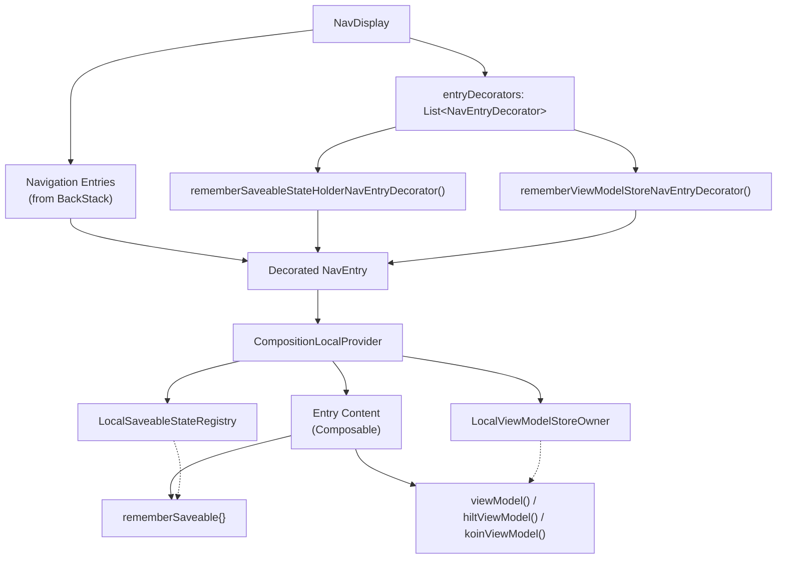
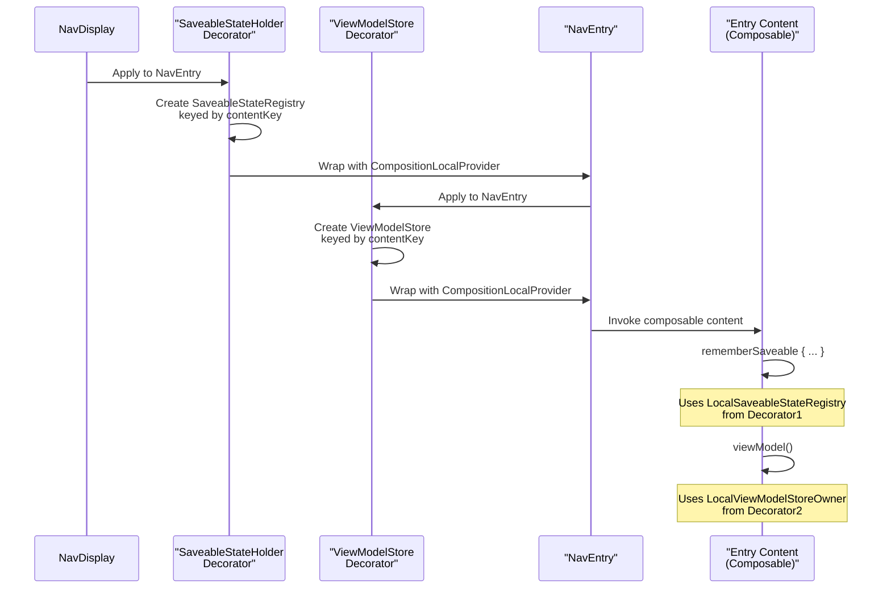
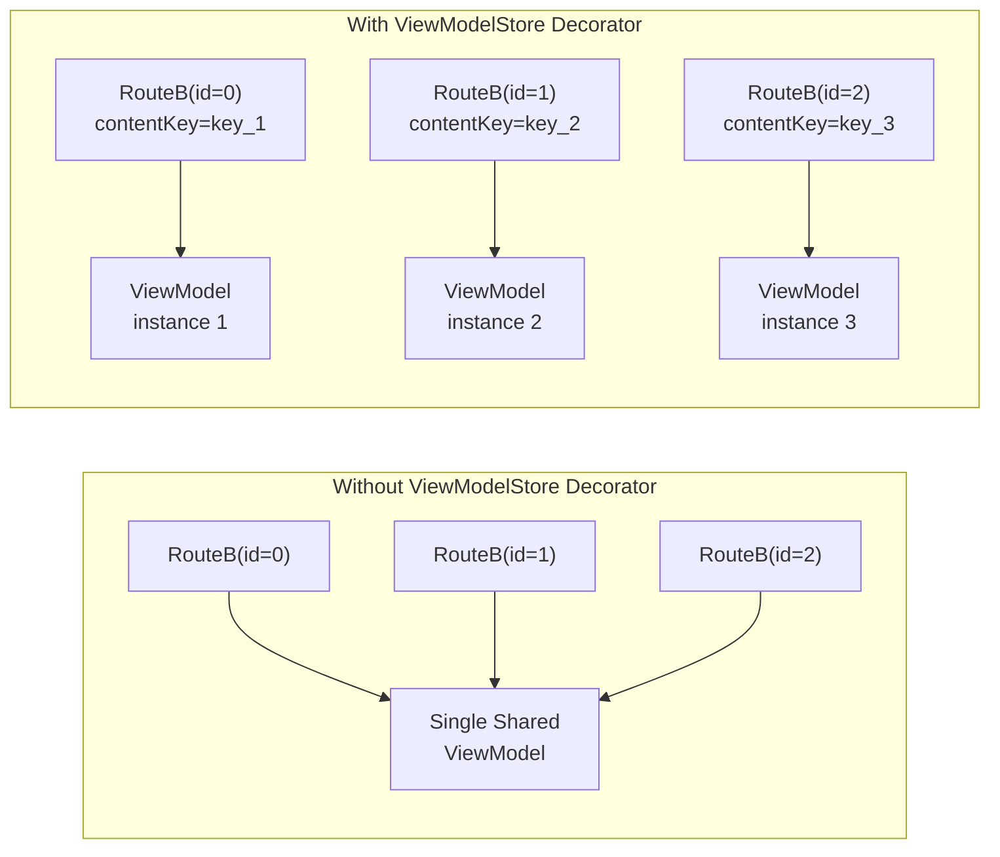
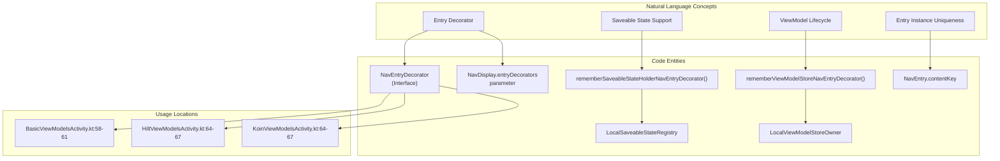

<!-- source: DeepWiki mcp.deepwiki.com · repo android/nav3-recipes · page 12.4 Entry Decorators · fetched 2026-10-23 -->

# Entry Decorators

<details>
<summary>Relevant source files</summary>

The following files were used as context for generating this wiki page:

- [app/src/main/java/com/example/nav3recipes/material/listdetail/MaterialListDetailActivity.kt](app/src/main/java/com/example/nav3recipes/material/listdetail/MaterialListDetailActivity.kt)
- [app/src/main/java/com/example/nav3recipes/material/supportingpane/MaterialSupportingPaneActivity.kt](app/src/main/java/com/example/nav3recipes/material/supportingpane/MaterialSupportingPaneActivity.kt)
- [app/src/main/java/com/example/nav3recipes/modular/hilt/CommonModule.kt](app/src/main/java/com/example/nav3recipes/modular/hilt/CommonModule.kt)
- [app/src/main/java/com/example/nav3recipes/passingarguments/viewmodels/basic/BasicViewModelsActivity.kt](app/src/main/java/com/example/nav3recipes/passingarguments/viewmodels/basic/BasicViewModelsActivity.kt)
- [app/src/main/java/com/example/nav3recipes/passingarguments/viewmodels/hilt/HiltViewModelsActivity.kt](app/src/main/java/com/example/nav3recipes/passingarguments/viewmodels/hilt/HiltViewModelsActivity.kt)
- [app/src/main/java/com/example/nav3recipes/passingarguments/viewmodels/koin/KoinViewModelsActivity.kt](app/src/main/java/com/example/nav3recipes/passingarguments/viewmodels/koin/KoinViewModelsActivity.kt)

</details>


Entry decorators enhance navigation entries with additional lifecycle-scoped capabilities such as ViewModel management and saveable state persistence. They are applied to entries before rendering, providing infrastructure that composable content can utilize.

For information about creating entry content and mapping NavKeys to Composables, see [NavDisplay and Entry Providers](#12.3). For information about ViewModel integration patterns, see [ViewModel Integration](#9).

---

## Purpose and Role

Entry decorators intercept navigation entries during rendering and augment them with additional composition-local values or capabilities. The two primary decorators used in Navigation 3 are:

- **SaveableStateHolderNavEntryDecorator**: Enables `rememberSaveable` to work within entry content, allowing state to survive configuration changes and process death
- **ViewModelStoreNavEntryDecorator**: Provides a unique `ViewModelStore` for each navigation entry, enabling ViewModels to be scoped per entry instance

Without these decorators, navigation entries would lack the infrastructure required for proper state management and ViewModel lifecycle handling.

**Sources:** [app/src/main/java/com/example/nav3recipes/passingarguments/viewmodels/basic/BasicViewModelsActivity.kt:54-61]()

---

## Architecture Overview

The following diagram illustrates how entry decorators fit into the Navigation 3 rendering pipeline:



**Sources:** [app/src/main/java/com/example/nav3recipes/passingarguments/viewmodels/basic/BasicViewModelsActivity.kt:51-61]()

---

## Core Entry Decorator Types

### SaveableStateHolderNavEntryDecorator

The `rememberSaveableStateHolderNavEntryDecorator()` provides a unique saveable state registry for each navigation entry. This enables the `rememberSaveable` composable to store and restore state that survives configuration changes and process death.

**Key Characteristics:**
- Provides `LocalSaveableStateRegistry` to entry content
- State is keyed by `NavEntry.contentKey`, ensuring uniqueness per entry instance
- State is automatically restored when an entry returns to the back stack
- Required for `rememberSaveable`, `TextField` state, and other saveable state mechanisms

### ViewModelStoreNavEntryDecorator

The `rememberViewModelStoreNavEntryDecorator()` provides a unique `ViewModelStore` for each navigation entry. This allows ViewModels to be scoped to individual navigation destinations, with automatic lifecycle management tied to entry removal from the back stack.

**Key Characteristics:**
- Provides `LocalViewModelStoreOwner` to entry content
- Each entry instance receives a distinct `ViewModelStore` based on `NavEntry.contentKey`
- ViewModels are automatically cleared when the entry is removed from the back stack
- Eliminates the need to manually specify a `key` parameter when calling `viewModel()`

**Sources:** [app/src/main/java/com/example/nav3recipes/passingarguments/viewmodels/basic/BasicViewModelsActivity.kt:77-84]()

---

## Usage Pattern: Explicit Decorator Configuration

When using ViewModels or requiring saveable state, you must explicitly provide both decorators to `NavDisplay`:

```kotlin
NavDisplay(
    backStack = backStack,
    onBack = { backStack.removeLastOrNull() },
    entryDecorators = listOf(
        rememberSaveableStateHolderNavEntryDecorator(),
        rememberViewModelStoreNavEntryDecorator()
    ),
    entryProvider = entryProvider {
        entry<RouteB> { key ->
            val viewModel = viewModel(factory = RouteBViewModel.Factory(key))
            ScreenB(viewModel = viewModel)
        }
    }
)
```

The following table summarizes the decorator configuration across different recipes:

| Recipe | SaveableStateHolder | ViewModelStore | Usage Context |
|--------|---------------------|----------------|---------------|
| BasicViewModelsActivity | ✓ | ✓ | Manual ViewModelProvider.Factory |
| HiltViewModelsActivity | ✓ | ✓ | Hilt @AssistedInject |
| KoinViewModelsActivity | ✓ | ✓ | Koin parametersOf |
| MaterialListDetailActivity | Default | Default | No explicit ViewModels |
| MaterialSupportingPaneActivity | Default | Default | No explicit ViewModels |

**Sources:** 
- [app/src/main/java/com/example/nav3recipes/passingarguments/viewmodels/basic/BasicViewModelsActivity.kt:51-61]()
- [app/src/main/java/com/example/nav3recipes/passingarguments/viewmodels/hilt/HiltViewModelsActivity.kt:56-67]()
- [app/src/main/java/com/example/nav3recipes/passingarguments/viewmodels/koin/KoinViewModelsActivity.kt:56-67]()

---

## Decorator Application Flow

This diagram shows how decorators are applied to each entry during composition:



**Sources:** [app/src/main/java/com/example/nav3recipes/passingarguments/viewmodels/basic/BasicViewModelsActivity.kt:58-61]()

---

## ViewModel Scoping with Decorators

The `ViewModelStoreNavEntryDecorator` ensures that each navigation entry instance receives a unique ViewModel instance. This is critical when the same route type appears multiple times in the back stack with different parameters.

### Example Scenario: Multiple Instances of Same Route

Consider a back stack containing multiple `RouteB` instances with different IDs:

```
Back Stack:
  RouteA
  RouteB(id = "0")
  RouteB(id = "1")
  RouteB(id = "2")  <-- Current
```

Without `ViewModelStoreNavEntryDecorator`, all three `RouteB` entries would share the same ViewModel, causing state conflicts. With the decorator, each entry receives a distinct ViewModel instance keyed by `NavEntry.contentKey`.



This is why the comments in the recipes emphasize: "Make sure you use rememberViewModelStoreNavEntryDecorator() if you want a new ViewModel for each new navigation key instance."

**Sources:** [app/src/main/java/com/example/nav3recipes/passingarguments/viewmodels/basic/BasicViewModelsActivity.kt:77-84]()

---

## Integration with Dependency Injection

Entry decorators work seamlessly with all dependency injection approaches. The decorator provides the `ViewModelStore`, while the DI framework handles dependency resolution:

### Basic (Manual Factory)

```kotlin
entry<RouteB> { key ->
    val viewModel = viewModel(factory = RouteBViewModel.Factory(key))
    ScreenB(viewModel = viewModel)
}
```

### Hilt (@AssistedInject)

```kotlin
entry<RouteB> { key ->
    val viewModel = hiltViewModel<RouteBViewModel, RouteBViewModel.Factory>(
        creationCallback = { factory -> factory.create(key) }
    )
    ScreenB(viewModel = viewModel)
}
```

### Koin (parametersOf)

```kotlin
entry<RouteB> { key ->
    val viewModel = koinViewModel<RouteBViewModel> {
        parametersOf(key)
    }
    ScreenB(viewModel = viewModel)
}
```

In all three cases, `ViewModelStoreNavEntryDecorator` ensures each entry receives a unique ViewModel instance, while the DI framework handles constructor injection.

**Sources:** 
- [app/src/main/java/com/example/nav3recipes/passingarguments/viewmodels/basic/BasicViewModelsActivity.kt:76-86]()
- [app/src/main/java/com/example/nav3recipes/passingarguments/viewmodels/hilt/HiltViewModelsActivity.kt:82-96]()
- [app/src/main/java/com/example/nav3recipes/passingarguments/viewmodels/koin/KoinViewModelsActivity.kt:82-87]()

---

## Default Behavior

When `entryDecorators` is not explicitly specified in `NavDisplay`, the system applies default decorators automatically. However, the documentation and recipe patterns consistently show explicit configuration when ViewModels are used, suggesting this is the recommended practice for clarity and control.

Recipes that don't use ViewModels (such as Material adaptive layout examples) typically omit explicit decorator configuration, relying on defaults:

**Sources:** 
- [app/src/main/java/com/example/nav3recipes/material/listdetail/MaterialListDetailActivity.kt:73-76]()
- [app/src/main/java/com/example/nav3recipes/material/supportingpane/MaterialSupportingPaneActivity.kt:79-82]()

---

## Common Patterns

### Pattern 1: Always Include Both Decorators

When using ViewModels, always provide both `rememberSaveableStateHolderNavEntryDecorator()` and `rememberViewModelStoreNavEntryDecorator()`:

```kotlin
entryDecorators = listOf(
    rememberSaveableStateHolderNavEntryDecorator(),
    rememberViewModelStoreNavEntryDecorator()
)
```

This ensures entry content has access to both state persistence and ViewModel lifecycle management.

### Pattern 2: No Manual Key Parameter Required

With `ViewModelStoreNavEntryDecorator`, you don't need to manually specify a `key` parameter when calling `viewModel()`, `hiltViewModel()`, or `koinViewModel()`. The decorator automatically uses `NavEntry.contentKey` for unique identification.

**Sources:** 
- [app/src/main/java/com/example/nav3recipes/passingarguments/viewmodels/basic/BasicViewModelsActivity.kt:54-61]()
- [app/src/main/java/com/example/nav3recipes/passingarguments/viewmodels/hilt/HiltViewModelsActivity.kt:84-91]()

---

## Code Entity Mapping

The following diagram maps natural language concepts to concrete code entities:



**Sources:** 
- [app/src/main/java/com/example/nav3recipes/passingarguments/viewmodels/basic/BasicViewModelsActivity.kt:58-61]()
- [app/src/main/java/com/example/nav3recipes/passingarguments/viewmodels/hilt/HiltViewModelsActivity.kt:64-67]()
- [app/src/main/java/com/example/nav3recipes/passingarguments/viewmodels/koin/KoinViewModelsActivity.kt:64-67]()

---

