<!-- source: DeepWiki mcp.deepwiki.com · repo android/nav3-recipes · page 13 Utilities and Helper Components · fetched 2026-10-23 -->

# Utilities and Helper Components

<details>
<summary>Relevant source files</summary>

The following files were used as context for generating this wiki page:

- [app/src/main/java/com/example/nav3recipes/basicsaveable/BasicSaveableActivity.kt](app/src/main/java/com/example/nav3recipes/basicsaveable/BasicSaveableActivity.kt)
- [app/src/main/java/com/example/nav3recipes/content/Content.kt](app/src/main/java/com/example/nav3recipes/content/Content.kt)
- [app/src/main/java/com/example/nav3recipes/ui/EdgeToEdgeCompat.kt](app/src/main/java/com/example/nav3recipes/ui/EdgeToEdgeCompat.kt)

</details>


This page documents the reusable utility functions and helper composables provided in the nav3-recipes repository. These components handle common concerns like edge-to-edge display configuration and demonstration UI, allowing recipes to focus on Navigation 3 patterns without duplicating boilerplate code.

**Covered in this page:**
- Edge-to-edge display configuration: `setEdgeToEdgeConfig()` extension function
- Reusable content composables: `ContentBase` and color variants for demonstration screens
- Helper components: `Title`, `Count`, and layout utilities

**For navigation-specific components, see:**
- Core Navigation 3 primitives: [Core Navigation 3 Concepts](#2.2)
- Navigation component reference: [Core Navigation Components Reference](#12)
</thinking>

## Utilities Architecture

The repository provides two categories of utilities:

1. **Display Configuration Utilities** - Functions for configuring Android system UI behavior
2. **Content Composables** - Pre-styled UI components for demonstration purposes

These utilities are designed to be independent, optional, and focused on reducing boilerplate in recipe examples.

---

## Edge-to-Edge Display Configuration

The repository provides the `setEdgeToEdgeConfig()` extension function to configure edge-to-edge display for modern Android UI. This utility is called by recipe activities in their `onCreate()` method before `setContent()`.

### Implementation: setEdgeToEdgeConfig()

The function is defined in [app/src/main/java/com/example/nav3recipes/ui/EdgeToEdgeCompat.kt:7-14]():

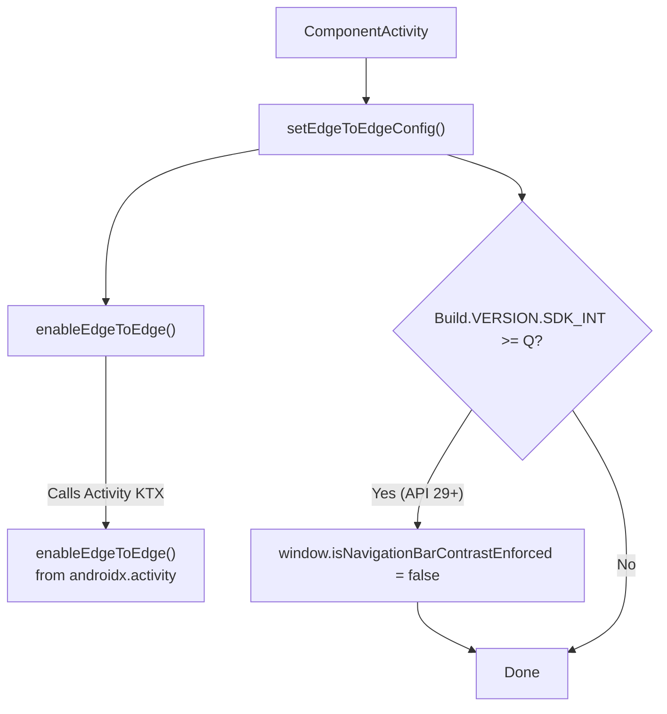

The function performs two operations:

| Operation | API Level | Purpose |
|-----------|-----------|---------|
| `enableEdgeToEdge()` | All | Configures transparent system bars and allows content to draw behind them |
| `window.isNavigationBarContrastEnforced = false` | 29+ (Q) | Forces 3-button navigation bar transparency |

**Sources:** [app/src/main/java/com/example/nav3recipes/ui/EdgeToEdgeCompat.kt:1-15]()

### Usage Pattern in Recipes

Recipe activities call this function before rendering content:

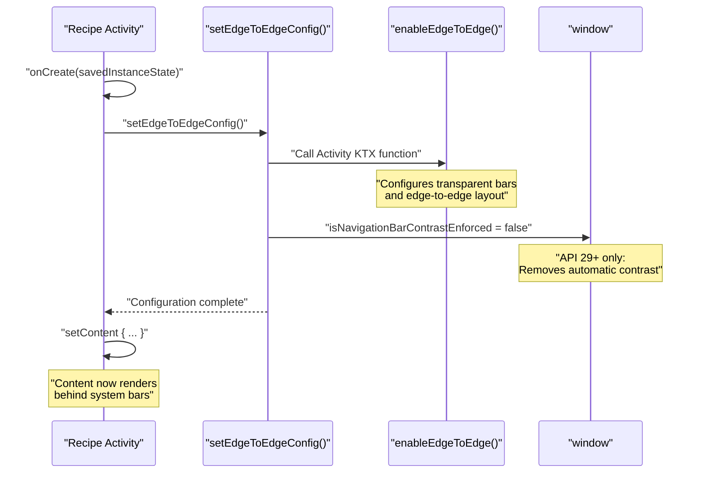

Example from [app/src/main/java/com/example/nav3recipes/basicsaveable/BasicSaveableActivity.kt:41-44]():

```
override fun onCreate(savedInstanceState: Bundle?) {
    setEdgeToEdgeConfig()
    super.onCreate(savedInstanceState)
    setContent { ... }
}
```

### Content Inset Handling

When edge-to-edge is enabled, composables must apply padding to avoid system bar overlap. The content composables in this repository use `Modifier.safeDrawingPadding()` from [app/src/main/java/com/example/nav3recipes/content/Content.kt:104]():

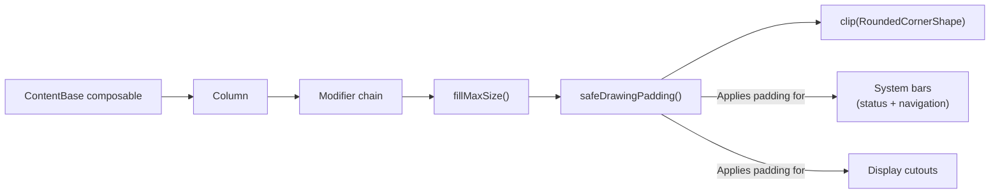

The `safeDrawingPadding()` modifier automatically applies padding for:
- Status bar (top)
- Navigation bar (bottom)
- Display cutouts (notches, camera holes)

**Sources:** [app/src/main/java/com/example/nav3recipes/ui/EdgeToEdgeCompat.kt:1-15](), [app/src/main/java/com/example/nav3recipes/basicsaveable/BasicSaveableActivity.kt:41-44](), [app/src/main/java/com/example/nav3recipes/content/Content.kt:100-118]()

---

## Reusable Content Components

The repository provides pre-styled composable components for demonstration purposes. These components allow recipes to focus on navigation logic without implementing custom UI for each destination.

### ContentBase Composable

The `ContentBase` composable is the foundation for all demonstration screens, defined in [app/src/main/java/com/example/nav3recipes/content/Content.kt:93-118]():

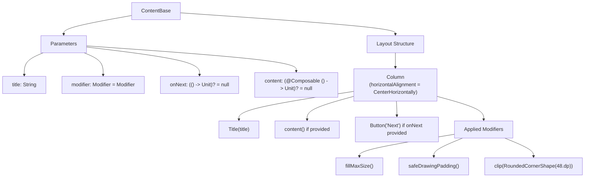

**ContentBase Parameters:**

| Parameter | Type | Default | Purpose |
|-----------|------|---------|---------|
| `title` | `String` | Required | Heading text displayed at top via `Title()` helper |
| `modifier` | `Modifier` | `Modifier` | Applied to root `Column`, typically contains background color |
| `onNext` | `(() -> Unit)?` | `null` | Navigation callback; if non-null, displays "Next" button |
| `content` | `(@Composable () -> Unit)?` | `null` | Optional content slot for custom body content |

**Sources:** [app/src/main/java/com/example/nav3recipes/content/Content.kt:93-118]()

### Color Variant Composables

The repository provides eight color-coded wrapper composables that call `ContentBase` with specific background colors from the theme. These are defined in [app/src/main/java/com/example/nav3recipes/content/Content.kt:152-253]():

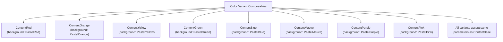

Each variant composable:
1. Accepts the same parameters as `ContentBase` (title, modifier, onNext, content)
2. Applies a background color from the theme's pastel color palette
3. Passes parameters through to `ContentBase`

| Composable | Background Color | Typical Usage |
|------------|------------------|---------------|
| `ContentRed` | `PastelRed` | First destination or primary screen |
| `ContentOrange` | `PastelOrange` | Second destination |
| `ContentYellow` | `PastelYellow` | Third destination |
| `ContentGreen` | `PastelGreen` | Fourth destination or success state |
| `ContentBlue` | `PastelBlue` | Fifth destination or detail screen |
| `ContentMauve` | `PastelMauve` | Sixth destination |
| `ContentPurple` | `PastelPurple` | Seventh destination |
| `ContentPink` | `PastelPink` | Eighth destination or special state |

**Sources:** [app/src/main/java/com/example/nav3recipes/content/Content.kt:152-253]()

### Pre-configured Content Composables

The repository also provides `ContentA` and `ContentB` with fixed titles and lorem ipsum text, defined in [app/src/main/java/com/example/nav3recipes/content/Content.kt:53-75]():

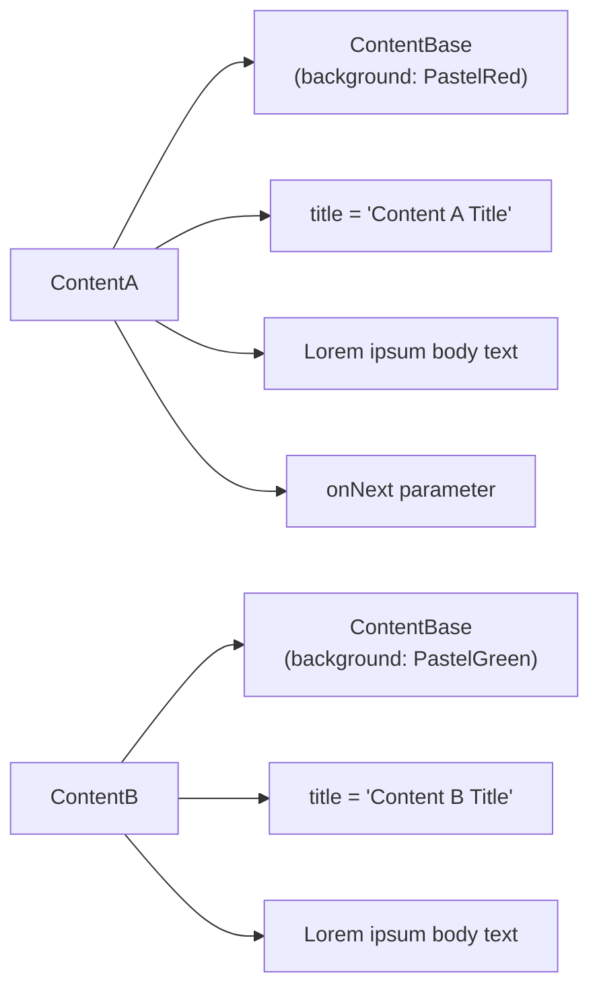

**ContentA** ([app/src/main/java/com/example/nav3recipes/content/Content.kt:53-63]()):
- Background: `PastelRed`
- Title: "Content A Title"
- Body: Lorem ipsum placeholder text
- Button: Optional, controlled by `onNext` parameter

**ContentB** ([app/src/main/java/com/example/nav3recipes/content/Content.kt:66-75]()):
- Background: `PastelGreen`
- Title: "Content B Title"
- Body: Lorem ipsum placeholder text
- Button: No button (no `onNext` parameter)

**Sources:** [app/src/main/java/com/example/nav3recipes/content/Content.kt:53-75]()

### Usage in Recipe Activities

Recipe activities use these content composables in their `entryProvider` to map `NavKey` instances to UI:

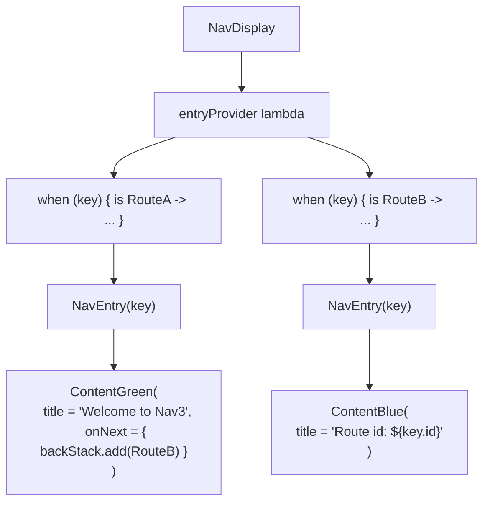

Example from [app/src/main/java/com/example/nav3recipes/basicsaveable/BasicSaveableActivity.kt:52-64]():

```
when (key) {
    is RouteA -> NavEntry(key) {
        ContentGreen("Welcome to Nav3") {
            Button(onClick = { backStack.add(RouteB("123")) }) {
                Text("Click to navigate")
            }
        }
    }
    is RouteB -> NavEntry(key) {
        ContentBlue("Route id: ${key.id} ")
    }
}
```

The distinct background colors make navigation transitions visually obvious, helping developers understand back stack behavior.

**Sources:** [app/src/main/java/com/example/nav3recipes/basicsaveable/BasicSaveableActivity.kt:44-72](), [app/src/main/java/com/example/nav3recipes/content/Content.kt:53-75]()

### Helper Composables

**Title**: Displays bold, centered heading text, defined in [app/src/main/java/com/example/nav3recipes/content/Content.kt:121-129]():

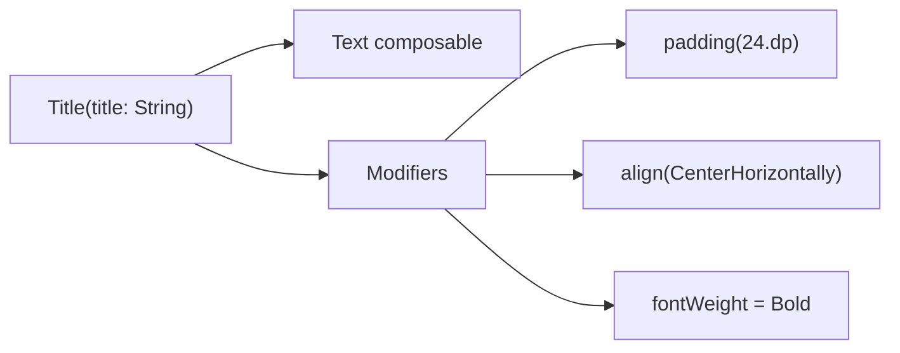

**Count**: Demonstrates state preservation with a counter, defined in [app/src/main/java/com/example/nav3recipes/content/Content.kt:140-148]():

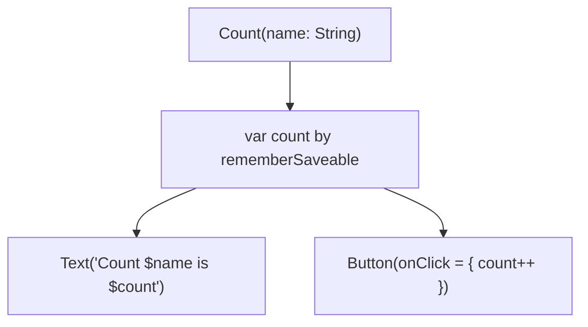

The `Count` composable uses `rememberSaveable` to preserve the count value across configuration changes and process death, demonstrating state survival in navigation scenarios.

**SampleContent**: Generic content creator defined in [app/src/main/java/com/example/nav3recipes/content/Content.kt:78-89](), accepts title, background color, and optional navigation callback.

**Sources:** [app/src/main/java/com/example/nav3recipes/content/Content.kt:78-148]()

---

## Recipe Picker Infrastructure

The `RecipePickerActivity` serves as the entry point to the application. It displays a scrollable, categorized list of all recipes and launches the selected recipe's activity.

### Recipe Picker Architecture

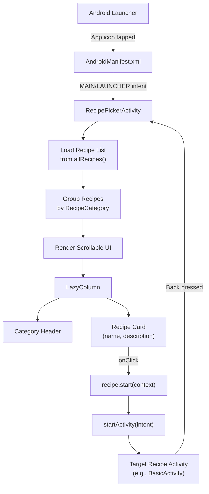

### Recipe List Structure

The recipe list is defined as a function that returns `List<Recipe>`:

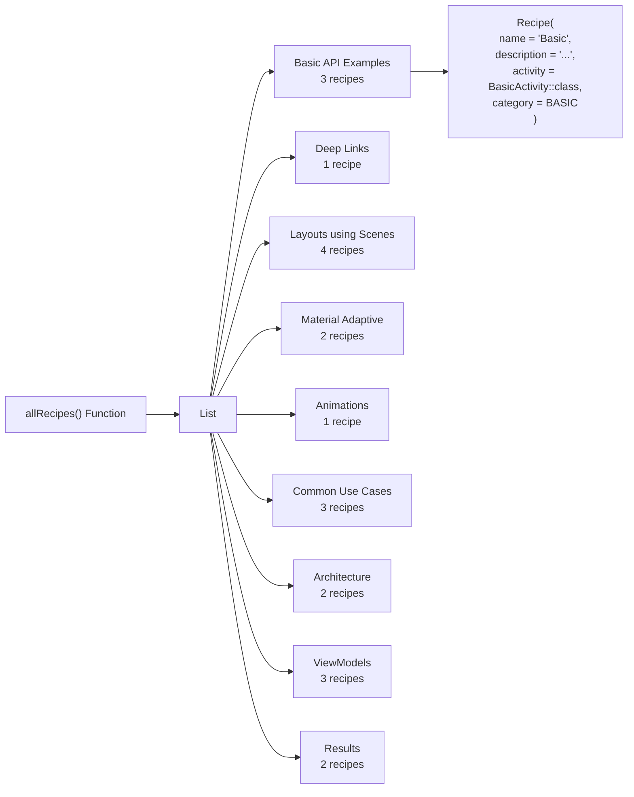

Each `Recipe` instance is constructed with:
- **name:** Short, descriptive title
- **description:** Brief explanation of demonstrated concept
- **activity:** KClass reference to the Activity to launch
- **category:** One of the `RecipeCategory` enum values for grouping

**Sources:** README.md:13-54, README.md:64

---

## Common Utilities Summary

The following table summarizes all common utilities available across recipes:

| Utility | Location | Purpose | Used By |
|---------|----------|---------|---------|
| `enableEdgeToEdge()` | Activity extension | Configure transparent system bars and edge-to-edge display | All recipe activities |
| `ContentBase()` | Composable | Base component for demonstration screens | All recipe UIs |
| `ContentA()` through `ContentE()` | Composables | Pre-configured colored content variants | Most recipe UIs |
| `Recipe` data class | Data model | Define recipe metadata and launch capability | `RecipePickerActivity` |
| `RecipeCategory` enum | Data model | Group recipes by functionality | `RecipePickerActivity` |
| `allRecipes()` | Function | Provide complete list of recipes | `RecipePickerActivity` |

### Design Principles

The common utilities follow these principles:

1. **Minimal dependencies:** Utilities depend only on Android/Compose APIs, not on each other
2. **Opt-in usage:** Recipes can choose not to use utilities if they demonstrate alternative approaches
3. **Focus enablement:** By handling boilerplate, utilities let recipes focus on demonstrating one concept
4. **Consistency:** Provide uniform look and feel across all recipes for easier learning
5. **Isolation:** Each recipe remains self-contained and can be copied as a starting point

**Sources:** README.md:64, README.md:1-8

---

