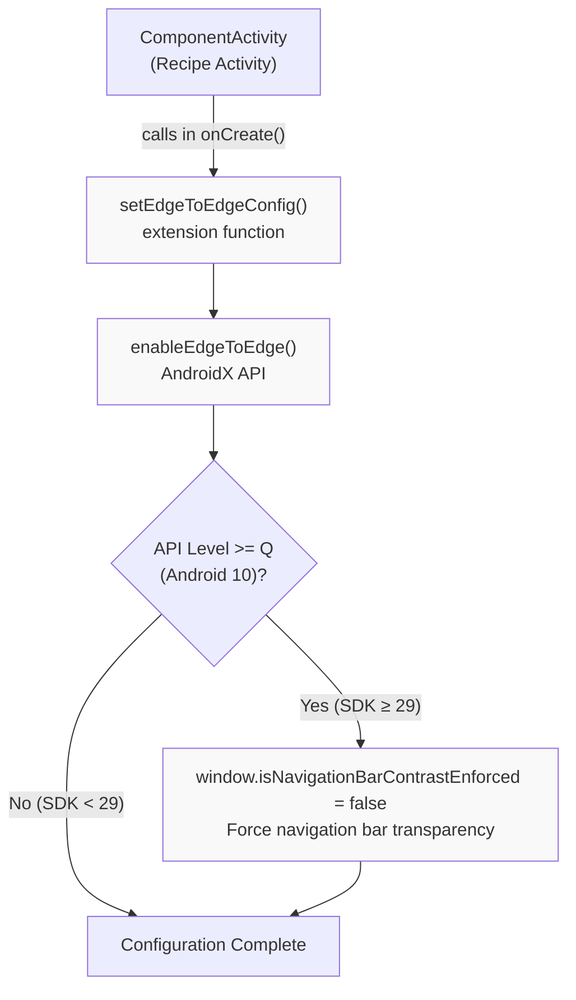
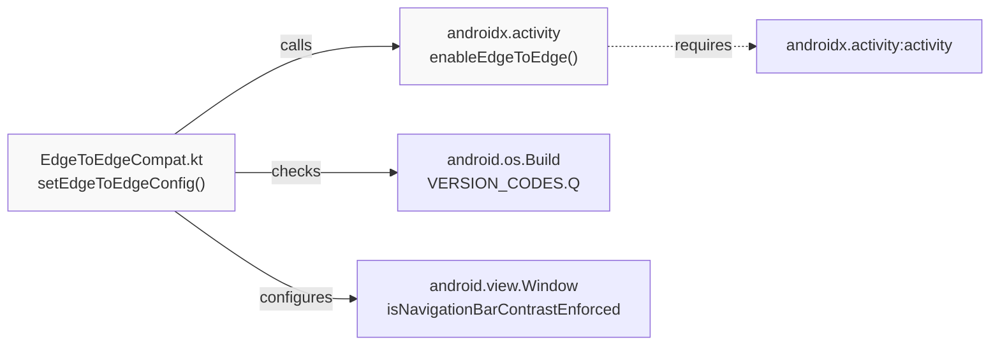
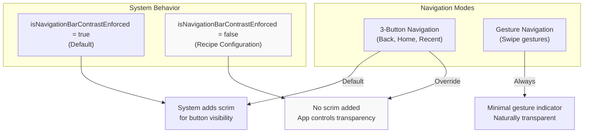

<!-- source: DeepWiki mcp.deepwiki.com · repo android/nav3-recipes · page 13.1 Edge-to-Edge Display Configuration · fetched 2026-10-23 -->

# Edge-to-Edge Display Configuration

<details>
<summary>Relevant source files</summary>

The following files were used as context for generating this wiki page:

- [app/src/main/java/com/example/nav3recipes/ui/EdgeToEdgeCompat.kt](app/src/main/java/com/example/nav3recipes/ui/EdgeToEdgeCompat.kt)

</details>


## Purpose and Scope

This document describes the `setEdgeToEdgeConfig()` utility function that configures Activities for edge-to-edge display in the nav3-recipes application. Edge-to-edge display allows application content to extend behind system bars (status bar and navigation bar), creating modern, immersive UI experiences. This utility is used consistently across all recipe examples to provide uniform visual presentation.

For information about other reusable UI components used in recipes, see [Reusable Content Components](#13.2).

---

## Overview

The nav3-recipes repository implements edge-to-edge display using a centralized configuration function located in [app/src/main/java/com/example/nav3recipes/ui/EdgeToEdgeCompat.kt:1-14](). This approach ensures consistent edge-to-edge behavior across all recipe Activities without code duplication.

**Key Functions:**
- `setEdgeToEdgeConfig()` - Extension function on `ComponentActivity` that enables edge-to-edge display and configures navigation bar transparency

---

## Implementation Architecture

### Edge-to-Edge Configuration Flow



**Diagram: Edge-to-Edge Configuration Sequence**

**Sources:** [app/src/main/java/com/example/nav3recipes/ui/EdgeToEdgeCompat.kt:7-14]()

---

## Function Implementation Details

### setEdgeToEdgeConfig() Extension Function

The `setEdgeToEdgeConfig()` function is implemented as an extension on `ComponentActivity` at [app/src/main/java/com/example/nav3recipes/ui/EdgeToEdgeCompat.kt:7-14]().

**Implementation Structure:**

| Step | Action | API Used | Purpose |
|------|--------|----------|---------|
| 1 | Enable edge-to-edge | `enableEdgeToEdge()` | Configures system bars for edge-to-edge layout |
| 2 | Check API level | `Build.VERSION.SDK_INT >= Build.VERSION_CODES.Q` | Determines if navigation bar transparency override is available |
| 3 | Set transparency | `window.isNavigationBarContrastEnforced = false` | Forces 3-button navigation bar transparency |

**Sources:** [app/src/main/java/com/example/nav3recipes/ui/EdgeToEdgeCompat.kt:1-14]()

---

## Component Dependencies



**Diagram: Component Dependencies**

**Sources:** [app/src/main/java/com/example/nav3recipes/ui/EdgeToEdgeCompat.kt:3-6]()

---

## API Version Considerations

The function implements different behavior based on Android API levels:

### enableEdgeToEdge()

Available on all Android versions supported by AndroidX Activity library. This function:
- Makes system bar backgrounds transparent
- Adjusts system bar icon colors for visibility
- Enables content to draw behind system bars

Implementation: [app/src/main/java/com/example/nav3recipes/ui/EdgeToEdgeCompat.kt:8]()

### Navigation Bar Contrast Enforcement

The `isNavigationBarContrastEnforced` property is only available on **Android 10 (API 29, Q) and above**. This property controls whether the system automatically adds a scrim behind the navigation bar to ensure button visibility.

**Version-Specific Behavior:**

| API Level | Version | Behavior |
|-----------|---------|----------|
| < 29 | Android 9 and below | Only `enableEdgeToEdge()` is called |
| ≥ 29 | Android 10 and above | `enableEdgeToEdge()` + `isNavigationBarContrastEnforced = false` |

Implementation: [app/src/main/java/com/example/nav3recipes/ui/EdgeToEdgeCompat.kt:9-13]()

**Sources:** [app/src/main/java/com/example/nav3recipes/ui/EdgeToEdgeCompat.kt:1-14]()

---

## Navigation Bar Transparency Configuration

### Why Disable Contrast Enforcement?

By default, on Android 10+, the system may add a dark scrim behind the navigation bar when using 3-button navigation to ensure button visibility. Setting `isNavigationBarContrastEnforced = false` disables this automatic behavior, giving the application full control over navigation bar appearance.

This is particularly important for Compose applications where content insets are handled declaratively through `WindowInsets` and system bar padding modifiers.

**Reference:** The implementation follows Android's official edge-to-edge guidance: https://developer.android.com/develop/ui/views/layout/edge-to-edge#create-transparent (as noted in [app/src/main/java/com/example/nav3recipes/ui/EdgeToEdgeCompat.kt:11]())

### Navigation Bar Modes

The navigation bar transparency override affects different navigation modes:



**Diagram: Navigation Bar Transparency Behavior**

**Sources:** [app/src/main/java/com/example/nav3recipes/ui/EdgeToEdgeCompat.kt:9-13]()

---

## Usage Pattern

Recipe Activities call `setEdgeToEdgeConfig()` in their `onCreate()` method before calling `setContent()`. This ensures edge-to-edge configuration is applied before the Compose UI tree is created.

**Typical Usage Pattern:**

```
class ExampleActivity : ComponentActivity() {
    override fun onCreate(savedInstanceState: Bundle?) {
        super.onCreate(savedInstanceState)
        setEdgeToEdgeConfig()  // Enable edge-to-edge
        setContent {
            // Compose UI with WindowInsets handling
        }
    }
}
```

The function is used across all recipe examples to maintain consistent visual presentation throughout the application.

**Sources:** [app/src/main/java/com/example/nav3recipes/ui/EdgeToEdgeCompat.kt:7-14]()

---

## Technical Implementation Details

### Package Structure

| Element | Value |
|---------|-------|
| Package | `com.example.nav3recipes.ui` |
| File | `EdgeToEdgeCompat.kt` |
| Function | `setEdgeToEdgeConfig()` |
| Receiver Type | `ComponentActivity` |
| Visibility | `public` (default) |

**Sources:** [app/src/main/java/com/example/nav3recipes/ui/EdgeToEdgeCompat.kt:1-7]()

---

## Integration with Compose

While `setEdgeToEdgeConfig()` configures the Activity window, Compose UI components must handle system bar insets appropriately. This is typically done using:

- `WindowInsets.Companion.systemBars` - Access system bar insets
- `Scaffold(contentWindowInsets = ...)` - Configure content padding
- `Modifier.systemBarsPadding()` - Apply system bar padding to content
- `Modifier.statusBarsPadding()` / `Modifier.navigationBarsPadding()` - Apply specific bar padding

The edge-to-edge configuration enables these Compose APIs to function correctly by allowing content to draw behind system bars.

**Sources:** [app/src/main/java/com/example/nav3recipes/ui/EdgeToEdgeCompat.kt:1-14]()

---

