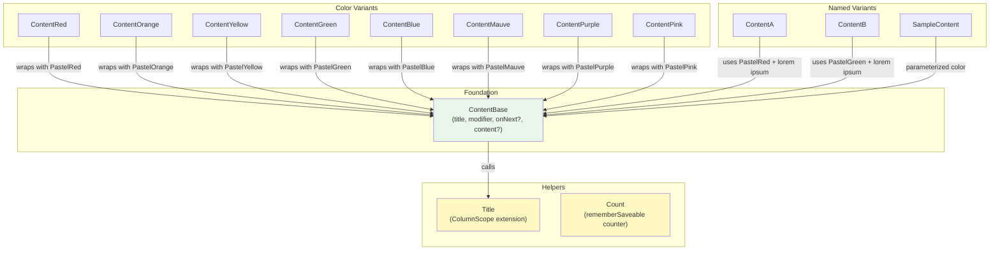
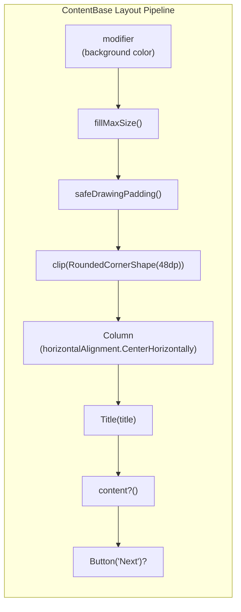
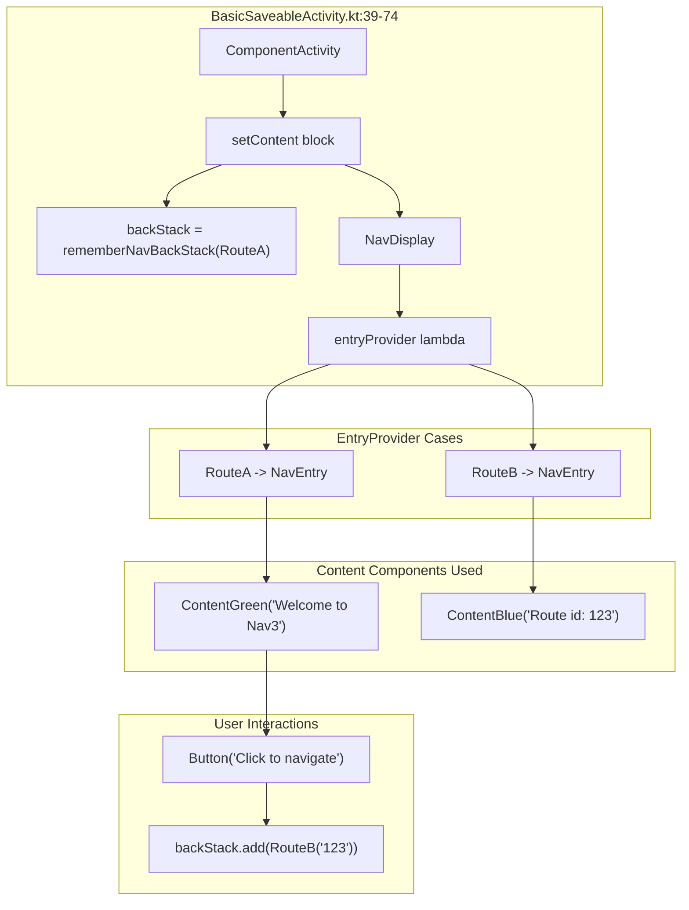

<!-- source: DeepWiki mcp.deepwiki.com · repo android/nav3-recipes · page 13.2 Reusable Content Components · fetched 2026-10-23 -->

# Reusable Content Components

<details>
<summary>Relevant source files</summary>

The following files were used as context for generating this wiki page:

- [app/src/main/java/com/example/nav3recipes/basicsaveable/BasicSaveableActivity.kt](app/src/main/java/com/example/nav3recipes/basicsaveable/BasicSaveableActivity.kt)
- [app/src/main/java/com/example/nav3recipes/content/Content.kt](app/src/main/java/com/example/nav3recipes/content/Content.kt)

</details>


## Purpose and Scope

This page documents the reusable UI components defined in [app/src/main/java/com/example/nav3recipes/content/Content.kt]() that provide consistent visual styling across recipe examples. These components wrap common layout patterns (titles, backgrounds, navigation buttons) to reduce boilerplate in individual recipe implementations. 

For edge-to-edge display configuration that these components rely on, see [13.1](#13.1). For how these components are used within navigation flows, see [3.1](#3.1) and [3.3](#3.3).

---

## Component Architecture

The content components follow a hierarchical design where `ContentBase` serves as the foundation, with specialized variants providing semantic meaning through color and behavior.



**Sources**: [app/src/main/java/com/example/nav3recipes/content/Content.kt:92-253]()

---

## ContentBase: The Foundation Component

`ContentBase` is the core component that implements the standard recipe screen layout pattern. It is defined at [app/src/main/java/com/example/nav3recipes/content/Content.kt:92-118]().

### Component Signature

```kotlin
@Composable
fun ContentBase(
    title: String,
    modifier: Modifier = Modifier,
    onNext: (() -> Unit)? = null,
    content: (@Composable () -> Unit)? = null,
)
```

### Layout Structure

| Element | Implementation | Purpose |
|---------|---------------|---------|
| **Container** | `Column` with `fillMaxSize()` | Full-screen vertical layout |
| **Safe Area** | `safeDrawingPadding()` | Respects system UI insets |
| **Shape** | `clip(RoundedCornerShape(48.dp))` | Rounded corner aesthetic |
| **Title** | `Title()` composable | Centered, bold header text |
| **Custom Content** | Optional `content` lambda | Recipe-specific UI |
| **Navigation Button** | Optional `Button` with `onNext` | Trigger next destination |

### Visual Styling Flow



**Sources**: [app/src/main/java/com/example/nav3recipes/content/Content.kt:100-117]()

---

## Color Variant Components

Eight color-specific variants wrap `ContentBase` with predefined pastel backgrounds. Each follows the same pattern: delegate to `ContentBase` with a modified `Modifier` that includes the appropriate background color.

### Color Variant Catalog

| Component | Background Color | Theme Constant | Line Reference |
|-----------|-----------------|----------------|----------------|
| `ContentRed` | Pastel Red | `PastelRed` | [152-162]() |
| `ContentOrange` | Pastel Orange | `PastelOrange` | [165-175]() |
| `ContentYellow` | Pastel Yellow | `PastelYellow` | [178-188]() |
| `ContentGreen` | Pastel Green | `PastelGreen` | [191-201]() |
| `ContentBlue` | Pastel Blue | `PastelBlue` | [204-214]() |
| `ContentMauve` | Pastel Mauve | `PastelMauve` | [217-227]() |
| `ContentPurple` | Pastel Purple | `PastelPurple` | [230-240]() |
| `ContentPink` | Pastel Pink | `PastelPink` | [243-253]() |

### Shared Implementation Pattern

All color variants follow this structure:

```kotlin
@Composable
fun ContentGreen(
    title: String,
    modifier: Modifier = Modifier,
    onNext: (() -> Unit)? = null,
    content: (@Composable () -> Unit)? = null,
) = ContentBase(
    title = title,
    modifier = modifier.background(PastelGreen),
    onNext = onNext,
    content = content
)
```

The `modifier` parameter allows callers to compose additional styling while preserving the color background through `modifier.background(PastelColor)`.

**Sources**: [app/src/main/java/com/example/nav3recipes/content/Content.kt:151-253]()

---

## Named Content Components

Three named variants provide pre-configured content for common demonstration scenarios.

### ContentA and ContentB

`ContentA` [app/src/main/java/com/example/nav3recipes/content/Content.kt:52-63]() and `ContentB` [app/src/main/java/com/example/nav3recipes/content/Content.kt:66-75]() are paired components with fixed lorem ipsum text:

- **ContentA**: Red background, requires `onNext` callback, demonstrates navigation source
- **ContentB**: Green background, no navigation button, demonstrates navigation destination

Both include identical lorem ipsum placeholder text to simulate content-heavy screens.

### SampleContent

`SampleContent` [app/src/main/java/com/example/nav3recipes/content/Content.kt:77-89]() is a parameterized variant accepting `title`, `backgroundColor`, and optional `onNext`:

```kotlin
@Composable
fun SampleContent(title: String, backgroundColor: Color, onNext: (() -> Unit)? = null)
```

This component enables recipes to generate multiple unique screens without defining new composables.

**Sources**: [app/src/main/java/com/example/nav3recipes/content/Content.kt:52-89]()

---

## Helper Components

### Title Component

`Title` is a `ColumnScope` extension function [app/src/main/java/com/example/nav3recipes/content/Content.kt:120-129]() that renders centered, bold header text:

```kotlin
@Composable
fun ColumnScope.Title(title: String) {
    Text(
        modifier = Modifier
            .padding(24.dp)
            .align(Alignment.CenterHorizontally),
        fontWeight = FontWeight.Bold,
        text = title
    )
}
```

The extension scoping ensures it can only be called within `Column` contexts, maintaining layout contract.

### Count Component

`Count` [app/src/main/java/com/example/nav3recipes/content/Content.kt:140-148]() demonstrates state preservation with `rememberSaveable`:

```kotlin
@Composable
fun Count(name: String) {
    var count: Int by rememberSaveable { mutableIntStateOf(0) }
    Column {
        Text("Count $name is $count")
        Button(onClick = { count++ }) {
            Text("Increment")
        }
    }
}
```

This component is used in recipes demonstrating `SaveableStateHolderNavEntryDecorator` functionality (see [12.4](#12.4)), showing that UI state survives configuration changes and navigation operations.

**Sources**: [app/src/main/java/com/example/nav3recipes/content/Content.kt:120-148]()

---

## Usage in Navigation Recipes

### Basic Recipe Example

The following diagram maps a typical recipe usage to the code entities involved:



### Code Citation

[app/src/main/java/com/example/nav3recipes/basicsaveable/BasicSaveableActivity.kt:44-72]() demonstrates typical usage:

- **Line 53**: `ContentGreen("Welcome to Nav3")` renders the start destination
- **Line 63**: `ContentBlue("Route id: ${key.id}")` renders the second destination with argument interpolation
- Both components automatically apply safe drawing padding and rounded corners

### Common Patterns

| Pattern | Implementation | Example Usage |
|---------|----------------|---------------|
| **Static Screen** | `ContentBlue("Title")` without `onNext` or `content` | Terminal destinations |
| **Navigation Source** | `ContentGreen("Title") { Button(...) }` with `content` lambda | Screens with custom buttons |
| **Simplified Navigation** | `ContentRed("Title", onNext = { ... })` | Quick next-screen button |
| **Dynamic Content** | `ContentBase(title, onNext) { /* custom UI */ }` | Complex recipe-specific layout |

**Sources**: [app/src/main/java/com/example/nav3recipes/basicsaveable/BasicSaveableActivity.kt:44-72]()

---

## Styling and Visual Design

### Edge-to-Edge Integration

All content components rely on `safeDrawingPadding()` [app/src/main/java/com/example/nav3recipes/content/Content.kt:104]() to respect system UI insets. This requires the Activity to configure edge-to-edge display using `setEdgeToEdgeConfig()` extension (see [13.1](#13.1)):

```kotlin
override fun onCreate(savedInstanceState: Bundle?) {
    setEdgeToEdgeConfig()  // Must be called before super.onCreate()
    super.onCreate(savedInstanceState)
    setContent { /* ... */ }
}
```

[app/src/main/java/com/example/nav3recipes/basicsaveable/BasicSaveableActivity.kt:42]() demonstrates this pattern.

### Rounded Corner Aesthetic

The `RoundedCornerShape(48.dp)` applied via `clip()` creates a distinctive visual style where content appears as a rounded card that fills the screen. This is consistent across all recipes and helps visually separate different destinations during navigation transitions.

### Theme Color Imports

The pastel color palette is imported from [app/src/main/java/com/example/nav3recipes/ui/theme/]():

[app/src/main/java/com/example/nav3recipes/content/Content.kt:42-49]() imports:
- `PastelBlue`
- `PastelGreen`
- `PastelMauve`
- `PastelOrange`
- `PastelPink`
- `PastelPurple`
- `PastelRed`
- `PastelYellow`

These colors provide visual differentiation between navigation destinations while maintaining a cohesive, gentle aesthetic appropriate for educational material.

**Sources**: [app/src/main/java/com/example/nav3recipes/content/Content.kt:42-49, 100-105](), [app/src/main/java/com/example/nav3recipes/basicsaveable/BasicSaveableActivity.kt:42]()

---

