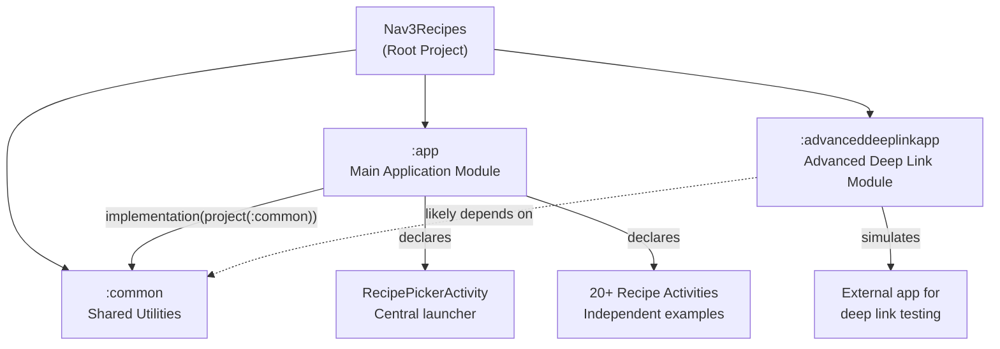
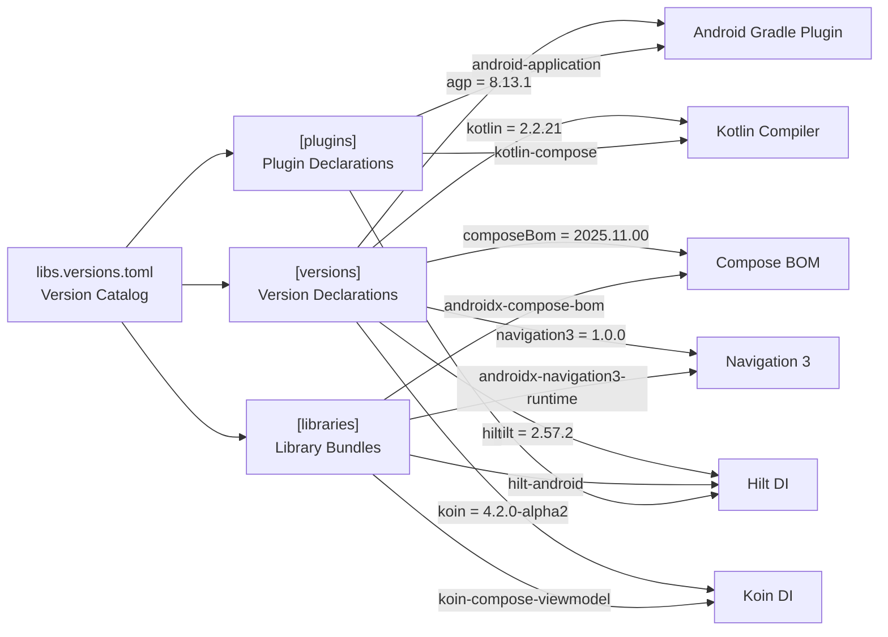
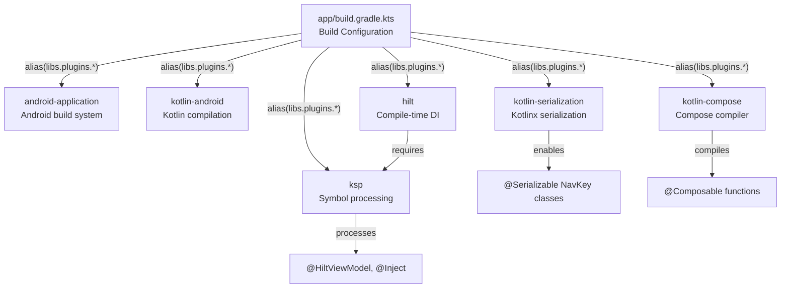
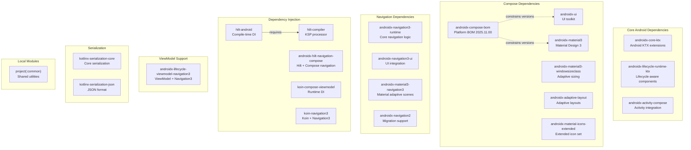
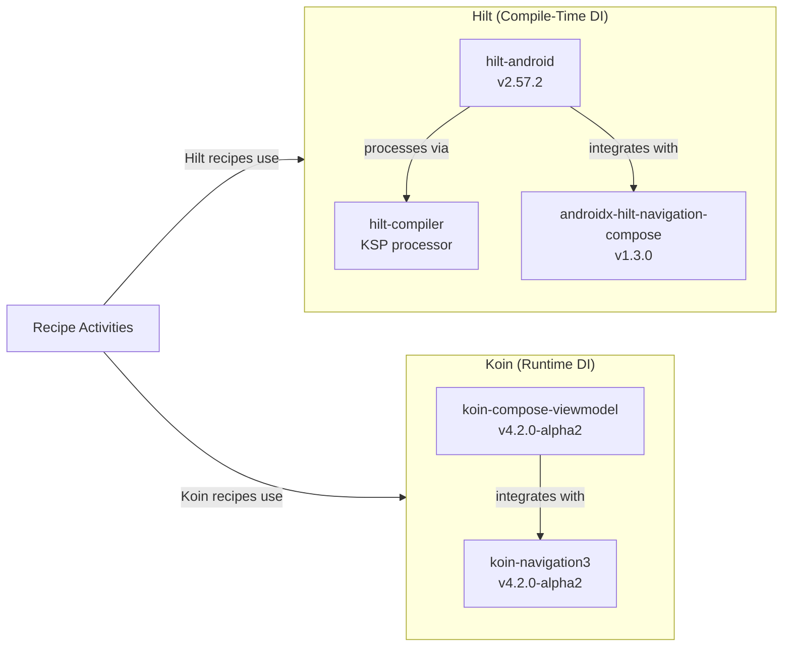
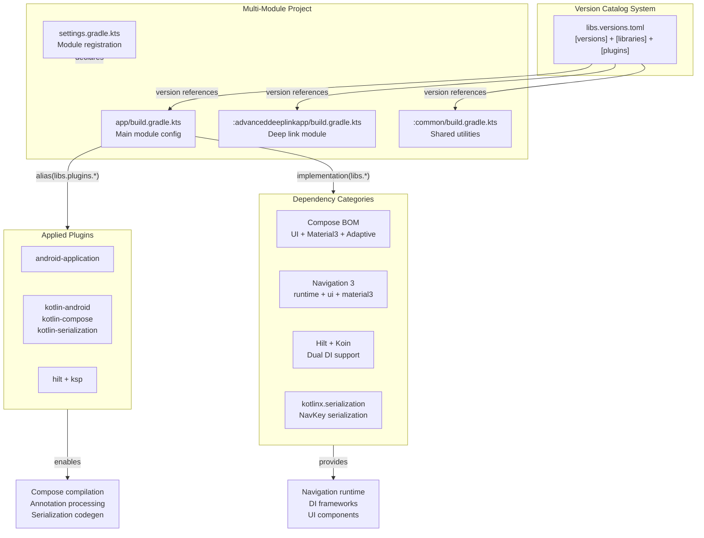

<!-- source: DeepWiki mcp.deepwiki.com · repo android/nav3-recipes · page 14 Build System and Project Structure · fetched 2026-10-23 -->

# Build System and Project Structure

<details>
<summary>Relevant source files</summary>

The following files were used as context for generating this wiki page:

- [app/build.gradle.kts](app/build.gradle.kts)
- [gradle/libs.versions.toml](gradle/libs.versions.toml)
- [settings.gradle.kts](settings.gradle.kts)

</details>


This document details the Gradle build configuration, version catalog system, multi-module architecture, and dependency management strategy used in the nav3-recipes repository. The build system is designed to support multiple dependency injection frameworks simultaneously while providing centralized version management and consistent build configuration across modules.

For information about the application manifest and activity declarations, see [Application Manifest and Module Structure](#14.2). For details on specific dependency usage patterns (Hilt, Koin, ViewModels), see the respective recipe documentation in sections [9](#9) and [10](#10).

## Project Module Structure

The repository uses Gradle's multi-module architecture with three distinct modules declared in [settings.gradle.kts:48-51]():



**Sources**: [settings.gradle.kts:48-51](), [app/build.gradle.kts:83]()

### Module Responsibilities

| Module | Purpose | Key Characteristics |
|--------|---------|---------------------|
| `:app` | Main application containing all recipe activities | Contains RecipePickerActivity, all recipe implementations, AndroidManifest.xml with activity declarations |
| `:advanceddeeplinkapp` | Simulated external application for deep link testing | Enables testing cross-app deep linking scenarios in advanced deep link recipe |
| `:common` | Shared utility code and base components | Reusable UI components, extension functions, helper classes used across recipes |

The `:app` module serves as the primary module, implementing all recipes as independent activities within a single application package. The modular separation allows the `:advanceddeeplinkapp` to be installed as a separate APK to simulate real-world deep linking from external applications.

**Sources**: [settings.gradle.kts:48-51](), [app/build.gradle.kts:83]()

## Gradle Version Catalog System

The project uses Gradle's centralized dependency management through the version catalog pattern, defined in [gradle/libs.versions.toml]().

### Version Catalog Structure



**Sources**: [gradle/libs.versions.toml:15-74]()

### Key Version Declarations

The `[versions]` section at [gradle/libs.versions.toml:15-34]() declares all version numbers:

| Version Key | Value | Purpose |
|-------------|-------|---------|
| `agp` | `8.13.1` | Android Gradle Plugin for build system |
| `kotlin` | `2.2.21` | Kotlin compiler with Compose support |
| `composeBom` | `2025.11.00` | Compose Bill of Materials for coordinated Compose versions |
| `navigation3` | `1.0.0` | Navigation 3 library version |
| `navigation2` | `2.9.6` | Navigation 2 library (for migration support) |
| `hilt` | `2.57.2` | Hilt dependency injection framework |
| `koin` | `4.2.0-alpha2` | Koin dependency injection framework |
| `ksp` | `2.3.2` | Kotlin Symbol Processing for annotation processors |

**Sources**: [gradle/libs.versions.toml:15-34]()

### Library Declarations

The `[libraries]` section at [gradle/libs.versions.toml:36-65]() defines dependency coordinates using version references:

```
androidx-compose-bom = { group = "androidx.compose", name = "compose-bom-alpha", version.ref = "composeBom" }
androidx-navigation3-runtime = { module = "androidx.navigation3:navigation3-runtime", version.ref = "navigation3" }
androidx-navigation3-ui = { module = "androidx.navigation3:navigation3-ui", version.ref = "navigation3" }
hilt-android = { group = "com.google.dagger", name = "hilt-android", version.ref = "hilt" }
koin-compose-viewmodel = { group = "io.insert-koin", name = "koin-compose-viewmodel", version.ref = "koin" }
```

These declarations are referenced in build files using the `libs.` prefix: `implementation(libs.androidx.navigation3.runtime)`.

**Sources**: [gradle/libs.versions.toml:36-65]()

### Plugin Declarations

The `[plugins]` section at [gradle/libs.versions.toml:67-73]() defines Gradle plugins:

```
android-application = { id = "com.android.application", version.ref = "agp" }
kotlin-android = { id = "org.jetbrains.kotlin.android", version.ref = "kotlin" }
kotlin-compose = { id = "org.jetbrains.kotlin.plugin.compose", version.ref = "kotlin" }
kotlin-serialization = { id = "org.jetbrains.kotlin.plugin.serialization", version.ref = "kotlin" }
ksp = { id = "com.google.devtools.ksp", version.ref = "ksp" }
hilt = { id = "com.google.dagger.hilt.android", version.ref = "hilt" }
```

Plugins are applied in module build files using the `alias()` function: `alias(libs.plugins.kotlin.compose)`.

**Sources**: [gradle/libs.versions.toml:67-73]()

## Build Plugin Configuration

The `:app` module at [app/build.gradle.kts:17-24]() applies multiple Gradle plugins to enable different build features:



**Sources**: [app/build.gradle.kts:17-24]()

### Plugin Purposes

| Plugin | Purpose | Key Feature Enabled |
|--------|---------|-------------------|
| `android-application` | Core Android build system | APK generation, manifest merging, resource processing |
| `kotlin-android` | Kotlin language support | Kotlin source compilation for Android |
| `kotlin-compose` | Jetpack Compose compiler | Transforms `@Composable` functions, enables Compose runtime |
| `kotlin-serialization` | kotlinx.serialization | Generates serializers for `@Serializable` classes used in `NavKey` implementations |
| `hilt` | Hilt dependency injection | Generates Hilt components, applies annotation processors |
| `ksp` | Kotlin Symbol Processing | Modern annotation processing for Hilt (replaces kapt) |

**Sources**: [app/build.gradle.kts:17-24]()

## Android Build Configuration

The `android` block at [app/build.gradle.kts:26-59]() configures compilation and target settings:

### SDK and Compilation Settings

```
android {
    namespace = "com.example.nav3recipes"
    compileSdk = 36
    
    defaultConfig {
        applicationId = "com.example.nav3recipes"
        minSdk = 24
        targetSdk = 35
        versionCode = 1
        versionName = "1.0"
    }
    
    compileOptions {
        sourceCompatibility = JavaVersion.VERSION_11
        targetCompatibility = JavaVersion.VERSION_11
    }
    
    kotlinOptions {
        jvmTarget = "11"
    }
    
    buildFeatures {
        compose = true
    }
}
```

**Sources**: [app/build.gradle.kts:26-59]()

| Configuration | Value | Rationale |
|---------------|-------|-----------|
| `namespace` | `com.example.nav3recipes` | Package name for generated R class and BuildConfig |
| `compileSdk` | `36` | Latest Android API for compilation (Android 15+) |
| `minSdk` | `24` | Android 7.0 (Nougat) minimum support |
| `targetSdk` | `35` | Target Android 15 APIs |
| `sourceCompatibility` / `targetCompatibility` | `JavaVersion.VERSION_11` | Java 11 bytecode level |
| `jvmTarget` | `11` | Kotlin compilation target matching Java compatibility |
| `compose` | `true` | Enables Compose build features |

The `minSdk = 24` requirement ensures compatibility with Navigation 3's minimum supported API level while maintaining broad device coverage.

**Sources**: [app/build.gradle.kts:26-59]()

## Dependency Architecture

The dependency configuration demonstrates a unique architectural decision: **dual dependency injection framework support**, allowing recipes to demonstrate both Hilt and Koin patterns within the same application.

### Dependency Categories and Structure



**Sources**: [app/build.gradle.kts:61-97]()

### Compose Bill of Materials (BOM)

The project uses `androidx-compose-bom` at version `2025.11.00` ([gradle/libs.versions.toml:26](), [app/build.gradle.kts:66]()) as a platform dependency:

```
implementation(platform(libs.androidx.compose.bom))
implementation(libs.androidx.ui)
implementation(libs.androidx.material3)
```

The BOM (Bill of Materials) pattern ensures all Compose libraries use compatible versions without explicit version declarations. Dependencies declared after the BOM inherit coordinated versions automatically.

**Sources**: [gradle/libs.versions.toml:26,43](), [app/build.gradle.kts:66-72]()

### Navigation 3 Dependencies

The application includes three Navigation 3 libraries:

| Dependency | Purpose | Reference |
|------------|---------|-----------|
| `androidx-navigation3-runtime` | Core navigation logic: `NavBackStack`, `NavKey`, `NavEntry` | [app/build.gradle.kts:77]() |
| `androidx-navigation3-ui` | UI components: `NavDisplay`, `EntryProvider` DSL | [app/build.gradle.kts:78]() |
| `androidx-material3-navigation3` | Material3 adaptive scenes: `ListDetailSceneStrategy`, `SupportingPaneSceneStrategy` | [app/build.gradle.kts:73]() |

Additionally, Navigation 2 (`androidx-navigation2`) is included at [app/build.gradle.kts:82]() to support migration pattern demonstrations.

**Sources**: [app/build.gradle.kts:73,77-78,82]()

### Dual Dependency Injection Framework Support

A unique architectural decision is the simultaneous inclusion of both Hilt and Koin:



**Sources**: [app/build.gradle.kts:85-88](), [gradle/libs.versions.toml:32,34,58-60,64-65]()

#### Hilt Configuration

Hilt dependencies at [app/build.gradle.kts:85-86]():
- `hilt-android`: Core Hilt runtime library
- `hilt-compiler`: KSP annotation processor for code generation
- `androidx-hilt-navigation-compose`: Integration with Compose navigation

Applied with `hilt` plugin at [app/build.gradle.kts:22]() and `ksp` plugin at [app/build.gradle.kts:23]().

#### Koin Configuration

Koin dependencies at [app/build.gradle.kts:87-88]():
- `koin-compose-viewmodel`: ViewModel support for Compose with `koinViewModel()` function
- `koin-navigation3`: Integration with Navigation 3 for modular navigation patterns

No compile-time processing required; Koin operates entirely at runtime.

#### Framework Coexistence Strategy

Both frameworks coexist by:
1. **Recipe isolation**: Each recipe activity independently declares its DI framework usage
2. **No cross-contamination**: Hilt `@HiltAndroidApp` annotation scope and Koin `startKoin()` initialization remain separate
3. **Separate module patterns**: Hilt modules use `@InstallIn` annotations; Koin modules use `module {}` DSL
4. **Distinct ViewModel creation**: `hiltViewModel()` vs `koinViewModel()` composable functions

This allows the repository to demonstrate both compile-time (Hilt) and runtime (Koin) DI approaches for educational purposes.

**Sources**: [app/build.gradle.kts:85-88]()

### ViewModel Lifecycle Integration

The `androidx-lifecycle-viewmodel-navigation3` dependency at [app/build.gradle.kts:80]() provides:
- `ViewModelStoreNavEntryDecorator`: Scopes ViewModels to navigation entries
- `rememberViewModel()`: Creates ViewModels bound to specific `NavKey` instances
- Automatic ViewModel cleanup when entries leave the back stack

This integration ensures ViewModels follow proper lifecycle management within the Navigation 3 architecture.

**Sources**: [app/build.gradle.kts:80]()

### Serialization Dependencies

The application uses kotlinx.serialization for `NavKey` serialization at [app/build.gradle.kts:75-76]():
- `kotlinx-serialization-core`: Core serialization framework
- `kotlinx-serialization-json`: JSON encoding/decoding

Enabled by the `kotlin-serialization` plugin at [app/build.gradle.kts:21](). All `NavKey` implementations are marked `@Serializable`, enabling automatic serialization for:
- Back stack persistence across process death
- Deep link argument parsing
- SavedStateHandle integration

**Sources**: [app/build.gradle.kts:21,75-76]()

## Repository Configuration

The repository configuration at [settings.gradle.kts:17-46]() defines artifact sources:

### Repository Declaration

```
pluginManagement {
    repositories {
        google()
        mavenCentral()
        gradlePluginPortal()
    }
}

dependencyResolutionManagement {
    repositoriesMode.set(RepositoriesMode.FAIL_ON_PROJECT_REPOS)
    repositories {
        google()
        mavenCentral()
    }
}
```

**Sources**: [settings.gradle.kts:17-46]()

| Repository | Purpose | Hosts |
|------------|---------|-------|
| `google()` | Google/AndroidX artifacts | Compose, Navigation 3, Hilt, Material3 |
| `mavenCentral()` | Community artifacts | Kotlin, kotlinx.serialization, Koin |
| `gradlePluginPortal()` | Gradle plugins (plugin management only) | AGP, Kotlin plugins, KSP |

The `RepositoriesMode.FAIL_ON_PROJECT_REPOS` setting at [settings.gradle.kts:36]() enforces that all dependencies come from centrally-declared repositories, preventing individual modules from adding repository declarations.

**Sources**: [settings.gradle.kts:17-46]()

### Snapshot Repository Support

Commented sections at [settings.gradle.kts:28-32,40-44]() provide instructions for using AndroidX snapshot builds:

```kotlin
/*maven {
    url = uri("https://androidx.dev/snapshots/builds/<build_id>/artifacts/repository")
}*/
```

This allows testing against unreleased AndroidX versions by uncommenting and replacing `<build_id>` with the specific snapshot build identifier from androidx.dev.

**Sources**: [settings.gradle.kts:28-32,40-44]()

## Build System Architecture Summary



**Sources**: [gradle/libs.versions.toml](), [settings.gradle.kts](), [app/build.gradle.kts]()

The build system architecture emphasizes:
1. **Centralized version management** through Gradle version catalogs
2. **Multi-module isolation** for independent feature development
3. **Dual DI framework support** for comprehensive recipe demonstrations
4. **Modern tooling** with KSP instead of kapt, Compose compiler plugin
5. **Latest libraries** targeting Compose BOM 2025.11.00 and Navigation 3 v1.0.0

This configuration provides a robust foundation for demonstrating diverse Navigation 3 patterns while maintaining build system clarity and dependency consistency.

**Sources**: [gradle/libs.versions.toml](), [settings.gradle.kts](), [app/build.gradle.kts]()

---

