<!-- source: DeepWiki mcp.deepwiki.com · repo android/nav3-recipes · page 14.1 Gradle Version Catalog and Dependencies · fetched 2026-10-23 -->

# Gradle Version Catalog and Dependencies

<details>
<summary>Relevant source files</summary>

The following files were used as context for generating this wiki page:

- [app/build.gradle.kts](app/build.gradle.kts)
- [gradle/libs.versions.toml](gradle/libs.versions.toml)
- [settings.gradle.kts](settings.gradle.kts)

</details>


## Purpose and Scope

This document explains the Gradle version catalog configuration used in the nav3-recipes repository. It details the structure of `gradle/libs.versions.toml`, version management strategy, library and plugin declarations, and how the catalog is consumed across modules. For information about the AndroidManifest and multi-module project organization, see [Application Manifest and Module Structure](#14.2).

The version catalog centralizes all dependency versions and coordinates, enabling consistent dependency management across the multi-module project and simplifying version updates.

**Sources**: [gradle/libs.versions.toml:1-74]()

---

## Version Catalog File Structure

The version catalog is defined in `gradle/libs.versions.toml` using TOML format. It contains three primary sections: `[versions]` for version variables, `[libraries]` for dependency coordinates, and `[plugins]` for Gradle plugin declarations.

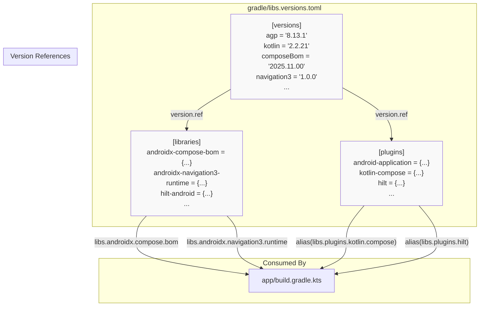

**Diagram**: Version catalog structure showing the three main sections and how they reference each other and are consumed by build files.

**Sources**: [gradle/libs.versions.toml:15-74](), [app/build.gradle.kts:17-24](), [app/build.gradle.kts:61-96]()

---

## Version Declarations

The `[versions]` section defines version variables that can be referenced throughout the catalog. This centralization allows updating a dependency version in one location.

| Version Variable | Value | Description |
|-----------------|-------|-------------|
| `agp` | `8.13.1` | Android Gradle Plugin version |
| `kotlin` | `2.2.21` | Kotlin compiler and runtime version |
| `composeBom` | `2025.11.00` | Compose Bill of Materials (BOM) version |
| `navigation3` | `1.0.0` | Navigation 3 library version |
| `navigation2` | `2.9.6` | Navigation 2 library version (migration support) |
| `hilt` | `2.57.2` | Hilt dependency injection framework version |
| `koin` | `4.2.0-alpha2` | Koin dependency injection framework version |
| `ksp` | `2.3.2` | Kotlin Symbol Processing version |
| `material3` | `1.4.0` | Material3 compose library version |
| `nav3Material` | `1.3.0-alpha03` | Material3 adaptive navigation3 integration |
| `lifecycleViewmodel` | `2.10.0` | Lifecycle ViewModel library version |

**Key Version Management Decisions**:

- **Compose BOM**: Uses `2025.11.00` to ensure all Compose dependencies are compatible
- **Dual Navigation Support**: Includes both Navigation 2 (`2.9.6`) and Navigation 3 (`1.0.0`) for migration examples
- **Dual DI Frameworks**: Supports both Hilt (`2.57.2`) and Koin (`4.2.0-alpha2`) for demonstrating different DI approaches
- **Kotlin 2.2.21**: Enables Compose compiler plugin and kotlinx.serialization

**Sources**: [gradle/libs.versions.toml:15-34]()

---

## Library Declarations

The `[libraries]` section defines dependency coordinates using group, name, and version references. Libraries are organized by functional category.

### Core Android and Compose Dependencies

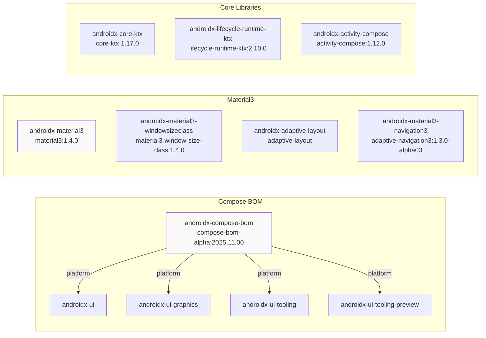

**Diagram**: Core Android and Compose library dependencies showing BOM-managed and versioned libraries.

**Key Libraries**:
- `androidx-compose-bom`: Platform dependency that manages versions of all Compose UI libraries
- `androidx-material3`: Material3 design system components
- `androidx-material3-windowsizeclass`: Window size class utilities for adaptive layouts
- `androidx-adaptive-layout`: Adaptive layout components for multi-pane UIs
- `androidx-activity-compose`: Activity integration for Compose

**Sources**: [gradle/libs.versions.toml:36-52](), [gradle/libs.versions.toml:62-63]()

### Navigation Dependencies

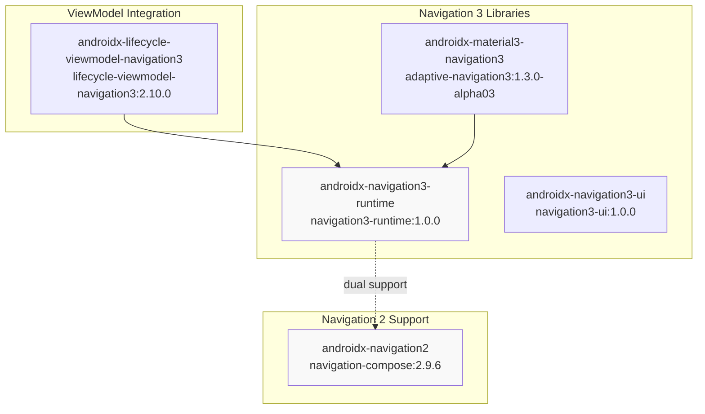

**Diagram**: Navigation library dependencies showing dual Navigation 2/3 support and integration libraries.

The repository includes both Navigation 2 and Navigation 3 libraries to demonstrate migration patterns:
- `androidx-navigation3-runtime`: Core Navigation 3 runtime with `NavKey`, `NavBackStack`, and state management
- `androidx-navigation3-ui`: Navigation 3 UI components including `NavDisplay` composable
- `androidx-navigation2`: Legacy Navigation Compose for migration examples
- `androidx-lifecycle-viewmodel-navigation3`: ViewModel scoping extensions for Navigation 3

**Sources**: [gradle/libs.versions.toml:54-57](), [gradle/libs.versions.toml:82]()

### Serialization Dependencies

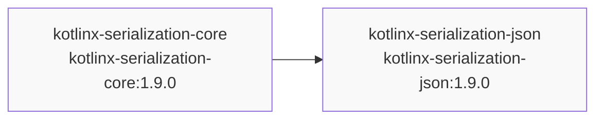

**Diagram**: Kotlinx.serialization libraries used for `NavKey` serialization and deep link parsing.

These libraries enable:
- `NavKey` serialization for process death recovery
- Back stack state persistence via `NavBackStackSerializer`
- Deep link URL parameter parsing and decoding

**Sources**: [gradle/libs.versions.toml:60-61]()

### Dependency Injection Frameworks

The repository demonstrates both compile-time (Hilt) and runtime (Koin) dependency injection approaches.

#### Hilt Dependencies

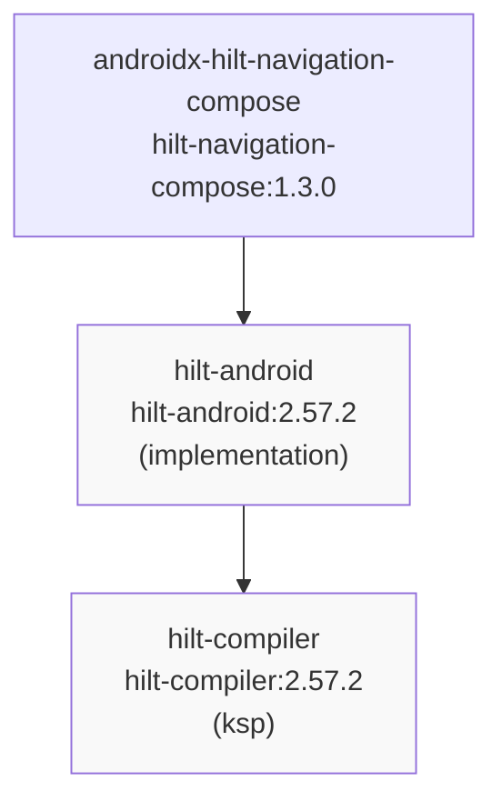

**Diagram**: Hilt dependency injection framework with compile-time annotation processing.

- `hilt-android`: Core Hilt runtime for compile-time dependency injection
- `hilt-compiler`: KSP annotation processor for Hilt code generation
- `androidx-hilt-navigation-compose`: Hilt integration with Compose Navigation (used for ViewModel scoping)

**Sources**: [gradle/libs.versions.toml:58-59](), [gradle/libs.versions.toml:53](), [app/build.gradle.kts:85-86]()

#### Koin Dependencies

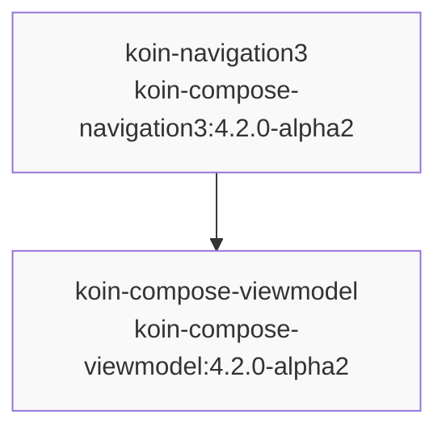

**Diagram**: Koin dependency injection framework with runtime DI support.

- `koin-compose-viewmodel`: Koin ViewModel integration for Compose
- `koin-navigation3`: Koin integration with Navigation 3 for navigation-scoped dependencies

**Sources**: [gradle/libs.versions.toml:64-65]()

### Testing Dependencies

| Library | Group/Name | Version | Purpose |
|---------|------------|---------|---------|
| `junit` | `junit:junit` | `4.13.2` | JUnit 4 unit testing framework |
| `androidx-junit` | `androidx.test.ext:junit` | `1.3.0` | AndroidX JUnit extensions |
| `androidx-espresso-core` | `androidx.test.espresso:espresso-core` | `3.7.0` | UI testing with Espresso |
| `androidx-ui-test-junit4` | `androidx.compose.ui:ui-test-junit4` | (from BOM) | Compose UI testing |
| `androidx-ui-test-manifest` | `androidx.compose.ui:ui-test-manifest` | (from BOM) | Test manifest for Compose |

**Sources**: [gradle/libs.versions.toml:38-40](), [gradle/libs.versions.toml:48-49]()

---

## Plugin Declarations

The `[plugins]` section declares Gradle plugins with their IDs and versions.

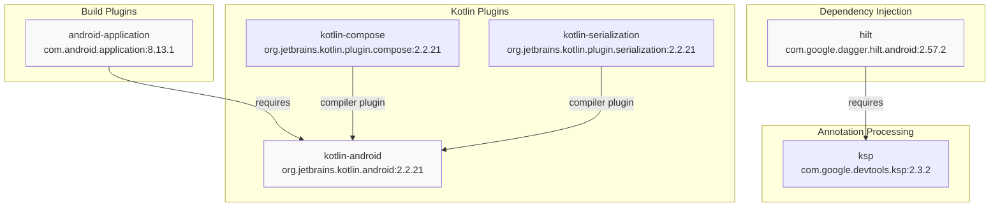

**Diagram**: Plugin declarations showing build, compiler, and processing plugins.

**Plugin Descriptions**:

- **`android-application`**: Android Gradle Plugin (AGP) v8.13.1 for building Android applications
- **`kotlin-android`**: Kotlin Android plugin for Kotlin compilation
- **`kotlin-compose`**: Kotlin compiler plugin for Jetpack Compose (enables strong skipping, etc.)
- **`kotlin-serialization`**: Kotlin compiler plugin for kotlinx.serialization code generation
- **`ksp`**: Kotlin Symbol Processing for compile-time annotation processing (used by Hilt)
- **`hilt`**: Hilt Gradle plugin for dependency injection setup

**Sources**: [gradle/libs.versions.toml:67-73]()

---

## Consuming the Version Catalog

The version catalog is consumed in module build files using the `libs` accessor. The `:app` module demonstrates typical usage patterns.

### Plugin Application

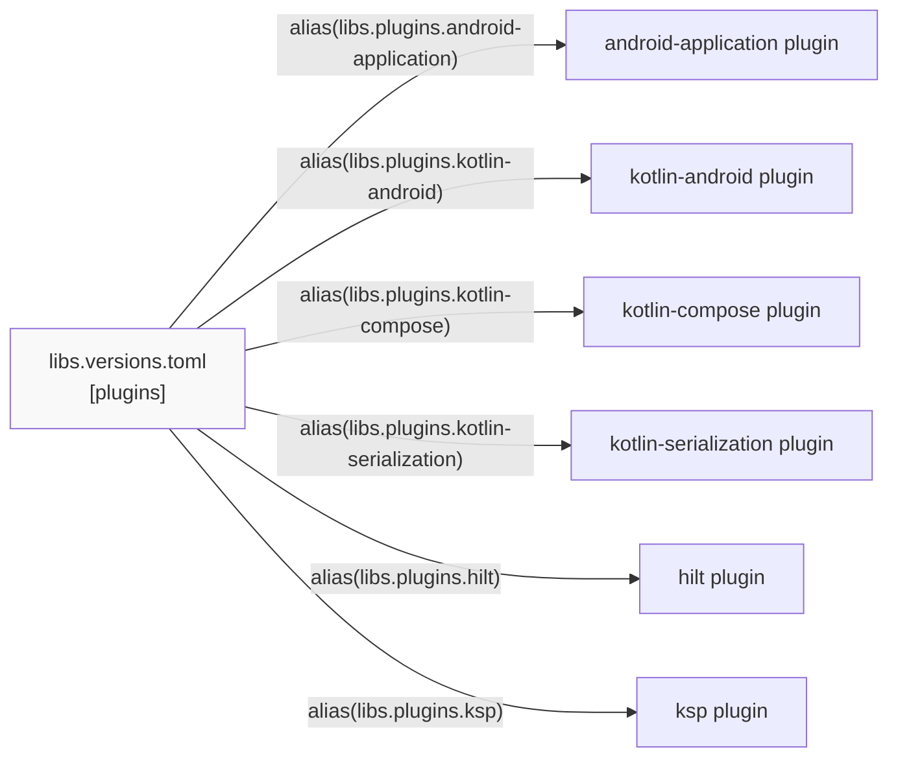

**Diagram**: Plugin consumption from version catalog using `alias()` syntax.

Plugins are applied in `app/build.gradle.kts` using the `alias()` function:

```kotlin
plugins {
    alias(libs.plugins.android.application)
    alias(libs.plugins.kotlin.android)
    alias(libs.plugins.kotlin.compose)
    alias(libs.plugins.kotlin.serialization)
    alias(libs.plugins.hilt)
    alias(libs.plugins.ksp)
}
```

**Sources**: [app/build.gradle.kts:17-24]()

### Dependency Configuration

Dependencies are declared using the `libs` accessor with specific configuration types:

| Configuration | Purpose | Example |
|--------------|---------|---------|
| `implementation` | Compile and runtime dependency | `libs.androidx.core.ktx` |
| `platform` | BOM dependency for version alignment | `libs.androidx.compose.bom` |
| `ksp` | Annotation processor dependency | `libs.hilt.compiler` |
| `testImplementation` | Unit test dependency | `libs.junit` |
| `androidTestImplementation` | Instrumented test dependency | `libs.androidx.junit` |
| `debugImplementation` | Debug build type only | `libs.androidx.ui.tooling` |

**Compose BOM Usage Pattern**:

```kotlin
implementation(platform(libs.androidx.compose.bom))
implementation(libs.androidx.ui)
implementation(libs.androidx.ui.graphics)
```

The `platform()` configuration ensures all Compose libraries use versions managed by the BOM.

**Sources**: [app/build.gradle.kts:61-96]()

### Module Dependency Declaration

Inter-module dependencies use the `project()` function:

```kotlin
implementation(project(":common"))
```

This declares a dependency on the `:common` module, which contains shared utilities and components.

**Sources**: [app/build.gradle.kts:83]()

---

## Dual Dependency Injection Framework Support

The repository includes both Hilt and Koin frameworks to demonstrate different dependency injection approaches in Navigation 3 recipes.

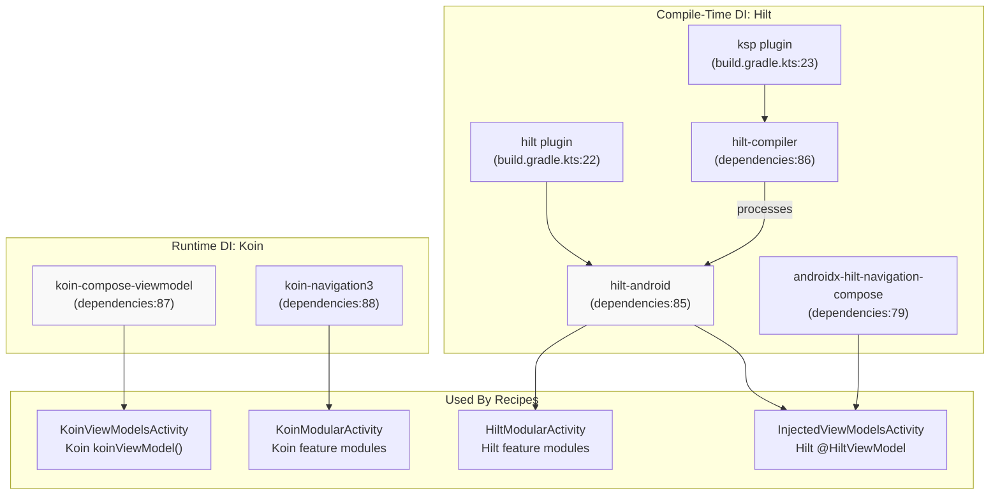

**Diagram**: Dual DI framework architecture showing compile-time (Hilt) and runtime (Koin) approaches.

**Rationale for Dual Support**:
- **Hilt**: Demonstrates compile-time DI with annotation processing, type safety, and build-time validation
- **Koin**: Demonstrates runtime DI with simpler setup, no code generation, and dynamic module loading

This allows recipes to show both approaches for ViewModel injection and modular navigation patterns.

**Sources**: [app/build.gradle.kts:22-23](), [app/build.gradle.kts:79](), [app/build.gradle.kts:85-88]()

---

## Repository Configuration

The `settings.gradle.kts` file configures repository sources for dependency resolution.

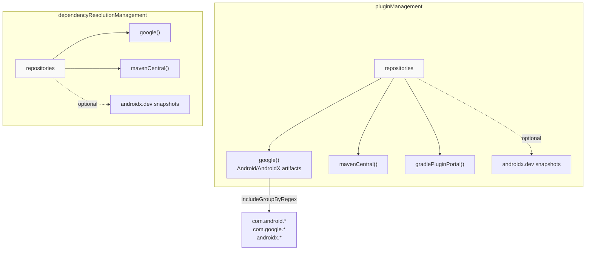

**Diagram**: Repository configuration for plugin management and dependency resolution.

**Repository Sources**:
- **google()**: Hosts Android SDK, AndroidX, and Google libraries
- **mavenCentral()**: Hosts Kotlin, kotlinx, and third-party libraries (Hilt, Koin)
- **gradlePluginPortal()**: Hosts Gradle plugins
- **androidx.dev snapshots** (commented): Optional repository for snapshot builds

**Content Filtering**: The Google repository uses `includeGroupByRegex()` to explicitly include only Android-related artifacts, improving build performance.

**Repository Mode**: `FAIL_ON_PROJECT_REPOS` ensures consistent dependency resolution across the project by preventing modules from declaring their own repositories.

**Sources**: [settings.gradle.kts:17-46]()

---

## Multi-Module Structure

The project consists of three modules declared in `settings.gradle.kts`.

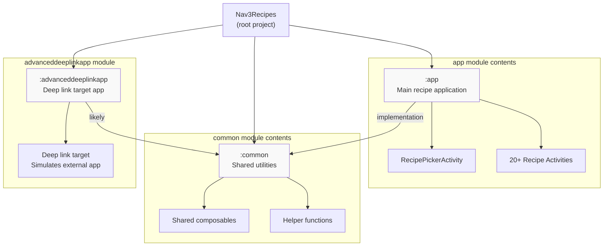

**Diagram**: Multi-module project structure showing dependencies between modules.

**Module Descriptions**:

- **`:app`**: Main application module containing `RecipePickerActivity` and all recipe implementations. Depends on `:common` for shared utilities.
- **`:common`**: Shared module containing reusable composables like `ContentBase`, `ContentGreen`, and utility functions like `setEdgeToEdgeConfig`.
- **`:advanceddeeplinkapp`**: Separate application module simulating an external app for advanced deep linking scenarios. Demonstrates cross-app navigation with synthetic back stack creation.

The multi-module structure enables:
- **Code Reuse**: Shared utilities in `:common` avoid duplication across recipes
- **Isolation**: The advanced deep link recipe can simulate cross-app scenarios
- **Build Performance**: Changes to `:common` don't require rebuilding recipe code if only recipe-specific changes occur

**Sources**: [settings.gradle.kts:48-51](), [app/build.gradle.kts:83]()

---

## Summary

The nav3-recipes repository uses Gradle's version catalog pattern to centralize dependency management:

1. **Version Catalog**: `gradle/libs.versions.toml` defines 15+ version variables, 30+ library coordinates, and 6 plugin declarations
2. **Key Dependencies**: Compose BOM 2025.11.00, Navigation 3 1.0.0, Kotlin 2.2.21, Material3 adaptive layouts
3. **Dual DI Support**: Both Hilt (compile-time) and Koin (runtime) frameworks for demonstrating different injection patterns
4. **Dual Navigation Support**: Both Navigation 2 and Navigation 3 libraries for migration examples
5. **Consumption Pattern**: Build files use `alias(libs.plugins.*)` for plugins and `libs.*` for dependencies
6. **Repository Configuration**: Google, Maven Central, and Gradle Plugin Portal with content filtering
7. **Multi-Module Structure**: `:app`, `:common`, and `:advanceddeeplinkapp` modules with shared dependencies

This architecture provides consistent versioning, simplified dependency updates, and enables the repository to demonstrate multiple approaches to common Android development patterns.

**Sources**: [gradle/libs.versions.toml:1-74](), [app/build.gradle.kts:1-98](), [settings.gradle.kts:1-51]()

---

