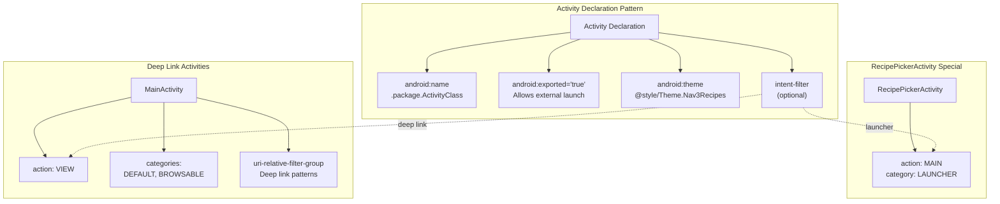
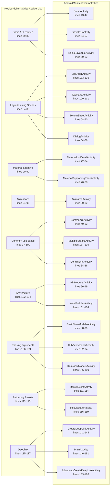
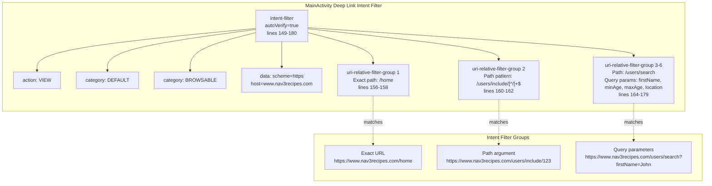
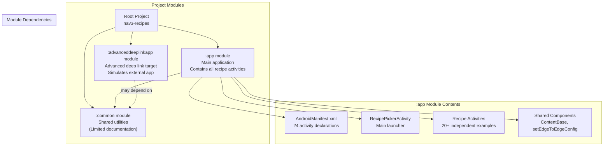
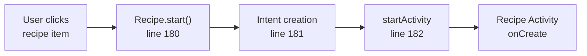

<!-- source: DeepWiki mcp.deepwiki.com · repo android/nav3-recipes · page 14.2 Application Manifest and Module Structure · fetched 2026-10-23 -->

# Application Manifest and Module Structure

<details>
<summary>Relevant source files</summary>

The following files were used as context for generating this wiki page:

- [README.md](README.md)
- [app/src/main/AndroidManifest.xml](app/src/main/AndroidManifest.xml)
- [app/src/main/java/com/example/nav3recipes/RecipePickerActivity.kt](app/src/main/java/com/example/nav3recipes/RecipePickerActivity.kt)

</details>


This document describes the application manifest structure, activity declarations, deep link intent filter configuration, and multi-module project organization. It details how the AndroidManifest.xml declares all recipe activities, configures the application class, and sets up deep link handling.

For information about the build system and dependency configuration, see [Gradle Version Catalog and Dependencies](#14.1). For details on running recipes, see [Running Recipe Examples](#2.3).

---

## Application Element Configuration

The `<application>` element in [app/src/main/AndroidManifest.xml:21-32]() configures application-wide settings:

| Attribute | Value | Purpose |
|-----------|-------|---------|
| `android:name` | `.content.Nav3RecipesApplication` | Custom Application class for DI initialization |
| `android:allowBackup` | `true` | Enables backup infrastructure |
| `android:dataExtractionRules` | `@xml/data_extraction_rules` | Android 12+ backup rules |
| `android:fullBackupContent` | `@xml/backup_rules` | Pre-Android 12 backup rules |
| `android:enableOnBackInvokedCallback` | `true` | Enables predictive back gesture (Android 13+) |
| `android:theme` | `@style/Theme.Nav3Recipes` | Application-level Material3 theme |
| `android:supportsRtl` | `true` | Right-to-left layout support |

The `Nav3RecipesApplication` class serves as the initialization point for dependency injection frameworks (Hilt and Koin) used across recipe examples.

**Sources**: [app/src/main/AndroidManifest.xml:21-32]()

---

## Recipe Activity Declaration Architecture

The manifest declares 24 distinct activities, each representing an independent recipe. Every recipe activity follows a consistent declaration pattern:



**Sources**: [app/src/main/AndroidManifest.xml:33-189]()

### RecipePickerActivity as Main Launcher

The `RecipePickerActivity` is the application's entry point, declared with the `MAIN`/`LAUNCHER` intent filter:

[app/src/main/AndroidManifest.xml:33-42]()

This activity serves as the central hub for navigating to all recipe examples. It maintains a hardcoded list of recipe entries in [app/src/main/java/com/example/nav3recipes/RecipePickerActivity.kt:78-118](), organized into seven categories.

**Sources**: [app/src/main/AndroidManifest.xml:33-42](), [app/src/main/java/com/example/nav3recipes/RecipePickerActivity.kt:68-119]()

---

## Recipe-to-Manifest Mapping

The following diagram maps the recipe categories from `RecipePickerActivity` to their corresponding manifest activity declarations:



Each `Recipe` instance in [RecipePickerActivity.kt:71-74]() contains a name and activity class reference. When clicked, the recipe launches its activity using `Intent` in [RecipePickerActivity.kt:180-183]().

**Sources**: [app/src/main/java/com/example/nav3recipes/RecipePickerActivity.kt:71-118](), [app/src/main/AndroidManifest.xml:33-189]()

---

## Deep Link Intent Filter Configuration

The `MainActivity` for the basic deep linking recipe contains sophisticated intent filters using `uri-relative-filter-group` for granular URL pattern matching:



The intent filter structure demonstrates three deep link patterns:

### Exact Path Matching

[app/src/main/AndroidManifest.xml:156-158]() matches the exact URL path `/home`:

```xml
<uri-relative-filter-group android:allow="true">
    <data android:path="/home" />
</uri-relative-filter-group>
```

### Path Pattern with Arguments

[app/src/main/AndroidManifest.xml:160-162]() uses regex pattern matching for URLs with path parameters:

```xml
<uri-relative-filter-group android:allow="true">
    <data android:pathPattern="/users/include/[^/]+$" />
</uri-relative-filter-group>
```

This matches URLs like `https://www.nav3recipes.com/users/include/123` where `123` is extracted as a path argument.

### Optional Query Parameters

[app/src/main/AndroidManifest.xml:164-179]() declares multiple filter groups for optional query parameters (`firstName`, `minAge`, `maxAge`, `location`). Each parameter gets its own filter group to support any combination of query arguments.

The `android:autoVerify="true"` attribute at [app/src/main/AndroidManifest.xml:149]() enables Android App Links verification, allowing the app to automatically handle matching URLs without showing a disambiguation dialog.

**Sources**: [app/src/main/AndroidManifest.xml:146-181]()

---

## Activity Declaration Categories

The 24 recipe activities are organized into functional groups within the manifest:

| Category | Activities | Manifest Lines | Purpose |
|----------|-----------|----------------|---------|
| **Launcher** | `RecipePickerActivity` | 33-42 | Main entry point with LAUNCHER intent filter |
| **Basic Navigation** | `BasicActivity`<br/>`BasicDslActivity`<br/>`BasicSaveableActivity` | 43-47<br/>54-57<br/>59-62 | Fundamental navigation patterns |
| **Common UI** | `CommonUiActivity` | 49-52 | Top-level navigation bar pattern |
| **Scenes** | `DialogActivity`<br/>`BottomSheetActivity`<br/>`ListDetailActivity`<br/>`TwoPaneActivity` | 64-66<br/>68-70<br/>133-135<br/>129-131 | Custom multi-pane and overlay layouts |
| **Material Adaptive** | `MaterialListDetailActivity`<br/>`MaterialSupportingPaneActivity` | 72-74<br/>76-78 | Material3 adaptive navigation patterns |
| **Animations** | `AnimatedActivity` | 80-82 | Custom navigation transitions |
| **Conditional** | `ConditionalActivity` | 84-86 | Login-gated navigation |
| **ViewModels** | `BasicViewModelsActivity`<br/>`HiltViewModelsActivity`<br/>`KoinViewModelsActivity` | 88-90<br/>92-94<br/>106-109 | Passing NavKey arguments to ViewModels |
| **Modular** | `HiltModularActivity`<br/>`KoinModularActivity` | 96-99<br/>101-104 | Decoupled navigation with DI |
| **Results** | `ResultEventActivity`<br/>`ResultStateActivity` | 111-114<br/>116-119 | Passing data back from destinations |
| **Migration** | `BeginAtomicMigrationActivity`<br/>`EndAtomicMigrationActivity` | 121-123<br/>125-127 | Nav2 to Nav3 migration patterns |
| **Multiple Stacks** | `MultipleStacksActivity` | 137-139 | Tab-based navigation with preserved state |
| **Deep Linking** | `CreateDeepLinkActivity`<br/>`MainActivity`<br/>`AdvancedCreateDeepLinkActivity` | 141-144<br/>146-181<br/>183-186 | URI parsing and synthetic back stacks |

All activities except `RecipePickerActivity` and deep link activities have no intent filters, making them accessible only through explicit `Intent` navigation from `RecipePickerActivity`.

**Sources**: [app/src/main/AndroidManifest.xml:33-189]()

---

## Multi-Module Project Structure

Based on the build system architecture (see [Gradle Version Catalog and Dependencies](#14.1)), the project consists of three Gradle modules:



### :app Module

The primary application module containing:
- [app/src/main/AndroidManifest.xml]() with all activity declarations
- [app/src/main/java/com/example/nav3recipes/RecipePickerActivity.kt]() as the launcher
- All recipe activity implementations organized by package
- Shared UI components and utilities

### :common Module

A shared module likely containing common utilities and components reusable across recipes. The exact contents are not detailed in available documentation.

### :advanceddeeplinkapp Module

A separate application module simulating an external app for the advanced deep linking recipe. This module demonstrates cross-app navigation scenarios where deep links originate from a different application context.

**Sources**: [README.md:1-95](), Build system architecture from high-level diagrams

---

## Intent Launching Pattern

The `RecipePickerActivity` uses explicit `Intent` launching for all recipe activities:



The launching mechanism in [RecipePickerActivity.kt:180-183]():

1. Creates an `Intent` with the current activity as context
2. Specifies the target activity class from `Recipe.activityClass`
3. Calls `startActivity(intent)` to launch the recipe
4. The Android system resolves the intent to the declared activity in the manifest

This explicit intent pattern ensures recipe activities remain isolated and are only accessible through the picker, not from external apps or system launchers (except for deep link activities).

**Sources**: [app/src/main/java/com/example/nav3recipes/RecipePickerActivity.kt:180-183](), [app/src/main/AndroidManifest.xml:43-189]()

---

## Activity Configuration Consistency

All recipe activities share consistent configuration attributes:

- **Exported**: All activities have `android:exported="true"` to allow `Intent` launching across process boundaries
- **Theme**: All activities use `@style/Theme.Nav3Recipes` for consistent Material3 theming
- **Label**: Most activities use `@string/app_name` as their label (some omit the label attribute)

The only activity with a unique intent filter is `RecipePickerActivity` (MAIN/LAUNCHER) and `MainActivity` (deep link VIEW actions). This isolation ensures recipes don't interfere with each other's navigation state.

**Sources**: [app/src/main/AndroidManifest.xml:33-189]()

---

