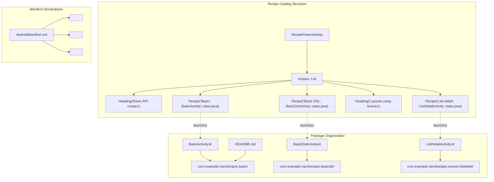
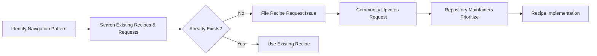
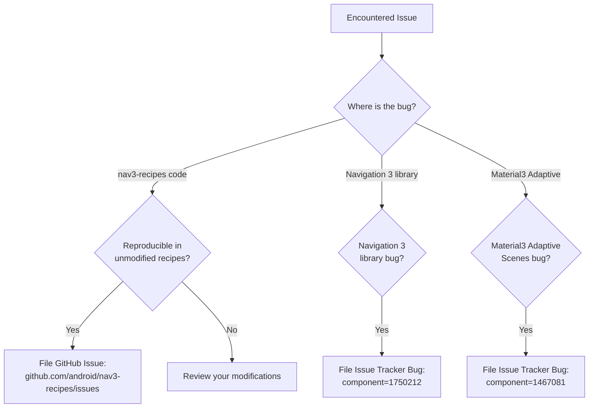
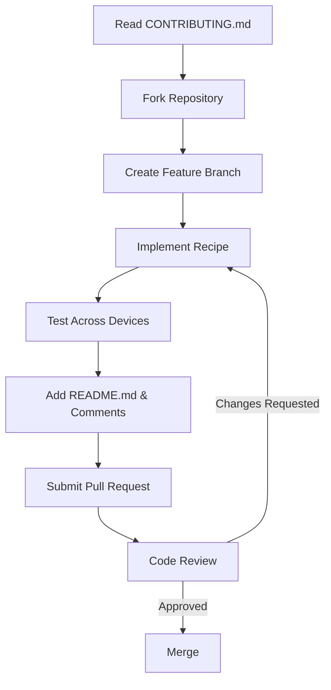
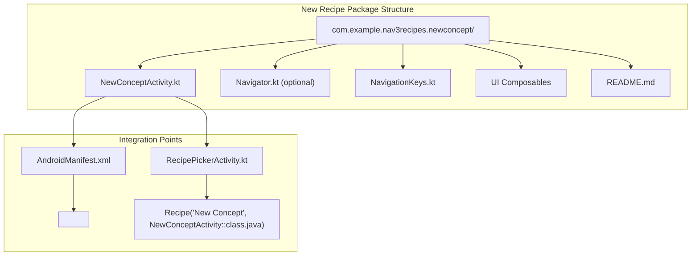
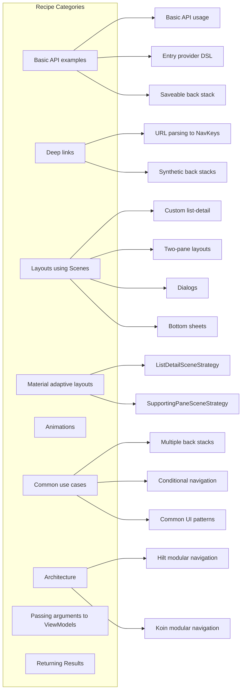
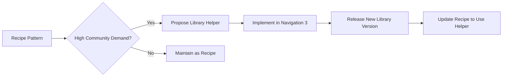

<!-- source: DeepWiki mcp.deepwiki.com · repo android/nav3-recipes · page 15 Contributing to nav3-recipes · fetched 2026-10-23 -->

# Contributing to nav3-recipes

Relevant source files

The following files were used as context for generating this wiki page:

- [README.md](README.md)
- [app/src/main/AndroidManifest.xml](app/src/main/AndroidManifest.xml)
- [app/src/main/java/com/example/nav3recipes/RecipePickerActivity.kt](app/src/main/java/com/example/nav3recipes/RecipePickerActivity.kt)

This document explains how to contribute to the nav3-recipes repository, including requesting new recipe examples, reporting issues, and understanding the repository's recipe-based organization philosophy. For instructions on setting up the project and running recipes, see [Project Setup and Build Configuration](#2.1) and [Running Recipe Examples](#2.3).

---

## Recipe Philosophy and Organization Principles

The nav3-recipes repository follows a **single-concept-per-recipe** architectural pattern. Each recipe demonstrates exactly one Navigation 3 concept or use case as an isolated, self-contained example.

### Core Principles

**Focused Scope**: Each recipe introduces a single navigation pattern or API feature. Rather than extending existing recipes to cover additional concepts, the repository creates new recipes. This ensures each example remains easy to understand and serves as a clear reference implementation.

**Recipe Lifecycle**: Recipes follow a graduation path where commonly-requested patterns may be promoted into official Navigation 3 library helpers. After graduation, recipes are updated to use the new library helper, demonstrating best practices for the evolved API.

**Isolation Architecture**: Each recipe is implemented as an independent `Activity` in its own package, declared separately in `AndroidManifest.xml`. This allows complete isolation of dependencies, navigation state, and UI implementation.

### Recipe Organization Structure

**Sources**: [README.md:1-18](), [app/src/main/java/com/example/nav3recipes/RecipePickerActivity.kt:68-118](), [app/src/main/AndroidManifest.xml:33-186]()

---

## Requesting New Recipes

### Recipe Request Workflow

The repository uses GitHub Issues with the `recipe-request` label for tracking community-requested examples. Recipe implementation priority is determined by community voting.

### Filing a Recipe Request

1. **Check for existing coverage**: Review the recipe list in [README.md:12-58]() and search [open recipe requests](https://github.com/android/nav3-recipes/issues?q=is%3Aissue+state%3Aopen+label%3Arecipe-request).

2. **Create a new issue**: Use the [recipe request template](https://github.com/android/nav3-recipes/issues/new?template=1-recipe-request.md) to file your request.

3. **Describe the use case**: Provide:
   - The navigation pattern or scenario you want to implement
   - Why existing recipes don't cover this use case
   - Expected behavior and UI flow
   - Any relevant Navigation 3 APIs involved

4. **Upvote prioritization**: The most upvoted requests are prioritized for implementation.

### Recipe Suitability Criteria

A good recipe request should:
- Demonstrate a **distinct navigation pattern** not covered by existing recipes
- Use **Navigation 3 APIs** as the primary focus (not general Compose patterns)
- Be **reproducible** across different app contexts
- Represent a **common use case** that multiple developers would encounter

**Sources**: [README.md:59-61]()

---

## Reporting Issues

### Issue Triage Decision Tree

### Reporting Recipe Bugs

Use the [bug report template](https://github.com/android/nav3-recipes/issues/new?template=2-bug-report.md) for issues directly related to recipe code.

**Required Information**:
- Recipe name and Activity class (e.g., `BasicActivity`, `ListDetailActivity`)
- Navigation 3 version (check [gradle/libs.versions.toml]() for `nav3` version)
- Steps to reproduce using the **unmodified** recipe code
- Expected vs actual behavior
- Device configuration (API level, screen size if relevant to adaptive layouts)

**Bug Scope**: Only file recipe bugs if the issue occurs without modifying the repository source code. If you've adapted recipe code for your own app, the issue likely stems from integration-specific changes.

### Reporting Library Bugs

**Navigation 3 Library Issues**: File at [Issue Tracker component 1750212](https://issuetracker.google.com/issues/new?component=1750212&template=2102223).

**Material3 Adaptive Scenes Issues**: File at [Issue Tracker component 1467081](https://issuetracker.google.com/issues/new?component=1467081).

These issues should include:
- Minimal reproduction case (can reference recipe code as starting point)
- Navigation 3 or Material3 Adaptive library versions
- Stack traces for crashes
- Logcat output for unexpected behavior

**Sources**: [README.md:70-71](), [README.md:36]()

---

## Contributing Code

### Contribution Process Overview

The repository accepts community contributions following the guidelines in `CONTRIBUTING.md`. While the full contribution guidelines are not provided in the available files, the key requirement is to follow the documented instructions.

### Recipe Implementation Structure

Each new recipe must follow the established architectural pattern:

| Component | Location | Purpose |
|-----------|----------|---------|
| Activity | `app/src/main/java/com/example/nav3recipes/{category}/{RecipeName}Activity.kt` | Entry point and navigation setup |
| Package | `app/src/main/java/com/example/nav3recipes/{category}/` | Contains all recipe-specific code |
| README | `app/src/main/java/com/example/nav3recipes/{category}/README.md` | Explains the concept and implementation |
| Manifest Entry | `app/src/main/AndroidManifest.xml` | Activity declaration |
| Picker Entry | `RecipePickerActivity.kt` recipes list | Makes recipe discoverable |

### Recipe Code Organization Pattern

### Recipe Implementation Checklist

A complete recipe contribution includes:

1. **Activity implementation** with edge-to-edge configuration using `setEdgeToEdgeConfig()` [app/src/main/java/com/example/nav3recipes/RecipePickerActivity.kt:124]()
2. **Self-contained navigation logic** demonstrating the specific concept
3. **README.md** explaining:
   - What concept is demonstrated
   - Key APIs and components used
   - Code walkthrough of the implementation
4. **Manifest declaration** with `android:exported="true"` [app/src/main/AndroidManifest.xml:43-186]()
5. **RecipePickerActivity entry** in the appropriate category heading [app/src/main/java/com/example/nav3recipes/RecipePickerActivity.kt:78-118]()
6. **Testing** on both phone and tablet form factors (if adaptive layouts involved)

**Sources**: [README.md:73-74](), [app/src/main/AndroidManifest.xml:43-186](), [app/src/main/java/com/example/nav3recipes/RecipePickerActivity.kt:68-184]()

---

## Recipe Categories and Scope

### Current Recipe Categories

The repository organizes recipes into thematic categories, each focusing on a specific aspect of Navigation 3:

### Recipe Category Guidelines

**Basic API examples**: Foundational Navigation 3 APIs (`NavKey`, `NavBackStack`, `NavDisplay`, `EntryProvider`) with minimal dependencies.

**Deep links**: URI parsing, intent handling, synthetic back stack construction, Task management for cross-app navigation.

**Layouts using Scenes**: Custom `SceneStrategy` implementations for adaptive multi-pane UIs with manual layout control.

**Material adaptive layouts**: Production-ready Material3 Adaptive APIs (`PaneScaffoldDirective`, `ListDetailSceneStrategy`, `SupportingPaneSceneStrategy`).

**Animations**: Custom transitions using `transitionSpec`, `popTransitionSpec`, and predictive back gesture handling.

**Common use cases**: Multi-stack tab navigation, conditional flows (login gates), shared navigation UI components.

**Architecture**: Dependency injection integration patterns with modular navigation code organization.

**Passing arguments to ViewModels**: ViewModel creation strategies with NavKey argument injection across DI frameworks.

**Returning Results**: Event-based and state-based result passing between navigation destinations.

**Sources**: [README.md:12-58](), [app/src/main/java/com/example/nav3recipes/RecipePickerActivity.kt:78-118]()

---

## Version Strategy and Compatibility

### Versioning Policy

The repository maintains recipes for different Navigation 3 release stages:

| Branch/Tag | Navigation 3 Version | Stability Level | Use Case |
|------------|---------------------|-----------------|----------|
| `main` | Latest (may be alpha/snapshot) | Bleeding edge | Testing new features |
| Release tags | Stable versions | Production-ready | Reference for apps |

The `main` branch uses the latest Navigation 3 version (including alpha and snapshot builds) to provide early access to new APIs. For production use, refer to the [releases page](https://github.com/android/nav3-recipes/releases) to find recipes using stable library versions.

### Recipe Graduation Process

When patterns demonstrated in recipes become widely adopted, they may be promoted to official Navigation 3 library helpers. After graduation:

1. The helper is added to the Navigation 3 library as an optional API
2. The recipe is updated to demonstrate the new helper
3. The recipe continues to serve as the canonical example for the feature

This lifecycle ensures recipes remain current with best practices while allowing experimental patterns to be validated in the community before library integration.

**Sources**: [README.md:6-10]()

---

## External Resources

### Compose Multiplatform Recipes

For Compose Multiplatform implementations of Navigation 3 patterns, see the [CMP recipes repository](https://github.com/terrakok/nav3-recipes) maintained by the community. These recipes adapt the concepts from this repository for cross-platform usage.

### Documentation and Guides

- [Jetpack Navigation 3 Official Documentation](https://goo.gle/nav3)
- [Deep Linking Guide](docs/deeplink-guide.md) - Comprehensive guide to implementing deep links
- [Navigation 3 Release Notes](https://developer.android.com/jetpack/androidx/releases/navigation)

**Sources**: [README.md:76-77](), [README.md:20-23]()