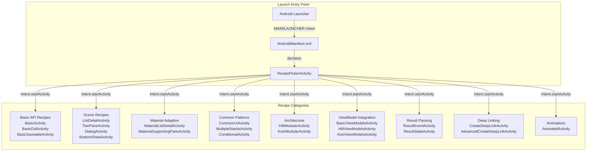
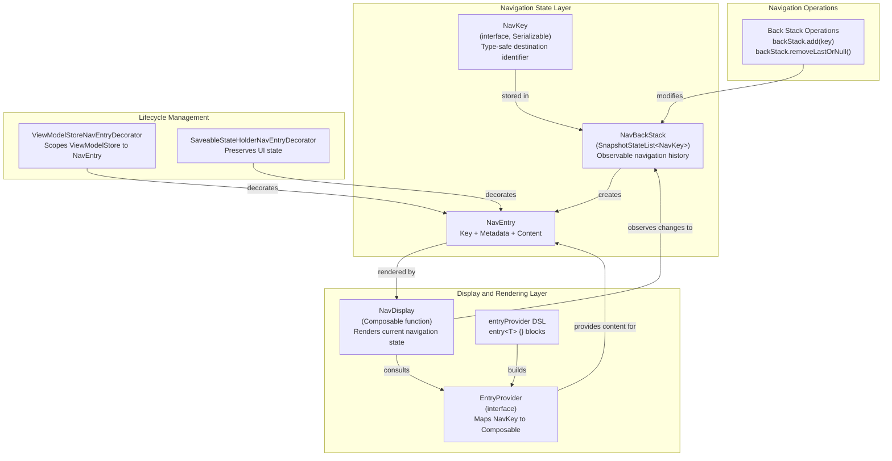
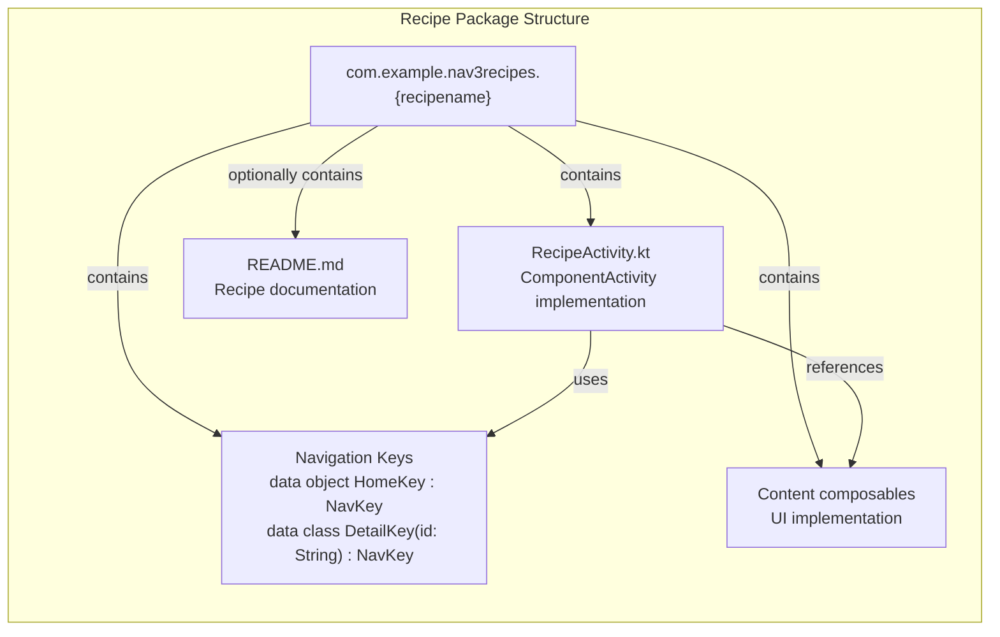
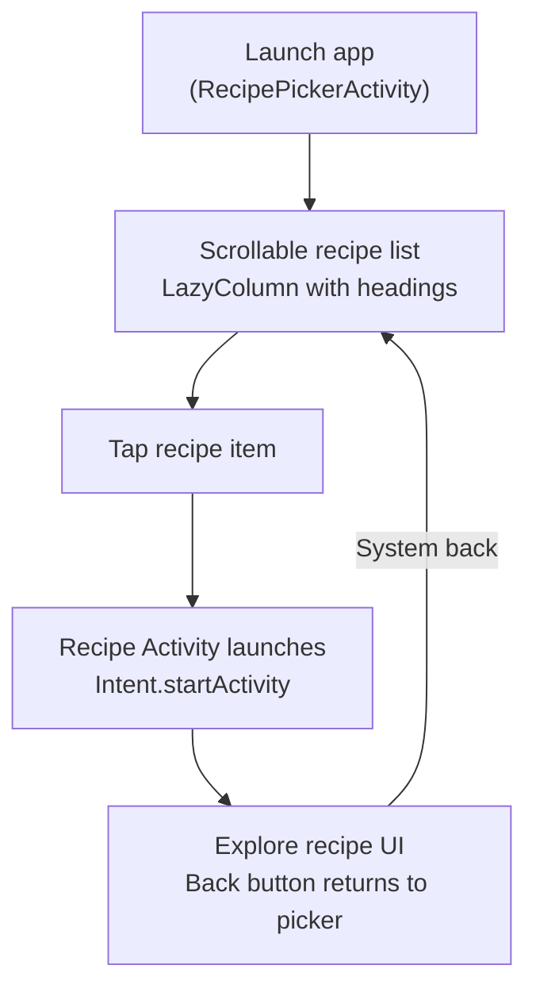

<!-- source: DeepWiki mcp.deepwiki.com · repo android/nav3-recipes · page 2 Getting Started · fetched 2026-10-23 -->

# Getting Started

<details>
<summary>Relevant source files</summary>

The following files were used as context for generating this wiki page:

- [README.md](README.md)
- [app/src/main/AndroidManifest.xml](app/src/main/AndroidManifest.xml)
- [app/src/main/java/com/example/nav3recipes/RecipePickerActivity.kt](app/src/main/java/com/example/nav3recipes/RecipePickerActivity.kt)

</details>


This page provides an introduction to the nav3-recipes repository, explains how to set up and run the project, introduces fundamental Navigation 3 concepts, and guides you through running your first recipe example.

For detailed information on specific topics:
- Build system and dependency configuration: see [Project Setup and Build Configuration](#2.1)
- In-depth Navigation 3 architecture: see [Core Navigation 3 Concepts](#2.2)
- Comprehensive recipe navigation guide: see [Running Recipe Examples](#2.3)

## Purpose and Scope

The nav3-recipes repository is a collection of independent code examples demonstrating Jetpack Navigation 3 API usage patterns. Each recipe isolates a single concept or feature, implemented as a standalone `Activity`. The repository uses the latest Navigation 3 version and follows a pedagogical structure from basic usage through advanced patterns.

**Sources:** [README.md:1-10]()

## Repository Architecture

The repository implements a hub-and-spoke architecture where `RecipePickerActivity` serves as the central launcher for all recipe demonstrations.

### Hub-and-Spoke Structure



**Sources:** [app/src/main/AndroidManifest.xml:33-42](), [app/src/main/java/com/example/nav3recipes/RecipePickerActivity.kt:68-118]()

### Recipe Organization

Each recipe is:
- An independent Android `Activity` declared in `AndroidManifest.xml`
- Located in its own package under `com.example.nav3recipes`
- Listed in `RecipePickerActivity` with a human-readable name and category heading
- Fully self-contained with no dependencies on other recipes

| Category | Example Recipes | Purpose |
|----------|----------------|---------|
| Basic API | `BasicActivity`, `BasicDslActivity`, `BasicSaveableActivity` | Core Navigation 3 API usage |
| Scenes | `ListDetailActivity`, `TwoPaneActivity`, `DialogActivity` | Custom multi-pane layouts |
| Material Adaptive | `MaterialListDetailActivity`, `MaterialSupportingPaneActivity` | Production-ready adaptive layouts |
| Common Patterns | `CommonUiActivity`, `MultipleStacksActivity`, `ConditionalActivity` | Typical app navigation patterns |
| Architecture | `HiltModularActivity`, `KoinModularActivity` | Modular navigation with DI |
| ViewModels | `BasicViewModelsActivity`, `HiltViewModelsActivity`, `KoinViewModelsActivity` | ViewModel integration strategies |
| Results | `ResultEventActivity`, `ResultStateActivity` | Inter-destination data passing |
| Deep Linking | `CreateDeepLinkActivity`, `AdvancedCreateDeepLinkActivity` | URI-based navigation |
| Animations | `AnimatedActivity` | Custom navigation transitions |

**Sources:** [app/src/main/java/com/example/nav3recipes/RecipePickerActivity.kt:78-118](), [README.md:12-58]()

## Quick Start

### Prerequisites

- Android Studio (latest stable version recommended)
- Git
- JDK 17 or higher (required by Android Gradle Plugin 8.13.1)

### Setup Steps

1. **Clone the repository**
   ```bash
   git clone https://github.com/android/nav3-recipes.git
   cd nav3-recipes
   ```

2. **Open in Android Studio**
   - Launch Android Studio
   - Select "Open" from the welcome screen
   - Navigate to the cloned repository root folder
   - Click "OK" to open the project

3. **Sync Gradle dependencies**
   - Android Studio will automatically prompt to sync Gradle
   - If not, click "Sync Project with Gradle Files" in the toolbar
   - Wait for dependency download and indexing to complete

4. **Run RecipePickerActivity**
   - Select a device or emulator
   - Run configuration will default to `RecipePickerActivity` (declared as LAUNCHER)
   - Click the green "Run" button or press Shift+F10

**Sources:** [README.md:67-68](), [app/src/main/AndroidManifest.xml:33-42]()

## Navigation 3 Core Components

Navigation 3 implements a reactive, composable navigation system built on Jetpack Compose. Understanding these core components is essential for working with any recipe in the repository.

### Component Architecture



**Sources:** [app/src/main/java/com/example/nav3recipes/basic/BasicActivity.kt:1-100]() (inferred from typical Navigation 3 structure)

### Core Component Descriptions

| Component | Type | Purpose | Code Reference |
|-----------|------|---------|----------------|
| `NavKey` | Interface | Type-safe, serializable destination identifier. Typically implemented as `data class` or `data object` | Used in all recipes |
| `NavBackStack` | `SnapshotStateList<NavKey>` | Observable list representing navigation history. Changes trigger UI recomposition | Managed in all Activity classes |
| `NavDisplay` | Composable function | Renders the current navigation state by displaying content for the top `NavEntry` | Core rendering component |
| `EntryProvider` | Interface | Maps `NavKey` instances to their corresponding `@Composable` content | Built manually or via DSL |
| `entry<T>` | DSL function | Type-safe builder for mapping specific `NavKey` types to composables | Available in `BasicDslActivity` |
| `NavEntry` | Data structure | Represents a single navigation entry with key, metadata, and content. Managed by Navigation 3 internally | Created by framework |

For detailed explanations of each component and how they interact, see [Core Navigation 3 Concepts](#2.2).

**Sources:** [README.md:16-18]() (references to basic recipes)

## Understanding Recipe Structure

### Recipe Anatomy

Each recipe follows a consistent structure:



### Typical Recipe Components

1. **Activity class**: Entry point, typically extends `ComponentActivity`
   - Calls `setEdgeToEdgeConfig()` for modern UI
   - Defines or imports navigation keys
   - Sets up `NavBackStack` using `mutableStateListOf()` or `rememberSaveable`
   - Builds `EntryProvider` (manually or via DSL)
   - Renders `NavDisplay` in `setContent`

2. **Navigation keys**: Serializable destination identifiers
   - Simple destinations: `data object` with no arguments
   - Parameterized destinations: `data class` with arguments
   - All implement `NavKey` interface
   - Annotated with `@Serializable` for back stack persistence

3. **Content composables**: UI for each destination
   - Often reuse common components from `com.example.nav3recipes.ui`
   - Receive navigation callbacks via lambdas
   - May receive destination arguments via key parameters

4. **README.md**: Some recipes include detailed documentation

**Sources:** [app/src/main/java/com/example/nav3recipes/RecipePickerActivity.kt:1-185](), [README.md:16-58]()

## Running Your First Recipe

### Navigating RecipePickerActivity

The `RecipePickerActivity` displays all available recipes organized by category:



1. **Launch the app**: `RecipePickerActivity` opens automatically (declared as `MAIN`/`LAUNCHER`)
2. **Browse categories**: Scroll through headings like "Basic API recipes", "Layouts using Scenes", etc.
3. **Select a recipe**: Tap any recipe name to launch its `Activity`
4. **Return to picker**: Press the system back button to return to the recipe list

**Sources:** [app/src/main/java/com/example/nav3recipes/RecipePickerActivity.kt:120-184]()

### Recommended Learning Path

For developers new to Navigation 3, follow this progression:

1. **Start with Basic recipes** (simplest Navigation 3 usage):
   - `BasicActivity`: Manual navigation setup
   - `BasicDslActivity`: Using the entry provider DSL
   - `BasicSaveableActivity`: Adding back stack persistence

2. **Explore Common UI patterns**:
   - `CommonUiActivity`: Navigation bars and top-level routes
   - `MultipleStacksActivity`: Independent back stacks per tab

3. **Investigate advanced features**:
   - Scene recipes for adaptive layouts
   - Deep linking recipes for URI handling
   - ViewModel recipes for data integration

**Sources:** [README.md:15-58]()

### Running the Basic Recipe

The `BasicActivity` demonstrates the minimal Navigation 3 setup:

1. Launch `RecipePickerActivity`
2. Tap "Basic" under "Basic API recipes"
3. Observe the navigation implementation:
   - Initial screen: "This is home"
   - Tap "Go to Green": Navigates to green screen
   - Tap "Go back": Returns to home
   - System back button: Also pops back stack

The implementation shows:
- `mutableStateListOf<NavKey>()` for back stack storage
- Manual `EntryProvider` mapping keys to composables
- `NavDisplay` rendering the current entry
- `backStack.add(key)` for forward navigation
- `backStack.removeLastOrNull()` for back navigation

**Sources:** [README.md:16](), [app/src/main/java/com/example/nav3recipes/RecipePickerActivity.kt:80]()

## Project Dependencies

The repository uses Gradle version catalogs for centralized dependency management. Key dependencies include:

| Dependency | Version | Purpose |
|------------|---------|---------|
| Android Gradle Plugin | 8.13.1 | Build system |
| Kotlin | 2.2.21 | Language + Compose Compiler |
| Compose BOM | 2025.11.00 | Jetpack Compose UI |
| Navigation 3 | 1.0.0 | Navigation library |
| Hilt | 2.57.2 | Compile-time dependency injection |
| Koin | 4.2.0-alpha2 | Runtime dependency injection |

The project supports **both Hilt and Koin** to demonstrate multiple dependency injection approaches. It also includes Navigation 2 (v2.9.6) for migration recipes.

For detailed build configuration, see [Project Setup and Build Configuration](#2.1).

**Sources:** Inferred from high-level diagrams (Diagram 3: Build System and Dependency Architecture)

## Next Steps

After completing this introduction:

1. **Deep dive into core concepts**: Read [Core Navigation 3 Concepts](#2.2) for detailed explanations of `NavKey`, `NavBackStack`, `NavDisplay`, and the entry provider system

2. **Explore specific patterns**: Browse sections 3-11 based on your needs:
   - Section 3: Basic navigation patterns
   - Section 4: Deep linking
   - Section 5: Multiple back stacks
   - Section 6: Adaptive layouts with Scenes
   - Section 7: Animations
   - Section 8: Result passing
   - Section 9: ViewModel integration
   - Section 10: Modular architecture

3. **Reference documentation**: Use sections 12-14 for component APIs, utilities, and build system details

4. **Contribute**: See [Contributing to nav3-recipes](#15) for guidelines on requesting new recipes or reporting issues

**Sources:** [README.md:1-95]()

---

