<!-- source: DeepWiki mcp.deepwiki.com · repo android/nav3-recipes · page 2.1 Project Setup and Build Configuration · fetched 2026-10-23 -->

# Project Setup and Build Configuration

Relevant source files

The following files were used as context for generating this wiki page:

- [app/build.gradle.kts](app/build.gradle.kts)
- [gradle/libs.versions.toml](gradle/libs.versions.toml)
- [settings.gradle.kts](settings.gradle.kts)

## Purpose and Scope

This document details the Gradle build configuration for the nav3-recipes repository, including the version catalog setup, multi-module project structure, dependency management, and plugin configuration. The build system implements centralized version management using Gradle's version catalog pattern and supports dual dependency injection frameworks (Hilt and Koin) for demonstration purposes.

For information about running the recipes themselves, see [Running Recipe Examples](#2.3). For details on the core Navigation 3 APIs used throughout the project, see [Core Navigation 3 Concepts](#2.2).

## Multi-Module Project Structure

The project consists of three Gradle modules defined in [settings.gradle.kts:48-51]():

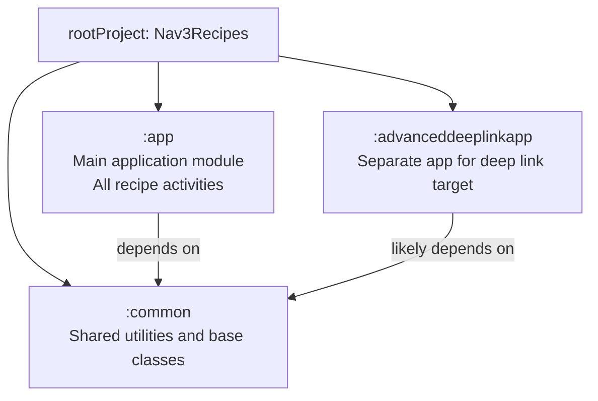

**Module Responsibilities:**

| Module | Purpose | Configuration |
|--------|---------|---------------|
| `:app` | Main application containing all recipe activities and RecipePickerActivity | [app/build.gradle.kts]() |
| `:common` | Shared utility functions, base composables, and common configuration | Not shown in provided files |
| `:advanceddeeplinkapp` | Standalone application simulating cross-app deep linking | Not shown in provided files |

**Sources:** [settings.gradle.kts:48-51]()

## Version Catalog Configuration

The project uses Gradle's version catalog feature to centralize dependency version management in [gradle/libs.versions.toml](). This file defines all versions, libraries, and plugins used across modules.

### Version Declarations

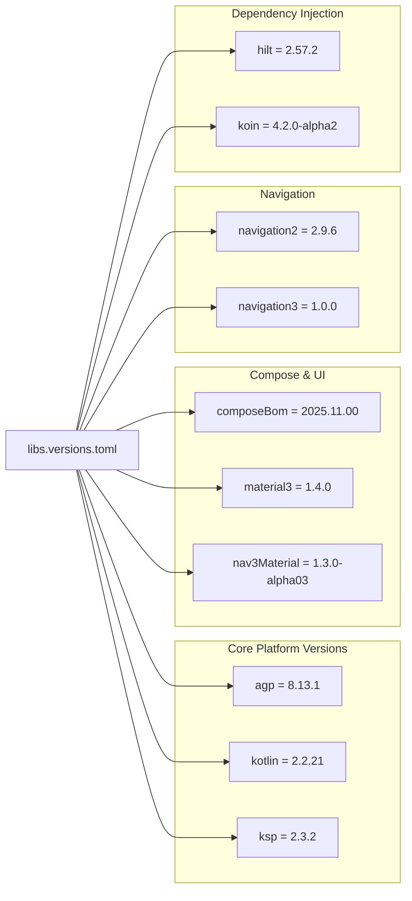

**Key Version Specifications:**

| Category | Artifact | Version | Reference |
|----------|----------|---------|-----------|
| Build System | Android Gradle Plugin | 8.13.1 | [gradle/libs.versions.toml:16]() |
| Language | Kotlin | 2.2.21 | [gradle/libs.versions.toml:17]() |
| UI Framework | Compose BOM | 2025.11.00 | [gradle/libs.versions.toml:26]() |
| Navigation | Navigation 3 Runtime | 1.0.0 | [gradle/libs.versions.toml:28]() |
| Navigation | Navigation 2 Compose | 2.9.6 | [gradle/libs.versions.toml:27]() |
| DI (Compile-time) | Hilt | 2.57.2 | [gradle/libs.versions.toml:32]() |
| DI (Runtime) | Koin | 4.2.0-alpha2 | [gradle/libs.versions.toml:34]() |
| Annotation Processing | KSP | 2.3.2 | [gradle/libs.versions.toml:31]() |

**Sources:** [gradle/libs.versions.toml:15-34]()

### Library Declarations

The version catalog defines library dependencies using the `[libraries]` section:

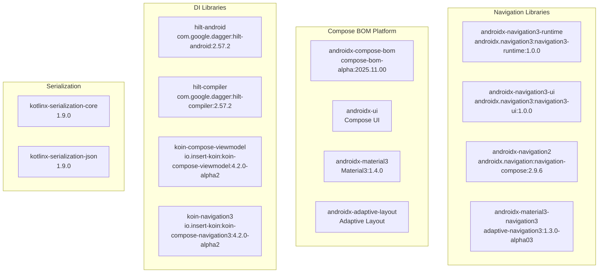

**Sources:** [gradle/libs.versions.toml:36-65]()

### Plugin Declarations

Plugins are declared in the `[plugins]` section and applied using the `alias()` function:

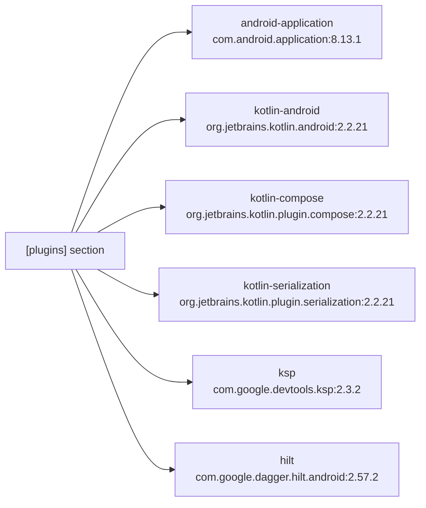

**Sources:** [gradle/libs.versions.toml:67-73]()

## App Module Build Configuration

The `:app` module's build configuration in [app/build.gradle.kts]() applies plugins and declares dependencies.

### Applied Plugins

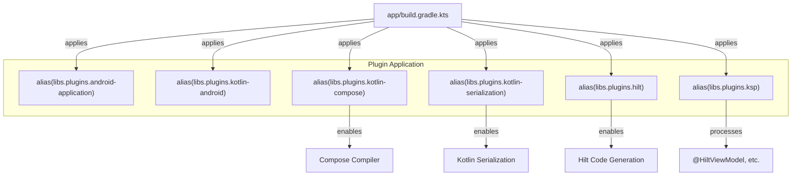

**Sources:** [app/build.gradle.kts:17-24]()

### Android Configuration Block

The `android` configuration block defines compilation and build parameters:

| Property | Value | Location |
|----------|-------|----------|
| `namespace` | `"com.example.nav3recipes"` | [app/build.gradle.kts:27]() |
| `compileSdk` | `36` | [app/build.gradle.kts:28]() |
| `applicationId` | `"com.example.nav3recipes"` | [app/build.gradle.kts:31]() |
| `minSdk` | `24` | [app/build.gradle.kts:32]() |
| `targetSdk` | `35` | [app/build.gradle.kts:33]() |
| `sourceCompatibility` | `JavaVersion.VERSION_11` | [app/build.gradle.kts:50]() |
| `targetCompatibility` | `JavaVersion.VERSION_11` | [app/build.gradle.kts:51]() |
| `jvmTarget` | `"11"` | [app/build.gradle.kts:54]() |

**Sources:** [app/build.gradle.kts:26-58]()

## Dependency Management

The `:app` module declares dependencies using the version catalog references. Dependencies are categorized by purpose:

### Navigation Dependencies

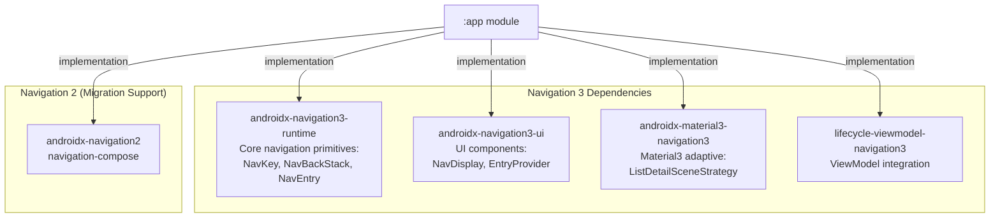

**Sources:** [app/build.gradle.kts:77-82]()

### Compose UI Dependencies

The Compose BOM (Bill of Materials) provides consistent versions for all Compose UI libraries:

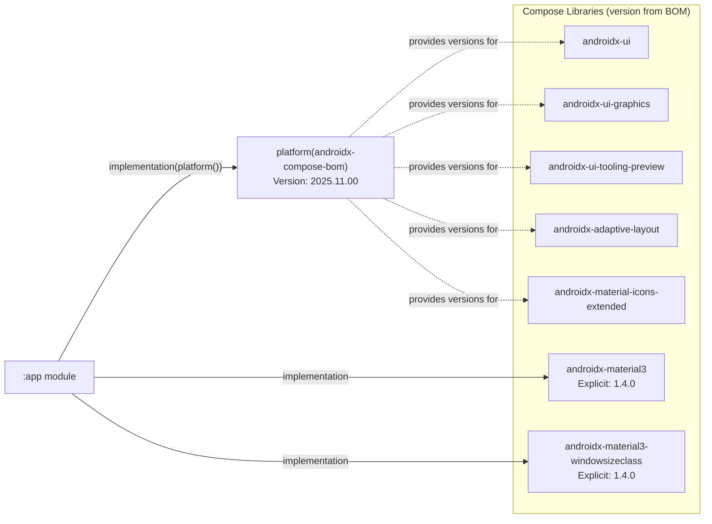

The `platform()` dependency ensures all Compose libraries use compatible versions from the BOM, except for those with explicit version overrides like `material3:1.4.0`.

**Sources:** [app/build.gradle.kts:66-73, 81]()

### Dual Dependency Injection Framework Support

The `:app` module includes both Hilt and Koin to demonstrate both compile-time and runtime DI patterns:

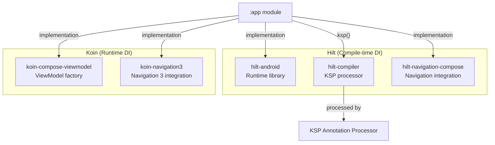

**Hilt Configuration:**
- Runtime: [app/build.gradle.kts:85]()
- Compiler: [app/build.gradle.kts:86]() (processed with KSP)
- Navigation: [app/build.gradle.kts:79]()

**Koin Configuration:**
- ViewModel: [app/build.gradle.kts:87]()
- Navigation 3: [app/build.gradle.kts:88]()

**Sources:** [app/build.gradle.kts:79, 85-88]()

### Serialization Dependencies

kotlinx.serialization is used for NavKey serialization and back stack persistence:

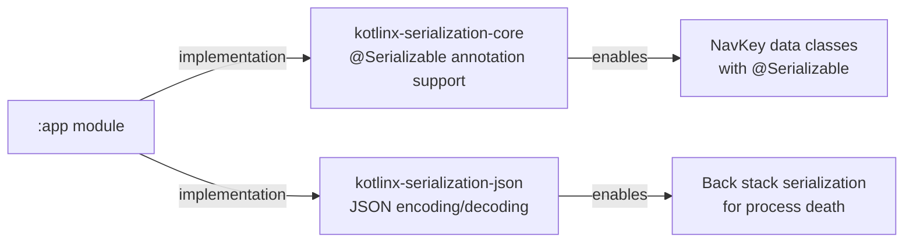

**Sources:** [app/build.gradle.kts:75-76]()

### Complete Dependency Graph

```mermaid
graph TB
    App[":app module"]
    Common[":common module"]
    
    subgraph "Platform Dependencies"
        Core["core-ktx"]
        Lifecycle["lifecycle-runtime-ktx"]
        Activity["activity-compose"]
    end
    
    subgraph "UI & Compose"
        BOM["compose-bom (platform)"]
        UI["ui, ui-graphics, ui-tooling-preview"]
        M3["material3, windowsizeclass"]
        Adaptive["adaptive-layout, material-icons"]
    end
    
    subgraph "Navigation"
        Nav3["navigation3-runtime, navigation3-ui"]
        Nav3M["material3-navigation3"]
        Nav2["navigation2-compose"]
        VM["lifecycle-viewmodel-navigation3"]
    end
    
    subgraph "Serialization"
        Ser["kotlinx-serialization-core/json"]
    end
    
    subgraph "Hilt DI"
        Hilt["hilt-android, hilt-navigation-compose"]
        HiltCompiler["hilt-compiler (ksp)"]
    end
    
    subgraph "Koin DI"
        Koin["koin-compose-viewmodel, koin-navigation3"]
    end
    
    subgraph "Testing"
        JUnit["junit, androidx-junit"]
        Espresso["espresso-core"]
        UITest["ui-test-junit4"]
    end
    
    App -->|"implementation"| Common
    App -->|"implementation"| Core
    App -->|"implementation"| Lifecycle
    App -->|"implementation"| Activity
    App -->|"implementation(platform)"| BOM
    App -->|"implementation"| UI
    App -->|"implementation"| M3
    App -->|"implementation"| Adaptive
    App -->|"implementation"| Nav3
    App -->|"implementation"| Nav3M
    App -->|"implementation"| Nav2
    App -->|"implementation"| VM
    App -->|"implementation"| Ser
    App -->|"implementation"| Hilt
    App -->|"ksp"| HiltCompiler
    App -->|"implementation"| Koin
    App -->|"testImplementation"| JUnit
    App -->|"androidTestImplementation"| Espresso
    App -->|"androidTestImplementation"| UITest
```

**Sources:** [app/build.gradle.kts:61-98]()

## Repository Configuration

The repository sources for dependencies are configured in [settings.gradle.kts]():

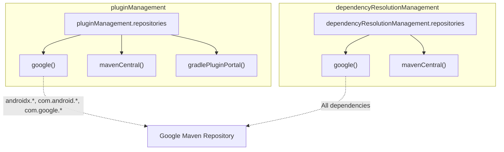

**Configuration Details:**

| Section | Purpose | Repositories | Location |
|---------|---------|--------------|----------|
| `pluginManagement` | Plugin resolution | Google (filtered), Maven Central, Gradle Plugin Portal | [settings.gradle.kts:17-33]() |
| `dependencyResolutionManagement` | Library resolution | Google, Maven Central | [settings.gradle.kts:35-45]() |
| `repositoriesMode` | `FAIL_ON_PROJECT_REPOS` (enforces centralized config) | - | [settings.gradle.kts:36]() |

**Sources:** [settings.gradle.kts:17-45]()

## Snapshot Artifacts Configuration

The project includes commented-out configuration for using AndroidX snapshot builds. To use snapshot artifacts:

1. Uncomment the `maven` block in both `pluginManagement` and `dependencyResolutionManagement` sections
2. Replace `<build_id>` with the desired snapshot build ID from androidx.dev
3. Example URL format: `https://androidx.dev/snapshots/builds/<build_id>/artifacts/repository`

**Sources:** [settings.gradle.kts:30-32, 42-44]()

## Build Configuration Summary

**Key Build System Features:**

| Feature | Implementation | Purpose |
|---------|----------------|---------|
| Version Catalog | `gradle/libs.versions.toml` | Centralized version management |
| Multi-Module | `:app`, `:common`, `:advanceddeeplinkapp` | Feature separation and code reuse |
| Dual DI Support | Hilt + Koin | Demonstrate both compile-time and runtime DI |
| Compose Compiler | Kotlin Compose Plugin 2.2.21 | Jetpack Compose support |
| Serialization | Kotlin Serialization Plugin | NavKey and back stack serialization |
| KSP | Version 2.3.2 | Annotation processing for Hilt |
| BOM Management | Compose BOM 2025.11.00 | Consistent Compose library versions |

**Sources:** [gradle/libs.versions.toml](), [app/build.gradle.kts](), [settings.gradle.kts]()

---

