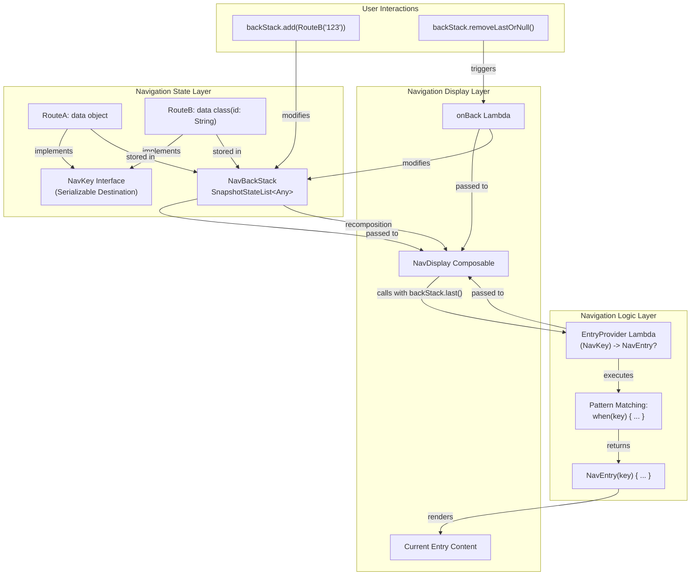
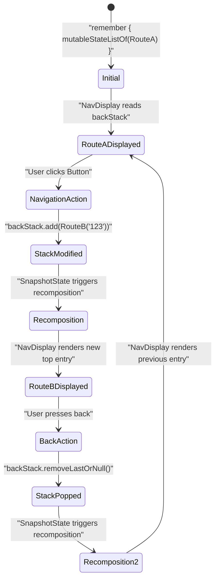
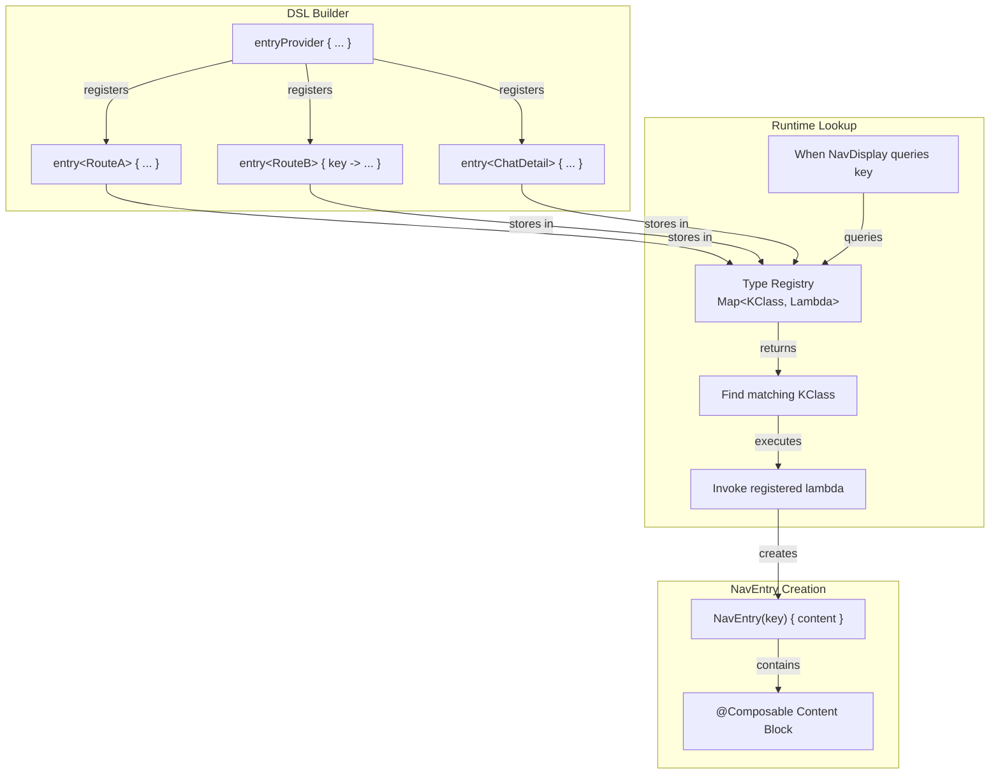
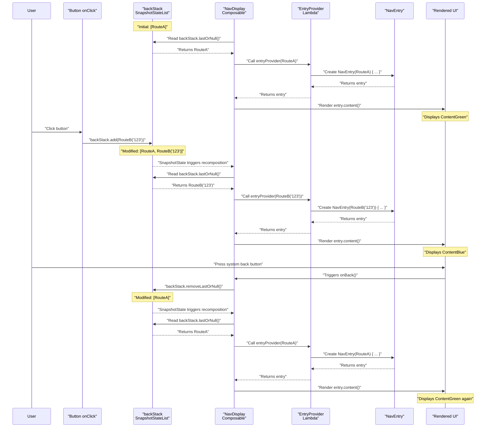
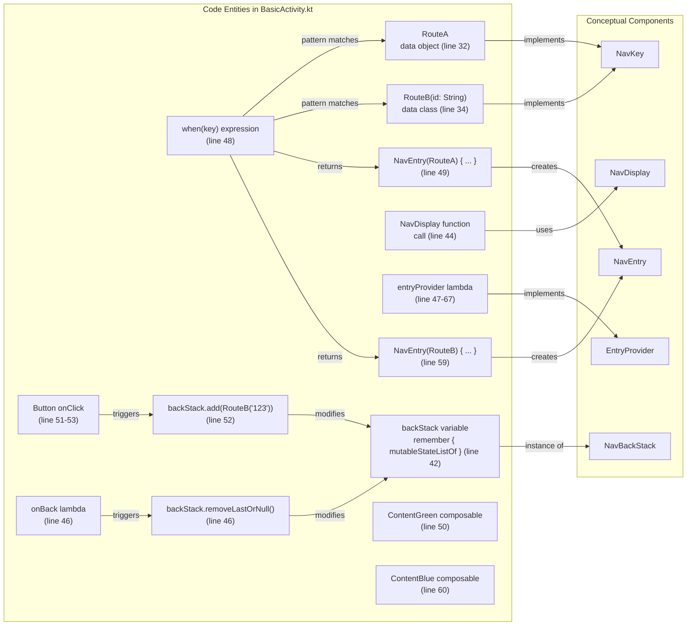

<!-- source: DeepWiki mcp.deepwiki.com · repo android/nav3-recipes · page 2.2 Core Navigation 3 Concepts · fetched 2026-10-23 -->

# Core Navigation 3 Concepts

<details>
<summary>Relevant source files</summary>

The following files were used as context for generating this wiki page:

- [app/src/main/java/com/example/nav3recipes/basic/BasicActivity.kt](app/src/main/java/com/example/nav3recipes/basic/BasicActivity.kt)
- [app/src/main/java/com/example/nav3recipes/basicsaveable/BasicSaveableActivity.kt](app/src/main/java/com/example/nav3recipes/basicsaveable/BasicSaveableActivity.kt)
- [app/src/main/java/com/example/nav3recipes/commonui/CommonUiActivity.kt](app/src/main/java/com/example/nav3recipes/commonui/CommonUiActivity.kt)
- [app/src/main/java/com/example/nav3recipes/content/Content.kt](app/src/main/java/com/example/nav3recipes/content/Content.kt)

</details>


## Purpose and Scope

This page explains the fundamental building blocks of Jetpack Navigation 3: `NavKey`, `NavBackStack`, `NavDisplay`, `EntryProvider`, and `NavEntry`. These components form the reactive architecture that powers type-safe, composable navigation in Android applications.

This document covers the core API concepts and how they interact. For information about specific navigation patterns like multiple back stacks, see [Multiple Back Stacks Pattern](#5.1). For details on Scene-based adaptive layouts, see [Scene System Overview](#6.1). For state persistence mechanisms, see [Saveable Back Stack](#3.3).

---

## Core Components Overview

Navigation 3 implements a reactive navigation system where navigation state is stored in an observable data structure and automatically triggers UI updates through Compose. The architecture separates three concerns:

1. **Navigation State**: What destinations are in the back stack
2. **Navigation Logic**: How to map destinations to UI content  
3. **Navigation Display**: How to render the current destination

| Component | Type | Purpose |
|-----------|------|---------|
| `NavKey` | Interface/Marker | Type-safe representation of a destination |
| `NavBackStack` | `SnapshotStateList<NavKey>` | Observable list storing navigation history |
| `NavDisplay` | `@Composable` | Renderer that displays the top entry from the back stack |
| `EntryProvider` | `(NavKey) -> NavEntry?` | Function mapping keys to renderable entries |
| `NavEntry` | Class | Wrapper containing a key and its composable content |

**Sources:**
- [app/src/main/java/com/example/nav3recipes/basic/BasicActivity.kt:36-71]()
- [app/src/main/java/com/example/nav3recipes/basicsaveable/BasicSaveableActivity.kt:39-74]()

---

## Architecture Diagram: Core Components and Data Flow



**Sources:**
- [app/src/main/java/com/example/nav3recipes/basic/BasicActivity.kt:42-68]()

---

## NavKey: Type-Safe Destinations

`NavKey` is a marker interface representing a navigation destination. Routes are implemented as Kotlin data classes or data objects that can carry arguments.

### Basic Route Definitions

The simplest approach uses plain Kotlin types without serialization:

**Example from BasicActivity:**
```kotlin
private data object RouteA
private data class RouteB(val id: String)
```

These routes can be any type (`Any`) and are stored directly in the back stack. This approach works for simple navigation but does not survive process death.

[app/src/main/java/com/example/nav3recipes/basic/BasicActivity.kt:32-34]()

### Serializable Routes with NavKey

For state preservation across configuration changes and process death, routes implement the `NavKey` interface and use `@Serializable`:

**Example from BasicSaveableActivity:**
```kotlin
@Serializable
private data object RouteA : NavKey

@Serializable  
private data class RouteB(val id: String) : NavKey
```

The `NavKey` interface enables automatic serialization through `kotlinx.serialization`. The `rememberNavBackStack` composable function handles serialization and restoration.

[app/src/main/java/com/example/nav3recipes/basicsaveable/BasicSaveableActivity.kt:33-37]()

### Route Design Patterns

| Pattern | Usage | Example |
|---------|-------|---------|
| `data object` | Routes with no arguments | `data object Home : NavKey` |
| `data class` | Routes with arguments | `data class UserProfile(val userId: String) : NavKey` |
| Type parameter | Routes from sealed interface | `sealed interface TopLevelRoute` |

**Sources:**
- [app/src/main/java/com/example/nav3recipes/basic/BasicActivity.kt:32-34]()
- [app/src/main/java/com/example/nav3recipes/basicsaveable/BasicSaveableActivity.kt:33-37]()

---

## NavBackStack: Navigation State Container

`NavBackStack` is a type alias for Compose's `SnapshotStateList`, which provides observable state that automatically triggers recomposition when modified.

### Creating a Back Stack

**Non-Saveable Approach:**
```kotlin
val backStack = remember { mutableStateListOf<Any>(RouteA) }
```

This creates a back stack initialized with `RouteA` as the start destination. The type is `SnapshotStateList<Any>`, allowing any route type.

[app/src/main/java/com/example/nav3recipes/basic/BasicActivity.kt:42]()

**Saveable Approach:**
```kotlin
val backStack = rememberNavBackStack(RouteA)
```

This creates a back stack that survives configuration changes and process death by serializing the back stack state. Requires routes to implement `NavKey` and be `@Serializable`.

[app/src/main/java/com/example/nav3recipes/basicsaveable/BasicSaveableActivity.kt:45]()

### Back Stack Operations

| Operation | Function | Effect |
|-----------|----------|--------|
| Push | `backStack.add(key)` | Adds destination to end of list |
| Pop | `backStack.removeLastOrNull()` | Removes and returns last destination |
| Read current | `backStack.lastOrNull()` | Returns current destination without removing |
| Clear and replace | `backStack.clear(); backStack.add(key)` | Replaces entire stack |

The back stack is observable: any modification triggers recomposition of composables reading from it.

### Back Stack State Flow Diagram



**Sources:**
- [app/src/main/java/com/example/nav3recipes/basic/BasicActivity.kt:42]()
- [app/src/main/java/com/example/nav3recipes/basicsaveable/BasicSaveableActivity.kt:45]()

---

## NavDisplay: The Rendering Coordinator

`NavDisplay` is a composable function that renders the current navigation entry based on the back stack state. It coordinates between the back stack, entry provider, and back button handling.

### NavDisplay Function Signature

```kotlin
@Composable
fun NavDisplay(
    backStack: SnapshotStateList<Any>,
    onBack: () -> Unit,
    entryProvider: (Any) -> NavEntry?
)
```

### Parameters

| Parameter | Type | Purpose |
|-----------|------|---------|
| `backStack` | `SnapshotStateList<Any>` | Observable navigation history |
| `onBack` | `() -> Unit` | Callback for system back button press |
| `entryProvider` | `(Any) -> NavEntry?` | Function mapping keys to entries |

### NavDisplay Behavior

1. **Reads Current Entry**: Calls `backStack.lastOrNull()` to get the current destination
2. **Maps to Content**: Invokes `entryProvider(key)` to obtain the `NavEntry`
3. **Renders Content**: Displays the composable content from the entry
4. **Handles Back**: Invokes `onBack` lambda when system back button is pressed

### Basic Usage Example

```kotlin
NavDisplay(
    backStack = backStack,
    onBack = { backStack.removeLastOrNull() },
    entryProvider = { key ->
        when (key) {
            is RouteA -> NavEntry(key) { ContentGreen("Welcome") }
            is RouteB -> NavEntry(key) { ContentBlue("Route: ${key.id}") }
            else -> error("Unknown route: $key")
        }
    }
)
```

The `onBack` parameter typically removes the last entry from the back stack, but can implement custom behavior like preventing back navigation or showing confirmation dialogs.

**Sources:**
- [app/src/main/java/com/example/nav3recipes/basic/BasicActivity.kt:44-68]()

---

## EntryProvider: Key-to-Content Mapping

The `EntryProvider` is a function that maps `NavKey` instances to `NavEntry` objects containing composable UI. Navigation 3 supports two approaches: manual lambda functions and a type-safe DSL.

### Manual Lambda Approach

The manual approach uses a `when` expression to pattern-match on the key:

```kotlin
entryProvider = { key ->
    when (key) {
        is RouteA -> NavEntry(key) {
            ContentGreen("Welcome to Nav3") {
                Button(onClick = { backStack.add(RouteB("123")) }) {
                    Text("Click to navigate")
                }
            }
        }
        is RouteB -> NavEntry(key) {
            ContentBlue("Route id: ${key.id}")
        }
        else -> error("Unknown route: $key")
    }
}
```

This approach provides explicit control but requires manual type checking and error handling.

[app/src/main/java/com/example/nav3recipes/basic/BasicActivity.kt:47-67]()

### Entry Provider DSL Approach

The DSL approach provides type-safe route registration using the `entryProvider` builder function:

```kotlin
entryProvider = entryProvider {
    entry<RouteA> {
        ContentGreen("Welcome to Nav3") {
            Button(onClick = { backStack.add(RouteB("123")) }) {
                Text("Click to navigate")
            }
        }
    }
    entry<RouteB> { key ->
        ContentBlue("Route id: ${key.id}")
    }
}
```

The `entry<T>` function registers a composable for a specific route type. The lambda receives the typed key as a parameter, eliminating manual casting.

[app/src/main/java/com/example/nav3recipes/commonui/CommonUiActivity.kt:89-106]()

### EntryProvider DSL Architecture



**Sources:**
- [app/src/main/java/com/example/nav3recipes/basic/BasicActivity.kt:47-67]()
- [app/src/main/java/com/example/nav3recipes/commonui/CommonUiActivity.kt:89-106]()

---

## NavEntry: Entry Wrapper

`NavEntry` is a class that wraps a navigation key with its composable content and optional metadata. It represents a complete navigation destination ready to be rendered.

### NavEntry Constructor

```kotlin
NavEntry(
    key: NavKey,
    content: @Composable () -> Unit
)
```

The constructor takes:
- **key**: The navigation destination identifier
- **content**: A composable lambda defining the UI

### Usage in Entry Provider

```kotlin
NavEntry(key) {
    ContentGreen("Welcome to Nav3") {
        Button(onClick = { backStack.add(RouteB("123")) }) {
            Text("Click to navigate")
        }
    }
}
```

The content lambda has access to the surrounding scope, including the back stack for navigation operations.

[app/src/main/java/com/example/nav3recipes/basic/BasicActivity.kt:49-56]()

### Entry Metadata for Scenes

`NavEntry` instances can include metadata that `SceneStrategy` implementations use to determine layout behavior. This enables adaptive multi-pane layouts. For example:

```kotlin
entry<UserList> {
    NavEntry(
        key = UserList,
        metadata = metadata { listPane() }
    ) {
        UserListContent()
    }
}
```

The metadata indicates which pane role this entry can fulfill in adaptive layouts. See [Scene System Overview](#6.1) for details on metadata and scenes.

**Sources:**
- [app/src/main/java/com/example/nav3recipes/basic/BasicActivity.kt:49-56]()
- [app/src/main/java/com/example/nav3recipes/basic/BasicActivity.kt:59-61]()

---

## Complete Navigation Flow

The following diagram illustrates how all core components work together during a navigation operation:



**Sources:**
- [app/src/main/java/com/example/nav3recipes/basic/BasicActivity.kt:36-71]()

---

## Code Entity Mapping: BasicActivity Example

This diagram maps the conceptual navigation components to their concrete implementations in `BasicActivity.kt`:



**Sources:**
- [app/src/main/java/com/example/nav3recipes/basic/BasicActivity.kt:32-71]()

---

## Comparison: Basic vs Saveable Navigation

| Aspect | BasicActivity | BasicSaveableActivity |
|--------|---------------|----------------------|
| Route Definition | `data object RouteA` | `@Serializable data object RouteA : NavKey` |
| Back Stack Creation | `remember { mutableStateListOf(RouteA) }` | `rememberNavBackStack(RouteA)` |
| Type Safety | Any type | `NavKey` constraint |
| Configuration Changes | State lost | State preserved |
| Process Death | State lost | State restored via serialization |
| Serialization Requirement | None | `@Serializable` annotation required |
| Use Case | Prototyping, simple flows | Production apps |

**Sources:**
- [app/src/main/java/com/example/nav3recipes/basic/BasicActivity.kt:32-71]()
- [app/src/main/java/com/example/nav3recipes/basicsaveable/BasicSaveableActivity.kt:33-74]()

---

## Key Takeaways

1. **NavKey**: Type-safe route definitions that can be data objects (no args) or data classes (with args)
2. **NavBackStack**: Observable `SnapshotStateList` that automatically triggers recomposition on changes
3. **NavDisplay**: Composable that reads the back stack and renders the current destination
4. **EntryProvider**: Function (manual lambda or DSL) that maps keys to `NavEntry` instances
5. **NavEntry**: Wrapper containing a key and its composable content

These five components form a reactive, type-safe navigation system where:
- State changes (back stack modifications) automatically trigger UI updates
- Navigation logic is separated from UI definition
- Routes carry type-safe arguments as data class properties
- The system integrates naturally with Compose's declarative paradigm

For more advanced patterns building on these concepts, see:
- [Entry Provider DSL](#3.2) for cleaner route registration
- [Saveable Back Stack](#3.3) for state preservation
- [Scene System Overview](#6.1) for adaptive layouts
- [Multiple Back Stacks Pattern](#5.1) for tab-based navigation

**Sources:**
- [app/src/main/java/com/example/nav3recipes/basic/BasicActivity.kt:36-71]()
- [app/src/main/java/com/example/nav3recipes/basicsaveable/BasicSaveableActivity.kt:39-74]()
- [app/src/main/java/com/example/nav3recipes/commonui/CommonUiActivity.kt:86-111]()

---

