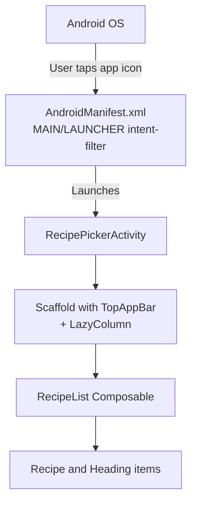
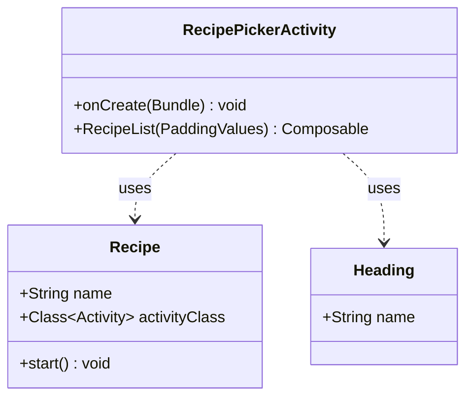
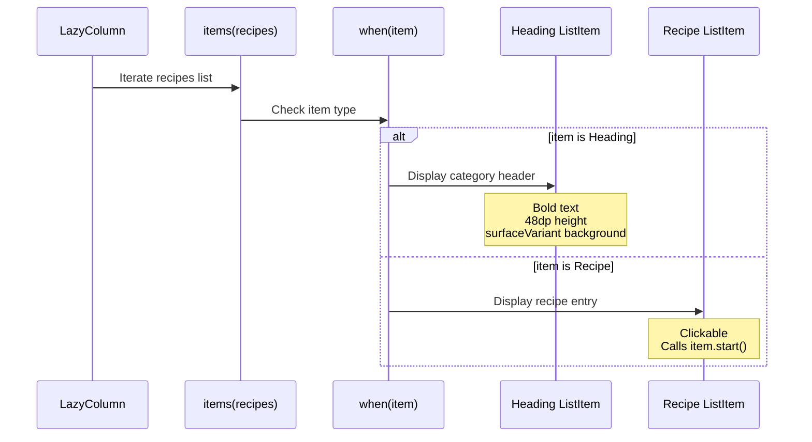
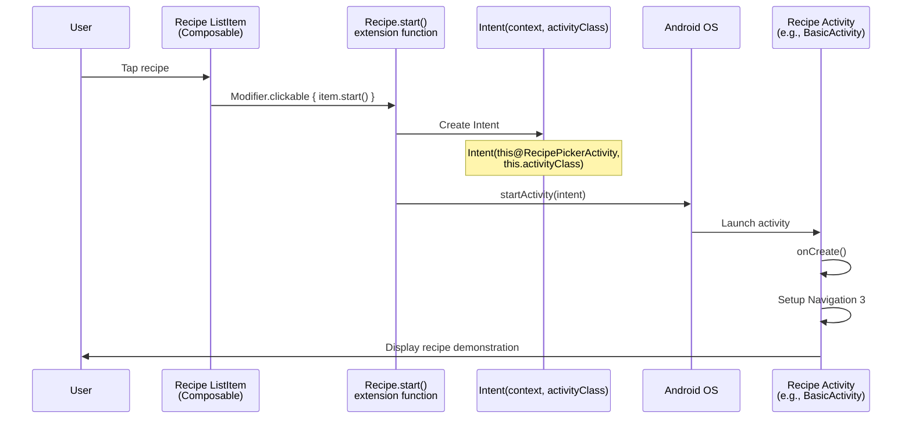
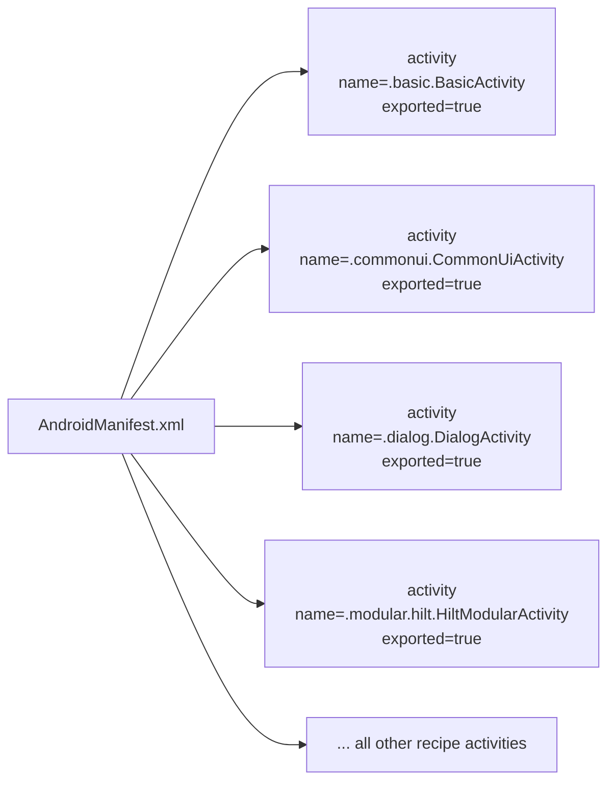
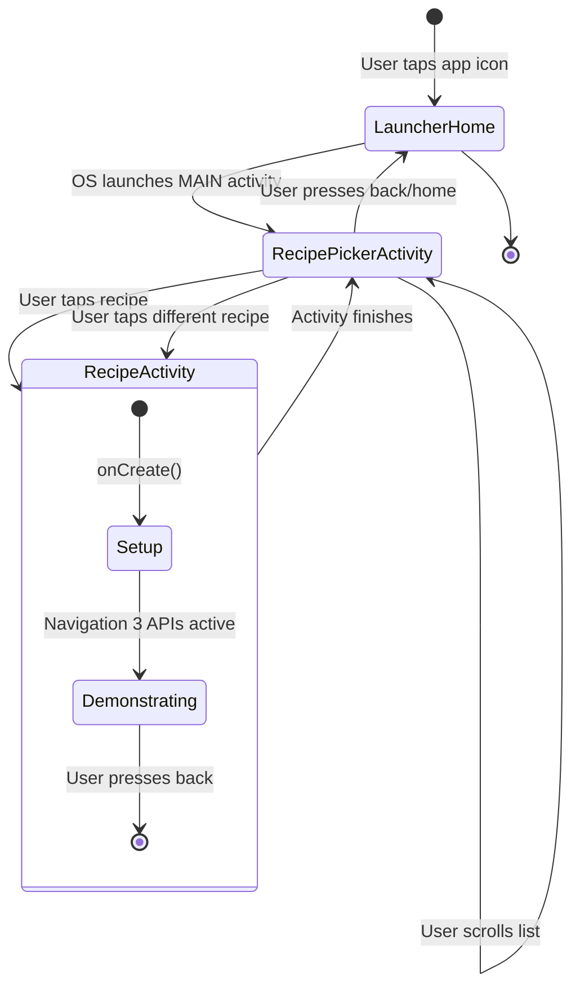
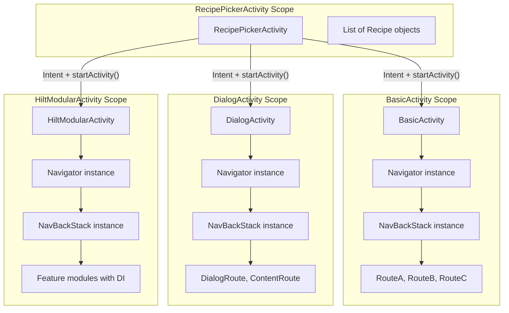

<!-- source: DeepWiki mcp.deepwiki.com · repo android/nav3-recipes · page 2.3 Running Recipe Examples · fetched 2026-10-23 -->

# Running Recipe Examples

Relevant source files

The following files were used as context for generating this wiki page:

- [README.md](README.md)
- [app/src/main/AndroidManifest.xml](app/src/main/AndroidManifest.xml)
- [app/src/main/java/com/example/nav3recipes/RecipePickerActivity.kt](app/src/main/java/com/example/nav3recipes/RecipePickerActivity.kt)

This page explains how to use `RecipePickerActivity` to browse, select, and launch individual recipe demonstrations. Each recipe is a self-contained example that demonstrates a specific Navigation 3 feature or pattern.

For information about the core Navigation 3 concepts demonstrated in these recipes, see [Core Navigation 3 Concepts](#2.2). For details on the project structure and build configuration, see [Project Setup and Build Configuration](#2.1).

## Overview

The nav3-recipes application uses a **hub-and-spoke architecture** where `RecipePickerActivity` serves as the central launcher. Each recipe runs in its own separate `Activity`, allowing complete isolation between examples. This design ensures that:

- Each recipe demonstrates exactly one concept without interference from other recipes
- Recipes can be understood independently without cross-dependencies
- Adding new recipes requires no changes to existing recipe code

**Sources:** [app/src/main/java/com/example/nav3recipes/RecipePickerActivity.kt:68-73]()

## Application Entry Point

### Launch Configuration

`RecipePickerActivity` is configured as the main launcher activity in the application manifest. When the user taps the app icon, Android OS launches this activity.

**Manifest Configuration:**

| Configuration | Value | Location |
|--------------|-------|----------|
| Activity name | `RecipePickerActivity` | [app/src/main/AndroidManifest.xml:34]() |
| Intent action | `android.intent.action.MAIN` | [app/src/main/AndroidManifest.xml:39]() |
| Intent category | `android.intent.category.LAUNCHER` | [app/src/main/AndroidManifest.xml:40]() |
| Theme | `@style/Theme.Nav3Recipes` | [app/src/main/AndroidManifest.xml:37]() |
| Exported | `true` | [app/src/main/AndroidManifest.xml:35]() |

**Sources:** [app/src/main/AndroidManifest.xml:33-42]()

### Activity Initialization

When `RecipePickerActivity.onCreate()` executes, it:

1. Applies edge-to-edge display configuration via `setEdgeToEdgeConfig()`
2. Sets Compose UI content using `setContent {}`
3. Renders a `Scaffold` with a `TopAppBar` titled "Recipes"
4. Displays the scrollable recipe list in the content area

**Sources:** [app/src/main/java/com/example/nav3recipes/RecipePickerActivity.kt:120-138]()

## Recipe Organization Structure

### Data Model

The recipe list uses two data classes to structure content:

| Class | Properties | Purpose |
|-------|-----------|---------|
| `Recipe` | `name: String` `activityClass: Class<out Activity>` | Represents a launchable recipe example with display name and target Activity |
| `Heading` | `name: String` | Represents a category header for organizing recipes into logical groups |

**Sources:** [app/src/main/java/com/example/nav3recipes/RecipePickerActivity.kt:70-75]()

### Recipe Categories

The recipes are organized into the following categories in the order displayed:

```mermaid
graph TD
    Root["recipes: List~Any~"]
    
    Root --> Basic["Basic API recipes"]
    Root --> Layouts["Layouts using Scenes"]
    Root --> Material["Material adaptive layouts"]
    Root --> Animations["Animations"]
    Root --> Common["Common use cases"]
    Root --> Architecture["Architecture"]
    Root --> ViewModels["Passing navigation arguments using ViewModels"]
    Root --> Results["Returning Results"]
    Root --> DeepLink["Deeplink"]
    
    Basic --> BasicActivity["Recipe: Basic → BasicActivity"]
    Basic --> BasicDslActivity["Recipe: Basic DSL → BasicDslActivity"]
    Basic --> BasicSaveableActivity["Recipe: Basic Saveable → BasicSaveableActivity"]
    
    Layouts --> ListDetailActivity["Recipe: List-detail → ListDetailActivity"]
    Layouts --> TwoPaneActivity["Recipe: Two pane → TwoPaneActivity"]
    Layouts --> BottomSheetActivity["Recipe: Bottom Sheet → BottomSheetActivity"]
    Layouts --> DialogActivity["Recipe: Dialog → DialogActivity"]
    
    Material --> MaterialListDetailActivity["Recipe: Material list-detail layout → MaterialListDetailActivity"]
    Material --> MaterialSupportingPaneActivity["Recipe: Material supporting-pane layout → MaterialSupportingPaneActivity"]
    
    Animations --> AnimatedActivity["Recipe: NavDisplay and NavEntry animations → AnimatedActivity"]
    
    Common --> CommonUiActivity["Recipe: Common UI → CommonUiActivity"]
    Common --> MultipleStacksActivity["Recipe: Multiple Stacks → MultipleStacksActivity"]
    Common --> ConditionalActivity["Recipe: Conditional navigation → ConditionalActivity"]
    
    Architecture --> HiltModularActivity["Recipe: Hilt - Modular Navigation → HiltModularActivity"]
    Architecture --> KoinModularActivity["Recipe: Koin - Modular Navigation → KoinModularActivity"]
    
    ViewModels --> BasicViewModelsActivity["Recipe: Basic → BasicViewModelsActivity"]
    ViewModels --> HiltViewModelsActivity["Recipe: Using Hilt → HiltViewModelsActivity"]
    ViewModels --> KoinViewModelsActivity["Recipe: Using Koin → KoinViewModelsActivity"]
    
    Results --> ResultEventActivity["Recipe: Return result as Event → ResultEventActivity"]
    Results --> ResultStateActivity["Recipe: Return result as State → ResultStateActivity"]
    
    DeepLink --> CreateDeepLinkActivity["Recipe: Parse Intent → CreateDeepLinkActivity"]
```

**Recipe Count by Category:**

| Category | Recipe Count | Example Recipes |
|----------|-------------|-----------------|
| Basic API recipes | 3 | Basic, Basic DSL, Basic Saveable |
| Layouts using Scenes | 4 | List-detail, Two pane, Bottom Sheet, Dialog |
| Material adaptive layouts | 2 | Material list-detail, Material supporting-pane |
| Animations | 1 | NavDisplay and NavEntry animations |
| Common use cases | 3 | Common UI, Multiple Stacks, Conditional navigation |
| Architecture | 2 | Hilt - Modular, Koin - Modular |
| Passing navigation arguments using ViewModels | 3 | Basic, Using Hilt, Using Koin |
| Returning Results | 2 | Return result as Event, Return result as State |
| Deeplink | 1 | Parse Intent |

**Sources:** [app/src/main/java/com/example/nav3recipes/RecipePickerActivity.kt:77-116]()

## UI Implementation

### LazyColumn Layout

The recipe list is rendered using a `LazyColumn` that displays both `Heading` and `Recipe` items:

**Heading ListItem Configuration:**
- Text: Bold font weight
- Height: `48.dp`
- Background: `MaterialTheme.colorScheme.surfaceVariant`
- Non-clickable

**Recipe ListItem Configuration:**
- Text: Regular font weight
- Modifier: `.clickable { item.start() }`
- Background: Default `ListItem` colors
- Launches activity on click

**Sources:** [app/src/main/java/com/example/nav3recipes/RecipePickerActivity.kt:141-176]()

## Launching a Recipe

### Recipe Launch Mechanism

When a user taps a recipe in the list, the following sequence executes:

**Implementation Details:**

The `Recipe.start()` extension function performs the launch:

| Step | Code Entity | Action |
|------|------------|--------|
| 1 | `Recipe.start()` | Extension function invoked by clickable modifier |
| 2 | `Intent` constructor | Creates intent targeting `this.activityClass` |
| 3 | `startActivity(intent)` | Launches the recipe activity |

**Sources:** [app/src/main/java/com/example/nav3recipes/RecipePickerActivity.kt:154-156](), [app/src/main/java/com/example/nav3recipes/RecipePickerActivity.kt:178-181]()

### Recipe Activity Declaration

All recipe activities must be declared in `AndroidManifest.xml` with `android:exported="true"` to be launchable. Example declarations:

Each recipe activity declaration follows this pattern:
- `android:name` attribute specifying the fully-qualified class name
- `android:exported="true"` allowing the activity to be launched
- `android:theme="@style/Theme.Nav3Recipes"` applying the app theme

**Sources:** [app/src/main/AndroidManifest.xml:43-145]()

## Navigation Flow

### Complete User Journey

The typical navigation flow through the recipe picker:

### Back Navigation Behavior

| Current Screen | Back Press Action | Result |
|----------------|------------------|--------|
| `RecipePickerActivity` | Standard back press | App exits to launcher |
| Any recipe activity (e.g., `BasicActivity`) | Standard back press | Recipe activity finishes, returns to `RecipePickerActivity` |
| Within a recipe's Navigation 3 back stack | Back gesture | Pops Navigation 3 back stack (handled by recipe's `Navigator`) |

**Key Points:**
- `RecipePickerActivity` maintains its state when returning from a recipe
- The `LazyColumn` scroll position is preserved
- Each recipe activity manages its own Navigation 3 state independently
- No shared state exists between recipe activities

**Sources:** [app/src/main/java/com/example/nav3recipes/RecipePickerActivity.kt:118-182]()

## Recipe Activity Isolation

### Self-Contained Architecture

Each recipe activity operates independently with the following characteristics:

**Isolation Guarantees:**

| Aspect | Implementation |
|--------|---------------|
| Navigation State | Each recipe creates its own `rememberNavBackStack()` or `rememberSaveableNavBackStack()` |
| Navigator Instance | Each recipe instantiates its own `Navigator` class |
| Route Definitions | Each recipe defines its own `NavKey` implementations in its package |
| Lifecycle | Each recipe activity has independent lifecycle callbacks |
| Dependencies | Recipes using DI (Hilt/Koin) have isolated dependency scopes |

This isolation allows recipes to:
- Demonstrate patterns without side effects on other recipes
- Use conflicting implementations of the same pattern
- Be understood in isolation without cross-referencing other code

**Sources:** [app/src/main/java/com/example/nav3recipes/RecipePickerActivity.kt:1-183](), [app/src/main/AndroidManifest.xml:33-145]()

## Finding Specific Recipes

To locate a specific recipe quickly:

1. **Scroll through categories** - Recipes are grouped logically by feature area
2. **Use category headers** - Bold, highlighted headers mark each category boundary
3. **Match recipe names to wiki pages** - Recipe names correspond to wiki documentation sections

**Common Recipe Name Mappings:**

| If you want to learn about... | Look for recipe... | See wiki page... |
|-------------------------------|-------------------|------------------|
| Basic navigation setup | "Basic" under Basic API recipes | [Basic Navigation](#4.1) |
| State preservation | "Basic Saveable" under Basic API recipes | [Saveable Back Stack](#4.3) |
| Dialog overlays | "Dialog" under Layouts using Scenes | [Dialog and BottomSheet Scenes](#6.4) |
| Adaptive UI with Material | "Material list-detail layout" under Material adaptive layouts | [Material3 Adaptive Layouts](#6.5) |
| Multiple independent stacks | "Multiple Stacks" under Common use cases | [Multiple Back Stacks Pattern](#5.1) |
| ViewModel with Hilt | "Using Hilt" under Passing navigation arguments using ViewModels | [Hilt Injected ViewModels](#9.2) |
| Event-based results | "Return result as Event" under Returning Results | [Event-Based Results](#8.1) |

**Sources:** [app/src/main/java/com/example/nav3recipes/RecipePickerActivity.kt:77-116]()

---

