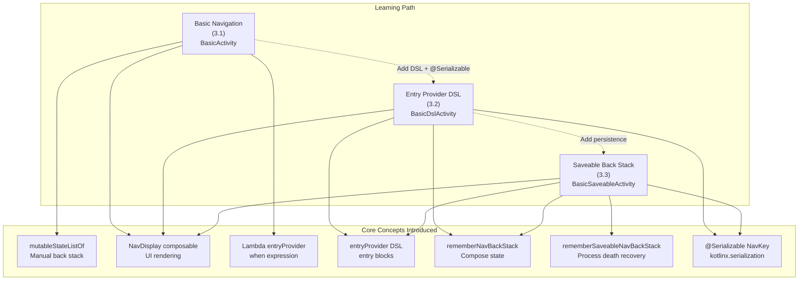
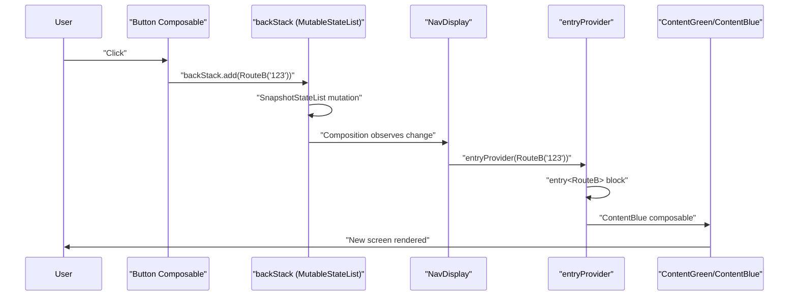
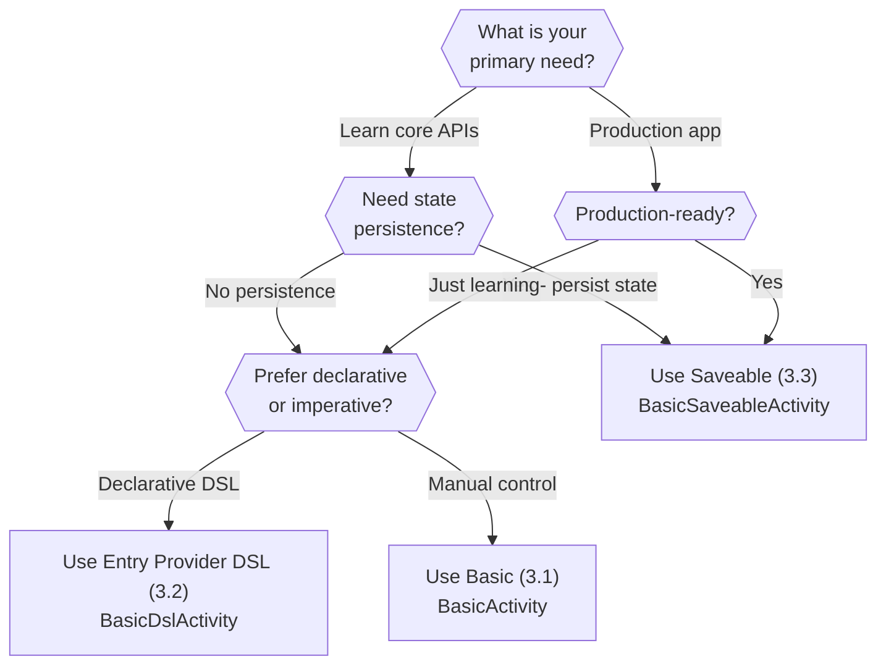

<!-- source: DeepWiki mcp.deepwiki.com · repo android/nav3-recipes · page 3 Basic Navigation Recipes · fetched 2026-10-23 -->

# Basic Navigation Recipes

<details>
<summary>Relevant source files</summary>

The following files were used as context for generating this wiki page:

- [app/src/main/java/com/example/nav3recipes/animations/AnimatedActivity.kt](app/src/main/java/com/example/nav3recipes/animations/AnimatedActivity.kt)
- [app/src/main/java/com/example/nav3recipes/basic/BasicActivity.kt](app/src/main/java/com/example/nav3recipes/basic/BasicActivity.kt)
- [app/src/main/java/com/example/nav3recipes/basicdsl/BasicDslActivity.kt](app/src/main/java/com/example/nav3recipes/basicdsl/BasicDslActivity.kt)
- [app/src/main/java/com/example/nav3recipes/commonui/CommonUiActivity.kt](app/src/main/java/com/example/nav3recipes/commonui/CommonUiActivity.kt)
- [app/src/main/java/com/example/nav3recipes/dialog/DialogActivity.kt](app/src/main/java/com/example/nav3recipes/dialog/DialogActivity.kt)

</details>


## Purpose and Scope

This section covers the foundational Navigation 3 recipes that demonstrate core API usage patterns. These recipes introduce the essential building blocks of Navigation 3: creating navigation keys, managing back stacks, displaying content with `NavDisplay`, and handling state persistence. Each recipe focuses on a single concept and builds progressively from minimal setup to production-ready patterns.

The basic recipes demonstrate:
- Simple screen-to-screen navigation with manual entry provider ([3.1](#3.1))
- Declarative route-to-content mapping using the `entryProvider` DSL ([3.2](#3.2))
- State persistence across configuration changes and process death ([3.3](#3.3))

For advanced multi-stack patterns, see [Multiple Back Stacks and Common UI Patterns](#5). For deep link handling, see [Deep Link Navigation](#4). For ViewModels with navigation arguments, see [ViewModel Integration](#9).

Sources: [app/src/main/java/com/example/nav3recipes/basic/BasicActivity.kt](), [app/src/main/java/com/example/nav3recipes/basicdsl/BasicDslActivity.kt]()

---

## Recipe Categories Overview

The basic navigation recipes are organized into three conceptual categories that form a natural learning progression:

| Category | Recipe | Activity Class | Key Demonstration | Complexity |
|----------|--------|----------------|-------------------|------------|
| **Core API** | Basic Navigation ([3.1](#3.1)) | `BasicActivity` | `NavDisplay`, `mutableStateListOf`, manual `entryProvider` lambda | Minimal |
| **Core API** | Entry Provider DSL ([3.2](#3.2)) | `BasicDslActivity` | `entryProvider { }` DSL with `entry<T>` blocks | Minimal |
| **State Management** | Saveable Back Stack ([3.3](#3.3)) | `BasicSaveableActivity` | `rememberSaveableNavBackStack()` for persistence | Low |

Sources: [app/src/main/java/com/example/nav3recipes/basic/BasicActivity.kt:36](), [app/src/main/java/com/example/nav3recipes/basicdsl/BasicDslActivity.kt:39]()

---

## Recipe Progression and Relationships



**Diagram: Basic Recipe Learning Progression**

This diagram shows how each recipe builds upon core Navigation 3 concepts. Basic Navigation ([3.1](#3.1)) introduces manual back stack management with `mutableStateListOf` and lambda-based entry providers. Entry Provider DSL ([3.2](#3.2)) replaces manual mapping with declarative `entryProvider { }` blocks and adds `@Serializable` annotation to `NavKey` routes. Saveable Back Stack ([3.3](#3.3)) extends the DSL pattern with `rememberSaveableNavBackStack()` for automatic state persistence.

Sources: [app/src/main/java/com/example/nav3recipes/basic/BasicActivity.kt:24-46](), [app/src/main/java/com/example/nav3recipes/basicdsl/BasicDslActivity.kt:24-49]()

---

## Code Entity Architecture for Basic Recipes

```mermaid
graph TB
    subgraph "Basic Recipe Activities"
        BasicAct["BasicActivity<br/>basic/BasicActivity.kt"]
        BasicDslAct["BasicDslActivity<br/>basicdsl/BasicDslActivity.kt"]
        BasicSaveableAct["BasicSaveableActivity<br/>basicsaveable/BasicSaveableActivity.kt"]
    end
    
    subgraph "Route Definitions"
        RouteABasic["data object RouteA<br/>(BasicActivity)"]
        RouteBBasic["data class RouteB(id: String)<br/>(BasicActivity)"]
        RouteADsl["@Serializable<br/>data object RouteA : NavKey"]
        RouteBDsl["@Serializable<br/>data class RouteB(id: String) : NavKey"]
    end
    
    subgraph "Back Stack Creation"
        MutableStateListCall["remember {<br/>  mutableStateListOf<Any>(RouteA)<br/>}"]
        RememberNavBSCall["rememberNavBackStack(RouteA)"]
        RememberSaveableCall["rememberSaveableNavBackStack(RouteA)"]
    end
    
    subgraph "Entry Provider Implementations"
        LambdaProvider["entryProvider = { key -><br/>  when (key) {<br/>    is RouteA -> NavEntry(key) { ... }<br/>    is RouteB -> NavEntry(key) { ... }<br/>  }<br/>}"]
        DSLProvider["entryProvider = entryProvider {<br/>  entry<RouteA> { ... }<br/>  entry<RouteB> { key -> ... }<br/>}"]
    end
    
    subgraph "Content Components"
        ContentGreen["ContentGreen(title)"]
        ContentBlue["ContentBlue(title)"]
        ButtonAdd["Button(onClick = {<br/>  backStack.add(RouteB('123'))<br/>})"]
    end
    
    BasicAct --> RouteABasic
    BasicAct --> RouteBBasic
    BasicAct --> MutableStateListCall
    BasicAct --> LambdaProvider
    BasicAct --> ContentGreen
    BasicAct --> ContentBlue
    BasicAct --> ButtonAdd
    
    BasicDslAct --> RouteADsl
    BasicDslAct --> RouteBDsl
    BasicDslAct --> RememberNavBSCall
    BasicDslAct --> DSLProvider
    BasicDslAct --> ContentGreen
    BasicDslAct --> ContentBlue
    BasicDslAct --> ButtonAdd
    
    BasicSaveableAct --> RouteADsl
    BasicSaveableAct --> RouteBDsl
    BasicSaveableAct --> RememberSaveableCall
    BasicSaveableAct --> DSLProvider
```



**Diagram: Code Entity Mapping for Basic Recipes**

This diagram maps high-level concepts to specific code entities used in the basic recipes. `BasicActivity` uses plain `data object` and `data class` routes with manual `mutableStateListOf` back stack creation and lambda-based entry providers. `BasicDslActivity` introduces `@Serializable` annotations on `NavKey` implementations, switches to `rememberNavBackStack`, and uses the `entryProvider { }` DSL with type-safe `entry<T>` blocks. `BasicSaveableActivity` extends the DSL pattern with `rememberSaveableNavBackStack` for automatic serialization and state restoration.

Sources: [app/src/main/java/com/example/nav3recipes/basic/BasicActivity.kt:32-68](), [app/src/main/java/com/example/nav3recipes/basicdsl/BasicDslActivity.kt:33-64]()

---

## Common Implementation Patterns

All basic recipes share these structural patterns:

### Activity Structure

Each recipe is self-contained in its own `ComponentActivity`:

| Element | Purpose | Code Location |
|---------|---------|---------------|
| **Activity Class** | Hosts the navigation demonstration | `class BasicActivity : ComponentActivity()` |
| **Route Definitions** | Type-safe destination identifiers | `data object RouteA`, `data class RouteB(id: String)` |
| **Back Stack** | Navigation history state | `val backStack = remember { mutableStateListOf<Any>(RouteA) }` or `rememberNavBackStack(RouteA)` |
| **NavDisplay** | Composable that renders current destination | `NavDisplay(backStack, onBack, entryProvider)` |
| **Entry Provider** | Maps routes to composable content | Lambda or `entryProvider { entry<RouteA> { ... } }` |
| **Content Composables** | Screen UI implementations | `ContentGreen`, `ContentBlue` |
| **Navigation Triggers** | User interactions that modify back stack | `Button(onClick = { backStack.add(RouteB("123")) })` |

### NavKey Design Patterns

Basic recipes demonstrate two route patterns:

**Pattern 1: Data object for parameterless routes**
```kotlin
data object RouteA  // BasicActivity
@Serializable data object RouteA : NavKey  // BasicDslActivity
```

**Pattern 2: Data class for routes with arguments**
```kotlin
data class RouteB(val id: String)  // BasicActivity
@Serializable data class RouteB(val id: String) : NavKey  // BasicDslActivity
```

The `@Serializable` annotation is required for `rememberNavBackStack` and `rememberSaveableNavBackStack` to enable automatic serialization.

### Navigation Flow



**Diagram: Basic Navigation Flow**

This sequence shows the reactive data flow pattern used across all basic recipes. User interactions directly modify the `backStack` state list. Because `NavDisplay` observes this state through Compose's snapshot system, any mutation triggers recomposition. The `entryProvider` function (or DSL block) is called with the new route to produce the composable content.

Sources: [app/src/main/java/com/example/nav3recipes/basic/BasicActivity.kt:42-68](), [app/src/main/java/com/example/nav3recipes/basicdsl/BasicDslActivity.kt:45-64]()

---

## Feature Comparison Matrix

| Feature | Basic ([3.1](#3.1)) | Entry Provider DSL ([3.2](#3.2)) | Saveable ([3.3](#3.3)) |
|---------|---------------------|-----------------------------------|------------------------|
| **Back Stack Creation** | `mutableStateListOf<Any>()` | `rememberNavBackStack()` | `rememberSaveableNavBackStack()` |
| **Content Mapping** | Lambda with `when` + `NavEntry()` | `entryProvider { entry<T> { } }` DSL | `entryProvider { entry<T> { } }` DSL |
| **Route Annotation** | None required | `@Serializable` on routes | `@Serializable` on routes |
| **NavKey Interface** | Optional | `NavKey` interface required | `NavKey` interface required |
| **State Persistence** | ❌ Lost on config change | ❌ Lost on config change | ✅ Survives config change & process death |
| **Type Safety** | Manual casting in `when` | Type-safe `entry<RouteA>` blocks | Type-safe `entry<RouteA>` blocks |
| **Boilerplate** | Manual `NavEntry()` construction | Automatic entry creation | Automatic entry creation |
| **Code Location** | [BasicActivity.kt:47-67]() | [BasicDslActivity.kt:50-63]() | N/A (similar to DSL) |

Sources: [app/src/main/java/com/example/nav3recipes/basic/BasicActivity.kt:42-68](), [app/src/main/java/com/example/nav3recipes/basicdsl/BasicDslActivity.kt:33-64]()

---

## When to Use Each Recipe

Use these decision criteria to select the appropriate basic recipe as a starting point:



**Diagram: Recipe Selection Decision Tree**

**Recommendations:**

- **Start with Entry Provider DSL ([3.2](#3.2))**: Most developers should begin here (`BasicDslActivity`) for the cleanest, most maintainable code structure with type-safe `entry<T>` blocks.
- **Use Basic ([3.1](#3.1))** (`BasicActivity`) only if you need to understand the low-level mechanics without DSL abstraction or if you need non-serializable routes.
- **Always use Saveable ([3.3](#3.3))** (`BasicSaveableActivity`) in production apps to prevent data loss during configuration changes and process death.

### Code Pattern Differences

**Basic Navigation** ([app/src/main/java/com/example/nav3recipes/basic/BasicActivity.kt:47-67]()):
```kotlin
entryProvider = { key ->
    when (key) {
        is RouteA -> NavEntry(key) { ContentGreen("...") }
        is RouteB -> NavEntry(key) { ContentBlue("Route id: ${key.id}") }
        else -> error("Unknown route: $key")
    }
}
```

**Entry Provider DSL** ([app/src/main/java/com/example/nav3recipes/basicdsl/BasicDslActivity.kt:50-63]()):
```kotlin
entryProvider = entryProvider {
    entry<RouteA> { ContentGreen("...") }
    entry<RouteB> { key -> ContentBlue("Route id: ${key.id}") }
}
```

The DSL eliminates manual `NavEntry` construction and the `when` expression, providing compile-time type safety through reified type parameters.

Sources: [app/src/main/java/com/example/nav3recipes/basic/BasicActivity.kt:47-67](), [app/src/main/java/com/example/nav3recipes/basicdsl/BasicDslActivity.kt:50-63]()

---

## Next Steps

After mastering these basic recipes, explore:

- **[Multiple Back Stacks and Common UI Patterns](#5)**: Implement tab-based navigation with independent stacks per tab
- **[Custom Scenes and Adaptive Layouts](#6)**: Create adaptive multi-pane layouts for tablets and foldables
- **[ViewModel Integration](#9)**: Pass navigation arguments to ViewModels using various DI frameworks
- **[Result Passing Between Destinations](#8)**: Return data from destination screens to source screens
- **[Navigator Implementation Patterns](#11)**: Advanced patterns for complex back stack management

Sources: [README.md:12-53]()

---

