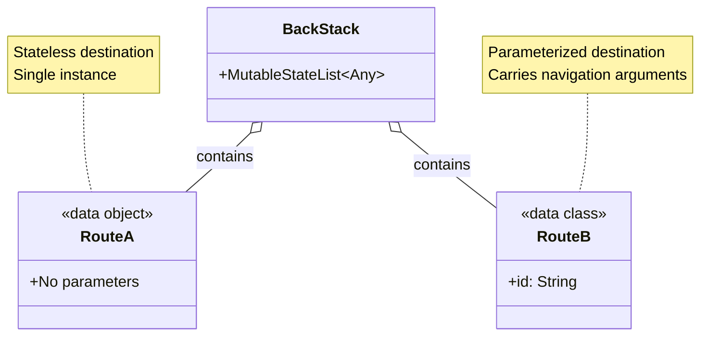
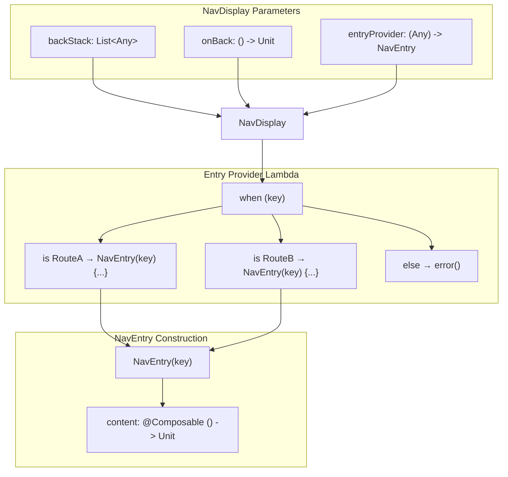
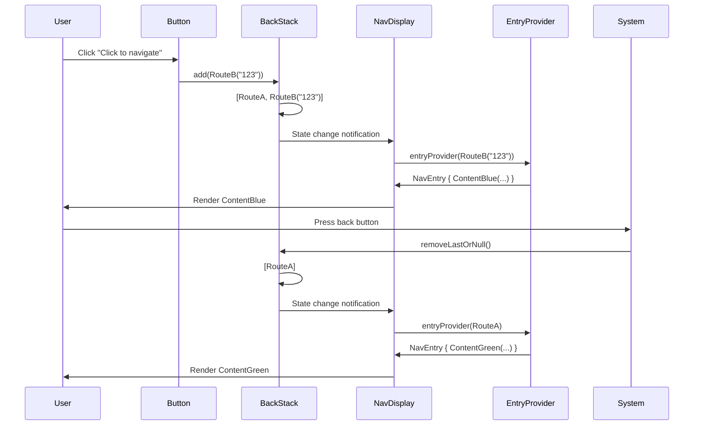
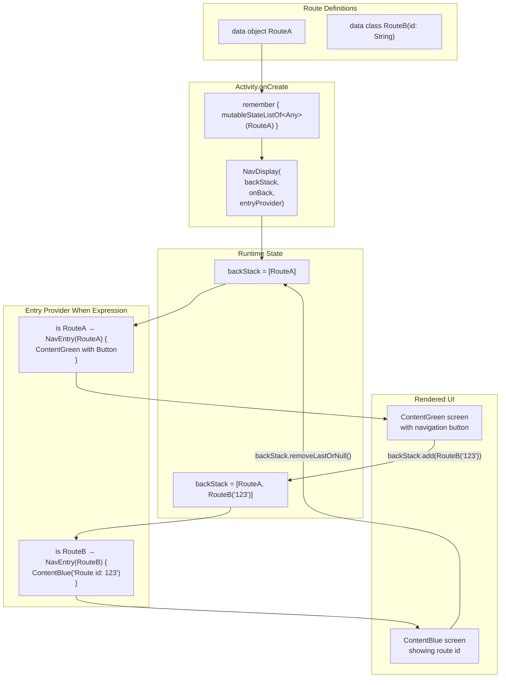

<!-- source: DeepWiki mcp.deepwiki.com · repo android/nav3-recipes · page 3.1 Basic Navigation API · fetched 2026-10-23 -->

# Basic Navigation API

<details>
<summary>Relevant source files</summary>

The following files were used as context for generating this wiki page:

- [app/src/main/java/com/example/nav3recipes/basic/BasicActivity.kt](app/src/main/java/com/example/nav3recipes/basic/BasicActivity.kt)
- [app/src/main/java/com/example/nav3recipes/commonui/CommonUiActivity.kt](app/src/main/java/com/example/nav3recipes/commonui/CommonUiActivity.kt)

</details>


## Purpose and Scope

This document demonstrates the simplest Navigation 3 setup using the core API directly without abstractions. It covers manual back stack creation, route definition, entry provider implementation, and basic navigation operations as shown in `BasicActivity`.

For more streamlined route-to-content mapping using a builder DSL, see [Entry Provider DSL](#3.2). For back stack persistence across process death, see [Saveable Back Stack](#3.3). For navigation with bottom bars and multiple stacks, see [Common Navigation UI with Bottom Bar](#5.2).

**Sources**: [app/src/main/java/com/example/nav3recipes/basic/BasicActivity.kt:1-72]()

---

## Core Components

The basic Navigation 3 setup requires three fundamental components working together:

| Component | Type | Purpose |
|-----------|------|---------|
| `backStack` | `MutableStateList<Any>` | Observable collection of route keys representing navigation history |
| `NavDisplay` | Composable function | Renders the current top entry from the back stack |
| `entryProvider` | `(Any) -> NavEntry` | Lambda that maps route keys to UI content |

The basic flow: routes are added to the `backStack`, `NavDisplay` observes the back stack and calls the `entryProvider` with the top route key, which returns a `NavEntry` containing the composable content to render.

**Sources**: [app/src/main/java/com/example/nav3recipes/basic/BasicActivity.kt:42-68]()

---

## Route Definition

Routes are type-safe Kotlin objects or data classes that serve as navigation keys:



**Route Implementation Patterns:**

1. **Data Object Routes** [app/src/main/java/com/example/nav3recipes/basic/BasicActivity.kt:32-32]()
   - Syntax: `data object RouteA`
   - Use case: Destinations without parameters
   - Single instance shared across app

2. **Data Class Routes** [app/src/main/java/com/example/nav3recipes/basic/BasicActivity.kt:34-34]()
   - Syntax: `data class RouteB(val id: String)`
   - Use case: Destinations with arguments
   - Each navigation creates new instance with specific parameters

Both patterns implement value equality, making them suitable as back stack keys. The back stack type is `MutableStateList<Any>` to accommodate heterogeneous route types.

**Sources**: [app/src/main/java/com/example/nav3recipes/basic/BasicActivity.kt:32-34]()

---

## Back Stack Initialization

The back stack is created as a Compose state object and initialized with a start destination:

```kotlin
val backStack = remember { mutableStateListOf<Any>(RouteA) }
```

**Key characteristics:**

| Aspect | Implementation | Rationale |
|--------|---------------|-----------|
| Type | `MutableStateList<Any>` from `androidx.compose.runtime` | Observable collection that triggers recomposition on changes |
| Wrapping | `remember { }` | Survives recomposition but not configuration changes |
| Initial state | `mutableStateListOf<Any>(RouteA)` | Always starts with at least one route |
| Generic bound | `<Any>` | Allows heterogeneous route types in same stack |

The `remember` wrapper ensures the back stack instance survives recompositions within the same composition, but it does **not** survive configuration changes or process death. For persistence, see [Saveable Back Stack](#3.3).

**Sources**: [app/src/main/java/com/example/nav3recipes/basic/BasicActivity.kt:42-42]()

---

## NavDisplay and Entry Provider

The `NavDisplay` composable is the rendering coordinator that connects the back stack to UI:



**NavDisplay Parameters** [app/src/main/java/com/example/nav3recipes/basic/BasicActivity.kt:44-68]():

1. **`backStack: List<Any>`** - The observable list of navigation keys. `NavDisplay` reads the last element (top of stack) to determine what to render.

2. **`onBack: () -> Unit`** - Callback invoked when the system back button is pressed. Typically removes the last route: `{ backStack.removeLastOrNull() }`.

3. **`entryProvider: (Any) -> NavEntry`** - Lambda that pattern-matches on the route key and returns a `NavEntry` containing the composable content.

**Entry Provider Pattern** [app/src/main/java/com/example/nav3recipes/basic/BasicActivity.kt:47-67]():

The entry provider uses exhaustive `when` expression to map each route type to its UI:

```
when (key) {
    is RouteA -> NavEntry(key) { /* composable */ }
    is RouteB -> NavEntry(key) { /* composable */ }
    else -> error("Unknown route: $key")
}
```

Each branch constructs a `NavEntry` with:
- The route key as first parameter
- A trailing lambda containing the composable content for that destination

The `else` branch ensures compile-time exhaustiveness checking fails fast on unhandled routes.

**Sources**: [app/src/main/java/com/example/nav3recipes/basic/BasicActivity.kt:44-68]()

---

## Navigation Operations

Navigation is performed through direct back stack manipulation:

### Forward Navigation

```kotlin
backStack.add(RouteB("123"))
```

Adds a new route to the end of the back stack [app/src/main/java/com/example/nav3recipes/basic/BasicActivity.kt:52-52](). The `NavDisplay` observes the change and automatically calls the entry provider with the new route key to render the new destination.

### Back Navigation

```kotlin
backStack.removeLastOrNull()
```

Removes the current top route from the back stack [app/src/main/java/com/example/nav3recipes/basic/BasicActivity.kt:46-46](). The `NavDisplay` observes the change and renders the new top entry. The `removeLastOrNull()` method returns null when the stack is empty, allowing the activity to finish.

**Navigation Flow:**



**Sources**: [app/src/main/java/com/example/nav3recipes/basic/BasicActivity.kt:46-52]()

---

## Complete Implementation Flow

The following diagram shows how all components interact in `BasicActivity`:



**Key Implementation Points:**

1. **Initialization** [app/src/main/java/com/example/nav3recipes/basic/BasicActivity.kt:38-42]() - Activity creates back stack in `remember` block within `setContent`

2. **NavDisplay Setup** [app/src/main/java/com/example/nav3recipes/basic/BasicActivity.kt:44-68]() - Passes back stack reference, back handler, and entry provider lambda

3. **Content Components** [app/src/main/java/com/example/nav3recipes/basic/BasicActivity.kt:50-61]() - Uses `ContentGreen` and `ContentBlue` helper composables for consistent styling

4. **Edge-to-Edge Configuration** [app/src/main/java/com/example/nav3recipes/basic/BasicActivity.kt:39-39]() - Calls `setEdgeToEdgeConfig()` to enable modern window insets handling

**Sources**: [app/src/main/java/com/example/nav3recipes/basic/BasicActivity.kt:36-71]()

---

## Comparison with Advanced Patterns

The basic API shown here provides direct control over navigation state but requires manual management. More advanced recipes build upon these primitives:

| Pattern | Basic API | Enhanced Approach | See |
|---------|-----------|-------------------|-----|
| Route mapping | Manual `when` expression | Entry provider DSL builder | [3.2](#3.2) |
| State persistence | Lost on configuration change | Serialization with `rememberSaveable` | [3.3](#3.3) |
| Multiple stacks | Single `MutableStateList` | `TopLevelBackStack` coordinator | [5.1](#5.1) |
| Bottom bar navigation | Not included | `Scaffold` with `NavigationBar` | [5.2](#5.2) |

The basic pattern is suitable for simple linear navigation flows where the developer needs full visibility into navigation mechanics without abstraction layers.

**Sources**: [app/src/main/java/com/example/nav3recipes/basic/BasicActivity.kt:1-72]()

---

