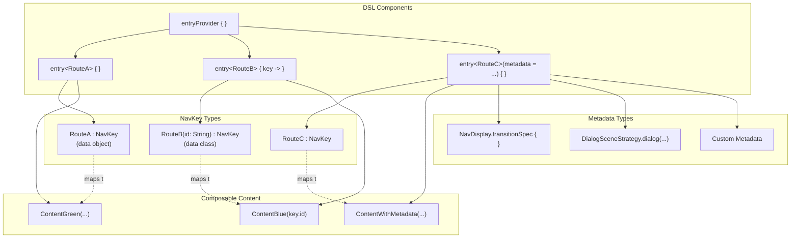
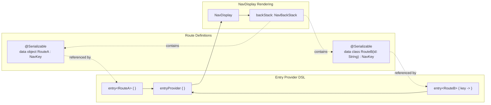
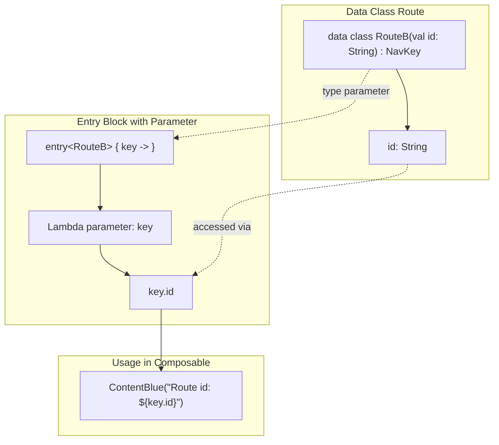
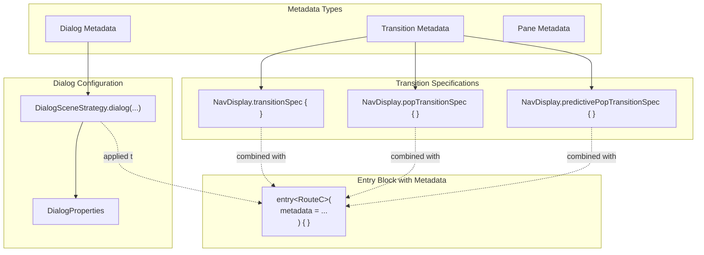
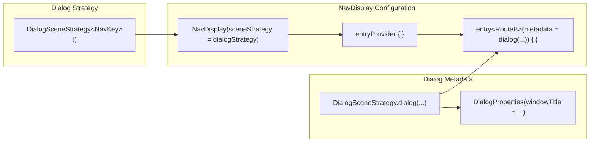
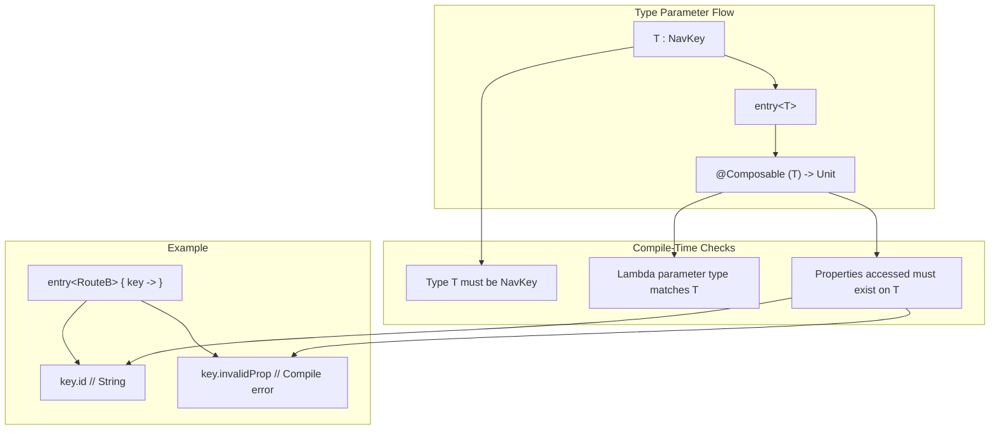

<!-- source: DeepWiki mcp.deepwiki.com · repo android/nav3-recipes · page 3.2 Entry Provider DSL · fetched 2026-10-23 -->

# Entry Provider DSL

<details>
<summary>Relevant source files</summary>

The following files were used as context for generating this wiki page:

- [app/src/main/java/com/example/nav3recipes/animations/AnimatedActivity.kt](app/src/main/java/com/example/nav3recipes/animations/AnimatedActivity.kt)
- [app/src/main/java/com/example/nav3recipes/basicdsl/BasicDslActivity.kt](app/src/main/java/com/example/nav3recipes/basicdsl/BasicDslActivity.kt)
- [app/src/main/java/com/example/nav3recipes/dialog/DialogActivity.kt](app/src/main/java/com/example/nav3recipes/dialog/DialogActivity.kt)

</details>


This page documents the `entryProvider` DSL provided by Navigation 3 for defining route-to-content mappings in a type-safe, declarative manner. The DSL simplifies the creation of `EntryProvider` instances by using Kotlin's builder pattern to associate `NavKey` types with their corresponding composable content.

For the basic Navigation 3 API without DSL, see [Basic Navigation API](#3.1). For persistence of back stack state, see [Saveable Back Stack](#3.3).

## EntryProvider DSL Structure

The entry provider DSL consists of two primary components: the `entryProvider` builder function and `entry<T>` blocks that define individual route mappings.



**DSL Structure: entryProvider Function and Entry Blocks**

Sources: [app/src/main/java/com/example/nav3recipes/basicdsl/BasicDslActivity.kt:50-63](), [app/src/main/java/com/example/nav3recipes/animations/AnimatedActivity.kt:50-90]()

## Basic Entry Blocks

The simplest form of the DSL uses `entry<T>` blocks where `T` is a `NavKey` type. Each block defines the composable content to display when that route is active.



**Route Type to Entry Block Mapping**

The DSL implementation in [BasicDslActivity.kt:50-63]() demonstrates:

| Component | Code Entity | Purpose |
|-----------|-------------|---------|
| DSL Builder | `entryProvider { }` | Creates an `EntryProvider` instance |
| Route Mapping | `entry<RouteA> { }` | Maps `RouteA` to composable content |
| Parameterized Route | `entry<RouteB> { key -> }` | Receives route instance with parameters |
| Content | `ContentGreen(...)`, `ContentBlue(...)` | Composable functions rendered for each route |

Sources: [app/src/main/java/com/example/nav3recipes/basicdsl/BasicDslActivity.kt:33-62]()

## Parameterized Routes with Data Classes

When a `NavKey` is implemented as a data class with properties, the entry block receives the key instance as a lambda parameter, providing access to route arguments.



**Accessing Route Parameters in Entry Blocks**

The pattern shown in [BasicDslActivity.kt:60-62]() illustrates:

- **Data Object Routes**: `entry<RouteA> { }` - No parameter needed, as data objects have no properties
- **Data Class Routes**: `entry<RouteB> { key -> }` - Lambda receives the route instance
- **Property Access**: `key.id` - Direct access to route properties within the block

Sources: [app/src/main/java/com/example/nav3recipes/basicdsl/BasicDslActivity.kt:36-62]()

## Entry Metadata

The `entry<T>` function accepts an optional `metadata` parameter for configuring entry-specific behavior such as transitions, dialog properties, or pane assignments.



**Entry Metadata Composition Patterns**

### Transition Metadata

Transition specifications define enter/exit animations for specific routes. Multiple specs can be combined using the `+` operator:

| Metadata Function | Purpose | Example Use Case |
|-------------------|---------|------------------|
| `transitionSpec` | Forward navigation animation | Slide in from right |
| `popTransitionSpec` | Back navigation animation | Slide out to right |
| `predictivePopTransitionSpec` | Predictive back gesture animation | Same as pop with gesture progress |

The implementation in [AnimatedActivity.kt:65-86]() demonstrates combining multiple transition specs for a single entry:

```
entry<ScreenC>(
    metadata = NavDisplay.transitionSpec { ... } +
               NavDisplay.popTransitionSpec { ... } +
               NavDisplay.predictivePopTransitionSpec { ... }
) { ... }
```

Sources: [app/src/main/java/com/example/nav3recipes/animations/AnimatedActivity.kt:65-89]()

### Dialog Metadata

Dialog metadata configures routes to render as dialogs or bottom sheets overlaying previous content:



**Dialog Rendering with Entry Metadata**

The pattern in [DialogActivity.kt:53-80]() shows:

1. Create `DialogSceneStrategy` instance: [DialogActivity.kt:53]()
2. Pass strategy to `NavDisplay`: [DialogActivity.kt:58]()
3. Mark entry with dialog metadata: [DialogActivity.kt:69-72]()
4. Content renders in dialog window overlaying previous screen

Sources: [app/src/main/java/com/example/nav3recipes/dialog/DialogActivity.kt:46-85]()

## Type Safety

The entry provider DSL provides compile-time type safety through reified type parameters:



**Type Safety in Entry Provider DSL**

The DSL enforces:

- **Route Type Constraint**: The type parameter `T` must be a `NavKey` subtype
- **Lambda Parameter Type**: The lambda receives exactly type `T`, not a supertype
- **Property Access**: Only properties defined on `T` are accessible in the block
- **Serialization**: Each `NavKey` type must be annotated with `@Serializable`

This ensures that route arguments are type-safe at compile time, preventing runtime errors from invalid property access or type mismatches.

Sources: [app/src/main/java/com/example/nav3recipes/basicdsl/BasicDslActivity.kt:33-62]()

## Integration with NavDisplay

The entry provider created by the DSL is passed to `NavDisplay`, which uses it to render the current route:

```mermaid
sequenceDiagram
    participant BS as NavBackStack
    participant ND as NavDisplay
    participant EP as entryProvider
    participant EB as entry&lt;T&gt; block
    participant Comp as @Composable Content
    
    BS->>ND: Current route: RouteB("123")
    ND->>EP: Get content for RouteB
    EP->>EB: Invoke entry&lt;RouteB&gt; block
    EB->>EB: Pass key = RouteB("123")
    EB->>Comp: Render content with key.id
    Comp-->>ND: Composable tree
    ND-->>BS: Display rendered content
```

**NavDisplay Rendering Flow with Entry Provider DSL**

The rendering process:

1. `NavDisplay` observes the `backStack` state: [BasicDslActivity.kt:47-48]()
2. For the current route, it queries the `entryProvider`: [BasicDslActivity.kt:50]()
3. The entry provider finds the matching `entry<T>` block by type
4. The block is invoked with the route instance as parameter
5. The resulting composable content is rendered

Sources: [app/src/main/java/com/example/nav3recipes/basicdsl/BasicDslActivity.kt:44-66]()

## Complete Example

The following table summarizes the components in a complete entry provider DSL implementation:

| Component | Code Location | Purpose |
|-----------|---------------|---------|
| Route Definitions | [BasicDslActivity.kt:33-37]() | Define serializable `NavKey` types |
| Back Stack | [BasicDslActivity.kt:45]() | Create and manage navigation state |
| Entry Provider | [BasicDslActivity.kt:50-63]() | Map routes to composable content |
| NavDisplay | [BasicDslActivity.kt:47-64]() | Render current route with back handling |
| Navigation Actions | [BasicDslActivity.kt:54]() | Add routes to back stack |

The DSL pattern eliminates boilerplate compared to manual `EntryProvider` implementation while maintaining full type safety and compile-time checking. It is the recommended approach for defining route-to-content mappings in Navigation 3 applications.

Sources: [app/src/main/java/com/example/nav3recipes/basicdsl/BasicDslActivity.kt:1-68]()

---

