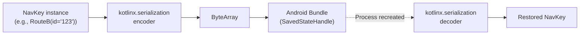
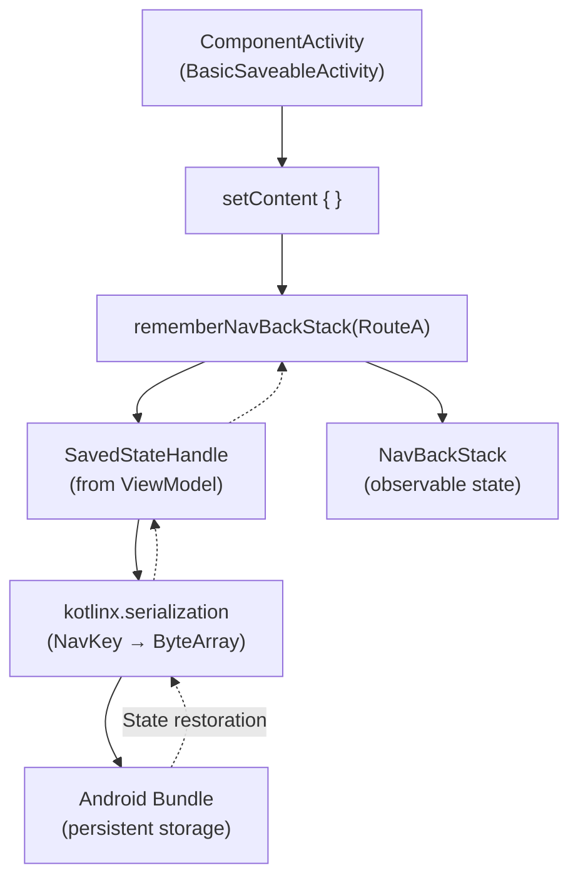
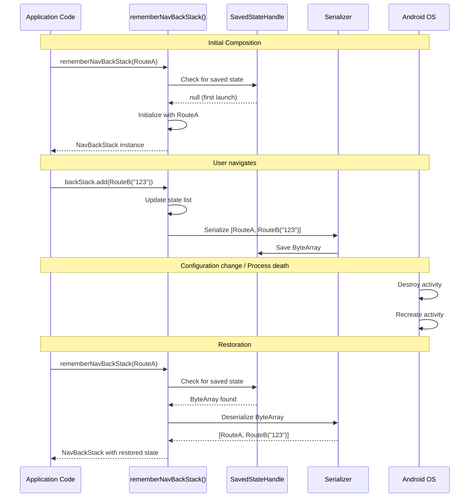
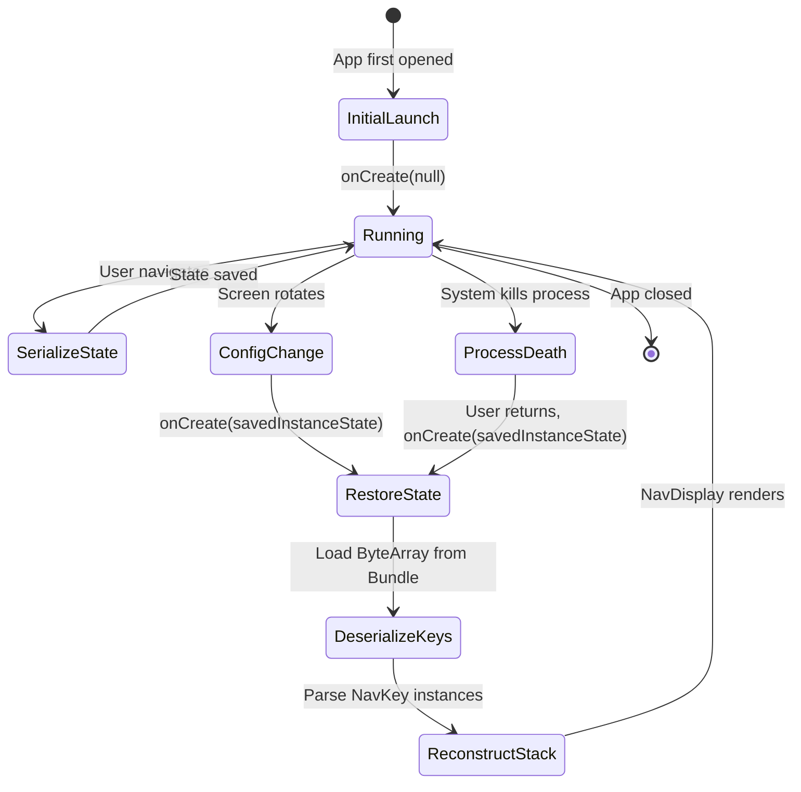
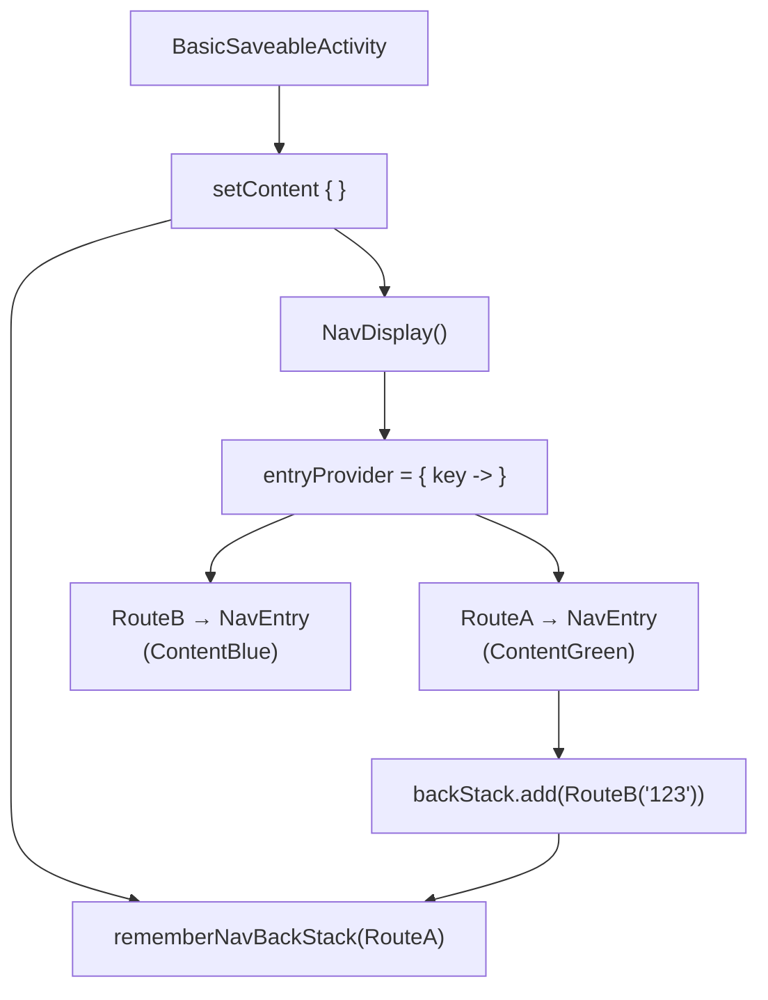
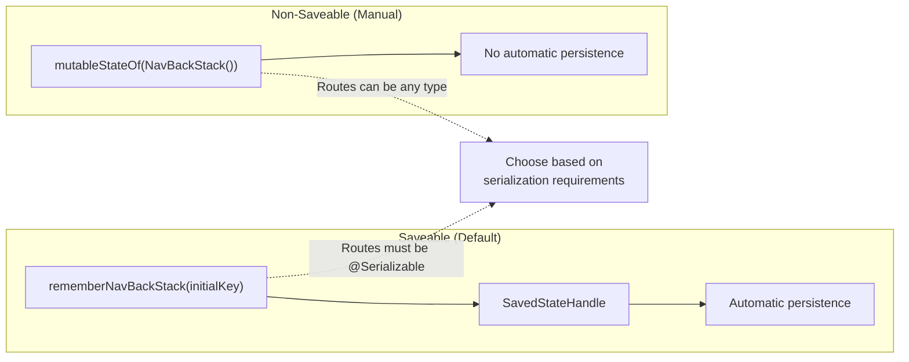

<!-- source: DeepWiki mcp.deepwiki.com · repo android/nav3-recipes · page 3.3 Saveable Back Stack · fetched 2026-10-23 -->

# Saveable Back Stack

<details>
<summary>Relevant source files</summary>

The following files were used as context for generating this wiki page:

- [app/src/main/java/com/example/nav3recipes/basicsaveable/BasicSaveableActivity.kt](app/src/main/java/com/example/nav3recipes/basicsaveable/BasicSaveableActivity.kt)
- [app/src/main/java/com/example/nav3recipes/content/Content.kt](app/src/main/java/com/example/nav3recipes/content/Content.kt)

</details>


## Purpose and Scope

This document explains how to persist navigation state across configuration changes (like screen rotation) and process death scenarios using Navigation 3's saveable back stack functionality. It covers the requirements for serializable routes, the `rememberNavBackStack()` API, and how state restoration works in the navigation system.

For basic navigation concepts and back stack operations, see [Basic Navigation](#4.1). For manual back stack creation without automatic persistence, see [Core Navigation 3 Concepts](#2.2).

---

## Serialization Requirements

Navigation 3 persists the back stack by serializing `NavKey` instances to Android's saved state bundle. This requires all navigation routes to be serializable.

### NavKey Serialization Contract

All `NavKey` implementations must be annotated with `@Serializable` from `kotlinx.serialization`:

```kotlin
@Serializable
data object RouteA : NavKey

@Serializable
data class RouteB(val id: String) : NavKey
```

**Why Serialization is Required:**

| Scenario | What Gets Saved | Restoration Trigger |
|----------|-----------------|---------------------|
| **Configuration Change** | Back stack entries (NavKey instances) | Activity recreated with `savedInstanceState` |
| **Process Death** | Back stack entries (NavKey instances) | System kills process, user returns to app |
| **State Restoration** | NavKey arguments and stack order | Android restores saved state bundle |

Navigation 3 uses `kotlinx.serialization` to convert `NavKey` instances to/from byte arrays that can be stored in Android's `Bundle` system.

**Serialization Flow:**



Sources: [app/src/main/java/com/example/nav3recipes/basicsaveable/BasicSaveableActivity.kt:33-37]()

---

## Using rememberNavBackStack

The `rememberNavBackStack()` composable function creates a `NavBackStack` that automatically persists to and restores from saved state.

### Function Signature

```kotlin
@Composable
fun <T : NavKey> rememberNavBackStack(
    initialKey: T,
    saveable: Boolean = true
): NavBackStack<T>
```

### Basic Usage Pattern

The typical setup in a `ComponentActivity`:

```kotlin
override fun onCreate(savedInstanceState: Bundle?) {
    super.onCreate(savedInstanceState)
    setContent {
        val backStack = rememberNavBackStack(RouteA)
        
        NavDisplay(
            backStack = backStack,
            onBack = { backStack.removeLastOrNull() },
            entryProvider = { /* ... */ }
        )
    }
}
```

**Key Parameters:**

| Parameter | Type | Purpose | Default |
|-----------|------|---------|---------|
| `initialKey` | `T : NavKey` | Starting route when no saved state exists | Required |
| `saveable` | `Boolean` | Whether to persist stack to saved state | `true` |

When `saveable = true` (default), the back stack automatically:
1. Saves all `NavKey` entries to `SavedStateHandle` on composition
2. Restores entries from `SavedStateHandle` when recomposed after recreation
3. Falls back to `initialKey` if no saved state exists

Sources: [app/src/main/java/com/example/nav3recipes/basicsaveable/BasicSaveableActivity.kt:45]()

---

## State Persistence Architecture

The saveable back stack integrates with Android's saved state system through Compose's `rememberSaveable` mechanism.

### Component Interaction Diagram



### Internal State Flow



Sources: [app/src/main/java/com/example/nav3recipes/basicsaveable/BasicSaveableActivity.kt:41-73]()

---

## Configuration Changes vs Process Death

The saveable back stack handles both configuration changes and process death scenarios identically, but they occur under different system conditions.

### Scenario Comparison

| Aspect | Configuration Change | Process Death |
|--------|---------------------|---------------|
| **Trigger** | Screen rotation, language change, theme change | Low memory, user navigates away for extended period |
| **Activity Lifecycle** | `onDestroy()` → `onCreate(savedInstanceState)` | `onDestroy()` → (process killed) → `onCreate(savedInstanceState)` |
| **Memory State** | Objects in memory briefly during transition | All memory cleared, process terminated |
| **Restoration Speed** | Fast (milliseconds) | Slower (cold start) |
| **SavedStateHandle** | Preserved by Android framework | Preserved by Android framework |
| **NavKey Serialization** | Required (enforced by compiler) | Required (enforced by compiler) |

### State Restoration Flow



**Critical Implementation Detail:**

Both scenarios rely on the same mechanism:
1. `rememberNavBackStack()` reads from `SavedStateHandle`
2. Android framework ensures `SavedStateHandle` survives both scenarios
3. `@Serializable` annotation enables `NavKey` persistence

Sources: [app/src/main/java/com/example/nav3recipes/basicsaveable/BasicSaveableActivity.kt:33-37](), [app/src/main/java/com/example/nav3recipes/basicsaveable/BasicSaveableActivity.kt:45]()

---

## Complete Implementation Example

The `BasicSaveableActivity` demonstrates the minimal requirements for a saveable back stack.

### File Structure

```
app/src/main/java/com/example/nav3recipes/basicsaveable/
└── BasicSaveableActivity.kt
```

### Route Definitions

[app/src/main/java/com/example/nav3recipes/basicsaveable/BasicSaveableActivity.kt:33-37]():

```kotlin
@Serializable
private data object RouteA : NavKey

@Serializable
private data class RouteB(val id: String) : NavKey
```

**Key Observations:**
- `RouteA` is a singleton (`data object`) with no parameters
- `RouteB` carries navigation arguments (`id: String`)
- Both use `@Serializable` annotation
- Both implement `NavKey` interface

### Activity Setup

[app/src/main/java/com/example/nav3recipes/basicsaveable/BasicSaveableActivity.kt:41-73]():

```kotlin
override fun onCreate(savedInstanceState: Bundle?) {
    setEdgeToEdgeConfig()
    super.onCreate(savedInstanceState)
    setContent {
        val backStack = rememberNavBackStack(RouteA)

        NavDisplay(
            backStack = backStack,
            onBack = { backStack.removeLastOrNull() },
            entryProvider = { key ->
                when (key) {
                    is RouteA -> NavEntry(key) {
                        ContentGreen("Welcome to Nav3") {
                            Button(onClick = {
                                backStack.add(RouteB("123"))
                            }) {
                                Text("Click to navigate")
                            }
                        }
                    }

                    is RouteB -> NavEntry(key) {
                        ContentBlue("Route id: ${key.id} ")
                    }

                    else -> {
                        error("Unknown route: $key")
                    }
                }
            }
        )
    }
}
```

**Implementation Components:**



Sources: [app/src/main/java/com/example/nav3recipes/basicsaveable/BasicSaveableActivity.kt:33-73]()

---

## Best Practices and Guidelines

### Serialization Constraints

**Supported Types in NavKey:**

| Type Category | Examples | Serializable? |
|---------------|----------|---------------|
| **Primitives** | `Int`, `String`, `Boolean`, `Long`, `Float` | ✅ Yes |
| **Kotlin Built-ins** | `List<String>`, `Map<String, Int>` | ✅ Yes (with serializable contents) |
| **Data Classes** | `data class User(val id: Int)` | ✅ Yes (with `@Serializable`) |
| **Sealed Classes** | `sealed class Result` | ✅ Yes (with `@Serializable`) |
| **ViewModels** | `ViewModel` instances | ❌ No |
| **Functions** | `() -> Unit` callbacks | ❌ No |
| **Android Objects** | `Context`, `View`, `Bitmap` | ❌ No |

### Common Patterns

**✅ Correct: Primitive arguments**
```kotlin
@Serializable
data class ProfileRoute(val userId: String) : NavKey
```

**✅ Correct: Complex data structures**
```kotlin
@Serializable
data class EditRoute(
    val itemId: String,
    val mode: EditMode
) : NavKey

@Serializable
enum class EditMode { CREATE, UPDATE }
```

**❌ Incorrect: Non-serializable types**
```kotlin
// This will cause runtime errors:
data class BadRoute(
    val callback: () -> Unit  // Functions cannot be serialized
) : NavKey
```

### Testing State Restoration

To verify proper state persistence:

1. **Configuration Change Testing:**
   - Enable "Don't keep activities" in Developer Options
   - Navigate through several screens
   - Rotate device
   - Verify all screens and arguments are preserved

2. **Process Death Testing:**
   - Navigate through several screens
   - Press Home button
   - Use `adb shell am kill <package>` to kill process
   - Return to app
   - Verify full back stack is restored

Sources: [app/src/main/java/com/example/nav3recipes/basicsaveable/BasicSaveableActivity.kt:33-37]()

---

## Comparison with Non-Saveable Back Stack

### When to Use Each Approach

| Use Case | Use `rememberNavBackStack()` | Create Non-Saveable Stack |
|----------|------------------------------|---------------------------|
| **Standard navigation flows** | ✅ Recommended | ❌ Not recommended |
| **User expects state preservation** | ✅ Yes | ❌ No |
| **Routes contain serializable data** | ✅ Yes | Either |
| **Routes contain non-serializable data** | ❌ Cannot use | ✅ Use this |
| **Temporary/ephemeral navigation** | Depends | ✅ Consider this |
| **Testing scenarios** | Depends | ✅ Simpler setup |

### API Differences



**Key Distinction:**

- **`rememberNavBackStack()`**: Integrates with Compose's `rememberSaveable` mechanism, provides automatic persistence
- **Manual state**: Using `remember { mutableStateOf() }` loses state on configuration changes

Sources: [app/src/main/java/com/example/nav3recipes/basicsaveable/BasicSaveableActivity.kt:45]()

---

## Integration with Other Navigation Patterns

The saveable back stack works seamlessly with other Navigation 3 features:

### Compatible Features

| Feature | Compatible? | Notes |
|---------|-------------|-------|
| **Multiple Back Stacks** | ✅ Yes | Each stack persists independently (see [Multiple Back Stacks](#5.1)) |
| **Deep Links** | ✅ Yes | Initial stack can be restored from intent (see [Deep Links](#4.4)) |
| **ViewModels** | ✅ Yes | ViewModels survive configuration changes via decorators (see [ViewModel Integration](#9)) |
| **Custom Scenes** | ✅ Yes | SceneStrategy reads from persisted back stack (see [Custom Scenes](#6)) |
| **Dialog/BottomSheet** | ✅ Yes | Overlay state persists with back stack (see [Dialog and BottomSheet Scenes](#6.4)) |
| **Result Passing** | ⚠️ Partial | Event-based results lost on process death (see [Result Passing](#8)) |

### Multi-Stack Persistence Pattern

When using multiple back stacks (e.g., for bottom navigation), each stack is independently saveable:

```kotlin
val homeStack = rememberNavBackStack(HomeRoute)
val profileStack = rememberNavBackStack(ProfileRoute)
val settingsStack = rememberNavBackStack(SettingsRoute)

// Each stack persists separately to SavedStateHandle
```

Sources: [app/src/main/java/com/example/nav3recipes/basicsaveable/BasicSaveableActivity.kt:45]()

---

## Troubleshooting

### Common Issues

**Issue: SerializationException at Runtime**

```
kotlinx.serialization.SerializationException: 
Serializer for class 'RouteX' is not found
```

**Solution:** Add `@Serializable` annotation to the `NavKey` class and ensure `kotlinx-serialization` plugin is applied in `build.gradle.kts`.

---

**Issue: State Not Restored After Configuration Change**

**Possible Causes:**
1. `rememberNavBackStack()` not used (using manual `remember` instead)
2. `NavKey` missing `@Serializable` annotation
3. `saveable` parameter explicitly set to `false`

**Solution:** Verify `rememberNavBackStack()` is used with serializable routes.

---

**Issue: Crash with "Cannot serialize X"**

**Solution:** Remove non-serializable fields from `NavKey` implementations. Use IDs instead of full objects:

```kotlin
// ❌ Bad: Cannot serialize ViewModel
@Serializable
data class DetailRoute(val viewModel: DetailViewModel) : NavKey

// ✅ Good: Serialize ID, recreate ViewModel
@Serializable
data class DetailRoute(val itemId: String) : NavKey
```

Sources: [app/src/main/java/com/example/nav3recipes/basicsaveable/BasicSaveableActivity.kt:33-37]()

---

## Related Documentation

- [Basic Navigation](#4.1) - Core navigation concepts without state persistence focus
- [Entry Provider DSL](#4.2) - Alternative syntax for mapping routes to composables
- [Multiple Back Stacks](#5.1) - Managing independent stacks with separate state persistence
- [ViewModel Integration](#9) - Passing arguments to ViewModels from serialized routes
- [Deep Links](#4.4) - Initializing saveable back stacks from intent URIs

---

