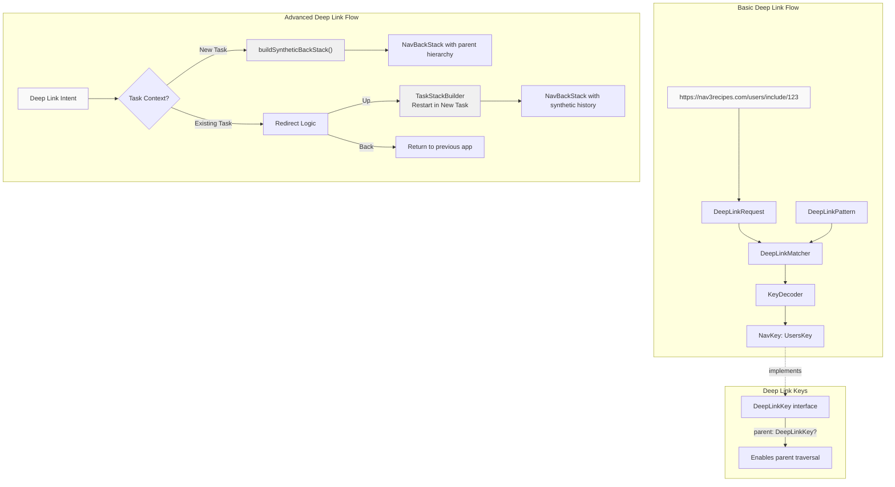
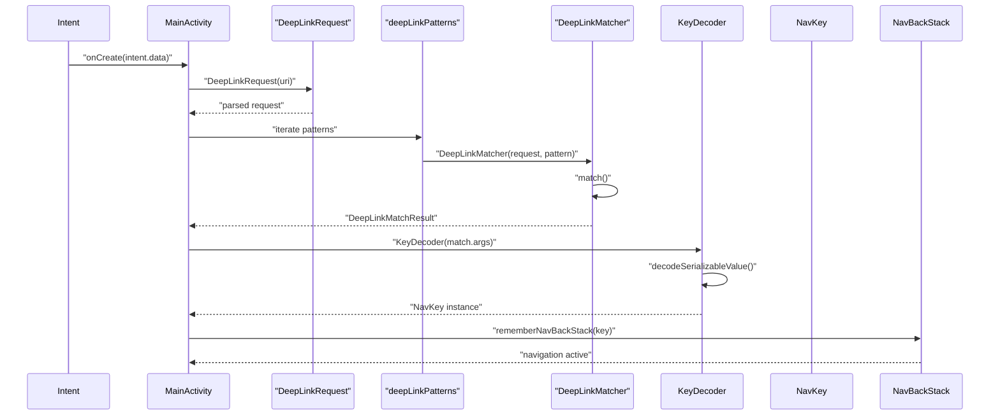
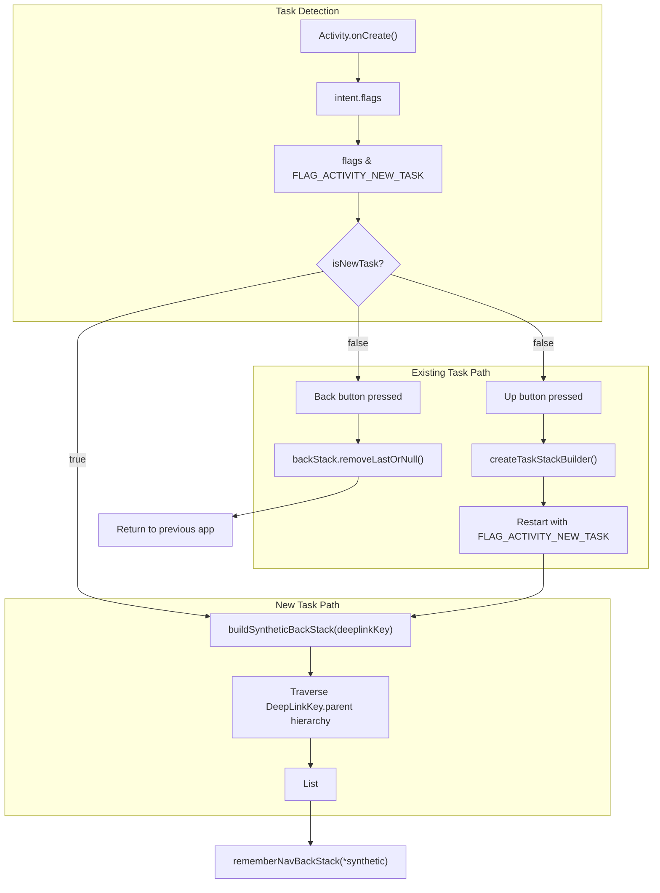
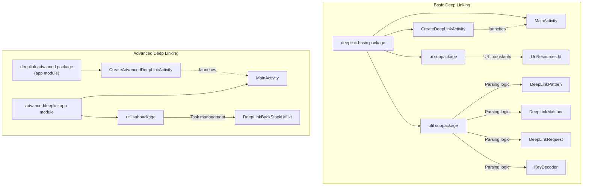
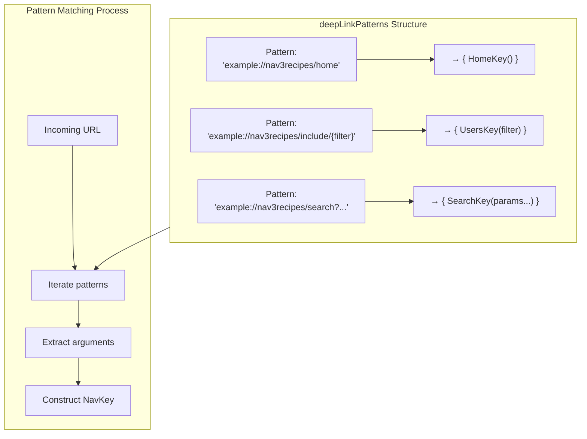

<!-- source: DeepWiki mcp.deepwiki.com · repo android/nav3-recipes · page 4 Deep Link Navigation · fetched 2026-10-23 -->

# Deep Link Navigation

<details>
<summary>Relevant source files</summary>

The following files were used as context for generating this wiki page:

- [app/src/main/java/com/example/nav3recipes/deeplink/advanced/README.md](app/src/main/java/com/example/nav3recipes/deeplink/advanced/README.md)
- [app/src/main/java/com/example/nav3recipes/deeplink/basic/CreateDeepLinkActivity.kt](app/src/main/java/com/example/nav3recipes/deeplink/basic/CreateDeepLinkActivity.kt)
- [app/src/main/java/com/example/nav3recipes/deeplink/basic/MainActivity.kt](app/src/main/java/com/example/nav3recipes/deeplink/basic/MainActivity.kt)
- [app/src/main/java/com/example/nav3recipes/deeplink/basic/NavRecipeKey.kt](app/src/main/java/com/example/nav3recipes/deeplink/basic/NavRecipeKey.kt)
- [app/src/main/java/com/example/nav3recipes/deeplink/basic/README.md](app/src/main/java/com/example/nav3recipes/deeplink/basic/README.md)
- [app/src/main/java/com/example/nav3recipes/deeplink/basic/ui/UrlResources.kt](app/src/main/java/com/example/nav3recipes/deeplink/basic/ui/UrlResources.kt)
- [common/.gitignore](common/.gitignore)
- [common/build.gradle.kts](common/build.gradle.kts)
- [docs/deeplink-guide.md](docs/deeplink-guide.md)

</details>


Deep linking enables external sources (other apps, web browsers, notifications) to navigate directly to specific destinations within your app. This page covers two deep linking patterns implemented in the repository: basic URL parsing and advanced Task management with synthetic back stacks.

For basic navigation concepts, see [Core Navigation 3 Concepts](#2.2). For details on defining navigation keys, see [NavKey and Route System](#12.1).

## Overview

The repository demonstrates two progressively sophisticated deep linking patterns:

| Pattern | Module | Key Concepts |
|---------|--------|--------------|
| **Basic Deep Linking** | `deeplink.basic` | Parse Intent URIs to `NavKey` instances using `DeepLinkPattern`, `DeepLinkMatcher`, and `KeyDecoder` |
| **Advanced Deep Linking** | `deeplink.advanced` + `advanceddeeplinkapp` | Build synthetic back stacks, manage Android Tasks, handle Up/Back navigation correctly |

**Basic deep linking** focuses on the four-step pipeline for converting URIs into typed navigation keys. This pattern handles three URL formats: exact match, path arguments, and query parameters. See [Basic Deep Link Parsing](#4.1) for implementation details.

**Advanced deep linking** addresses Android's Task system complexity. When deep links open in new Tasks, synthetic back stacks simulate manual navigation paths. When opening in existing Tasks, special logic differentiates Up button behavior (restart in new Task) from Back button behavior (return to previous app). See [Advanced Deep Links with Synthetic Back Stacks](#4.2) for implementation details.

Sources: [app/src/main/java/com/example/nav3recipes/deeplink/basic/README.md:1-24](), [app/src/main/java/com/example/nav3recipes/deeplink/advanced/README.md:1-24](), [docs/deeplink-guide.md:1-50]()

## Navigation Principles for Deep Linking

Deep linking implementation follows three key principles from the [Android Navigation Principles](https://developer.android.com/guide/navigation/principles):

### Principle 1: Up and Back Are Identical Within Your App's Task

When your Activity starts in a **new Task**, both Up and Back should navigate to the parent screen. This requires building a synthetic back stack at Activity creation.

When your Activity starts in an **existing Task** (another app's Task), Up and Back behave differently:
- **Back button**: Returns to the previous app (the screen before deep linking)
- **Up button**: Navigates to a parent screen within your app (requires restarting your app in a new Task)

### Principle 2: The Up Button Never Exits Your App

The Up button always navigates within your app's screens and never exits to another app or the home screen. The Up button should be disabled on your app's start destination.

### Principle 3: Deep Linking Simulates Manual Navigation

Deep links jump directly to destinations with only that destination in the back stack. To support natural Up/Back navigation to the start destination, build a **synthetic back stack** that simulates the path users would have taken to reach that destination manually.

Sources: [docs/deeplink-guide.md:10-40]()

## Deep Linking Architecture Overview



**Diagram: Deep Linking Architecture - Basic and Advanced Patterns**

The basic flow parses URIs through a four-step pipeline: `DeepLinkRequest` → `DeepLinkMatcher` → `KeyDecoder` → `NavKey`. The advanced flow adds Task-aware logic: new Tasks build synthetic back stacks using `DeepLinkKey.parent` traversal, while existing Tasks implement special Up/Back handling using `TaskStackBuilder`.

Sources: [docs/deeplink-guide.md:52-150](), [docs/deeplink-guide.md:152-321]()

## Basic Deep Linking Pattern

The basic pattern converts Intent data URIs into typed `NavKey` instances through a four-step process:



**Diagram: Basic Deep Link Parsing Sequence**

The basic recipe demonstrates three URL formats:

| Format | Example | NavKey |
|--------|---------|--------|
| Exact match | `https://nav3recipes.com/home` | `HomeKey` |
| Path arguments | `https://nav3recipes.com/users/include/recentlyAdded` | `UsersKey(filter="recentlyAdded")` |
| Query parameters | `https://nav3recipes.com/users/search?firstName=John&location=CA` | `SearchKey(firstName="John", location="CA")` |

The implementation leverages `kotlinx.serialization`: `NavKey` classes are annotated with `@Serializable`, and `DeepLinkPattern` uses the generated `Serializer` to map URL arguments to key fields. The `KeyDecoder` then decodes matched arguments into strongly-typed `NavKey` instances.

For complete implementation details, see [Basic Deep Link Parsing](#4.1).

Sources: [app/src/main/java/com/example/nav3recipes/deeplink/basic/README.md:10-16](), [docs/deeplink-guide.md:52-150](), [app/src/main/java/com/example/nav3recipes/deeplink/basic/MainActivity.kt:51-82]()

## Advanced Deep Linking Pattern

The advanced pattern extends basic parsing with Task management and synthetic back stack construction. The implementation simulates a two-app scenario:

- **App A** (`deeplink.advanced` module): `CreateAdvancedDeepLinkActivity` creates deep link Intents with optional `FLAG_ACTIVITY_NEW_TASK`
- **App B** (`advanceddeeplinkapp` module): `MainActivity` handles deep links with Task-aware navigation logic



**Diagram: Advanced Deep Link Task Management**

### Synthetic Back Stack Construction

The `DeepLinkKey` interface defines a `parent` field that enables parent hierarchy traversal:

```kotlin
interface DeepLinkKey: NavKey {
    val parent: DeepLinkKey?
}
```

The `buildSyntheticBackStack()` function iterates through the parent chain, building a list from the start destination to the deep link target. This simulates the path users would have taken to reach the destination manually.

### Task-Aware Up/Back Navigation

**In a New Task**: Both Up and Back navigate through the synthetic back stack.

**In an Existing Task**:
- **Back button**: Calls `backStack.removeLastOrNull()`, returning to the previous app
- **Up button**: Calls `createTaskStackBuilder()` with parent's deep link URL, restarting the app in a new Task with synthetic back stack

The `TaskStackBuilder` ensures proper Task management:

```kotlin
Intent(context, MainActivity::class.java).apply {
    data = parentKey.deeplinkUrl.toUri()
    addFlags(Intent.FLAG_ACTIVITY_NEW_TASK or Intent.FLAG_ACTIVITY_CLEAR_TASK)
}
```

For complete implementation details, see [Advanced Deep Links with Synthetic Back Stacks](#4.2).

Sources: [app/src/main/java/com/example/nav3recipes/deeplink/advanced/README.md:1-24](), [docs/deeplink-guide.md:152-321]()

## Deep Link Key Design

Navigation keys for deep linking implement serialization for URI parsing and optionally implement `DeepLinkKey` for synthetic back stack support.

### Basic Deep Link Keys

Basic deep link keys use `@Serializable` annotation for automatic serializer generation:

```kotlin
// app/src/main/java/com/example/nav3recipes/deeplink/basic/NavRecipeKey.kt
@Serializable
object HomeKey: NavKey

@Serializable
data class UsersKey(val filter: String): NavKey

@Serializable
data class SearchKey(
    val firstName: String? = null,
    val ageMin: Int? = null,
    val ageMax: Int? = null,
    val location: String? = null
): NavKey
```

`DeepLinkPattern` uses these serializers to map URL arguments to key fields. `KeyDecoder` leverages `kotlinx.serialization.DeserializationStrategy` to decode matched arguments into typed instances.

Sources: [app/src/main/java/com/example/nav3recipes/deeplink/basic/NavRecipeKey.kt:1-39](), [docs/deeplink-guide.md:76-120]()

### Advanced Deep Link Keys

Advanced deep link keys implement the `DeepLinkKey` interface to enable parent traversal:

```kotlin
interface DeepLinkKey: NavKey {
    val parent: DeepLinkKey?
}
```

Each key declares its logical parent in the navigation hierarchy. The `buildSyntheticBackStack()` function traverses this chain to construct the full back stack:

```kotlin
fun buildSyntheticBackStack(deeplinkKey: DeepLinkKey): List<NavKey> {
    return buildList {
        var node: DeepLinkKey? = deeplinkKey
        while (node != null) {
            add(0, node)  // Add to front
            node = node.parent
        }
    }
}
```

The parent relationship should represent the most natural navigation path users would take to reach the child destination manually.

Sources: [docs/deeplink-guide.md:182-220]()

## Repository Structure

The deep linking recipes are organized into two independent modules:



**Diagram: Deep Linking Module Organization**

| Module | Location | Purpose |
|--------|----------|---------|
| **Basic** | `app/src/main/java/.../deeplink/basic/` | Demonstrates URI parsing to `NavKey` conversion |
| **Advanced** | `app/src/main/java/.../deeplink/advanced/` + `advanceddeeplinkapp/` | Simulates cross-app deep linking with Task management |

The basic recipe contains three subpackages:
- **Activities**: `CreateDeepLinkActivity` (link builder) and `MainActivity` (link handler)
- **UI**: URL constants, string resources, shared composables
- **Util**: `DeepLinkPattern`, `DeepLinkMatcher`, `DeepLinkRequest`, `KeyDecoder`

The advanced recipe uses a two-module structure to simulate App A deep linking into App B:
- **App A** (`deeplink.advanced` package): `CreateAdvancedDeepLinkActivity` with Task flag controls
- **App B** (`advanceddeeplinkapp` module): `MainActivity` with `DeepLinkBackStackUtil` for synthetic back stack and Task management

Sources: [app/src/main/java/com/example/nav3recipes/deeplink/basic/README.md:18-24](), [app/src/main/java/com/example/nav3recipes/deeplink/advanced/README.md:6-20]()

## Package Structure

The deep link recipe organizes code into three packages:

| Package | Purpose | Key Components |
|---------|---------|----------------|
| `basic.deeplink` | Activities | `CreateDeepLinkActivity`, `MainActivity` |
| `basic.deeplink.ui` | UI Components | `EntryScreen`, `DeepLinkButton`, `MenuDropDown`, `MenuTextInput`, NavKey definitions |
| `basic.deeplink.util` | Parsing Logic | Deep link matching utilities, pattern parsing helpers |

The separation allows the parsing utilities in `basic.deeplink.util` to be reusable across different activities or modules without coupling to specific UI implementations.

Sources: [app/src/main/java/com/example/nav3recipes/deeplink/basic/README.md:18-24](), [app/src/main/java/com/example/nav3recipes/deeplink/basic/CreateDeepLinkActivity.kt:48-52]()

## Integration with Navigation 3

Deep links integrate with Navigation 3's core concepts:

1. **NavKey as Deep Link Target** - Each deep link pattern maps to a serializable `NavKey` implementation (`HomeKey`, `UsersKey`, `SearchKey`)
2. **Back Stack Initialization** - Deep link `NavKey` instances are added to the `NavBackStack` during activity creation
3. **Type Safety** - Pattern matching produces strongly-typed `NavKey` instances with validated parameters
4. **Persistence** - Since `NavKey` instances are serializable, deep link state survives configuration changes and process death

This approach maintains Navigation 3's type-safe, serializable architecture while supporting traditional Android deep linking mechanisms. For details on `NavKey` serialization, see [NavKey and Route System](#12.1). For back stack management, see [NavBackStack and State Management](#12.2).

Sources: [app/src/main/java/com/example/nav3recipes/deeplink/basic/CreateDeepLinkActivity.kt:34-54]()

## Deep Link Pattern Registration

The `MainActivity.deepLinkPatterns` property defines the mapping between URL patterns and `NavKey` constructors. This is typically implemented as a map or list structure:



**Diagram: Deep Link Pattern Registration and Matching**

Patterns are registered with lambda functions that construct the appropriate `NavKey` given extracted arguments. The matcher iterates registered patterns until finding a match, then executes the corresponding lambda to produce a typed `NavKey` instance.

Sources: [app/src/main/java/com/example/nav3recipes/deeplink/basic/CreateDeepLinkActivity.kt:46]()

## Key Implementation Details

### Base URL Configuration

The base URL is defined as a constant: `PATH_BASE = "example://nav3recipes"`. This is visible in [app/src/main/java/com/example/nav3recipes/deeplink/basic/CreateDeepLinkActivity.kt:25]() where it's imported from the UI package.

### Path Constants

Path segments are defined as constants to ensure consistency between deep link creation and pattern matching:
- `STRING_LITERAL_HOME` - The literal "home" path
- `PATH_INCLUDE` - The "include" path for `UsersKey`
- `PATH_SEARCH` - The "search" path for `SearchKey`

These are imported from the UI package in [app/src/main/java/com/example/nav3recipes/deeplink/basic/CreateDeepLinkActivity.kt:25-29]().

### Query Parameter Handling

The `SearchKey` demonstrates optional query parameter handling. The URL construction logic in [app/src/main/java/com/example/nav3recipes/deeplink/basic/CreateDeepLinkActivity.kt:137-146]() only includes non-empty values in the query string, using a conditional prefix (`?` for first parameter, `&` for subsequent parameters).

### Filter Options

The `UsersKey` filter parameter accepts two predefined values:
- `FILTER_OPTION_RECENTLY_ADDED` - Shows recently added users
- `FILTER_OPTION_ALL` - Shows all users

These are referenced in [app/src/main/java/com/example/nav3recipes/deeplink/basic/CreateDeepLinkActivity.kt:173]().

Sources: [app/src/main/java/com/example/nav3recipes/deeplink/basic/CreateDeepLinkActivity.kt:25-29](), [app/src/main/java/com/example/nav3recipes/deeplink/basic/CreateDeepLinkActivity.kt:137-146](), [app/src/main/java/com/example/nav3recipes/deeplink/basic/CreateDeepLinkActivity.kt:172-174]()

## Testing and Demonstration

The two-activity architecture enables easy testing:

1. Launch `CreateDeepLinkActivity` from the recipe picker
2. Configure desired path and parameters using dropdown menus
3. Observe the constructed URL in the UI
4. Tap "DeepLinkButton" to trigger the Intent
5. `MainActivity` launches and displays the parsed destination

This interactive approach demonstrates the entire deep link lifecycle without requiring external tools or ADB commands.

Sources: [app/src/main/java/com/example/nav3recipes/deeplink/basic/README.md:7-8](), [app/src/main/java/com/example/nav3recipes/deeplink/basic/CreateDeepLinkActivity.kt:34-40]()

---

