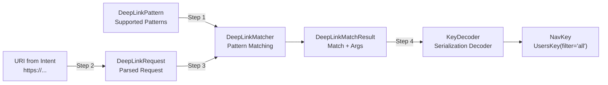
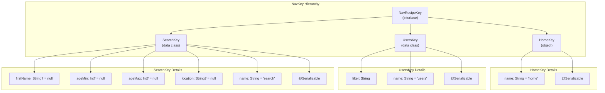
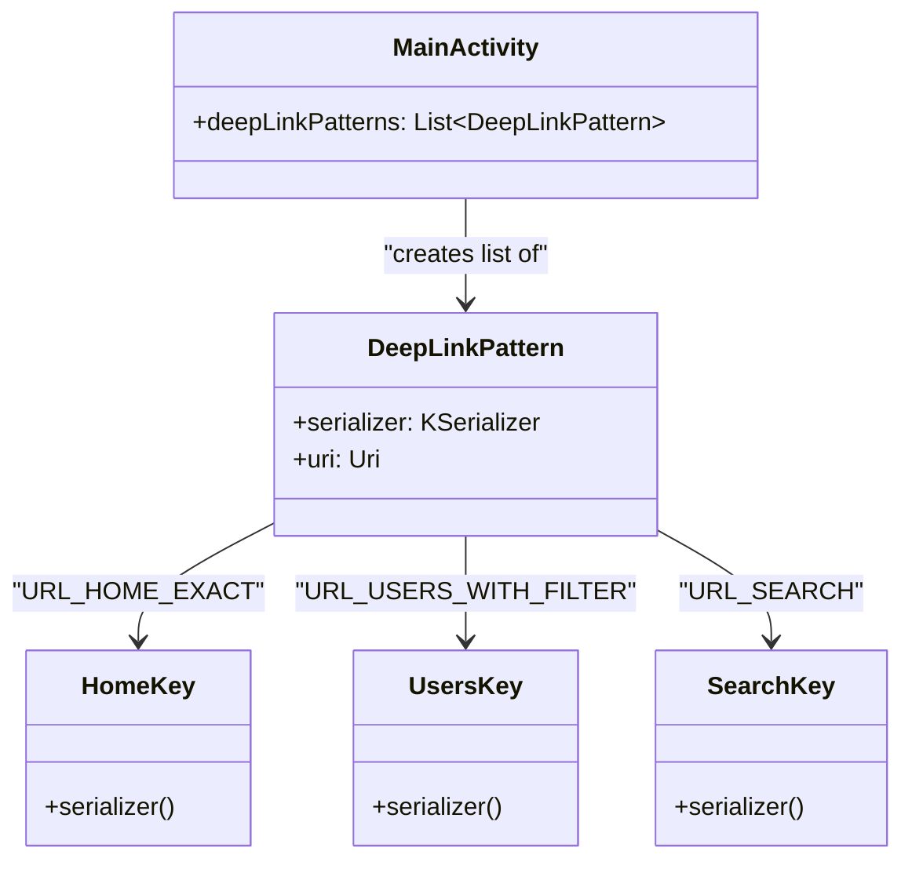
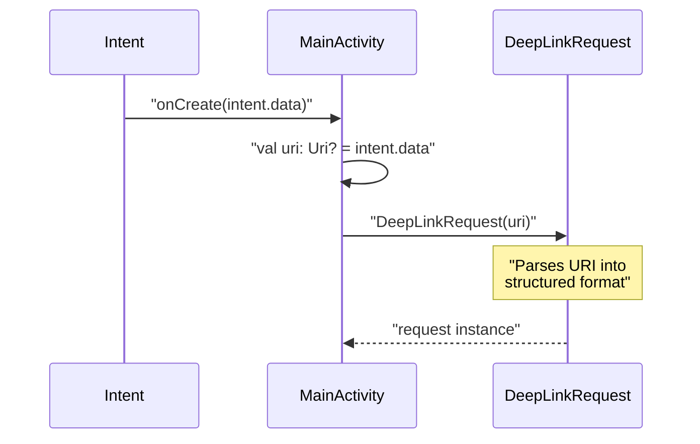
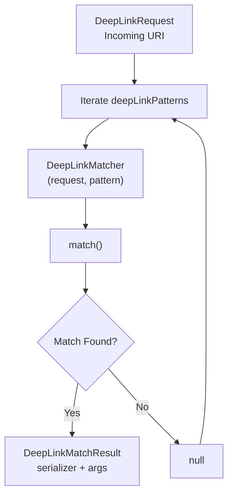
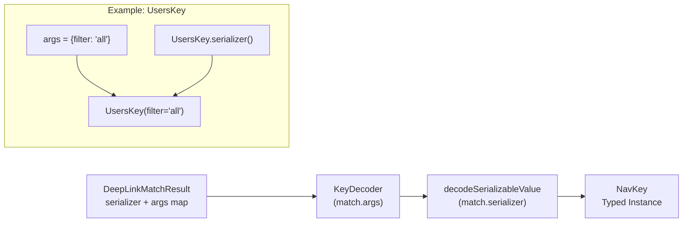
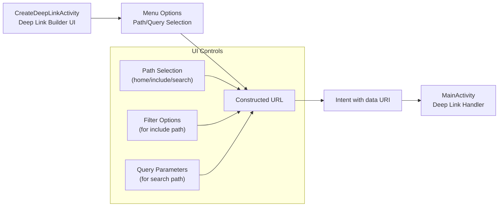

<!-- source: DeepWiki mcp.deepwiki.com · repo android/nav3-recipes · page 4.1 Basic Deep Link Parsing · fetched 2026-10-23 -->

# Basic Deep Link Parsing

<details>
<summary>Relevant source files</summary>

The following files were used as context for generating this wiki page:

- [app/src/main/java/com/example/nav3recipes/deeplink/basic/CreateDeepLinkActivity.kt](app/src/main/java/com/example/nav3recipes/deeplink/basic/CreateDeepLinkActivity.kt)
- [app/src/main/java/com/example/nav3recipes/deeplink/basic/MainActivity.kt](app/src/main/java/com/example/nav3recipes/deeplink/basic/MainActivity.kt)
- [app/src/main/java/com/example/nav3recipes/deeplink/basic/NavRecipeKey.kt](app/src/main/java/com/example/nav3recipes/deeplink/basic/NavRecipeKey.kt)
- [app/src/main/java/com/example/nav3recipes/deeplink/basic/README.md](app/src/main/java/com/example/nav3recipes/deeplink/basic/README.md)
- [app/src/main/java/com/example/nav3recipes/deeplink/basic/ui/UrlResources.kt](app/src/main/java/com/example/nav3recipes/deeplink/basic/ui/UrlResources.kt)
- [common/.gitignore](common/.gitignore)
- [common/build.gradle.kts](common/build.gradle.kts)

</details>


## Purpose and Scope

This document explains how to parse deep link URIs from Android Intents into typed `NavKey` instances for Navigation 3. It covers the four-step parsing pipeline: defining supported patterns, parsing incoming requests, matching patterns to requests, and decoding match results into navigation keys using `kotlinx.serialization`.

This document focuses exclusively on the parsing mechanics. For information about building synthetic back stacks from deep links, managing Android Tasks, and handling Up/Back button behavior, see [Advanced Deep Links with Synthetic Back Stacks](#4.2).

**Sources:** [app/src/main/java/com/example/nav3recipes/deeplink/basic/README.md:1-24](), [app/src/main/java/com/example/nav3recipes/deeplink/basic/MainActivity.kt:26-49]()

## Deep Link Parsing Overview

The basic deep link recipe implements a four-step pipeline that transforms URIs like `https://www.nav3recipes.com/users/include/all` into type-safe `NavKey` objects:



**Diagram: Four-Step Deep Link Parsing Pipeline**

The pipeline processes deep links as follows:

1. **Define Supported Patterns**: Create `DeepLinkPattern` instances with URL templates and serializers
2. **Parse Incoming Request**: Convert the Intent URI to a `DeepLinkRequest`
3. **Match Pattern to Request**: Use `DeepLinkMatcher` to find matching patterns and extract arguments
4. **Decode to NavKey**: Use `KeyDecoder` with the match result's serializer to create typed navigation keys

**Sources:** [app/src/main/java/com/example/nav3recipes/deeplink/basic/MainActivity.kt:27-38]()

## Supported Deep Link Types

The basic recipe demonstrates three types of deep link patterns, each matching a different `NavKey` type:

| Deep Link Type | URL Pattern | NavKey Type | Description |
|----------------|-------------|-------------|-------------|
| Exact URL | `https://www.nav3recipes.com/home` | `HomeKey` | Matches complete URL with no arguments |
| Path Arguments | `https://www.nav3recipes.com/users/with/{filter}` | `UsersKey` | Extracts path segments as arguments |
| Query Parameters | `https://www.nav3recipes.com/users/search?firstName={...}&ageMin={...}` | `SearchKey` | Extracts query string parameters |



**Diagram: NavKey Type Hierarchy for Deep Link Targets**

Each `NavKey` must be annotated with `@Serializable` to enable automatic decoding from deep link arguments using `kotlinx.serialization`.

**Sources:** [app/src/main/java/com/example/nav3recipes/deeplink/basic/NavRecipeKey.kt:1-39](), [app/src/main/java/com/example/nav3recipes/deeplink/basic/README.md:10-16]()

## Step 1: Defining Supported Deep Link Patterns

The first step is to define all supported deep link patterns using the `DeepLinkPattern` class. Each pattern associates a URL template with a serializer for the target `NavKey` type.



**Diagram: DeepLinkPattern Creation and Serializer Association**

The `MainActivity` defines its supported patterns at [app/src/main/java/com/example/nav3recipes/deeplink/basic/MainActivity.kt:53-60]():

```kotlin
internal val deepLinkPatterns: List<DeepLinkPattern<out NavKey>> = listOf(
    DeepLinkPattern(HomeKey.serializer(), (URL_HOME_EXACT).toUri()),
    DeepLinkPattern(UsersKey.serializer(), (URL_USERS_WITH_FILTER).toUri()),
    DeepLinkPattern(SearchKey.serializer(), (URL_SEARCH.toUri())),
)
```

The URL templates use curly braces `{...}` to denote argument placeholders:

| Constant | Value | Arguments |
|----------|-------|-----------|
| `URL_HOME_EXACT` | `https://www.nav3recipes.com/home` | None |
| `URL_USERS_WITH_FILTER` | `https://www.nav3recipes.com/users/include/{filter}` | `filter` (path) |
| `URL_SEARCH` | `https://www.nav3recipes.com/users/search?ageMin={...}&ageMax={...}&firstName={...}&location={...}` | Multiple query parameters |

**Sources:** [app/src/main/java/com/example/nav3recipes/deeplink/basic/MainActivity.kt:51-60](), [app/src/main/java/com/example/nav3recipes/deeplink/basic/ui/UrlResources.kt:1-24]()

## Step 2: Parsing the Incoming Deep Link Request

When an Activity receives a deep link Intent, the URI must be parsed into a `DeepLinkRequest` object that facilitates comparison with supported patterns.



**Diagram: Deep Link Request Parsing Sequence**

The Activity extracts the URI from the Intent and wraps it in a `DeepLinkRequest`:

```kotlin
// From MainActivity.onCreate()
val uri: Uri? = intent.data
val request = DeepLinkRequest(uri)
```

The `DeepLinkRequest` class parses the URI into components that can be compared against `DeepLinkPattern` templates. This includes extracting the scheme, host, path segments, and query parameters into a format compatible with pattern matching.

**Sources:** [app/src/main/java/com/example/nav3recipes/deeplink/basic/MainActivity.kt:66-70]()

## Step 3: Matching Patterns and Extracting Arguments

The `DeepLinkMatcher` compares a `DeepLinkRequest` against a `DeepLinkPattern` to determine if they match and extract argument values.



**Diagram: Pattern Matching Loop with DeepLinkMatcher**

The matching logic at [app/src/main/java/com/example/nav3recipes/deeplink/basic/MainActivity.kt:71-74]() iterates through patterns:

```kotlin
val match = deepLinkPatterns.firstNotNullOfOrNull { pattern ->
    DeepLinkMatcher(request, pattern).match()
}
```

The `DeepLinkMatcher.match()` method returns a `DeepLinkMatchResult` if successful, or `null` if the pattern doesn't match. The result contains:
- The pattern's `serializer` for the target `NavKey` type
- A map of argument names to extracted values from the URI

For example, matching `https://www.nav3recipes.com/users/include/all` against the `UsersKey` pattern extracts `args = {"filter": "all"}`.

**Sources:** [app/src/main/java/com/example/nav3recipes/deeplink/basic/MainActivity.kt:71-74](), [app/src/main/java/com/example/nav3recipes/deeplink/basic/MainActivity.kt:31-36]()

## Step 4: Decoding Match Results to NavKeys

The final step uses `KeyDecoder` with `kotlinx.serialization` to convert the match result into a typed `NavKey` instance.



**Diagram: KeyDecoder Deserialization Process**

The decoding logic at [app/src/main/java/com/example/nav3recipes/deeplink/basic/MainActivity.kt:76-81]():

```kotlin
match?.let {
    KeyDecoder(match.args)
        .decodeSerializableValue(match.serializer)
}
```

The `KeyDecoder` implements the `kotlinx.serialization.Decoder` interface, reading argument values from the extracted map and feeding them to the serializer. This process automatically:
- Maps argument names to `NavKey` constructor parameters
- Converts string values to the appropriate types (Int, String, nullable types)
- Instantiates the correct `NavKey` subclass

If no match is found, the code falls back to a default key: `key ?: HomeKey`.

**Sources:** [app/src/main/java/com/example/nav3recipes/deeplink/basic/MainActivity.kt:75-82]()

## Complete Integration Example

The parsed `NavKey` is then used as the starting route for the navigation back stack:

```mermaid
sequenceDiagram
    participant Intent
    participant MainActivity
    participant Parsing["Deep Link<br/>Parsing Pipeline"]
    participant NavBackStack
    participant NavDisplay
    
    Intent->>MainActivity: "intent.data = URI"
    MainActivity->>Parsing: "4-step process"
    Parsing-->>MainActivity: "NavKey instance"
    MainActivity->>NavBackStack: "rememberNavBackStack(key)"
    Note over NavBackStack: "Initialize with<br/>deep link key"
    MainActivity->>NavDisplay: "backStack + entryProvider"
    NavDisplay->>NavDisplay: "Render entry for key"
```

**Diagram: Deep Link to Navigation Display Integration**

The full integration at [app/src/main/java/com/example/nav3recipes/deeplink/basic/MainActivity.kt:84-124]():

1. Parse the Intent URI through the four-step pipeline to get a `NavKey`
2. Initialize `rememberNavBackStack(key)` with the deep link key as the starting route
3. Pass the back stack to `NavDisplay` with an `entryProvider` that maps keys to UI
4. The `NavDisplay` renders the appropriate entry based on the deep link target

This enables users arriving via deep link to land directly on the target content, with the navigation system properly initialized to that route.

**Sources:** [app/src/main/java/com/example/nav3recipes/deeplink/basic/MainActivity.kt:84-124]()

## Testing Deep Links with CreateDeepLinkActivity

The recipe includes a companion `CreateDeepLinkActivity` that provides a UI for constructing and testing deep links:



**Diagram: CreateDeepLinkActivity Test Harness Architecture**

The `CreateDeepLinkActivity` at [app/src/main/java/com/example/nav3recipes/deeplink/basic/CreateDeepLinkActivity.kt:55-163]() allows users to:
- Select a path option (home, users/include, users/search)
- Configure path arguments (filter value for include)
- Configure query parameters (firstName, ageMin, ageMax, location for search)
- View the final constructed URL
- Trigger the deep link by launching `MainActivity` with the URL as Intent data

This provides an interactive way to test all supported deep link patterns without external tools.

**Sources:** [app/src/main/java/com/example/nav3recipes/deeplink/basic/CreateDeepLinkActivity.kt:33-53](), [app/src/main/java/com/example/nav3recipes/deeplink/basic/CreateDeepLinkActivity.kt:152-160]()

## Package Structure

The basic deep link recipe is organized into three packages:

| Package | Purpose | Key Components |
|---------|---------|----------------|
| `basic.deeplink` | Activity declarations | `MainActivity`, `CreateDeepLinkActivity` |
| `basic.deeplink.ui` | UI resources and URL constants | `URL_HOME_EXACT`, `URL_USERS_WITH_FILTER`, `URL_SEARCH` |
| `basic.deeplink.util` | Deep link parsing utilities | `DeepLinkPattern`, `DeepLinkRequest`, `DeepLinkMatcher`, `DeepLinkMatchResult`, `KeyDecoder` |

The utility classes in the `util` package provide reusable components that can be adapted for production deep link handling in real applications.

**Sources:** [app/src/main/java/com/example/nav3recipes/deeplink/basic/README.md:18-24]()

---

