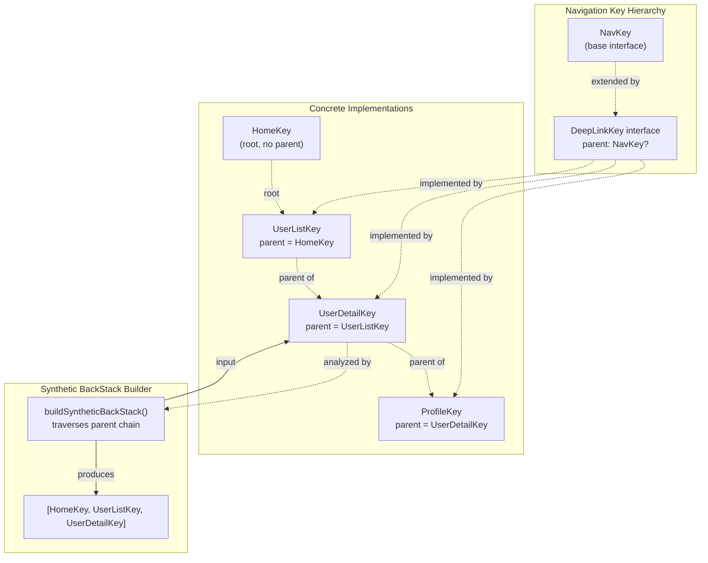
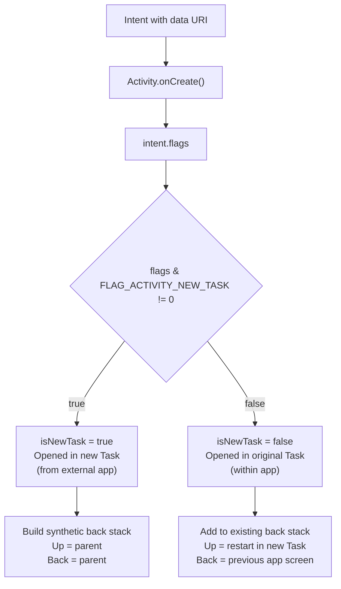
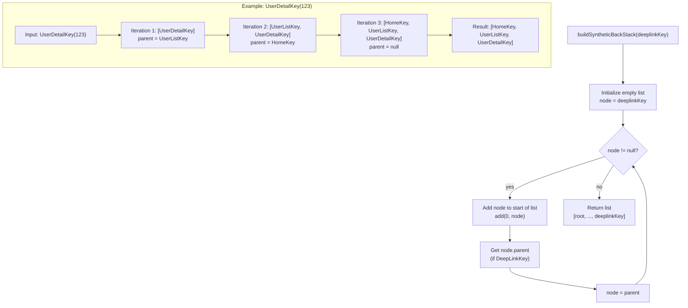
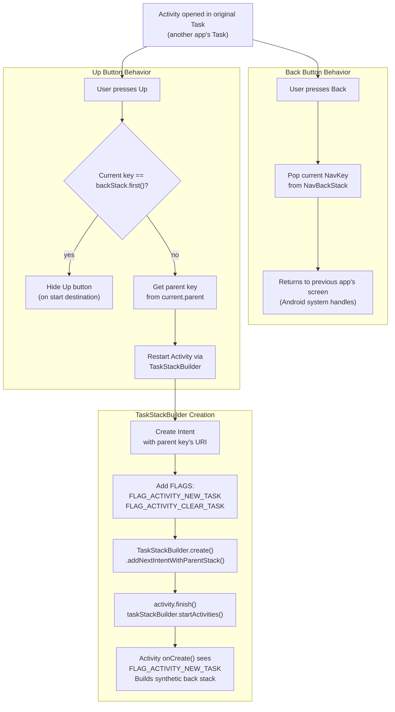
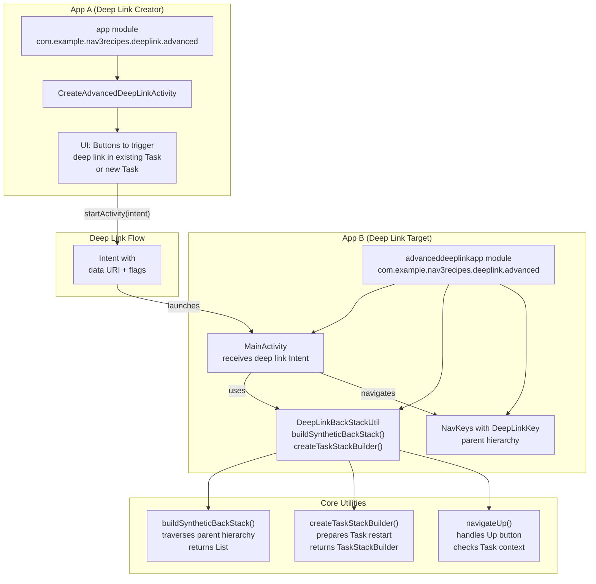

<!-- source: DeepWiki mcp.deepwiki.com · repo android/nav3-recipes · page 4.2 Advanced Deep Links with Synthetic Back Stacks · fetched 2026-10-23 -->

# Advanced Deep Links with Synthetic Back Stacks

<details>
<summary>Relevant source files</summary>

The following files were used as context for generating this wiki page:

- [app/src/main/java/com/example/nav3recipes/deeplink/advanced/README.md](app/src/main/java/com/example/nav3recipes/deeplink/advanced/README.md)
- [docs/deeplink-guide.md](docs/deeplink-guide.md)

</details>


## Purpose and Scope

This page explains how to implement advanced deep linking patterns in Navigation 3 that handle Android Task management, synthetic back stack construction, and correct Up/Back navigation behavior across different Task contexts. This builds upon the basic deep link parsing covered in [Basic Deep Link Parsing](#4.1) by addressing the navigation principles that ensure consistent user experience when deep linking between applications.

The implementation demonstrates a two-app scenario where one application deep links into another, requiring proper back stack synthesis and Task-aware navigation logic.

**Sources:** [app/src/main/java/com/example/nav3recipes/deeplink/advanced/README.md:1-25](), [docs/deeplink-guide.md:1-24]()

## Navigation Principles for Deep Linking

Three core Android navigation principles guide the implementation of advanced deep linking:

| Principle | Requirement | Implication |
|-----------|-------------|-------------|
| **Up and Back identical within app's Task** | Both navigate to expected previous screen within app | Behavior differs when Activity starts in another app's Task |
| **Up never exits app** | Up button always stays within app screens | Must be disabled on start destination; requires Task restart if opened in external Task |
| **Deep linking simulates manual navigation** | Back stack should reflect natural navigation path | Requires building synthetic back stack from parent hierarchy |

When a deep link opens your Activity in another app's Task (e.g., clicking a link in a browser), the Back button should return to that app, but the Up button must restart your app in its own Task with proper navigation history. When opened in your app's own Task, both buttons can navigate normally within the synthetic back stack.

**Sources:** [docs/deeplink-guide.md:11-40]()

## Deep Link Key Interface and Parent Hierarchy

### Title: DeepLinkKey Interface Design



The `DeepLinkKey` interface extends `NavKey` and adds a `parent` field that enables building synthetic back stacks by traversing the parent hierarchy. Each deep-linkable destination declares its logical parent - the screen a user would most likely have seen before manually navigating to this destination.

The parent hierarchy determines the synthetic back stack order. For example, if a user deep links to `UserDetailKey`, the builder walks up the parent chain (`UserDetailKey` → `UserListKey` → `HomeKey`) and constructs a back stack `[HomeKey, UserListKey, UserDetailKey]`.

**Sources:** [docs/deeplink-guide.md:183-199](), [advanceddeeplinkapp/src/main/java/com/example/nav3recipes/deeplink/advanced/util/DeepLinkBackStackUtil.kt:15-35]()

## Task Context Identification

### Title: Deep Link Task Detection Flow



The Activity's `onCreate()` method examines the incoming Intent's flags to determine the Task context. The presence of `Intent.FLAG_ACTIVITY_NEW_TASK` indicates the Activity launched in a new Task (typically from an external app like a browser or email client). Without this flag, the Activity opened within the current Task (either the user's existing app session or another app's Task).

This distinction is critical because Up and Back button behaviors differ based on Task context. The implementation checks for this flag using bitwise AND operation: `flags and Intent.FLAG_ACTIVITY_NEW_TASK != 0`.

**Sources:** [docs/deeplink-guide.md:158-177]()

## Building Synthetic Back Stacks for New Tasks

When the Activity launches in a new Task (e.g., user clicks a deep link in another app), the implementation must build a synthetic back stack that simulates the navigation path from the start destination to the deep-linked destination.

### Title: Synthetic BackStack Construction Algorithm



The `buildSyntheticBackStack()` function iterates through the parent hierarchy, prepending each parent to the list to maintain proper order (oldest to newest). The resulting list represents the back stack the user would have had if they navigated manually from the start destination.

The implementation passes this synthetic back stack to `rememberNavBackStack()` by spreading the list elements: `rememberNavBackStack(*(syntheticBackStack.toTypedArray()))`. This initializes the `NavBackStack` with the full navigation history, allowing both Up and Back buttons to navigate through the hierarchy.

**Sources:** [docs/deeplink-guide.md:201-220](), [docs/deeplink-guide.md:227-240](), [advanceddeeplinkapp/src/main/java/com/example/nav3recipes/deeplink/advanced/util/DeepLinkBackStackUtil.kt:15-35]()

## Handling Original Task Context

When the Activity opens in the original Task (without `FLAG_ACTIVITY_NEW_TASK`), the Up and Back buttons must behave differently to meet the navigation principles.

### Title: Original Task Navigation Decision Tree



### Back Button in Original Task

The Back button simply requires adding the deep-linked key to the NavBackStack. When the user presses Back, the system naturally returns to the previous Activity (the external app's screen). No synthetic back stack is necessary unless the app has specific requirements.

The implementation initializes the back stack with just the deep-linked key: `rememberNavBackStack(deeplinkKey)`.

**Sources:** [docs/deeplink-guide.md:242-260]()

### Up Button in Original Task

The Up button must never exit the app or return to the external app. Instead, it must restart the Activity in a new Task with a synthetic back stack. This requires the `TaskStackBuilder` API:

1. **Create Intent**: Construct an Intent for the current Activity class with the parent key's deep link URI as data
2. **Set Flags**: Add `FLAG_ACTIVITY_NEW_TASK` and `FLAG_ACTIVITY_CLEAR_TASK` to start a fresh Task
3. **Build Stack**: Use `TaskStackBuilder.create(context).addNextIntentWithParentStack(intent)` to prepare the launch
4. **Finish and Start**: Call `activity.finish()` then `taskStackBuilder.startActivities()` to transition

The Activity's `onCreate()` method will detect the `FLAG_ACTIVITY_NEW_TASK` flag and build the synthetic back stack as described in the previous section.

**Sources:** [docs/deeplink-guide.md:262-321](), [advanceddeeplinkapp/src/main/java/com/example/nav3recipes/deeplink/advanced/util/DeepLinkBackStackUtil.kt:37-97]()

## Implementation Architecture

### Title: Advanced Deep Link Module Structure



The advanced deep link recipe uses a two-module architecture to simulate real-world cross-app deep linking:

**App A (Deep Link Creator)**: The `CreateAdvancedDeepLinkActivity` in [app/src/main/java/com/example/nav3recipes/deeplink/advanced]() provides UI buttons that create deep link Intents and launch them either in the existing Task or a new Task. This simulates scenarios like clicking links in browsers, email clients, or other apps.

**App B (Deep Link Target)**: The `advanceddeeplinkapp` module contains the `MainActivity` that receives the deep link. This Activity demonstrates the complete implementation including Task detection, synthetic back stack construction, and Task-aware Up/Back navigation.

The core implementation logic resides in `DeepLinkBackStackUtil.kt`, which provides reusable functions:
- `buildSyntheticBackStack()`: Traverses parent hierarchy to construct navigation history
- `createTaskStackBuilder()`: Prepares Intent and TaskStackBuilder for Task restart
- `navigateUp()`: Orchestrates Up button behavior based on Task context

**Sources:** [app/src/main/java/com/example/nav3recipes/deeplink/advanced/README.md:6-16](), [app/src/main/java/com/example/nav3recipes/deeplink/advanced/README.md:18-20]()

## Up Button Visibility Control

The Up button must be hidden when displaying the start destination, as navigating "up" from the root would exit the app, violating the navigation principles.

The implementation checks if the current key matches the first entry in the back stack. The TopAppBar's `navigationIcon` slot conditionally renders the Up button:

```kotlin
TopAppBar(
    navigationIcon = {
        if (currentKey != backStack.first()) {
            IconButton(onClick = { backStack.navigateUp() }) {
                Icon(imageVector = Icons.AutoMirrored.Filled.ArrowBack, ...)
            }
        }
    },
    // ...
)
```

This pattern appears in the Material 3 TopAppBar implementation within the deep link target Activity, ensuring the Up button only appears when there's a valid parent to navigate to.

**Sources:** [docs/deeplink-guide.md:322-343]()

## Task and Back Stack Behavior Summary

The following tables summarize the required behavior for different Task contexts:

### New Task Scenario

| Button | Target | Back Stack Strategy |
|--------|--------|-------------------|
| **Up** | Deep-linked screen's parent | Build synthetic back stack on Activity creation |
| **Back** | Deep-linked screen's parent | Build synthetic back stack on Activity creation |

When launched in a new Task, both Up and Back navigate through the synthetic back stack, providing identical behavior within the app's Task.

### Original Task Scenario

| Button | Target | Back Stack Strategy |
|--------|--------|-------------------|
| **Up** | Deep-linked screen's parent | Restart Activity in new Task with synthetic back stack |
| **Back** | Screen before deep linking (previous app) | No synthetic back stack needed (optional) |

When launched in another app's Task, Back returns to the external app (handled by Android system), while Up restarts the app in its own Task to provide in-app navigation.

**Sources:** [docs/deeplink-guide.md:356-374]()

## Complete Implementation Reference

The complete implementation can be found in the following locations:

**Module Structure**:
- Deep link creator (App A): [app/src/main/java/com/example/nav3recipes/deeplink/advanced]()
- Deep link target (App B): [advanceddeeplinkapp/src/main/java/com/example/nav3recipes/deeplink/advanced]()

**Core Utilities**:
- Synthetic back stack and Task management: [advanceddeeplinkapp/src/main/java/com/example/nav3recipes/deeplink/advanced/util/DeepLinkBackStackUtil.kt]()

**Documentation**:
- Recipe README: [app/src/main/java/com/example/nav3recipes/deeplink/advanced/README.md]()
- Comprehensive deep linking guide: [docs/deeplink-guide.md]()

The implementation demonstrates production-ready patterns for handling deep links across Task boundaries while maintaining consistent navigation behavior aligned with Android's navigation principles.

**Sources:** [app/src/main/java/com/example/nav3recipes/deeplink/advanced/README.md:1-25](), [docs/deeplink-guide.md:1-406]()

---

