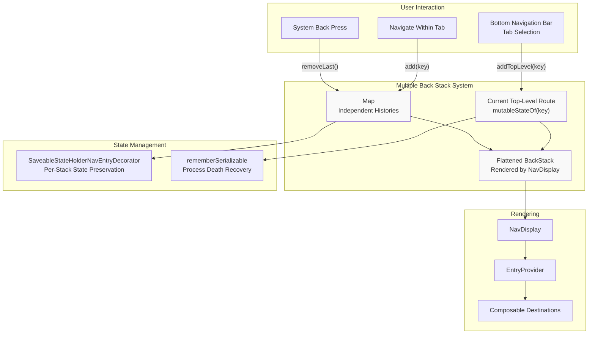
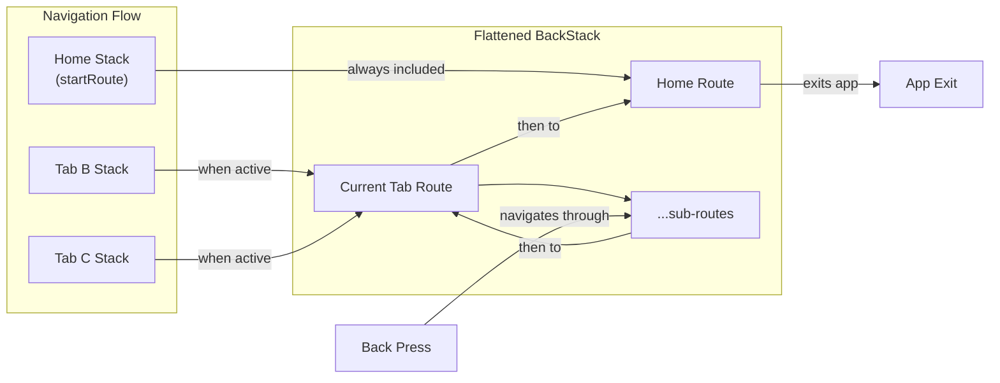
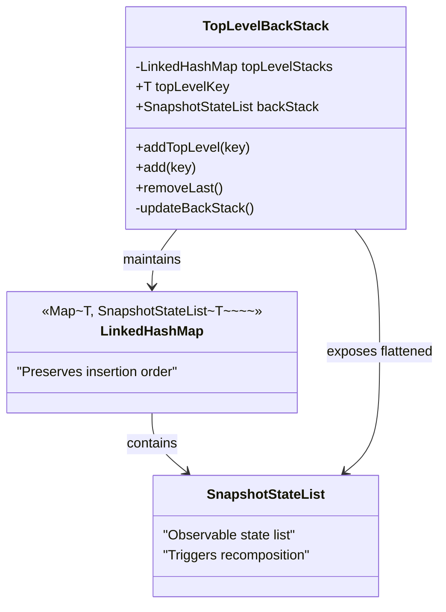
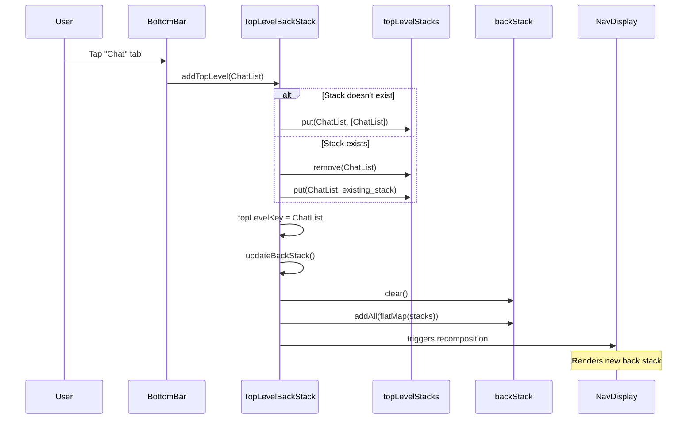
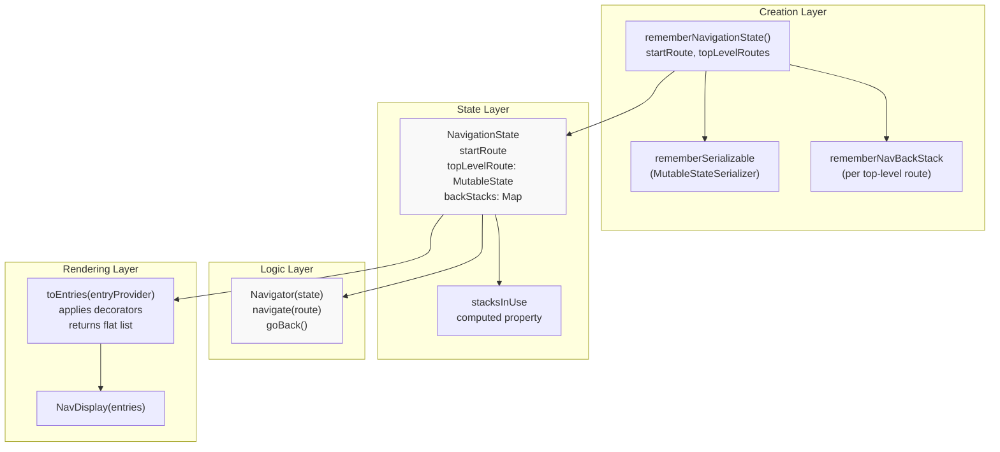
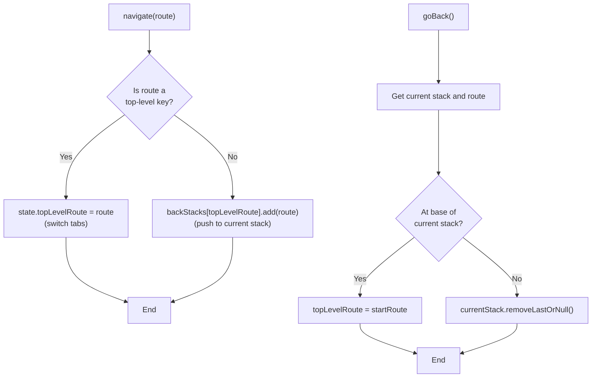
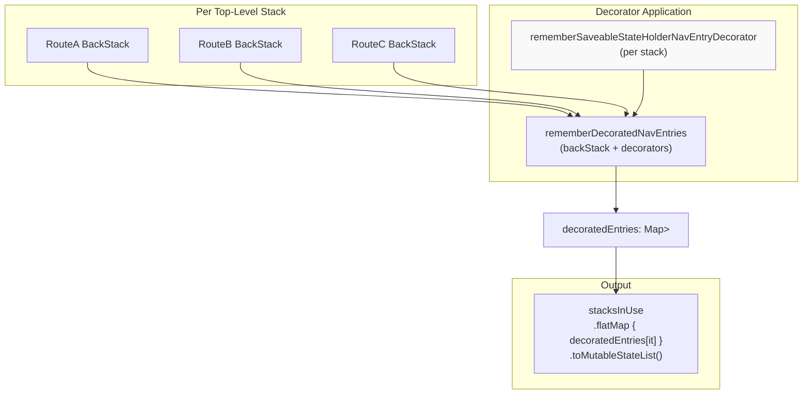
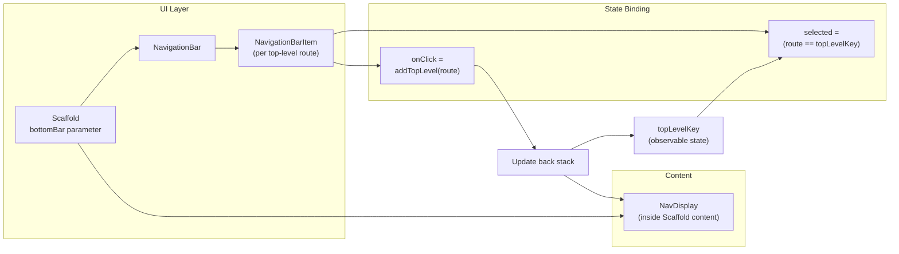

<!-- source: DeepWiki mcp.deepwiki.com · repo android/nav3-recipes · page 5 Multiple Back Stacks and Common UI Patterns · fetched 2026-10-23 -->

# Multiple Back Stacks and Common UI Patterns

<details>
<summary>Relevant source files</summary>

The following files were used as context for generating this wiki page:

- [app/src/main/java/com/example/nav3recipes/basic/BasicActivity.kt](app/src/main/java/com/example/nav3recipes/basic/BasicActivity.kt)
- [app/src/main/java/com/example/nav3recipes/commonui/CommonUiActivity.kt](app/src/main/java/com/example/nav3recipes/commonui/CommonUiActivity.kt)
- [app/src/main/java/com/example/nav3recipes/multiplestacks/Content.kt](app/src/main/java/com/example/nav3recipes/multiplestacks/Content.kt)
- [app/src/main/java/com/example/nav3recipes/multiplestacks/MultipleStacksActivity.kt](app/src/main/java/com/example/nav3recipes/multiplestacks/MultipleStacksActivity.kt)
- [app/src/main/java/com/example/nav3recipes/multiplestacks/NavigationState.kt](app/src/main/java/com/example/nav3recipes/multiplestacks/NavigationState.kt)
- [app/src/main/java/com/example/nav3recipes/multiplestacks/Navigator.kt](app/src/main/java/com/example/nav3recipes/multiplestacks/Navigator.kt)
- [app/src/main/java/com/example/nav3recipes/multiplestacks/README.md](app/src/main/java/com/example/nav3recipes/multiplestacks/README.md)

</details>


This document covers the implementation of multiple independent navigation histories (back stacks) for tab-based navigation patterns, commonly used with bottom navigation bars. This pattern allows users to switch between top-level sections of an app while preserving the navigation history within each section.

For deep linking with synthetic back stacks, see [Advanced Deep Links with Synthetic Back Stacks](#4.2). For conditional navigation patterns, see [Advanced Navigator Patterns](#11).

## Overview

Multiple back stacks enable applications to maintain separate navigation histories for each top-level route, typically corresponding to tabs in a bottom navigation bar. When users switch tabs, their navigation state within each tab is preserved, allowing them to return to where they left off.

The repository demonstrates two implementations of this pattern:

| Implementation | Class | Complexity | Use Case |
|---|---|---|---|
| Simple | `TopLevelBackStack` | Low | Basic tab navigation with preserved history |
| Structured | `NavigationState` + `Navigator` | Medium | Production apps with state persistence and complex navigation logic |

Both implementations follow the "exit through home" pattern, where the back button always navigates users through the starting route before exiting the app.

**Sources:** [app/src/main/java/com/example/nav3recipes/commonui/CommonUiActivity.kt](), [app/src/main/java/com/example/nav3recipes/multiplestacks/MultipleStacksActivity.kt]()

## Core Architecture



**Sources:** [app/src/main/java/com/example/nav3recipes/commonui/CommonUiActivity.kt:113-162](), [app/src/main/java/com/example/nav3recipes/multiplestacks/NavigationState.kt:71-84]()

## Exit Through Home Pattern

The "exit through home" pattern ensures users always navigate through the starting route before exiting the application. This creates predictable back navigation behavior in multi-stack applications.



The `stacksInUse` property in `NavigationState` implements this pattern:

```
stacksInUse = if (topLevelRoute == startRoute) {
    [startRoute]
} else {
    [startRoute, topLevelRoute]
}
```

When the user is on the start route, only that stack is visible. When on any other top-level route, both the start route stack and the current stack are included in the flattened back stack.

**Sources:** [app/src/main/java/com/example/nav3recipes/multiplestacks/NavigationState.kt:77-82](), [app/src/main/java/com/example/nav3recipes/multiplestacks/README.md:15-16]()

## TopLevelBackStack Implementation

The `TopLevelBackStack` class provides a self-contained solution for managing multiple back stacks with minimal boilerplate.

### Data Structure



The `LinkedHashMap` preserves the order of top-level routes, which determines the back stack order. When switching tabs, the selected stack moves to the end of the map.

**Sources:** [app/src/main/java/com/example/nav3recipes/commonui/CommonUiActivity.kt:113-162]()

### Operation Flow



**Sources:** [app/src/main/java/com/example/nav3recipes/commonui/CommonUiActivity.kt:133-148]()

### Usage Example

The `CommonUiActivity` demonstrates integration with Material3's `NavigationBar`:

```
TopLevelBackStack(startKey = Home)
├── Home stack: [Home]
├── ChatList stack: [ChatList, ChatDetail]
└── Camera stack: [Camera]

Flattened backStack when ChatList is active:
[Home, ChatList, ChatDetail]
```

The bottom bar selection state is derived from `topLevelBackStack.topLevelKey`, and tab clicks call `topLevelBackStack.addTopLevel(route)`.

**Sources:** [app/src/main/java/com/example/nav3recipes/commonui/CommonUiActivity.kt:47-111]()

## NavigationState + Navigator Pattern

The `MultipleStacksActivity` demonstrates a more structured approach that separates state management from navigation logic, suitable for production applications requiring state persistence and testability.

### Component Responsibilities

| Component | Responsibility | File |
|---|---|---|
| `NavigationState` | Holds back stacks and current route | NavigationState.kt:71-84 |
| `Navigator` | Handles navigation events | Navigator.kt:24-46 |
| `rememberNavigationState` | Creates persistent state | NavigationState.kt:40-62 |
| `NavigationState.toEntries` | Converts state to NavEntries | NavigationState.kt:89-108 |



**Sources:** [app/src/main/java/com/example/nav3recipes/multiplestacks/NavigationState.kt](), [app/src/main/java/com/example/nav3recipes/multiplestacks/Navigator.kt]()

### Navigator Logic

The `Navigator` class encapsulates navigation decision logic:



This logic ensures:
- Top-level routes trigger tab switches
- Sub-routes are pushed onto the active stack
- Back navigation from a top-level route returns to the start route

**Sources:** [app/src/main/java/com/example/nav3recipes/multiplestacks/Navigator.kt:24-46]()

### Entry Decoration and State Persistence

The `toEntries` extension function applies decorators to preserve state:



Each top-level stack maintains its own `SaveableStateHolderNavEntryDecorator`, ensuring state preservation is scoped correctly when switching tabs.

**Sources:** [app/src/main/java/com/example/nav3recipes/multiplestacks/NavigationState.kt:89-108](), [app/src/main/java/com/example/nav3recipes/multiplestacks/README.md:20]()

## State Preservation Across Tab Switches

Both implementations preserve navigation state and UI state when switching tabs:

| State Type | Preservation Mechanism | Scope |
|---|---|---|
| Back stack contents | `SnapshotStateList` / `rememberNavBackStack` | Per top-level route |
| UI state (counters, text fields, etc.) | `SaveableStateHolderNavEntryDecorator` | Per navigation entry |
| Current tab | `mutableStateOf` / `rememberSerializable` | Global |
| Process death recovery | `NavKeySerializer` + `MutableStateSerializer` | All serializable state |

The `Content.kt` file demonstrates state preservation with counters that survive tab switches and process death using `rememberSaveable`.

**Sources:** [app/src/main/java/com/example/nav3recipes/multiplestacks/Content.kt:50-56](), [app/src/main/java/com/example/nav3recipes/multiplestacks/NavigationState.kt:46-51]()

## Bottom Navigation Bar Integration

Both implementations integrate with Material3's `NavigationBar` component:



The `Scaffold` ensures the bottom bar remains visible while content changes, and padding is applied to prevent content from being obscured by the bar.

**Sources:** [app/src/main/java/com/example/nav3recipes/commonui/CommonUiActivity.kt:64-84](), [app/src/main/java/com/example/nav3recipes/multiplestacks/MultipleStacksActivity.kt:89-106]()

## Implementation Comparison

### TopLevelBackStack Approach

**Advantages:**
- Single class encapsulation
- Minimal setup code
- Suitable for simple use cases

**Code structure:**
```
TopLevelBackStack(Home)
  - manages Map<TopLevelKey, SnapshotStateList>
  - exposes flattened backStack
  - handles all navigation logic internally
```

**Sources:** [app/src/main/java/com/example/nav3recipes/commonui/CommonUiActivity.kt:113-162]()

### NavigationState + Navigator Approach

**Advantages:**
- Separation of concerns (state vs logic)
- State persistence with `rememberSerializable`
- Per-stack decorator application
- Testable `Navigator` class
- Modular entry provider organization

**Code structure:**
```
rememberNavigationState()
  └── NavigationState
        ├── startRoute
        ├── topLevelRoute (persisted)
        └── backStacks (per-route, persisted)

Navigator(state)
  ├── navigate(route)
  └── goBack()

state.toEntries(entryProvider)
  └── applies SaveableStateHolderNavEntryDecorator per stack
```

**Sources:** [app/src/main/java/com/example/nav3recipes/multiplestacks/NavigationState.kt](), [app/src/main/java/com/example/nav3recipes/multiplestacks/Navigator.kt]()

## Key Files Reference

| File | Primary Class/Function | Purpose |
|---|---|---|
| CommonUiActivity.kt:113-162 | `TopLevelBackStack` | Self-contained multiple stacks implementation |
| NavigationState.kt:71-84 | `NavigationState` | State holder for structured approach |
| NavigationState.kt:40-62 | `rememberNavigationState` | Factory with persistence |
| NavigationState.kt:89-108 | `NavigationState.toEntries` | Converts state to decorated entries |
| Navigator.kt:24-46 | `Navigator` | Navigation event handler |
| MultipleStacksActivity.kt | `MultipleStacksActivity` | Complete structured implementation |
| Content.kt | Entry provider sections | Feature-based route organization |

**Sources:** All files listed in the table above

---

