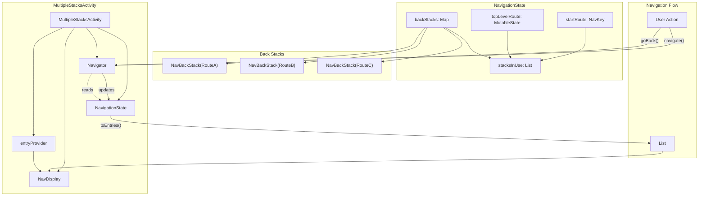
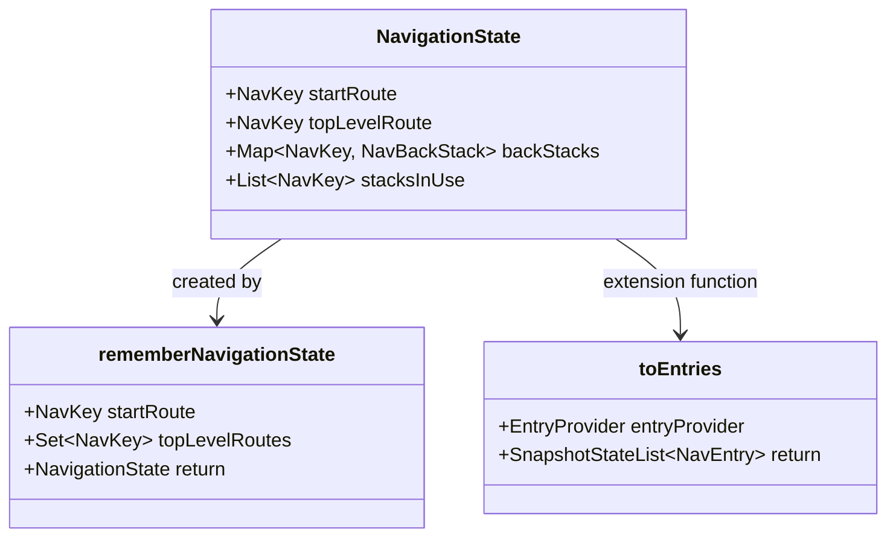
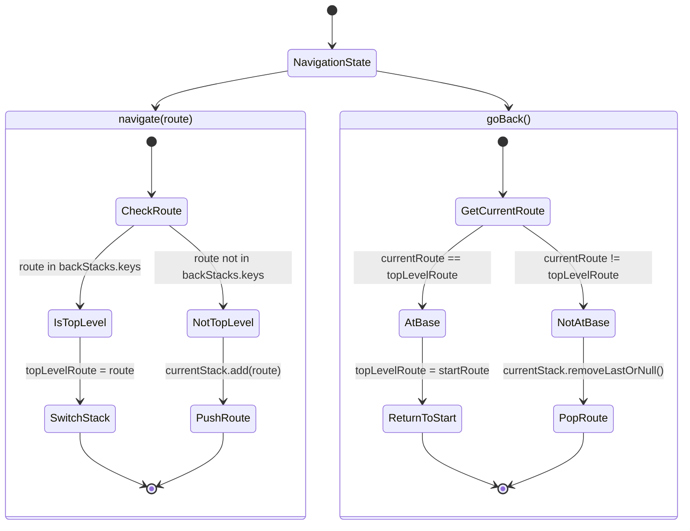
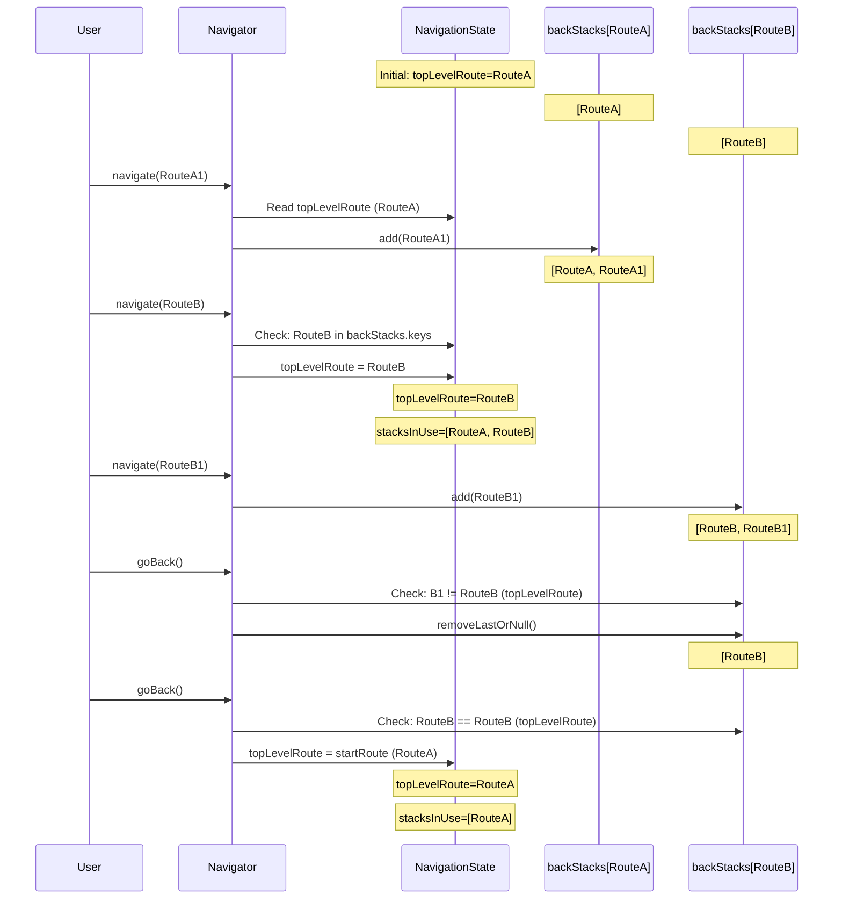
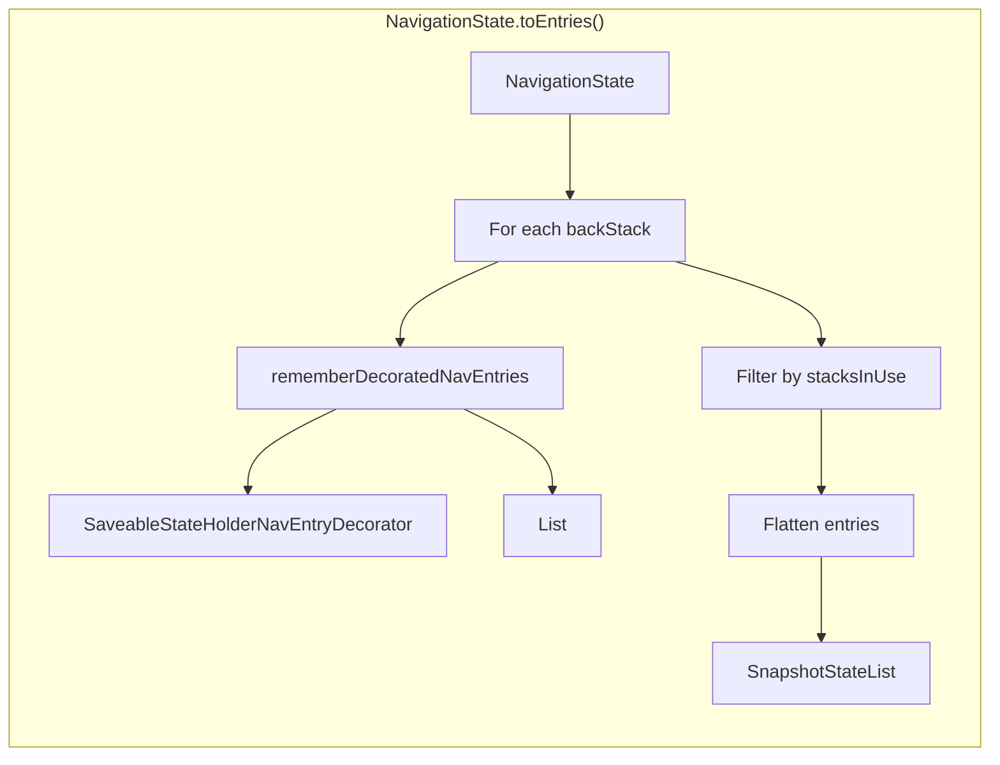
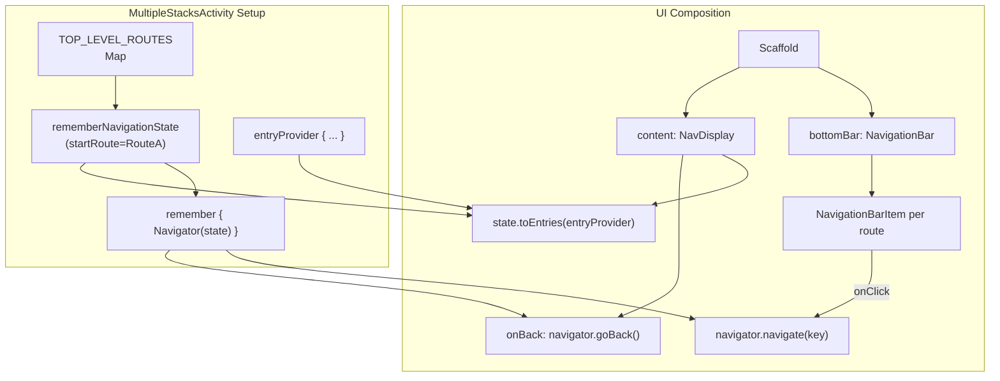

<!-- source: DeepWiki mcp.deepwiki.com · repo android/nav3-recipes · page 5.1 Multiple Back Stacks Pattern · fetched 2026-10-23 -->

# Multiple Back Stacks Pattern

<details>
<summary>Relevant source files</summary>

The following files were used as context for generating this wiki page:

- [app/src/main/java/com/example/nav3recipes/multiplestacks/Content.kt](app/src/main/java/com/example/nav3recipes/multiplestacks/Content.kt)
- [app/src/main/java/com/example/nav3recipes/multiplestacks/MultipleStacksActivity.kt](app/src/main/java/com/example/nav3recipes/multiplestacks/MultipleStacksActivity.kt)
- [app/src/main/java/com/example/nav3recipes/multiplestacks/NavigationState.kt](app/src/main/java/com/example/nav3recipes/multiplestacks/NavigationState.kt)
- [app/src/main/java/com/example/nav3recipes/multiplestacks/Navigator.kt](app/src/main/java/com/example/nav3recipes/multiplestacks/Navigator.kt)
- [app/src/main/java/com/example/nav3recipes/multiplestacks/README.md](app/src/main/java/com/example/nav3recipes/multiplestacks/README.md)

</details>


This document explains the Multiple Back Stacks pattern in Navigation 3, where each top-level destination in an application maintains its own independent navigation history. This pattern is commonly used in applications with bottom navigation bars or navigation drawers, where switching between top-level sections preserves each section's navigation state.

For information about the UI implementation of bottom navigation bars used with this pattern, see [Common Navigation UI with Bottom Bar](#5.2).

## Pattern Overview

The Multiple Back Stacks pattern allows an application to maintain separate navigation histories for different top-level destinations. When a user navigates between top-level sections (e.g., Home, Profile, Settings), each section remembers its own navigation stack, including any deep navigation the user performed within that section.

This pattern implements "exit-through-home" behavior: regardless of which top-level section is currently active, pressing back repeatedly will eventually return the user to the start route before exiting the application.

**Key Characteristics:**

| Characteristic | Behavior |
|---------------|----------|
| Stack Independence | Each top-level route maintains its own `NavBackStack` |
| State Preservation | Navigation state and composable state persist when switching sections |
| Exit Behavior | User always exits through the designated start route |
| Stack Visibility | Only the start route stack and current active stack are rendered |

Sources: [app/src/main/java/com/example/nav3recipes/multiplestacks/README.md:1-21]()

## Use Cases

This pattern is appropriate when:

- The application has multiple top-level sections accessed via bottom navigation, navigation drawer, or navigation rail
- Users need to switch between sections without losing their place within each section
- Each section contains its own navigation hierarchy (e.g., list → detail → edit flows)
- The application should preserve scroll positions, form state, and navigation depth when switching sections

Common examples include social media apps (Home/Search/Profile), e-commerce apps (Browse/Cart/Account), and productivity apps (Inbox/Calendar/Tasks).

Sources: [app/src/main/java/com/example/nav3recipes/multiplestacks/MultipleStacksActivity.kt:71-114]()

## Architecture Overview



**Diagram: Multiple Back Stacks Architecture**

The architecture consists of three main components:

1. **NavigationState**: Holds the current navigation state, including which top-level route is active and the individual back stack for each top-level route
2. **Navigator**: Handles navigation events and updates the `NavigationState` according to the pattern's rules
3. **NavDisplay**: Renders the currently visible entries from the active back stacks

Sources: [app/src/main/java/com/example/nav3recipes/multiplestacks/NavigationState.kt:40-84](), [app/src/main/java/com/example/nav3recipes/multiplestacks/Navigator.kt:21-46]()

## Key Components

### NavigationState

The `NavigationState` class is the central state holder for the multiple back stacks pattern.



**Diagram: NavigationState Structure**

**Properties:**

| Property | Type | Description |
|----------|------|-------------|
| `startRoute` | `NavKey` | The route users exit through; always remains in the back stack |
| `topLevelRoute` | `NavKey` (mutable) | The currently active top-level route |
| `backStacks` | `Map<NavKey, NavBackStack>` | One back stack per top-level route |
| `stacksInUse` | `List<NavKey>` (computed) | Routes whose entries should be rendered |

The `stacksInUse` property implements the exit-through-home behavior. It returns:
- Only `[startRoute]` when the user is on the start route
- `[startRoute, topLevelRoute]` when the user is on any other top-level route

This ensures the start route's entries are always present, enabling the user to back out through the start route from any section.

Sources: [app/src/main/java/com/example/nav3recipes/multiplestacks/NavigationState.kt:71-84]()

### rememberNavigationState

The `rememberNavigationState` composable function creates and persists the `NavigationState` across configuration changes and process death.

**Parameters:**

| Parameter | Type | Description |
|-----------|------|-------------|
| `startRoute` | `NavKey` | Initial and exit route |
| `topLevelRoutes` | `Set<NavKey>` | All top-level destinations |

**State Persistence:**

- The `topLevelRoute` is saved using `rememberSerializable` with `MutableStateSerializer`
- Each back stack is created with `rememberNavBackStack`, which handles its own persistence
- The `backStacks` map is created by associating each top-level route with its own `NavBackStack`

Sources: [app/src/main/java/com/example/nav3recipes/multiplestacks/NavigationState.kt:40-62]()

### Navigator

The `Navigator` class handles navigation logic and updates the `NavigationState`.



**Diagram: Navigator State Machine**

**Navigation Logic:**

The `navigate(route: NavKey)` function implements two behaviors:

1. **Top-Level Navigation**: If the route is a key in `backStacks`, switch to that top-level section
   ```
   state.topLevelRoute = route
   ```

2. **Within-Stack Navigation**: If the route is not a top-level route, add it to the current stack
   ```
   state.backStacks[state.topLevelRoute]?.add(route)
   ```

**Back Navigation:**

The `goBack()` function handles two cases:

1. **At Stack Base**: If at the base of a non-start route, switch to the start route
   ```
   if (currentRoute == state.topLevelRoute) {
       state.topLevelRoute = state.startRoute
   }
   ```

2. **Within Stack**: If deeper in the stack, pop the last entry
   ```
   currentStack.removeLastOrNull()
   ```

Sources: [app/src/main/java/com/example/nav3recipes/multiplestacks/Navigator.kt:24-46]()

## Navigation Behavior Examples



**Diagram: Example Navigation Sequence**

### Scenario Walkthrough

Consider an application with three top-level routes: A (start), B, and C. Here's how the pattern behaves:

| Action | Active Route | StackA | StackB | StackC | stacksInUse |
|--------|--------------|--------|--------|--------|-------------|
| Initial | A | [A] | [B] | [C] | [A] |
| Navigate to A1 | A | [A, A1] | [B] | [C] | [A] |
| Navigate to B | B | [A, A1] | [B] | [C] | [A, B] |
| Navigate to B1 | B | [A, A1] | [B, B1] | [C] | [A, B] |
| Navigate to C | C | [A, A1] | [B, B1] | [C] | [A, C] |
| Back | C | [A, A1] | [B, B1] | [C] | [A] (switched to A) |
| Navigate to B | B | [A, A1] | [B, B1] | [C] | [A, B] |
| Back | B | [A, A1] | [B] | [C] | [A, B] |
| Back | A | [A, A1] | [B] | [C] | [A] (switched to A) |
| Back | A | [A] | [B] | [C] | [A] |
| Back | Exit | | | | |

**Key Observations:**

- Stacks B and C retained their state (B1 remained) even after switching to C
- When backing from the base of a non-start stack, the system switches to the start stack
- The start stack (A) entries are always present in `stacksInUse`, implementing exit-through-home

Sources: [app/src/main/java/com/example/nav3recipes/multiplestacks/Navigator.kt:24-46](), [app/src/main/java/com/example/nav3recipes/multiplestacks/README.md:13-17]()

## Converting State to Entries

The `toEntries` extension function converts the `NavigationState` into a list of `NavEntry` objects that `NavDisplay` can render.



**Diagram: toEntries Conversion Process**

**Process:**

1. **Decorate Each Stack**: Each back stack's entries are decorated with a `SaveableStateHolderNavEntryDecorator`
2. **Filter Active Stacks**: Only entries from stacks in `stacksInUse` are included
3. **Flatten**: The entries from multiple stacks are flattened into a single list
4. **Return**: A `SnapshotStateList` that recomposes when any stack changes

**Important Detail**: Each top-level route gets its own `SaveableStateHolderNavEntryDecorator` instance. This ensures that saveable state (like scroll positions, text field values, etc.) is preserved independently for each section.

Sources: [app/src/main/java/com/example/nav3recipes/multiplestacks/NavigationState.kt:89-108]()

## State Preservation

The pattern preserves two types of state:

### Navigation State Persistence

| State Component | Persistence Mechanism | Survives |
|----------------|----------------------|----------|
| `topLevelRoute` | `rememberSerializable` with `MutableStateSerializer` | Config changes + process death |
| Each `NavBackStack` | `rememberNavBackStack` | Config changes + process death |
| Overall structure | `remember` with stable keys | Config changes only |

### Composable State Persistence

Each entry's composable state (e.g., `rememberSaveable` values) is preserved through the `SaveableStateHolderNavEntryDecorator`. Because each top-level route gets its own decorator instance, state is isolated between sections.

**Example from the recipe:**

In [app/src/main/java/com/example/nav3recipes/multiplestacks/Content.kt:49-57](), RouteA1 contains:

```kotlin
var count by rememberSaveable { mutableIntStateOf(0) }
```

This counter state persists when:
- Switching from RouteA to RouteB and back
- Rotating the device
- The process is killed and restored

Each sub-route (A1, B1, C1) maintains its own independent counter state.

Sources: [app/src/main/java/com/example/nav3recipes/multiplestacks/NavigationState.kt:94-102](), [app/src/main/java/com/example/nav3recipes/multiplestacks/Content.kt:49-107]()

## Implementation Example

The `MultipleStacksActivity` demonstrates the complete implementation:



**Diagram: MultipleStacksActivity Component Structure**

### Route Definitions

The recipe defines six routes: three top-level routes and three sub-routes:

```kotlin
@Serializable data object RouteA : NavKey    // Top-level
@Serializable data object RouteA1 : NavKey   // Sub-route of A

@Serializable data object RouteB : NavKey    // Top-level
@Serializable data object RouteB1 : NavKey   // Sub-route of B

@Serializable data object RouteC : NavKey    // Top-level
@Serializable data object RouteC1 : NavKey   // Sub-route of C
```

The `TOP_LEVEL_ROUTES` map associates each top-level route with its navigation bar metadata:

```kotlin
private val TOP_LEVEL_ROUTES = mapOf<NavKey, NavBarItem>(
    RouteA to NavBarItem(icon = Icons.Default.Home, description = "Route A"),
    RouteB to NavBarItem(icon = Icons.Default.Face, description = "Route B"),
    RouteC to NavBarItem(icon = Icons.Default.Camera, description = "Route C"),
)
```

Sources: [app/src/main/java/com/example/nav3recipes/multiplestacks/MultipleStacksActivity.kt:42-64]()

### Activity Setup

The activity's `onCreate` method sets up the navigation infrastructure:

1. **Create Navigation State**: Initialize with RouteA as the start route
   ```kotlin
   val navigationState = rememberNavigationState(
       startRoute = RouteA,
       topLevelRoutes = TOP_LEVEL_ROUTES.keys
   )
   ```

2. **Create Navigator**: Bind the navigator to the state
   ```kotlin
   val navigator = remember { Navigator(navigationState) }
   ```

3. **Define Entry Provider**: Map each route to its composable content
   ```kotlin
   val entryProvider = entryProvider {
       featureASection(onSubRouteClick = { navigator.navigate(RouteA1) })
       featureBSection(onSubRouteClick = { navigator.navigate(RouteB1) })
       featureCSection(onSubRouteClick = { navigator.navigate(RouteC1) })
   }
   ```

4. **Compose UI**: Scaffold with bottom navigation and NavDisplay
   ```kotlin
   Scaffold(bottomBar = { /* NavigationBar */ }) { paddingValues ->
       NavDisplay(
           entries = navigationState.toEntries(entryProvider),
           onBack = { navigator.goBack() },
           modifier = Modifier.padding(paddingValues)
       )
   }
   ```

Sources: [app/src/main/java/com/example/nav3recipes/multiplestacks/MultipleStacksActivity.kt:76-112]()

### Entry Provider Organization

The entry provider is organized into feature sections using extension functions:

| Function | Routes Defined | Purpose |
|----------|----------------|---------|
| `featureASection` | RouteA, RouteA1 | Defines entries for feature A |
| `featureBSection` | RouteB, RouteB1 | Defines entries for feature B |
| `featureCSection` | RouteC, RouteC1 | Defines entries for feature C |

Each section defines:
- A top-level entry with a button to navigate to its sub-route
- A sub-route entry with a counter to demonstrate state preservation

Sources: [app/src/main/java/com/example/nav3recipes/multiplestacks/Content.kt:36-108]()

## Implementation Considerations

### When to Use This Pattern

**Appropriate:**
- Apps with 3-5 top-level sections
- Each section has independent navigation flows
- Users frequently switch between sections
- State preservation is important

**Not Appropriate:**
- Simple apps with linear navigation
- Apps with a single primary flow
- When memory constraints are severe (each stack maintains its state)

### Memory Management

The pattern keeps all back stacks in memory simultaneously. Each stack retains:
- Navigation history
- Composable state via `SaveableStateHolder`
- ViewModel instances (if decorated)

For apps with many top-level routes or deep stacks, consider:
- Limiting the depth of each stack
- Clearing non-current stacks after extended periods
- Using ViewModel clearing strategies

### Back Stack Initialization

Each top-level route's back stack is initialized with that route as its base:

```kotlin
val backStacks = topLevelRoutes.associateWith { key -> rememberNavBackStack(key) }
```

This ensures every top-level section starts with a valid base entry. You cannot have an empty back stack in this pattern.

Sources: [app/src/main/java/com/example/nav3recipes/multiplestacks/NavigationState.kt:53]()

## Testing Considerations

When testing the multiple back stacks pattern:

1. **State Retention**: Verify each stack preserves state when switching sections
2. **Exit Behavior**: Confirm users exit through the start route
3. **Back Navigation**: Test backing from base routes returns to start
4. **Process Death**: Ensure navigation state survives configuration changes and process death
5. **Saveable State**: Verify composable state persists across section switches

Example test scenarios:
- Navigate A → A1 → B → C, press back → should show A
- Navigate A → A1, switch to B, return to A → A1 should still be present
- Navigate to B, press back at RouteB → should switch to RouteA

Sources: [app/src/main/java/com/example/nav3recipes/multiplestacks/README.md:13-21]()

## Relationship to Other Patterns

This pattern can be combined with:

- **[Common Navigation UI with Bottom Bar](#5.2)**: Provides the UI layer for this navigation pattern
- **[ViewModel Integration](#9)**: Add ViewModels to entries with argument passing
- **[Result Passing](#8)**: Communicate results between sections
- **[Modular Architecture](#10)**: Organize each section into separate feature modules

The pattern is foundational for applications with complex, multi-section navigation hierarchies.

Sources: [app/src/main/java/com/example/nav3recipes/multiplestacks/MultipleStacksActivity.kt:1-115]()

---

