<!-- source: DeepWiki mcp.deepwiki.com · repo android/nav3-recipes · page 5.2 Common Navigation UI with Bottom Bar · fetched 2026-10-23 -->

# Common Navigation UI with Bottom Bar

<details>
<summary>Relevant source files</summary>

The following files were used as context for generating this wiki page:

- [app/src/main/java/com/example/nav3recipes/basic/BasicActivity.kt](app/src/main/java/com/example/nav3recipes/basic/BasicActivity.kt)
- [app/src/main/java/com/example/nav3recipes/commonui/CommonUiActivity.kt](app/src/main/java/com/example/nav3recipes/commonui/CommonUiActivity.kt)
- [app/src/main/java/com/example/nav3recipes/commonui/README.md](app/src/main/java/com/example/nav3recipes/commonui/README.md)

</details>


## Purpose and Scope

This document describes the Common UI recipe, which demonstrates how to implement a standard navigation pattern using Material 3's `NavigationBar` (bottom bar) combined with multiple independent back stacks. This pattern allows users to switch between top-level destinations while preserving navigation history within each section.

For information about the underlying multiple back stacks pattern and exit-through-home behavior, see [Multiple Back Stacks Pattern](#5.1). This document focuses specifically on the UI integration and the `TopLevelBackStack` implementation.

**Sources:** [app/src/main/java/com/example/nav3recipes/commonui/README.md:1-30]()

---

## Recipe Overview

The Common UI recipe implements a three-tab application with:
- **Home**: A standalone top-level destination
- **ChatList**: A top-level destination with nested navigation to `ChatDetail`
- **Camera**: A standalone top-level destination

Each top-level destination maintains its own navigation stack, and a bottom `NavigationBar` allows switching between them.

**Sources:** [app/src/main/java/com/example/nav3recipes/commonui/CommonUiActivity.kt:47-55]()

---

## UI Architecture

### Component Hierarchy

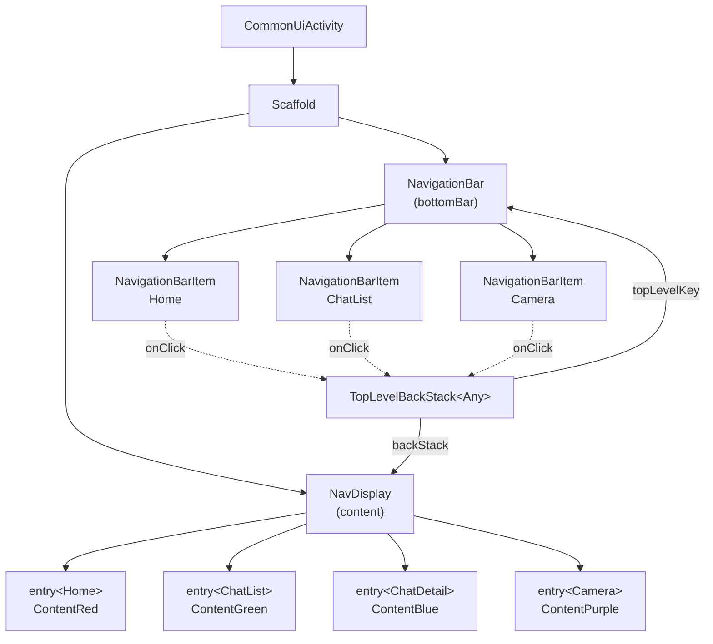

**Diagram: UI Component Structure**

The `Scaffold` composable provides the layout structure, with `NavigationBar` positioned as the `bottomBar` and `NavDisplay` as the main content. The `TopLevelBackStack` instance manages state for both components.

**Sources:** [app/src/main/java/com/example/nav3recipes/commonui/CommonUiActivity.kt:64-108]()

---

## Route Definitions

The recipe defines routes using a sealed interface pattern:

| Route | Type | Purpose | Icon |
|-------|------|---------|------|
| `Home` | Top-level | Home screen | `Icons.Default.Home` |
| `ChatList` | Top-level | Chat list screen | `Icons.Default.Face` |
| `Camera` | Top-level | Camera screen | `Icons.Default.PlayArrow` |
| `ChatDetail` | Nested | Individual chat conversation | N/A |

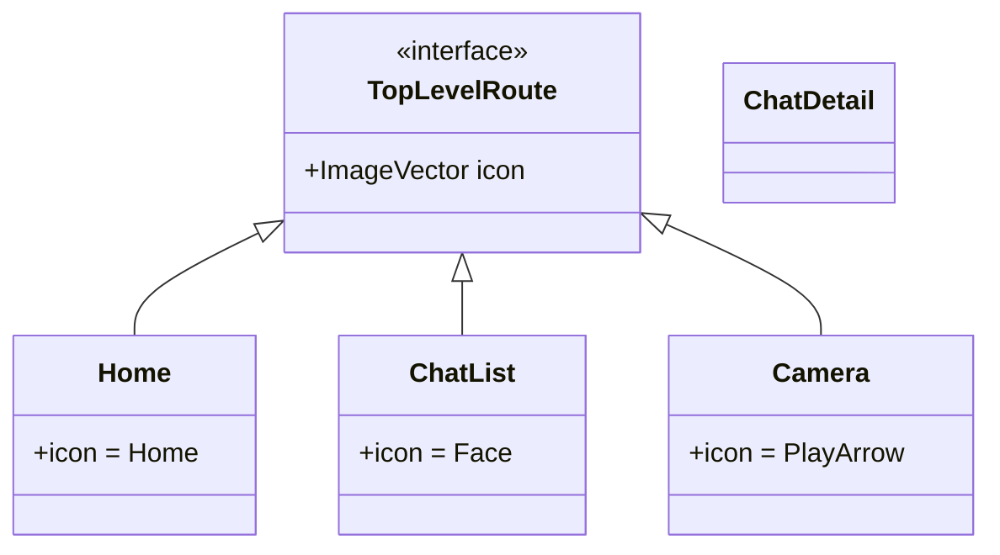

**Diagram: Route Type Hierarchy**

The `TopLevelRoute` sealed interface defines routes that appear in the `NavigationBar`. Only top-level routes have icons. `ChatDetail` is a nested route accessible from `ChatList`.

**Sources:** [app/src/main/java/com/example/nav3recipes/commonui/CommonUiActivity.kt:47-55]()

---

## TopLevelBackStack Implementation

### Data Structure

The `TopLevelBackStack<T>` class manages multiple independent navigation stacks using a `LinkedHashMap`:

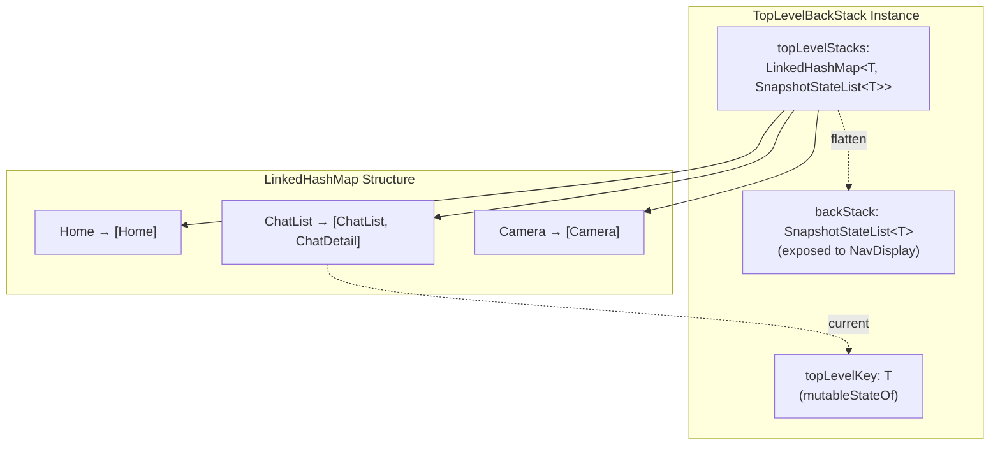

**Diagram: TopLevelBackStack Internal State**

The class maintains:
- **`topLevelStacks`**: A `LinkedHashMap<T, SnapshotStateList<T>>` where each top-level route maps to its own navigation stack
- **`topLevelKey`**: The currently active top-level route
- **`backStack`**: A flattened `SnapshotStateList<T>` containing all routes across all stacks, used by `NavDisplay`

**Sources:** [app/src/main/java/com/example/nav3recipes/commonui/CommonUiActivity.kt:113-126]()

---

### Key Operations

#### Constructor Initialization

The `TopLevelBackStack` constructor requires a `startKey` parameter:

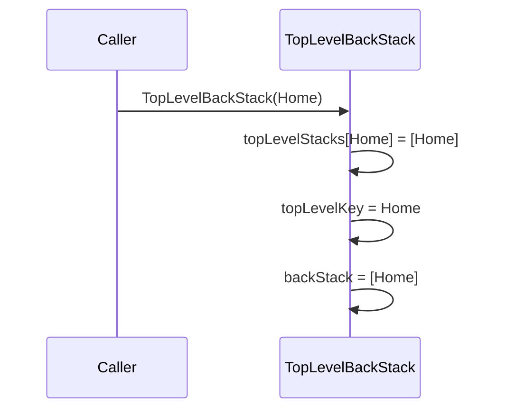

**Diagram: TopLevelBackStack Initialization**

**Sources:** [app/src/main/java/com/example/nav3recipes/commonui/CommonUiActivity.kt:113-125]()

---

#### addTopLevel() Method

The `addTopLevel(key: T)` method switches between top-level destinations:

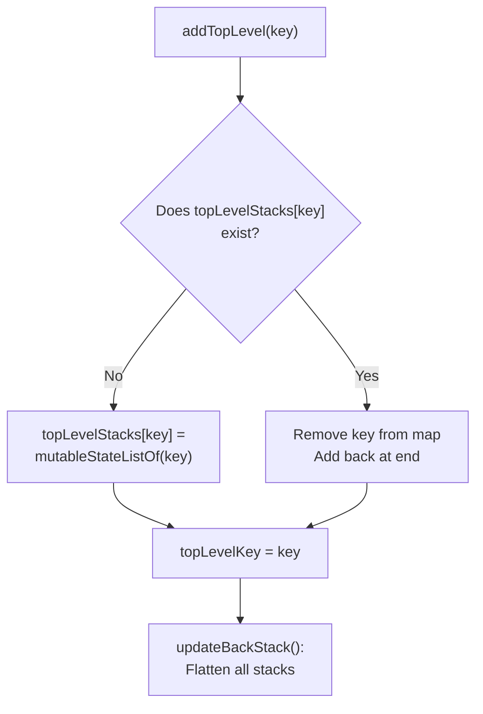

**Diagram: addTopLevel() Flow**

When switching to a top-level destination:
1. If the destination doesn't exist in `topLevelStacks`, create a new stack with just that key
2. If it exists, move it to the end of the `LinkedHashMap` (to maintain ordering)
3. Update `topLevelKey` to the selected destination
4. Flatten all stacks into the exposed `backStack`

The use of `LinkedHashMap` ensures that the order of top-level destinations reflects their access history, which is important for back navigation.

**Sources:** [app/src/main/java/com/example/nav3recipes/commonui/CommonUiActivity.kt:133-148]()

---

#### add() Method

The `add(key: T)` method adds a route to the current top-level stack:

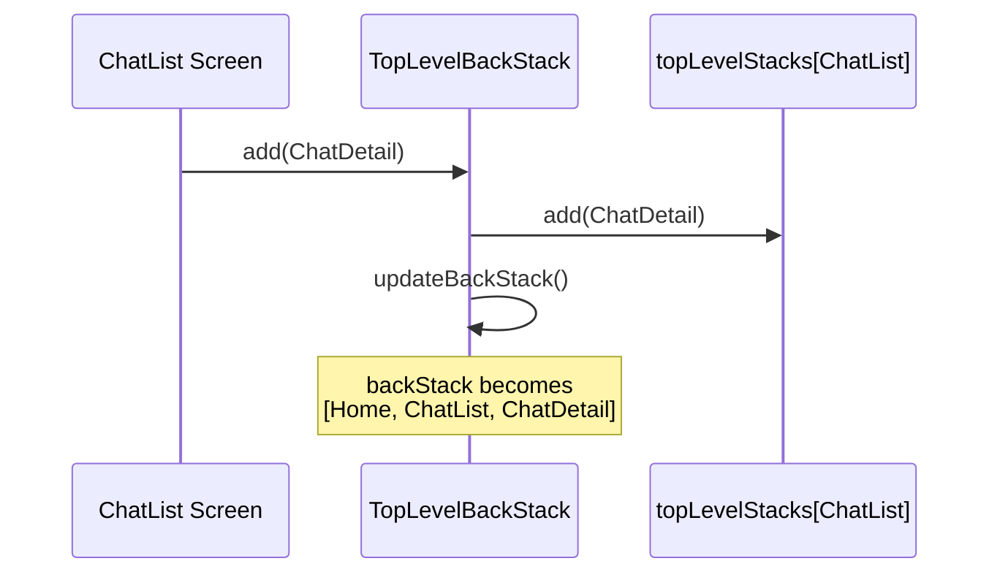

**Diagram: Adding Nested Route**

This method adds a route to the stack of the currently active top-level destination (`topLevelKey`).

**Sources:** [app/src/main/java/com/example/nav3recipes/commonui/CommonUiActivity.kt:150-153]()

---

#### removeLast() Method

The `removeLast()` method handles back navigation:

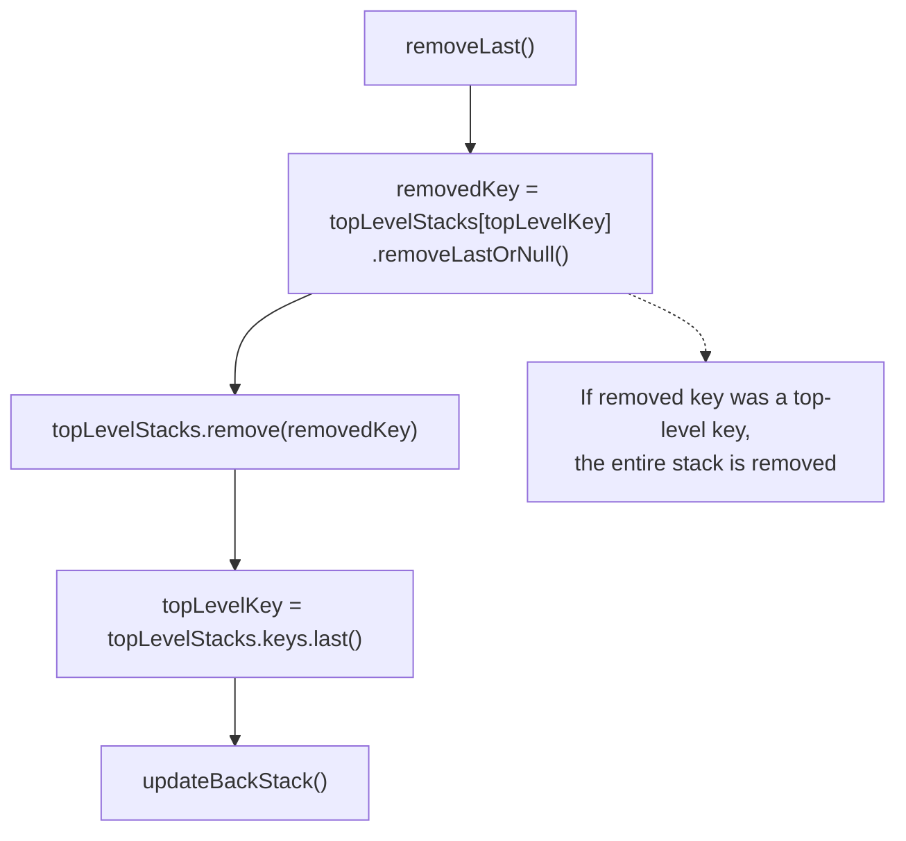

**Diagram: removeLast() Flow**

When the user presses back:
1. Remove the last route from the current top-level stack
2. If the removed route was itself a top-level route, remove its entire stack from `topLevelStacks`
3. Update `topLevelKey` to the last remaining top-level route
4. Flatten the remaining stacks into `backStack`

This implements the exit-through-home behavior: when backing out of a top-level destination, its entire stack is discarded.

**Sources:** [app/src/main/java/com/example/nav3recipes/commonui/CommonUiActivity.kt:155-161]()

---

#### updateBackStack() Helper

The `updateBackStack()` method flattens all individual stacks into a single back stack:

| Operation | Description |
|-----------|-------------|
| `backStack.clear()` | Remove all existing entries |
| `addAll(topLevelStacks.flatMap { it.value })` | Flatten each stack and concatenate |

**Sources:** [app/src/main/java/com/example/nav3recipes/commonui/CommonUiActivity.kt:127-131]()

---

## NavigationBar Integration

### Bar Configuration

The `NavigationBar` iterates over `TOP_LEVEL_ROUTES` to create `NavigationBarItem`s:

```mermaid
graph LR
    TLR["TOP_LEVEL_ROUTES<br/>[Home, ChatList, Camera]"]
    
    TLR -->|forEach| Item1["NavigationBarItem<br/>Home"]
    TLR -->|forEach| Item2["NavigationBarItem<br/>ChatList"]
    TLR -->|forEach| Item3["NavigationBarItem<br/>Camera"]
    
    TLB["topLevelBackStack.topLevelKey"]
    
    TLB -.->|selected = (route == topLevelKey)| Item1
    TLB -.->|selected = (route == topLevelKey)| Item2
    TLB -.->|selected = (route == topLevelKey)| Item3
    
    Item1 -.->|onClick| AddTL1["addTopLevel(Home)"]
    Item2 -.->|onClick| AddTL2["addTopLevel(ChatList)"]
    Item3 -.->|onClick| AddTL3["addTopLevel(Camera)"]
```

**Diagram: NavigationBar Item Configuration**

Each `NavigationBarItem`:
- Displays the route's icon
- Sets `selected = (topLevelRoute == topLevelBackStack.topLevelKey)`
- Calls `topLevelBackStack.addTopLevel(topLevelRoute)` on click

**Sources:** [app/src/main/java/com/example/nav3recipes/commonui/CommonUiActivity.kt:66-82]()

---

### Selection State

The selection state is derived from comparing each route to `topLevelBackStack.topLevelKey`:

```kotlin
val isSelected = topLevelRoute == topLevelBackStack.topLevelKey
```

This reactive binding ensures the UI reflects the current navigation state.

**Sources:** [app/src/main/java/com/example/nav3recipes/commonui/CommonUiActivity.kt:69]()

---

## NavDisplay Configuration

The `NavDisplay` receives:

| Parameter | Value | Purpose |
|-----------|-------|---------|
| `backStack` | `topLevelBackStack.backStack` | Flattened list of all routes |
| `onBack` | `{ topLevelBackStack.removeLast() }` | Back press handler |
| `entryProvider` | `entryProvider { ... }` | Route-to-UI mapping |

The `entryProvider` defines composable content for each route using the DSL:

```mermaid
graph TB
    EP["entryProvider { }"]
    
    EP --> Home["entry&lt;Home&gt; {<br/>ContentRed(\"Home screen\")<br/>}"]
    EP --> ChatList["entry&lt;ChatList&gt; {<br/>ContentGreen(\"Chat list screen\") {<br/>  Button: add(ChatDetail)<br/>}<br/>}"]
    EP --> ChatDetail["entry&lt;ChatDetail&gt; {<br/>ContentBlue(\"Chat detail screen\")<br/>}"]
    EP --> Camera["entry&lt;Camera&gt; {<br/>ContentPurple(\"Camera screen\")<br/>}"]
```

**Diagram: Entry Provider Mapping**

**Sources:** [app/src/main/java/com/example/nav3recipes/commonui/CommonUiActivity.kt:86-107]()

---

## Navigation Interaction Patterns

### Scenario 1: Switching Top-Level Tabs

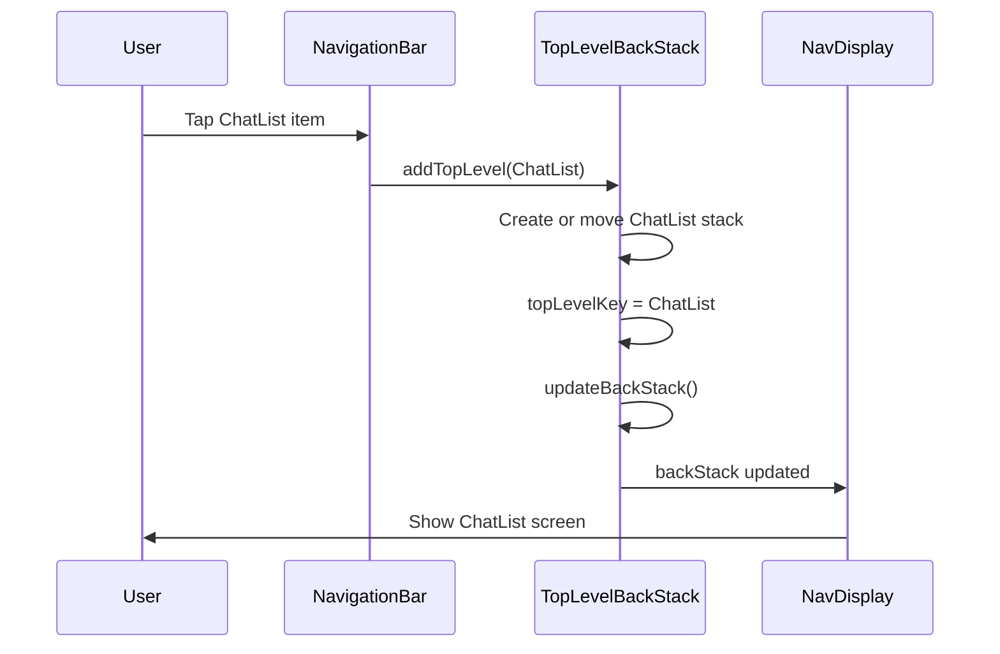

**Diagram: Top-Level Tab Switch**

**Sources:** [app/src/main/java/com/example/nav3recipes/commonui/CommonUiActivity.kt:72-74]()

---

### Scenario 2: Nested Navigation

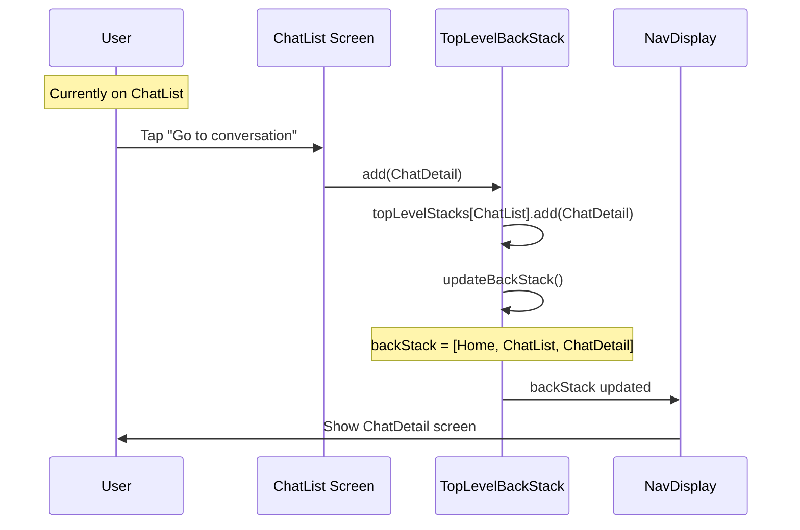

**Diagram: Nested Navigation Within Tab**

**Sources:** [app/src/main/java/com/example/nav3recipes/commonui/CommonUiActivity.kt:95-96]()

---

### Scenario 3: Back Navigation

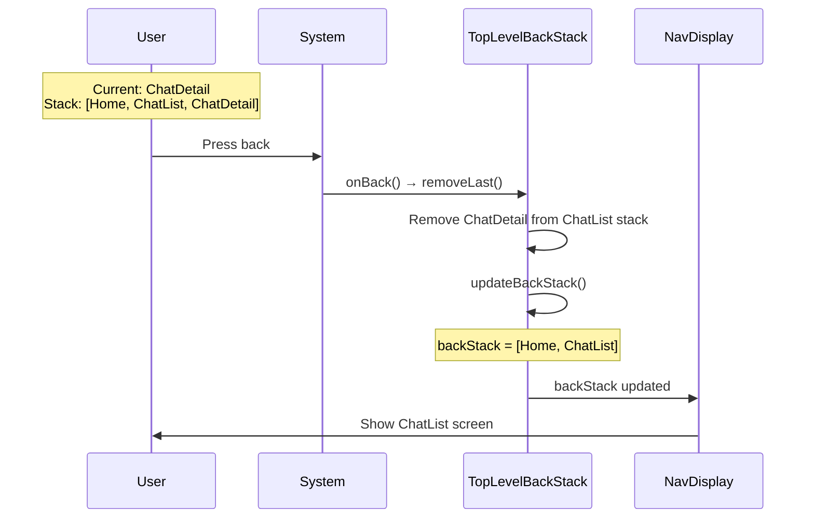

**Diagram: Back from Nested Route**

**Sources:** [app/src/main/java/com/example/nav3recipes/commonui/CommonUiActivity.kt:88]()

---

### Scenario 4: Exit Through Home

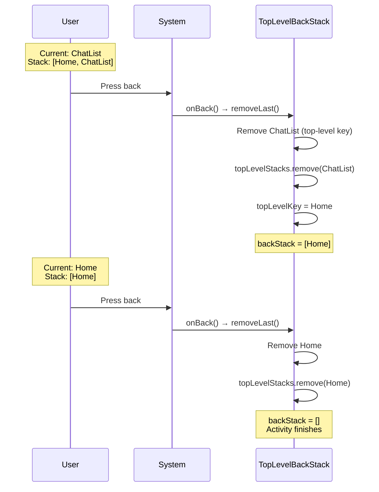

**Diagram: Exit Through Home Behavior**

When backing out of a top-level destination, its entire stack is removed. The app exits when the last remaining top-level route is removed.

**Sources:** [app/src/main/java/com/example/nav3recipes/commonui/CommonUiActivity.kt:155-161](), [app/src/main/java/com/example/nav3recipes/commonui/README.md:28-30]()

---

## State Preservation Characteristics

### Non-Persistent Back Stacks

The `TopLevelBackStack` instance is created with `remember`, meaning:

| Event | Behavior |
|-------|----------|
| Configuration change | State is **preserved** |
| Process death | State is **lost** |
| Back to previous tab | State is **lost** (stack removed) |

When a user backs out of a top-level destination completely, its stack is removed from `topLevelStacks`. Returning to that tab later starts fresh.

**Sources:** [app/src/main/java/com/example/nav3recipes/commonui/CommonUiActivity.kt:62](), [app/src/main/java/com/example/nav3recipes/commonui/README.md:26-28]()

---

### Future Enhancement: Saveable State

To persist state across process death, consider:
- Using `rememberSaveable` instead of `remember`
- Ensuring all route types implement `Serializable` or `Parcelable`
- Implementing custom `Saver` for `TopLevelBackStack`

For more information on saveable back stacks, see [Saveable Back Stack](#3.3).

**Sources:** [app/src/main/java/com/example/nav3recipes/commonui/README.md:26-28]()

---

## Complete Navigation Flow

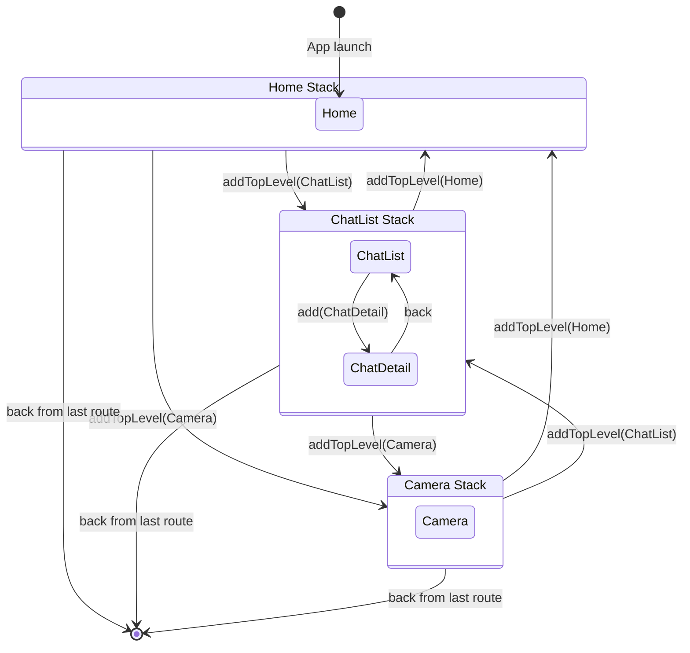

**Diagram: Complete State Machine**

**Sources:** [app/src/main/java/com/example/nav3recipes/commonui/CommonUiActivity.kt:113-162]()

---

## Summary

The Common UI recipe demonstrates a navigation pattern combining:

| Component | Responsibility |
|-----------|----------------|
| `TopLevelBackStack` | Multi-stack management, state exposure |
| `NavigationBar` | Top-level destination selection UI |
| `NavDisplay` | Content rendering based on flattened back stack |
| `entryProvider` | Route-to-composable mapping |

Characteristics:
- Each top-level destination maintains independent navigation history
- Switching tabs preserves history until user backs out completely
- Exit-through-home behavior removes unused stacks
- State updates trigger UI recomposition

**Sources:** [app/src/main/java/com/example/nav3recipes/commonui/CommonUiActivity.kt:1-164](), [app/src/main/java/com/example/nav3recipes/commonui/README.md:1-30]()

---

