<!-- source: DeepWiki mcp.deepwiki.com · repo android/nav3-recipes · page 6 Custom Scenes and Adaptive Layouts · fetched 2026-10-23 -->

# Custom Scenes and Adaptive Layouts

Relevant source files

The following files were used as context for generating this wiki page:

- [app/src/main/java/com/example/nav3recipes/scenes/listdetail/Content.kt](app/src/main/java/com/example/nav3recipes/scenes/listdetail/Content.kt)
- [app/src/main/java/com/example/nav3recipes/scenes/listdetail/ListDetailActivity.kt](app/src/main/java/com/example/nav3recipes/scenes/listdetail/ListDetailActivity.kt)
- [app/src/main/java/com/example/nav3recipes/scenes/listdetail/ListDetailScene.kt](app/src/main/java/com/example/nav3recipes/scenes/listdetail/ListDetailScene.kt)
- [app/src/main/java/com/example/nav3recipes/scenes/twopane/TwoPaneActivity.kt](app/src/main/java/com/example/nav3recipes/scenes/twopane/TwoPaneActivity.kt)
- [app/src/main/java/com/example/nav3recipes/scenes/twopane/TwoPaneScene.kt](app/src/main/java/com/example/nav3recipes/scenes/twopane/TwoPaneScene.kt)

## Purpose and Scope

This document covers the Scene system in Navigation 3, which enables adaptive multi-pane layouts that respond to device characteristics. The Scene system allows multiple `NavEntry` objects to be rendered simultaneously in a single composition, creating list-detail layouts, two-pane views, and other responsive patterns.

This page provides an architectural overview of how scenes work. For implementation details of specific scene patterns, see:
- [Scene System Overview](#6.1) - Core concepts and the `SceneStrategy` interface
- [Two-Pane Scene Implementation](#6.2) - 50/50 split-pane pattern
- [List-Detail Scene Implementation](#6.3) - 40/60 list-detail pattern with animations
- [Dialog and BottomSheet Scenes](#6.4) - Overlay-based scene patterns
- [Material3 Adaptive Layouts](#6.5) - Production-ready Material3 adaptive components

## Scene System Architecture

The Scene system extends Navigation 3's single-entry model to support multi-pane layouts through a metadata-driven architecture. When a `SceneStrategy` is provided to `NavDisplay`, it can intercept the back stack rendering to compose multiple entries together.

### Core Components

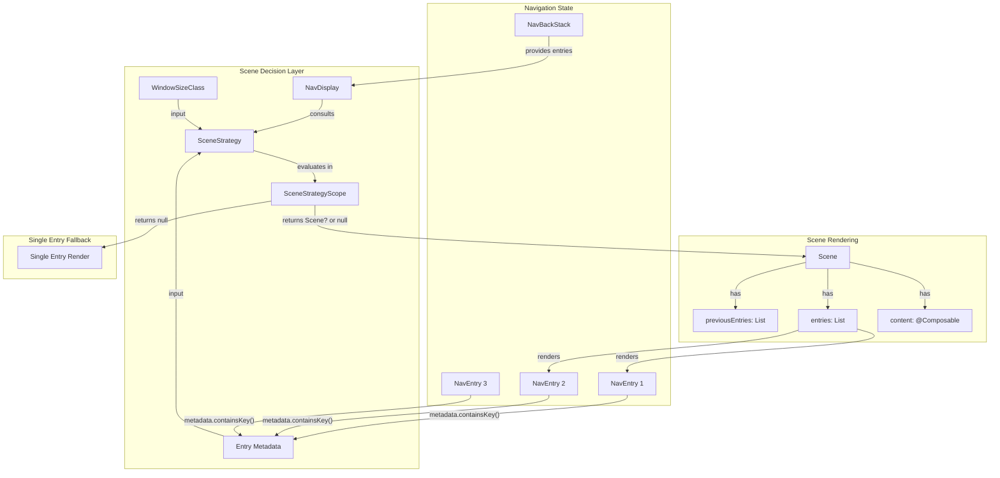

**Sources:** [app/src/main/java/com/example/nav3recipes/scenes/listdetail/ListDetailScene.kt:32-51](), [app/src/main/java/com/example/nav3recipes/scenes/twopane/TwoPaneScene.kt:10-48]()

### Scene Resolution Flow

The scene resolution process determines whether to render a multi-entry scene or fall back to single-entry rendering:

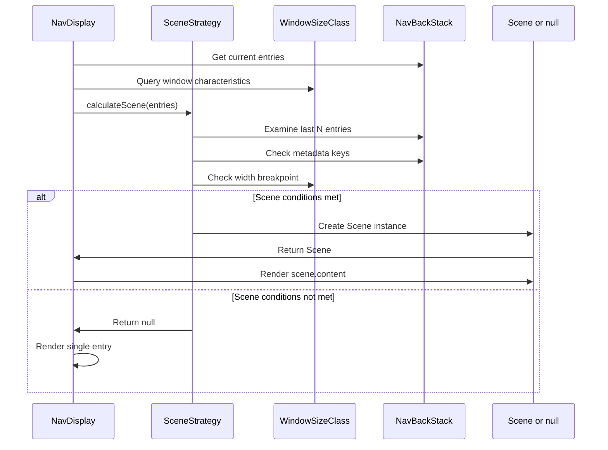

**Sources:** [app/src/main/java/com/example/nav3recipes/scenes/listdetail/ListDetailScene.kt:113-147](), [app/src/main/java/com/example/nav3recipes/scenes/twopane/TwoPaneScene.kt:60-107]()

## Metadata-Based Pane Assignment

Entries declare their eligibility for pane display through metadata maps attached during entry provider configuration. The metadata keys serve as markers that `SceneStrategy` implementations query to determine scene composition.

### Metadata Pattern

| Scene Type | Metadata Function | Metadata Key | Usage |
|------------|------------------|--------------|-------|
| `TwoPaneScene` | `TwoPaneScene.twoPane()` | `"TwoPane"` | Both entries must have this key |
| `ListDetailScene` | `ListDetailScene.listPane()` | `"ListDetailScene-List"` | List entry requirement |
| `ListDetailScene` | `ListDetailScene.detailPane()` | `"ListDetailScene-Detail"` | Detail entry requirement |

**Sources:** [app/src/main/java/com/example/nav3recipes/scenes/twopane/TwoPaneScene.kt:40-47](), [app/src/main/java/com/example/nav3recipes/scenes/listdetail/ListDetailScene.kt:78-93]()

### Entry Provider Configuration

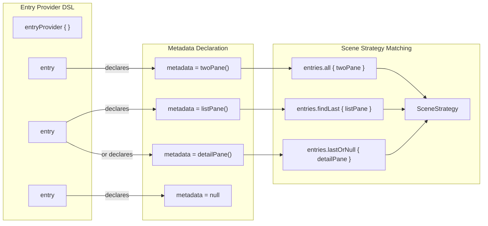

**Sources:** [app/src/main/java/com/example/nav3recipes/scenes/twopane/TwoPaneActivity.kt:63-97](), [app/src/main/java/com/example/nav3recipes/scenes/listdetail/ListDetailActivity.kt:75-97]()

## Window Size Evaluation

Scene strategies evaluate `WindowSizeClass` to determine device characteristics and apply responsive layout rules. The `isWidthAtLeastBreakpoint()` extension function checks width thresholds.

### Width Breakpoint Constants

| Constant | Value | Typical Device |
|----------|-------|---------------|
| `WIDTH_DP_MEDIUM_LOWER_BOUND` | 600dp | Tablets, large phones in landscape |
| Compact (implicit) | < 600dp | Phones in portrait |

**Sources:** [app/src/main/java/com/example/nav3recipes/scenes/twopane/TwoPaneScene.kt:50-57](), [app/src/main/java/com/example/nav3recipes/scenes/listdetail/ListDetailScene.kt:103-110]()

### Window Size Query Pattern

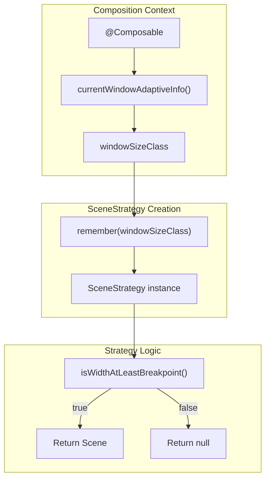

**Sources:** [app/src/main/java/com/example/nav3recipes/scenes/twopane/TwoPaneScene.kt:50-57](), [app/src/main/java/com/example/nav3recipes/scenes/listdetail/ListDetailScene.kt:103-110]()

## Scene Key Design

Each `Scene` instance has a unique `key` that identifies its state. The scene key determines when `NavDisplay` performs scene transitions. When the scene key changes, the entire scene animates out and the new scene animates in. When the scene key remains stable, the scene handles internal state changes without triggering `NavDisplay` transitions.

### Scene Key Strategies

| Scene Type | Key Composition | Purpose |
|------------|----------------|---------|
| `TwoPaneScene` | `Pair(firstEntry.contentKey, secondEntry.contentKey)` | New scene when either entry changes |
| `ListDetailScene` | `listEntry.contentKey` | Stable key allows scene to animate detail changes |

The `ListDetailScene` uses the list entry's content key as the scene key. This design allows the detail pane to change without triggering a scene transition, enabling the scene's internal `AnimatedContent` to handle detail animations smoothly.

**Sources:** [app/src/main/java/com/example/nav3recipes/scenes/twopane/TwoPaneScene.kt:85-88](), [app/src/main/java/com/example/nav3recipes/scenes/listdetail/ListDetailScene.kt:135-145]()

## Previous Entries and Back Navigation

The `previousEntries` property on a `Scene` defines what remains in the back stack when the user navigates back from a scene. This is a UX decision that the scene strategy controls.

### Back Stack Manipulation

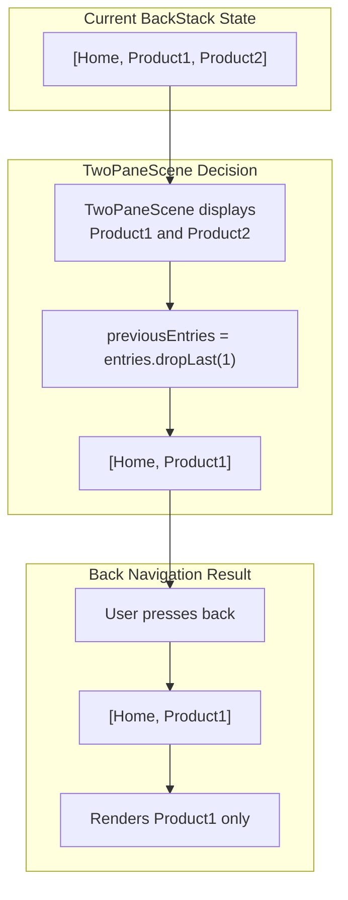

The `TwoPaneScene` sets `previousEntries = entries.dropLast(1)`, removing only the second entry when navigating back. This matches the user's mental model: they navigated forward by adding one entry, so back should remove one entry, not two.

The `ListDetailScene` sets `previousEntries = entries.dropLast(1)`, which removes the detail entry but keeps the list entry when navigating back.

**Sources:** [app/src/main/java/com/example/nav3recipes/scenes/twopane/TwoPaneScene.kt:89-99](), [app/src/main/java/com/example/nav3recipes/scenes/listdetail/ListDetailScene.kt:140-145]()

## Custom Scene Implementation Pattern

Both `TwoPaneScene` and `ListDetailScene` follow a common implementation pattern:

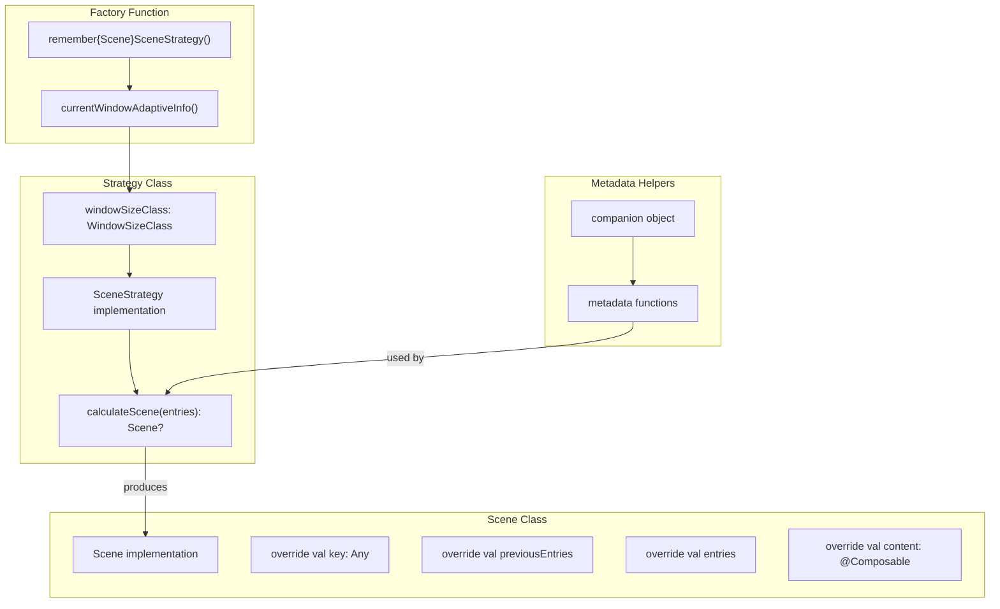

**Sources:** [app/src/main/java/com/example/nav3recipes/scenes/twopane/TwoPaneScene.kt:1-109](), [app/src/main/java/com/example/nav3recipes/scenes/listdetail/ListDetailScene.kt:1-149]()

## Scene Content Layout

Scene implementations define their layout composition in the `content` property. Both examples use `Row` with weighted `Column` children to create side-by-side panes.

### Layout Structure

| Scene Type | First Pane Weight | Second Pane Weight | Layout Modifier |
|------------|-------------------|-------------------|-----------------|
| `TwoPaneScene` | 0.5f | 0.5f | `Modifier.fillMaxSize()` |
| `ListDetailScene` | 0.4f | 0.6f | `Modifier.fillMaxSize()` |

The layout is rendered by calling `NavEntry.Content()` on each entry within the scene's `entries` list:

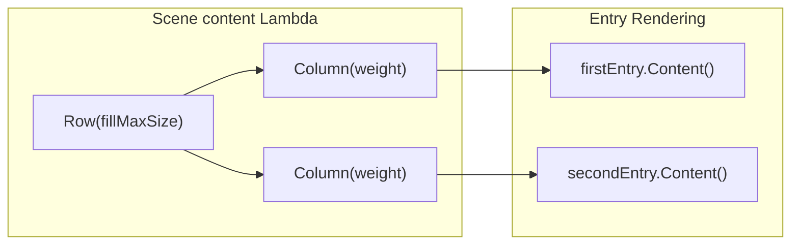

**Sources:** [app/src/main/java/com/example/nav3recipes/scenes/twopane/TwoPaneScene.kt:28-38](), [app/src/main/java/com/example/nav3recipes/scenes/listdetail/ListDetailScene.kt:52-76]()

## Advanced Scene Features

### AnimatedContent for Detail Transitions

`ListDetailScene` wraps the detail pane in `AnimatedContent` to provide slide transitions when the detail entry changes while maintaining the scene's stable key:

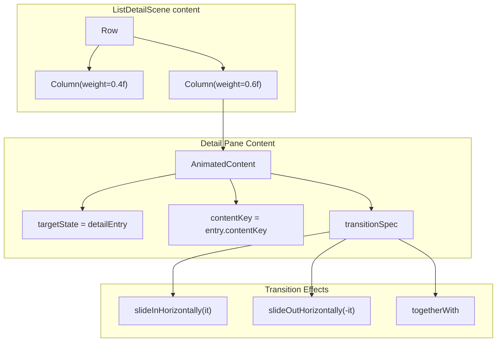

The `AnimatedContent` animates detail entry changes with horizontal slide transitions: new content slides in from the right (`initialOffsetX = { it }`), while old content slides out to the left (`targetOffsetX = { -it }`).

**Sources:** [app/src/main/java/com/example/nav3recipes/scenes/listdetail/ListDetailScene.kt:61-73]()

### LocalBackButtonVisibility

`ListDetailScene` provides `LocalBackButtonVisibility` as a `CompositionLocal` to control back button rendering. Detail entries displayed in a list-detail scene should not show their own back button, since back navigation is already handled by the scene context.

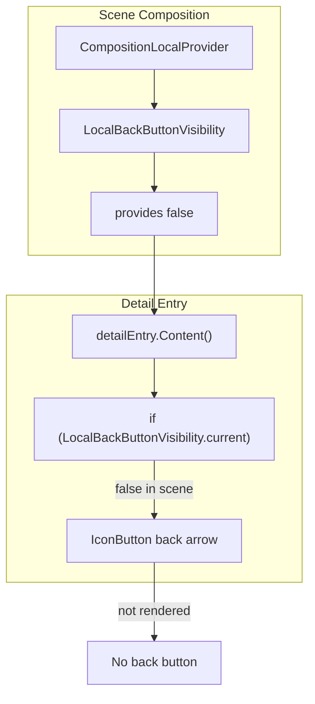

Detail entries query `LocalBackButtonVisibility.current` to conditionally render their back button. In single-pane mode, the value is `true` (default). In list-detail scene mode, the scene sets it to `false`.

**Sources:** [app/src/main/java/com/example/nav3recipes/scenes/listdetail/ListDetailScene.kt:59-74, 101](), [app/src/main/java/com/example/nav3recipes/scenes/listdetail/Content.kt:90-100]()

## Entry Filtering in Strategies

Scene strategies examine the back stack to find entries that match their metadata requirements. The filtering patterns differ between scene types:

### TwoPaneSceneStrategy Filtering

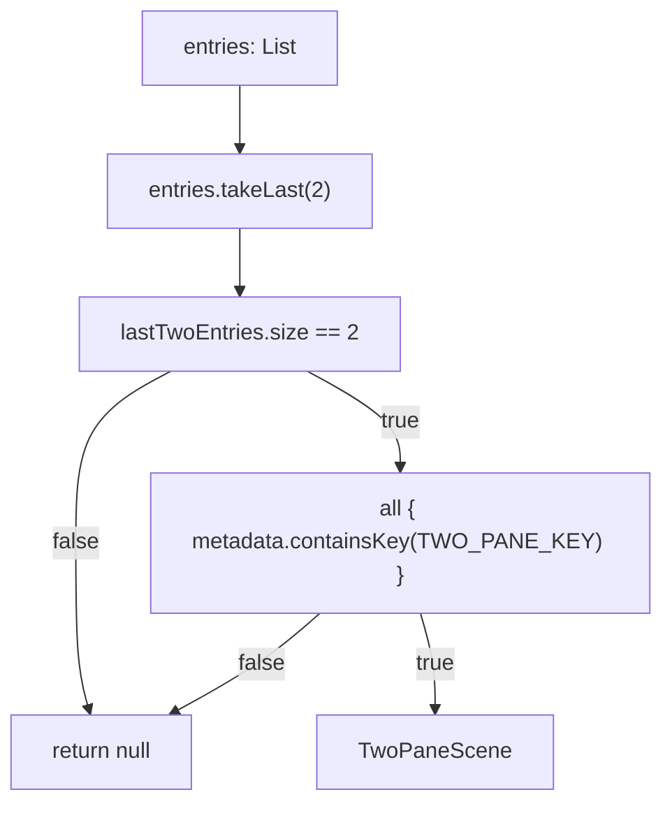

**Sources:** [app/src/main/java/com/example/nav3recipes/scenes/twopane/TwoPaneScene.kt:67-104]()

### ListDetailSceneStrategy Filtering

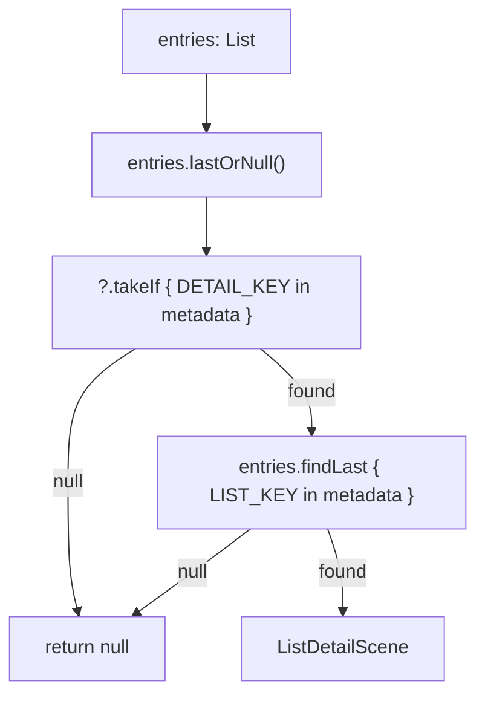

The `ListDetailSceneStrategy` requires:
1. A detail entry as the last entry in the back stack
2. A list entry anywhere in the back stack (found via `findLast`)

This allows the list to remain stable while details change, and supports navigation from detail to other destinations (like Profile) that don't participate in the list-detail layout.

**Sources:** [app/src/main/java/com/example/nav3recipes/scenes/listdetail/ListDetailScene.kt:125-146]()

## Integration with NavDisplay

Scene strategies are passed to `NavDisplay` via the `sceneStrategy` parameter. The strategy is consulted before rendering each composition:

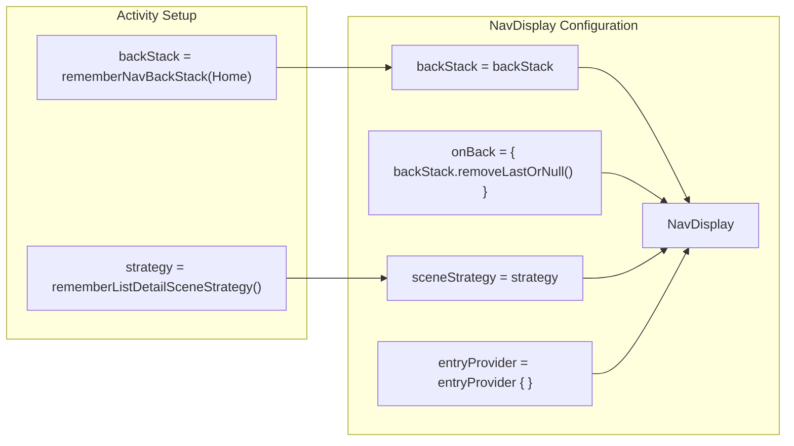

**Sources:** [app/src/main/java/com/example/nav3recipes/scenes/twopane/TwoPaneActivity.kt:56-98](), [app/src/main/java/com/example/nav3recipes/scenes/listdetail/ListDetailActivity.kt:63-98]()

## Material3 Adaptive Comparison

While custom scenes provide complete layout control, Navigation 3 also supports Material3's adaptive components through similar metadata patterns. Material3 adaptive uses `PaneScaffoldDirective` to calculate optimal layouts for phones, tablets, and foldables based on Material Design guidelines.

Key differences:

| Aspect | Custom Scenes | Material3 Adaptive |
|--------|---------------|-------------------|
| Layout control | Manual Row/Column composition | `PaneScaffoldDirective` calculations |
| Breakpoints | Custom (e.g., 600dp) | Material Design standard breakpoints |
| Animation | Custom `AnimatedContent` | Built-in pane transitions |
| Back stack behavior | Custom `previousEntries` logic | Scaffold-managed navigation |
| Metadata functions | Custom (e.g., `twoPane()`) | Standard (e.g., `mainPane()`, `supportingPane()`) |

For Material3 adaptive implementation details, see [Material3 Adaptive Layouts](#6.5).

**Sources:** Referenced from high-level architecture diagrams

## Back Stack Management with Scenes

Scene-based navigation often requires custom back stack manipulation logic to maintain UX consistency. The examples demonstrate two patterns:

### Duplicate Prevention Pattern

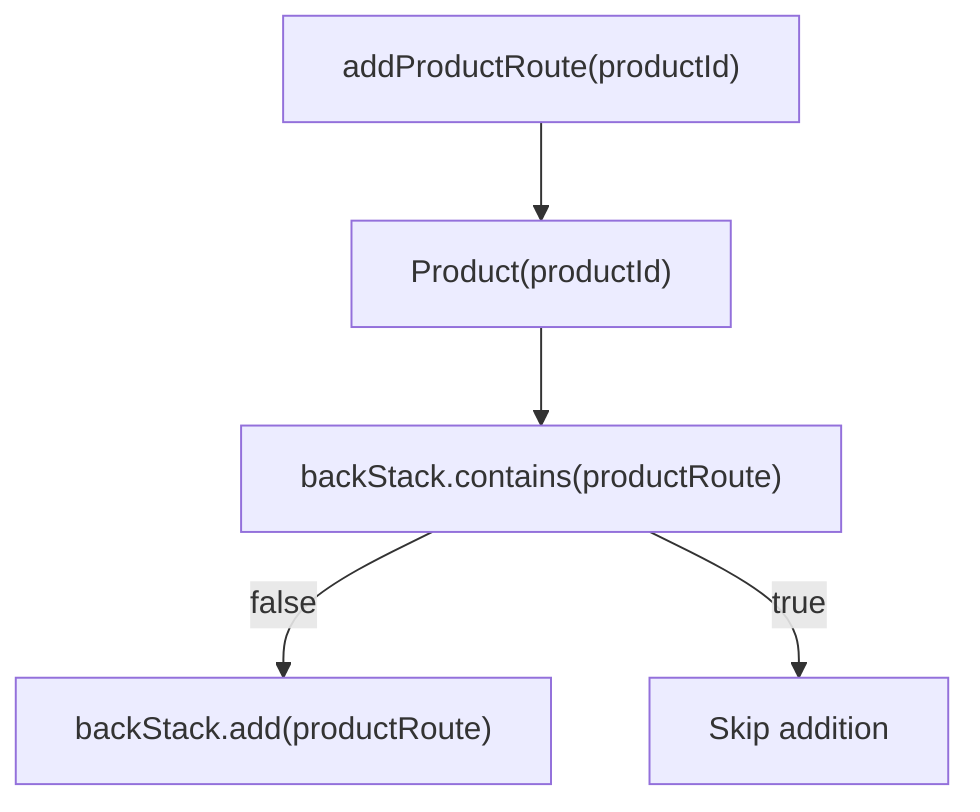

The `TwoPaneActivity` checks for duplicate routes before adding to prevent the same product appearing multiple times in the back stack, which would create confusing back navigation behavior in two-pane mode.

**Sources:** [app/src/main/java/com/example/nav3recipes/scenes/twopane/TwoPaneActivity.kt:103-110]()

### Detail Replacement Pattern

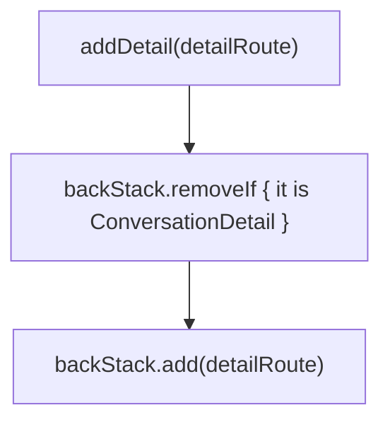

The `ListDetailActivity` removes all existing detail routes before adding a new detail. This ensures only one detail is in the back stack at a time, preventing back navigation from cycling through multiple details instead of returning to the list.

**Sources:** [app/src/main/java/com/example/nav3recipes/scenes/listdetail/ListDetailActivity.kt:104-111]()

## Scene Strategy Scope

`SceneStrategy.calculateScene()` executes within a `SceneStrategyScope`, which provides context for scene calculation. The scope is marked but doesn't expose additional APIs in the current implementation—it serves as an extension point for future scene strategy capabilities.

**Sources:** [app/src/main/java/com/example/nav3recipes/scenes/listdetail/ListDetailScene.kt:125](), [app/src/main/java/com/example/nav3recipes/scenes/twopane/TwoPaneScene.kt:67]()

---

