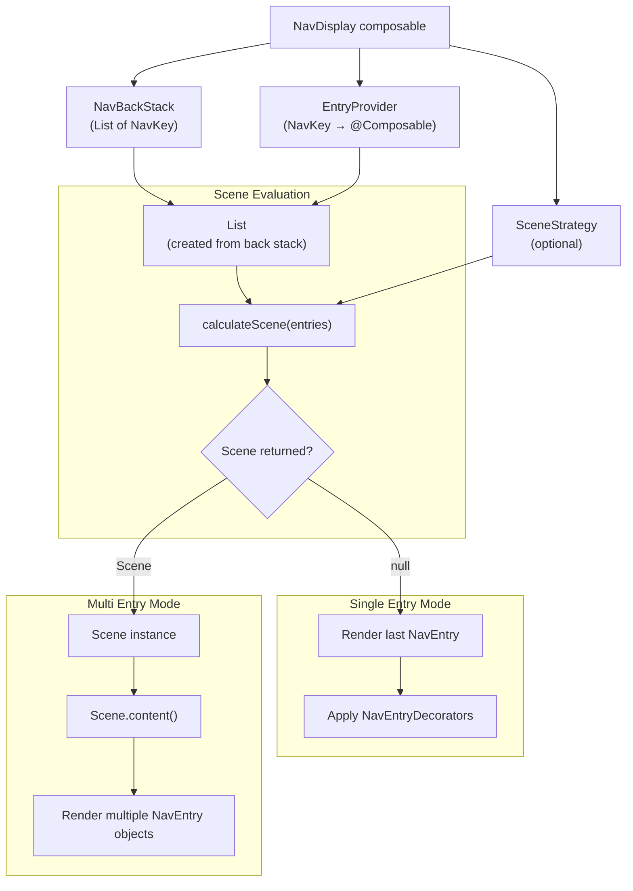
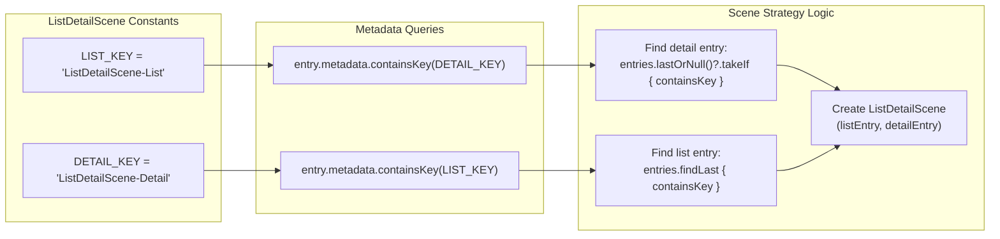
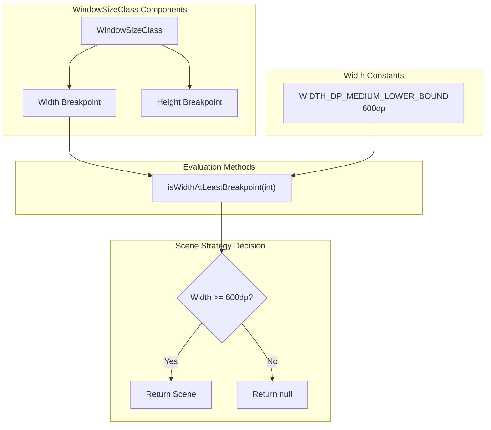
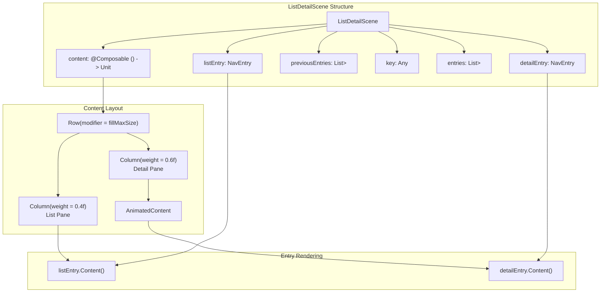
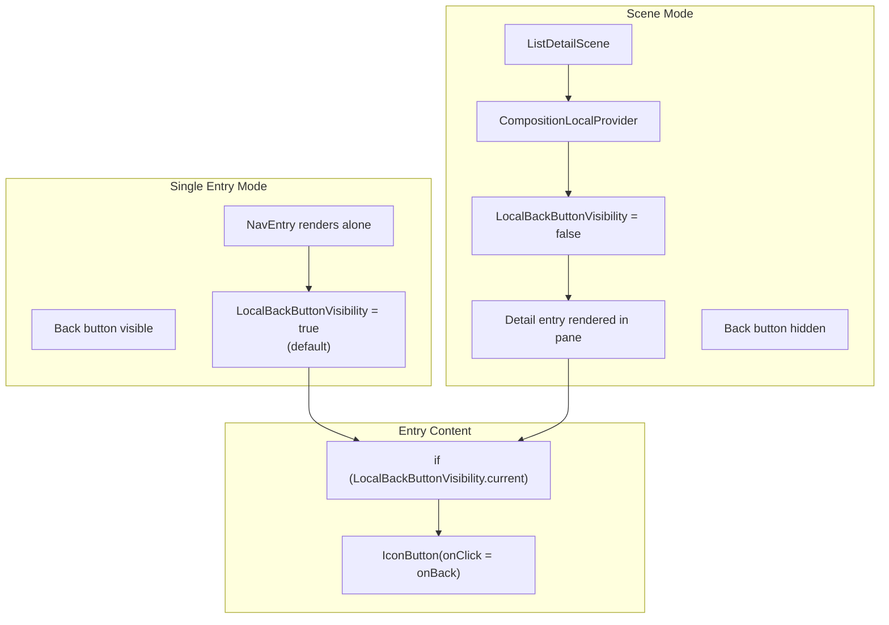
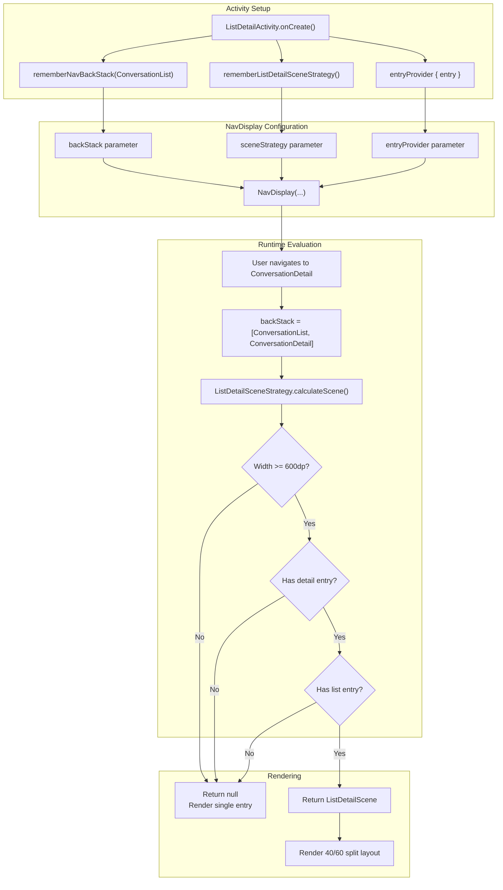

<!-- source: DeepWiki mcp.deepwiki.com · repo android/nav3-recipes · page 6.1 Scene System Overview · fetched 2026-10-23 -->

# Scene System Overview

<details>
<summary>Relevant source files</summary>

The following files were used as context for generating this wiki page:

- [app/src/main/java/com/example/nav3recipes/scenes/listdetail/Content.kt](app/src/main/java/com/example/nav3recipes/scenes/listdetail/Content.kt)
- [app/src/main/java/com/example/nav3recipes/scenes/listdetail/ListDetailActivity.kt](app/src/main/java/com/example/nav3recipes/scenes/listdetail/ListDetailActivity.kt)
- [app/src/main/java/com/example/nav3recipes/scenes/listdetail/ListDetailScene.kt](app/src/main/java/com/example/nav3recipes/scenes/listdetail/ListDetailScene.kt)

</details>


## Purpose and Scope

The Scene System enables Navigation 3 to render multiple `NavEntry` instances simultaneously in adaptive, multi-pane layouts. This system evaluates window characteristics and entry metadata to determine when to compose multiple navigation entries side-by-side, rather than displaying a single entry at a time.

This page covers the core architecture of the Scene System: the `SceneStrategy` interface, `Scene` composition, metadata-driven pane assignment, and `WindowSizeClass` evaluation. For specific scene implementations, see [Two-Pane Scene Implementation](#6.2), [List-Detail Scene Implementation](#6.3), [Dialog and BottomSheet Scenes](#6.4), and [Material3 Adaptive Layouts](#6.5). For foundational navigation concepts, see [Core Navigation 3 Concepts](#2.2).

**Sources**: Diagram 2 and 5 from high-level architecture, [app/src/main/java/com/example/nav3recipes/scenes/listdetail/ListDetailScene.kt:1-149]()

---

## Core Scene Components

The Scene System consists of three primary components that work together to enable multi-pane layouts:

| Component | Type | Role |
|-----------|------|------|
| `Scene<T>` | Interface | Represents a multi-entry layout composition with its own content renderer |
| `SceneStrategy<T>` | Interface | Evaluates back stack and window size to decide when to create a `Scene` |
| `SceneStrategyScope<T>` | Interface | Provides contextual information during scene calculation |

### Scene Interface

A `Scene` encapsulates multiple `NavEntry` instances into a single layout unit. It defines:

- `key`: Unique identifier for the scene instance
- `entries`: List of `NavEntry<T>` objects to be rendered together
- `previousEntries`: Entries from the back stack not included in the scene
- `content`: Composable function that renders the multi-pane layout

The `content` function is responsible for arranging multiple entries spatially (e.g., side-by-side in a `Row`, overlaid in a `Box`).

**Sources**: [app/src/main/java/com/example/nav3recipes/scenes/listdetail/ListDetailScene.kt:45-76]()

### SceneStrategy Interface

A `SceneStrategy` implements the decision logic for when to create a `Scene`. It provides a single method:

```kotlin
fun SceneStrategyScope<T>.calculateScene(entries: List<NavEntry<T>>): Scene<T>?
```

The strategy receives all current back stack entries and returns:
- A `Scene` instance if the conditions for multi-pane layout are met
- `null` to fall back to single-entry display via `NavDisplay`

**Sources**: [app/src/main/java/com/example/nav3recipes/scenes/listdetail/ListDetailScene.kt:113-147]()

### SceneStrategyScope

The `SceneStrategyScope` provides contextual information available during scene calculation. This includes access to window characteristics and other environmental data needed for layout decisions.

**Sources**: [app/src/main/java/com/example/nav3recipes/scenes/listdetail/ListDetailScene.kt:125]()

---

## Scene Strategy Evaluation Flow

The following diagram illustrates how `NavDisplay` evaluates a `SceneStrategy` to determine rendering mode:



**Evaluation Process**:

1. `NavDisplay` creates `NavEntry` instances from the back stack using the `EntryProvider`
2. If a `SceneStrategy` is provided, `NavDisplay` invokes `calculateScene` with the entry list
3. The strategy evaluates whether conditions are met for multi-pane layout (window size, entry metadata, etc.)
4. If the strategy returns `null`, `NavDisplay` renders the last entry using standard single-entry mode
5. If the strategy returns a `Scene`, `NavDisplay` renders the scene's `content` composable

**Sources**: [app/src/main/java/com/example/nav3recipes/scenes/listdetail/ListDetailScene.kt:113-147](), [app/src/main/java/com/example/nav3recipes/scenes/listdetail/ListDetailActivity.kt:70-74]()

---

## Metadata-Driven Pane Assignment

The Scene System uses entry metadata to identify which entries are eligible for each pane in a multi-pane layout. Metadata is attached to entries via the `entry<T>` DSL function:

```kotlin
entry<ConversationList>(
    metadata = ListDetailScene.listPane()
) { ... }

entry<ConversationDetail>(
    metadata = ListDetailScene.detailPane()
) { ... }
```

### Metadata Functions

Scene implementations provide helper functions that return metadata maps:

| Function | Returns | Purpose |
|----------|---------|---------|
| `ListDetailScene.listPane()` | `Map<String, Boolean>` | Marks entry as eligible for list pane |
| `ListDetailScene.detailPane()` | `Map<String, Boolean>` | Marks entry as eligible for detail pane |

**Sources**: [app/src/main/java/com/example/nav3recipes/scenes/listdetail/ListDetailScene.kt:78-93](), [app/src/main/java/com/example/nav3recipes/scenes/listdetail/ListDetailActivity.kt:76-88]()

### Metadata Keys

Scene strategies use specific string keys to query metadata:



The `ListDetailSceneStrategy` searches the back stack for:
1. **Detail entry**: The last entry with `DETAIL_KEY` in metadata
2. **List entry**: The last entry (searching backward from end) with `LIST_KEY` in metadata

If both are found, a `ListDetailScene` is created. If either is missing, the strategy returns `null`.

**Sources**: [app/src/main/java/com/example/nav3recipes/scenes/listdetail/ListDetailScene.kt:78-80, 131-134]()

---

## WindowSizeClass Evaluation

Scene strategies evaluate device window characteristics to determine layout appropriateness. The primary evaluation mechanism uses `WindowSizeClass`:

### WindowSizeClass Structure



### Obtaining WindowSizeClass

The `currentWindowAdaptiveInfo()` composable provides window characteristics:

```kotlin
val windowSizeClass = currentWindowAdaptiveInfo().windowSizeClass
```

Scene strategies are typically created in `remember` blocks to recompute when window size changes:

```kotlin
@Composable
fun <T : Any> rememberListDetailSceneStrategy(): ListDetailSceneStrategy<T> {
    val windowSizeClass = currentWindowAdaptiveInfo().windowSizeClass
    
    return remember(windowSizeClass) {
        ListDetailSceneStrategy(windowSizeClass)
    }
}
```

**Sources**: [app/src/main/java/com/example/nav3recipes/scenes/listdetail/ListDetailScene.kt:104-110, 127-129]()

### Width Breakpoint Logic

The `ListDetailSceneStrategy` checks if the window width is at least 600dp:

```kotlin
if (!windowSizeClass.isWidthAtLeastBreakpoint(WIDTH_DP_MEDIUM_LOWER_BOUND)) {
    return null
}
```

This ensures that multi-pane layouts only appear on sufficiently wide devices (tablets, unfolded foldables, large phones in landscape).

**Sources**: [app/src/main/java/com/example/nav3recipes/scenes/listdetail/ListDetailScene.kt:127-129]()

---

## Scene Composition and Rendering

A `Scene` instance defines how multiple entries are composed together. The `ListDetailScene` demonstrates this pattern:



### Layout Composition

The `content` function in `ListDetailScene` uses a weighted `Row`:

| Component | Weight | Purpose |
|-----------|--------|---------|
| List Column | 0.4 (40%) | Displays the list entry |
| Detail Column | 0.6 (60%) | Displays the detail entry with animated transitions |

**Sources**: [app/src/main/java/com/example/nav3recipes/scenes/listdetail/ListDetailScene.kt:52-76]()

### Scene Key Management

The scene's `key` is derived from the list entry's `contentKey`:

```kotlin
val sceneKey = listEntry.contentKey
```

This allows the detail pane to change without recreating the entire scene. When a different detail entry is selected, the scene key remains stable, enabling `AnimatedContent` within the scene to handle detail transitions rather than having `NavDisplay` animate the entire scene.

**Sources**: [app/src/main/java/com/example/nav3recipes/scenes/listdetail/ListDetailScene.kt:135-138]()

### AnimatedContent for Detail Transitions

The detail pane wraps entry content in `AnimatedContent`:

```kotlin
AnimatedContent(
    targetState = detailEntry,
    contentKey = { entry -> entry.contentKey },
    transitionSpec = {
        slideInHorizontally(initialOffsetX = { it }) togetherWith
        slideOutHorizontally(targetOffsetX = { -it })
    }
) { entry ->
    entry.Content()
}
```

This provides slide transitions when navigating between different detail entries.

**Sources**: [app/src/main/java/com/example/nav3recipes/scenes/listdetail/ListDetailScene.kt:61-72]()

---

## Cross-Cutting Scene Concerns

### LocalBackButtonVisibility

Scenes can communicate rendering preferences to entries using Composition Locals. `LocalBackButtonVisibility` informs detail entries whether to display a back button:



### Usage in Scenes

The `ListDetailScene` wraps the detail column with `CompositionLocalProvider`:

```kotlin
CompositionLocalProvider(LocalBackButtonVisibility provides false) {
    Column(modifier = Modifier.weight(0.6f)) {
        // Detail entry content
    }
}
```

**Sources**: [app/src/main/java/com/example/nav3recipes/scenes/listdetail/ListDetailScene.kt:59-74, 101]()

### Usage in Entry Content

Detail entries check the local value to conditionally display back buttons:

```kotlin
if (LocalBackButtonVisibility.current) {
    IconButton(onClick = onBack) {
        Icon(imageVector = Icons.AutoMirrored.Filled.ArrowBack, ...)
    }
}
```

This ensures that when the detail entry is displayed in a scene alongside the list, the back button is hidden (since the list pane provides navigation context). When the same entry is displayed alone (on narrow screens), the back button appears.

**Sources**: [app/src/main/java/com/example/nav3recipes/scenes/listdetail/Content.kt:90-100]()

---

## Scene Strategy Integration with NavDisplay

The following diagram shows the complete integration flow from activity setup to scene rendering:



### Configuration in Activity

Activities configure scene strategies by passing them to `NavDisplay`:

```kotlin
val backStack = rememberNavBackStack(ConversationList)
val listDetailStrategy = rememberListDetailSceneStrategy<NavKey>()

NavDisplay(
    backStack = backStack,
    onBack = { backStack.removeLastOrNull() },
    sceneStrategy = listDetailStrategy,
    modifier = Modifier.padding(paddingValues),
    entryProvider = entryProvider { ... }
)
```

**Sources**: [app/src/main/java/com/example/nav3recipes/scenes/listdetail/ListDetailActivity.kt:67-98]()

### Back Stack Manipulation for Scenes

When navigating to detail entries, it's often desirable to replace existing detail entries rather than stacking them:

```kotlin
private fun NavBackStack<NavKey>.addDetail(detailRoute: ConversationDetail) {
    // Remove any existing detail routes before adding this detail route
    removeIf { it is ConversationDetail }
    add(detailRoute)
}
```

This ensures only one detail entry is present in the back stack at a time, preventing unwanted navigation history when switching between detail items.

**Sources**: [app/src/main/java/com/example/nav3recipes/scenes/listdetail/ListDetailActivity.kt:104-111]()

---

## Summary

The Scene System provides a declarative, metadata-driven approach to adaptive multi-pane layouts in Navigation 3:

| Component | Responsibility |
|-----------|----------------|
| `Scene` | Defines multi-entry layout composition and rendering |
| `SceneStrategy` | Evaluates window size and metadata to determine when to create scenes |
| Entry Metadata | Declares pane eligibility (`listPane()`, `detailPane()`) |
| `WindowSizeClass` | Provides device characteristics for layout decisions |
| `NavDisplay` | Consults strategy and renders either a scene or single entry |
| Composition Locals | Enable cross-cutting communication (e.g., `LocalBackButtonVisibility`) |

This architecture separates layout decision logic from content definition, enabling the same navigation entries to adapt seamlessly between single-pane (narrow screens) and multi-pane (wide screens) presentations.

**Sources**: [app/src/main/java/com/example/nav3recipes/scenes/listdetail/ListDetailScene.kt:1-149](), [app/src/main/java/com/example/nav3recipes/scenes/listdetail/ListDetailActivity.kt:1-111]()

---

