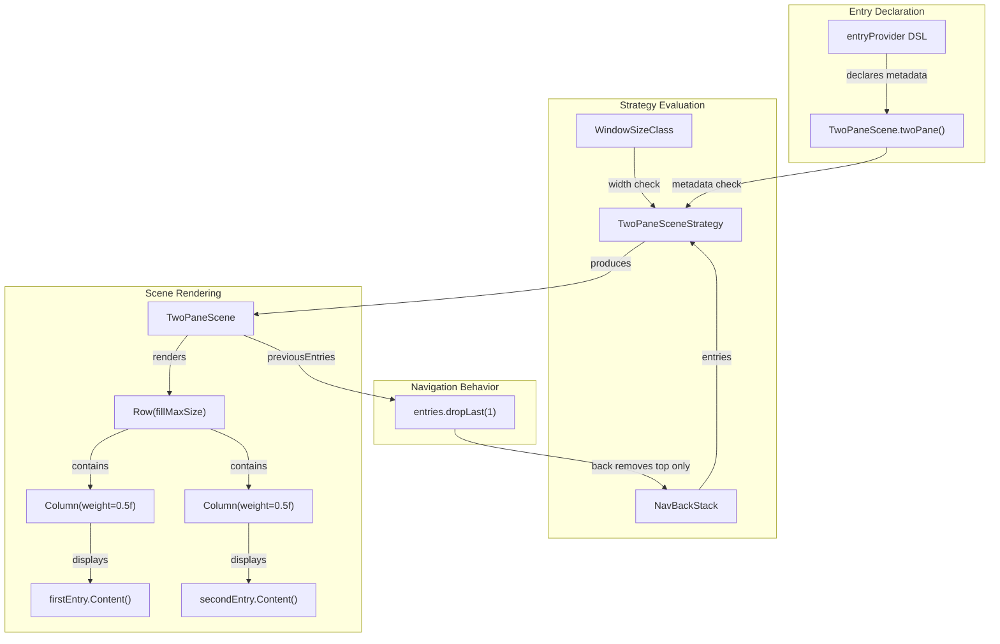
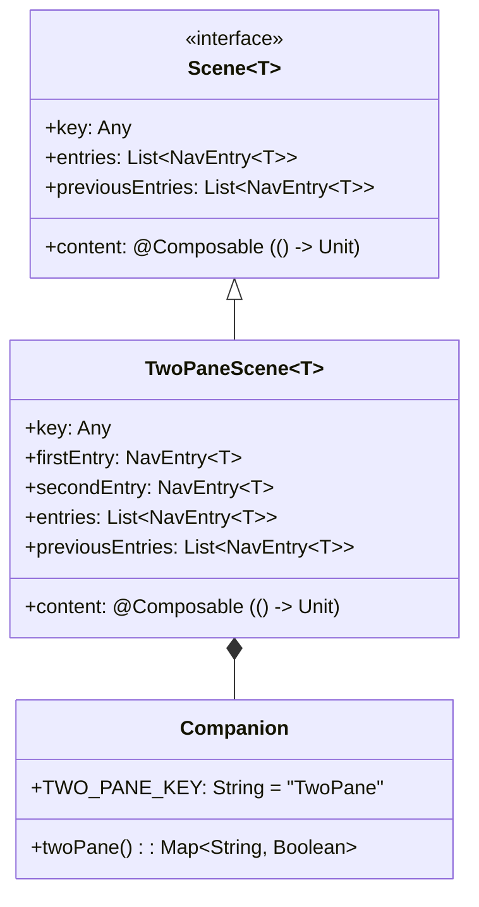
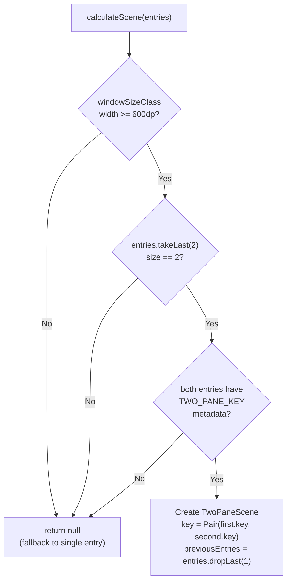
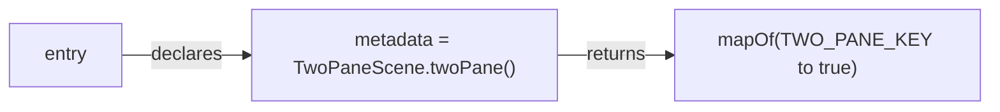
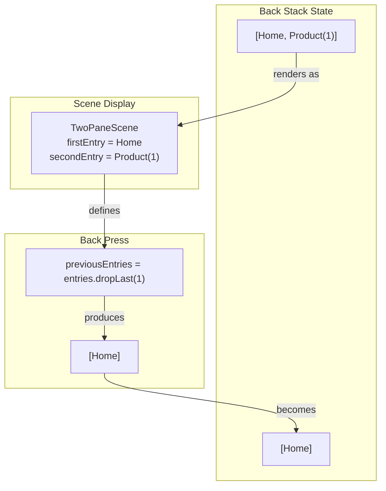
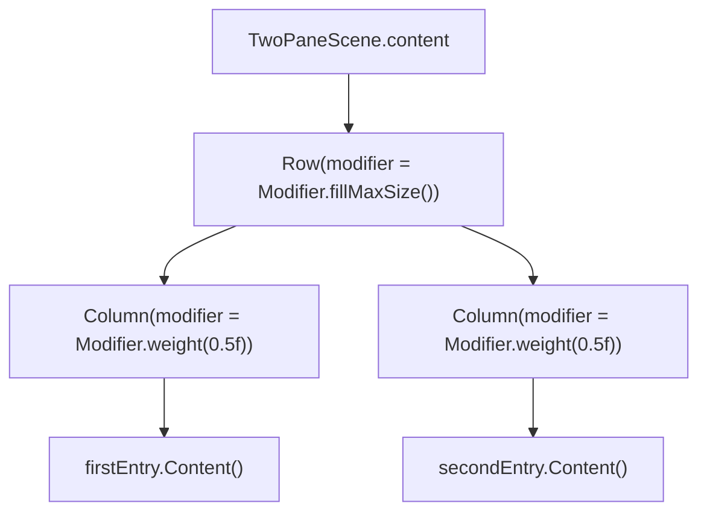
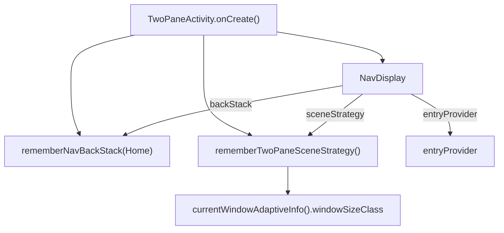

<!-- source: DeepWiki mcp.deepwiki.com · repo android/nav3-recipes · page 6.2 Two-Pane Scene Implementation · fetched 2026-10-23 -->

# Two-Pane Scene Implementation

<details>
<summary>Relevant source files</summary>

The following files were used as context for generating this wiki page:

- [app/src/main/java/com/example/nav3recipes/scenes/twopane/TwoPaneActivity.kt](app/src/main/java/com/example/nav3recipes/scenes/twopane/TwoPaneActivity.kt)
- [app/src/main/java/com/example/nav3recipes/scenes/twopane/TwoPaneScene.kt](app/src/main/java/com/example/nav3recipes/scenes/twopane/TwoPaneScene.kt)

</details>


## Purpose and Scope

This document describes the custom `TwoPaneScene` implementation, which displays two navigation entries side-by-side in a 50/50 split on wide screens. This pattern is useful for adaptive layouts where you want to show two destinations simultaneously when screen space permits.

For an overview of the Scene system architecture and how `SceneStrategy` works, see [Scene System Overview](#6.1). For the 40/60 list-detail pattern with animations, see [List-Detail Scene Implementation](#6.3). For production-ready Material3 adaptive layouts, see [Material3 Adaptive Layouts](#6.5).

**Sources**: [app/src/main/java/com/example/nav3recipes/scenes/twopane/TwoPaneScene.kt:1-109]()

---

## Architecture Overview

The two-pane system consists of three main components:



**Sources**: [app/src/main/java/com/example/nav3recipes/scenes/twopane/TwoPaneScene.kt:1-109]()

---

## TwoPaneScene Class

The `TwoPaneScene` class implements the `Scene<T>` interface to render two navigation entries simultaneously:



### Constructor Parameters

| Parameter | Type | Description |
|-----------|------|-------------|
| `key` | `Any` | Unique identifier for the scene state, typically `Pair(firstEntry.contentKey, secondEntry.contentKey)` |
| `previousEntries` | `List<NavEntry<T>>` | Entries to display when back navigation occurs |
| `firstEntry` | `NavEntry<T>` | Entry displayed in the left pane (50% width) |
| `secondEntry` | `NavEntry<T>` | Entry displayed in the right pane (50% width) |

### Implementation Details

The `entries` property combines both entries: `listOf(firstEntry, secondEntry)` [app/src/main/java/com/example/nav3recipes/scenes/twopane/TwoPaneScene.kt:28]().

The `content` composable creates a horizontal `Row` with two equal-width `Column` containers [app/src/main/java/com/example/nav3recipes/scenes/twopane/TwoPaneScene.kt:29-38]():

```
Row(Modifier.fillMaxSize())
  └─ Column(Modifier.weight(0.5f))  // Left pane
       └─ firstEntry.Content()
  └─ Column(Modifier.weight(0.5f))  // Right pane
       └─ secondEntry.Content()
```

**Sources**: [app/src/main/java/com/example/nav3recipes/scenes/twopane/TwoPaneScene.kt:18-48]()

---

## TwoPaneSceneStrategy

The `TwoPaneSceneStrategy` class determines when to activate the two-pane layout:



### Window Size Evaluation

The strategy checks the window width against the medium breakpoint (600dp) [app/src/main/java/com/example/nav3recipes/scenes/twopane/TwoPaneScene.kt:71]():

```kotlin
if (!windowSizeClass.isWidthAtLeastBreakpoint(WIDTH_DP_MEDIUM_LOWER_BOUND)) {
    return null
}
```

Where `WIDTH_DP_MEDIUM_LOWER_BOUND` equals 600dp [app/src/main/java/com/example/nav3recipes/scenes/twopane/TwoPaneScene.kt:15]().

### Entry Selection Logic

The strategy examines the last two entries in the back stack [app/src/main/java/com/example/nav3recipes/scenes/twopane/TwoPaneScene.kt:75-80]():

| Condition | Check |
|-----------|-------|
| Entry count | `lastTwoEntries.size == 2` |
| Metadata presence | `lastTwoEntries.all { it.metadata.containsKey(TwoPaneScene.TWO_PANE_KEY) }` |

If both conditions are met, a `TwoPaneScene` is created. Otherwise, `null` is returned, causing `NavDisplay` to fall back to single-entry rendering.

### Scene Key Generation

The scene key is a `Pair` of content keys from both entries [app/src/main/java/com/example/nav3recipes/scenes/twopane/TwoPaneScene.kt:87]():

```kotlin
val sceneKey = Pair(firstEntry.contentKey, secondEntry.contentKey)
```

This ensures scene uniqueness when entry content changes.

**Sources**: [app/src/main/java/com/example/nav3recipes/scenes/twopane/TwoPaneScene.kt:60-107]()

---

## Metadata Declaration

Entries declare two-pane capability using the `TwoPaneScene.twoPane()` metadata function:



### Usage in EntryProvider

The metadata is specified in the `entry` block [app/src/main/java/com/example/nav3recipes/scenes/twopane/TwoPaneActivity.kt:64-65]():

```kotlin
entry<Home>(
    metadata = TwoPaneScene.twoPane()
) { /* content */ }
```

### Implementation

The `twoPane()` function returns a map with the marker key [app/src/main/java/com/example/nav3recipes/scenes/twopane/TwoPaneScene.kt:46]():

```kotlin
fun twoPane() = mapOf(TWO_PANE_KEY to true)
```

Where `TWO_PANE_KEY = "TwoPane"` [app/src/main/java/com/example/nav3recipes/scenes/twopane/TwoPaneScene.kt:41]().

### Mixed Metadata Example

Not all entries need two-pane metadata. In the example, `Profile` has no metadata [app/src/main/java/com/example/nav3recipes/scenes/twopane/TwoPaneActivity.kt:94-96](), so it always renders as a single pane:

| Entry | Has `twoPane()` Metadata | Behavior |
|-------|--------------------------|----------|
| `Home` | Yes | Can display in two-pane scene |
| `Product` | Yes | Can display in two-pane scene |
| `Profile` | No | Always displays as single pane |

**Sources**: [app/src/main/java/com/example/nav3recipes/scenes/twopane/TwoPaneScene.kt:40-47](), [app/src/main/java/com/example/nav3recipes/scenes/twopane/TwoPaneActivity.kt:63-97]()

---

## Back Navigation Behavior

The two-pane scene implements a "remove top entry only" back navigation pattern:



### Rationale

The `previousEntries` is calculated as `entries.dropLast(1)` [app/src/main/java/com/example/nav3recipes/scenes/twopane/TwoPaneScene.kt:96](), removing only the top entry despite displaying two entries. 

The implementation comment explains this UX decision [app/src/main/java/com/example/nav3recipes/scenes/twopane/TwoPaneScene.kt:91-95]():

> "This is because in this app we only ever add one entry to the back stack at a time. It would therefore be confusing to the user to add one when navigating forward, but remove two when navigating back."

### Back Navigation Flow

| State | Back Stack | Display | User Presses Back | New Back Stack |
|-------|-----------|---------|-------------------|----------------|
| Initial | `[Home]` | Single pane: Home | N/A | N/A |
| After navigation | `[Home, Product(1)]` | Two pane: Home \| Product(1) | Yes | `[Home]` |
| After back | `[Home]` | Single pane: Home | Yes | `[]` (exits) |

**Sources**: [app/src/main/java/com/example/nav3recipes/scenes/twopane/TwoPaneScene.kt:89-99]()

---

## Scene Composition and Layout

The layout structure creates equal-width panes:



### Layout Properties

| Component | Modifier | Description |
|-----------|----------|-------------|
| `Row` | `Modifier.fillMaxSize()` | Fills entire available space |
| Left `Column` | `Modifier.weight(0.5f)` | Takes 50% of horizontal space |
| Right `Column` | `Modifier.weight(0.5f)` | Takes 50% of horizontal space |

### Content Rendering

Each entry's content is rendered by calling `firstEntry.Content()` and `secondEntry.Content()` [app/src/main/java/com/example/nav3recipes/scenes/twopane/TwoPaneScene.kt:32-35]().

The `NavEntry.Content()` function executes the composable lambda defined in the `entryProvider` DSL for that entry's key type.

**Sources**: [app/src/main/java/com/example/nav3recipes/scenes/twopane/TwoPaneScene.kt:29-38]()

---

## Integration Example

The `TwoPaneActivity` demonstrates the complete integration:



### Setup Steps

1. **Create back stack** with initial route [app/src/main/java/com/example/nav3recipes/scenes/twopane/TwoPaneActivity.kt:56]():
   ```kotlin
   val backStack = rememberNavBackStack(Home)
   ```

2. **Create scene strategy** with window size [app/src/main/java/com/example/nav3recipes/scenes/twopane/TwoPaneActivity.kt:57]():
   ```kotlin
   val twoPaneStrategy = rememberTwoPaneSceneStrategy<NavKey>()
   ```

3. **Configure NavDisplay** [app/src/main/java/com/example/nav3recipes/scenes/twopane/TwoPaneActivity.kt:59-98]():
   ```kotlin
   NavDisplay(
       backStack = backStack,
       onBack = { backStack.removeLastOrNull() },
       sceneStrategy = twoPaneStrategy,
       entryProvider = entryProvider { /* ... */ }
   )
   ```

### rememberTwoPaneSceneStrategy Composable

The `rememberTwoPaneSceneStrategy` function creates the strategy with the current window size [app/src/main/java/com/example/nav3recipes/scenes/twopane/TwoPaneScene.kt:50-57]():

```kotlin
@Composable
fun <T: Any> rememberTwoPaneSceneStrategy() : TwoPaneSceneStrategy<T> {
    val windowSizeClass = currentWindowAdaptiveInfo().windowSizeClass
    return remember(windowSizeClass){
        TwoPaneSceneStrategy(windowSizeClass)
    }
}
```

The strategy is remembered and recreated when `windowSizeClass` changes (e.g., device rotation, window resize).

**Sources**: [app/src/main/java/com/example/nav3recipes/scenes/twopane/TwoPaneActivity.kt:49-100](), [app/src/main/java/com/example/nav3recipes/scenes/twopane/TwoPaneScene.kt:50-57]()

---

## Navigation Helper Functions

The example includes a helper function to prevent duplicate entries [app/src/main/java/com/example/nav3recipes/scenes/twopane/TwoPaneActivity.kt:103-110]():

```kotlin
private fun NavBackStack<NavKey>.addProductRoute(productId: Int) {
    val productRoute = Product(productId)
    // Avoid adding the same product route to the back stack twice.
    if (!contains(productRoute)) {
        add(productRoute)
    }
}
```

This ensures that navigating to the same product multiple times doesn't create duplicate entries, which would cause confusing back navigation behavior.

**Sources**: [app/src/main/java/com/example/nav3recipes/scenes/twopane/TwoPaneActivity.kt:103-110]()

---

## Key Design Decisions

### 50/50 Split Ratio

The implementation uses equal weights (`0.5f` and `0.5f`) for both panes, creating a symmetric layout. This differs from the list-detail pattern which uses a 40/60 split. The equal split emphasizes that neither pane is primary.

### Single Entry Back Removal

The `previousEntries = entries.dropLast(1)` pattern ensures symmetric forward/backward navigation: adding one entry navigates forward, removing one entry navigates back.

### Metadata-Based Opt-In

The metadata system allows granular control over which destinations support two-pane display. Destinations like `Profile` that should always be full-screen can omit the metadata.

### Window Size Dependency

The strategy is recreated when window size changes [app/src/main/java/com/example/nav3recipes/scenes/twopane/TwoPaneScene.kt:54](), ensuring the layout adapts immediately to configuration changes like rotation or window resizing.

### Scene Key Uniqueness

Using `Pair(firstEntry.contentKey, secondEntry.contentKey)` as the scene key ensures that changing either entry triggers scene recomposition, maintaining correct state across navigation operations.

**Sources**: [app/src/main/java/com/example/nav3recipes/scenes/twopane/TwoPaneScene.kt:1-109](), [app/src/main/java/com/example/nav3recipes/scenes/twopane/TwoPaneActivity.kt:1-111]()

---

