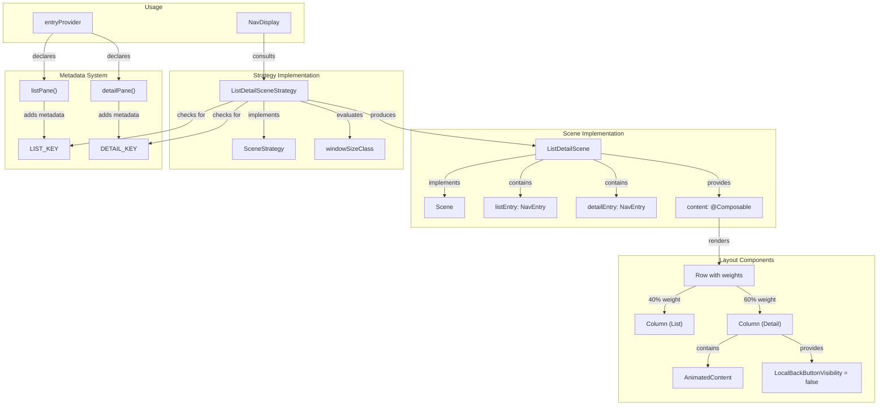
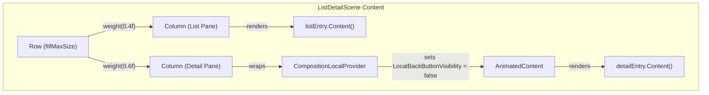
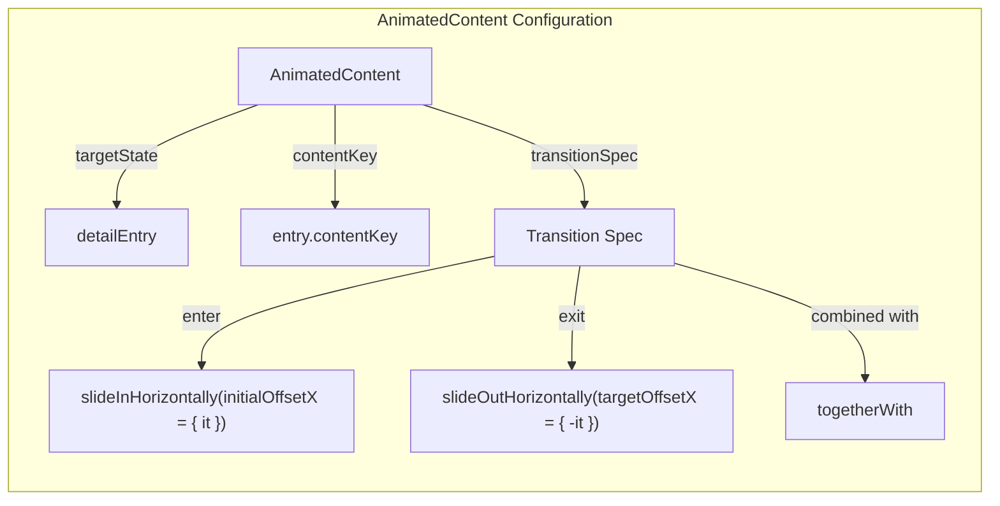
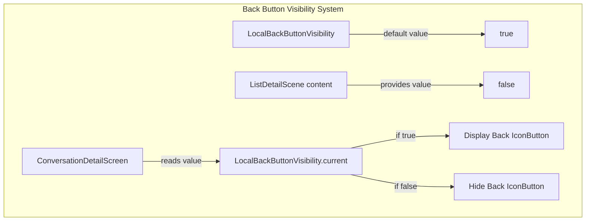
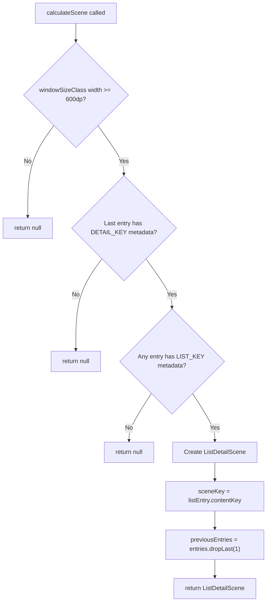
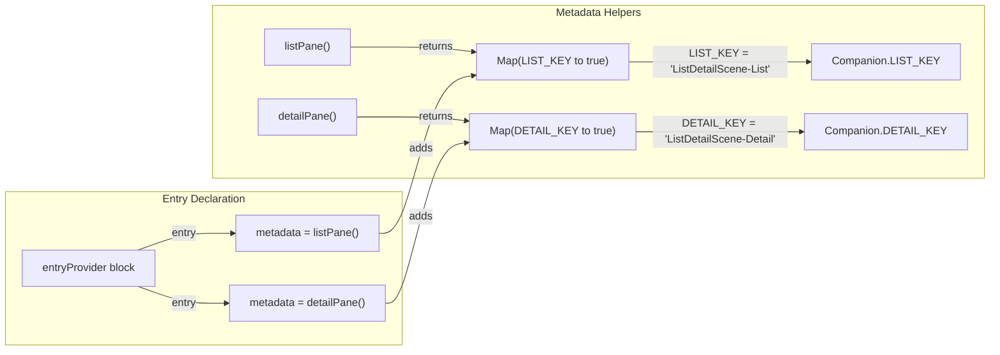
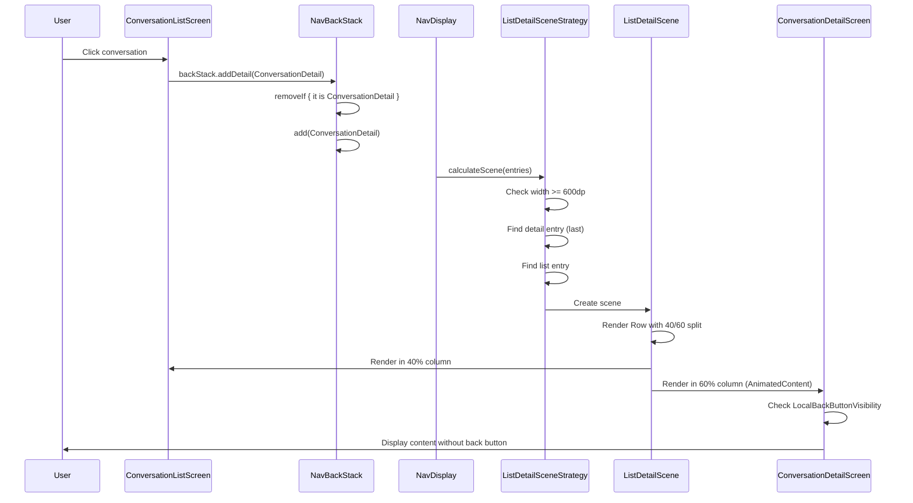

<!-- source: DeepWiki mcp.deepwiki.com · repo android/nav3-recipes · page 6.3 List-Detail Scene Implementation · fetched 2026-10-23 -->

# List-Detail Scene Implementation

<details>
<summary>Relevant source files</summary>

The following files were used as context for generating this wiki page:

- [app/src/main/java/com/example/nav3recipes/scenes/listdetail/Content.kt](app/src/main/java/com/example/nav3recipes/scenes/listdetail/Content.kt)
- [app/src/main/java/com/example/nav3recipes/scenes/listdetail/ListDetailActivity.kt](app/src/main/java/com/example/nav3recipes/scenes/listdetail/ListDetailActivity.kt)
- [app/src/main/java/com/example/nav3recipes/scenes/listdetail/ListDetailScene.kt](app/src/main/java/com/example/nav3recipes/scenes/listdetail/ListDetailScene.kt)

</details>


This document covers the implementation of `ListDetailScene`, a custom scene that displays list and detail content side-by-side in a 40/60 split layout on wider screens. This scene includes animated transitions between detail items and automatic back button visibility control.

For general scene system concepts and the `SceneStrategy` interface, see [Scene System Overview](#6.1). For Material3's production-ready adaptive layouts, see [Material3 Adaptive Layouts](#6.5).

## Purpose and Scope

`ListDetailScene` demonstrates building a custom adaptive layout that:
- Renders two `NavEntry` instances simultaneously in a master-detail pattern
- Uses a fixed 40/60 width ratio for list and detail panes
- Animates detail pane transitions without re-rendering the entire scene
- Controls back button visibility based on layout mode
- Activates when window width exceeds 600dp and appropriate entries exist in the back stack

**Sources:**
- [app/src/main/java/com/example/nav3recipes/scenes/listdetail/ListDetailScene.kt:41-44]()
- [app/src/main/java/com/example/nav3recipes/scenes/listdetail/ListDetailActivity.kt:35-43]()

## Architecture Overview

The following diagram shows the relationship between the main components in the list-detail scene implementation:



**Sources:**
- [app/src/main/java/com/example/nav3recipes/scenes/listdetail/ListDetailScene.kt:45-94]()
- [app/src/main/java/com/example/nav3recipes/scenes/listdetail/ListDetailScene.kt:113-147]()

## ListDetailScene Class

The `ListDetailScene` class represents a scene that composes two navigation entries into a side-by-side layout.

| Property | Type | Description |
|----------|------|-------------|
| `key` | `Any` | Unique identifier for the scene, typically derived from list entry's `contentKey` |
| `previousEntries` | `List<NavEntry<T>>` | Entries below the list entry in the back stack |
| `listEntry` | `NavEntry<T>` | The entry to display in the list pane (40% width) |
| `detailEntry` | `NavEntry<T>` | The entry to display in the detail pane (60% width) |
| `entries` | `List<NavEntry<T>>` | Combined list of both entries |
| `content` | `@Composable (() -> Unit)` | Composable function that renders the layout |

The scene's key is set to the list entry's `contentKey` rather than the detail entry's key. This design allows the detail pane to change without triggering scene replacement, enabling the scene itself to handle detail animations.

**Sources:**
- [app/src/main/java/com/example/nav3recipes/scenes/listdetail/ListDetailScene.kt:45-51]()
- [app/src/main/java/com/example/nav3recipes/scenes/listdetail/ListDetailScene.kt:135-145]()

## Layout Implementation

The scene's content function defines the 40/60 split layout using Compose's weight system:



The layout structure in [app/src/main/java/com/example/nav3recipes/scenes/listdetail/ListDetailScene.kt:52-76]():

- **Row**: Container using `fillMaxSize()` to occupy full available space
- **List Column**: Uses `weight(0.4f)` for 40% width allocation
- **Detail Column**: Uses `weight(0.6f)` for 60% width allocation
- **CompositionLocalProvider**: Sets `LocalBackButtonVisibility` to `false` for detail pane
- **AnimatedContent**: Handles transitions when detail entry changes

**Sources:**
- [app/src/main/java/com/example/nav3recipes/scenes/listdetail/ListDetailScene.kt:52-76]()

## Detail Pane Animations

The detail pane uses `AnimatedContent` to animate transitions between different detail entries:



The animation configuration in [app/src/main/java/com/example/nav3recipes/scenes/listdetail/ListDetailScene.kt:61-72]():

| Property | Configuration | Effect |
|----------|--------------|--------|
| `targetState` | `detailEntry` | Current detail entry to display |
| `contentKey` | `entry.contentKey` | Unique key to trigger re-composition |
| `slideInHorizontally` | `initialOffsetX = { it }` | New detail enters from right (full width offset) |
| `slideOutHorizontally` | `targetOffsetX = { -it }` | Old detail exits to left (negative full width offset) |
| `togetherWith` | Combines transitions | Simultaneous enter/exit animations |

This creates a horizontal slide effect where new detail content slides in from the right while the previous content slides out to the left.

**Sources:**
- [app/src/main/java/com/example/nav3recipes/scenes/listdetail/ListDetailScene.kt:61-72]()

## Back Button Control

The scene uses `LocalBackButtonVisibility` to control whether detail entries should display back buttons:



The system works in two parts:

**Definition** in [app/src/main/java/com/example/nav3recipes/scenes/listdetail/ListDetailScene.kt:96-101]():
```
val LocalBackButtonVisibility = compositionLocalOf{ true }
```
Default is `true`, meaning back buttons are shown in normal single-pane navigation.

**Override** in [app/src/main/java/com/example/nav3recipes/scenes/listdetail/ListDetailScene.kt:59-60]():
```
CompositionLocalProvider(LocalBackButtonVisibility provides false)
```
The scene sets this to `false` for detail pane content, since back navigation is handled by the list pane in two-pane mode.

**Consumption** in [app/src/main/java/com/example/nav3recipes/scenes/listdetail/Content.kt:90-100]():
```
if (LocalBackButtonVisibility.current) {
    IconButton(onClick = onBack, ...) { ... }
}
```
Detail screens check this value to conditionally render back buttons.

**Sources:**
- [app/src/main/java/com/example/nav3recipes/scenes/listdetail/ListDetailScene.kt:96-101]()
- [app/src/main/java/com/example/nav3recipes/scenes/listdetail/ListDetailScene.kt:59-60]()
- [app/src/main/java/com/example/nav3recipes/scenes/listdetail/Content.kt:90-100]()

## ListDetailSceneStrategy

The `ListDetailSceneStrategy` determines when to display the list-detail scene based on window size and back stack composition:



The strategy implementation in [app/src/main/java/com/example/nav3recipes/scenes/listdetail/ListDetailScene.kt:125-146]():

**Step 1: Width Check**
```kotlin
if (!windowSizeClass.isWidthAtLeastBreakpoint(WIDTH_DP_MEDIUM_LOWER_BOUND)) {
    return null
}
```
Returns `null` if width is below 600dp (`WIDTH_DP_MEDIUM_LOWER_BOUND`).

**Step 2: Detail Entry Check**
```kotlin
val detailEntry = entries.lastOrNull()?.takeIf { it.metadata.containsKey(DETAIL_KEY) } ?: return null
```
Returns `null` if the last entry doesn't have `DETAIL_KEY` metadata.

**Step 3: List Entry Check**
```kotlin
val listEntry = entries.findLast { it.metadata.containsKey(LIST_KEY) } ?: return null
```
Returns `null` if no entry has `LIST_KEY` metadata. Uses `findLast` to get the most recent list entry.

**Step 4: Scene Creation**
```kotlin
val sceneKey = listEntry.contentKey
return ListDetailScene(
    key = sceneKey,
    previousEntries = entries.dropLast(1),
    listEntry = listEntry,
    detailEntry = detailEntry
)
```
Creates scene with list entry's `contentKey` as the scene key, enabling detail animations without scene replacement.

**Sources:**
- [app/src/main/java/com/example/nav3recipes/scenes/listdetail/ListDetailScene.kt:113-147]()

## Metadata System

Entries declare their pane eligibility using metadata helper functions:



**Constant Definitions** in [app/src/main/java/com/example/nav3recipes/scenes/listdetail/ListDetailScene.kt:78-80]():
```kotlin
internal const val LIST_KEY = "ListDetailScene-List"
internal const val DETAIL_KEY = "ListDetailScene-Detail"
```

**Helper Functions** in [app/src/main/java/com/example/nav3recipes/scenes/listdetail/ListDetailScene.kt:82-93]():

| Function | Returns | Purpose |
|----------|---------|---------|
| `listPane()` | `mapOf(LIST_KEY to true)` | Marks entry as list pane content |
| `detailPane()` | `mapOf(DETAIL_KEY to true)` | Marks entry as detail pane content |

**Usage** in [app/src/main/java/com/example/nav3recipes/scenes/listdetail/ListDetailActivity.kt:76-96]():
```kotlin
entryProvider {
    entry<ConversationList>(
        metadata = ListDetailScene.listPane()
    ) { ... }
    
    entry<ConversationDetail>(
        metadata = ListDetailScene.detailPane()
    ) { ... }
    
    entry<Profile> { ... }  // No metadata = single pane only
}
```

Entries without metadata will only display in single-pane mode.

**Sources:**
- [app/src/main/java/com/example/nav3recipes/scenes/listdetail/ListDetailScene.kt:78-93]()
- [app/src/main/java/com/example/nav3recipes/scenes/listdetail/ListDetailActivity.kt:76-96]()

## Complete Usage Example

The following diagram shows the complete flow from user interaction to scene rendering:



**Key Implementation Details:**

**NavKey Definitions** in [app/src/main/java/com/example/nav3recipes/scenes/listdetail/ListDetailActivity.kt:45-54]():
```kotlin
@Serializable
data object ConversationList : NavKey

@Serializable
data class ConversationDetail(val id: Int, val colorId: Int) : NavKey

@Serializable 
data object Profile : NavKey
```

**Back Stack Management** in [app/src/main/java/com/example/nav3recipes/scenes/listdetail/ListDetailActivity.kt:104-111]():
```kotlin
private fun NavBackStack<NavKey>.addDetail(detailRoute: ConversationDetail) {
    // Remove any existing detail routes before adding this detail route
    removeIf { it is ConversationDetail }
    add(detailRoute)
}
```
This ensures only one detail entry exists, preventing multiple detail panes from stacking.

**NavDisplay Configuration** in [app/src/main/java/com/example/nav3recipes/scenes/listdetail/ListDetailActivity.kt:67-74]():
```kotlin
val backStack = rememberNavBackStack(ConversationList)
val listDetailStrategy = rememberListDetailSceneStrategy<NavKey>()

NavDisplay(
    backStack = backStack,
    onBack = { backStack.removeLastOrNull() },
    sceneStrategy = listDetailStrategy,
    modifier = Modifier.padding(paddingValues),
    entryProvider = entryProvider { ... }
)
```

**List Screen with Click Handler** in [app/src/main/java/com/example/nav3recipes/scenes/listdetail/Content.kt:46-76]():
Creates clickable list items that navigate to detail by calling `onConversationClicked(ConversationDetail)`.

**Detail Screen with Conditional Back Button** in [app/src/main/java/com/example/nav3recipes/scenes/listdetail/Content.kt:78-118]():
Uses `LocalBackButtonVisibility.current` to hide back button in two-pane mode, shows "View Profile" button for further navigation.

**Sources:**
- [app/src/main/java/com/example/nav3recipes/scenes/listdetail/ListDetailActivity.kt:45-111]()
- [app/src/main/java/com/example/nav3recipes/scenes/listdetail/Content.kt:46-137]()

## Behavior Characteristics

The list-detail scene exhibits the following behaviors:

| Screen Size | Back Stack State | Behavior |
|-------------|------------------|----------|
| < 600dp | ConversationList | Single pane: List screen |
| < 600dp | ConversationList → ConversationDetail | Single pane: Detail screen with back button |
| >= 600dp | ConversationList | Single pane: List screen (no detail to show) |
| >= 600dp | ConversationList → ConversationDetail | Two pane: List (40%) + Detail (60%) without back button |
| >= 600dp | ConversationList → Detail1 → Detail2 | Two pane: List (40%) + Detail2 (60%), animates Detail1→Detail2 |
| >= 600dp | ConversationList → ConversationDetail → Profile | Single pane: Profile screen (no scene metadata) |

**Rotation Behavior:**
- Rotating from narrow to wide: Scene activates, list entry found in back stack
- Rotating from wide to narrow: Scene deactivates, detail entry remains as top of stack
- Detail entry position in back stack is preserved through rotations

**Navigation Stack Management:**
- The `addDetail()` function removes existing detail entries before adding new ones
- This prevents back stack from containing multiple consecutive detail entries
- Profile route (no metadata) always displays single-pane, even in wide mode

**Sources:**
- [app/src/main/java/com/example/nav3recipes/scenes/listdetail/ListDetailActivity.kt:104-111]()
- [app/src/main/java/com/example/nav3recipes/scenes/listdetail/ListDetailScene.kt:125-146]()

---

