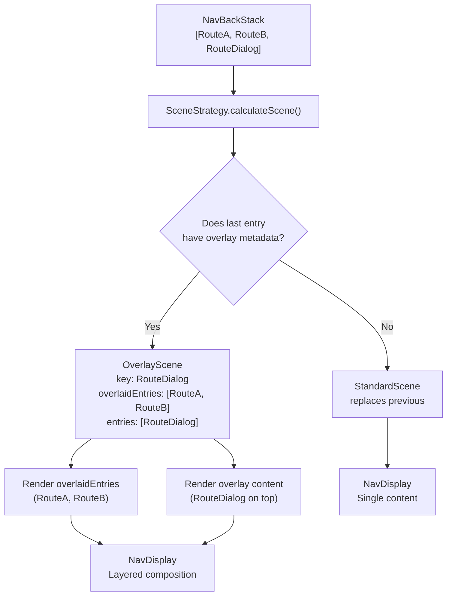
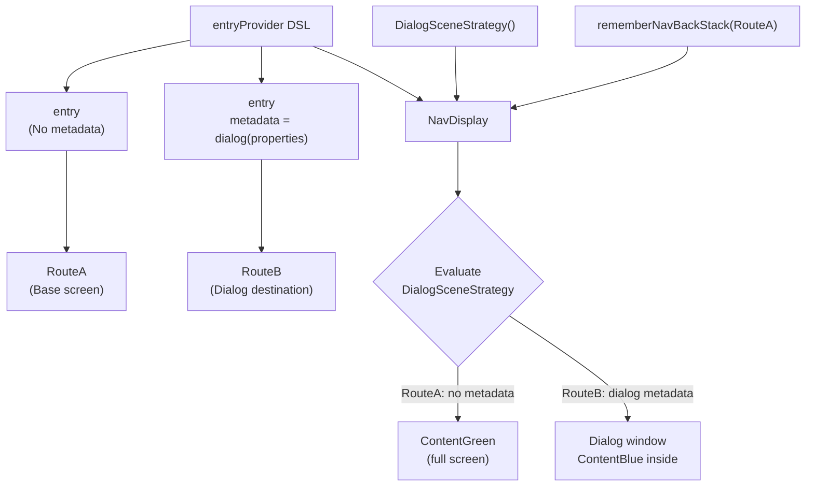
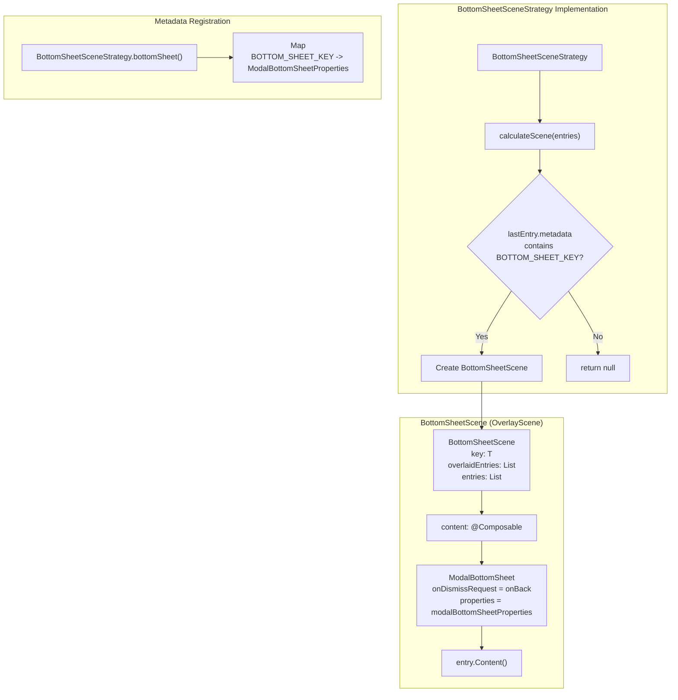
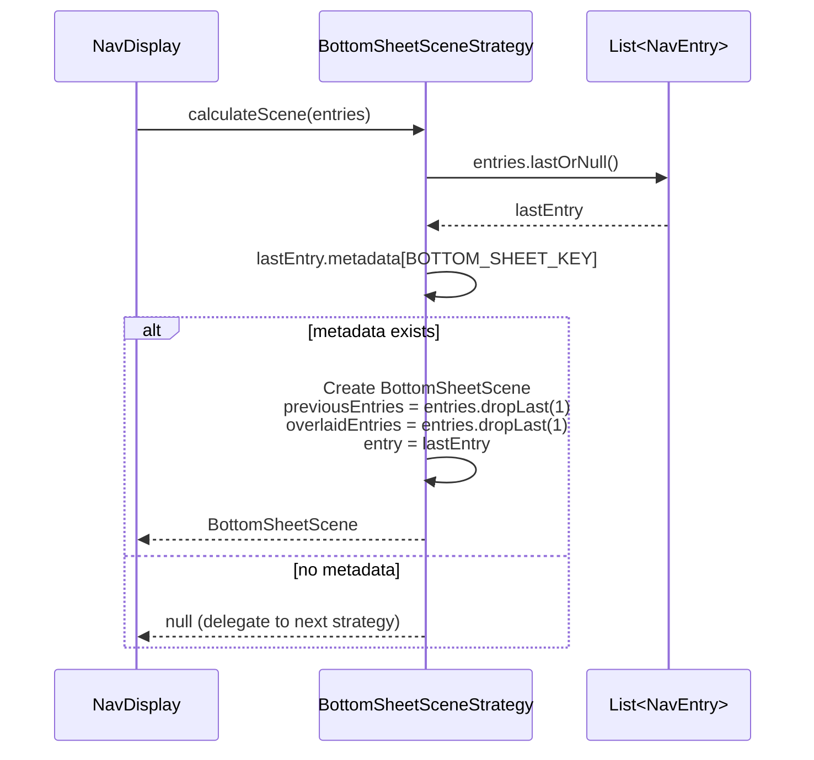
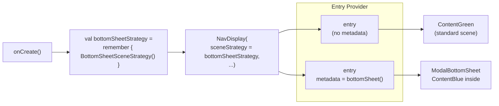
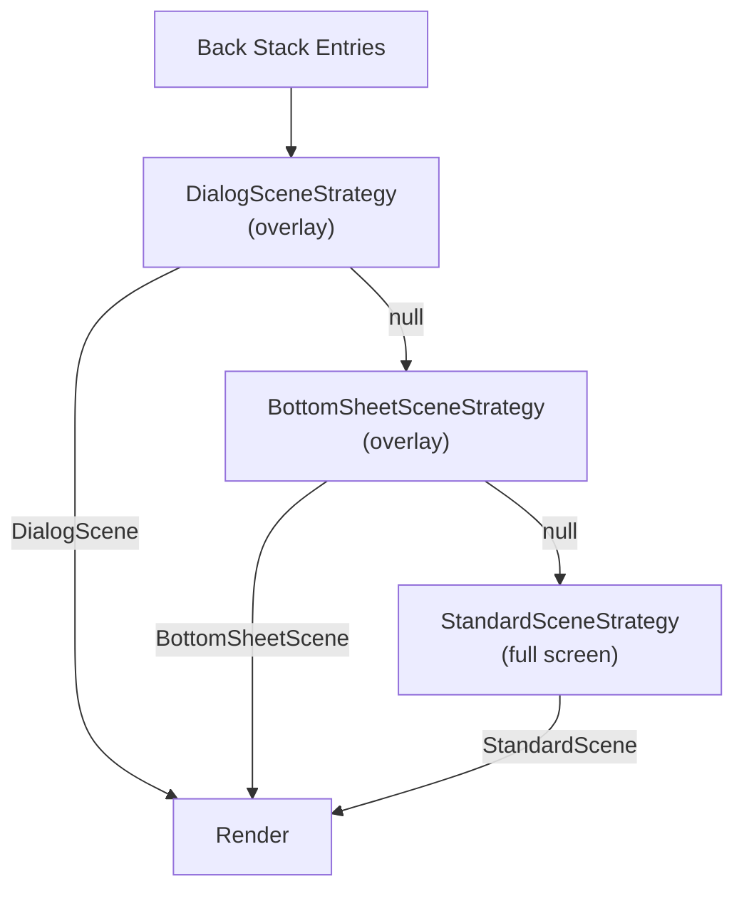
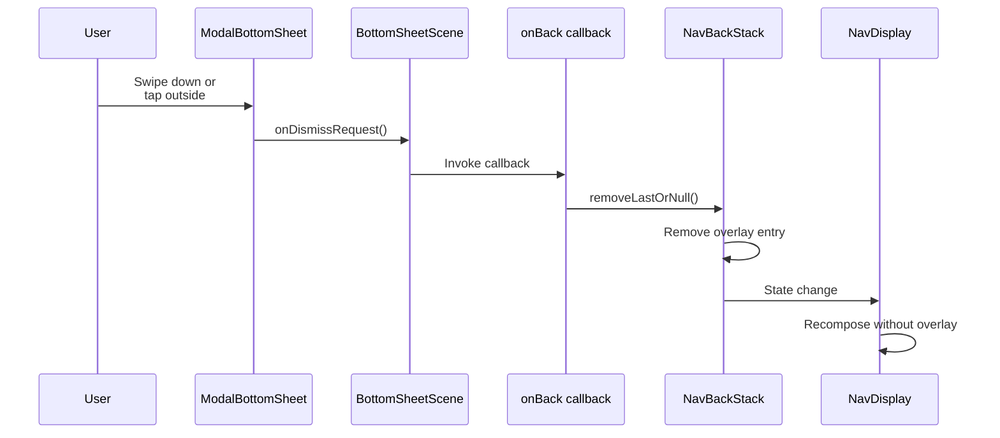

<!-- source: DeepWiki mcp.deepwiki.com · repo android/nav3-recipes · page 6.4 Dialog and BottomSheet Scenes · fetched 2026-10-23 -->

# Dialog and BottomSheet Scenes

<details>
<summary>Relevant source files</summary>

The following files were used as context for generating this wiki page:

- [app/src/main/java/com/example/nav3recipes/animations/AnimatedActivity.kt](app/src/main/java/com/example/nav3recipes/animations/AnimatedActivity.kt)
- [app/src/main/java/com/example/nav3recipes/basicdsl/BasicDslActivity.kt](app/src/main/java/com/example/nav3recipes/basicdsl/BasicDslActivity.kt)
- [app/src/main/java/com/example/nav3recipes/dialog/DialogActivity.kt](app/src/main/java/com/example/nav3recipes/dialog/DialogActivity.kt)

</details>


## Purpose and Scope

This page explains how to display navigation destinations as **overlay scenes** using `DialogSceneStrategy` and custom bottom sheet implementations. Overlay scenes render destinations on top of existing content without replacing it, creating modal interactions that users can dismiss. This pattern is appropriate for temporary, focused content like confirmation dialogs, option pickers, or detail sheets.

For general scene architecture and strategy concepts, see [Scene System Overview](#6.1). For multi-pane layouts that replace rather than overlay content, see [Two-Pane Scene](#6.2) and [List-Detail Scene](#6.3).

**Sources:** [app/src/main/java/com/example/nav3recipes/dialog/DialogActivity.kt:1-86](), [app/src/main/java/com/example/nav3recipes/bottomsheet/BottomSheetActivity.kt:1-84]()

---

## Overlay Scene Architecture

Overlay scenes implement the `OverlayScene<T>` interface, which extends `Scene<T>` with the ability to display content on top of previous destinations without removing them from the visual hierarchy. The `OverlayScene` maintains references to `overlaidEntries` (entries beneath the overlay) and `previousEntries` (all entries before the overlay in the back stack).

### Overlay Scene Flow



**Key Characteristics:**
- **Layered Rendering**: `overlaidEntries` remain visible beneath the overlay
- **Independent Lifecycle**: Overlay entries maintain their own `NavEntry` lifecycle
- **Dismissal Behavior**: Back gesture or dismiss action removes the overlay, revealing underlying content
- **Strategy Ordering**: Overlay strategies must be evaluated before standard scene strategies

**Sources:** [app/src/main/java/com/example/nav3recipes/bottomsheet/BottomSheetSceneStrategy.kt:8-34]()

---

## Dialog Scenes with DialogSceneStrategy

The Navigation 3 library provides `DialogSceneStrategy<T>`, which renders entries within Compose's `Dialog` composable. This strategy checks for `DialogSceneStrategy.dialog()` metadata and creates `DialogScene` instances.

### Dialog Configuration

| Configuration Method | Usage | Parameters |
|---------------------|-------|------------|
| `DialogSceneStrategy.dialog()` | Add to entry metadata | `DialogProperties` for window configuration |
| `DialogSceneStrategy<NavKey>()` | Create strategy instance | Type parameter matches `NavKey` type |
| `NavDisplay.sceneStrategy` | Set strategy for display | Pass strategy instance |

### DialogActivity Implementation



The implementation in [DialogActivity.kt:48-84]() demonstrates:

1. **Strategy Creation**: `val dialogStrategy = remember { DialogSceneStrategy<NavKey>() }`
2. **Strategy Registration**: `NavDisplay(sceneStrategy = dialogStrategy, ...)`
3. **Metadata Configuration**: `entry<RouteB>(metadata = DialogSceneStrategy.dialog(DialogProperties(...)))`
4. **Standard Entry Definition**: Base routes omit dialog metadata, rendering as standard scenes

The `DialogProperties` parameter configures window behavior:
- `usePlatformDefaultWidth`: Whether dialog width should match platform default
- `dismissOnBackPress`: Whether back gesture dismisses dialog
- `dismissOnClickOutside`: Whether outside click dismisses dialog
- `windowTitle`: Accessibility title for dialog window

**Sources:** [app/src/main/java/com/example/nav3recipes/dialog/DialogActivity.kt:46-85]()

---

## BottomSheet Scenes with Custom SceneStrategy

The repository demonstrates a custom `BottomSheetSceneStrategy<T>` implementation that renders entries within Material 3's `ModalBottomSheet`. This pattern shows how to create overlay strategies for components not provided by the Navigation 3 library.

### BottomSheetSceneStrategy Architecture



### BottomSheetScene Class

The `BottomSheetScene<T>` class in [BottomSheetSceneStrategy.kt:15-34]() implements `OverlayScene<T>`:

**Constructor Parameters:**
- `key: T` - Scene key for identity
- `previousEntries: List<NavEntry<T>>` - All entries before this in back stack
- `overlaidEntries: List<NavEntry<T>>` - Entries visible beneath the overlay
- `entry: NavEntry<T>` - The entry to render in the bottom sheet
- `modalBottomSheetProperties: ModalBottomSheetProperties` - Material 3 bottom sheet configuration
- `onBack: () -> Unit` - Callback for dismissal

**Key Implementation Details:**
- `entries` returns single-item list containing the overlay entry
- `content` composable wraps `entry.Content()` inside `ModalBottomSheet`
- `onDismissRequest` invokes `onBack` callback from `SceneStrategyScope`

### BottomSheetSceneStrategy.calculateScene()

The strategy's `calculateScene()` method in [BottomSheetSceneStrategy.kt:45-59]() implements the decision logic:



**Implementation Steps:**
1. Extract last entry from back stack entries
2. Check metadata for `BOTTOM_SHEET_KEY`
3. If present, cast to `ModalBottomSheetProperties` and create `BottomSheetScene`
4. Pass `entries.dropLast(1)` as both `previousEntries` and `overlaidEntries`
5. If metadata absent, return `null` to delegate to next strategy

**Sources:** [app/src/main/java/com/example/nav3recipes/bottomsheet/BottomSheetSceneStrategy.kt:1-76]()

### BottomSheetActivity Usage

The [BottomSheetActivity.kt]() demonstrates integration:



**Key Code Locations:**
- Strategy instantiation: [BottomSheetActivity.kt:53]()
- Strategy registration: [BottomSheetActivity.kt:58]()
- Metadata configuration: [BottomSheetActivity.kt:70]()

**Sources:** [app/src/main/java/com/example/nav3recipes/bottomsheet/BottomSheetActivity.kt:45-83]()

---

## Strategy Ordering and Metadata Patterns

### Strategy Evaluation Order

Multiple `SceneStrategy` instances can be combined using `SceneStrategy.plus()`. Strategies evaluate in the order they are combined, with the first strategy to return a non-null `Scene` winning.

**Critical Ordering Rule:**
Overlay strategies (dialog, bottom sheet) must be evaluated **before** standard scene strategies. This ensures overlay metadata is checked before the entry is rendered as a standard scene.



**Example Combined Strategy:**
```kotlin
val combinedStrategy = dialogStrategy + bottomSheetStrategy + standardStrategy
```

### Metadata-Based Configuration

Both dialog and bottom sheet strategies use entry metadata to configure presentation:

| Strategy | Metadata Key | Metadata Value Type | Purpose |
|----------|--------------|---------------------|---------|
| `DialogSceneStrategy` | Internal to library | `DialogProperties` | Configure dialog window |
| `BottomSheetSceneStrategy` | `"bottomsheet"` | `ModalBottomSheetProperties` | Configure bottom sheet |

**Metadata Pattern:**
1. Strategy companion object provides factory function (e.g., `bottomSheet()`)
2. Factory returns `Map<String, Any>` with strategy-specific key and properties
3. Entry metadata receives map via `entry(metadata = ...)`
4. Strategy's `calculateScene()` checks for metadata key and casts value

**Metadata Registration Example:**
```kotlin
entry<RouteB>(
    metadata = BottomSheetSceneStrategy.bottomSheet(
        modalBottomSheetProperties = ModalBottomSheetProperties(
            shouldDismissOnBackPress = true
        )
    )
) { key ->
    // Content rendered inside ModalBottomSheet
}
```

**Sources:** [app/src/main/java/com/example/nav3recipes/dialog/DialogActivity.kt:69-73](), [app/src/main/java/com/example/nav3recipes/bottomsheet/BottomSheetActivity.kt:69-71](), [app/src/main/java/com/example/nav3recipes/bottomsheet/BottomSheetSceneStrategy.kt:61-75]()

---

## Back Handling and Dismissal

Overlay scenes handle dismissal through the `onBack` callback provided by `SceneStrategyScope`. This callback is passed to the overlay composable's dismiss mechanism.

### Dismissal Flow



**Key Points:**
- **Automatic Integration**: `ModalBottomSheet` and `Dialog` composables handle gesture detection
- **Callback Propagation**: `SceneStrategyScope.onBack` is passed to overlay constructors
- **Back Stack Modification**: `onBack` typically calls `backStack.removeLastOrNull()`
- **Recomposition**: Removing the overlay entry causes `NavDisplay` to recompose without the overlay scene

**Back Handler Registration:**
The `onBack` parameter in `NavDisplay` connects to system back handling:
```kotlin
NavDisplay(
    backStack = backStack,
    onBack = { backStack.removeLastOrNull() }, // Registered with system
    sceneStrategy = overlayStrategy,
    entryProvider = entryProvider { /* ... */ }
)
```

**Sources:** [app/src/main/java/com/example/nav3recipes/bottomsheet/BottomSheetSceneStrategy.kt:28-32](), [app/src/main/java/com/example/nav3recipes/dialog/DialogActivity.kt:49](), [app/src/main/java/com/example/nav3recipes/bottomsheet/BottomSheetActivity.kt:57]()

---

## Comparison: Dialog vs BottomSheet

| Aspect | DialogSceneStrategy | BottomSheetSceneStrategy |
|--------|---------------------|--------------------------|
| **Provided By** | Navigation 3 library | Custom implementation (recipe) |
| **Overlay Composable** | `Dialog` (Compose foundation) | `ModalBottomSheet` (Material 3) |
| **Metadata Function** | `DialogSceneStrategy.dialog()` | `BottomSheetSceneStrategy.bottomSheet()` |
| **Properties Type** | `DialogProperties` | `ModalBottomSheetProperties` |
| **Visual Style** | Centered window with dim scrim | Sheet from bottom edge |
| **Dismissal Gestures** | Outside click, back press | Swipe down, outside tap, back press |
| **Material Design** | Not Material-specific | Material 3 component |
| **Custom Implementation** | Not required | Demonstrated in recipe |

**Sources:** [app/src/main/java/com/example/nav3recipes/dialog/DialogActivity.kt:1-86](), [app/src/main/java/com/example/nav3recipes/bottomsheet/BottomSheetActivity.kt:1-84](), [app/src/main/java/com/example/nav3recipes/bottomsheet/BottomSheetSceneStrategy.kt:1-76]()

---

## Common Patterns and Best Practices

### Pattern 1: Single Overlay Strategy

When using only one overlay type, register it directly as the scene strategy:

```kotlin
val dialogStrategy = remember { DialogSceneStrategy<NavKey>() }

NavDisplay(
    backStack = backStack,
    onBack = { backStack.removeLastOrNull() },
    sceneStrategy = dialogStrategy, // Single strategy
    entryProvider = entryProvider { /* ... */ }
)
```

### Pattern 2: Multiple Overlay Strategies

Combine multiple overlay strategies using `+` operator, with overlays before standard scenes:

```kotlin
val combinedStrategy = remember {
    DialogSceneStrategy<NavKey>() + 
    BottomSheetSceneStrategy<NavKey>() +
    StandardSceneStrategy() // Fallback for non-overlay entries
}
```

### Pattern 3: Rounded Corners for Overlay Content

Apply clipping to content rendered inside overlays to match Material Design guidelines:

```kotlin
entry<RouteB>(
    metadata = BottomSheetSceneStrategy.bottomSheet()
) { key ->
    ContentBlue(
        title = "Route id: ${key.id}",
        modifier = Modifier.clip(
            shape = RoundedCornerShape(16.dp)
        )
    )
}
```

### Pattern 4: Custom Properties for Behavior

Configure dismissal and interaction behavior through properties objects:

```kotlin
// Dialog example
metadata = DialogSceneStrategy.dialog(
    DialogProperties(
        dismissOnBackPress = true,
        dismissOnClickOutside = false, // Prevent accidental dismissal
        usePlatformDefaultWidth = false
    )
)

// BottomSheet example
metadata = BottomSheetSceneStrategy.bottomSheet(
    ModalBottomSheetProperties(
        shouldDismissOnBackPress = true,
        isFocusable = true
    )
)
```

**Sources:** [app/src/main/java/com/example/nav3recipes/dialog/DialogActivity.kt:69-80](), [app/src/main/java/com/example/nav3recipes/bottomsheet/BottomSheetActivity.kt:69-78]()

---

## Creating Custom Overlay Strategies

The `BottomSheetSceneStrategy` implementation provides a template for creating custom overlay strategies:

### Implementation Checklist

1. **Create OverlayScene Implementation**
   - Implement `OverlayScene<T>` interface
   - Store `overlaidEntries` and `previousEntries`
   - Wrap content in overlay composable
   - Connect `onBack` callback to dismissal

2. **Create SceneStrategy Implementation**
   - Implement `SceneStrategy<T>` interface
   - Define metadata key constant
   - Implement `calculateScene()` to check metadata
   - Create scene instance when metadata present
   - Return `null` when metadata absent

3. **Provide Metadata Factory**
   - Create companion object function
   - Return `Map<String, Any>` with metadata key and configuration
   - Accept configuration parameters (e.g., properties object)

4. **Document Strategy Ordering**
   - Specify that strategy should be registered before standard scene strategies
   - Explain interaction with other overlay strategies

**Template Structure:**
```
CustomOverlayScene<T> : OverlayScene<T>
  - Wraps entry in overlay composable
  - Handles dismissal via onBack

CustomOverlaySceneStrategy<T> : SceneStrategy<T>
  - calculateScene() checks for metadata
  - Creates CustomOverlayScene when found
  
  companion object
    - factory function returns metadata Map
```

**Sources:** [app/src/main/java/com/example/nav3recipes/bottomsheet/BottomSheetSceneStrategy.kt:1-76]()

---

