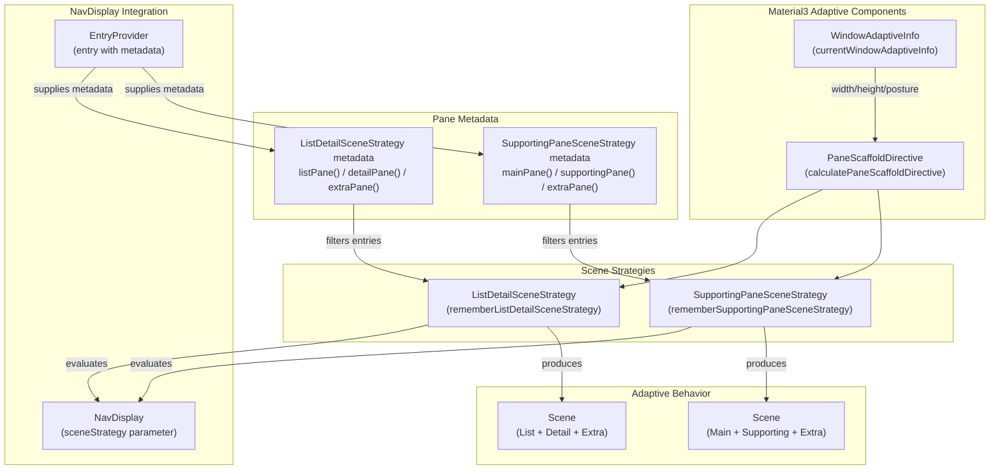
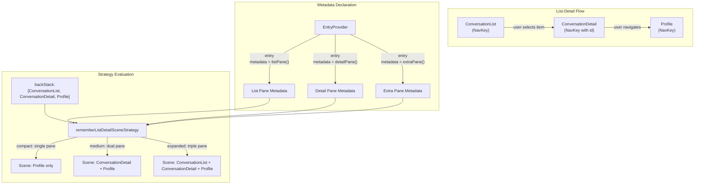
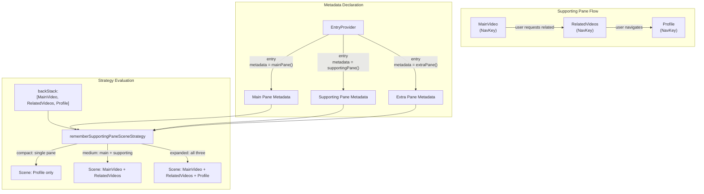
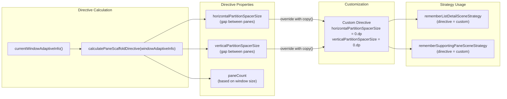
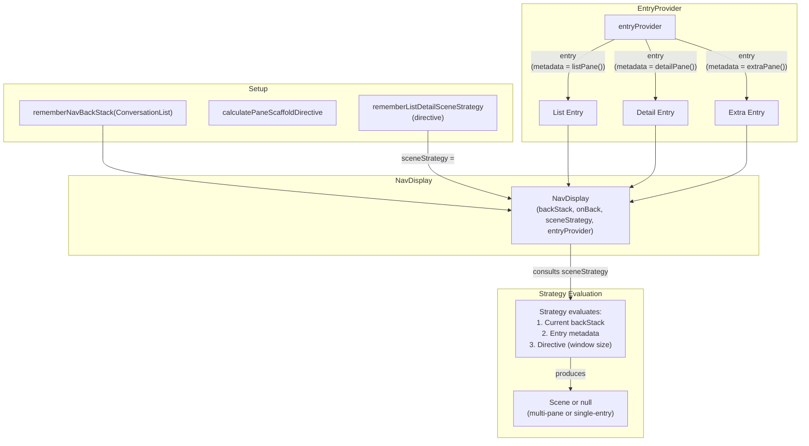

<!-- source: DeepWiki mcp.deepwiki.com · repo android/nav3-recipes · page 6.5 Material3 Adaptive Layouts · fetched 2026-10-23 -->

# Material3 Adaptive Layouts

<details>
<summary>Relevant source files</summary>

The following files were used as context for generating this wiki page:

- [app/src/main/java/com/example/nav3recipes/material/listdetail/MaterialListDetailActivity.kt](app/src/main/java/com/example/nav3recipes/material/listdetail/MaterialListDetailActivity.kt)
- [app/src/main/java/com/example/nav3recipes/material/supportingpane/MaterialSupportingPaneActivity.kt](app/src/main/java/com/example/nav3recipes/material/supportingpane/MaterialSupportingPaneActivity.kt)
- [app/src/main/java/com/example/nav3recipes/modular/hilt/CommonModule.kt](app/src/main/java/com/example/nav3recipes/modular/hilt/CommonModule.kt)
- [app/src/main/java/com/example/nav3recipes/passingarguments/viewmodels/basic/BasicViewModelsActivity.kt](app/src/main/java/com/example/nav3recipes/passingarguments/viewmodels/basic/BasicViewModelsActivity.kt)
- [app/src/main/java/com/example/nav3recipes/passingarguments/viewmodels/hilt/HiltViewModelsActivity.kt](app/src/main/java/com/example/nav3recipes/passingarguments/viewmodels/hilt/HiltViewModelsActivity.kt)
- [app/src/main/java/com/example/nav3recipes/passingarguments/viewmodels/koin/KoinViewModelsActivity.kt](app/src/main/java/com/example/nav3recipes/passingarguments/viewmodels/koin/KoinViewModelsActivity.kt)

</details>


This page covers the production-ready Material3 adaptive navigation patterns provided by the `androidx.compose.material3.adaptive.navigation3` package. These patterns enable list-detail and supporting-pane layouts that automatically adapt to different screen sizes, orientations, and foldable device configurations.

For custom scene implementations with manual layout control, see [Custom Scenes](#6.1), [Two-Pane Scene Implementation](#6.2), and [List-Detail Scene Implementation](#6.3). For the underlying scene system architecture, see [Scene System Overview](#6.1).

**Sources:** Diagram 5 from high-level architecture overview

---

## Material3 Adaptive Strategy Architecture

Material3 provides two production-ready `SceneStrategy` implementations that leverage the `androidx.compose.material3.adaptive` library's automatic layout calculation system.



**Sources:** 
- [app/src/main/java/com/example/nav3recipes/material/listdetail/MaterialListDetailActivity.kt:1-116]()
- [app/src/main/java/com/example/nav3recipes/material/supportingpane/MaterialSupportingPaneActivity.kt:1-118]()

---

## ListDetailSceneStrategy

`ListDetailSceneStrategy` implements the common list-detail pattern where a list of items appears alongside item details. This strategy automatically manages three panes based on available screen space.

### Pane Roles

| Pane | Metadata Function | Purpose | Example Use Case |
|------|------------------|---------|------------------|
| List | `ListDetailSceneStrategy.listPane()` | Displays navigable list of items | Conversation list, email folder |
| Detail | `ListDetailSceneStrategy.detailPane()` | Shows selected item details | Conversation content, email body |
| Extra | `ListDetailSceneStrategy.extraPane()` | Optional tertiary content | User profile, attachment viewer |

### Implementation



The strategy creates the entry provider with three entries declared at [app/src/main/java/com/example/nav3recipes/material/listdetail/MaterialListDetailActivity.kt:78-111]():

- **List pane** with `detailPlaceholder` for when no detail is selected
- **Detail pane** that displays the selected conversation
- **Extra pane** for additional content like profiles

### List Pane with Placeholder

The list pane metadata accepts an optional `detailPlaceholder` composable that displays when the list is visible but no detail has been selected:

```
metadata = ListDetailSceneStrategy.listPane(
    detailPlaceholder = {
        ContentYellow("Choose a conversation from the list")
    }
)
```

**Sources:** [app/src/main/java/com/example/nav3recipes/material/listdetail/MaterialListDetailActivity.kt:79-82]()

---

## SupportingPaneSceneStrategy

`SupportingPaneSceneStrategy` implements layouts where a main content area is optionally supplemented by supporting information in an adjacent pane. This is commonly used for video players with related content or documents with annotations.

### Pane Roles

| Pane | Metadata Function | Purpose | Example Use Case |
|------|------------------|---------|------------------|
| Main | `SupportingPaneSceneStrategy.mainPane()` | Primary content focus | Video player, document viewer |
| Supporting | `SupportingPaneSceneStrategy.supportingPane()` | Contextual supplementary content | Related videos, comments, annotations |
| Extra | `SupportingPaneSceneStrategy.extraPane()` | Optional tertiary content | User profile, settings |

### Implementation



The implementation at [app/src/main/java/com/example/nav3recipes/material/supportingpane/MaterialSupportingPaneActivity.kt:84-113]() declares three pane types:

- **Main pane** for the primary video content
- **Supporting pane** for related videos list
- **Extra pane** for profile information

### Back Navigation Behavior

By default, `SupportingPaneSceneStrategy` uses `BackNavigationBehavior.PopLatestHistory`, which only dismisses the supporting pane when the main pane changes. To allow dismissing the supporting pane with the back button, configure:

```
val supportingPaneStrategy = rememberSupportingPaneSceneStrategy<NavKey>(
    backNavigationBehavior = BackNavigationBehavior.PopUntilCurrentDestinationChange,
    directive = directive
)
```

**Sources:** [app/src/main/java/com/example/nav3recipes/material/supportingpane/MaterialSupportingPaneActivity.kt:74-77]()

---

## PaneScaffoldDirective Configuration

`PaneScaffoldDirective` contains the layout instructions calculated from window characteristics. Both strategies accept an optional `directive` parameter for customization.



### Removing Pane Spacers

The default `PaneScaffoldDirective` includes spacing between panes. Both recipe examples override this to create edge-to-edge layouts:

```
val windowAdaptiveInfo = currentWindowAdaptiveInfo()
val directive = remember(windowAdaptiveInfo) {
    calculatePaneScaffoldDirective(windowAdaptiveInfo)
        .copy(horizontalPartitionSpacerSize = 0.dp, verticalPartitionSpacerSize = 0.dp)
}
```

**Sources:** 
- [app/src/main/java/com/example/nav3recipes/material/listdetail/MaterialListDetailActivity.kt:66-70]()
- [app/src/main/java/com/example/nav3recipes/material/supportingpane/MaterialSupportingPaneActivity.kt:66-70]()

---

## NavDisplay Integration

Material3 adaptive strategies integrate with `NavDisplay` through the `sceneStrategy` parameter, following the same pattern as custom scenes.

### List-Detail Integration



The complete integration at [app/src/main/java/com/example/nav3recipes/material/listdetail/MaterialListDetailActivity.kt:73-114]() shows:

1. **Back stack** created with initial route
2. **Directive** calculated from window adaptive info
3. **Strategy** created with directive
4. **NavDisplay** configured with strategy and entry provider
5. **Entry provider** declares metadata for each route

### Supporting Pane Integration

The supporting pane pattern follows the same structure at [app/src/main/java/com/example/nav3recipes/material/supportingpane/MaterialSupportingPaneActivity.kt:62-115](), with additional `BackNavigationBehavior` configuration.

**Sources:** 
- [app/src/main/java/com/example/nav3recipes/material/listdetail/MaterialListDetailActivity.kt:60-114]()
- [app/src/main/java/com/example/nav3recipes/material/supportingpane/MaterialSupportingPaneActivity.kt:60-116]()

---

## Comparison with Custom Scenes

Material3 adaptive strategies differ from custom scenes in several key aspects:

| Aspect | Material3 Adaptive | Custom Scenes |
|--------|-------------------|---------------|
| **Layout Calculation** | Automatic via `PaneScaffoldDirective` | Manual layout code required |
| **Window Size Handling** | Built-in responsive breakpoints | Developer-defined conditions |
| **Foldable Support** | Automatic posture adaptation | Manual posture handling |
| **Implementation Complexity** | Configuration-based | Code-based |
| **Customization** | Limited to directive overrides | Full layout control |
| **Production Readiness** | Material Design guidelines | Custom design requirements |
| **Animation** | Standard Material animations | Custom transition control |

### When to Use Each Approach

**Use Material3 Adaptive when:**
- Following Material Design guidelines
- Need automatic foldable device support
- Want production-ready responsive behavior
- Prefer configuration over code

**Use Custom Scenes when:**
- Implementing non-standard layouts (see [Two-Pane Scene Implementation](#6.2))
- Need fine-grained animation control (see [List-Detail Scene Implementation](#6.3))
- Require custom layout logic
- Building design system outside Material guidelines

**Sources:** 
- Diagram 5 from high-level architecture overview
- [app/src/main/java/com/example/nav3recipes/material/listdetail/MaterialListDetailActivity.kt:1-116]()
- [app/src/main/java/com/example/nav3recipes/material/supportingpane/MaterialSupportingPaneActivity.kt:1-118]()

---

## Metadata API Reference

Both strategies provide metadata factory functions that must be used in the `entry()` metadata parameter.

### ListDetailSceneStrategy Metadata

```
// List pane - displays item list
metadata = ListDetailSceneStrategy.listPane(
    detailPlaceholder: (@Composable () -> Unit)? = null
)

// Detail pane - displays selected item
metadata = ListDetailSceneStrategy.detailPane()

// Extra pane - displays tertiary content
metadata = ListDetailSceneStrategy.extraPane()
```

### SupportingPaneSceneStrategy Metadata

```
// Main pane - primary content
metadata = SupportingPaneSceneStrategy.mainPane()

// Supporting pane - supplementary content
metadata = SupportingPaneSceneStrategy.supportingPane()

// Extra pane - tertiary content
metadata = SupportingPaneSceneStrategy.extraPane()
```

All metadata functions return objects that implement the internal metadata interface used by `SceneStrategy` to filter and organize entries.

**Sources:** 
- [app/src/main/java/com/example/nav3recipes/material/listdetail/MaterialListDetailActivity.kt:79-110]()
- [app/src/main/java/com/example/nav3recipes/material/supportingpane/MaterialSupportingPaneActivity.kt:85-110]()

---

