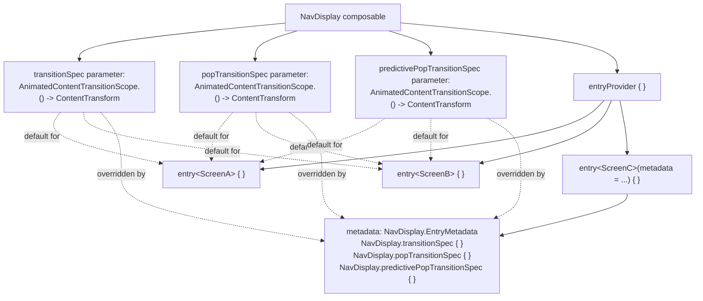
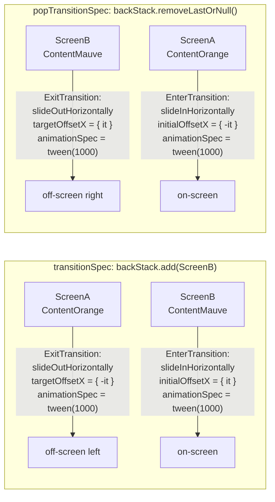
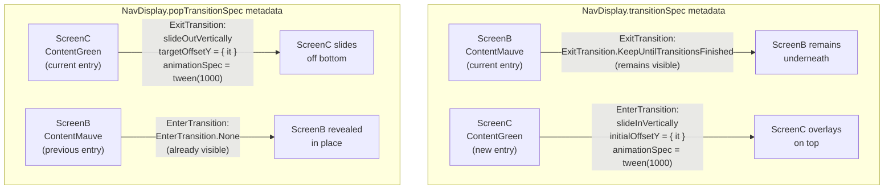
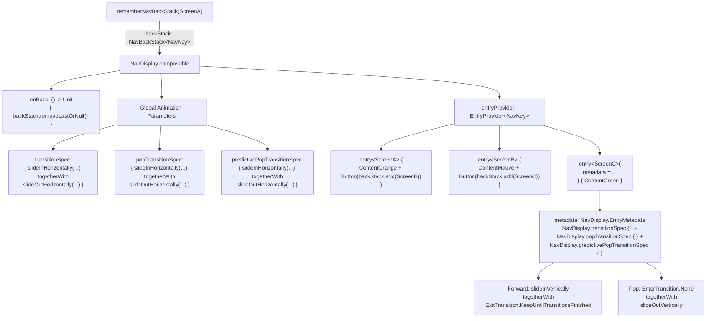

<!-- source: DeepWiki mcp.deepwiki.com · repo android/nav3-recipes · page 7 Navigation Animations · fetched 2026-10-23 -->

# Navigation Animations

<details>
<summary>Relevant source files</summary>

The following files were used as context for generating this wiki page:

- [app/src/main/java/com/example/nav3recipes/animations/AnimatedActivity.kt](app/src/main/java/com/example/nav3recipes/animations/AnimatedActivity.kt)
- [app/src/main/java/com/example/nav3recipes/basicdsl/BasicDslActivity.kt](app/src/main/java/com/example/nav3recipes/basicdsl/BasicDslActivity.kt)
- [app/src/main/java/com/example/nav3recipes/dialog/DialogActivity.kt](app/src/main/java/com/example/nav3recipes/dialog/DialogActivity.kt)

</details>


## Purpose and Scope

This page documents how to customize enter, exit, and predictive back animations for navigation transitions in Navigation 3. It covers configuring animations at the `NavDisplay` level for default behavior and overriding animations for specific destinations using entry metadata. The `AnimatedActivity` example demonstrates both global and per-destination animation patterns.

**Sources:** [app/src/main/java/com/example/nav3recipes/animations/AnimatedActivity.kt:1-125]()

---

## Animation System Overview

Navigation 3 provides a flexible animation system that supports three types of transitions:

| Transition Type | Trigger Condition | Purpose |
|----------------|-------------------|---------|
| `transitionSpec` | Navigating forward (adding to back stack) | Defines how new content enters and old content exits |
| `popTransitionSpec` | Navigating backward (removing from back stack) | Defines how previous content enters and current content exits |
| `predictivePopTransitionSpec` | Predictive back gesture in progress | Defines animations during predictive back preview |

Animations can be configured at two levels:

1. **Global level**: Applied to all destinations via `NavDisplay` parameters
2. **Per-destination level**: Override global defaults using entry metadata

**Sources:** [app/src/main/java/com/example/nav3recipes/animations/AnimatedActivity.kt:28-36](), [app/src/main/java/com/example/nav3recipes/animations/AnimatedActivity.kt:91-121]()

---

## Animation Configuration Architecture

**Diagram: Animation Configuration Hierarchy**



The `NavDisplay` composable accepts three animation parameters: `transitionSpec`, `popTransitionSpec`, and `predictivePopTransitionSpec`. These define default animations for all destinations in the `entryProvider` DSL. Individual `entry<T>()` blocks can override these defaults by specifying `metadata` with `NavDisplay.transitionSpec`, `NavDisplay.popTransitionSpec`, and `NavDisplay.predictivePopTransitionSpec` functions. In `AnimatedActivity`, `entry<ScreenA>` and `entry<ScreenB>` inherit the global horizontal slide animations, while `entry<ScreenC>` provides custom vertical slide animations via metadata composition.

**Sources:** [app/src/main/java/com/example/nav3recipes/animations/AnimatedActivity.kt:47-121]()

---

## Global Animation Configuration

Global animations are specified as parameters to `NavDisplay`. These define the default transition behavior for all destinations that do not override them.

### Implementation Example

**Diagram: Global Horizontal Slide Transitions in AnimatedActivity**



The `AnimatedActivity` configures global horizontal slide animations that apply to `ScreenA` and `ScreenB` navigation.

### Forward Navigation (transitionSpec)

[app/src/main/java/com/example/nav3recipes/animations/AnimatedActivity.kt:91-100]()

The `transitionSpec` parameter on `NavDisplay` defines animations when navigating forward (e.g., `backStack.add(ScreenB)`):

- **Enter animation**: `slideInHorizontally(initialOffsetX = { it })` - New content enters from the right edge
- **Exit animation**: `slideOutHorizontally(targetOffsetX = { -it })` - Old content exits to the left edge
- **Duration**: `tween(1000)` - 1000ms linear interpolation
- **Combination**: `togetherWith` operator combines enter and exit animations simultaneously

### Backward Navigation (popTransitionSpec)

[app/src/main/java/com/example/nav3recipes/animations/AnimatedActivity.kt:101-110]()

The `popTransitionSpec` parameter on `NavDisplay` defines animations when navigating backward (e.g., `backStack.removeLastOrNull()` or system back button):

- **Enter animation**: `slideInHorizontally(initialOffsetX = { -it })` - Previous content enters from the left edge
- **Exit animation**: `slideOutHorizontally(targetOffsetX = { it })` - Current content exits to the right edge
- **Effect**: Reverses the forward navigation direction to create spatial consistency

### Predictive Back (predictivePopTransitionSpec)

[app/src/main/java/com/example/nav3recipes/animations/AnimatedActivity.kt:111-120]()

The `predictivePopTransitionSpec` parameter on `NavDisplay` defines animations during predictive back gesture tracking (before navigation is committed). In `AnimatedActivity`, this mirrors `popTransitionSpec` to provide consistent visual behavior as the user drags the back gesture.

**Sources:** [app/src/main/java/com/example/nav3recipes/animations/AnimatedActivity.kt:91-120]()

---

## Per-Destination Animation Overrides

Individual destinations can override global animations using the `metadata` parameter on `entry<T>()` calls. The `ScreenC` destination in `AnimatedActivity` demonstrates vertical slide animations that differ from the global horizontal slides.

### Metadata Composition

[app/src/main/java/com/example/nav3recipes/animations/AnimatedActivity.kt:65-87]()

The `metadata` parameter accepts `NavDisplay.EntryMetadata` values. Multiple metadata objects are combined using the `+` operator:

```kotlin
entry<ScreenC>(
    metadata = NavDisplay.transitionSpec { ... } +
               NavDisplay.popTransitionSpec { ... } +
               NavDisplay.predictivePopTransitionSpec { ... }
) {
    ContentGreen("This is Screen C")
}
```

Each function (`NavDisplay.transitionSpec`, `NavDisplay.popTransitionSpec`, `NavDisplay.predictivePopTransitionSpec`) returns a `NavDisplay.EntryMetadata` that defines animation behavior for that transition type.

### Vertical Slide Implementation for ScreenC

**Diagram: ScreenC Vertical Slide Animation with Overlay Effect**



### Forward Transition Configuration for ScreenC

[app/src/main/java/com/example/nav3recipes/animations/AnimatedActivity.kt:66-71]()

The `NavDisplay.transitionSpec` metadata function defines how `ScreenC` enters when navigating forward from `ScreenB`:

- **Enter**: `slideInVertically(initialOffsetY = { it })` - `ScreenC` slides up from the bottom edge
- **Exit**: `ExitTransition.KeepUntilTransitionsFinished` - `ScreenB` remains visible without animation
- **Effect**: Creates an overlay where `ScreenC` covers `ScreenB` like a bottom sheet

### Backward Transition Configuration for ScreenC

[app/src/main/java/com/example/nav3recipes/animations/AnimatedActivity.kt:72-78]()

The `NavDisplay.popTransitionSpec` metadata function defines how `ScreenC` exits when navigating back to `ScreenB`:

- **Enter**: `EnterTransition.None` - `ScreenB` has no enter animation (already visible underneath)
- **Exit**: `slideOutVertically(targetOffsetY = { it })` - `ScreenC` slides down to the bottom edge
- **Effect**: Reveals `ScreenB` as `ScreenC` dismisses

### Predictive Back Configuration for ScreenC

[app/src/main/java/com/example/nav3recipes/animations/AnimatedActivity.kt:79-86]()

The `NavDisplay.predictivePopTransitionSpec` metadata mirrors the pop transition to provide consistent predictive back gesture behavior for `ScreenC`.

**Sources:** [app/src/main/java/com/example/nav3recipes/animations/AnimatedActivity.kt:65-87]()

---

## Transition Specification APIs

### EnterTransition Types

| Type | Parameters | Behavior | Use Case |
|------|------------|----------|----------|
| `slideInHorizontally` | `initialOffsetX`, `animationSpec` | Slides content from horizontal offset | Lateral navigation between screens |
| `slideInVertically` | `initialOffsetY`, `animationSpec` | Slides content from vertical offset | Hierarchical navigation (overlay patterns) |
| `EnterTransition.None` | None | No animation, content immediately visible | Content already present underneath |

### ExitTransition Types

| Type | Parameters | Behavior | Use Case |
|------|------------|----------|----------|
| `slideOutHorizontally` | `targetOffsetX`, `animationSpec` | Slides content to horizontal offset | Lateral navigation out of view |
| `slideOutVertically` | `targetOffsetY`, `animationSpec` | Slides content to vertical offset | Hierarchical navigation (dismiss overlays) |
| `ExitTransition.KeepUntilTransitionsFinished` | None | Content remains visible during animation | Keep content visible underneath overlays |

### Offset Lambda Functions

The offset parameters accept lambda functions `(Int) -> Int` where the input is the full width or height:

- `{ it }` - Positive offset (right edge for X, bottom edge for Y)
- `{ -it }` - Negative offset (left edge for X, top edge for Y)

### Animation Specifications

The `animationSpec` parameter from `androidx.compose.animation.core` controls timing and easing:

- `tween(durationMillis)` - Linear interpolation over specified duration (used in `AnimatedActivity` with 1000ms)
- `spring()` - Physics-based spring animation
- `keyframes()` - Multi-stage animation with explicit values at specific times
- `snap()` - Immediate transition without interpolation

**Sources:** [app/src/main/java/com/example/nav3recipes/animations/AnimatedActivity.kt:7-14](), [app/src/main/java/com/example/nav3recipes/animations/AnimatedActivity.kt:66-86]()

---

## Implementation Pattern Summary

### Route Definitions

[app/src/main/java/com/example/nav3recipes/animations/AnimatedActivity.kt:28-36]()

The `AnimatedActivity` defines three serializable `NavKey` implementations:

| NavKey | Type | Purpose |
|--------|------|---------|
| `ScreenA` | `data object` | Starting screen, uses global horizontal animations |
| `ScreenB` | `data object` | Intermediate screen, uses global horizontal animations |
| `ScreenC` | `data object` | Final screen, overrides with vertical animations via metadata |

### Complete Setup Flow

**Diagram: AnimatedActivity Navigation Setup with Animation Configuration**



### Key Implementation Steps

1. **Initialize back stack** with `rememberNavBackStack(ScreenA)` [app/src/main/java/com/example/nav3recipes/animations/AnimatedActivity.kt:45]()
2. **Configure NavDisplay** with `transitionSpec`, `popTransitionSpec`, `predictivePopTransitionSpec` parameters [app/src/main/java/com/example/nav3recipes/animations/AnimatedActivity.kt:47-121]()
3. **Define entry provider** using `entryProvider` DSL with `entry<T>()` calls [app/src/main/java/com/example/nav3recipes/animations/AnimatedActivity.kt:50-90]()
4. **Override animations** for `ScreenC` using `metadata` parameter with composed `NavDisplay.transitionSpec` + `NavDisplay.popTransitionSpec` + `NavDisplay.predictivePopTransitionSpec` [app/src/main/java/com/example/nav3recipes/animations/AnimatedActivity.kt:65-87]()
5. **Handle back navigation** with `onBack = { backStack.removeLastOrNull() }` [app/src/main/java/com/example/nav3recipes/animations/AnimatedActivity.kt:49]()

**Sources:** [app/src/main/java/com/example/nav3recipes/animations/AnimatedActivity.kt:38-124]()

---

## Animation Configuration Reference

### NavDisplay Animation Parameters

| Parameter | Type | Required | Purpose |
|-----------|------|----------|---------|
| `transitionSpec` | `AnimatedContentTransitionScope<BackStackEntry>.() -> ContentTransform` | Optional | Default forward navigation animation |
| `popTransitionSpec` | `AnimatedContentTransitionScope<BackStackEntry>.() -> ContentTransform` | Optional | Default backward navigation animation |
| `predictivePopTransitionSpec` | `AnimatedContentTransitionScope<BackStackEntry>.() -> ContentTransform` | Optional | Predictive back gesture animation |

### Entry Metadata Animation Functions

| Function | Purpose | Returns |
|----------|---------|---------|
| `NavDisplay.transitionSpec { ... }` | Define forward transition override | `NavDisplay.EntryMetadata` |
| `NavDisplay.popTransitionSpec { ... }` | Define backward transition override | `NavDisplay.EntryMetadata` |
| `NavDisplay.predictivePopTransitionSpec { ... }` | Define predictive back override | `NavDisplay.EntryMetadata` |

Metadata is combined using the `+` operator: `transitionSpec {...} + popTransitionSpec {...} + predictivePopTransitionSpec {...}`

**Sources:** [app/src/main/java/com/example/nav3recipes/animations/AnimatedActivity.kt:52-126]()

---

