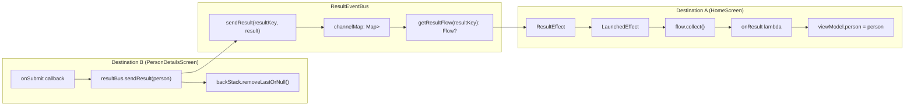
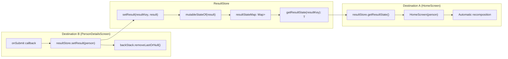
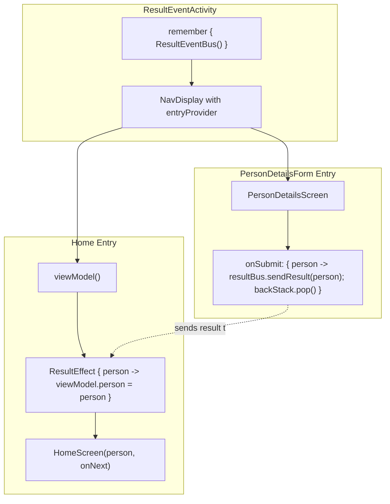
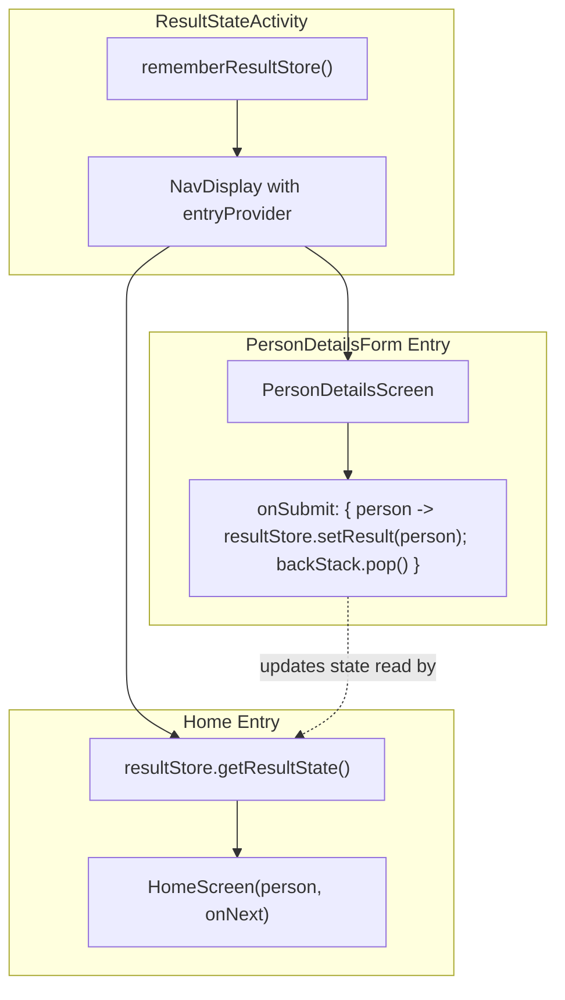
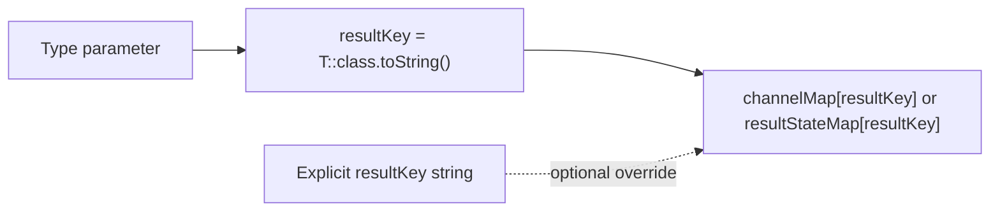
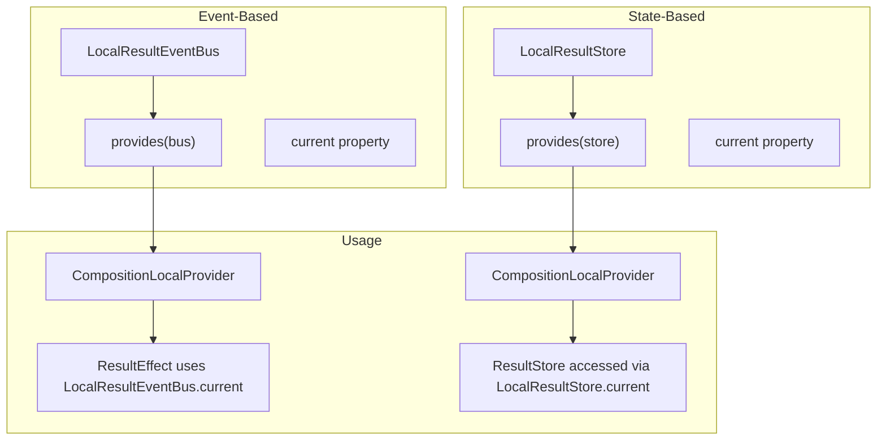

<!-- source: DeepWiki mcp.deepwiki.com · repo android/nav3-recipes · page 8 Result Passing Between Destinations · fetched 2026-10-23 -->

# Result Passing Between Destinations

<details>
<summary>Relevant source files</summary>

The following files were used as context for generating this wiki page:

- [app/src/main/java/com/example/nav3recipes/results/event/ResultEffect.kt](app/src/main/java/com/example/nav3recipes/results/event/ResultEffect.kt)
- [app/src/main/java/com/example/nav3recipes/results/event/ResultEventActivity.kt](app/src/main/java/com/example/nav3recipes/results/event/ResultEventActivity.kt)
- [app/src/main/java/com/example/nav3recipes/results/event/ResultEventBus.kt](app/src/main/java/com/example/nav3recipes/results/event/ResultEventBus.kt)
- [app/src/main/java/com/example/nav3recipes/results/state/ResultStateActivity.kt](app/src/main/java/com/example/nav3recipes/results/state/ResultStateActivity.kt)
- [app/src/main/java/com/example/nav3recipes/results/state/ResultStore.kt](app/src/main/java/com/example/nav3recipes/results/state/ResultStore.kt)

</details>


## Purpose and Scope

This document explains how to pass data back from a destination to a previous screen in the Navigation 3 back stack. Two complementary approaches are provided: **event-based results** using `ResultEventBus` with Kotlin Channels for one-time delivery, and **state-based results** using `ResultStore` with MutableState for persistent values. This covers the common pattern where a child screen (e.g., a form) needs to return data to its parent screen after completion.

For general argument passing *to* destinations, see [NavKey and Route System](#12.1). For ViewModel-based data sharing, see [ViewModel Integration](#9).

**Sources:** [app/src/main/java/com/example/nav3recipes/results/event/ResultEventActivity.kt:1-81](), [app/src/main/java/com/example/nav3recipes/results/state/ResultStateActivity.kt:1-74]()

---

## Two Approaches to Result Passing

Navigation 3 supports two distinct patterns for result passing, each suited to different use cases:

| Approach | Implementation | Delivery Semantics | Persistence | Use Case |
|----------|----------------|-------------------|-------------|----------|
| **Event-Based** | `ResultEventBus` with Kotlin `Channel` | One-time consumption via `Flow.collect()` | Not persisted across configuration changes | Trigger-once actions (e.g., show snackbar, trigger side effect) |
| **State-Based** | `ResultStore` with `MutableState` | Multiple reads via state value | Persisted with `rememberSaveable` | Display data that survives recomposition (e.g., form results) |

**Sources:** [app/src/main/java/com/example/nav3recipes/results/event/ResultEventBus.kt:52-84](), [app/src/main/java/com/example/nav3recipes/results/state/ResultStore.kt:62-93]()

---

## Architecture Overview

### Event-Based Flow (ResultEventBus)



**Sources:** [app/src/main/java/com/example/nav3recipes/results/event/ResultEventActivity.kt:54-76](), [app/src/main/java/com/example/nav3recipes/results/event/ResultEventBus.kt:56-84](), [app/src/main/java/com/example/nav3recipes/results/event/ResultEffect.kt:32-43]()

---

### State-Based Flow (ResultStore)



**Sources:** [app/src/main/java/com/example/nav3recipes/results/state/ResultStateActivity.kt:52-69](), [app/src/main/java/com/example/nav3recipes/results/state/ResultStore.kt:67-93]()

---

## Common Usage Pattern

Both recipes implement the same user flow: a `Home` screen navigates to a `PersonDetailsForm`, and the form returns a `Person` object when submitted. The implementation differs only in the result delivery mechanism.

### NavKey Definitions

```kotlin
// Shared across both approaches
@Serializable
data object Home : NavKey

@Serializable
data class PersonDetailsForm() : NavKey

@Serializable
data class Person(val name: String, val email: String)
```

**Sources:** [app/src/main/java/com/example/nav3recipes/results/common]() (inferred from usage patterns)

---

### Event-Based Implementation Structure



**Sources:** [app/src/main/java/com/example/nav3recipes/results/event/ResultEventActivity.kt:40-80]()

---

### State-Based Implementation Structure



**Sources:** [app/src/main/java/com/example/nav3recipes/results/state/ResultStateActivity.kt:39-73]()

---

## Key Components

### ResultEventBus Class

The `ResultEventBus` class provides event-based result delivery using Kotlin Channels:

| Member | Type | Purpose |
|--------|------|---------|
| `channelMap` | `MutableMap<String, Channel<Any?>>` | Maps result keys to channels |
| `sendResult<T>(resultKey, result)` | Function | Sends result to channel (creates channel if needed with `BUFFERED` capacity) |
| `getResultFlow<T>(resultKey)` | Function | Returns `Flow` for collecting results |
| `removeResult<T>(resultKey)` | Function | Clears channel for given key |

The result key defaults to `T::class.toString()`, enabling type-safe result routing without explicit key strings.

**Sources:** [app/src/main/java/com/example/nav3recipes/results/event/ResultEventBus.kt:56-84]()

---

### ResultEffect Composable

The `ResultEffect` composable wraps `LaunchedEffect` to collect results from the event bus:

```kotlin
@Composable
inline fun <reified T> ResultEffect(
    resultEventBus: ResultEventBus = LocalResultEventBus.current,
    resultKey: String = T::class.toString(),
    crossinline onResult: suspend (T) -> Unit
)
```

- Launches a coroutine that collects from `resultBus.getResultFlow<T>()`
- Invokes `onResult` callback for each received result
- Restarts if `resultKey` or `channelMap` reference changes
- Typically placed at the beginning of the destination that expects results

**Sources:** [app/src/main/java/com/example/nav3recipes/results/event/ResultEffect.kt:32-43]()

---

### ResultStore Class

The `ResultStore` class provides state-based result storage using `MutableState`:

| Member | Type | Purpose |
|--------|------|---------|
| `resultStateMap` | `MutableMap<String, MutableState<Any?>>` | Maps result keys to mutable states |
| `setResult<T>(resultKey, result)` | Function | Stores result as `mutableStateOf(result)` |
| `getResultState<T>(resultKey)` | Function | Returns current state value (cast to `T`) |
| `removeResult<T>(resultKey)` | Function | Clears state for given key |

The `rememberResultStore()` function creates a `ResultStore` that persists across configuration changes using `rememberSaveable` with a custom `Saver`.

**Sources:** [app/src/main/java/com/example/nav3recipes/results/state/ResultStore.kt:67-100]()

---

## Result Key Resolution

Both approaches use type-based key resolution:



This enables multiple result types to coexist without collisions. For example, `ResultEffect<Person>` automatically uses `"Person"` as the key, while `ResultEffect<Address>(resultKey = "shippingAddress")` uses a custom key for disambiguation.

**Sources:** [app/src/main/java/com/example/nav3recipes/results/event/ResultEventBus.kt:65-76](), [app/src/main/java/com/example/nav3recipes/results/state/ResultStore.kt:77-85]()

---

## When to Use Each Approach

### Use Event-Based Results When:

- Results represent **one-time events** (e.g., "form submitted", "item deleted")
- Results trigger **side effects** rather than display updates (e.g., showing a Snackbar)
- Multiple consumers may need to react to the same event independently
- Results should not persist after being handled (consumption semantics)

### Use State-Based Results When:

- Results represent **data to display** (e.g., selected item, form values)
- The receiving screen needs to **read the value multiple times** across recompositions
- Results must **survive configuration changes** (rotation, language change)
- Results should remain available until explicitly cleared

**Sources:** [app/src/main/java/com/example/nav3recipes/results/event/ResultEventBus.kt:52-55](), [app/src/main/java/com/example/nav3recipes/results/state/ResultStore.kt:63-66]()

---

## Integration with CompositionLocal

Both implementations provide `CompositionLocal` wrappers for convenient access:



This allows results to be passed through the composition tree without explicit parameter passing, though the recipes shown in [app/src/main/java/com/example/nav3recipes/results]() pass the bus/store directly for clarity.

**Sources:** [app/src/main/java/com/example/nav3recipes/results/event/ResultEventBus.kt:28-50](), [app/src/main/java/com/example/nav3recipes/results/state/ResultStore.kt:28-50]()

---

## Configuration Change Handling

### Event-Based Approach

`ResultEventBus` is created with `remember`, meaning it is **not automatically preserved** across configuration changes. Results in flight may be lost during rotation unless stored in a ViewModel or other persistent mechanism. The bus itself must be recreated, but channels are recreated with `BUFFERED` capacity to queue results until collected.

**Sources:** [app/src/main/java/com/example/nav3recipes/results/event/ResultEventActivity.kt:44](), [app/src/main/java/com/example/nav3recipes/results/event/ResultEventBus.kt:73]()

---

### State-Based Approach

`ResultStore` is created with `rememberSaveable` and a custom `Saver`, meaning results **survive configuration changes** automatically. The `ResultStoreSaver` saves the `resultStateMap` and restores it by recreating the `ResultStore` and repopulating the map.

```kotlin
private fun ResultStoreSaver(): Saver<ResultStore, *> =
    Saver(
        save = { it.resultStateMap },
        restore = { ResultStore().apply { resultStateMap.putAll(it) } }
    )
```

**Sources:** [app/src/main/java/com/example/nav3recipes/results/state/ResultStore.kt:55-100]()

---

## Related Patterns

For complete working examples, see:
- [Event-Based Results with ResultEventBus](#8.1) - Detailed walkthrough of Channel-based results
- [State-Based Results with ResultStore](#8.2) - Detailed walkthrough of State-based results
- [ViewModel Integration](#9) - Alternative approach using ViewModels for shared data
- [NavKey and Route System](#12.1) - Forward argument passing to destinations

**Sources:** [app/src/main/java/com/example/nav3recipes/results/event](), [app/src/main/java/com/example/nav3recipes/results/state]()

---

