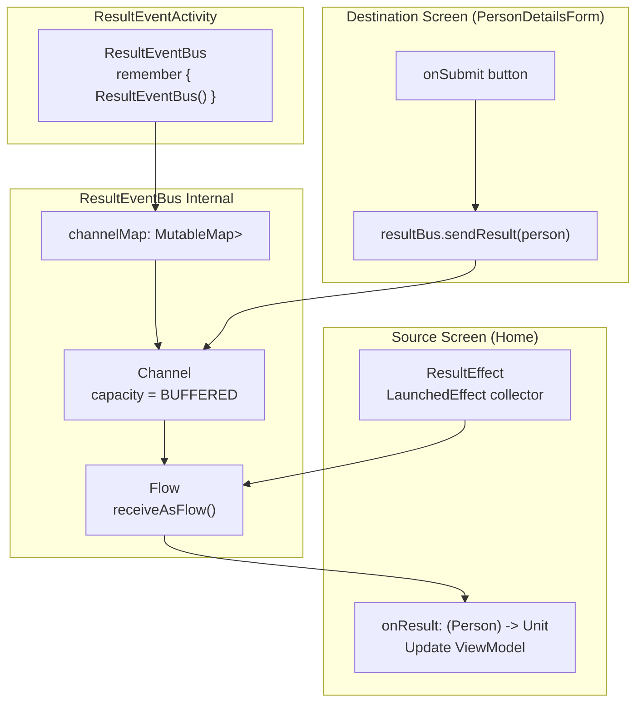
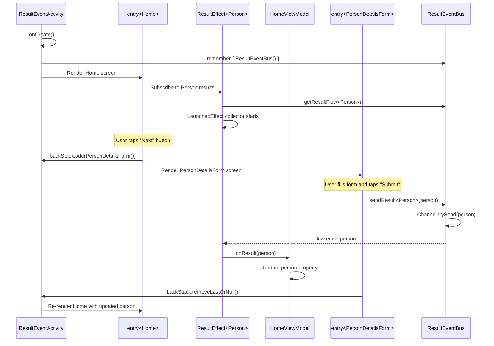
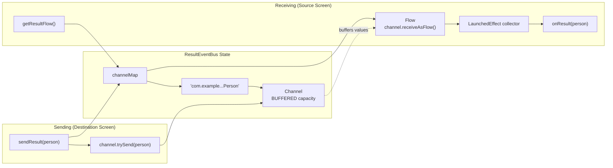
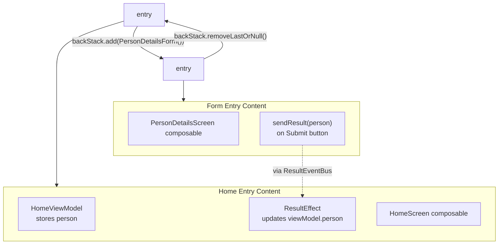

<!-- source: DeepWiki mcp.deepwiki.com · repo android/nav3-recipes · page 8.1 Event-Based Results with ResultEventBus · fetched 2026-10-23 -->

# Event-Based Results

<details>
<summary>Relevant source files</summary>

The following files were used as context for generating this wiki page:

- [app/src/main/java/com/example/nav3recipes/results/event/ResultEffect.kt](app/src/main/java/com/example/nav3recipes/results/event/ResultEffect.kt)
- [app/src/main/java/com/example/nav3recipes/results/event/ResultEventActivity.kt](app/src/main/java/com/example/nav3recipes/results/event/ResultEventActivity.kt)
- [app/src/main/java/com/example/nav3recipes/results/event/ResultEventBus.kt](app/src/main/java/com/example/nav3recipes/results/event/ResultEventBus.kt)
- [app/src/main/java/com/example/nav3recipes/results/state/ResultStateActivity.kt](app/src/main/java/com/example/nav3recipes/results/state/ResultStateActivity.kt)
- [app/src/main/java/com/example/nav3recipes/results/state/ResultStore.kt](app/src/main/java/com/example/nav3recipes/results/state/ResultStore.kt)

</details>


## Purpose and Scope

This document explains the **event-based pattern** for passing results back from destination screens to source screens using `ResultEventBus`, Kotlin Channels, and Flow. This pattern is designed for **asynchronous, one-time result delivery** where the source screen needs to react to an event from a destination screen without persisting the result beyond the immediate handler.

For the alternative **state-based pattern** that uses Compose `MutableState` for synchronous, persistent results, see [State-Based Results](#8.2). For general navigation concepts, see [Core Navigation 3 Concepts](#2.2).

---

## When to Use Event-Based Results

The event-based pattern is appropriate for the following scenarios:

| Use Case | Why Event-Based |
|----------|----------------|
| **Imperative workflows** | You want to execute side effects immediately when the result arrives (e.g., show a toast, trigger an API call) |
| **One-time events** | The result should be consumed once and then discarded, not persisted across recompositions |
| **Fire-and-forget** | The destination screen sends the result without caring if anyone is listening |
| **Asynchronous handling** | You need coroutine-based handling with `suspend` functions |
| **No state persistence needed** | The result doesn't need to survive configuration changes or process death |

**Avoid event-based results when:**
- You need the result to persist across configuration changes
- Multiple composables need to read the same result reactively
- The result should trigger Compose recompositions automatically

For these scenarios, use the state-based pattern instead (see [State-Based Results](#8.2)).

Sources: [app/src/main/java/com/example/nav3recipes/results/event/ResultEventBus.kt:1-84]()

---

## Architecture Overview

The event-based results system consists of three core components that work together to deliver results asynchronously.

### High-Level Component Diagram



**Key Points:**
- `ResultEventBus` is created once per navigation graph and shared across all screens
- The bus maintains a map of result keys to `Channel` instances
- Source screens use `ResultEffect` to subscribe to results via `Flow`
- Destination screens call `sendResult` to emit results into the channel

Sources: [app/src/main/java/com/example/nav3recipes/results/event/ResultEventActivity.kt:38-80](), [app/src/main/java/com/example/nav3recipes/results/event/ResultEventBus.kt:56-84]()

---

## Core Components

### ResultEventBus

The `ResultEventBus` class is the central hub for result passing. It manages a map of result channels and provides methods for sending and receiving results.

**Class Definition:** [app/src/main/java/com/example/nav3recipes/results/event/ResultEventBus.kt:56-84]()

| Member | Type | Purpose |
|--------|------|---------|
| `channelMap` | `MutableMap<String, Channel<Any?>>` | Maps result keys to their corresponding channels |
| `getResultFlow<T>(resultKey)` | `Flow<T>?` | Returns a Flow for collecting results of type `T` |
| `sendResult<T>(resultKey, result)` | `Unit` | Sends a result into the channel for the given key |
| `removeResult<T>(resultKey)` | `Unit` | Removes the channel associated with the key |

**Result Key Generation:**
By default, the result key is the fully qualified class name of the result type `T` (e.g., `"com.example.nav3recipes.results.common.Person"`). This is obtained via `T::class.toString()`.

**Channel Configuration:**
Each channel is created with:
- `capacity = BUFFERED` - Uses the default buffer size (64 elements)
- `onBufferOverflow = BufferOverflow.SUSPEND` - Suspends the sender if the buffer is full

Sources: [app/src/main/java/com/example/nav3recipes/results/event/ResultEventBus.kt:56-84]()

### ResultEffect Composable

The `ResultEffect` composable is a convenience wrapper around `LaunchedEffect` that automatically subscribes to a result flow and invokes a callback when results arrive.

**Function Signature:** [app/src/main/java/com/example/nav3recipes/results/event/ResultEffect.kt:32-43]()

```kotlin
@Composable
inline fun <reified T> ResultEffect(
    resultEventBus: ResultEventBus = LocalResultEventBus.current,
    resultKey: String = T::class.toString(),
    crossinline onResult: suspend (T) -> Unit
)
```

**Parameters:**
- `resultEventBus` - The bus instance; defaults to `LocalResultEventBus.current`
- `resultKey` - The key to listen for; defaults to the type name of `T`
- `onResult` - A suspend lambda invoked for each result received

**Implementation Details:**
The effect uses `LaunchedEffect(resultKey, resultEventBus.channelMap[resultKey])` to restart the collector when:
1. The result key changes
2. The channel instance in the map changes

This ensures the collector always has the latest channel reference.

Sources: [app/src/main/java/com/example/nav3recipes/results/event/ResultEffect.kt:32-43]()

### LocalResultEventBus Composition Local

A composition local is provided for accessing the `ResultEventBus` without explicit passing through the composable hierarchy.

**Usage:**
- **Providing:** `CompositionLocalProvider(LocalResultEventBus provides resultBus)`
- **Consuming:** `LocalResultEventBus.current` or as default parameter in `ResultEffect`

In the recipes, the bus is typically created at the activity level and passed directly to `ResultEffect` rather than using the composition local. The local is provided as an option for more complex hierarchies.

Sources: [app/src/main/java/com/example/nav3recipes/results/event/ResultEventBus.kt:28-50]()

---

## Usage Pattern

### Result Passing Sequence Diagram



### Implementation Steps

**1. Create the ResultEventBus in the Activity**

At the activity level, create and remember the `ResultEventBus` instance:

[app/src/main/java/com/example/nav3recipes/results/event/ResultEventActivity.kt:44]()
```kotlin
val resultBus = remember { ResultEventBus() }
```

**2. Register ResultEffect in the Source Screen**

In the entry where you want to receive results, use `ResultEffect` to register a handler:

[app/src/main/java/com/example/nav3recipes/results/event/ResultEventActivity.kt:57-59]()
```kotlin
ResultEffect<Person>(resultBus) { person ->
    viewModel.person = person
}
```

The handler will be invoked whenever a `Person` result is sent.

**3. Send Results from the Destination Screen**

In the destination screen, call `sendResult` when ready to return a result:

[app/src/main/java/com/example/nav3recipes/results/event/ResultEventActivity.kt:69-72]()
```kotlin
PersonDetailsScreen(
    onSubmit = { person ->
        resultBus.sendResult<Person>(result = person)
        backStack.removeLastOrNull()
    }
)
```

**Important:** Send the result **before** navigating back. This ensures the result is in the channel before the source screen's `ResultEffect` collector becomes active again.

Sources: [app/src/main/java/com/example/nav3recipes/results/event/ResultEventActivity.kt:38-80]()

---

## Implementation Details

### Channel and Flow Mechanics



### Lazy Channel Creation

Channels are created **on demand** when the first `sendResult` call is made for a given result key:

[app/src/main/java/com/example/nav3recipes/results/event/ResultEventBus.kt:72-74]()
```kotlin
if (!channelMap.contains(resultKey)) {
    channelMap[resultKey] = Channel(capacity = BUFFERED, onBufferOverflow = BufferOverflow.SUSPEND)
}
```

This means:
- If no one ever sends a result, no channel is allocated
- The channel persists in the map even after results are consumed
- To clean up, explicitly call `removeResult<T>()`

### Buffer Overflow Behavior

The `BUFFERED` capacity (default 64) means:
- Up to 64 results can be queued before the sender suspends
- For typical use cases (single result per navigation), this is more than sufficient
- If the buffer fills, `trySend` will return `false` without suspending (non-blocking send)

The `SUSPEND` overflow strategy means that if the channel were to use `send()` instead of `trySend()`, it would suspend the sender until buffer space is available. However, the current implementation uses `trySend()`, which never suspends.

Sources: [app/src/main/java/com/example/nav3recipes/results/event/ResultEventBus.kt:60-84]()

### Type Safety and Reified Types

The use of `inline` and `reified` type parameters allows the result key to be automatically derived from the result type:

```kotlin
inline fun <reified T> sendResult(resultKey: String = T::class.toString(), result: T)
```

This provides type-safe result passing without requiring explicit key strings:

```kotlin
// Type-safe: key is "Person" class name
resultBus.sendResult<Person>(result = person)

// Custom key: for multiple Person results with different meanings
resultBus.sendResult<Person>(resultKey = "billing_address", result = billingPerson)
resultBus.sendResult<Person>(resultKey = "shipping_address", result = shippingPerson)
```

Sources: [app/src/main/java/com/example/nav3recipes/results/event/ResultEventBus.kt:71-76]()

---

## Example Walkthrough

The `ResultEventActivity` demonstrates a two-screen flow where a user enters person details and the result is passed back to the home screen.

### Screen Definitions

The example uses two navigation destinations:

| NavKey | Screen Purpose |
|--------|---------------|
| `Home` | Source screen that displays the current `Person` and has a "Next" button |
| `PersonDetailsForm` | Destination screen with a form to enter name and age |

Both are defined in: [app/src/main/java/com/example/nav3recipes/results/common/]()

### Navigation Graph Structure



### Home Screen Entry

[app/src/main/java/com/example/nav3recipes/results/event/ResultEventActivity.kt:55-66]()

The home entry demonstrates the **result receiving side**:

1. **ViewModel Creation:** A `HomeViewModel` is created with a key to survive configuration changes
2. **ResultEffect Registration:** Registers a handler for `Person` results
3. **State Update:** When a result arrives, updates `viewModel.person`
4. **UI Rendering:** Passes the person to `HomeScreen` for display
5. **Navigation:** The "Next" button adds `PersonDetailsForm` to the back stack

### PersonDetailsForm Screen Entry

[app/src/main/java/com/example/nav3recipes/results/event/ResultEventActivity.kt:67-74]()

The form entry demonstrates the **result sending side**:

1. **UI Rendering:** Renders `PersonDetailsScreen` with an `onSubmit` callback
2. **Result Sending:** When the form is submitted, calls `sendResult<Person>(result = person)`
3. **Navigation Back:** Immediately removes itself from the back stack

**Critical Ordering:**
The result must be sent **before** calling `removeLastOrNull()`. This ensures the result is in the channel before the home screen's `ResultEffect` becomes active again.

Sources: [app/src/main/java/com/example/nav3recipes/results/event/ResultEventActivity.kt:38-80]()

---

## Comparison with State-Based Results

The following table summarizes the key differences between event-based and state-based result patterns:

| Aspect | Event-Based (This Page) | State-Based ([#8.2](#8.2)) |
|--------|------------------------|---------------------------|
| **Primary Use Case** | One-time events, imperative workflows | Persistent state, reactive UIs |
| **Storage Mechanism** | `Channel<T>` (Kotlin Coroutines) | `MutableState<T>` (Compose) |
| **Access Pattern** | `Flow<T>` collection via `LaunchedEffect` | Direct property access via `State<T>` |
| **Result Lifetime** | Consumed once and cleared from buffer | Persists until explicitly removed or overwritten |
| **Recomposition** | No automatic recomposition | Automatic recomposition when state changes |
| **Configuration Changes** | Results in channel buffer survive | Results survive if using `rememberSaveable` |
| **Multiple Consumers** | All collectors receive the same result | All readers see the same state value |
| **Async Handling** | Natural with `suspend` functions | Requires additional effects for async work |
| **Type Safety** | Via reified type parameters | Via reified type parameters |
| **Cleanup** | `removeResult<T>()` to clear channel | `removeResult<T>()` to clear state |

### When to Choose Event-Based

Choose event-based results when:
- The result triggers a side effect (e.g., show snackbar, log analytics)
- The result should be consumed exactly once
- You need coroutine-based processing
- The result doesn't affect the UI state directly

### When to Choose State-Based

Choose state-based results when:
- The result should be displayed in the UI
- Multiple composables need to read the result
- You want automatic recomposition when the result changes
- The result should persist across the navigation lifecycle

Sources: [app/src/main/java/com/example/nav3recipes/results/event/ResultEventBus.kt:1-84](), [app/src/main/java/com/example/nav3recipes/results/state/ResultStore.kt:1-100]()

---

## Advanced Topics

### Multiple Result Types

A single `ResultEventBus` can handle multiple result types simultaneously. Each type gets its own channel based on the result key:

```kotlin
// Receive multiple result types
ResultEffect<Person>(resultBus) { person -> 
    viewModel.person = person 
}
ResultEffect<Address>(resultBus) { address -> 
    viewModel.address = address 
}

// Send different result types
resultBus.sendResult<Person>(result = person)
resultBus.sendResult<Address>(result = address)
```

Each result type is isolated in its own channel, preventing type confusion.

### Custom Result Keys

For scenarios where you need multiple results of the same type, provide custom result keys:

```kotlin
// Receive results with custom keys
ResultEffect<Person>(resultBus, resultKey = "owner") { owner -> 
    viewModel.owner = owner 
}
ResultEffect<Person>(resultBus, resultKey = "emergency_contact") { contact -> 
    viewModel.emergencyContact = contact 
}

// Send results with matching keys
resultBus.sendResult<Person>(resultKey = "owner", result = ownerPerson)
resultBus.sendResult<Person>(resultKey = "emergency_contact", result = contactPerson)
```

This pattern is useful for forms that collect multiple entities of the same type.

### Cleanup Considerations

Channels persist in the `channelMap` even after results are consumed. For long-running applications with many different result types, consider periodic cleanup:

```kotlin
// After result is consumed and no longer needed
resultBus.removeResult<Person>()
```

However, for typical navigation flows, cleanup is not necessary as the `ResultEventBus` is scoped to the activity lifecycle.

Sources: [app/src/main/java/com/example/nav3recipes/results/event/ResultEventBus.kt:56-84]()

---

## Summary

The event-based results pattern provides a robust solution for passing one-time results asynchronously between navigation destinations:

- **`ResultEventBus`** manages channels for different result types
- **`ResultEffect`** provides a declarative way to receive results in Compose
- **`sendResult`** sends results from destination screens
- **Type-safe** API using reified generics
- **Buffered channels** handle timing issues between send and receive

For persistent, reactive results that drive UI state, consider the state-based pattern described in [State-Based Results](#8.2).

Sources: [app/src/main/java/com/example/nav3recipes/results/event/ResultEventActivity.kt:1-81](), [app/src/main/java/com/example/nav3recipes/results/event/ResultEventBus.kt:1-84](), [app/src/main/java/com/example/nav3recipes/results/event/ResultEffect.kt:1-43]()

---

