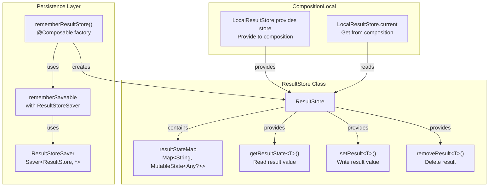
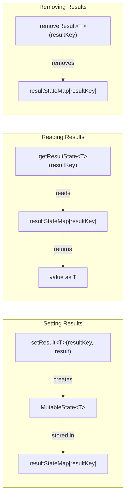
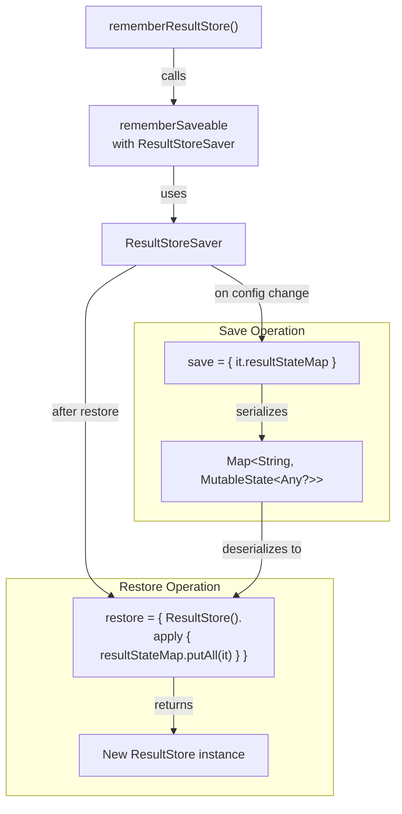
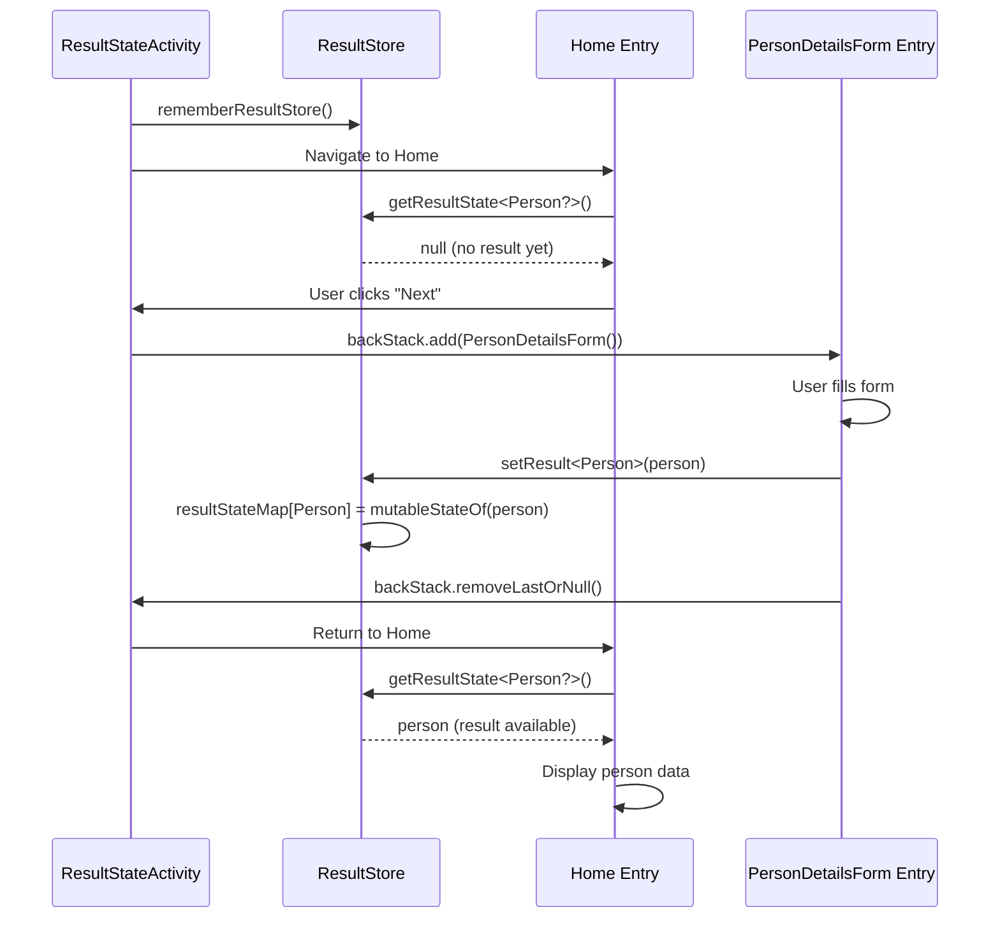
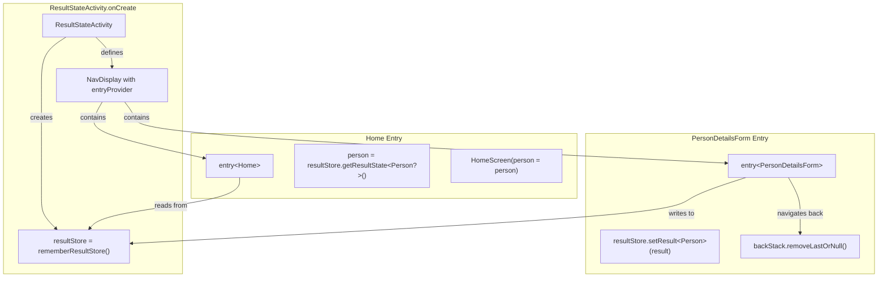
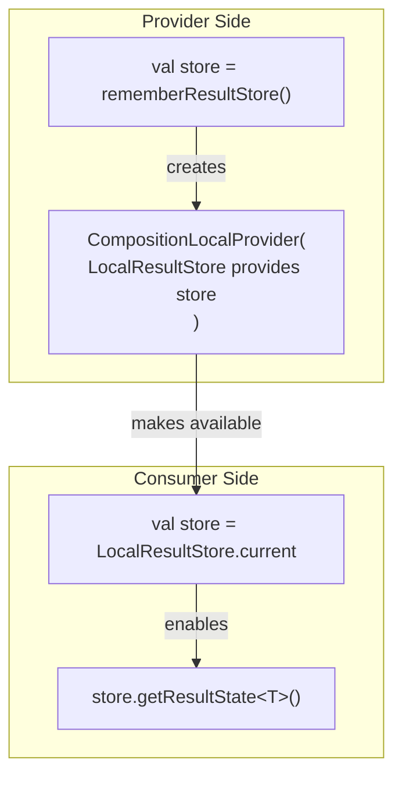
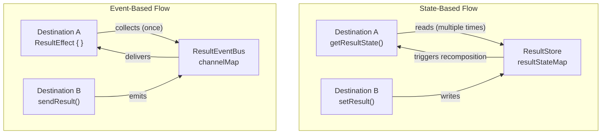

<!-- source: DeepWiki mcp.deepwiki.com · repo android/nav3-recipes · page 8.2 State-Based Results with ResultStore · fetched 2026-10-23 -->

# State-Based Results with ResultStore

<details>
<summary>Relevant source files</summary>

The following files were used as context for generating this wiki page:

- [app/src/main/java/com/example/nav3recipes/results/event/ResultEffect.kt](app/src/main/java/com/example/nav3recipes/results/event/ResultEffect.kt)
- [app/src/main/java/com/example/nav3recipes/results/event/ResultEventActivity.kt](app/src/main/java/com/example/nav3recipes/results/event/ResultEventActivity.kt)
- [app/src/main/java/com/example/nav3recipes/results/event/ResultEventBus.kt](app/src/main/java/com/example/nav3recipes/results/event/ResultEventBus.kt)
- [app/src/main/java/com/example/nav3recipes/results/state/ResultStateActivity.kt](app/src/main/java/com/example/nav3recipes/results/state/ResultStateActivity.kt)
- [app/src/main/java/com/example/nav3recipes/results/state/ResultStore.kt](app/src/main/java/com/example/nav3recipes/results/state/ResultStore.kt)

</details>


## Purpose and Scope

This page documents the state-based approach to passing results between navigation destinations using the `ResultStore` class. This pattern stores results as persistent `MutableState` values that can be read synchronously by any destination in the navigation hierarchy.

For the alternative event-based approach using Channels and Flows, see [Event-Based Results with ResultEventBus](#8.1).

**Sources**: [app/src/main/java/com/example/nav3recipes/results/state/ResultStateActivity.kt:1-73](), [app/src/main/java/com/example/nav3recipes/results/state/ResultStore.kt:1-100]()

---

## Architecture Overview

The `ResultStore` provides a state-based solution for passing results between destinations. Unlike event-based approaches that deliver results once via Channels, state-based results persist in memory and can be read multiple times by multiple destinations.

### ResultStore Component Architecture



**Sources**: [app/src/main/java/com/example/nav3recipes/results/state/ResultStore.kt:67-100]()

---

## ResultStore Class

The `ResultStore` class maintains a map of result keys to mutable state holders. Each result is stored as a `MutableState<Any?>`, enabling automatic recomposition when values change.

### Core Data Structure

| Component | Type | Purpose |
|-----------|------|---------|
| `resultStateMap` | `MutableMap<String, MutableState<Any?>>` | Stores all results indexed by key |
| Result Key | `String` (default: `T::class.toString()`) | Type-based identifier for results |
| Result Value | `MutableState<Any?>` | Observable state holder for the result |

**Sources**: [app/src/main/java/com/example/nav3recipes/results/state/ResultStore.kt:67-93]()

### Result Operations

The `ResultStore` provides three inline reified functions for type-safe result management:



#### setResult<T>

Sets a result for a given key by creating a new `MutableState` and storing it in the map.

```
inline fun <reified T> setResult(resultKey: String = T::class.toString(), result: T)
```

**Sources**: [app/src/main/java/com/example/nav3recipes/results/state/ResultStore.kt:83-85]()

#### getResultState<T>

Retrieves the current value of a result. Returns the value cast to the expected type `T`. If no result exists for the key, this will return `null` (or throw if the cast fails).

```
inline fun <reified T> getResultState(resultKey: String = T::class.toString()) = 
    resultStateMap[resultKey]?.value as T
```

**Sources**: [app/src/main/java/com/example/nav3recipes/results/state/ResultStore.kt:77-78]()

#### removeResult<T>

Removes a result from the store, typically for cleanup purposes.

```
inline fun <reified T> removeResult(resultKey: String = T::class.toString())
```

**Sources**: [app/src/main/java/com/example/nav3recipes/results/state/ResultStore.kt:90-92]()

---

## State Persistence

The `ResultStore` integrates with Compose's `rememberSaveable` to survive configuration changes and process death.

### rememberResultStore Composable

The `rememberResultStore()` function creates a `ResultStore` instance that persists across configuration changes using a custom `Saver`.



**Implementation**:

The `ResultStoreSaver` saves the entire `resultStateMap` and restores it by creating a new `ResultStore` and populating its map.

**Sources**: [app/src/main/java/com/example/nav3recipes/results/state/ResultStore.kt:55-100]()

### Persistence Characteristics

| Survives | State-Based (ResultStore) | Event-Based (ResultEventBus) |
|----------|---------------------------|------------------------------|
| Configuration Changes | ✅ Yes (via rememberSaveable) | ❌ No |
| Process Death | ✅ Yes (via rememberSaveable) | ❌ No |
| Multiple Reads | ✅ Yes | ❌ No (consumed on read) |

**Sources**: [app/src/main/java/com/example/nav3recipes/results/state/ResultStore.kt:56-60](), [app/src/main/java/com/example/nav3recipes/results/event/ResultEventBus.kt:56-84]()

---

## Usage Example

The `ResultStateActivity` demonstrates a typical implementation where a form destination sets a result that is read by the calling destination.

### Complete Flow



**Sources**: [app/src/main/java/com/example/nav3recipes/results/state/ResultStateActivity.kt:38-73]()

### Code Structure Mapping



**Sources**: [app/src/main/java/com/example/nav3recipes/results/state/ResultStateActivity.kt:42-72]()

### Setting Results in Child Destination

In the `PersonDetailsForm` entry, results are set before navigating back:

```kotlin
entry<PersonDetailsForm> {
    PersonDetailsScreen(
        onSubmit = { person ->
            resultStore.setResult<Person>(result = person)
            backStack.removeLastOrNull()
        }
    )
}
```

**Sources**: [app/src/main/java/com/example/nav3recipes/results/state/ResultStateActivity.kt:60-67]()

### Reading Results in Parent Destination

In the `Home` entry, results are read synchronously as a regular state value:

```kotlin
entry<Home> {
    val person = resultStore.getResultState<Person?>()
    HomeScreen(
        person = person,
        onNext = { backStack.add(PersonDetailsForm()) }
    )
}
```

The `person` value triggers recomposition when it changes because `getResultState` reads from a `MutableState`.

**Sources**: [app/src/main/java/com/example/nav3recipes/results/state/ResultStateActivity.kt:53-59]()

---

## CompositionLocal Provider Pattern

While not used in `ResultStateActivity`, the `LocalResultStore` provides an optional mechanism to access the `ResultStore` from deeply nested composables without explicit parameter passing.

### LocalResultStore API



### Usage Pattern

**Provider**:
```kotlin
val resultStore = rememberResultStore()
CompositionLocalProvider(LocalResultStore provides resultStore) {
    // Composable hierarchy
}
```

**Consumer**:
```kotlin
@Composable
fun SomeNestedComposable() {
    val store = LocalResultStore.current
    val result = store.getResultState<MyType>()
}
```

**Sources**: [app/src/main/java/com/example/nav3recipes/results/state/ResultStore.kt:31-50]()

---

## State-Based vs Event-Based Comparison

### Architectural Differences

| Aspect | State-Based (ResultStore) | Event-Based (ResultEventBus) |
|--------|---------------------------|------------------------------|
| Storage Mechanism | `MutableState<Any?>` | `Channel<Any?>` |
| Delivery Model | Persistent state | One-time event |
| Reading Pattern | Synchronous property access | Asynchronous Flow collection |
| Multiple Reads | ✅ Supported | ❌ Consumed on first read |
| Compose Integration | Native `MutableState` | Requires `LaunchedEffect` |
| Persistence | ✅ rememberSaveable support | ❌ Not survives config changes |

**Sources**: [app/src/main/java/com/example/nav3recipes/results/state/ResultStore.kt:67-93](), [app/src/main/java/com/example/nav3recipes/results/event/ResultEventBus.kt:56-84]()

### Data Flow Comparison



**Sources**: [app/src/main/java/com/example/nav3recipes/results/state/ResultStateActivity.kt:53-67](), [app/src/main/java/com/example/nav3recipes/results/event/ResultEventActivity.kt:55-74]()

### Use Case Recommendations

**Choose State-Based (ResultStore) when**:
- Results need to survive configuration changes
- Multiple destinations need to read the same result
- You want synchronous state access
- Results represent persistent application state

**Choose Event-Based (ResultEventBus) when**:
- Results represent one-time events (e.g., "item deleted", "payment completed")
- You want to ensure results are only processed once
- You need to handle results asynchronously
- Results should not persist across navigation changes

**Sources**: [app/src/main/java/com/example/nav3recipes/results/state/ResultStore.kt:63-65](), [app/src/main/java/com/example/nav3recipes/results/event/ResultEventBus.kt:52-54]()

---

## Type Safety and Result Keys

Both `ResultStore` and `ResultEventBus` use inline reified functions with default result keys based on the type's fully qualified name.

### Default Key Generation

```kotlin
inline fun <reified T> getResultState(resultKey: String = T::class.toString())
```

For `Person` class, the default key would be: `"com.example.nav3recipes.results.common.Person"`

### Custom Result Keys

You can provide custom keys when you need multiple results of the same type:

```kotlin
// Set multiple Person results with different keys
resultStore.setResult<Person>(resultKey = "person1", result = person1)
resultStore.setResult<Person>(resultKey = "person2", result = person2)

// Read specific results
val person1 = resultStore.getResultState<Person>(resultKey = "person1")
val person2 = resultStore.getResultState<Person>(resultKey = "person2")
```

**Sources**: [app/src/main/java/com/example/nav3recipes/results/state/ResultStore.kt:77-92]()

---

## Implementation Checklist

To implement state-based results in your navigation code:

1. **Create ResultStore**: Use `rememberResultStore()` at the activity/root level
2. **Pass to NavDisplay**: Make the store available to entry providers (directly or via CompositionLocal)
3. **Set Results**: Call `resultStore.setResult<T>(result)` before navigating back
4. **Read Results**: Call `resultStore.getResultState<T>()` in receiving destinations
5. **Clean Up** (optional): Call `resultStore.removeResult<T>()` when results are no longer needed

**Sources**: [app/src/main/java/com/example/nav3recipes/results/state/ResultStateActivity.kt:38-73]()

---

