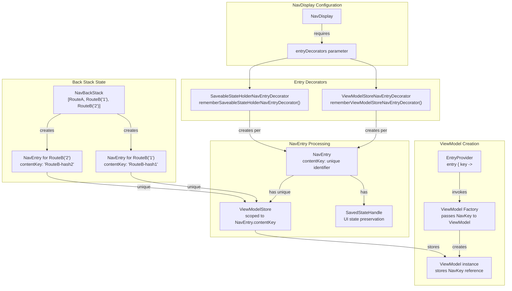
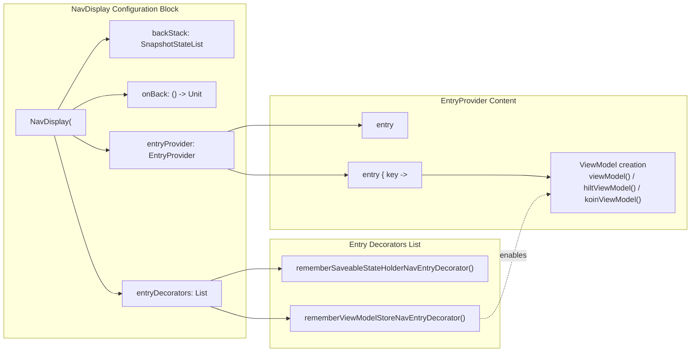
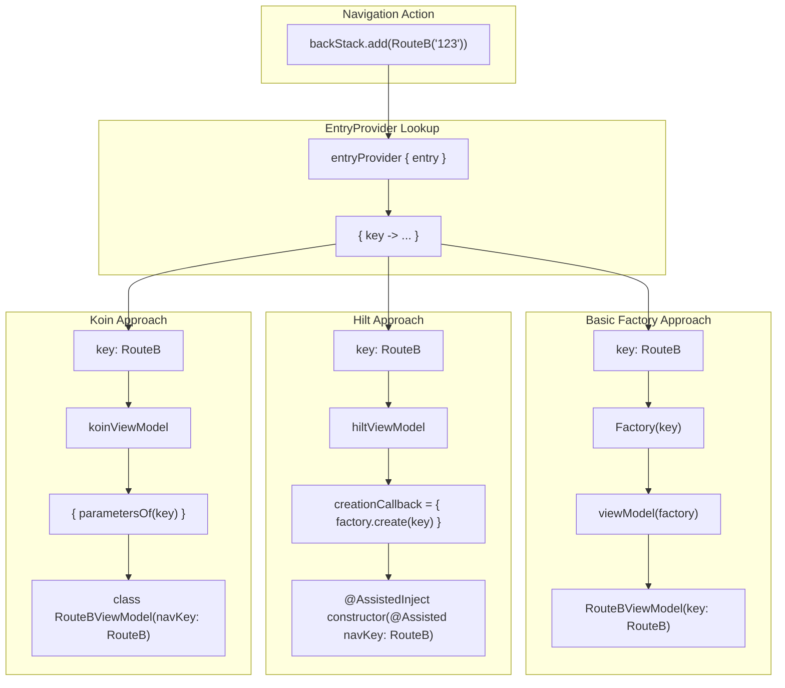
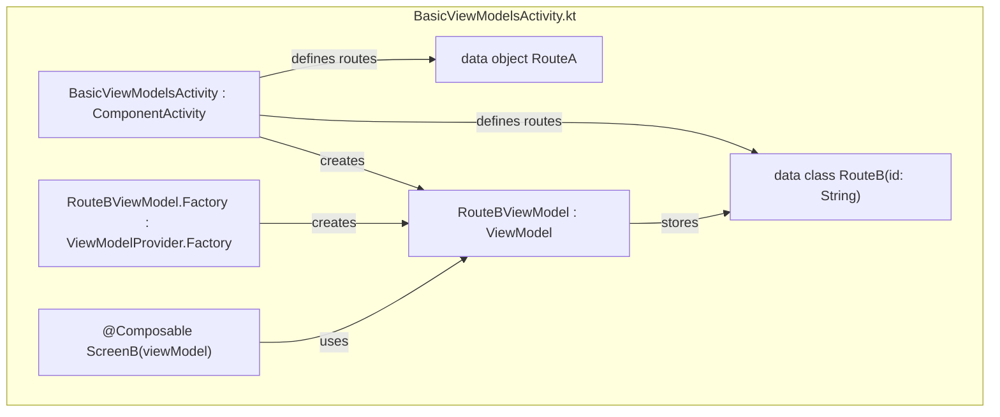
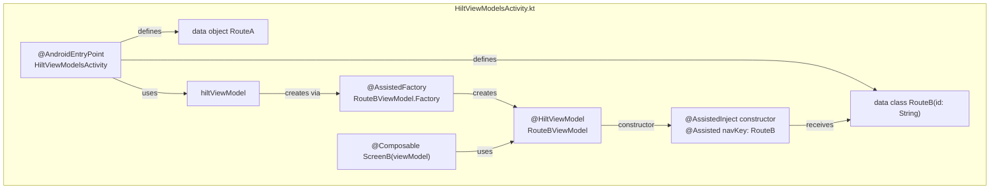
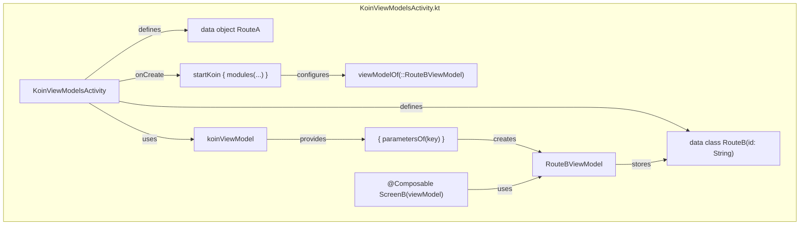

<!-- source: DeepWiki mcp.deepwiki.com · repo android/nav3-recipes · page 9 ViewModel Integration · fetched 2026-10-23 -->

# ViewModel Integration

<details>
<summary>Relevant source files</summary>

The following files were used as context for generating this wiki page:

- [app/src/main/java/com/example/nav3recipes/material/listdetail/MaterialListDetailActivity.kt](app/src/main/java/com/example/nav3recipes/material/listdetail/MaterialListDetailActivity.kt)
- [app/src/main/java/com/example/nav3recipes/material/supportingpane/MaterialSupportingPaneActivity.kt](app/src/main/java/com/example/nav3recipes/material/supportingpane/MaterialSupportingPaneActivity.kt)
- [app/src/main/java/com/example/nav3recipes/modular/hilt/CommonModule.kt](app/src/main/java/com/example/nav3recipes/modular/hilt/CommonModule.kt)
- [app/src/main/java/com/example/nav3recipes/passingarguments/viewmodels/basic/BasicViewModelsActivity.kt](app/src/main/java/com/example/nav3recipes/passingarguments/viewmodels/basic/BasicViewModelsActivity.kt)
- [app/src/main/java/com/example/nav3recipes/passingarguments/viewmodels/hilt/HiltViewModelsActivity.kt](app/src/main/java/com/example/nav3recipes/passingarguments/viewmodels/hilt/HiltViewModelsActivity.kt)
- [app/src/main/java/com/example/nav3recipes/passingarguments/viewmodels/koin/KoinViewModelsActivity.kt](app/src/main/java/com/example/nav3recipes/passingarguments/viewmodels/koin/KoinViewModelsActivity.kt)

</details>


This page explains how to integrate Android Architecture Components ViewModels with Navigation 3, focusing on passing navigation arguments to ViewModels and managing ViewModel lifecycle per navigation entry. Three approaches are demonstrated: manual Factory creation, Hilt compile-time dependency injection, and Koin runtime dependency injection. For general state persistence patterns not involving ViewModels, see [Saveable Back Stack](#3.3). For passing data between destinations without ViewModels, see [Result Passing Between Destinations](#8).

## ViewModelStore Scoping with NavEntryDecorator

Navigation 3 uses `ViewModelStoreNavEntryDecorator` to provide unique `ViewModelStore` instances per `NavEntry`, ensuring each navigation destination instance receives its own ViewModel even when multiple instances of the same route type exist in the back stack. Without this decorator, navigating to the same route type multiple times (e.g., `RouteB("1")` then `RouteB("2")`) would reuse the same ViewModel instance, causing incorrect state sharing.

### ViewModel Lifecycle Architecture



**Sources:**
- [app/src/main/java/com/example/nav3recipes/passingarguments/viewmodels/basic/BasicViewModelsActivity.kt:54-61]()
- [app/src/main/java/com/example/nav3recipes/passingarguments/viewmodels/hilt/HiltViewModelsActivity.kt:60-67]()
- [app/src/main/java/com/example/nav3recipes/passingarguments/viewmodels/koin/KoinViewModelsActivity.kt:64-67]()

The decorator system ensures that when `RouteB("1")` and `RouteB("2")` are both in the back stack, each receives a distinct `ViewModelStore` identified by `NavEntry.contentKey`. This eliminates the need to manually provide a `key` parameter to `viewModel()`, `hiltViewModel()`, or `koinViewModel()` functions, as the decorator automatically supplies unique keys based on the navigation entry.

## ViewModel Creation Approaches

Navigation 3 supports three patterns for creating ViewModels with navigation arguments:

| Approach | DI Framework | Compilation Phase | Factory Pattern | Use Case |
|----------|--------------|-------------------|-----------------|----------|
| Basic Factory | None | N/A | `ViewModelProvider.Factory` | Simple apps, no DI framework |
| Hilt Injection | Hilt (Dagger) | Compile-time (KSP) | `@AssistedFactory` | Large apps, compile-time safety |
| Koin Injection | Koin | Runtime | `parametersOf()` | Quick prototyping, runtime flexibility |

For detailed implementation of each approach:
- [Basic ViewModels with Factory](#9.1)
- [Hilt Injected ViewModels](#9.2)
- [Koin Injected ViewModels](#9.3)

## Common Configuration Requirements

All three ViewModel integration approaches require identical `NavDisplay` configuration to enable proper ViewModel lifecycle management.

### Required NavDisplay Setup



**Sources:**
- [app/src/main/java/com/example/nav3recipes/passingarguments/viewmodels/basic/BasicViewModelsActivity.kt:51-89]()
- [app/src/main/java/com/example/nav3recipes/passingarguments/viewmodels/hilt/HiltViewModelsActivity.kt:56-100]()
- [app/src/main/java/com/example/nav3recipes/passingarguments/viewmodels/koin/KoinViewModelsActivity.kt:56-90]()

### Decorator Order and Purpose

The `entryDecorators` parameter must include both decorators in the following order:

1. **`rememberSaveableStateHolderNavEntryDecorator()`**: Provides `rememberSaveable` functionality for UI state persistence across configuration changes
2. **`rememberViewModelStoreNavEntryDecorator()`**: Provides unique `ViewModelStore` per navigation entry, enabling ViewModel scoping

The order matters because `SaveableStateHolderNavEntryDecorator` must establish UI state context before ViewModels are created.

## NavKey to ViewModel Argument Passing

All three approaches follow the same pattern of receiving the typed `NavKey` in the `entry<T>` lambda and passing it to the ViewModel constructor, though the mechanism differs by framework.

### Argument Flow Pattern



**Sources:**
- [app/src/main/java/com/example/nav3recipes/passingarguments/viewmodels/basic/BasicViewModelsActivity.kt:76-86]()
- [app/src/main/java/com/example/nav3recipes/passingarguments/viewmodels/hilt/HiltViewModelsActivity.kt:82-97]()
- [app/src/main/java/com/example/nav3recipes/passingarguments/viewmodels/koin/KoinViewModelsActivity.kt:82-87]()

### ViewModel Property Naming Conventions

The three recipe examples use different property names for storing the `NavKey`:

| Approach | Property Name | Example |
|----------|---------------|---------|
| Basic Factory | `key` | `viewModel.key.id` |
| Hilt | `navKey` | `viewModel.navKey.id` |
| Koin | `navKey` | `viewModel.navKey.id` |

This inconsistency across recipes is purely stylistic. The property can be named `key`, `navKey`, `route`, or any descriptive identifier. The important pattern is that the ViewModel constructor receives the typed `NavKey` instance and stores it as a property for use in ViewModel logic.

## Code Entity Reference Map

### Basic Factory Pattern Classes



**Sources:**
- [app/src/main/java/com/example/nav3recipes/passingarguments/viewmodels/basic/BasicViewModelsActivity.kt:39-109]()

### Hilt Pattern Classes



**Sources:**
- [app/src/main/java/com/example/nav3recipes/passingarguments/viewmodels/hilt/HiltViewModelsActivity.kt:44-119]()

### Koin Pattern Classes



**Sources:**
- [app/src/main/java/com/example/nav3recipes/passingarguments/viewmodels/koin/KoinViewModelsActivity.kt:30-99]()

## Framework-Specific Configuration

### Hilt Requirements

Hilt integration requires the Activity to be annotated with `@AndroidEntryPoint`:

```kotlin
@AndroidEntryPoint
class HiltViewModelsActivity : ComponentActivity()
```

This annotation enables Hilt's compile-time code generation for dependency injection within the Activity and its composable hierarchy. The `hiltViewModel()` composable function requires this annotation to be present.

**Sources:**
- [app/src/main/java/com/example/nav3recipes/passingarguments/viewmodels/hilt/HiltViewModelsActivity.kt:47-48]()

### Koin Initialization

Koin requires initialization in `Activity.onCreate()` (or preferably in `Application.onCreate()` for production apps):

```kotlin
override fun onCreate(savedInstanceState: Bundle?) {
    if (KoinPlatform.getKoinOrNull() != null) {
        stopKoin()
    }
    startKoin {
        androidContext(this@KoinViewModelsActivity)
        modules(
            module {
                viewModelOf(::RouteBViewModel)
            }
        )
    }
    // ...
}
```

The recipe includes `stopKoin()` to prevent conflicts when multiple Koin-based recipes run in the same process. Production apps should initialize Koin once in `Application.onCreate()` and avoid stopping/restarting.

**Sources:**
- [app/src/main/java/com/example/nav3recipes/passingarguments/viewmodels/koin/KoinViewModelsActivity.kt:35-49]()

## Approach Selection Criteria

| Criteria | Basic Factory | Hilt | Koin |
|----------|---------------|------|------|
| Build configuration | No additional dependencies | Requires KSP plugin, Hilt Gradle plugin | Requires Koin dependencies |
| Compilation time | Fast (no code generation) | Slow (KSP annotation processing) | Fast (no code generation) |
| Runtime overhead | Minimal | Minimal (generated at compile-time) | Moderate (reflection at runtime) |
| Type safety | Manual factory code | Compile-time verification | Runtime verification |
| Learning curve | Low (standard Android APIs) | High (Dagger/Hilt concepts) | Medium (Koin DSL) |
| Boilerplate | High (manual factory classes) | Medium (annotations + factory interface) | Low (DSL registration) |
| Suitable for | Prototypes, simple apps | Large production apps | Medium apps, rapid development |
| Multi-module support | Manual wiring | Native support via Hilt modules | Native support via Koin modules |

Choose **Basic Factory** for simple apps or when avoiding DI frameworks. Choose **Hilt** for large-scale production apps requiring compile-time safety and multi-module architecture. Choose **Koin** for medium-sized apps prioritizing development speed and runtime flexibility.

---

