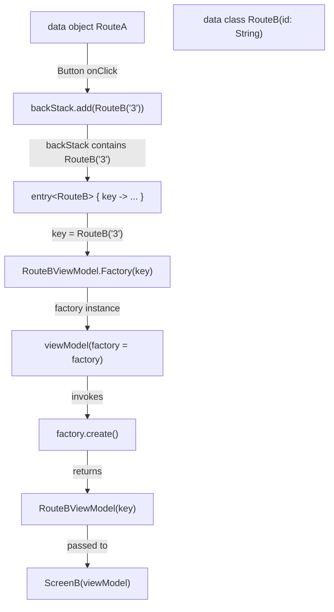
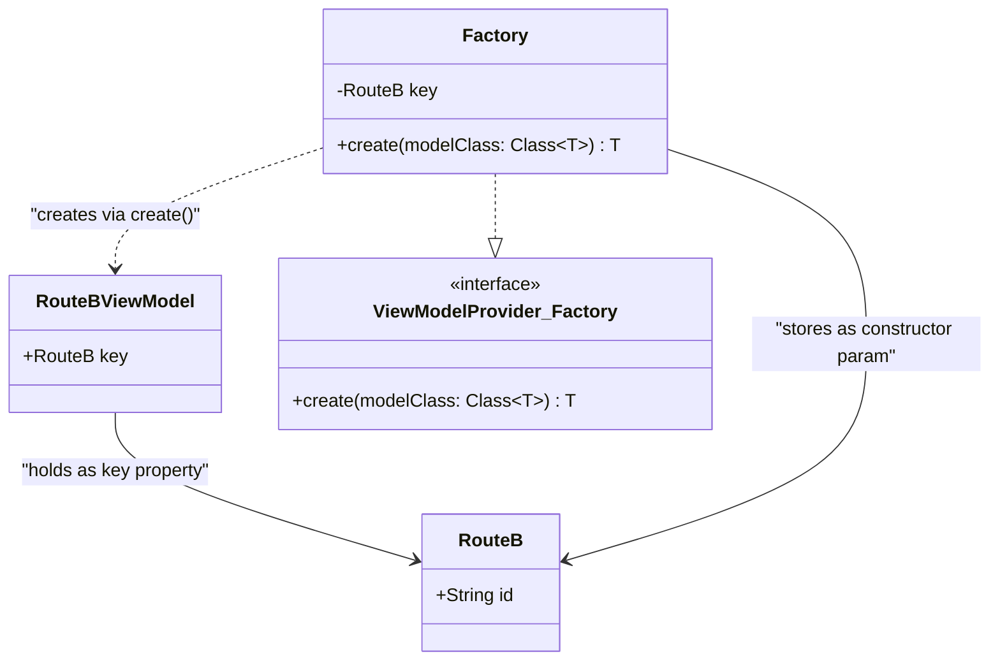
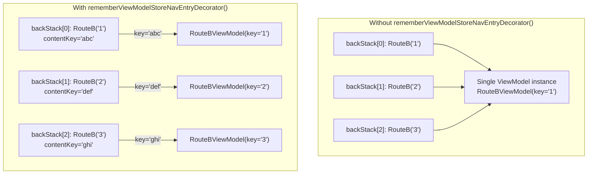
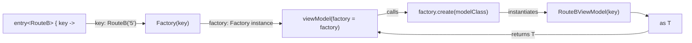
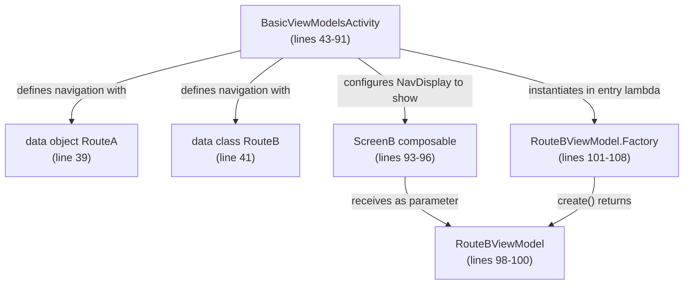

<!-- source: DeepWiki mcp.deepwiki.com · repo android/nav3-recipes · page 9.1 Basic ViewModels with Factory · fetched 2026-10-23 -->

# Basic ViewModels with Factory

<details>
<summary>Relevant source files</summary>

The following files were used as context for generating this wiki page:

- [app/src/main/java/com/example/nav3recipes/material/listdetail/MaterialListDetailActivity.kt](app/src/main/java/com/example/nav3recipes/material/listdetail/MaterialListDetailActivity.kt)
- [app/src/main/java/com/example/nav3recipes/material/supportingpane/MaterialSupportingPaneActivity.kt](app/src/main/java/com/example/nav3recipes/material/supportingpane/MaterialSupportingPaneActivity.kt)
- [app/src/main/java/com/example/nav3recipes/modular/hilt/CommonModule.kt](app/src/main/java/com/example/nav3recipes/modular/hilt/CommonModule.kt)
- [app/src/main/java/com/example/nav3recipes/passingarguments/viewmodels/basic/BasicViewModelsActivity.kt](app/src/main/java/com/example/nav3recipes/passingarguments/viewmodels/basic/BasicViewModelsActivity.kt)
- [app/src/main/java/com/example/nav3recipes/passingarguments/viewmodels/hilt/HiltViewModelsActivity.kt](app/src/main/java/com/example/nav3recipes/passingarguments/viewmodels/hilt/HiltViewModelsActivity.kt)
- [app/src/main/java/com/example/nav3recipes/passingarguments/viewmodels/koin/KoinViewModelsActivity.kt](app/src/main/java/com/example/nav3recipes/passingarguments/viewmodels/koin/KoinViewModelsActivity.kt)

</details>


## Purpose and Scope

This page demonstrates manual ViewModel creation with navigation arguments using Android's `ViewModelProvider.Factory` pattern. Navigation keys containing parameters (e.g., `RouteB(id: String)`) are passed to ViewModels through factory classes that implement `ViewModelProvider.Factory`.

This approach requires no dependency injection framework. For DI-based ViewModel integration, see Hilt [9.2](#9.2) or Koin [9.3](#9.3). For decorator system details, see [12.4](#12.4).

**Sources:** [app/src/main/java/com/example/nav3recipes/passingarguments/viewmodels/basic/BasicViewModelsActivity.kt:1-109]()

---

## Problem: Passing NavKey Parameters to ViewModels

Navigation keys often contain route parameters. A detail screen `RouteB(id: String)` needs to access the `id` parameter inside its ViewModel. The standard `viewModel()` composable does not accept constructor arguments, requiring a custom `ViewModelProvider.Factory` implementation.

**Sources:** [app/src/main/java/com/example/nav3recipes/passingarguments/viewmodels/basic/BasicViewModelsActivity.kt:76-86]()

---

## Recipe Architecture

`BasicViewModelsActivity` demonstrates passing route parameters to ViewModels through a factory:

1. `RouteA` (data object) displays buttons numbered 0-9
2. Button click executes `backStack.add(RouteB("$i"))` 
3. `entry<RouteB>` lambda receives `key: RouteB` parameter
4. Factory is instantiated: `RouteBViewModel.Factory(key)`
5. `viewModel(factory = ...)` calls `factory.create()` 
6. `RouteBViewModel(key)` is constructed with the route parameter

**Navigation flow: RouteA → backStack.add() → entry<RouteB> → Factory → ViewModel**



**Diagram: Code-level navigation flow from button click to ViewModel instantiation**

**Sources:** [app/src/main/java/com/example/nav3recipes/passingarguments/viewmodels/basic/BasicViewModelsActivity.kt:39-41](), [app/src/main/java/com/example/nav3recipes/passingarguments/viewmodels/basic/BasicViewModelsActivity.kt:67-74](), [app/src/main/java/com/example/nav3recipes/passingarguments/viewmodels/basic/BasicViewModelsActivity.kt:76-86]()

---

## Key Components

### Route Definitions

| Route | Type | Parameters | Purpose |
|-------|------|------------|---------|
| `RouteA` | `data object` | None | Home screen with list of navigation options |
| `RouteB` | `data class` | `id: String` | Detail screen that displays the ID parameter |

**Sources:** [app/src/main/java/com/example/nav3recipes/passingarguments/viewmodels/basic/BasicViewModelsActivity.kt:39-41]()

### RouteBViewModel and Factory Implementation

The `RouteBViewModel` class holds the `RouteB` navigation key as a constructor parameter. The nested `Factory` class implements `ViewModelProvider.Factory` to enable instantiation with custom arguments.

**ViewModel class structure (lines 98-100):**
```
class RouteBViewModel(val key: RouteB) : ViewModel()
```

**Factory class structure (lines 101-108):**
```
class Factory(private val key: RouteB) : ViewModelProvider.Factory {
    override fun <T : ViewModel> create(modelClass: Class<T>): T {
        return RouteBViewModel(key) as T
    }
}
```



**Diagram: Class relationships between Factory, ViewModel, and route key**

The factory stores the `RouteB` key from its constructor and returns `RouteBViewModel(key) as T` from the `create()` method. Type casting to `T` satisfies the generic return type.

**Sources:** [app/src/main/java/com/example/nav3recipes/passingarguments/viewmodels/basic/BasicViewModelsActivity.kt:98-108]()

---

## ViewModelStoreNavEntryDecorator Requirement

The `rememberViewModelStoreNavEntryDecorator()` decorator is required to prevent ViewModel instance sharing. Without it, `viewModel()` uses the ViewModel class type as the default key, causing all `RouteB` instances to share a single `RouteBViewModel`.

The decorator uses `NavEntry.contentKey` (unique per back stack entry) as the ViewModel key, ensuring each navigation entry gets its own ViewModel instance.



**Diagram: ViewModel scoping behavior with and without ViewModelStoreNavEntryDecorator**

**Sources:** [app/src/main/java/com/example/nav3recipes/passingarguments/viewmodels/basic/BasicViewModelsActivity.kt:54-61](), [app/src/main/java/com/example/nav3recipes/passingarguments/viewmodels/basic/BasicViewModelsActivity.kt:77-84]()

---

## Implementation Sequence

```mermaid
sequenceDiagram
    participant User
    participant Button as "Button onClick"
    participant BackStack as "backStack: MutableStateList"
    participant NavDisplay as "NavDisplay composable"
    participant EntryLambda as "entry&lt;RouteB&gt; lambda"
    participant Factory as "RouteBViewModel.Factory"
    participant ViewModelFn as "viewModel() function"
    participant ViewModel as "RouteBViewModel instance"
    participant ScreenB as "ScreenB(@Composable)"
    
    User->>Button: Click button "5"
    Button->>BackStack: backStack.add(RouteB("5"))
    BackStack->>NavDisplay: Recompose with new backStack
    NavDisplay->>EntryLambda: Invoke entry&lt;RouteB&gt; { key ->
    Note over EntryLambda: key = RouteB(id="5")
    EntryLambda->>Factory: Factory(key)
    Factory->>Factory: Store key: RouteB("5")
    EntryLambda->>ViewModelFn: viewModel(factory = factory)
    ViewModelFn->>Factory: create(RouteBViewModel::class.java)
    Factory->>ViewModel: return RouteBViewModel(key) as T
    EntryLambda->>ScreenB: ScreenB(viewModel = viewModel)
    ScreenB->>User: Display "Route id: 5"
```

**Diagram: Execution sequence from button click to screen rendering**

**Sources:** [app/src/main/java/com/example/nav3recipes/passingarguments/viewmodels/basic/BasicViewModelsActivity.kt:67-86]()

---

## Entry Decorators Configuration

Both decorators must be explicitly provided to `NavDisplay` when using ViewModels:

| Decorator | Purpose | Code Location |
|-----------|---------|---------------|
| `rememberSaveableStateHolderNavEntryDecorator()` | Provides `SavedStateRegistry` for UI state persistence | Line 59 |
| `rememberViewModelStoreNavEntryDecorator()` | Provides `ViewModelStore` scoped per `NavEntry.contentKey` | Line 60 |

Configuration at [app/src/main/java/com/example/nav3recipes/passingarguments/viewmodels/basic/BasicViewModelsActivity.kt:58-61]():

```
entryDecorators = listOf(
    rememberSaveableStateHolderNavEntryDecorator(),
    rememberViewModelStoreNavEntryDecorator()
)
```

The `ViewModelStoreNavEntryDecorator` prevents instance sharing by scoping `ViewModelStore` per navigation entry instead of per Activity.

**Sources:** [app/src/main/java/com/example/nav3recipes/passingarguments/viewmodels/basic/BasicViewModelsActivity.kt:54-61]()

---

## Factory Pattern Implementation

The factory pattern bridges the gap between parameterless `viewModel()` function and parameterized ViewModel constructors:



**Diagram: Factory pattern execution flow**

Implementation steps at [app/src/main/java/com/example/nav3recipes/passingarguments/viewmodels/basic/BasicViewModelsActivity.kt:76-86]():

1. `entry<RouteB> { key ->` lambda receives route parameter
2. `Factory(key)` constructor stores navigation key
3. `viewModel(factory = Factory(key))` invokes factory
4. `create()` method constructs `RouteBViewModel(key)`
5. Type cast `as T` returns properly typed instance

**Sources:** [app/src/main/java/com/example/nav3recipes/passingarguments/viewmodels/basic/BasicViewModelsActivity.kt:76-86](), [app/src/main/java/com/example/nav3recipes/passingarguments/viewmodels/basic/BasicViewModelsActivity.kt:101-108]()

---

## Comparison with Dependency Injection Approaches

| Aspect | Basic Factory (9.1) | Hilt (9.2) | Koin (9.3) |
|--------|---------------------|-----------|-----------|
| **Framework** | None | Dagger/Hilt (compile-time) | Koin (runtime) |
| **Factory Implementation** | Manual `Factory : ViewModelProvider.Factory` | `@AssistedFactory` annotation | Built-in via `parametersOf()` |
| **ViewModel Annotation** | None | `@HiltViewModel` + `@AssistedInject` | None |
| **Activity Annotation** | None | `@AndroidEntryPoint` | None |
| **Creation Syntax** | `viewModel(factory = Factory(key))` | `hiltViewModel<VM, Factory>(creationCallback = { ... })` | `koinViewModel { parametersOf(key) }` |
| **Build Configuration** | None | KSP annotation processing | Koin module initialization |
| **Boilerplate** | Factory class per ViewModel | Annotations + assisted factory interface | Module DSL with `viewModelOf()` |

Use manual factory when:
- Project has no DI framework
- Minimal ViewModels need arguments
- Explicit factory control is required
- Avoiding annotation processing overhead

**Sources:** [app/src/main/java/com/example/nav3recipes/passingarguments/viewmodels/basic/BasicViewModelsActivity.kt:98-108](), [app/src/main/java/com/example/nav3recipes/passingarguments/viewmodels/hilt/HiltViewModelsActivity.kt:109-118](), [app/src/main/java/com/example/nav3recipes/passingarguments/viewmodels/koin/KoinViewModelsActivity.kt:83-86]()

---

## Code Organization

Single file structure: [app/src/main/java/com/example/nav3recipes/passingarguments/viewmodels/basic/BasicViewModelsActivity.kt:1-109]()

| Component | Lines | Type | Purpose |
|-----------|-------|------|---------|
| `RouteA` | 39 | `data object` | Navigation key for home screen |
| `RouteB` | 41 | `data class` | Navigation key with `id: String` parameter |
| `BasicViewModelsActivity` | 43-91 | `ComponentActivity` | Configures `NavDisplay` with decorators and entry provider |
| `ScreenB` | 93-96 | `@Composable` | Displays ViewModel data: `viewModel.key.id` |
| `RouteBViewModel` | 98-100 | `ViewModel` | Holds `key: RouteB` property |
| `RouteBViewModel.Factory` | 101-108 | `ViewModelProvider.Factory` | Implements `create()` to instantiate ViewModel with key |



**Diagram: File component structure and dependencies**

**Sources:** [app/src/main/java/com/example/nav3recipes/passingarguments/viewmodels/basic/BasicViewModelsActivity.kt:1-109]()

---

## Running the Recipe

1. Launch the nav3-recipes application
2. Select "Basic ViewModels" from the recipe list
3. Observe the list of numbered buttons on RouteA
4. Tap any button (e.g., "3")
5. RouteB displays with "Route id: 3"
6. The ViewModel correctly receives the navigation parameter
7. Use system back to return to RouteA
8. Navigate to different IDs to verify each creates a distinct ViewModel instance

**Sources:** [app/src/main/java/com/example/nav3recipes/passingarguments/viewmodels/basic/BasicViewModelsActivity.kt:63-86]()

---

