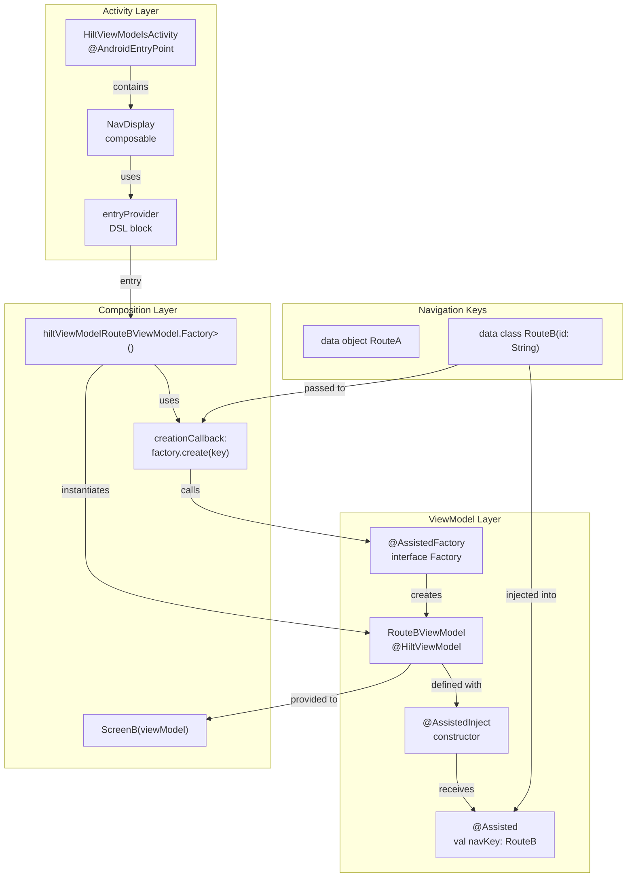
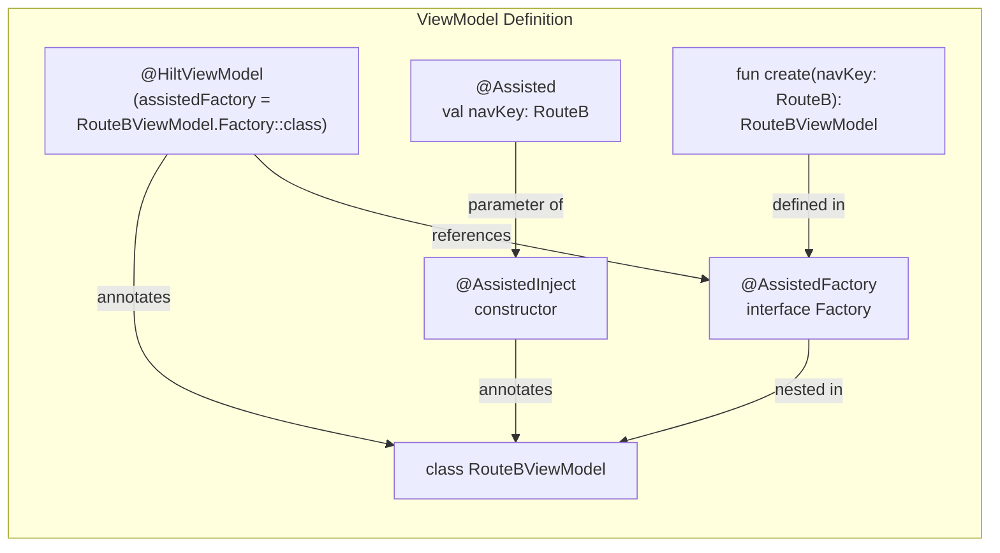
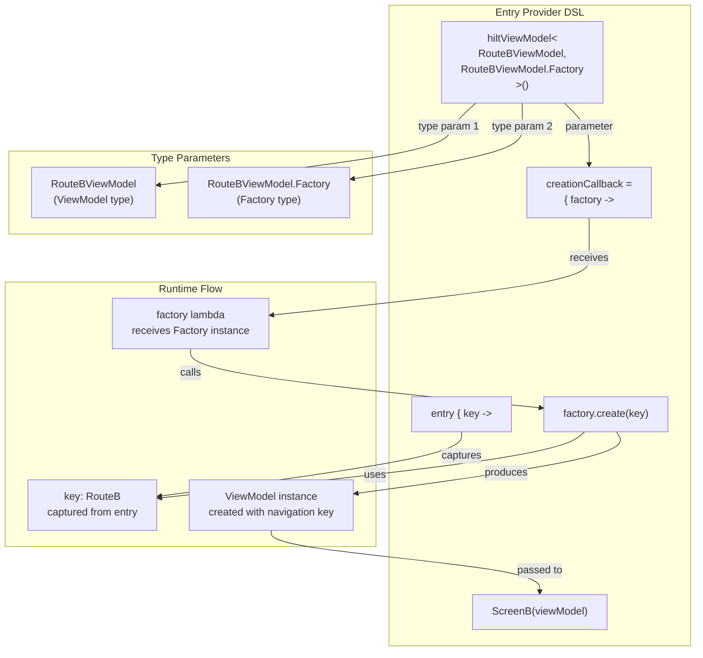
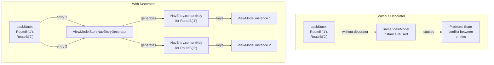
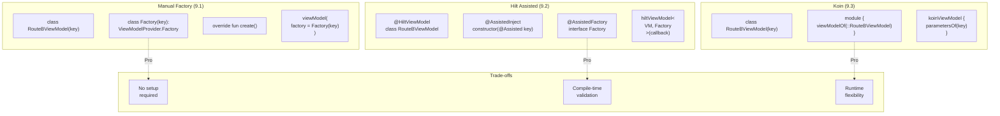
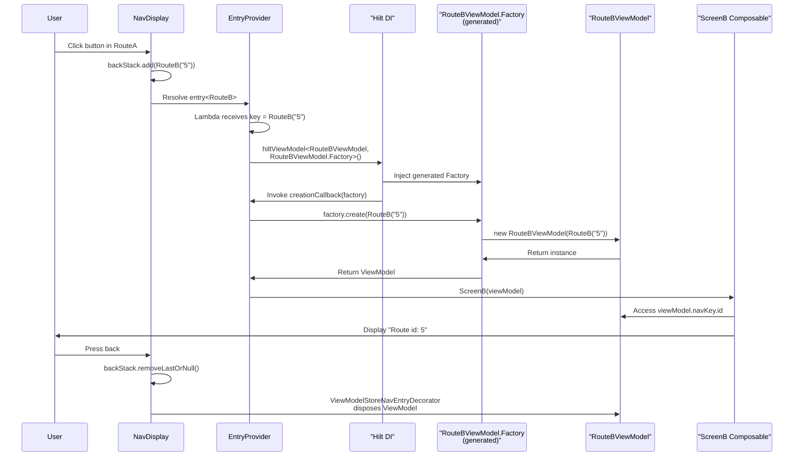
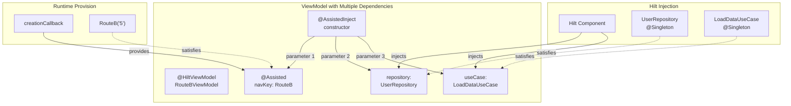

<!-- source: DeepWiki mcp.deepwiki.com · repo android/nav3-recipes · page 9.2 Hilt Injected ViewModels · fetched 2026-10-23 -->

# Hilt Injected ViewModels

<details>
<summary>Relevant source files</summary>

The following files were used as context for generating this wiki page:

- [app/src/main/java/com/example/nav3recipes/material/listdetail/MaterialListDetailActivity.kt](app/src/main/java/com/example/nav3recipes/material/listdetail/MaterialListDetailActivity.kt)
- [app/src/main/java/com/example/nav3recipes/material/supportingpane/MaterialSupportingPaneActivity.kt](app/src/main/java/com/example/nav3recipes/material/supportingpane/MaterialSupportingPaneActivity.kt)
- [app/src/main/java/com/example/nav3recipes/modular/hilt/CommonModule.kt](app/src/main/java/com/example/nav3recipes/modular/hilt/CommonModule.kt)
- [app/src/main/java/com/example/nav3recipes/passingarguments/viewmodels/basic/BasicViewModelsActivity.kt](app/src/main/java/com/example/nav3recipes/passingarguments/viewmodels/basic/BasicViewModelsActivity.kt)
- [app/src/main/java/com/example/nav3recipes/passingarguments/viewmodels/hilt/HiltViewModelsActivity.kt](app/src/main/java/com/example/nav3recipes/passingarguments/viewmodels/hilt/HiltViewModelsActivity.kt)
- [app/src/main/java/com/example/nav3recipes/passingarguments/viewmodels/koin/KoinViewModelsActivity.kt](app/src/main/java/com/example/nav3recipes/passingarguments/viewmodels/koin/KoinViewModelsActivity.kt)

</details>


## Purpose and Scope

This page documents how to pass navigation arguments to ViewModels using Hilt's compile-time dependency injection system, specifically leveraging `@AssistedInject` and `@AssistedFactory` annotations. This approach allows ViewModels to receive navigation keys as constructor parameters while Hilt manages other dependencies.

For passing arguments without dependency injection, see [Basic ViewModels with Factory](#9.1). For the Koin runtime dependency injection approach, see [Koin Injected ViewModels](#9.3).

**Sources:** [app/src/main/java/com/example/nav3recipes/passingarguments/viewmodels/hilt/HiltViewModelsActivity.kt:1-119]()

## Overview

The Hilt approach uses Dagger's assisted injection pattern to combine compile-time dependency injection with runtime navigation arguments. The key difference from manual factory creation is that Hilt generates the factory implementation automatically, and other ViewModel dependencies can be injected alongside the navigation key.

**Pattern Summary:**
- Activity annotated with `@AndroidEntryPoint`
- ViewModel annotated with `@HiltViewModel(assistedFactory = ...)`
- Constructor uses `@AssistedInject` with `@Assisted` parameters
- Factory interface defined with `@AssistedFactory`
- Composables use `hiltViewModel()` with `creationCallback`

**Sources:** [app/src/main/java/com/example/nav3recipes/passingarguments/viewmodels/hilt/HiltViewModelsActivity.kt:47-119]()

## Key Components Mapping



**Sources:** [app/src/main/java/com/example/nav3recipes/passingarguments/viewmodels/hilt/HiltViewModelsActivity.kt:44-118]()

## Activity Setup with @AndroidEntryPoint

The activity must be annotated with `@AndroidEntryPoint` to enable Hilt's code generation. This allows Hilt to inject dependencies and generate the ViewModel factory.

| Annotation | Purpose |
|------------|---------|
| `@AndroidEntryPoint` | Marks activity as Hilt injection target |
| Location | Applied to `HiltViewModelsActivity` class |
| Effect | Generates Hilt components and enables `hiltViewModel()` |

The `NavDisplay` configuration requires `ViewModelStoreNavEntryDecorator` to ensure each navigation entry receives a unique ViewModel instance:

```
entryDecorators = listOf(
    rememberSaveableStateHolderNavEntryDecorator(),
    rememberViewModelStoreNavEntryDecorator()
)
```

The `ViewModelStoreNavEntryDecorator` uses `NavEntry.contentKey` to uniquely identify each ViewModel, eliminating the need for manual key management.

**Sources:** [app/src/main/java/com/example/nav3recipes/passingarguments/viewmodels/hilt/HiltViewModelsActivity.kt:47-67]()

## ViewModel Definition with Hilt Annotations



The ViewModel class requires four key elements:

| Element | Annotation/Type | Purpose |
|---------|----------------|---------|
| Class annotation | `@HiltViewModel(assistedFactory = Factory::class)` | Tells Hilt to generate factory implementation |
| Constructor annotation | `@AssistedInject` | Enables assisted injection pattern |
| Navigation parameter | `@Assisted val navKey: RouteB` | Marks runtime-provided navigation argument |
| Factory interface | `@AssistedFactory` | Defines factory contract for Hilt |

**Example from code:**

```
@HiltViewModel(assistedFactory = RouteBViewModel.Factory::class)
class RouteBViewModel @AssistedInject constructor(
    @Assisted val navKey: RouteB
) : ViewModel() {

    @AssistedFactory
    interface Factory {
        fun create(navKey: RouteB): RouteBViewModel
    }
}
```

The `@Assisted` annotation indicates that `navKey` must be provided at instantiation time, not injected by Hilt. This allows combining Hilt-injected dependencies (e.g., repositories) with navigation arguments.

**Sources:** [app/src/main/java/com/example/nav3recipes/passingarguments/viewmodels/hilt/HiltViewModelsActivity.kt:109-118]()

## Using hiltViewModel in Entry Provider



The `hiltViewModel()` composable function requires explicit type parameters and a `creationCallback`:

| Parameter | Type | Purpose |
|-----------|------|---------|
| Type parameter 1 | `RouteBViewModel` | ViewModel class to instantiate |
| Type parameter 2 | `RouteBViewModel.Factory` | Assisted factory interface |
| `creationCallback` | Lambda `(Factory) -> ViewModel` | Provides navigation key to factory |

**Implementation pattern:**

```
entry<RouteB> { key ->
    val viewModel = hiltViewModel<RouteBViewModel, RouteBViewModel.Factory>(
        creationCallback = { factory ->
            factory.create(key)
        }
    )
    ScreenB(viewModel = viewModel)
}
```

The `key` parameter from the `entry<RouteB>` lambda is captured and passed to the factory's `create()` method. Hilt injects the `Factory` implementation into the `creationCallback` lambda.

**Sources:** [app/src/main/java/com/example/nav3recipes/passingarguments/viewmodels/hilt/HiltViewModelsActivity.kt:82-97]()

## ViewModelStoreNavEntryDecorator Requirement



The decorator performs two critical functions:

1. **Unique ViewModel Instances**: Uses `NavEntry.contentKey` to ensure each navigation entry gets its own ViewModel instance, even for identical `RouteB` types with different parameters
2. **Lifecycle Management**: Disposes ViewModels when their navigation entries are removed from the back stack

**Configuration requirement:**

```
entryDecorators = listOf(
    rememberSaveableStateHolderNavEntryDecorator(),
    rememberViewModelStoreNavEntryDecorator()
)
```

Both decorators must be specified when using ViewModels with Navigation 3. The `SaveableStateHolderNavEntryDecorator` provides state saving capabilities, while the `ViewModelStoreNavEntryDecorator` manages ViewModel lifecycle.

**Sources:** [app/src/main/java/com/example/nav3recipes/passingarguments/viewmodels/hilt/HiltViewModelsActivity.kt:60-67](), [app/src/main/java/com/example/nav3recipes/passingarguments/viewmodels/hilt/HiltViewModelsActivity.kt:84-91]()

## Comparison with Other Approaches



| Aspect | Manual Factory | Hilt Assisted | Koin |
|--------|---------------|---------------|------|
| Annotations | None | `@HiltViewModel`, `@AssistedInject`, `@AssistedFactory` | None |
| Factory code | Manual implementation | Generated by Hilt | Runtime resolution |
| DI support | None | Compile-time | Runtime |
| Type safety | Compile-time | Compile-time | Runtime |
| Setup complexity | Low | Medium | Low |
| Module system | No | Dagger modules | Koin modules |
| Additional dependencies | None | Hilt annotation processor | Koin runtime |

**When to use each approach:**
- **Manual Factory (9.1)**: Simple projects without DI framework, minimal dependencies
- **Hilt Assisted (9.2)**: Existing Dagger/Hilt projects, complex dependency graphs, compile-time validation required
- **Koin (9.3)**: Projects preferring runtime DI, multi-module Kotlin-first codebases

**Sources:** [app/src/main/java/com/example/nav3recipes/passingarguments/viewmodels/basic/BasicViewModelsActivity.kt:98-108](), [app/src/main/java/com/example/nav3recipes/passingarguments/viewmodels/hilt/HiltViewModelsActivity.kt:109-118](), [app/src/main/java/com/example/nav3recipes/passingarguments/viewmodels/koin/KoinViewModelsActivity.kt:99]()

## Complete Execution Flow



**Key execution points:**

1. **Entry resolution**: `NavDisplay` finds matching `entry<RouteB>` in `entryProvider`
2. **Key capture**: Lambda captures `key` parameter containing navigation arguments
3. **Hilt injection**: `hiltViewModel()` triggers Hilt to inject the generated factory
4. **Factory invocation**: `creationCallback` passes navigation key to factory
5. **ViewModel creation**: Factory constructs ViewModel with assisted-injected navigation key
6. **Composition**: ViewModel passed to screen composable
7. **Cleanup**: Decorator disposes ViewModel when entry removed from back stack

**Sources:** [app/src/main/java/com/example/nav3recipes/passingarguments/viewmodels/hilt/HiltViewModelsActivity.kt:56-100]()

## Additional ViewModel Dependencies



The Hilt assisted injection pattern enables mixing navigation arguments with Hilt-managed dependencies:

```
@HiltViewModel(assistedFactory = RouteBViewModel.Factory::class)
class RouteBViewModel @AssistedInject constructor(
    @Assisted val navKey: RouteB,
    private val repository: UserRepository,
    private val useCase: LoadDataUseCase
) : ViewModel() {
    @AssistedFactory
    interface Factory {
        fun create(navKey: RouteB): RouteBViewModel
    }
}
```

**Dependency resolution:**
- `@Assisted` parameters: Provided through `factory.create()` call
- Unannotated parameters: Injected by Hilt from the dependency graph
- Mixed parameters: Hilt generates factory implementation handling both types

This pattern is particularly valuable when ViewModels require both navigation context (the route/key) and application-level dependencies (repositories, use cases, data stores).

**Sources:** Documentation inference based on Hilt assisted injection pattern

---

