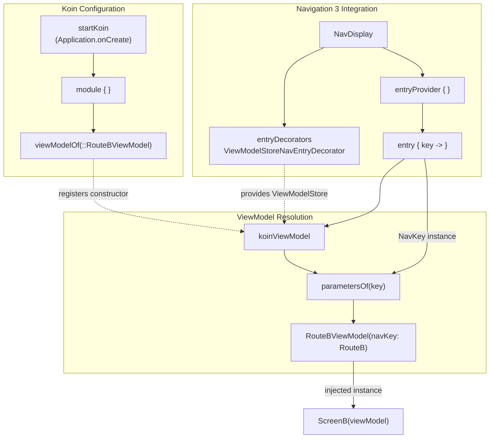
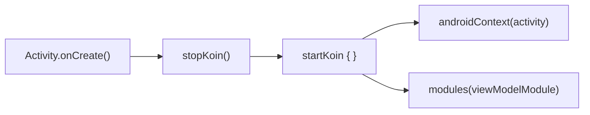
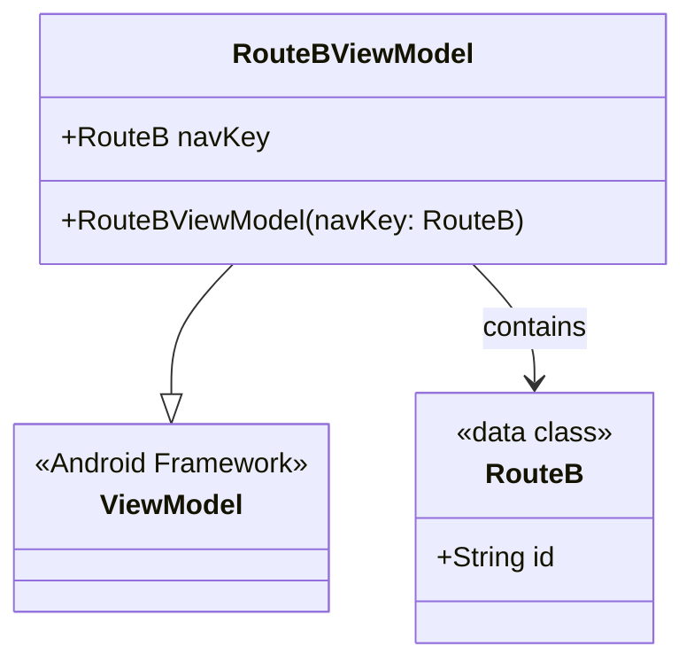
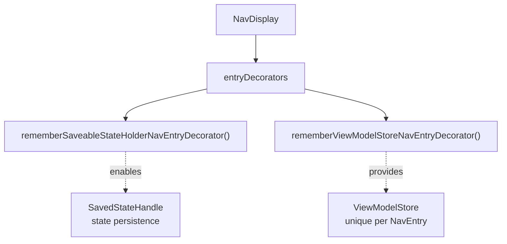
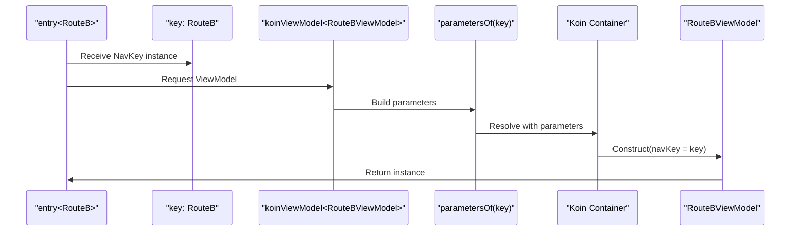
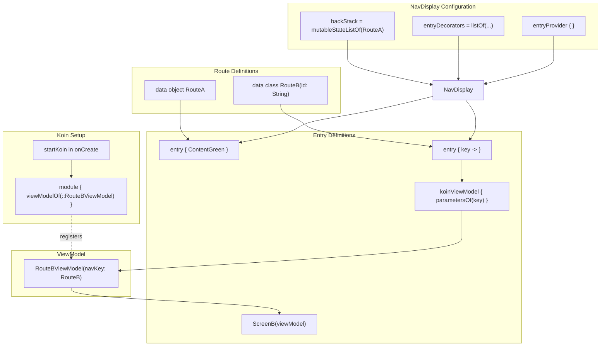
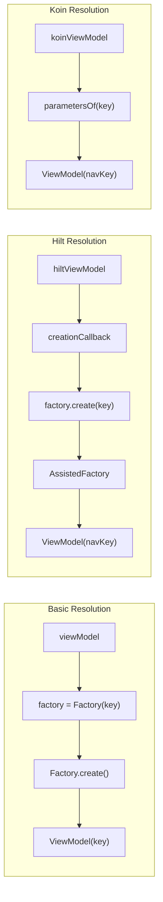

<!-- source: DeepWiki mcp.deepwiki.com · repo android/nav3-recipes · page 9.3 Koin Injected ViewModels · fetched 2026-10-23 -->

# Koin Injected ViewModels

Relevant source files

The following files were used as context for generating this wiki page:

- [app/src/main/java/com/example/nav3recipes/material/listdetail/MaterialListDetailActivity.kt](app/src/main/java/com/example/nav3recipes/material/listdetail/MaterialListDetailActivity.kt)
- [app/src/main/java/com/example/nav3recipes/material/supportingpane/MaterialSupportingPaneActivity.kt](app/src/main/java/com/example/nav3recipes/material/supportingpane/MaterialSupportingPaneActivity.kt)
- [app/src/main/java/com/example/nav3recipes/modular/hilt/CommonModule.kt](app/src/main/java/com/example/nav3recipes/modular/hilt/CommonModule.kt)
- [app/src/main/java/com/example/nav3recipes/passingarguments/viewmodels/basic/BasicViewModelsActivity.kt](app/src/main/java/com/example/nav3recipes/passingarguments/viewmodels/basic/BasicViewModelsActivity.kt)
- [app/src/main/java/com/example/nav3recipes/passingarguments/viewmodels/hilt/HiltViewModelsActivity.kt](app/src/main/java/com/example/nav3recipes/passingarguments/viewmodels/hilt/HiltViewModelsActivity.kt)
- [app/src/main/java/com/example/nav3recipes/passingarguments/viewmodels/koin/KoinViewModelsActivity.kt](app/src/main/java/com/example/nav3recipes/passingarguments/viewmodels/koin/KoinViewModelsActivity.kt)

## Purpose and Scope

This page demonstrates how to pass navigation arguments to ViewModels using **Koin** dependency injection in Navigation 3. Koin provides a runtime, reflection-based DI approach that requires minimal boilerplate compared to compile-time alternatives.

For ViewModel argument passing without dependency injection, see [Basic ViewModels with Factory](#9.1). For a compile-time DI approach using Hilt, see [Hilt Injected ViewModels](#9.2).

**Sources:** [app/src/main/java/com/example/nav3recipes/passingarguments/viewmodels/koin/KoinViewModelsActivity.kt:1-99]()

---

## Koin ViewModel Integration Architecture

The following diagram illustrates how Koin integrates with Navigation 3 to provide ViewModels with navigation arguments.

**Diagram: Koin ViewModel Resolution Flow**

Koin uses runtime reflection to resolve ViewModel constructors. The `viewModelOf(::RouteBViewModel)` registration tells Koin how to construct the ViewModel, and `parametersOf(key)` supplies the navigation argument at resolution time.

**Sources:** [app/src/main/java/com/example/nav3recipes/passingarguments/viewmodels/koin/KoinViewModelsActivity.kt:42-48](), [app/src/main/java/com/example/nav3recipes/passingarguments/viewmodels/koin/KoinViewModelsActivity.kt:82-86](), [app/src/main/java/com/example/nav3recipes/passingarguments/viewmodels/koin/KoinViewModelsActivity.kt:99]()

---

## Koin Module Configuration

Koin initialization happens in two steps: starting the Koin context and defining modules with ViewModel registrations.

### Starting Koin

**Diagram: Koin Initialization Sequence**

In production, `startKoin` should be called once in `Application.onCreate()`. The recipe calls it in the Activity for demonstration purposes and includes `stopKoin()` to prevent conflicts with other recipes.

**Sources:** [app/src/main/java/com/example/nav3recipes/passingarguments/viewmodels/koin/KoinViewModelsActivity.kt:37-49]()

### Module Definition

The Koin module registers the ViewModel using `viewModelOf`, which is a concise DSL for registering ViewModel constructors:

[app/src/main/java/com/example/nav3recipes/passingarguments/viewmodels/koin/KoinViewModelsActivity.kt:42-48]()

| Koin DSL | Purpose |
|----------|---------|
| `startKoin { }` | Initialize Koin container with context and modules |
| `androidContext(activity)` | Provide Android context for resolving Android dependencies |
| `modules(module { })` | Register dependency modules |
| `viewModelOf(::RouteBViewModel)` | Register ViewModel constructor reference |

**Sources:** [app/src/main/java/com/example/nav3recipes/passingarguments/viewmodels/koin/KoinViewModelsActivity.kt:42-48]()

---

## ViewModel Definition Pattern

The ViewModel class in the Koin approach is simpler than the Basic approach because it doesn't require a custom `Factory` class:

[app/src/main/java/com/example/nav3recipes/passingarguments/viewmodels/koin/KoinViewModelsActivity.kt:99]()

**Diagram: Koin ViewModel Class Structure**

The ViewModel is a plain class extending `ViewModel`. No annotations or factory interfaces are required—Koin uses reflection to discover the constructor signature.

**Sources:** [app/src/main/java/com/example/nav3recipes/passingarguments/viewmodels/koin/KoinViewModelsActivity.kt:99]()

---

## Integration with NavDisplay

The Koin ViewModel integration requires the same `NavDisplay` configuration as other ViewModel approaches:

[app/src/main/java/com/example/nav3recipes/passingarguments/viewmodels/koin/KoinViewModelsActivity.kt:56-89]()

### Required Entry Decorators

**Diagram: Required Entry Decorators**

The `ViewModelStoreNavEntryDecorator` is critical—it ensures each navigation entry gets its own `ViewModelStore`, allowing multiple instances of the same route to have separate ViewModel instances.

**Sources:** [app/src/main/java/com/example/nav3recipes/passingarguments/viewmodels/koin/KoinViewModelsActivity.kt:64-67]()

---

## Passing Arguments with parametersOf

The key Koin feature for passing navigation arguments to ViewModels is the `parametersOf` function:

[app/src/main/java/com/example/nav3recipes/passingarguments/viewmodels/koin/KoinViewModelsActivity.kt:82-86]()

### Argument Resolution Flow

**Diagram: Koin Argument Resolution Sequence**

The `parametersOf(key)` function creates a parameter definition that Koin uses to inject the navigation argument into the ViewModel constructor at resolution time.

**Sources:** [app/src/main/java/com/example/nav3recipes/passingarguments/viewmodels/koin/KoinViewModelsActivity.kt:82-86]()

### koinViewModel DSL

The `koinViewModel` function is a Compose-aware wrapper that integrates with both Koin's DI container and Jetpack Compose's lifecycle:

| Function | Parameters | Return Type | Purpose |
|----------|-----------|-------------|---------|
| `koinViewModel<T>` | Type parameter `T` | `T : ViewModel` | Resolve ViewModel from Koin |
| Lambda block | `parametersOf(...)` | `ParametersHolder` | Supply constructor arguments |

**Sources:** [app/src/main/java/com/example/nav3recipes/passingarguments/viewmodels/koin/KoinViewModelsActivity.kt:83-85]()

---

## Comparison with Other Approaches

The three ViewModel argument passing approaches differ primarily in their dependency injection mechanisms:

```mermaid
graph TB
    subgraph "Basic Approach - No DI"
        BasicVM["viewModel(factory = Factory(key))"]
        ManualFactory["ViewModelProvider.Factory<br/>manual implementation"]
        BasicConstruct["ViewModel(key)"]
        
        BasicVM --> ManualFactory
        ManualFactory --> BasicConstruct
    end
    
    subgraph "Hilt Approach - Compile-time DI"
        HiltVM["hiltViewModel<VM, Factory>"]
        AssistedInject["@AssistedInject<br/>@Assisted"]
        AssistedFactory["@AssistedFactory<br/>interface"]
        CreationCallback["creationCallback = { factory.create(key) }"]
        HiltConstruct["ViewModel(navKey)"]
        
        HiltVM --> CreationCallback
        CreationCallback --> AssistedFactory
        AssistedFactory --> AssistedInject
        AssistedInject --> HiltConstruct
    end
    
    subgraph "Koin Approach - Runtime DI"
        KoinVM["koinViewModel<ViewModel>"]
        ParametersOf["parametersOf(key)"]
        ViewModelOf["viewModelOf(::ViewModel)<br/>in module"]
        KoinConstruct["ViewModel(navKey)"]
        
        KoinVM --> ParametersOf
        ParametersOf --> ViewModelOf
        ViewModelOf --> KoinConstruct
    end
```

**Diagram: Three ViewModel Argument Passing Patterns**

### Feature Comparison

| Feature | Basic | Hilt | Koin |
|---------|-------|------|------|
| **Setup Complexity** | Low | High | Medium |
| **Boilerplate Code** | Factory class | Annotations + factory interface | Module registration |
| **Compilation Time** | Fast | Slow (code generation) | Fast |
| **Runtime Performance** | Direct instantiation | Direct instantiation | Reflection-based |
| **Type Safety** | Compile-time | Compile-time | Runtime |
| **DI Integration** | None | Full Hilt graph | Full Koin graph |
| **Testability** | Manual mocking | Hilt test modules | Koin test modules |

**Sources:** [app/src/main/java/com/example/nav3recipes/passingarguments/viewmodels/basic/BasicViewModelsActivity.kt:85](), [app/src/main/java/com/example/nav3recipes/passingarguments/viewmodels/hilt/HiltViewModelsActivity.kt:83-94](), [app/src/main/java/com/example/nav3recipes/passingarguments/viewmodels/koin/KoinViewModelsActivity.kt:83-85]()

### Code Comparison

**Basic Approach - Manual Factory:**
[app/src/main/java/com/example/nav3recipes/passingarguments/viewmodels/basic/BasicViewModelsActivity.kt:101-107]()

**Hilt Approach - Assisted Injection:**
[app/src/main/java/com/example/nav3recipes/passingarguments/viewmodels/hilt/HiltViewModelsActivity.kt:109-118]()

**Koin Approach - ParametersOf:**
[app/src/main/java/com/example/nav3recipes/passingarguments/viewmodels/koin/KoinViewModelsActivity.kt:99]()

The Koin approach eliminates the factory interface and annotations, requiring only constructor parameters and module registration.

**Sources:** [app/src/main/java/com/example/nav3recipes/passingarguments/viewmodels/basic/BasicViewModelsActivity.kt:98-108](), [app/src/main/java/com/example/nav3recipes/passingarguments/viewmodels/hilt/HiltViewModelsActivity.kt:109-118](), [app/src/main/java/com/example/nav3recipes/passingarguments/viewmodels/koin/KoinViewModelsActivity.kt:99]()

---

## Complete Implementation Example

The complete Koin ViewModel integration follows this structure:

**Diagram: Complete Koin ViewModel Integration**

Key implementation points:
1. Initialize Koin in `onCreate` (or `Application.onCreate` in production)
2. Register ViewModels with `viewModelOf` in a Koin module
3. Add `ViewModelStoreNavEntryDecorator` to NavDisplay
4. Use `koinViewModel` with `parametersOf` in entry definitions
5. Define ViewModels as plain classes with constructor parameters

**Sources:** [app/src/main/java/com/example/nav3recipes/passingarguments/viewmodels/koin/KoinViewModelsActivity.kt:1-99]()

---

## Key Differences from Basic and Hilt

### Eliminated Components

The Koin approach eliminates several components required by other approaches:

| Component | Basic | Hilt | Koin |
|-----------|-------|------|------|
| Custom Factory class | ✓ Required | ✗ Not needed | ✗ Not needed |
| `@HiltViewModel` annotation | ✗ N/A | ✓ Required | ✗ Not needed |
| `@AssistedInject` annotation | ✗ N/A | ✓ Required | ✗ Not needed |
| `@AssistedFactory` interface | ✗ N/A | ✓ Required | ✗ Not needed |
| `@AndroidEntryPoint` annotation | ✗ N/A | ✓ Required | ✗ Not needed |
| Module registration | ✗ N/A | ✗ Auto-generated | ✓ Required |

### Simplified Resolution

**Diagram: Resolution Complexity Comparison**

Koin's runtime reflection-based approach reduces the resolution chain to just two steps: specifying the ViewModel type and providing parameters.

**Sources:** [app/src/main/java/com/example/nav3recipes/passingarguments/viewmodels/basic/BasicViewModelsActivity.kt:85](), [app/src/main/java/com/example/nav3recipes/passingarguments/viewmodels/hilt/HiltViewModelsActivity.kt:83-94](), [app/src/main/java/com/example/nav3recipes/passingarguments/viewmodels/koin/KoinViewModelsActivity.kt:83-85]()

---

## When to Use Koin

Choose the Koin approach when:

- Your project already uses Koin for dependency injection
- You prefer runtime DI over compile-time code generation
- You want minimal boilerplate for ViewModel argument passing
- Fast compilation times are important
- You're comfortable with reflection-based DI

Consider alternatives when:

- You need compile-time verification of DI graphs (use Hilt)
- You want zero DI dependencies (use Basic approach)
- Maximum runtime performance is critical (use Basic or Hilt)
- Your project has no existing DI infrastructure and you want to avoid the overhead

**Sources:** [app/src/main/java/com/example/nav3recipes/passingarguments/viewmodels/koin/KoinViewModelsActivity.kt:1-99]()

---

