# Page: Overview

# Overview

<details>
<summary>Relevant source files</summary>

The following files were used as context for generating this wiki page:

- [README.md](README.md)
- [app/src/main/AndroidManifest.xml](app/src/main/AndroidManifest.xml)
- [app/src/main/java/com/example/nav3recipes/RecipePickerActivity.kt](app/src/main/java/com/example/nav3recipes/RecipePickerActivity.kt)

</details>


## Purpose and Scope

The `nav3-recipes` repository is a collection of standalone code examples demonstrating how to use [Jetpack Navigation 3](https://goo.gle/nav3) APIs to implement common navigation use cases in Android applications. Each recipe is a self-contained example that introduces a single concept, packaged as its own `Activity` within the repository.

This Overview page introduces the repository structure, recipe philosophy, and high-level organization. For detailed information about specific topics:
- Core Navigation 3 concepts (NavKey, NavBackStack, NavDisplay): see [Core Navigation 3 Concepts](#2.2)
- Running and exploring recipes: see [Running Recipe Examples](#2.3)
- Individual recipe categories: see sections [3](#3) through [11](#11)

## Repository Architecture

The repository uses a hub-and-spoke architecture where `RecipePickerActivity` serves as the central launcher, providing access to all recipe examples through a categorized list interface.

```mermaid
graph TB
    subgraph "Application Entry Point"
        Manifest["AndroidManifest.xml"]
        Launcher["RecipePickerActivity<br/>(MAIN/LAUNCHER)"]
    end
    
    subgraph "Recipe Activities"
        Basic["BasicActivity"]
        BasicDsl["BasicDslActivity"]
        BasicSaveable["BasicSaveableActivity"]
        CommonUi["CommonUiActivity"]
        ListDetail["ListDetailActivity"]
        TwoPane["TwoPaneActivity"]
        Dialog["DialogActivity"]
        BottomSheet["BottomSheetActivity"]
        MaterialLD["MaterialListDetailActivity"]
        MaterialSP["MaterialSupportingPaneActivity"]
        Animated["AnimatedActivity"]
        MultiStacks["MultipleStacksActivity"]
        Conditional["ConditionalActivity"]
        HiltMod["HiltModularActivity"]
        KoinMod["KoinModularActivity"]
        BasicVM["BasicViewModelsActivity"]
        HiltVM["HiltViewModelsActivity"]
        KoinVM["KoinViewModelsActivity"]
        ResultEvt["ResultEventActivity"]
        ResultState["ResultStateActivity"]
        CreateDL["CreateDeepLinkActivity"]
        AdvancedDL["AdvancedCreateDeepLinkActivity"]
    end
    
    Manifest -->|declares| Launcher
    Manifest -->|declares all| Basic
    Manifest -->|declares all| BasicDsl
    
    Launcher -->|Intent| Basic
    Launcher -->|Intent| BasicDsl
    Launcher -->|Intent| BasicSaveable
    Launcher -->|Intent| CommonUi
    Launcher -->|Intent| ListDetail
    Launcher -->|Intent| TwoPane
    Launcher -->|Intent| Dialog
    Launcher -->|Intent| BottomSheet
    Launcher -->|Intent| MaterialLD
    Launcher -->|Intent| MaterialSP
    Launcher -->|Intent| Animated
    Launcher -->|Intent| MultiStacks
    Launcher -->|Intent| Conditional
    Launcher -->|Intent| HiltMod
    Launcher -->|Intent| KoinMod
    Launcher -->|Intent| BasicVM
    Launcher -->|Intent| HiltVM
    Launcher -->|Intent| KoinVM
    Launcher -->|Intent| ResultEvt
    Launcher -->|Intent| ResultState
    Launcher -->|Intent| CreateDL
    Launcher -->|Intent| AdvancedDL
```

**Sources**: [README.md:1-95](), [app/src/main/AndroidManifest.xml:1-190](), [app/src/main/java/com/example/nav3recipes/RecipePickerActivity.kt:1-185]()

### RecipePickerActivity Implementation

The `RecipePickerActivity` class maintains a list of all recipes organized by category. Each recipe is defined using the `Recipe` data class containing a display name and the `Activity` class to launch.

| Component | Purpose | Implementation |
|-----------|---------|----------------|
| `Recipe` | Represents a single recipe example | Contains `name: String` and `activityClass: Class<out Activity>` |
| `Heading` | Categorizes recipes in the UI | Contains `name: String` for category labels |
| `recipes` list | Master recipe registry | Defines all available recipes with their categories at [RecipePickerActivity.kt:78-118]() |
| `RecipeList` composable | UI presentation | Renders recipes as clickable `ListItem` components |

The `recipes` list at [RecipePickerActivity.kt:78-118]() defines the canonical list of all examples in the repository, organized into categories that align with the sections in this wiki.

**Sources**: [app/src/main/java/com/example/nav3recipes/RecipePickerActivity.kt:68-185]()

## Recipe Philosophy

The repository follows a **single-concept-per-recipe** philosophy:

1. **Independence**: Each recipe is a complete, standalone example with its own `Activity` and navigation setup
2. **Focused scope**: Recipes demonstrate one specific concept or pattern without mixing multiple concerns
3. **Progressive complexity**: New concepts result in new recipes rather than modifications to existing ones
4. **Graduation path**: Successful patterns from recipes may "graduate" to become official library helpers in Jetpack Navigation 3, after which recipes are updated to use those helpers

This approach ensures that developers can:
- Explore specific features in isolation
- Copy and adapt recipe code without untangling multiple patterns
- Compare different approaches to similar problems (e.g., Hilt vs Koin for DI)

**Sources**: [README.md:1-10]()

## Recipe Categories

The repository organizes recipes into nine primary categories, each addressing different aspects of navigation implementation:

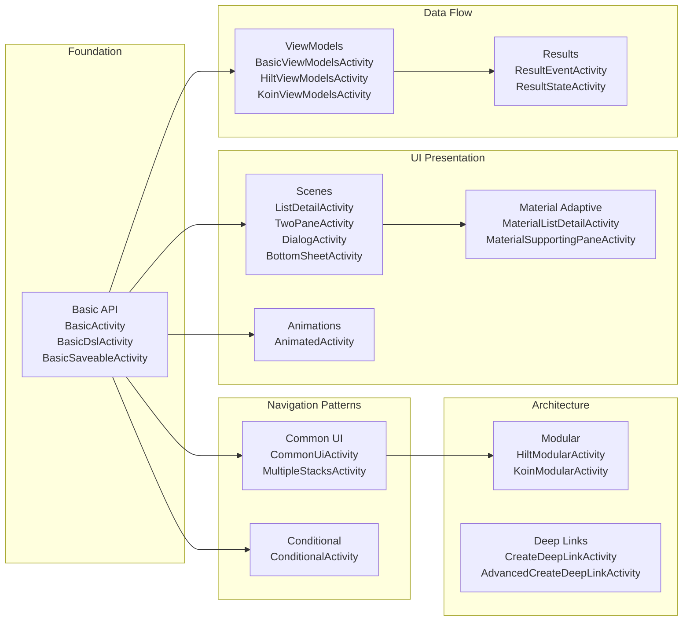

**Sources**: [README.md:12-60](), [app/src/main/java/com/example/nav3recipes/RecipePickerActivity.kt:78-118]()

### Category Descriptions

| Category | Recipe Count | Key Concepts Demonstrated | Wiki Section |
|----------|--------------|--------------------------|--------------|
| **Basic API examples** | 3 | NavDisplay, NavBackStack, EntryProvider, serialization | [3](#3) |
| **Deep links** | 2 | URL parsing, synthetic back stacks, Task management | [4](#4) |
| **Layouts using Scenes** | 4 | SceneStrategy, multi-pane layouts, dialogs, bottom sheets | [6](#6) |
| **Material adaptive layouts** | 2 | PaneScaffoldDirective, Material3 adaptive components | [6.5](#6.5) |
| **Animations** | 1 | Custom transitions, transitionSpec, predictive back | [7](#7) |
| **Common use cases** | 3 | Bottom bar navigation, multiple back stacks, conditional routing | [5](#5), [11.2](#11.2) |
| **Architecture** | 2 | Modular navigation with Hilt and Koin | [10](#10) |
| **Passing arguments to ViewModels** | 3 | ViewModel factories, Hilt/Koin injection | [9](#9) |
| **Returning Results** | 2 | Event-based and state-based result passing | [8](#8) |

**Sources**: [README.md:12-60]()

## Navigation 3 Core Components

While detailed coverage of Navigation 3 concepts is provided in [Core Navigation 3 Concepts](#2.2), the following diagram shows how the core components used throughout recipes relate to each other:

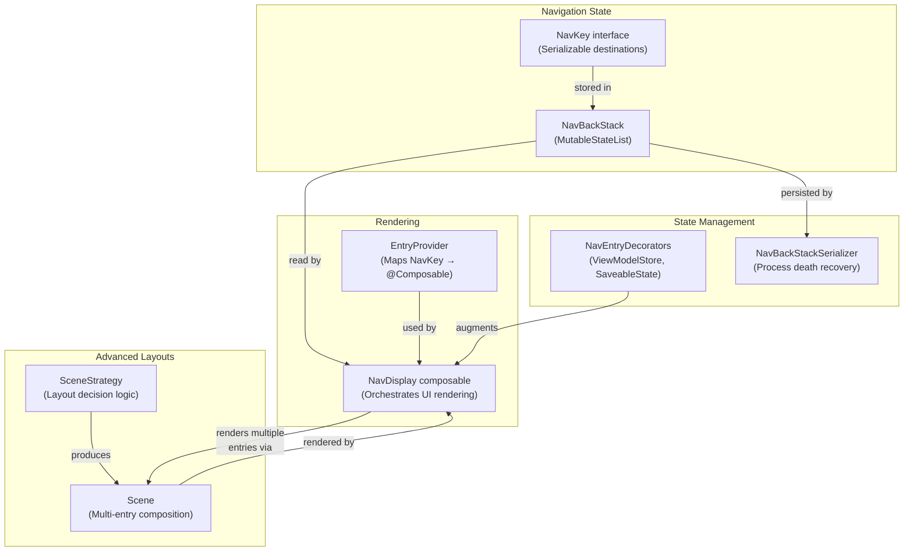

### Recipes by Component Coverage

The following table maps Navigation 3 components to the recipes that demonstrate them:

| Component | Primary Recipes | Wiki Section |
|-----------|----------------|--------------|
| `NavKey` | BasicActivity, CreateDeepLinkActivity | [3.1](#3.1), [4.1](#4.1), [12.1](#12.1) |
| `NavBackStack` | BasicActivity, MultipleStacksActivity | [3.1](#3.1), [5](#5), [12.2](#12.2) |
| `NavDisplay` | All recipes | [3.1](#3.1), [12.3](#12.3) |
| `EntryProvider` (DSL) | BasicDslActivity | [3.2](#3.2), [12.3](#12.3) |
| `NavBackStackSerializer` | BasicSaveableActivity | [3.3](#3.3), [12.2](#12.2) |
| `SceneStrategy` | ListDetailActivity, TwoPaneActivity | [6.1](#6.1), [6.2](#6.2), [6.3](#6.3) |
| `DialogSceneStrategy` | DialogActivity, BottomSheetActivity | [6.4](#6.4) |
| Material3 adaptive | MaterialListDetailActivity, MaterialSupportingPaneActivity | [6.5](#6.5) |
| `NavEntryDecorator` | BasicActivity, HiltViewModelsActivity | [12.4](#12.4) |

**Sources**: [README.md:15-39]()

## Version and Compatibility

The repository uses the **latest version** of Navigation 3 on the `main` branch, which may include alpha or snapshot releases. For recipes tested against **stable** versions of the library, developers should refer to the [releases page](https://github.com/android/nav3-recipes/releases).

The build configuration supports:
- **Dual dependency injection**: Both Hilt (compile-time) and Koin (runtime) frameworks are included, allowing recipes to demonstrate both approaches
- **Navigation 2 compatibility**: Some recipes show migration patterns from Navigation 2 to Navigation 3
- **Multi-module structure**: The `:app`, `:common`, and `:advanceddeeplinkapp` modules enable feature separation

For detailed build system information, see [Build System and Project Structure](#14).

**Sources**: [README.md:10-11](), [README.md:67-68]()

## Using This Repository

Developers can use this repository in three ways:

1. **Learning**: Explore recipes sequentially to understand Navigation 3 capabilities, starting with basic examples and progressing to advanced patterns
2. **Reference**: Find specific recipes that match your use case (e.g., "How do I implement a list-detail layout?") and study the implementation
3. **Code templates**: Copy recipe code as a starting point for implementing similar features in your own application

Each recipe directory contains:
- A `README.md` file explaining the recipe's purpose and key concepts
- Complete source code with inline comments
- Activity implementation that can be launched from RecipePickerActivity

To run the recipes:
1. Clone the repository: `git clone https://github.com/android/nav3-recipes.git`
2. Open the project in [Android Studio](https://developer.android.com/studio)
3. Build and run the app
4. RecipePickerActivity launches automatically, displaying all available recipes
5. Tap any recipe to launch its dedicated Activity

For detailed setup instructions, see [Running Recipe Examples](#2.3).

**Sources**: [README.md:67-69]()

## Issue Reporting and Contributions

### Issues Specific to Recipes

If you encounter an issue that is **directly related to this repository** (reproducible without modifying the source code), file an issue on the [GitHub issue tracker](https://github.com/android/nav3-recipes/issues/new?template=2-bug-report.md).

### Issues with Navigation 3 Library

If you've found an issue with the **Jetpack Navigation 3 library itself**, file it on the [Android issue tracker](https://issuetracker.google.com/issues/new?component=1750212&template=2102223).

### Material3 Adaptive Issues

For bugs or feature requests related to **Material3 Adaptive Scenes**, file them on the [Material Components issue tracker](https://issuetracker.google.com/issues/new?component=1467081) rather than this repository.

### Requesting New Recipes

To request a new recipe demonstrating a specific use case, file a [recipe request](https://github.com/android/nav3-recipes/issues/new?template=1-recipe-request.md). The most upvoted recipe requests are prioritized for implementation.

### Contributing Code

Contributions are welcome following the [contribution guidelines](CONTRIBUTING.md). The repository maintains the philosophy that new concepts should be separate recipes rather than modifications to existing ones, ensuring each recipe remains focused and easy to understand.

**Sources**: [README.md:70-74]()

## Related Resources

- **Compose Multiplatform Recipes**: For CMP-specific navigation recipes, see the [terrakok/nav3-recipes](https://github.com/terrakok/nav3-recipes) repository
- **Official Documentation**: [Jetpack Navigation 3 documentation](https://goo.gle/nav3)
- **Deep Linking Guide**: See the repository's [deep linking guide](docs/deeplink-guide.md) for comprehensive coverage of URL handling patterns

**Sources**: [README.md:76-77]()

---

# Page: Getting Started

# Getting Started

<details>
<summary>Relevant source files</summary>

The following files were used as context for generating this wiki page:

- [README.md](README.md)
- [app/src/main/AndroidManifest.xml](app/src/main/AndroidManifest.xml)
- [app/src/main/java/com/example/nav3recipes/RecipePickerActivity.kt](app/src/main/java/com/example/nav3recipes/RecipePickerActivity.kt)

</details>


This page provides an introduction to the nav3-recipes repository, explains how to set up and run the project, introduces fundamental Navigation 3 concepts, and guides you through running your first recipe example.

For detailed information on specific topics:
- Build system and dependency configuration: see [Project Setup and Build Configuration](#2.1)
- In-depth Navigation 3 architecture: see [Core Navigation 3 Concepts](#2.2)
- Comprehensive recipe navigation guide: see [Running Recipe Examples](#2.3)

## Purpose and Scope

The nav3-recipes repository is a collection of independent code examples demonstrating Jetpack Navigation 3 API usage patterns. Each recipe isolates a single concept or feature, implemented as a standalone `Activity`. The repository uses the latest Navigation 3 version and follows a pedagogical structure from basic usage through advanced patterns.

**Sources:** [README.md:1-10]()

## Repository Architecture

The repository implements a hub-and-spoke architecture where `RecipePickerActivity` serves as the central launcher for all recipe demonstrations.

### Hub-and-Spoke Structure

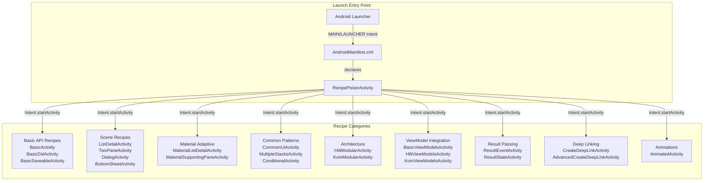

**Sources:** [app/src/main/AndroidManifest.xml:33-42](), [app/src/main/java/com/example/nav3recipes/RecipePickerActivity.kt:68-118]()

### Recipe Organization

Each recipe is:
- An independent Android `Activity` declared in `AndroidManifest.xml`
- Located in its own package under `com.example.nav3recipes`
- Listed in `RecipePickerActivity` with a human-readable name and category heading
- Fully self-contained with no dependencies on other recipes

| Category | Example Recipes | Purpose |
|----------|----------------|---------|
| Basic API | `BasicActivity`, `BasicDslActivity`, `BasicSaveableActivity` | Core Navigation 3 API usage |
| Scenes | `ListDetailActivity`, `TwoPaneActivity`, `DialogActivity` | Custom multi-pane layouts |
| Material Adaptive | `MaterialListDetailActivity`, `MaterialSupportingPaneActivity` | Production-ready adaptive layouts |
| Common Patterns | `CommonUiActivity`, `MultipleStacksActivity`, `ConditionalActivity` | Typical app navigation patterns |
| Architecture | `HiltModularActivity`, `KoinModularActivity` | Modular navigation with DI |
| ViewModels | `BasicViewModelsActivity`, `HiltViewModelsActivity`, `KoinViewModelsActivity` | ViewModel integration strategies |
| Results | `ResultEventActivity`, `ResultStateActivity` | Inter-destination data passing |
| Deep Linking | `CreateDeepLinkActivity`, `AdvancedCreateDeepLinkActivity` | URI-based navigation |
| Animations | `AnimatedActivity` | Custom navigation transitions |

**Sources:** [app/src/main/java/com/example/nav3recipes/RecipePickerActivity.kt:78-118](), [README.md:12-58]()

## Quick Start

### Prerequisites

- Android Studio (latest stable version recommended)
- Git
- JDK 17 or higher (required by Android Gradle Plugin 8.13.1)

### Setup Steps

1. **Clone the repository**
   ```bash
   git clone https://github.com/android/nav3-recipes.git
   cd nav3-recipes
   ```

2. **Open in Android Studio**
   - Launch Android Studio
   - Select "Open" from the welcome screen
   - Navigate to the cloned repository root folder
   - Click "OK" to open the project

3. **Sync Gradle dependencies**
   - Android Studio will automatically prompt to sync Gradle
   - If not, click "Sync Project with Gradle Files" in the toolbar
   - Wait for dependency download and indexing to complete

4. **Run RecipePickerActivity**
   - Select a device or emulator
   - Run configuration will default to `RecipePickerActivity` (declared as LAUNCHER)
   - Click the green "Run" button or press Shift+F10

**Sources:** [README.md:67-68](), [app/src/main/AndroidManifest.xml:33-42]()

## Navigation 3 Core Components

Navigation 3 implements a reactive, composable navigation system built on Jetpack Compose. Understanding these core components is essential for working with any recipe in the repository.

### Component Architecture

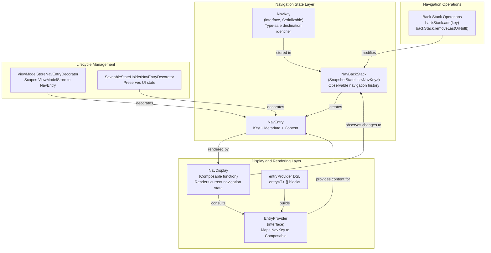

**Sources:** [app/src/main/java/com/example/nav3recipes/basic/BasicActivity.kt:1-100]() (inferred from typical Navigation 3 structure)

### Core Component Descriptions

| Component | Type | Purpose | Code Reference |
|-----------|------|---------|----------------|
| `NavKey` | Interface | Type-safe, serializable destination identifier. Typically implemented as `data class` or `data object` | Used in all recipes |
| `NavBackStack` | `SnapshotStateList<NavKey>` | Observable list representing navigation history. Changes trigger UI recomposition | Managed in all Activity classes |
| `NavDisplay` | Composable function | Renders the current navigation state by displaying content for the top `NavEntry` | Core rendering component |
| `EntryProvider` | Interface | Maps `NavKey` instances to their corresponding `@Composable` content | Built manually or via DSL |
| `entry<T>` | DSL function | Type-safe builder for mapping specific `NavKey` types to composables | Available in `BasicDslActivity` |
| `NavEntry` | Data structure | Represents a single navigation entry with key, metadata, and content. Managed by Navigation 3 internally | Created by framework |

For detailed explanations of each component and how they interact, see [Core Navigation 3 Concepts](#2.2).

**Sources:** [README.md:16-18]() (references to basic recipes)

## Understanding Recipe Structure

### Recipe Anatomy

Each recipe follows a consistent structure:

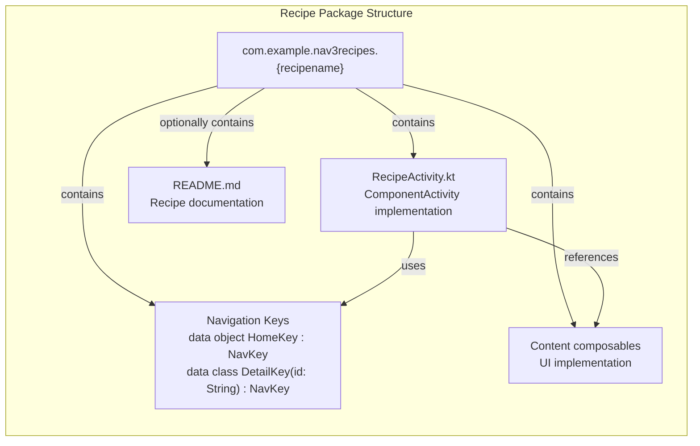

### Typical Recipe Components

1. **Activity class**: Entry point, typically extends `ComponentActivity`
   - Calls `setEdgeToEdgeConfig()` for modern UI
   - Defines or imports navigation keys
   - Sets up `NavBackStack` using `mutableStateListOf()` or `rememberSaveable`
   - Builds `EntryProvider` (manually or via DSL)
   - Renders `NavDisplay` in `setContent`

2. **Navigation keys**: Serializable destination identifiers
   - Simple destinations: `data object` with no arguments
   - Parameterized destinations: `data class` with arguments
   - All implement `NavKey` interface
   - Annotated with `@Serializable` for back stack persistence

3. **Content composables**: UI for each destination
   - Often reuse common components from `com.example.nav3recipes.ui`
   - Receive navigation callbacks via lambdas
   - May receive destination arguments via key parameters

4. **README.md**: Some recipes include detailed documentation

**Sources:** [app/src/main/java/com/example/nav3recipes/RecipePickerActivity.kt:1-185](), [README.md:16-58]()

## Running Your First Recipe

### Navigating RecipePickerActivity

The `RecipePickerActivity` displays all available recipes organized by category:

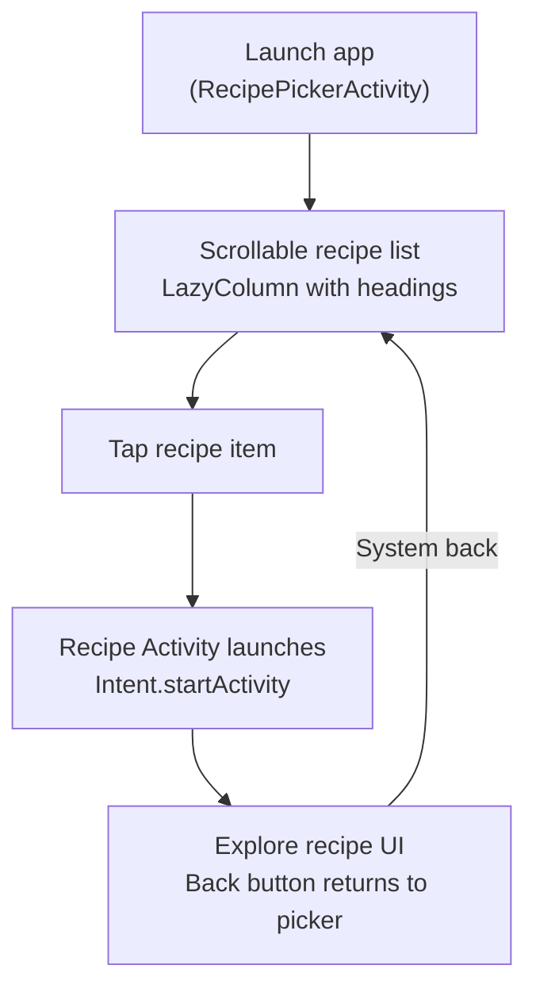

1. **Launch the app**: `RecipePickerActivity` opens automatically (declared as `MAIN`/`LAUNCHER`)
2. **Browse categories**: Scroll through headings like "Basic API recipes", "Layouts using Scenes", etc.
3. **Select a recipe**: Tap any recipe name to launch its `Activity`
4. **Return to picker**: Press the system back button to return to the recipe list

**Sources:** [app/src/main/java/com/example/nav3recipes/RecipePickerActivity.kt:120-184]()

### Recommended Learning Path

For developers new to Navigation 3, follow this progression:

1. **Start with Basic recipes** (simplest Navigation 3 usage):
   - `BasicActivity`: Manual navigation setup
   - `BasicDslActivity`: Using the entry provider DSL
   - `BasicSaveableActivity`: Adding back stack persistence

2. **Explore Common UI patterns**:
   - `CommonUiActivity`: Navigation bars and top-level routes
   - `MultipleStacksActivity`: Independent back stacks per tab

3. **Investigate advanced features**:
   - Scene recipes for adaptive layouts
   - Deep linking recipes for URI handling
   - ViewModel recipes for data integration

**Sources:** [README.md:15-58]()

### Running the Basic Recipe

The `BasicActivity` demonstrates the minimal Navigation 3 setup:

1. Launch `RecipePickerActivity`
2. Tap "Basic" under "Basic API recipes"
3. Observe the navigation implementation:
   - Initial screen: "This is home"
   - Tap "Go to Green": Navigates to green screen
   - Tap "Go back": Returns to home
   - System back button: Also pops back stack

The implementation shows:
- `mutableStateListOf<NavKey>()` for back stack storage
- Manual `EntryProvider` mapping keys to composables
- `NavDisplay` rendering the current entry
- `backStack.add(key)` for forward navigation
- `backStack.removeLastOrNull()` for back navigation

**Sources:** [README.md:16](), [app/src/main/java/com/example/nav3recipes/RecipePickerActivity.kt:80]()

## Project Dependencies

The repository uses Gradle version catalogs for centralized dependency management. Key dependencies include:

| Dependency | Version | Purpose |
|------------|---------|---------|
| Android Gradle Plugin | 8.13.1 | Build system |
| Kotlin | 2.2.21 | Language + Compose Compiler |
| Compose BOM | 2025.11.00 | Jetpack Compose UI |
| Navigation 3 | 1.0.0 | Navigation library |
| Hilt | 2.57.2 | Compile-time dependency injection |
| Koin | 4.2.0-alpha2 | Runtime dependency injection |

The project supports **both Hilt and Koin** to demonstrate multiple dependency injection approaches. It also includes Navigation 2 (v2.9.6) for migration recipes.

For detailed build configuration, see [Project Setup and Build Configuration](#2.1).

**Sources:** Inferred from high-level diagrams (Diagram 3: Build System and Dependency Architecture)

## Next Steps

After completing this introduction:

1. **Deep dive into core concepts**: Read [Core Navigation 3 Concepts](#2.2) for detailed explanations of `NavKey`, `NavBackStack`, `NavDisplay`, and the entry provider system

2. **Explore specific patterns**: Browse sections 3-11 based on your needs:
   - Section 3: Basic navigation patterns
   - Section 4: Deep linking
   - Section 5: Multiple back stacks
   - Section 6: Adaptive layouts with Scenes
   - Section 7: Animations
   - Section 8: Result passing
   - Section 9: ViewModel integration
   - Section 10: Modular architecture

3. **Reference documentation**: Use sections 12-14 for component APIs, utilities, and build system details

4. **Contribute**: See [Contributing to nav3-recipes](#15) for guidelines on requesting new recipes or reporting issues

**Sources:** [README.md:1-95]()

---

# Page: Project Setup and Build Configuration

# Project Setup and Build Configuration

<details>
<summary>Relevant source files</summary>

The following files were used as context for generating this wiki page:

- [app/build.gradle.kts](app/build.gradle.kts)
- [gradle/libs.versions.toml](gradle/libs.versions.toml)
- [settings.gradle.kts](settings.gradle.kts)

</details>


## Purpose and Scope

This document details the Gradle build configuration for the nav3-recipes repository, including the version catalog setup, multi-module project structure, dependency management, and plugin configuration. The build system implements centralized version management using Gradle's version catalog pattern and supports dual dependency injection frameworks (Hilt and Koin) for demonstration purposes.

For information about running the recipes themselves, see [Running Recipe Examples](#2.3). For details on the core Navigation 3 APIs used throughout the project, see [Core Navigation 3 Concepts](#2.2).

## Multi-Module Project Structure

The project consists of three Gradle modules defined in [settings.gradle.kts:48-51]():

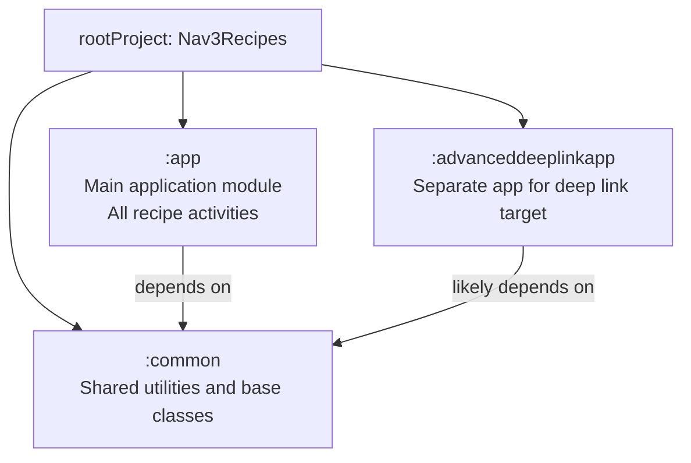

**Module Responsibilities:**

| Module | Purpose | Configuration |
|--------|---------|---------------|
| `:app` | Main application containing all recipe activities and RecipePickerActivity | [app/build.gradle.kts]() |
| `:common` | Shared utility functions, base composables, and common configuration | Not shown in provided files |
| `:advanceddeeplinkapp` | Standalone application simulating cross-app deep linking | Not shown in provided files |

**Sources:** [settings.gradle.kts:48-51]()

## Version Catalog Configuration

The project uses Gradle's version catalog feature to centralize dependency version management in [gradle/libs.versions.toml](). This file defines all versions, libraries, and plugins used across modules.

### Version Declarations

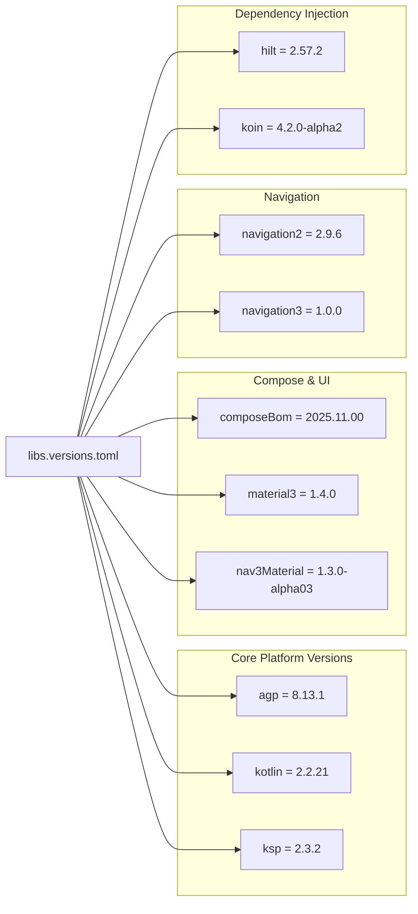

**Key Version Specifications:**

| Category | Artifact | Version | Reference |
|----------|----------|---------|-----------|
| Build System | Android Gradle Plugin | 8.13.1 | [gradle/libs.versions.toml:16]() |
| Language | Kotlin | 2.2.21 | [gradle/libs.versions.toml:17]() |
| UI Framework | Compose BOM | 2025.11.00 | [gradle/libs.versions.toml:26]() |
| Navigation | Navigation 3 Runtime | 1.0.0 | [gradle/libs.versions.toml:28]() |
| Navigation | Navigation 2 Compose | 2.9.6 | [gradle/libs.versions.toml:27]() |
| DI (Compile-time) | Hilt | 2.57.2 | [gradle/libs.versions.toml:32]() |
| DI (Runtime) | Koin | 4.2.0-alpha2 | [gradle/libs.versions.toml:34]() |
| Annotation Processing | KSP | 2.3.2 | [gradle/libs.versions.toml:31]() |

**Sources:** [gradle/libs.versions.toml:15-34]()

### Library Declarations

The version catalog defines library dependencies using the `[libraries]` section:

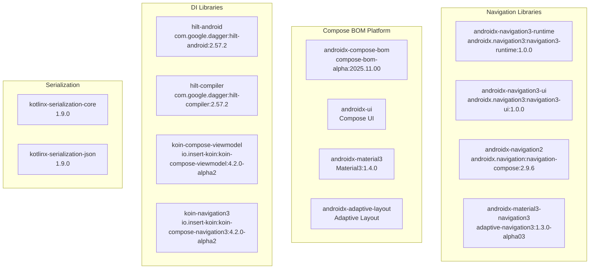

**Sources:** [gradle/libs.versions.toml:36-65]()

### Plugin Declarations

Plugins are declared in the `[plugins]` section and applied using the `alias()` function:

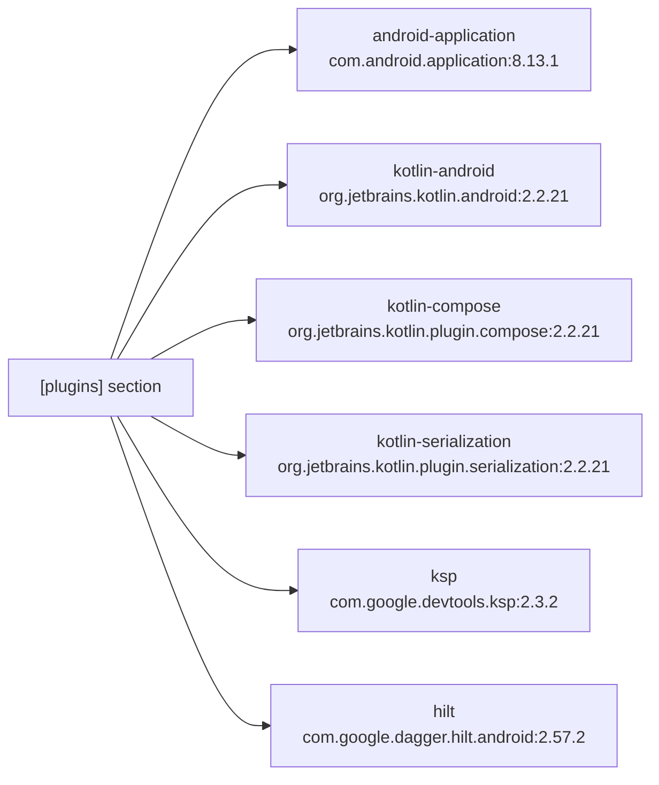

**Sources:** [gradle/libs.versions.toml:67-73]()

## App Module Build Configuration

The `:app` module's build configuration in [app/build.gradle.kts]() applies plugins and declares dependencies.

### Applied Plugins

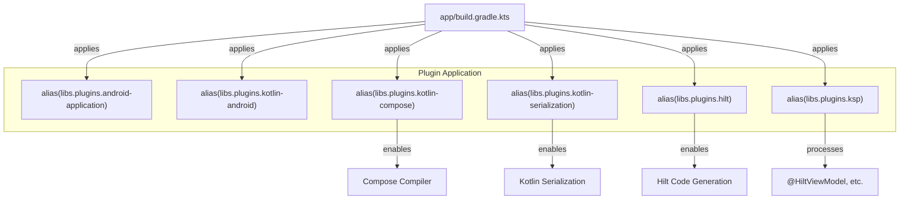

**Sources:** [app/build.gradle.kts:17-24]()

### Android Configuration Block

The `android` configuration block defines compilation and build parameters:

| Property | Value | Location |
|----------|-------|----------|
| `namespace` | `"com.example.nav3recipes"` | [app/build.gradle.kts:27]() |
| `compileSdk` | `36` | [app/build.gradle.kts:28]() |
| `applicationId` | `"com.example.nav3recipes"` | [app/build.gradle.kts:31]() |
| `minSdk` | `24` | [app/build.gradle.kts:32]() |
| `targetSdk` | `35` | [app/build.gradle.kts:33]() |
| `sourceCompatibility` | `JavaVersion.VERSION_11` | [app/build.gradle.kts:50]() |
| `targetCompatibility` | `JavaVersion.VERSION_11` | [app/build.gradle.kts:51]() |
| `jvmTarget` | `"11"` | [app/build.gradle.kts:54]() |

**Sources:** [app/build.gradle.kts:26-58]()

## Dependency Management

The `:app` module declares dependencies using the version catalog references. Dependencies are categorized by purpose:

### Navigation Dependencies

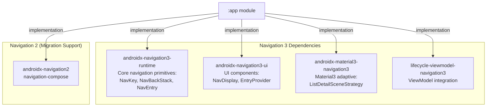

**Sources:** [app/build.gradle.kts:77-82]()

### Compose UI Dependencies

The Compose BOM (Bill of Materials) provides consistent versions for all Compose UI libraries:

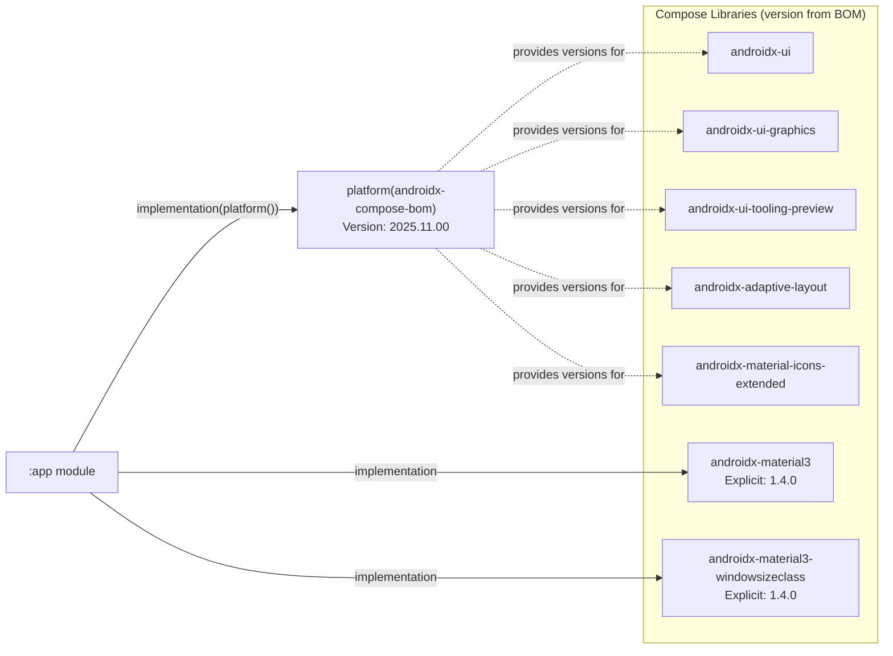

The `platform()` dependency ensures all Compose libraries use compatible versions from the BOM, except for those with explicit version overrides like `material3:1.4.0`.

**Sources:** [app/build.gradle.kts:66-73, 81]()

### Dual Dependency Injection Framework Support

The `:app` module includes both Hilt and Koin to demonstrate both compile-time and runtime DI patterns:

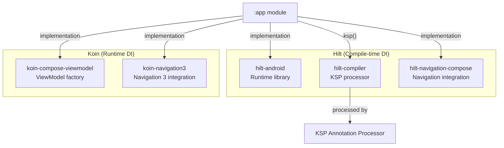

**Hilt Configuration:**
- Runtime: [app/build.gradle.kts:85]()
- Compiler: [app/build.gradle.kts:86]() (processed with KSP)
- Navigation: [app/build.gradle.kts:79]()

**Koin Configuration:**
- ViewModel: [app/build.gradle.kts:87]()
- Navigation 3: [app/build.gradle.kts:88]()

**Sources:** [app/build.gradle.kts:79, 85-88]()

### Serialization Dependencies

kotlinx.serialization is used for NavKey serialization and back stack persistence:

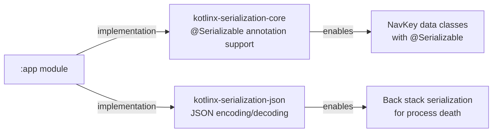

**Sources:** [app/build.gradle.kts:75-76]()

### Complete Dependency Graph

```mermaid
graph TB
    App[":app module"]
    Common[":common module"]
    
    subgraph "Platform Dependencies"
        Core["core-ktx"]
        Lifecycle["lifecycle-runtime-ktx"]
        Activity["activity-compose"]
    end
    
    subgraph "UI & Compose"
        BOM["compose-bom (platform)"]
        UI["ui, ui-graphics, ui-tooling-preview"]
        M3["material3, windowsizeclass"]
        Adaptive["adaptive-layout, material-icons"]
    end
    
    subgraph "Navigation"
        Nav3["navigation3-runtime, navigation3-ui"]
        Nav3M["material3-navigation3"]
        Nav2["navigation2-compose"]
        VM["lifecycle-viewmodel-navigation3"]
    end
    
    subgraph "Serialization"
        Ser["kotlinx-serialization-core/json"]
    end
    
    subgraph "Hilt DI"
        Hilt["hilt-android, hilt-navigation-compose"]
        HiltCompiler["hilt-compiler (ksp)"]
    end
    
    subgraph "Koin DI"
        Koin["koin-compose-viewmodel, koin-navigation3"]
    end
    
    subgraph "Testing"
        JUnit["junit, androidx-junit"]
        Espresso["espresso-core"]
        UITest["ui-test-junit4"]
    end
    
    App -->|"implementation"| Common
    App -->|"implementation"| Core
    App -->|"implementation"| Lifecycle
    App -->|"implementation"| Activity
    App -->|"implementation(platform)"| BOM
    App -->|"implementation"| UI
    App -->|"implementation"| M3
    App -->|"implementation"| Adaptive
    App -->|"implementation"| Nav3
    App -->|"implementation"| Nav3M
    App -->|"implementation"| Nav2
    App -->|"implementation"| VM
    App -->|"implementation"| Ser
    App -->|"implementation"| Hilt
    App -->|"ksp"| HiltCompiler
    App -->|"implementation"| Koin
    App -->|"testImplementation"| JUnit
    App -->|"androidTestImplementation"| Espresso
    App -->|"androidTestImplementation"| UITest
```

**Sources:** [app/build.gradle.kts:61-98]()

## Repository Configuration

The repository sources for dependencies are configured in [settings.gradle.kts]():

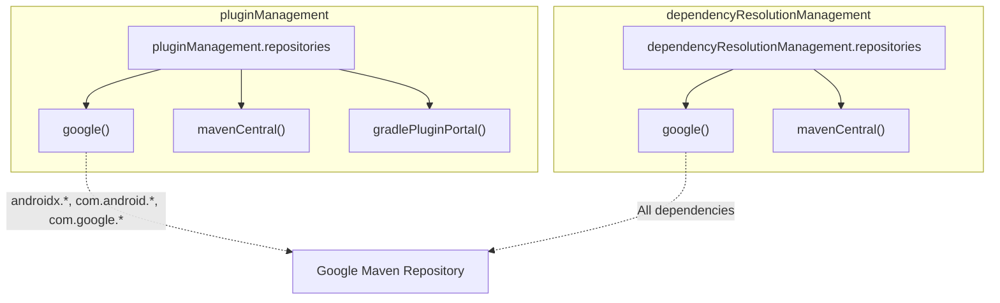

**Configuration Details:**

| Section | Purpose | Repositories | Location |
|---------|---------|--------------|----------|
| `pluginManagement` | Plugin resolution | Google (filtered), Maven Central, Gradle Plugin Portal | [settings.gradle.kts:17-33]() |
| `dependencyResolutionManagement` | Library resolution | Google, Maven Central | [settings.gradle.kts:35-45]() |
| `repositoriesMode` | `FAIL_ON_PROJECT_REPOS` (enforces centralized config) | - | [settings.gradle.kts:36]() |

**Sources:** [settings.gradle.kts:17-45]()

## Snapshot Artifacts Configuration

The project includes commented-out configuration for using AndroidX snapshot builds. To use snapshot artifacts:

1. Uncomment the `maven` block in both `pluginManagement` and `dependencyResolutionManagement` sections
2. Replace `<build_id>` with the desired snapshot build ID from androidx.dev
3. Example URL format: `https://androidx.dev/snapshots/builds/<build_id>/artifacts/repository`

**Sources:** [settings.gradle.kts:30-32, 42-44]()

## Build Configuration Summary

**Key Build System Features:**

| Feature | Implementation | Purpose |
|---------|----------------|---------|
| Version Catalog | `gradle/libs.versions.toml` | Centralized version management |
| Multi-Module | `:app`, `:common`, `:advanceddeeplinkapp` | Feature separation and code reuse |
| Dual DI Support | Hilt + Koin | Demonstrate both compile-time and runtime DI |
| Compose Compiler | Kotlin Compose Plugin 2.2.21 | Jetpack Compose support |
| Serialization | Kotlin Serialization Plugin | NavKey and back stack serialization |
| KSP | Version 2.3.2 | Annotation processing for Hilt |
| BOM Management | Compose BOM 2025.11.00 | Consistent Compose library versions |

**Sources:** [gradle/libs.versions.toml](), [app/build.gradle.kts](), [settings.gradle.kts]()

---

# Page: Core Navigation 3 Concepts

# Core Navigation 3 Concepts

<details>
<summary>Relevant source files</summary>

The following files were used as context for generating this wiki page:

- [app/src/main/java/com/example/nav3recipes/basic/BasicActivity.kt](app/src/main/java/com/example/nav3recipes/basic/BasicActivity.kt)
- [app/src/main/java/com/example/nav3recipes/basicsaveable/BasicSaveableActivity.kt](app/src/main/java/com/example/nav3recipes/basicsaveable/BasicSaveableActivity.kt)
- [app/src/main/java/com/example/nav3recipes/commonui/CommonUiActivity.kt](app/src/main/java/com/example/nav3recipes/commonui/CommonUiActivity.kt)
- [app/src/main/java/com/example/nav3recipes/content/Content.kt](app/src/main/java/com/example/nav3recipes/content/Content.kt)

</details>


## Purpose and Scope

This page explains the fundamental building blocks of Jetpack Navigation 3: `NavKey`, `NavBackStack`, `NavDisplay`, `EntryProvider`, and `NavEntry`. These components form the reactive architecture that powers type-safe, composable navigation in Android applications.

This document covers the core API concepts and how they interact. For information about specific navigation patterns like multiple back stacks, see [Multiple Back Stacks Pattern](#5.1). For details on Scene-based adaptive layouts, see [Scene System Overview](#6.1). For state persistence mechanisms, see [Saveable Back Stack](#3.3).

---

## Core Components Overview

Navigation 3 implements a reactive navigation system where navigation state is stored in an observable data structure and automatically triggers UI updates through Compose. The architecture separates three concerns:

1. **Navigation State**: What destinations are in the back stack
2. **Navigation Logic**: How to map destinations to UI content  
3. **Navigation Display**: How to render the current destination

| Component | Type | Purpose |
|-----------|------|---------|
| `NavKey` | Interface/Marker | Type-safe representation of a destination |
| `NavBackStack` | `SnapshotStateList<NavKey>` | Observable list storing navigation history |
| `NavDisplay` | `@Composable` | Renderer that displays the top entry from the back stack |
| `EntryProvider` | `(NavKey) -> NavEntry?` | Function mapping keys to renderable entries |
| `NavEntry` | Class | Wrapper containing a key and its composable content |

**Sources:**
- [app/src/main/java/com/example/nav3recipes/basic/BasicActivity.kt:36-71]()
- [app/src/main/java/com/example/nav3recipes/basicsaveable/BasicSaveableActivity.kt:39-74]()

---

## Architecture Diagram: Core Components and Data Flow

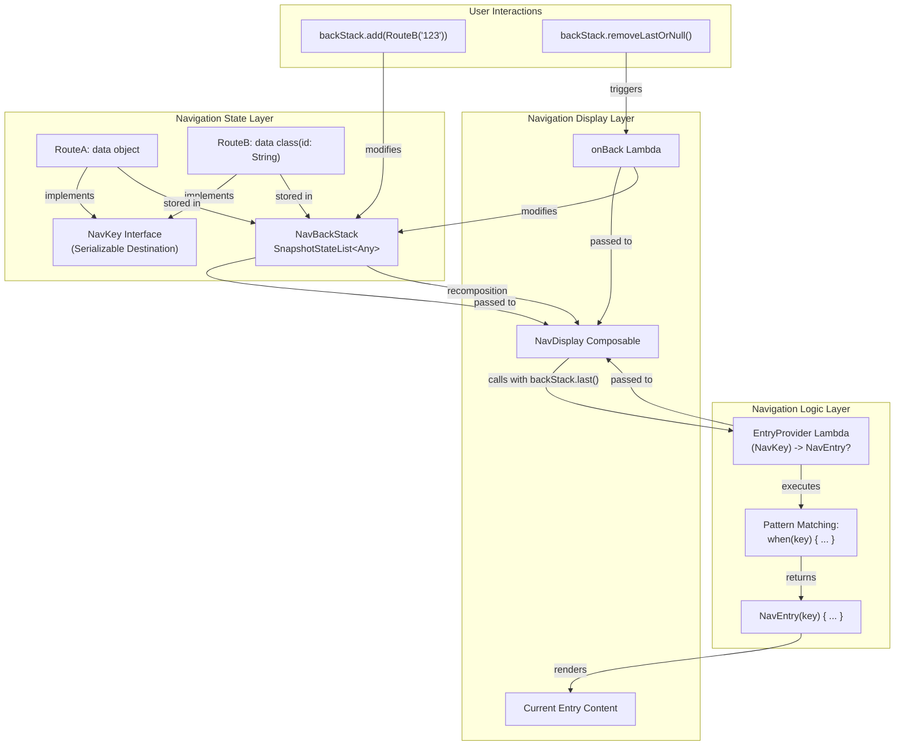

**Sources:**
- [app/src/main/java/com/example/nav3recipes/basic/BasicActivity.kt:42-68]()

---

## NavKey: Type-Safe Destinations

`NavKey` is a marker interface representing a navigation destination. Routes are implemented as Kotlin data classes or data objects that can carry arguments.

### Basic Route Definitions

The simplest approach uses plain Kotlin types without serialization:

**Example from BasicActivity:**
```kotlin
private data object RouteA
private data class RouteB(val id: String)
```

These routes can be any type (`Any`) and are stored directly in the back stack. This approach works for simple navigation but does not survive process death.

[app/src/main/java/com/example/nav3recipes/basic/BasicActivity.kt:32-34]()

### Serializable Routes with NavKey

For state preservation across configuration changes and process death, routes implement the `NavKey` interface and use `@Serializable`:

**Example from BasicSaveableActivity:**
```kotlin
@Serializable
private data object RouteA : NavKey

@Serializable  
private data class RouteB(val id: String) : NavKey
```

The `NavKey` interface enables automatic serialization through `kotlinx.serialization`. The `rememberNavBackStack` composable function handles serialization and restoration.

[app/src/main/java/com/example/nav3recipes/basicsaveable/BasicSaveableActivity.kt:33-37]()

### Route Design Patterns

| Pattern | Usage | Example |
|---------|-------|---------|
| `data object` | Routes with no arguments | `data object Home : NavKey` |
| `data class` | Routes with arguments | `data class UserProfile(val userId: String) : NavKey` |
| Type parameter | Routes from sealed interface | `sealed interface TopLevelRoute` |

**Sources:**
- [app/src/main/java/com/example/nav3recipes/basic/BasicActivity.kt:32-34]()
- [app/src/main/java/com/example/nav3recipes/basicsaveable/BasicSaveableActivity.kt:33-37]()

---

## NavBackStack: Navigation State Container

`NavBackStack` is a type alias for Compose's `SnapshotStateList`, which provides observable state that automatically triggers recomposition when modified.

### Creating a Back Stack

**Non-Saveable Approach:**
```kotlin
val backStack = remember { mutableStateListOf<Any>(RouteA) }
```

This creates a back stack initialized with `RouteA` as the start destination. The type is `SnapshotStateList<Any>`, allowing any route type.

[app/src/main/java/com/example/nav3recipes/basic/BasicActivity.kt:42]()

**Saveable Approach:**
```kotlin
val backStack = rememberNavBackStack(RouteA)
```

This creates a back stack that survives configuration changes and process death by serializing the back stack state. Requires routes to implement `NavKey` and be `@Serializable`.

[app/src/main/java/com/example/nav3recipes/basicsaveable/BasicSaveableActivity.kt:45]()

### Back Stack Operations

| Operation | Function | Effect |
|-----------|----------|--------|
| Push | `backStack.add(key)` | Adds destination to end of list |
| Pop | `backStack.removeLastOrNull()` | Removes and returns last destination |
| Read current | `backStack.lastOrNull()` | Returns current destination without removing |
| Clear and replace | `backStack.clear(); backStack.add(key)` | Replaces entire stack |

The back stack is observable: any modification triggers recomposition of composables reading from it.

### Back Stack State Flow Diagram

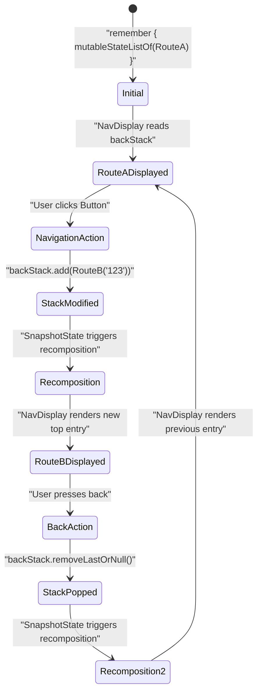

**Sources:**
- [app/src/main/java/com/example/nav3recipes/basic/BasicActivity.kt:42]()
- [app/src/main/java/com/example/nav3recipes/basicsaveable/BasicSaveableActivity.kt:45]()

---

## NavDisplay: The Rendering Coordinator

`NavDisplay` is a composable function that renders the current navigation entry based on the back stack state. It coordinates between the back stack, entry provider, and back button handling.

### NavDisplay Function Signature

```kotlin
@Composable
fun NavDisplay(
    backStack: SnapshotStateList<Any>,
    onBack: () -> Unit,
    entryProvider: (Any) -> NavEntry?
)
```

### Parameters

| Parameter | Type | Purpose |
|-----------|------|---------|
| `backStack` | `SnapshotStateList<Any>` | Observable navigation history |
| `onBack` | `() -> Unit` | Callback for system back button press |
| `entryProvider` | `(Any) -> NavEntry?` | Function mapping keys to entries |

### NavDisplay Behavior

1. **Reads Current Entry**: Calls `backStack.lastOrNull()` to get the current destination
2. **Maps to Content**: Invokes `entryProvider(key)` to obtain the `NavEntry`
3. **Renders Content**: Displays the composable content from the entry
4. **Handles Back**: Invokes `onBack` lambda when system back button is pressed

### Basic Usage Example

```kotlin
NavDisplay(
    backStack = backStack,
    onBack = { backStack.removeLastOrNull() },
    entryProvider = { key ->
        when (key) {
            is RouteA -> NavEntry(key) { ContentGreen("Welcome") }
            is RouteB -> NavEntry(key) { ContentBlue("Route: ${key.id}") }
            else -> error("Unknown route: $key")
        }
    }
)
```

The `onBack` parameter typically removes the last entry from the back stack, but can implement custom behavior like preventing back navigation or showing confirmation dialogs.

**Sources:**
- [app/src/main/java/com/example/nav3recipes/basic/BasicActivity.kt:44-68]()

---

## EntryProvider: Key-to-Content Mapping

The `EntryProvider` is a function that maps `NavKey` instances to `NavEntry` objects containing composable UI. Navigation 3 supports two approaches: manual lambda functions and a type-safe DSL.

### Manual Lambda Approach

The manual approach uses a `when` expression to pattern-match on the key:

```kotlin
entryProvider = { key ->
    when (key) {
        is RouteA -> NavEntry(key) {
            ContentGreen("Welcome to Nav3") {
                Button(onClick = { backStack.add(RouteB("123")) }) {
                    Text("Click to navigate")
                }
            }
        }
        is RouteB -> NavEntry(key) {
            ContentBlue("Route id: ${key.id}")
        }
        else -> error("Unknown route: $key")
    }
}
```

This approach provides explicit control but requires manual type checking and error handling.

[app/src/main/java/com/example/nav3recipes/basic/BasicActivity.kt:47-67]()

### Entry Provider DSL Approach

The DSL approach provides type-safe route registration using the `entryProvider` builder function:

```kotlin
entryProvider = entryProvider {
    entry<RouteA> {
        ContentGreen("Welcome to Nav3") {
            Button(onClick = { backStack.add(RouteB("123")) }) {
                Text("Click to navigate")
            }
        }
    }
    entry<RouteB> { key ->
        ContentBlue("Route id: ${key.id}")
    }
}
```

The `entry<T>` function registers a composable for a specific route type. The lambda receives the typed key as a parameter, eliminating manual casting.

[app/src/main/java/com/example/nav3recipes/commonui/CommonUiActivity.kt:89-106]()

### EntryProvider DSL Architecture

```mermaid
graph TB
    subgraph "DSL Builder"
        EPBuilder["entryProvider { ... }"]
        EntryBlock1["entry&lt;RouteA&gt; { ... }"]
        EntryBlock2["entry&lt;RouteB&gt; { key -> ... }"]
        EntryBlock3["entry&lt;ChatDetail&gt; { ... }"]
    end
    
    subgraph "Runtime Lookup"
        Registry["Type Registry<br/>Map&lt;KClass, Lambda&gt;"]
        Lookup["When NavDisplay queries key"]
        TypeMatch["Find matching KClass"]
        Invoke["Invoke registered lambda"]
    end
    
    subgraph "NavEntry Creation"
        NE["NavEntry(key) { content }"]
        Content["@Composable Content Block"]
    end
    
    EPBuilder -->|"registers"| EntryBlock1
    EPBuilder -->|"registers"| EntryBlock2
    EPBuilder -->|"registers"| EntryBlock3
    
    EntryBlock1 -->|"stores in"| Registry
    EntryBlock2 -->|"stores in"| Registry
    EntryBlock3 -->|"stores in"| Registry
    
    Lookup -->|"queries"| Registry
    Registry -->|"returns"| TypeMatch
    TypeMatch -->|"executes"| Invoke
    Invoke -->|"creates"| NE
    NE -->|"contains"| Content
```

**Sources:**
- [app/src/main/java/com/example/nav3recipes/basic/BasicActivity.kt:47-67]()
- [app/src/main/java/com/example/nav3recipes/commonui/CommonUiActivity.kt:89-106]()

---

## NavEntry: Entry Wrapper

`NavEntry` is a class that wraps a navigation key with its composable content and optional metadata. It represents a complete navigation destination ready to be rendered.

### NavEntry Constructor

```kotlin
NavEntry(
    key: NavKey,
    content: @Composable () -> Unit
)
```

The constructor takes:
- **key**: The navigation destination identifier
- **content**: A composable lambda defining the UI

### Usage in Entry Provider

```kotlin
NavEntry(key) {
    ContentGreen("Welcome to Nav3") {
        Button(onClick = { backStack.add(RouteB("123")) }) {
            Text("Click to navigate")
        }
    }
}
```

The content lambda has access to the surrounding scope, including the back stack for navigation operations.

[app/src/main/java/com/example/nav3recipes/basic/BasicActivity.kt:49-56]()

### Entry Metadata for Scenes

`NavEntry` instances can include metadata that `SceneStrategy` implementations use to determine layout behavior. This enables adaptive multi-pane layouts. For example:

```kotlin
entry<UserList> {
    NavEntry(
        key = UserList,
        metadata = metadata { listPane() }
    ) {
        UserListContent()
    }
}
```

The metadata indicates which pane role this entry can fulfill in adaptive layouts. See [Scene System Overview](#6.1) for details on metadata and scenes.

**Sources:**
- [app/src/main/java/com/example/nav3recipes/basic/BasicActivity.kt:49-56]()
- [app/src/main/java/com/example/nav3recipes/basic/BasicActivity.kt:59-61]()

---

## Complete Navigation Flow

The following diagram illustrates how all core components work together during a navigation operation:

```mermaid
sequenceDiagram
    participant User
    participant Button as "Button onClick"
    participant BackStack as "backStack<br/>SnapshotStateList"
    participant NavDisplay as "NavDisplay<br/>Composable"
    participant EP as "EntryProvider<br/>Lambda"
    participant Entry as "NavEntry"
    participant UI as "Rendered UI"

    Note over BackStack: "Initial: [RouteA]"
    
    NavDisplay->>BackStack: "Read backStack.lastOrNull()"
    BackStack-->>NavDisplay: "Returns RouteA"
    NavDisplay->>EP: "Call entryProvider(RouteA)"
    EP->>Entry: "Create NavEntry(RouteA) { ... }"
    Entry-->>EP: "Returns entry"
    EP-->>NavDisplay: "Returns entry"
    NavDisplay->>UI: "Render entry.content()"
    Note over UI: "Displays ContentGreen"

    User->>Button: "Click button"
    Button->>BackStack: "backStack.add(RouteB('123'))"
    Note over BackStack: "Modified: [RouteA, RouteB('123')]"
    BackStack-->>NavDisplay: "SnapshotState triggers recomposition"
    
    NavDisplay->>BackStack: "Read backStack.lastOrNull()"
    BackStack-->>NavDisplay: "Returns RouteB('123')"
    NavDisplay->>EP: "Call entryProvider(RouteB('123'))"
    EP->>Entry: "Create NavEntry(RouteB('123')) { ... }"
    Entry-->>EP: "Returns entry"
    EP-->>NavDisplay: "Returns entry"
    NavDisplay->>UI: "Render entry.content()"
    Note over UI: "Displays ContentBlue"

    User->>UI: "Press system back button"
    UI->>NavDisplay: "Triggers onBack()"
    NavDisplay->>BackStack: "backStack.removeLastOrNull()"
    Note over BackStack: "Modified: [RouteA]"
    BackStack-->>NavDisplay: "SnapshotState triggers recomposition"
    
    NavDisplay->>BackStack: "Read backStack.lastOrNull()"
    BackStack-->>NavDisplay: "Returns RouteA"
    NavDisplay->>EP: "Call entryProvider(RouteA)"
    EP->>Entry: "Create NavEntry(RouteA) { ... }"
    Entry-->>EP: "Returns entry"
    EP-->>NavDisplay: "Returns entry"
    NavDisplay->>UI: "Render entry.content()"
    Note over UI: "Displays ContentGreen again"
```

**Sources:**
- [app/src/main/java/com/example/nav3recipes/basic/BasicActivity.kt:36-71]()

---

## Code Entity Mapping: BasicActivity Example

This diagram maps the conceptual navigation components to their concrete implementations in `BasicActivity.kt`:

```mermaid
graph LR
    subgraph "Code Entities in BasicActivity.kt"
        RouteA_def["RouteA<br/>data object (line 32)"]
        RouteB_def["RouteB(id: String)<br/>data class (line 34)"]
        backStack_var["backStack variable<br/>remember { mutableStateListOf } (line 42)"]
        NavDisplay_call["NavDisplay function<br/>call (line 44)"]
        entryProvider_lambda["entryProvider lambda<br/>(line 47-67)"]
        when_expr["when(key) expression<br/>(line 48)"]
        NavEntry_RouteA["NavEntry(RouteA) { ... }<br/>(line 49)"]
        NavEntry_RouteB["NavEntry(RouteB) { ... }<br/>(line 59)"]
        ContentGreen_call["ContentGreen composable<br/>(line 50)"]
        ContentBlue_call["ContentBlue composable<br/>(line 60)"]
        Button_click["Button onClick<br/>(line 51-53)"]
        add_call["backStack.add(RouteB('123'))<br/>(line 52)"]
        onBack_lambda["onBack lambda<br/>(line 46)"]
        removeLastOrNull_call["backStack.removeLastOrNull()<br/>(line 46)"]
    end
    
    subgraph "Conceptual Components"
        NavKey_concept["NavKey"]
        BackStack_concept["NavBackStack"]
        NavDisplay_concept["NavDisplay"]
        EntryProvider_concept["EntryProvider"]
        NavEntry_concept["NavEntry"]
    end
    
    RouteA_def -->|"implements"| NavKey_concept
    RouteB_def -->|"implements"| NavKey_concept
    backStack_var -->|"instance of"| BackStack_concept
    NavDisplay_call -->|"uses"| NavDisplay_concept
    entryProvider_lambda -->|"implements"| EntryProvider_concept
    NavEntry_RouteA -->|"creates"| NavEntry_concept
    NavEntry_RouteB -->|"creates"| NavEntry_concept
    
    when_expr -->|"pattern matches"| RouteA_def
    when_expr -->|"pattern matches"| RouteB_def
    when_expr -->|"returns"| NavEntry_RouteA
    when_expr -->|"returns"| NavEntry_RouteB
    
    Button_click -->|"triggers"| add_call
    add_call -->|"modifies"| backStack_var
    onBack_lambda -->|"triggers"| removeLastOrNull_call
    removeLastOrNull_call -->|"modifies"| backStack_var
```

**Sources:**
- [app/src/main/java/com/example/nav3recipes/basic/BasicActivity.kt:32-71]()

---

## Comparison: Basic vs Saveable Navigation

| Aspect | BasicActivity | BasicSaveableActivity |
|--------|---------------|----------------------|
| Route Definition | `data object RouteA` | `@Serializable data object RouteA : NavKey` |
| Back Stack Creation | `remember { mutableStateListOf(RouteA) }` | `rememberNavBackStack(RouteA)` |
| Type Safety | Any type | `NavKey` constraint |
| Configuration Changes | State lost | State preserved |
| Process Death | State lost | State restored via serialization |
| Serialization Requirement | None | `@Serializable` annotation required |
| Use Case | Prototyping, simple flows | Production apps |

**Sources:**
- [app/src/main/java/com/example/nav3recipes/basic/BasicActivity.kt:32-71]()
- [app/src/main/java/com/example/nav3recipes/basicsaveable/BasicSaveableActivity.kt:33-74]()

---

## Key Takeaways

1. **NavKey**: Type-safe route definitions that can be data objects (no args) or data classes (with args)
2. **NavBackStack**: Observable `SnapshotStateList` that automatically triggers recomposition on changes
3. **NavDisplay**: Composable that reads the back stack and renders the current destination
4. **EntryProvider**: Function (manual lambda or DSL) that maps keys to `NavEntry` instances
5. **NavEntry**: Wrapper containing a key and its composable content

These five components form a reactive, type-safe navigation system where:
- State changes (back stack modifications) automatically trigger UI updates
- Navigation logic is separated from UI definition
- Routes carry type-safe arguments as data class properties
- The system integrates naturally with Compose's declarative paradigm

For more advanced patterns building on these concepts, see:
- [Entry Provider DSL](#3.2) for cleaner route registration
- [Saveable Back Stack](#3.3) for state preservation
- [Scene System Overview](#6.1) for adaptive layouts
- [Multiple Back Stacks Pattern](#5.1) for tab-based navigation

**Sources:**
- [app/src/main/java/com/example/nav3recipes/basic/BasicActivity.kt:36-71]()
- [app/src/main/java/com/example/nav3recipes/basicsaveable/BasicSaveableActivity.kt:39-74]()
- [app/src/main/java/com/example/nav3recipes/commonui/CommonUiActivity.kt:86-111]()

---

# Page: Running Recipe Examples

# Running Recipe Examples

<details>
<summary>Relevant source files</summary>

The following files were used as context for generating this wiki page:

- [README.md](README.md)
- [app/src/main/AndroidManifest.xml](app/src/main/AndroidManifest.xml)
- [app/src/main/java/com/example/nav3recipes/RecipePickerActivity.kt](app/src/main/java/com/example/nav3recipes/RecipePickerActivity.kt)

</details>


This page explains how to use `RecipePickerActivity` to browse, select, and launch individual recipe demonstrations. Each recipe is a self-contained example that demonstrates a specific Navigation 3 feature or pattern.

For information about the core Navigation 3 concepts demonstrated in these recipes, see [Core Navigation 3 Concepts](#2.2). For details on the project structure and build configuration, see [Project Setup and Build Configuration](#2.1).

## Overview

The nav3-recipes application uses a **hub-and-spoke architecture** where `RecipePickerActivity` serves as the central launcher. Each recipe runs in its own separate `Activity`, allowing complete isolation between examples. This design ensures that:

- Each recipe demonstrates exactly one concept without interference from other recipes
- Recipes can be understood independently without cross-dependencies
- Adding new recipes requires no changes to existing recipe code

**Sources:** [app/src/main/java/com/example/nav3recipes/RecipePickerActivity.kt:68-73]()

## Application Entry Point

### Launch Configuration

`RecipePickerActivity` is configured as the main launcher activity in the application manifest. When the user taps the app icon, Android OS launches this activity.

```mermaid
graph TB
    OS["Android OS"]
    Launcher["RecipePickerActivity"]
    Manifest["AndroidManifest.xml<br/>MAIN/LAUNCHER intent-filter"]
    
    OS -->|"User taps app icon"| Manifest
    Manifest -->|"Launches"| Launcher
    
    Launcher --> UI["Scaffold with TopAppBar<br/>+ LazyColumn"]
    UI --> RecipeList["RecipeList Composable"]
    RecipeList --> Items["Recipe and Heading items"]
```

**Manifest Configuration:**

| Configuration | Value | Location |
|--------------|-------|----------|
| Activity name | `RecipePickerActivity` | [app/src/main/AndroidManifest.xml:34]() |
| Intent action | `android.intent.action.MAIN` | [app/src/main/AndroidManifest.xml:39]() |
| Intent category | `android.intent.category.LAUNCHER` | [app/src/main/AndroidManifest.xml:40]() |
| Theme | `@style/Theme.Nav3Recipes` | [app/src/main/AndroidManifest.xml:37]() |
| Exported | `true` | [app/src/main/AndroidManifest.xml:35]() |

**Sources:** [app/src/main/AndroidManifest.xml:33-42]()

### Activity Initialization

When `RecipePickerActivity.onCreate()` executes, it:

1. Applies edge-to-edge display configuration via `setEdgeToEdgeConfig()`
2. Sets Compose UI content using `setContent {}`
3. Renders a `Scaffold` with a `TopAppBar` titled "Recipes"
4. Displays the scrollable recipe list in the content area

**Sources:** [app/src/main/java/com/example/nav3recipes/RecipePickerActivity.kt:120-138]()

## Recipe Organization Structure

### Data Model

The recipe list uses two data classes to structure content:

```mermaid
classDiagram
    class Recipe {
        +String name
        +Class~Activity~ activityClass
        +start() void
    }
    
    class Heading {
        +String name
    }
    
    class RecipePickerActivity {
        +onCreate(Bundle) void
        +RecipeList(PaddingValues) Composable
    }
    
    RecipePickerActivity ..> Recipe : uses
    RecipePickerActivity ..> Heading : uses
```

| Class | Properties | Purpose |
|-------|-----------|---------|
| `Recipe` | `name: String`<br/>`activityClass: Class<out Activity>` | Represents a launchable recipe example with display name and target Activity |
| `Heading` | `name: String` | Represents a category header for organizing recipes into logical groups |

**Sources:** [app/src/main/java/com/example/nav3recipes/RecipePickerActivity.kt:70-75]()

### Recipe Categories

The recipes are organized into the following categories in the order displayed:

```mermaid
graph TD
    Root["recipes: List~Any~"]
    
    Root --> Basic["Basic API recipes"]
    Root --> Layouts["Layouts using Scenes"]
    Root --> Material["Material adaptive layouts"]
    Root --> Animations["Animations"]
    Root --> Common["Common use cases"]
    Root --> Architecture["Architecture"]
    Root --> ViewModels["Passing navigation arguments using ViewModels"]
    Root --> Results["Returning Results"]
    Root --> DeepLink["Deeplink"]
    
    Basic --> BasicActivity["Recipe: Basic → BasicActivity"]
    Basic --> BasicDslActivity["Recipe: Basic DSL → BasicDslActivity"]
    Basic --> BasicSaveableActivity["Recipe: Basic Saveable → BasicSaveableActivity"]
    
    Layouts --> ListDetailActivity["Recipe: List-detail → ListDetailActivity"]
    Layouts --> TwoPaneActivity["Recipe: Two pane → TwoPaneActivity"]
    Layouts --> BottomSheetActivity["Recipe: Bottom Sheet → BottomSheetActivity"]
    Layouts --> DialogActivity["Recipe: Dialog → DialogActivity"]
    
    Material --> MaterialListDetailActivity["Recipe: Material list-detail layout → MaterialListDetailActivity"]
    Material --> MaterialSupportingPaneActivity["Recipe: Material supporting-pane layout → MaterialSupportingPaneActivity"]
    
    Animations --> AnimatedActivity["Recipe: NavDisplay and NavEntry animations → AnimatedActivity"]
    
    Common --> CommonUiActivity["Recipe: Common UI → CommonUiActivity"]
    Common --> MultipleStacksActivity["Recipe: Multiple Stacks → MultipleStacksActivity"]
    Common --> ConditionalActivity["Recipe: Conditional navigation → ConditionalActivity"]
    
    Architecture --> HiltModularActivity["Recipe: Hilt - Modular Navigation → HiltModularActivity"]
    Architecture --> KoinModularActivity["Recipe: Koin - Modular Navigation → KoinModularActivity"]
    
    ViewModels --> BasicViewModelsActivity["Recipe: Basic → BasicViewModelsActivity"]
    ViewModels --> HiltViewModelsActivity["Recipe: Using Hilt → HiltViewModelsActivity"]
    ViewModels --> KoinViewModelsActivity["Recipe: Using Koin → KoinViewModelsActivity"]
    
    Results --> ResultEventActivity["Recipe: Return result as Event → ResultEventActivity"]
    Results --> ResultStateActivity["Recipe: Return result as State → ResultStateActivity"]
    
    DeepLink --> CreateDeepLinkActivity["Recipe: Parse Intent → CreateDeepLinkActivity"]
```

**Recipe Count by Category:**

| Category | Recipe Count | Example Recipes |
|----------|-------------|-----------------|
| Basic API recipes | 3 | Basic, Basic DSL, Basic Saveable |
| Layouts using Scenes | 4 | List-detail, Two pane, Bottom Sheet, Dialog |
| Material adaptive layouts | 2 | Material list-detail, Material supporting-pane |
| Animations | 1 | NavDisplay and NavEntry animations |
| Common use cases | 3 | Common UI, Multiple Stacks, Conditional navigation |
| Architecture | 2 | Hilt - Modular, Koin - Modular |
| Passing navigation arguments using ViewModels | 3 | Basic, Using Hilt, Using Koin |
| Returning Results | 2 | Return result as Event, Return result as State |
| Deeplink | 1 | Parse Intent |

**Sources:** [app/src/main/java/com/example/nav3recipes/RecipePickerActivity.kt:77-116]()

## UI Implementation

### LazyColumn Layout

The recipe list is rendered using a `LazyColumn` that displays both `Heading` and `Recipe` items:

```mermaid
sequenceDiagram
    participant LC as LazyColumn
    participant Items as items(recipes)
    participant When as when(item)
    participant Heading as Heading ListItem
    participant Recipe as Recipe ListItem
    
    LC->>Items: Iterate recipes list
    Items->>When: Check item type
    
    alt item is Heading
        When->>Heading: Display category header
        Note over Heading: Bold text<br/>48dp height<br/>surfaceVariant background
    else item is Recipe
        When->>Recipe: Display recipe entry
        Note over Recipe: Clickable<br/>Calls item.start()
    end
```

**Heading ListItem Configuration:**
- Text: Bold font weight
- Height: `48.dp`
- Background: `MaterialTheme.colorScheme.surfaceVariant`
- Non-clickable

**Recipe ListItem Configuration:**
- Text: Regular font weight
- Modifier: `.clickable { item.start() }`
- Background: Default `ListItem` colors
- Launches activity on click

**Sources:** [app/src/main/java/com/example/nav3recipes/RecipePickerActivity.kt:141-176]()

## Launching a Recipe

### Recipe Launch Mechanism

When a user taps a recipe in the list, the following sequence executes:

```mermaid
sequenceDiagram
    participant User
    participant ListItem as Recipe ListItem<br/>(Composable)
    participant StartFunc as Recipe.start()<br/>extension function
    participant Intent as Intent(context, activityClass)
    participant OS as Android OS
    participant RecipeActivity as Recipe Activity<br/>(e.g., BasicActivity)
    
    User->>ListItem: Tap recipe
    ListItem->>StartFunc: Modifier.clickable { item.start() }
    StartFunc->>Intent: Create Intent
    Note over Intent: Intent(this@RecipePickerActivity,<br/>this.activityClass)
    StartFunc->>OS: startActivity(intent)
    OS->>RecipeActivity: Launch activity
    RecipeActivity->>RecipeActivity: onCreate()
    RecipeActivity->>RecipeActivity: Setup Navigation 3
    RecipeActivity->>User: Display recipe demonstration
```

**Implementation Details:**

The `Recipe.start()` extension function performs the launch:

| Step | Code Entity | Action |
|------|------------|--------|
| 1 | `Recipe.start()` | Extension function invoked by clickable modifier |
| 2 | `Intent` constructor | Creates intent targeting `this.activityClass` |
| 3 | `startActivity(intent)` | Launches the recipe activity |

**Sources:** [app/src/main/java/com/example/nav3recipes/RecipePickerActivity.kt:154-156](), [app/src/main/java/com/example/nav3recipes/RecipePickerActivity.kt:178-181]()

### Recipe Activity Declaration

All recipe activities must be declared in `AndroidManifest.xml` with `android:exported="true"` to be launchable. Example declarations:

```mermaid
graph LR
    Manifest["AndroidManifest.xml"]
    
    Manifest --> BasicActivity["<br/>activity<br/>name=.basic.BasicActivity<br/>exported=true"]
    Manifest --> CommonUiActivity["<br/>activity<br/>name=.commonui.CommonUiActivity<br/>exported=true"]
    Manifest --> DialogActivity["<br/>activity<br/>name=.dialog.DialogActivity<br/>exported=true"]
    Manifest --> HiltModularActivity["<br/>activity<br/>name=.modular.hilt.HiltModularActivity<br/>exported=true"]
    Manifest --> More["... all other recipe activities"]
```

Each recipe activity declaration follows this pattern:
- `android:name` attribute specifying the fully-qualified class name
- `android:exported="true"` allowing the activity to be launched
- `android:theme="@style/Theme.Nav3Recipes"` applying the app theme

**Sources:** [app/src/main/AndroidManifest.xml:43-145]()

## Navigation Flow

### Complete User Journey

The typical navigation flow through the recipe picker:

```mermaid
stateDiagram-v2
    [*] --> LauncherHome: User taps app icon
    LauncherHome --> RecipePickerActivity: OS launches MAIN activity
    
    RecipePickerActivity --> RecipePickerActivity: User scrolls list
    RecipePickerActivity --> RecipeActivity: User taps recipe
    
    state RecipeActivity {
        [*] --> Setup: onCreate()
        Setup --> Demonstrating: Navigation 3 APIs active
        Demonstrating --> [*]: User presses back
    }
    
    RecipeActivity --> RecipePickerActivity: Activity finishes
    RecipePickerActivity --> RecipeActivity: User taps different recipe
    RecipePickerActivity --> LauncherHome: User presses back/home
    LauncherHome --> [*]
```

### Back Navigation Behavior

| Current Screen | Back Press Action | Result |
|----------------|------------------|--------|
| `RecipePickerActivity` | Standard back press | App exits to launcher |
| Any recipe activity (e.g., `BasicActivity`) | Standard back press | Recipe activity finishes, returns to `RecipePickerActivity` |
| Within a recipe's Navigation 3 back stack | Back gesture | Pops Navigation 3 back stack (handled by recipe's `Navigator`) |

**Key Points:**
- `RecipePickerActivity` maintains its state when returning from a recipe
- The `LazyColumn` scroll position is preserved
- Each recipe activity manages its own Navigation 3 state independently
- No shared state exists between recipe activities

**Sources:** [app/src/main/java/com/example/nav3recipes/RecipePickerActivity.kt:118-182]()

## Recipe Activity Isolation

### Self-Contained Architecture

Each recipe activity operates independently with the following characteristics:

```mermaid
graph TB
    subgraph "RecipePickerActivity Scope"
        Picker["RecipePickerActivity"]
        RecipesList["List of Recipe objects"]
    end
    
    subgraph "BasicActivity Scope"
        BasicActivity["BasicActivity"]
        BasicNav["Navigator instance"]
        BasicBackStack["NavBackStack instance"]
        BasicRoutes["RouteA, RouteB, RouteC"]
    end
    
    subgraph "DialogActivity Scope"
        DialogActivity["DialogActivity"]
        DialogNav["Navigator instance"]
        DialogBackStack["NavBackStack instance"]
        DialogRoutes["DialogRoute, ContentRoute"]
    end
    
    subgraph "HiltModularActivity Scope"
        HiltActivity["HiltModularActivity"]
        HiltNav["Navigator instance"]
        HiltBackStack["NavBackStack instance"]
        HiltModules["Feature modules with DI"]
    end
    
    Picker -->|"Intent + startActivity()"| BasicActivity
    Picker -->|"Intent + startActivity()"| DialogActivity
    Picker -->|"Intent + startActivity()"| HiltActivity
    
    BasicActivity --> BasicNav
    BasicNav --> BasicBackStack
    BasicBackStack --> BasicRoutes
    
    DialogActivity --> DialogNav
    DialogNav --> DialogBackStack
    DialogBackStack --> DialogRoutes
    
    HiltActivity --> HiltNav
    HiltNav --> HiltBackStack
    HiltBackStack --> HiltModules
```

**Isolation Guarantees:**

| Aspect | Implementation |
|--------|---------------|
| Navigation State | Each recipe creates its own `rememberNavBackStack()` or `rememberSaveableNavBackStack()` |
| Navigator Instance | Each recipe instantiates its own `Navigator` class |
| Route Definitions | Each recipe defines its own `NavKey` implementations in its package |
| Lifecycle | Each recipe activity has independent lifecycle callbacks |
| Dependencies | Recipes using DI (Hilt/Koin) have isolated dependency scopes |

This isolation allows recipes to:
- Demonstrate patterns without side effects on other recipes
- Use conflicting implementations of the same pattern
- Be understood in isolation without cross-referencing other code

**Sources:** [app/src/main/java/com/example/nav3recipes/RecipePickerActivity.kt:1-183](), [app/src/main/AndroidManifest.xml:33-145]()

## Finding Specific Recipes

To locate a specific recipe quickly:

1. **Scroll through categories** - Recipes are grouped logically by feature area
2. **Use category headers** - Bold, highlighted headers mark each category boundary
3. **Match recipe names to wiki pages** - Recipe names correspond to wiki documentation sections

**Common Recipe Name Mappings:**

| If you want to learn about... | Look for recipe... | See wiki page... |
|-------------------------------|-------------------|------------------|
| Basic navigation setup | "Basic" under Basic API recipes | [Basic Navigation](#4.1) |
| State preservation | "Basic Saveable" under Basic API recipes | [Saveable Back Stack](#4.3) |
| Dialog overlays | "Dialog" under Layouts using Scenes | [Dialog and BottomSheet Scenes](#6.4) |
| Adaptive UI with Material | "Material list-detail layout" under Material adaptive layouts | [Material3 Adaptive Layouts](#6.5) |
| Multiple independent stacks | "Multiple Stacks" under Common use cases | [Multiple Back Stacks Pattern](#5.1) |
| ViewModel with Hilt | "Using Hilt" under Passing navigation arguments using ViewModels | [Hilt Injected ViewModels](#9.2) |
| Event-based results | "Return result as Event" under Returning Results | [Event-Based Results](#8.1) |

**Sources:** [app/src/main/java/com/example/nav3recipes/RecipePickerActivity.kt:77-116]()

---

# Page: Basic Navigation Recipes

# Basic Navigation Recipes

<details>
<summary>Relevant source files</summary>

The following files were used as context for generating this wiki page:

- [app/src/main/java/com/example/nav3recipes/animations/AnimatedActivity.kt](app/src/main/java/com/example/nav3recipes/animations/AnimatedActivity.kt)
- [app/src/main/java/com/example/nav3recipes/basic/BasicActivity.kt](app/src/main/java/com/example/nav3recipes/basic/BasicActivity.kt)
- [app/src/main/java/com/example/nav3recipes/basicdsl/BasicDslActivity.kt](app/src/main/java/com/example/nav3recipes/basicdsl/BasicDslActivity.kt)
- [app/src/main/java/com/example/nav3recipes/commonui/CommonUiActivity.kt](app/src/main/java/com/example/nav3recipes/commonui/CommonUiActivity.kt)
- [app/src/main/java/com/example/nav3recipes/dialog/DialogActivity.kt](app/src/main/java/com/example/nav3recipes/dialog/DialogActivity.kt)

</details>


## Purpose and Scope

This section covers the foundational Navigation 3 recipes that demonstrate core API usage patterns. These recipes introduce the essential building blocks of Navigation 3: creating navigation keys, managing back stacks, displaying content with `NavDisplay`, and handling state persistence. Each recipe focuses on a single concept and builds progressively from minimal setup to production-ready patterns.

The basic recipes demonstrate:
- Simple screen-to-screen navigation with manual entry provider ([3.1](#3.1))
- Declarative route-to-content mapping using the `entryProvider` DSL ([3.2](#3.2))
- State persistence across configuration changes and process death ([3.3](#3.3))

For advanced multi-stack patterns, see [Multiple Back Stacks and Common UI Patterns](#5). For deep link handling, see [Deep Link Navigation](#4). For ViewModels with navigation arguments, see [ViewModel Integration](#9).

Sources: [app/src/main/java/com/example/nav3recipes/basic/BasicActivity.kt](), [app/src/main/java/com/example/nav3recipes/basicdsl/BasicDslActivity.kt]()

---

## Recipe Categories Overview

The basic navigation recipes are organized into three conceptual categories that form a natural learning progression:

| Category | Recipe | Activity Class | Key Demonstration | Complexity |
|----------|--------|----------------|-------------------|------------|
| **Core API** | Basic Navigation ([3.1](#3.1)) | `BasicActivity` | `NavDisplay`, `mutableStateListOf`, manual `entryProvider` lambda | Minimal |
| **Core API** | Entry Provider DSL ([3.2](#3.2)) | `BasicDslActivity` | `entryProvider { }` DSL with `entry<T>` blocks | Minimal |
| **State Management** | Saveable Back Stack ([3.3](#3.3)) | `BasicSaveableActivity` | `rememberSaveableNavBackStack()` for persistence | Low |

Sources: [app/src/main/java/com/example/nav3recipes/basic/BasicActivity.kt:36](), [app/src/main/java/com/example/nav3recipes/basicdsl/BasicDslActivity.kt:39]()

---

## Recipe Progression and Relationships

```mermaid
graph TB
    subgraph "Learning Path"
        Basic["Basic Navigation<br/>(3.1)<br/>BasicActivity"]
        DSL["Entry Provider DSL<br/>(3.2)<br/>BasicDslActivity"]
        Saveable["Saveable Back Stack<br/>(3.3)<br/>BasicSaveableActivity"]
    end
    
    subgraph "Core Concepts Introduced"
        MutableStateList["mutableStateListOf<Any><br/>Manual back stack"]
        NavDisplay["NavDisplay composable<br/>UI rendering"]
        ManualProvider["Lambda entryProvider<br/>when expression"]
        EntryProviderDSL["entryProvider DSL<br/>entry<T> blocks"]
        RememberNavBS["rememberNavBackStack<br/>Compose state"]
        SaveableAPI["rememberSaveableNavBackStack<br/>Process death recovery"]
        SerializableKeys["@Serializable NavKey<br/>kotlinx.serialization"]
    end
    
    Basic --> MutableStateList
    Basic --> NavDisplay
    Basic --> ManualProvider
    
    DSL --> RememberNavBS
    DSL --> NavDisplay
    DSL --> EntryProviderDSL
    DSL --> SerializableKeys
    
    Saveable --> RememberNavBS
    Saveable --> NavDisplay
    Saveable --> EntryProviderDSL
    Saveable --> SerializableKeys
    Saveable --> SaveableAPI
    
    Basic -.->|"Add DSL + @Serializable"| DSL
    DSL -.->|"Add persistence"| Saveable
```

**Diagram: Basic Recipe Learning Progression**

This diagram shows how each recipe builds upon core Navigation 3 concepts. Basic Navigation ([3.1](#3.1)) introduces manual back stack management with `mutableStateListOf` and lambda-based entry providers. Entry Provider DSL ([3.2](#3.2)) replaces manual mapping with declarative `entryProvider { }` blocks and adds `@Serializable` annotation to `NavKey` routes. Saveable Back Stack ([3.3](#3.3)) extends the DSL pattern with `rememberSaveableNavBackStack()` for automatic state persistence.

Sources: [app/src/main/java/com/example/nav3recipes/basic/BasicActivity.kt:24-46](), [app/src/main/java/com/example/nav3recipes/basicdsl/BasicDslActivity.kt:24-49]()

---

## Code Entity Architecture for Basic Recipes

```mermaid
graph TB
    subgraph "Basic Recipe Activities"
        BasicAct["BasicActivity<br/>basic/BasicActivity.kt"]
        BasicDslAct["BasicDslActivity<br/>basicdsl/BasicDslActivity.kt"]
        BasicSaveableAct["BasicSaveableActivity<br/>basicsaveable/BasicSaveableActivity.kt"]
    end
    
    subgraph "Route Definitions"
        RouteABasic["data object RouteA<br/>(BasicActivity)"]
        RouteBBasic["data class RouteB(id: String)<br/>(BasicActivity)"]
        RouteADsl["@Serializable<br/>data object RouteA : NavKey"]
        RouteBDsl["@Serializable<br/>data class RouteB(id: String) : NavKey"]
    end
    
    subgraph "Back Stack Creation"
        MutableStateListCall["remember {<br/>  mutableStateListOf<Any>(RouteA)<br/>}"]
        RememberNavBSCall["rememberNavBackStack(RouteA)"]
        RememberSaveableCall["rememberSaveableNavBackStack(RouteA)"]
    end
    
    subgraph "Entry Provider Implementations"
        LambdaProvider["entryProvider = { key -><br/>  when (key) {<br/>    is RouteA -> NavEntry(key) { ... }<br/>    is RouteB -> NavEntry(key) { ... }<br/>  }<br/>}"]
        DSLProvider["entryProvider = entryProvider {<br/>  entry<RouteA> { ... }<br/>  entry<RouteB> { key -> ... }<br/>}"]
    end
    
    subgraph "Content Components"
        ContentGreen["ContentGreen(title)"]
        ContentBlue["ContentBlue(title)"]
        ButtonAdd["Button(onClick = {<br/>  backStack.add(RouteB('123'))<br/>})"]
    end
    
    BasicAct --> RouteABasic
    BasicAct --> RouteBBasic
    BasicAct --> MutableStateListCall
    BasicAct --> LambdaProvider
    BasicAct --> ContentGreen
    BasicAct --> ContentBlue
    BasicAct --> ButtonAdd
    
    BasicDslAct --> RouteADsl
    BasicDslAct --> RouteBDsl
    BasicDslAct --> RememberNavBSCall
    BasicDslAct --> DSLProvider
    BasicDslAct --> ContentGreen
    BasicDslAct --> ContentBlue
    BasicDslAct --> ButtonAdd
    
    BasicSaveableAct --> RouteADsl
    BasicSaveableAct --> RouteBDsl
    BasicSaveableAct --> RememberSaveableCall
    BasicSaveableAct --> DSLProvider
```

**Diagram: Code Entity Mapping for Basic Recipes**

This diagram maps high-level concepts to specific code entities used in the basic recipes. `BasicActivity` uses plain `data object` and `data class` routes with manual `mutableStateListOf` back stack creation and lambda-based entry providers. `BasicDslActivity` introduces `@Serializable` annotations on `NavKey` implementations, switches to `rememberNavBackStack`, and uses the `entryProvider { }` DSL with type-safe `entry<T>` blocks. `BasicSaveableActivity` extends the DSL pattern with `rememberSaveableNavBackStack` for automatic serialization and state restoration.

Sources: [app/src/main/java/com/example/nav3recipes/basic/BasicActivity.kt:32-68](), [app/src/main/java/com/example/nav3recipes/basicdsl/BasicDslActivity.kt:33-64]()

---

## Common Implementation Patterns

All basic recipes share these structural patterns:

### Activity Structure

Each recipe is self-contained in its own `ComponentActivity`:

| Element | Purpose | Code Location |
|---------|---------|---------------|
| **Activity Class** | Hosts the navigation demonstration | `class BasicActivity : ComponentActivity()` |
| **Route Definitions** | Type-safe destination identifiers | `data object RouteA`, `data class RouteB(id: String)` |
| **Back Stack** | Navigation history state | `val backStack = remember { mutableStateListOf<Any>(RouteA) }` or `rememberNavBackStack(RouteA)` |
| **NavDisplay** | Composable that renders current destination | `NavDisplay(backStack, onBack, entryProvider)` |
| **Entry Provider** | Maps routes to composable content | Lambda or `entryProvider { entry<RouteA> { ... } }` |
| **Content Composables** | Screen UI implementations | `ContentGreen`, `ContentBlue` |
| **Navigation Triggers** | User interactions that modify back stack | `Button(onClick = { backStack.add(RouteB("123")) })` |

### NavKey Design Patterns

Basic recipes demonstrate two route patterns:

**Pattern 1: Data object for parameterless routes**
```kotlin
data object RouteA  // BasicActivity
@Serializable data object RouteA : NavKey  // BasicDslActivity
```

**Pattern 2: Data class for routes with arguments**
```kotlin
data class RouteB(val id: String)  // BasicActivity
@Serializable data class RouteB(val id: String) : NavKey  // BasicDslActivity
```

The `@Serializable` annotation is required for `rememberNavBackStack` and `rememberSaveableNavBackStack` to enable automatic serialization.

### Navigation Flow

```mermaid
sequenceDiagram
    participant User
    participant Button as "Button Composable"
    participant BS as "backStack (MutableStateList)"
    participant ND as "NavDisplay"
    participant EP as "entryProvider"
    participant Content as "ContentGreen/ContentBlue"
    
    User->>Button: "Click"
    Button->>BS: "backStack.add(RouteB('123'))"
    BS->>BS: "SnapshotStateList mutation"
    BS->>ND: "Composition observes change"
    ND->>EP: "entryProvider(RouteB('123'))"
    EP->>EP: "entry<RouteB> block"
    EP->>Content: "ContentBlue composable"
    Content->>User: "New screen rendered"
```

**Diagram: Basic Navigation Flow**

This sequence shows the reactive data flow pattern used across all basic recipes. User interactions directly modify the `backStack` state list. Because `NavDisplay` observes this state through Compose's snapshot system, any mutation triggers recomposition. The `entryProvider` function (or DSL block) is called with the new route to produce the composable content.

Sources: [app/src/main/java/com/example/nav3recipes/basic/BasicActivity.kt:42-68](), [app/src/main/java/com/example/nav3recipes/basicdsl/BasicDslActivity.kt:45-64]()

---

## Feature Comparison Matrix

| Feature | Basic ([3.1](#3.1)) | Entry Provider DSL ([3.2](#3.2)) | Saveable ([3.3](#3.3)) |
|---------|---------------------|-----------------------------------|------------------------|
| **Back Stack Creation** | `mutableStateListOf<Any>()` | `rememberNavBackStack()` | `rememberSaveableNavBackStack()` |
| **Content Mapping** | Lambda with `when` + `NavEntry()` | `entryProvider { entry<T> { } }` DSL | `entryProvider { entry<T> { } }` DSL |
| **Route Annotation** | None required | `@Serializable` on routes | `@Serializable` on routes |
| **NavKey Interface** | Optional | `NavKey` interface required | `NavKey` interface required |
| **State Persistence** | ❌ Lost on config change | ❌ Lost on config change | ✅ Survives config change & process death |
| **Type Safety** | Manual casting in `when` | Type-safe `entry<RouteA>` blocks | Type-safe `entry<RouteA>` blocks |
| **Boilerplate** | Manual `NavEntry()` construction | Automatic entry creation | Automatic entry creation |
| **Code Location** | [BasicActivity.kt:47-67]() | [BasicDslActivity.kt:50-63]() | N/A (similar to DSL) |

Sources: [app/src/main/java/com/example/nav3recipes/basic/BasicActivity.kt:42-68](), [app/src/main/java/com/example/nav3recipes/basicdsl/BasicDslActivity.kt:33-64]()

---

## When to Use Each Recipe

Use these decision criteria to select the appropriate basic recipe as a starting point:

```mermaid
graph TD
    Start{{"What is your<br/>primary need?"}}
    
    Start -->|"Learn core APIs"| LearnAPI{{"Need state<br/>persistence?"}}
    Start -->|"Production app"| Production{{"Production-ready?"}}
    
    LearnAPI -->|"No persistence"| DSLDSL{{"Prefer declarative<br/>or imperative?"}}
    LearnAPI -->|"Yes - persist state"| UseSaveable["Use Saveable (3.3)<br/>BasicSaveableActivity"]
    
    DSLDSL -->|"Declarative DSL"| UseDSL["Use Entry Provider DSL (3.2)<br/>BasicDslActivity"]
    DSLDSL -->|"Manual control"| UseBasic["Use Basic (3.1)<br/>BasicActivity"]
    
    Production -->|"Yes"| UseSaveable
    Production -->|"Just learning"| DSLDSL
```

**Diagram: Recipe Selection Decision Tree**

**Recommendations:**

- **Start with Entry Provider DSL ([3.2](#3.2))**: Most developers should begin here (`BasicDslActivity`) for the cleanest, most maintainable code structure with type-safe `entry<T>` blocks.
- **Use Basic ([3.1](#3.1))** (`BasicActivity`) only if you need to understand the low-level mechanics without DSL abstraction or if you need non-serializable routes.
- **Always use Saveable ([3.3](#3.3))** (`BasicSaveableActivity`) in production apps to prevent data loss during configuration changes and process death.

### Code Pattern Differences

**Basic Navigation** ([app/src/main/java/com/example/nav3recipes/basic/BasicActivity.kt:47-67]()):
```kotlin
entryProvider = { key ->
    when (key) {
        is RouteA -> NavEntry(key) { ContentGreen("...") }
        is RouteB -> NavEntry(key) { ContentBlue("Route id: ${key.id}") }
        else -> error("Unknown route: $key")
    }
}
```

**Entry Provider DSL** ([app/src/main/java/com/example/nav3recipes/basicdsl/BasicDslActivity.kt:50-63]()):
```kotlin
entryProvider = entryProvider {
    entry<RouteA> { ContentGreen("...") }
    entry<RouteB> { key -> ContentBlue("Route id: ${key.id}") }
}
```

The DSL eliminates manual `NavEntry` construction and the `when` expression, providing compile-time type safety through reified type parameters.

Sources: [app/src/main/java/com/example/nav3recipes/basic/BasicActivity.kt:47-67](), [app/src/main/java/com/example/nav3recipes/basicdsl/BasicDslActivity.kt:50-63]()

---

## Next Steps

After mastering these basic recipes, explore:

- **[Multiple Back Stacks and Common UI Patterns](#5)**: Implement tab-based navigation with independent stacks per tab
- **[Custom Scenes and Adaptive Layouts](#6)**: Create adaptive multi-pane layouts for tablets and foldables
- **[ViewModel Integration](#9)**: Pass navigation arguments to ViewModels using various DI frameworks
- **[Result Passing Between Destinations](#8)**: Return data from destination screens to source screens
- **[Navigator Implementation Patterns](#11)**: Advanced patterns for complex back stack management

Sources: [README.md:12-53]()

---

# Page: Basic Navigation API

# Basic Navigation API

<details>
<summary>Relevant source files</summary>

The following files were used as context for generating this wiki page:

- [app/src/main/java/com/example/nav3recipes/basic/BasicActivity.kt](app/src/main/java/com/example/nav3recipes/basic/BasicActivity.kt)
- [app/src/main/java/com/example/nav3recipes/commonui/CommonUiActivity.kt](app/src/main/java/com/example/nav3recipes/commonui/CommonUiActivity.kt)

</details>


## Purpose and Scope

This document demonstrates the simplest Navigation 3 setup using the core API directly without abstractions. It covers manual back stack creation, route definition, entry provider implementation, and basic navigation operations as shown in `BasicActivity`.

For more streamlined route-to-content mapping using a builder DSL, see [Entry Provider DSL](#3.2). For back stack persistence across process death, see [Saveable Back Stack](#3.3). For navigation with bottom bars and multiple stacks, see [Common Navigation UI with Bottom Bar](#5.2).

**Sources**: [app/src/main/java/com/example/nav3recipes/basic/BasicActivity.kt:1-72]()

---

## Core Components

The basic Navigation 3 setup requires three fundamental components working together:

| Component | Type | Purpose |
|-----------|------|---------|
| `backStack` | `MutableStateList<Any>` | Observable collection of route keys representing navigation history |
| `NavDisplay` | Composable function | Renders the current top entry from the back stack |
| `entryProvider` | `(Any) -> NavEntry` | Lambda that maps route keys to UI content |

The basic flow: routes are added to the `backStack`, `NavDisplay` observes the back stack and calls the `entryProvider` with the top route key, which returns a `NavEntry` containing the composable content to render.

**Sources**: [app/src/main/java/com/example/nav3recipes/basic/BasicActivity.kt:42-68]()

---

## Route Definition

Routes are type-safe Kotlin objects or data classes that serve as navigation keys:

```mermaid
classDiagram
    class RouteA {
        <<data object>>
        +No parameters
    }
    
    class RouteB {
        <<data class>>
        +id: String
    }
    
    class BackStack {
        +MutableStateList~Any~
    }
    
    BackStack o-- RouteA : contains
    BackStack o-- RouteB : contains
    
    note for RouteA "Stateless destination<br/>Single instance"
    note for RouteB "Parameterized destination<br/>Carries navigation arguments"
```

**Route Implementation Patterns:**

1. **Data Object Routes** [app/src/main/java/com/example/nav3recipes/basic/BasicActivity.kt:32-32]()
   - Syntax: `data object RouteA`
   - Use case: Destinations without parameters
   - Single instance shared across app

2. **Data Class Routes** [app/src/main/java/com/example/nav3recipes/basic/BasicActivity.kt:34-34]()
   - Syntax: `data class RouteB(val id: String)`
   - Use case: Destinations with arguments
   - Each navigation creates new instance with specific parameters

Both patterns implement value equality, making them suitable as back stack keys. The back stack type is `MutableStateList<Any>` to accommodate heterogeneous route types.

**Sources**: [app/src/main/java/com/example/nav3recipes/basic/BasicActivity.kt:32-34]()

---

## Back Stack Initialization

The back stack is created as a Compose state object and initialized with a start destination:

```kotlin
val backStack = remember { mutableStateListOf<Any>(RouteA) }
```

**Key characteristics:**

| Aspect | Implementation | Rationale |
|--------|---------------|-----------|
| Type | `MutableStateList<Any>` from `androidx.compose.runtime` | Observable collection that triggers recomposition on changes |
| Wrapping | `remember { }` | Survives recomposition but not configuration changes |
| Initial state | `mutableStateListOf<Any>(RouteA)` | Always starts with at least one route |
| Generic bound | `<Any>` | Allows heterogeneous route types in same stack |

The `remember` wrapper ensures the back stack instance survives recompositions within the same composition, but it does **not** survive configuration changes or process death. For persistence, see [Saveable Back Stack](#3.3).

**Sources**: [app/src/main/java/com/example/nav3recipes/basic/BasicActivity.kt:42-42]()

---

## NavDisplay and Entry Provider

The `NavDisplay` composable is the rendering coordinator that connects the back stack to UI:

```mermaid
graph TB
    subgraph "NavDisplay Parameters"
        BS["backStack: List&lt;Any&gt;"]
        OB["onBack: () -> Unit"]
        EP["entryProvider: (Any) -> NavEntry"]
    end
    
    subgraph "Entry Provider Lambda"
        WHEN["when (key)"]
        RA["is RouteA → NavEntry(key) {...}"]
        RB["is RouteB → NavEntry(key) {...}"]
        ERR["else → error()"]
    end
    
    subgraph "NavEntry Construction"
        NE["NavEntry(key)"]
        CONTENT["content: @Composable () -> Unit"]
    end
    
    BS --> NavDisplay
    OB --> NavDisplay
    EP --> NavDisplay
    
    NavDisplay --> WHEN
    WHEN --> RA
    WHEN --> RB
    WHEN --> ERR
    
    RA --> NE
    RB --> NE
    NE --> CONTENT
```

**NavDisplay Parameters** [app/src/main/java/com/example/nav3recipes/basic/BasicActivity.kt:44-68]():

1. **`backStack: List<Any>`** - The observable list of navigation keys. `NavDisplay` reads the last element (top of stack) to determine what to render.

2. **`onBack: () -> Unit`** - Callback invoked when the system back button is pressed. Typically removes the last route: `{ backStack.removeLastOrNull() }`.

3. **`entryProvider: (Any) -> NavEntry`** - Lambda that pattern-matches on the route key and returns a `NavEntry` containing the composable content.

**Entry Provider Pattern** [app/src/main/java/com/example/nav3recipes/basic/BasicActivity.kt:47-67]():

The entry provider uses exhaustive `when` expression to map each route type to its UI:

```
when (key) {
    is RouteA -> NavEntry(key) { /* composable */ }
    is RouteB -> NavEntry(key) { /* composable */ }
    else -> error("Unknown route: $key")
}
```

Each branch constructs a `NavEntry` with:
- The route key as first parameter
- A trailing lambda containing the composable content for that destination

The `else` branch ensures compile-time exhaustiveness checking fails fast on unhandled routes.

**Sources**: [app/src/main/java/com/example/nav3recipes/basic/BasicActivity.kt:44-68]()

---

## Navigation Operations

Navigation is performed through direct back stack manipulation:

### Forward Navigation

```kotlin
backStack.add(RouteB("123"))
```

Adds a new route to the end of the back stack [app/src/main/java/com/example/nav3recipes/basic/BasicActivity.kt:52-52](). The `NavDisplay` observes the change and automatically calls the entry provider with the new route key to render the new destination.

### Back Navigation

```kotlin
backStack.removeLastOrNull()
```

Removes the current top route from the back stack [app/src/main/java/com/example/nav3recipes/basic/BasicActivity.kt:46-46](). The `NavDisplay` observes the change and renders the new top entry. The `removeLastOrNull()` method returns null when the stack is empty, allowing the activity to finish.

**Navigation Flow:**

```mermaid
sequenceDiagram
    participant User
    participant Button
    participant BackStack
    participant NavDisplay
    participant EntryProvider
    
    User->>Button: Click "Click to navigate"
    Button->>BackStack: add(RouteB("123"))
    BackStack->>BackStack: [RouteA, RouteB("123")]
    BackStack->>NavDisplay: State change notification
    NavDisplay->>EntryProvider: entryProvider(RouteB("123"))
    EntryProvider->>NavDisplay: NavEntry { ContentBlue(...) }
    NavDisplay->>User: Render ContentBlue
    
    User->>System: Press back button
    System->>BackStack: removeLastOrNull()
    BackStack->>BackStack: [RouteA]
    BackStack->>NavDisplay: State change notification
    NavDisplay->>EntryProvider: entryProvider(RouteA)
    EntryProvider->>NavDisplay: NavEntry { ContentGreen(...) }
    NavDisplay->>User: Render ContentGreen
```

**Sources**: [app/src/main/java/com/example/nav3recipes/basic/BasicActivity.kt:46-52]()

---

## Complete Implementation Flow

The following diagram shows how all components interact in `BasicActivity`:

```mermaid
graph TB
    subgraph "Route Definitions"
        RouteA["data object RouteA"]
        RouteB["data class RouteB(id: String)"]
    end
    
    subgraph "Activity.onCreate"
        Remember["remember { mutableStateListOf&lt;Any&gt;(RouteA) }"]
        NavDisplayCall["NavDisplay(<br/>backStack,<br/>onBack,<br/>entryProvider)"]
    end
    
    subgraph "Runtime State"
        BSState["backStack = [RouteA]"]
        BSState2["backStack = [RouteA, RouteB('123')]"]
    end
    
    subgraph "Entry Provider When Expression"
        WhenA["is RouteA → NavEntry(RouteA) {<br/>ContentGreen with Button<br/>}"]
        WhenB["is RouteB → NavEntry(RouteB) {<br/>ContentBlue('Route id: 123')<br/>}"]
    end
    
    subgraph "Rendered UI"
        ContentGreenUI["ContentGreen screen<br/>with navigation button"]
        ContentBlueUI["ContentBlue screen<br/>showing route id"]
    end
    
    RouteA --> Remember
    Remember --> NavDisplayCall
    NavDisplayCall --> BSState
    
    BSState --> WhenA
    WhenA --> ContentGreenUI
    
    ContentGreenUI -->|"backStack.add(RouteB('123'))"| BSState2
    
    BSState2 --> WhenB
    WhenB --> ContentBlueUI
    
    ContentBlueUI -->|"backStack.removeLastOrNull()"| BSState
```

**Key Implementation Points:**

1. **Initialization** [app/src/main/java/com/example/nav3recipes/basic/BasicActivity.kt:38-42]() - Activity creates back stack in `remember` block within `setContent`

2. **NavDisplay Setup** [app/src/main/java/com/example/nav3recipes/basic/BasicActivity.kt:44-68]() - Passes back stack reference, back handler, and entry provider lambda

3. **Content Components** [app/src/main/java/com/example/nav3recipes/basic/BasicActivity.kt:50-61]() - Uses `ContentGreen` and `ContentBlue` helper composables for consistent styling

4. **Edge-to-Edge Configuration** [app/src/main/java/com/example/nav3recipes/basic/BasicActivity.kt:39-39]() - Calls `setEdgeToEdgeConfig()` to enable modern window insets handling

**Sources**: [app/src/main/java/com/example/nav3recipes/basic/BasicActivity.kt:36-71]()

---

## Comparison with Advanced Patterns

The basic API shown here provides direct control over navigation state but requires manual management. More advanced recipes build upon these primitives:

| Pattern | Basic API | Enhanced Approach | See |
|---------|-----------|-------------------|-----|
| Route mapping | Manual `when` expression | Entry provider DSL builder | [3.2](#3.2) |
| State persistence | Lost on configuration change | Serialization with `rememberSaveable` | [3.3](#3.3) |
| Multiple stacks | Single `MutableStateList` | `TopLevelBackStack` coordinator | [5.1](#5.1) |
| Bottom bar navigation | Not included | `Scaffold` with `NavigationBar` | [5.2](#5.2) |

The basic pattern is suitable for simple linear navigation flows where the developer needs full visibility into navigation mechanics without abstraction layers.

**Sources**: [app/src/main/java/com/example/nav3recipes/basic/BasicActivity.kt:1-72]()

---

# Page: Entry Provider DSL

# Entry Provider DSL

<details>
<summary>Relevant source files</summary>

The following files were used as context for generating this wiki page:

- [app/src/main/java/com/example/nav3recipes/animations/AnimatedActivity.kt](app/src/main/java/com/example/nav3recipes/animations/AnimatedActivity.kt)
- [app/src/main/java/com/example/nav3recipes/basicdsl/BasicDslActivity.kt](app/src/main/java/com/example/nav3recipes/basicdsl/BasicDslActivity.kt)
- [app/src/main/java/com/example/nav3recipes/dialog/DialogActivity.kt](app/src/main/java/com/example/nav3recipes/dialog/DialogActivity.kt)

</details>


This page documents the `entryProvider` DSL provided by Navigation 3 for defining route-to-content mappings in a type-safe, declarative manner. The DSL simplifies the creation of `EntryProvider` instances by using Kotlin's builder pattern to associate `NavKey` types with their corresponding composable content.

For the basic Navigation 3 API without DSL, see [Basic Navigation API](#3.1). For persistence of back stack state, see [Saveable Back Stack](#3.3).

## EntryProvider DSL Structure

The entry provider DSL consists of two primary components: the `entryProvider` builder function and `entry<T>` blocks that define individual route mappings.

```mermaid
graph TB
    subgraph "DSL Components"
        EP["entryProvider { }"]
        E1["entry&lt;RouteA&gt; { }"]
        E2["entry&lt;RouteB&gt; { key -&gt; }"]
        E3["entry&lt;RouteC&gt;(metadata = ...) { }"]
    end
    
    subgraph "NavKey Types"
        K1["RouteA : NavKey<br/>(data object)"]
        K2["RouteB(id: String) : NavKey<br/>(data class)"]
        K3["RouteC : NavKey"]
    end
    
    subgraph "Composable Content"
        C1["ContentGreen(...)"]
        C2["ContentBlue(key.id)"]
        C3["ContentWithMetadata(...)"]
    end
    
    subgraph "Metadata Types"
        M1["NavDisplay.transitionSpec { }"]
        M2["DialogSceneStrategy.dialog(...)"]
        M3["Custom Metadata"]
    end
    
    EP --> E1
    EP --> E2
    EP --> E3
    
    E1 --> K1
    E2 --> K2
    E3 --> K3
    
    E1 --> C1
    E2 --> C2
    E3 --> C3
    
    E3 --> M1
    E3 --> M2
    E3 --> M3
    
    K1 -.maps to.-> C1
    K2 -.maps to.-> C2
    K3 -.maps to.-> C3
```

**DSL Structure: entryProvider Function and Entry Blocks**

Sources: [app/src/main/java/com/example/nav3recipes/basicdsl/BasicDslActivity.kt:50-63](), [app/src/main/java/com/example/nav3recipes/animations/AnimatedActivity.kt:50-90]()

## Basic Entry Blocks

The simplest form of the DSL uses `entry<T>` blocks where `T` is a `NavKey` type. Each block defines the composable content to display when that route is active.

```mermaid
graph LR
    subgraph "Route Definitions"
        R1["@Serializable<br/>data object RouteA : NavKey"]
        R2["@Serializable<br/>data class RouteB(id: String) : NavKey"]
    end
    
    subgraph "Entry Provider DSL"
        EP["entryProvider { }"]
        E1["entry&lt;RouteA&gt; { }"]
        E2["entry&lt;RouteB&gt; { key -&gt; }"]
    end
    
    subgraph "NavDisplay Rendering"
        ND["NavDisplay"]
        BS["backStack: NavBackStack"]
        ND --> BS
    end
    
    R1 -.referenced by.-> E1
    R2 -.referenced by.-> E2
    
    E1 --> EP
    E2 --> EP
    
    EP --> ND
    
    BS -.contains.-> R1
    BS -.contains.-> R2
```

**Route Type to Entry Block Mapping**

The DSL implementation in [BasicDslActivity.kt:50-63]() demonstrates:

| Component | Code Entity | Purpose |
|-----------|-------------|---------|
| DSL Builder | `entryProvider { }` | Creates an `EntryProvider` instance |
| Route Mapping | `entry<RouteA> { }` | Maps `RouteA` to composable content |
| Parameterized Route | `entry<RouteB> { key -> }` | Receives route instance with parameters |
| Content | `ContentGreen(...)`, `ContentBlue(...)` | Composable functions rendered for each route |

Sources: [app/src/main/java/com/example/nav3recipes/basicdsl/BasicDslActivity.kt:33-62]()

## Parameterized Routes with Data Classes

When a `NavKey` is implemented as a data class with properties, the entry block receives the key instance as a lambda parameter, providing access to route arguments.

```mermaid
graph TB
    subgraph "Data Class Route"
        DC["data class RouteB(val id: String) : NavKey"]
        ID["id: String"]
        DC --> ID
    end
    
    subgraph "Entry Block with Parameter"
        EB["entry&lt;RouteB&gt; { key -&gt; }"]
        LAMBDA["Lambda parameter: key"]
        ACCESS["key.id"]
        EB --> LAMBDA
        LAMBDA --> ACCESS
    end
    
    subgraph "Usage in Composable"
        COMP["ContentBlue(&quot;Route id: ${key.id}&quot;)"]
        ACCESS --> COMP
    end
    
    DC -.type parameter.-> EB
    ID -.accessed via.-> ACCESS
```

**Accessing Route Parameters in Entry Blocks**

The pattern shown in [BasicDslActivity.kt:60-62]() illustrates:

- **Data Object Routes**: `entry<RouteA> { }` - No parameter needed, as data objects have no properties
- **Data Class Routes**: `entry<RouteB> { key -> }` - Lambda receives the route instance
- **Property Access**: `key.id` - Direct access to route properties within the block

Sources: [app/src/main/java/com/example/nav3recipes/basicdsl/BasicDslActivity.kt:36-62]()

## Entry Metadata

The `entry<T>` function accepts an optional `metadata` parameter for configuring entry-specific behavior such as transitions, dialog properties, or pane assignments.

```mermaid
graph TB
    subgraph "Metadata Types"
        TM["Transition Metadata"]
        DM["Dialog Metadata"]
        PM["Pane Metadata"]
    end
    
    subgraph "Transition Specifications"
        TS["NavDisplay.transitionSpec { }"]
        PTS["NavDisplay.popTransitionSpec { }"]
        PPTS["NavDisplay.predictivePopTransitionSpec { }"]
        TM --> TS
        TM --> PTS
        TM --> PPTS
    end
    
    subgraph "Dialog Configuration"
        DS["DialogSceneStrategy.dialog(...)"]
        DP["DialogProperties"]
        DS --> DP
        DM --> DS
    end
    
    subgraph "Entry Block with Metadata"
        E["entry&lt;RouteC&gt;(<br/>metadata = ...<br/>) { }"]
        TS -.combined with.-> E
        PTS -.combined with.-> E
        PPTS -.combined with.-> E
        DS -.applied to.-> E
    end
```

**Entry Metadata Composition Patterns**

### Transition Metadata

Transition specifications define enter/exit animations for specific routes. Multiple specs can be combined using the `+` operator:

| Metadata Function | Purpose | Example Use Case |
|-------------------|---------|------------------|
| `transitionSpec` | Forward navigation animation | Slide in from right |
| `popTransitionSpec` | Back navigation animation | Slide out to right |
| `predictivePopTransitionSpec` | Predictive back gesture animation | Same as pop with gesture progress |

The implementation in [AnimatedActivity.kt:65-86]() demonstrates combining multiple transition specs for a single entry:

```
entry<ScreenC>(
    metadata = NavDisplay.transitionSpec { ... } +
               NavDisplay.popTransitionSpec { ... } +
               NavDisplay.predictivePopTransitionSpec { ... }
) { ... }
```

Sources: [app/src/main/java/com/example/nav3recipes/animations/AnimatedActivity.kt:65-89]()

### Dialog Metadata

Dialog metadata configures routes to render as dialogs or bottom sheets overlaying previous content:

```mermaid
graph LR
    subgraph "Dialog Strategy"
        DSS["DialogSceneStrategy&lt;NavKey&gt;()"]
    end
    
    subgraph "Dialog Metadata"
        DM["DialogSceneStrategy.dialog(...)"]
        DP["DialogProperties(windowTitle = ...)"]
        DM --> DP
    end
    
    subgraph "NavDisplay Configuration"
        ND["NavDisplay(sceneStrategy = dialogStrategy)"]
        EP["entryProvider { }"]
        E["entry&lt;RouteB&gt;(metadata = dialog(...)) { }"]
        ND --> EP
        EP --> E
    end
    
    DSS --> ND
    DM --> E
```

**Dialog Rendering with Entry Metadata**

The pattern in [DialogActivity.kt:53-80]() shows:

1. Create `DialogSceneStrategy` instance: [DialogActivity.kt:53]()
2. Pass strategy to `NavDisplay`: [DialogActivity.kt:58]()
3. Mark entry with dialog metadata: [DialogActivity.kt:69-72]()
4. Content renders in dialog window overlaying previous screen

Sources: [app/src/main/java/com/example/nav3recipes/dialog/DialogActivity.kt:46-85]()

## Type Safety

The entry provider DSL provides compile-time type safety through reified type parameters:

```mermaid
graph TB
    subgraph "Type Parameter Flow"
        NK["T : NavKey"]
        EP["entry&lt;T&gt;"]
        LAMBDA["@Composable (T) -&gt; Unit"]
        
        NK --> EP
        EP --> LAMBDA
    end
    
    subgraph "Compile-Time Checks"
        C1["Type T must be NavKey"]
        C2["Lambda parameter type matches T"]
        C3["Properties accessed must exist on T"]
        
        NK --> C1
        LAMBDA --> C2
        LAMBDA --> C3
    end
    
    subgraph "Example"
        RB["entry&lt;RouteB&gt; { key -&gt; }"]
        PROP["key.id // String"]
        ERR["key.invalidProp // Compile error"]
        
        RB --> PROP
        RB --> ERR
        C3 --> PROP
        C3 --> ERR
    end
```

**Type Safety in Entry Provider DSL**

The DSL enforces:

- **Route Type Constraint**: The type parameter `T` must be a `NavKey` subtype
- **Lambda Parameter Type**: The lambda receives exactly type `T`, not a supertype
- **Property Access**: Only properties defined on `T` are accessible in the block
- **Serialization**: Each `NavKey` type must be annotated with `@Serializable`

This ensures that route arguments are type-safe at compile time, preventing runtime errors from invalid property access or type mismatches.

Sources: [app/src/main/java/com/example/nav3recipes/basicdsl/BasicDslActivity.kt:33-62]()

## Integration with NavDisplay

The entry provider created by the DSL is passed to `NavDisplay`, which uses it to render the current route:

```mermaid
sequenceDiagram
    participant BS as NavBackStack
    participant ND as NavDisplay
    participant EP as entryProvider
    participant EB as entry&lt;T&gt; block
    participant Comp as @Composable Content
    
    BS->>ND: Current route: RouteB("123")
    ND->>EP: Get content for RouteB
    EP->>EB: Invoke entry&lt;RouteB&gt; block
    EB->>EB: Pass key = RouteB("123")
    EB->>Comp: Render content with key.id
    Comp-->>ND: Composable tree
    ND-->>BS: Display rendered content
```

**NavDisplay Rendering Flow with Entry Provider DSL**

The rendering process:

1. `NavDisplay` observes the `backStack` state: [BasicDslActivity.kt:47-48]()
2. For the current route, it queries the `entryProvider`: [BasicDslActivity.kt:50]()
3. The entry provider finds the matching `entry<T>` block by type
4. The block is invoked with the route instance as parameter
5. The resulting composable content is rendered

Sources: [app/src/main/java/com/example/nav3recipes/basicdsl/BasicDslActivity.kt:44-66]()

## Complete Example

The following table summarizes the components in a complete entry provider DSL implementation:

| Component | Code Location | Purpose |
|-----------|---------------|---------|
| Route Definitions | [BasicDslActivity.kt:33-37]() | Define serializable `NavKey` types |
| Back Stack | [BasicDslActivity.kt:45]() | Create and manage navigation state |
| Entry Provider | [BasicDslActivity.kt:50-63]() | Map routes to composable content |
| NavDisplay | [BasicDslActivity.kt:47-64]() | Render current route with back handling |
| Navigation Actions | [BasicDslActivity.kt:54]() | Add routes to back stack |

The DSL pattern eliminates boilerplate compared to manual `EntryProvider` implementation while maintaining full type safety and compile-time checking. It is the recommended approach for defining route-to-content mappings in Navigation 3 applications.

Sources: [app/src/main/java/com/example/nav3recipes/basicdsl/BasicDslActivity.kt:1-68]()

---

# Page: Saveable Back Stack

# Saveable Back Stack

<details>
<summary>Relevant source files</summary>

The following files were used as context for generating this wiki page:

- [app/src/main/java/com/example/nav3recipes/basicsaveable/BasicSaveableActivity.kt](app/src/main/java/com/example/nav3recipes/basicsaveable/BasicSaveableActivity.kt)
- [app/src/main/java/com/example/nav3recipes/content/Content.kt](app/src/main/java/com/example/nav3recipes/content/Content.kt)

</details>


## Purpose and Scope

This document explains how to persist navigation state across configuration changes (like screen rotation) and process death scenarios using Navigation 3's saveable back stack functionality. It covers the requirements for serializable routes, the `rememberNavBackStack()` API, and how state restoration works in the navigation system.

For basic navigation concepts and back stack operations, see [Basic Navigation](#4.1). For manual back stack creation without automatic persistence, see [Core Navigation 3 Concepts](#2.2).

---

## Serialization Requirements

Navigation 3 persists the back stack by serializing `NavKey` instances to Android's saved state bundle. This requires all navigation routes to be serializable.

### NavKey Serialization Contract

All `NavKey` implementations must be annotated with `@Serializable` from `kotlinx.serialization`:

```kotlin
@Serializable
data object RouteA : NavKey

@Serializable
data class RouteB(val id: String) : NavKey
```

**Why Serialization is Required:**

| Scenario | What Gets Saved | Restoration Trigger |
|----------|-----------------|---------------------|
| **Configuration Change** | Back stack entries (NavKey instances) | Activity recreated with `savedInstanceState` |
| **Process Death** | Back stack entries (NavKey instances) | System kills process, user returns to app |
| **State Restoration** | NavKey arguments and stack order | Android restores saved state bundle |

Navigation 3 uses `kotlinx.serialization` to convert `NavKey` instances to/from byte arrays that can be stored in Android's `Bundle` system.

**Serialization Flow:**

```mermaid
graph LR
    NavKey["NavKey instance<br/>(e.g., RouteB(id='123'))"]
    Serializer["kotlinx.serialization<br/>encoder"]
    ByteArray["ByteArray"]
    Bundle["Android Bundle<br/>(SavedStateHandle)"]
    Deserializer["kotlinx.serialization<br/>decoder"]
    RestoredKey["Restored NavKey"]
    
    NavKey --> Serializer
    Serializer --> ByteArray
    ByteArray --> Bundle
    Bundle -.->|"Process recreated"| Deserializer
    Deserializer --> RestoredKey
```

Sources: [app/src/main/java/com/example/nav3recipes/basicsaveable/BasicSaveableActivity.kt:33-37]()

---

## Using rememberNavBackStack

The `rememberNavBackStack()` composable function creates a `NavBackStack` that automatically persists to and restores from saved state.

### Function Signature

```kotlin
@Composable
fun <T : NavKey> rememberNavBackStack(
    initialKey: T,
    saveable: Boolean = true
): NavBackStack<T>
```

### Basic Usage Pattern

The typical setup in a `ComponentActivity`:

```kotlin
override fun onCreate(savedInstanceState: Bundle?) {
    super.onCreate(savedInstanceState)
    setContent {
        val backStack = rememberNavBackStack(RouteA)
        
        NavDisplay(
            backStack = backStack,
            onBack = { backStack.removeLastOrNull() },
            entryProvider = { /* ... */ }
        )
    }
}
```

**Key Parameters:**

| Parameter | Type | Purpose | Default |
|-----------|------|---------|---------|
| `initialKey` | `T : NavKey` | Starting route when no saved state exists | Required |
| `saveable` | `Boolean` | Whether to persist stack to saved state | `true` |

When `saveable = true` (default), the back stack automatically:
1. Saves all `NavKey` entries to `SavedStateHandle` on composition
2. Restores entries from `SavedStateHandle` when recomposed after recreation
3. Falls back to `initialKey` if no saved state exists

Sources: [app/src/main/java/com/example/nav3recipes/basicsaveable/BasicSaveableActivity.kt:45]()

---

## State Persistence Architecture

The saveable back stack integrates with Android's saved state system through Compose's `rememberSaveable` mechanism.

### Component Interaction Diagram

```mermaid
graph TB
    Activity["ComponentActivity<br/>(BasicSaveableActivity)"]
    Composable["setContent { }"]
    RememberBackStack["rememberNavBackStack(RouteA)"]
    SavedStateHandle["SavedStateHandle<br/>(from ViewModel)"]
    NavBackStack["NavBackStack<T><br/>(observable state)"]
    Serialization["kotlinx.serialization<br/>(NavKey → ByteArray)"]
    Bundle["Android Bundle<br/>(persistent storage)"]
    
    Activity --> Composable
    Composable --> RememberBackStack
    RememberBackStack --> SavedStateHandle
    RememberBackStack --> NavBackStack
    SavedStateHandle --> Serialization
    Serialization --> Bundle
    
    Bundle -.->|"State restoration"| Serialization
    Serialization -.-> SavedStateHandle
    SavedStateHandle -.-> RememberBackStack
```

### Internal State Flow

```mermaid
sequenceDiagram
    participant App as Application Code
    participant RBS as rememberNavBackStack()
    participant SSH as SavedStateHandle
    participant Ser as Serializer
    participant OS as Android OS
    
    Note over App,OS: Initial Composition
    App->>RBS: rememberNavBackStack(RouteA)
    RBS->>SSH: Check for saved state
    SSH-->>RBS: null (first launch)
    RBS->>RBS: Initialize with RouteA
    RBS-->>App: NavBackStack instance
    
    Note over App,OS: User navigates
    App->>RBS: backStack.add(RouteB("123"))
    RBS->>RBS: Update state list
    RBS->>Ser: Serialize [RouteA, RouteB("123")]
    Ser->>SSH: Save ByteArray
    
    Note over App,OS: Configuration change / Process death
    OS->>OS: Destroy activity
    OS->>OS: Recreate activity
    
    Note over App,OS: Restoration
    App->>RBS: rememberNavBackStack(RouteA)
    RBS->>SSH: Check for saved state
    SSH-->>RBS: ByteArray found
    RBS->>Ser: Deserialize ByteArray
    Ser-->>RBS: [RouteA, RouteB("123")]
    RBS-->>App: NavBackStack with restored state
```

Sources: [app/src/main/java/com/example/nav3recipes/basicsaveable/BasicSaveableActivity.kt:41-73]()

---

## Configuration Changes vs Process Death

The saveable back stack handles both configuration changes and process death scenarios identically, but they occur under different system conditions.

### Scenario Comparison

| Aspect | Configuration Change | Process Death |
|--------|---------------------|---------------|
| **Trigger** | Screen rotation, language change, theme change | Low memory, user navigates away for extended period |
| **Activity Lifecycle** | `onDestroy()` → `onCreate(savedInstanceState)` | `onDestroy()` → (process killed) → `onCreate(savedInstanceState)` |
| **Memory State** | Objects in memory briefly during transition | All memory cleared, process terminated |
| **Restoration Speed** | Fast (milliseconds) | Slower (cold start) |
| **SavedStateHandle** | Preserved by Android framework | Preserved by Android framework |
| **NavKey Serialization** | Required (enforced by compiler) | Required (enforced by compiler) |

### State Restoration Flow

```mermaid
stateDiagram-v2
    [*] --> InitialLaunch: App first opened
    InitialLaunch --> Running: onCreate(null)
    Running --> SerializeState: User navigates
    SerializeState --> Running: State saved
    
    Running --> ConfigChange: Screen rotates
    Running --> ProcessDeath: System kills process
    
    ConfigChange --> RestoreState: onCreate(savedInstanceState)
    ProcessDeath --> RestoreState: User returns, onCreate(savedInstanceState)
    
    RestoreState --> DeserializeKeys: Load ByteArray from Bundle
    DeserializeKeys --> ReconstructStack: Parse NavKey instances
    ReconstructStack --> Running: NavDisplay renders
    
    Running --> [*]: App closed
```

**Critical Implementation Detail:**

Both scenarios rely on the same mechanism:
1. `rememberNavBackStack()` reads from `SavedStateHandle`
2. Android framework ensures `SavedStateHandle` survives both scenarios
3. `@Serializable` annotation enables `NavKey` persistence

Sources: [app/src/main/java/com/example/nav3recipes/basicsaveable/BasicSaveableActivity.kt:33-37](), [app/src/main/java/com/example/nav3recipes/basicsaveable/BasicSaveableActivity.kt:45]()

---

## Complete Implementation Example

The `BasicSaveableActivity` demonstrates the minimal requirements for a saveable back stack.

### File Structure

```
app/src/main/java/com/example/nav3recipes/basicsaveable/
└── BasicSaveableActivity.kt
```

### Route Definitions

[app/src/main/java/com/example/nav3recipes/basicsaveable/BasicSaveableActivity.kt:33-37]():

```kotlin
@Serializable
private data object RouteA : NavKey

@Serializable
private data class RouteB(val id: String) : NavKey
```

**Key Observations:**
- `RouteA` is a singleton (`data object`) with no parameters
- `RouteB` carries navigation arguments (`id: String`)
- Both use `@Serializable` annotation
- Both implement `NavKey` interface

### Activity Setup

[app/src/main/java/com/example/nav3recipes/basicsaveable/BasicSaveableActivity.kt:41-73]():

```kotlin
override fun onCreate(savedInstanceState: Bundle?) {
    setEdgeToEdgeConfig()
    super.onCreate(savedInstanceState)
    setContent {
        val backStack = rememberNavBackStack(RouteA)

        NavDisplay(
            backStack = backStack,
            onBack = { backStack.removeLastOrNull() },
            entryProvider = { key ->
                when (key) {
                    is RouteA -> NavEntry(key) {
                        ContentGreen("Welcome to Nav3") {
                            Button(onClick = {
                                backStack.add(RouteB("123"))
                            }) {
                                Text("Click to navigate")
                            }
                        }
                    }

                    is RouteB -> NavEntry(key) {
                        ContentBlue("Route id: ${key.id} ")
                    }

                    else -> {
                        error("Unknown route: $key")
                    }
                }
            }
        )
    }
}
```

**Implementation Components:**

```mermaid
graph TB
    Activity["BasicSaveableActivity"]
    SetContent["setContent { }"]
    RememberBackStack["rememberNavBackStack(RouteA)"]
    NavDisplay["NavDisplay()"]
    EntryProvider["entryProvider = { key -> }"]
    RouteAEntry["RouteA → NavEntry<br/>(ContentGreen)"]
    RouteBEntry["RouteB → NavEntry<br/>(ContentBlue)"]
    Navigation["backStack.add(RouteB('123'))"]
    
    Activity --> SetContent
    SetContent --> RememberBackStack
    SetContent --> NavDisplay
    NavDisplay --> EntryProvider
    EntryProvider --> RouteAEntry
    EntryProvider --> RouteBEntry
    RouteAEntry --> Navigation
    Navigation --> RememberBackStack
```

Sources: [app/src/main/java/com/example/nav3recipes/basicsaveable/BasicSaveableActivity.kt:33-73]()

---

## Best Practices and Guidelines

### Serialization Constraints

**Supported Types in NavKey:**

| Type Category | Examples | Serializable? |
|---------------|----------|---------------|
| **Primitives** | `Int`, `String`, `Boolean`, `Long`, `Float` | ✅ Yes |
| **Kotlin Built-ins** | `List<String>`, `Map<String, Int>` | ✅ Yes (with serializable contents) |
| **Data Classes** | `data class User(val id: Int)` | ✅ Yes (with `@Serializable`) |
| **Sealed Classes** | `sealed class Result` | ✅ Yes (with `@Serializable`) |
| **ViewModels** | `ViewModel` instances | ❌ No |
| **Functions** | `() -> Unit` callbacks | ❌ No |
| **Android Objects** | `Context`, `View`, `Bitmap` | ❌ No |

### Common Patterns

**✅ Correct: Primitive arguments**
```kotlin
@Serializable
data class ProfileRoute(val userId: String) : NavKey
```

**✅ Correct: Complex data structures**
```kotlin
@Serializable
data class EditRoute(
    val itemId: String,
    val mode: EditMode
) : NavKey

@Serializable
enum class EditMode { CREATE, UPDATE }
```

**❌ Incorrect: Non-serializable types**
```kotlin
// This will cause runtime errors:
data class BadRoute(
    val callback: () -> Unit  // Functions cannot be serialized
) : NavKey
```

### Testing State Restoration

To verify proper state persistence:

1. **Configuration Change Testing:**
   - Enable "Don't keep activities" in Developer Options
   - Navigate through several screens
   - Rotate device
   - Verify all screens and arguments are preserved

2. **Process Death Testing:**
   - Navigate through several screens
   - Press Home button
   - Use `adb shell am kill <package>` to kill process
   - Return to app
   - Verify full back stack is restored

Sources: [app/src/main/java/com/example/nav3recipes/basicsaveable/BasicSaveableActivity.kt:33-37]()

---

## Comparison with Non-Saveable Back Stack

### When to Use Each Approach

| Use Case | Use `rememberNavBackStack()` | Create Non-Saveable Stack |
|----------|------------------------------|---------------------------|
| **Standard navigation flows** | ✅ Recommended | ❌ Not recommended |
| **User expects state preservation** | ✅ Yes | ❌ No |
| **Routes contain serializable data** | ✅ Yes | Either |
| **Routes contain non-serializable data** | ❌ Cannot use | ✅ Use this |
| **Temporary/ephemeral navigation** | Depends | ✅ Consider this |
| **Testing scenarios** | Depends | ✅ Simpler setup |

### API Differences

```mermaid
graph LR
    subgraph "Saveable (Default)"
        RSB["rememberNavBackStack(initialKey)"]
        SSH["SavedStateHandle"]
        Auto["Automatic persistence"]
        
        RSB --> SSH
        SSH --> Auto
    end
    
    subgraph "Non-Saveable (Manual)"
        Manual["mutableStateOf(NavBackStack())"]
        NoSave["No automatic persistence"]
        
        Manual --> NoSave
    end
    
    Use["Choose based on<br/>serialization requirements"]
    
    RSB -.->|"Routes must be @Serializable"| Use
    Manual -.->|"Routes can be any type"| Use
```

**Key Distinction:**

- **`rememberNavBackStack()`**: Integrates with Compose's `rememberSaveable` mechanism, provides automatic persistence
- **Manual state**: Using `remember { mutableStateOf() }` loses state on configuration changes

Sources: [app/src/main/java/com/example/nav3recipes/basicsaveable/BasicSaveableActivity.kt:45]()

---

## Integration with Other Navigation Patterns

The saveable back stack works seamlessly with other Navigation 3 features:

### Compatible Features

| Feature | Compatible? | Notes |
|---------|-------------|-------|
| **Multiple Back Stacks** | ✅ Yes | Each stack persists independently (see [Multiple Back Stacks](#5.1)) |
| **Deep Links** | ✅ Yes | Initial stack can be restored from intent (see [Deep Links](#4.4)) |
| **ViewModels** | ✅ Yes | ViewModels survive configuration changes via decorators (see [ViewModel Integration](#9)) |
| **Custom Scenes** | ✅ Yes | SceneStrategy reads from persisted back stack (see [Custom Scenes](#6)) |
| **Dialog/BottomSheet** | ✅ Yes | Overlay state persists with back stack (see [Dialog and BottomSheet Scenes](#6.4)) |
| **Result Passing** | ⚠️ Partial | Event-based results lost on process death (see [Result Passing](#8)) |

### Multi-Stack Persistence Pattern

When using multiple back stacks (e.g., for bottom navigation), each stack is independently saveable:

```kotlin
val homeStack = rememberNavBackStack(HomeRoute)
val profileStack = rememberNavBackStack(ProfileRoute)
val settingsStack = rememberNavBackStack(SettingsRoute)

// Each stack persists separately to SavedStateHandle
```

Sources: [app/src/main/java/com/example/nav3recipes/basicsaveable/BasicSaveableActivity.kt:45]()

---

## Troubleshooting

### Common Issues

**Issue: SerializationException at Runtime**

```
kotlinx.serialization.SerializationException: 
Serializer for class 'RouteX' is not found
```

**Solution:** Add `@Serializable` annotation to the `NavKey` class and ensure `kotlinx-serialization` plugin is applied in `build.gradle.kts`.

---

**Issue: State Not Restored After Configuration Change**

**Possible Causes:**
1. `rememberNavBackStack()` not used (using manual `remember` instead)
2. `NavKey` missing `@Serializable` annotation
3. `saveable` parameter explicitly set to `false`

**Solution:** Verify `rememberNavBackStack()` is used with serializable routes.

---

**Issue: Crash with "Cannot serialize X"**

**Solution:** Remove non-serializable fields from `NavKey` implementations. Use IDs instead of full objects:

```kotlin
// ❌ Bad: Cannot serialize ViewModel
@Serializable
data class DetailRoute(val viewModel: DetailViewModel) : NavKey

// ✅ Good: Serialize ID, recreate ViewModel
@Serializable
data class DetailRoute(val itemId: String) : NavKey
```

Sources: [app/src/main/java/com/example/nav3recipes/basicsaveable/BasicSaveableActivity.kt:33-37]()

---

## Related Documentation

- [Basic Navigation](#4.1) - Core navigation concepts without state persistence focus
- [Entry Provider DSL](#4.2) - Alternative syntax for mapping routes to composables
- [Multiple Back Stacks](#5.1) - Managing independent stacks with separate state persistence
- [ViewModel Integration](#9) - Passing arguments to ViewModels from serialized routes
- [Deep Links](#4.4) - Initializing saveable back stacks from intent URIs

---

# Page: Deep Link Navigation

# Deep Link Navigation

<details>
<summary>Relevant source files</summary>

The following files were used as context for generating this wiki page:

- [app/src/main/java/com/example/nav3recipes/deeplink/advanced/README.md](app/src/main/java/com/example/nav3recipes/deeplink/advanced/README.md)
- [app/src/main/java/com/example/nav3recipes/deeplink/basic/CreateDeepLinkActivity.kt](app/src/main/java/com/example/nav3recipes/deeplink/basic/CreateDeepLinkActivity.kt)
- [app/src/main/java/com/example/nav3recipes/deeplink/basic/MainActivity.kt](app/src/main/java/com/example/nav3recipes/deeplink/basic/MainActivity.kt)
- [app/src/main/java/com/example/nav3recipes/deeplink/basic/NavRecipeKey.kt](app/src/main/java/com/example/nav3recipes/deeplink/basic/NavRecipeKey.kt)
- [app/src/main/java/com/example/nav3recipes/deeplink/basic/README.md](app/src/main/java/com/example/nav3recipes/deeplink/basic/README.md)
- [app/src/main/java/com/example/nav3recipes/deeplink/basic/ui/UrlResources.kt](app/src/main/java/com/example/nav3recipes/deeplink/basic/ui/UrlResources.kt)
- [common/.gitignore](common/.gitignore)
- [common/build.gradle.kts](common/build.gradle.kts)
- [docs/deeplink-guide.md](docs/deeplink-guide.md)

</details>


Deep linking enables external sources (other apps, web browsers, notifications) to navigate directly to specific destinations within your app. This page covers two deep linking patterns implemented in the repository: basic URL parsing and advanced Task management with synthetic back stacks.

For basic navigation concepts, see [Core Navigation 3 Concepts](#2.2). For details on defining navigation keys, see [NavKey and Route System](#12.1).

## Overview

The repository demonstrates two progressively sophisticated deep linking patterns:

| Pattern | Module | Key Concepts |
|---------|--------|--------------|
| **Basic Deep Linking** | `deeplink.basic` | Parse Intent URIs to `NavKey` instances using `DeepLinkPattern`, `DeepLinkMatcher`, and `KeyDecoder` |
| **Advanced Deep Linking** | `deeplink.advanced` + `advanceddeeplinkapp` | Build synthetic back stacks, manage Android Tasks, handle Up/Back navigation correctly |

**Basic deep linking** focuses on the four-step pipeline for converting URIs into typed navigation keys. This pattern handles three URL formats: exact match, path arguments, and query parameters. See [Basic Deep Link Parsing](#4.1) for implementation details.

**Advanced deep linking** addresses Android's Task system complexity. When deep links open in new Tasks, synthetic back stacks simulate manual navigation paths. When opening in existing Tasks, special logic differentiates Up button behavior (restart in new Task) from Back button behavior (return to previous app). See [Advanced Deep Links with Synthetic Back Stacks](#4.2) for implementation details.

Sources: [app/src/main/java/com/example/nav3recipes/deeplink/basic/README.md:1-24](), [app/src/main/java/com/example/nav3recipes/deeplink/advanced/README.md:1-24](), [docs/deeplink-guide.md:1-50]()

## Navigation Principles for Deep Linking

Deep linking implementation follows three key principles from the [Android Navigation Principles](https://developer.android.com/guide/navigation/principles):

### Principle 1: Up and Back Are Identical Within Your App's Task

When your Activity starts in a **new Task**, both Up and Back should navigate to the parent screen. This requires building a synthetic back stack at Activity creation.

When your Activity starts in an **existing Task** (another app's Task), Up and Back behave differently:
- **Back button**: Returns to the previous app (the screen before deep linking)
- **Up button**: Navigates to a parent screen within your app (requires restarting your app in a new Task)

### Principle 2: The Up Button Never Exits Your App

The Up button always navigates within your app's screens and never exits to another app or the home screen. The Up button should be disabled on your app's start destination.

### Principle 3: Deep Linking Simulates Manual Navigation

Deep links jump directly to destinations with only that destination in the back stack. To support natural Up/Back navigation to the start destination, build a **synthetic back stack** that simulates the path users would have taken to reach that destination manually.

Sources: [docs/deeplink-guide.md:10-40]()

## Deep Linking Architecture Overview

```mermaid
graph TB
    subgraph "Basic Deep Link Flow"
        URI1["https://nav3recipes.com/users/include/123"]
        DLR1["DeepLinkRequest"]
        DLP1["DeepLinkPattern"]
        DLM1["DeepLinkMatcher"]
        KD1["KeyDecoder"]
        NK1["NavKey: UsersKey"]
    end
    
    subgraph "Advanced Deep Link Flow"
        URI2["Deep Link Intent"]
        TASK{"Task Context?"}
        TASK -->|"New Task"| SYNTH["buildSyntheticBackStack()"]
        TASK -->|"Existing Task"| REDIR["Redirect Logic"]
        SYNTH --> BS1["NavBackStack with parent hierarchy"]
        REDIR -->|"Up"| TSB["TaskStackBuilder<br/>Restart in New Task"]
        REDIR -->|"Back"| POP["Return to previous app"]
        TSB --> BS2["NavBackStack with synthetic history"]
    end
    
    subgraph "Deep Link Keys"
        DLK["DeepLinkKey interface"]
        DLK -->|"parent: DeepLinkKey?"| PARENT["Enables parent traversal"]
        NK1 -.->|"implements"| DLK
    end
    
    URI1 --> DLR1
    DLR1 --> DLM1
    DLP1 --> DLM1
    DLM1 --> KD1
    KD1 --> NK1
    
    URI2 --> TASK
    
    style URI1 fill:#f9f9f9
    style URI2 fill:#f9f9f9
    style SYNTH fill:#f0f0f0
    style TSB fill:#f0f0f0
```

**Diagram: Deep Linking Architecture - Basic and Advanced Patterns**

The basic flow parses URIs through a four-step pipeline: `DeepLinkRequest` → `DeepLinkMatcher` → `KeyDecoder` → `NavKey`. The advanced flow adds Task-aware logic: new Tasks build synthetic back stacks using `DeepLinkKey.parent` traversal, while existing Tasks implement special Up/Back handling using `TaskStackBuilder`.

Sources: [docs/deeplink-guide.md:52-150](), [docs/deeplink-guide.md:152-321]()

## Basic Deep Linking Pattern

The basic pattern converts Intent data URIs into typed `NavKey` instances through a four-step process:

```mermaid
sequenceDiagram
    participant Intent
    participant MainActivity
    participant DLRequest as "DeepLinkRequest"
    participant DLPattern as "deepLinkPatterns"
    participant DLMatcher as "DeepLinkMatcher"
    participant KeyDecoder
    participant NavKey
    participant NavBackStack
    
    Intent->>MainActivity: "onCreate(intent.data)"
    MainActivity->>DLRequest: "DeepLinkRequest(uri)"
    DLRequest-->>MainActivity: "parsed request"
    
    MainActivity->>DLPattern: "iterate patterns"
    DLPattern->>DLMatcher: "DeepLinkMatcher(request, pattern)"
    DLMatcher->>DLMatcher: "match()"
    DLMatcher-->>MainActivity: "DeepLinkMatchResult"
    
    MainActivity->>KeyDecoder: "KeyDecoder(match.args)"
    KeyDecoder->>KeyDecoder: "decodeSerializableValue()"
    KeyDecoder-->>MainActivity: "NavKey instance"
    
    MainActivity->>NavBackStack: "rememberNavBackStack(key)"
    NavBackStack-->>MainActivity: "navigation active"
```

**Diagram: Basic Deep Link Parsing Sequence**

The basic recipe demonstrates three URL formats:

| Format | Example | NavKey |
|--------|---------|--------|
| Exact match | `https://nav3recipes.com/home` | `HomeKey` |
| Path arguments | `https://nav3recipes.com/users/include/recentlyAdded` | `UsersKey(filter="recentlyAdded")` |
| Query parameters | `https://nav3recipes.com/users/search?firstName=John&location=CA` | `SearchKey(firstName="John", location="CA")` |

The implementation leverages `kotlinx.serialization`: `NavKey` classes are annotated with `@Serializable`, and `DeepLinkPattern` uses the generated `Serializer` to map URL arguments to key fields. The `KeyDecoder` then decodes matched arguments into strongly-typed `NavKey` instances.

For complete implementation details, see [Basic Deep Link Parsing](#4.1).

Sources: [app/src/main/java/com/example/nav3recipes/deeplink/basic/README.md:10-16](), [docs/deeplink-guide.md:52-150](), [app/src/main/java/com/example/nav3recipes/deeplink/basic/MainActivity.kt:51-82]()

## Advanced Deep Linking Pattern

The advanced pattern extends basic parsing with Task management and synthetic back stack construction. The implementation simulates a two-app scenario:

- **App A** (`deeplink.advanced` module): `CreateAdvancedDeepLinkActivity` creates deep link Intents with optional `FLAG_ACTIVITY_NEW_TASK`
- **App B** (`advanceddeeplinkapp` module): `MainActivity` handles deep links with Task-aware navigation logic

```mermaid
graph TB
    subgraph "Task Detection"
        onCreate["Activity.onCreate()"]
        flags["intent.flags"]
        check["flags & FLAG_ACTIVITY_NEW_TASK"]
        isNewTask{"isNewTask?"}
        
        onCreate --> flags
        flags --> check
        check --> isNewTask
    end
    
    subgraph "New Task Path"
        buildStack["buildSyntheticBackStack(deeplinkKey)"]
        traverseParent["Traverse DeepLinkKey.parent hierarchy"]
        syntheticList["List<NavKey>"]
        
        isNewTask -->|"true"| buildStack
        buildStack --> traverseParent
        traverseParent --> syntheticList
    end
    
    subgraph "Existing Task Path"
        backButton["Back button pressed"]
        upButton["Up button pressed"]
        
        isNewTask -->|"false"| backButton
        isNewTask -->|"false"| upButton
        
        backButton --> popStack["backStack.removeLastOrNull()"]
        upButton --> restart["createTaskStackBuilder()"]
        restart --> newTask["Restart with FLAG_ACTIVITY_NEW_TASK"]
    end
    
    syntheticList --> navBackStack["rememberNavBackStack(*synthetic)"]
    popStack --> prevApp["Return to previous app"]
    newTask --> buildStack
```

**Diagram: Advanced Deep Link Task Management**

### Synthetic Back Stack Construction

The `DeepLinkKey` interface defines a `parent` field that enables parent hierarchy traversal:

```kotlin
interface DeepLinkKey: NavKey {
    val parent: DeepLinkKey?
}
```

The `buildSyntheticBackStack()` function iterates through the parent chain, building a list from the start destination to the deep link target. This simulates the path users would have taken to reach the destination manually.

### Task-Aware Up/Back Navigation

**In a New Task**: Both Up and Back navigate through the synthetic back stack.

**In an Existing Task**:
- **Back button**: Calls `backStack.removeLastOrNull()`, returning to the previous app
- **Up button**: Calls `createTaskStackBuilder()` with parent's deep link URL, restarting the app in a new Task with synthetic back stack

The `TaskStackBuilder` ensures proper Task management:

```kotlin
Intent(context, MainActivity::class.java).apply {
    data = parentKey.deeplinkUrl.toUri()
    addFlags(Intent.FLAG_ACTIVITY_NEW_TASK or Intent.FLAG_ACTIVITY_CLEAR_TASK)
}
```

For complete implementation details, see [Advanced Deep Links with Synthetic Back Stacks](#4.2).

Sources: [app/src/main/java/com/example/nav3recipes/deeplink/advanced/README.md:1-24](), [docs/deeplink-guide.md:152-321]()

## Deep Link Key Design

Navigation keys for deep linking implement serialization for URI parsing and optionally implement `DeepLinkKey` for synthetic back stack support.

### Basic Deep Link Keys

Basic deep link keys use `@Serializable` annotation for automatic serializer generation:

```kotlin
// app/src/main/java/com/example/nav3recipes/deeplink/basic/NavRecipeKey.kt
@Serializable
object HomeKey: NavKey

@Serializable
data class UsersKey(val filter: String): NavKey

@Serializable
data class SearchKey(
    val firstName: String? = null,
    val ageMin: Int? = null,
    val ageMax: Int? = null,
    val location: String? = null
): NavKey
```

`DeepLinkPattern` uses these serializers to map URL arguments to key fields. `KeyDecoder` leverages `kotlinx.serialization.DeserializationStrategy` to decode matched arguments into typed instances.

Sources: [app/src/main/java/com/example/nav3recipes/deeplink/basic/NavRecipeKey.kt:1-39](), [docs/deeplink-guide.md:76-120]()

### Advanced Deep Link Keys

Advanced deep link keys implement the `DeepLinkKey` interface to enable parent traversal:

```kotlin
interface DeepLinkKey: NavKey {
    val parent: DeepLinkKey?
}
```

Each key declares its logical parent in the navigation hierarchy. The `buildSyntheticBackStack()` function traverses this chain to construct the full back stack:

```kotlin
fun buildSyntheticBackStack(deeplinkKey: DeepLinkKey): List<NavKey> {
    return buildList {
        var node: DeepLinkKey? = deeplinkKey
        while (node != null) {
            add(0, node)  // Add to front
            node = node.parent
        }
    }
}
```

The parent relationship should represent the most natural navigation path users would take to reach the child destination manually.

Sources: [docs/deeplink-guide.md:182-220]()

## Repository Structure

The deep linking recipes are organized into two independent modules:

```mermaid
graph TB
    subgraph "Basic Deep Linking"
        BasicPkg["deeplink.basic package"]
        CreateBasic["CreateDeepLinkActivity"]
        MainBasic["MainActivity"]
        BasicUI["ui subpackage"]
        BasicUtil["util subpackage"]
        
        BasicPkg --> CreateBasic
        BasicPkg --> MainBasic
        BasicPkg --> BasicUI
        BasicPkg --> BasicUtil
        
        BasicUI -->|"URL constants"| UrlRes["UrlResources.kt"]
        BasicUtil -->|"Parsing logic"| DLPattern["DeepLinkPattern"]
        BasicUtil -->|"Parsing logic"| DLMatcher["DeepLinkMatcher"]
        BasicUtil -->|"Parsing logic"| DLRequest["DeepLinkRequest"]
        BasicUtil -->|"Parsing logic"| KeyDec["KeyDecoder"]
    end
    
    subgraph "Advanced Deep Linking"
        AdvPkgA["deeplink.advanced package<br/>(app module)"]
        CreateAdv["CreateAdvancedDeepLinkActivity"]
        
        AdvPkgB["advanceddeeplinkapp module"]
        MainAdv["MainActivity"]
        AdvUtil["util subpackage"]
        
        AdvPkgA --> CreateAdv
        AdvPkgB --> MainAdv
        AdvPkgB --> AdvUtil
        
        AdvUtil -->|"Task management"| BackStackUtil["DeepLinkBackStackUtil.kt"]
    end
    
    CreateBasic -.->|"launches"| MainBasic
    CreateAdv -.->|"launches"| MainAdv
```

**Diagram: Deep Linking Module Organization**

| Module | Location | Purpose |
|--------|----------|---------|
| **Basic** | `app/src/main/java/.../deeplink/basic/` | Demonstrates URI parsing to `NavKey` conversion |
| **Advanced** | `app/src/main/java/.../deeplink/advanced/` + `advanceddeeplinkapp/` | Simulates cross-app deep linking with Task management |

The basic recipe contains three subpackages:
- **Activities**: `CreateDeepLinkActivity` (link builder) and `MainActivity` (link handler)
- **UI**: URL constants, string resources, shared composables
- **Util**: `DeepLinkPattern`, `DeepLinkMatcher`, `DeepLinkRequest`, `KeyDecoder`

The advanced recipe uses a two-module structure to simulate App A deep linking into App B:
- **App A** (`deeplink.advanced` package): `CreateAdvancedDeepLinkActivity` with Task flag controls
- **App B** (`advanceddeeplinkapp` module): `MainActivity` with `DeepLinkBackStackUtil` for synthetic back stack and Task management

Sources: [app/src/main/java/com/example/nav3recipes/deeplink/basic/README.md:18-24](), [app/src/main/java/com/example/nav3recipes/deeplink/advanced/README.md:6-20]()

## Package Structure

The deep link recipe organizes code into three packages:

| Package | Purpose | Key Components |
|---------|---------|----------------|
| `basic.deeplink` | Activities | `CreateDeepLinkActivity`, `MainActivity` |
| `basic.deeplink.ui` | UI Components | `EntryScreen`, `DeepLinkButton`, `MenuDropDown`, `MenuTextInput`, NavKey definitions |
| `basic.deeplink.util` | Parsing Logic | Deep link matching utilities, pattern parsing helpers |

The separation allows the parsing utilities in `basic.deeplink.util` to be reusable across different activities or modules without coupling to specific UI implementations.

Sources: [app/src/main/java/com/example/nav3recipes/deeplink/basic/README.md:18-24](), [app/src/main/java/com/example/nav3recipes/deeplink/basic/CreateDeepLinkActivity.kt:48-52]()

## Integration with Navigation 3

Deep links integrate with Navigation 3's core concepts:

1. **NavKey as Deep Link Target** - Each deep link pattern maps to a serializable `NavKey` implementation (`HomeKey`, `UsersKey`, `SearchKey`)
2. **Back Stack Initialization** - Deep link `NavKey` instances are added to the `NavBackStack` during activity creation
3. **Type Safety** - Pattern matching produces strongly-typed `NavKey` instances with validated parameters
4. **Persistence** - Since `NavKey` instances are serializable, deep link state survives configuration changes and process death

This approach maintains Navigation 3's type-safe, serializable architecture while supporting traditional Android deep linking mechanisms. For details on `NavKey` serialization, see [NavKey and Route System](#12.1). For back stack management, see [NavBackStack and State Management](#12.2).

Sources: [app/src/main/java/com/example/nav3recipes/deeplink/basic/CreateDeepLinkActivity.kt:34-54]()

## Deep Link Pattern Registration

The `MainActivity.deepLinkPatterns` property defines the mapping between URL patterns and `NavKey` constructors. This is typically implemented as a map or list structure:

```mermaid
graph TB
    subgraph PatternRegistry["deepLinkPatterns Structure"]
        Pattern1["Pattern:<br/>'example://nav3recipes/home'"]
        Pattern2["Pattern:<br/>'example://nav3recipes/include/{filter}'"]
        Pattern3["Pattern:<br/>'example://nav3recipes/search?...'"]
        
        Key1["→ { HomeKey() }"]
        Key2["→ { UsersKey(filter) }"]
        Key3["→ { SearchKey(params...) }"]
        
        Pattern1 --> Key1
        Pattern2 --> Key2
        Pattern3 --> Key3
    end
    
    subgraph Matching["Pattern Matching Process"]
        IncomingURL["Incoming URL"]
        Iterate["Iterate patterns"]
        Extract["Extract arguments"]
        Construct["Construct NavKey"]
        
        IncomingURL --> Iterate
        Iterate --> Extract
        Extract --> Construct
    end
    
    PatternRegistry --> Iterate
```

**Diagram: Deep Link Pattern Registration and Matching**

Patterns are registered with lambda functions that construct the appropriate `NavKey` given extracted arguments. The matcher iterates registered patterns until finding a match, then executes the corresponding lambda to produce a typed `NavKey` instance.

Sources: [app/src/main/java/com/example/nav3recipes/deeplink/basic/CreateDeepLinkActivity.kt:46]()

## Key Implementation Details

### Base URL Configuration

The base URL is defined as a constant: `PATH_BASE = "example://nav3recipes"`. This is visible in [app/src/main/java/com/example/nav3recipes/deeplink/basic/CreateDeepLinkActivity.kt:25]() where it's imported from the UI package.

### Path Constants

Path segments are defined as constants to ensure consistency between deep link creation and pattern matching:
- `STRING_LITERAL_HOME` - The literal "home" path
- `PATH_INCLUDE` - The "include" path for `UsersKey`
- `PATH_SEARCH` - The "search" path for `SearchKey`

These are imported from the UI package in [app/src/main/java/com/example/nav3recipes/deeplink/basic/CreateDeepLinkActivity.kt:25-29]().

### Query Parameter Handling

The `SearchKey` demonstrates optional query parameter handling. The URL construction logic in [app/src/main/java/com/example/nav3recipes/deeplink/basic/CreateDeepLinkActivity.kt:137-146]() only includes non-empty values in the query string, using a conditional prefix (`?` for first parameter, `&` for subsequent parameters).

### Filter Options

The `UsersKey` filter parameter accepts two predefined values:
- `FILTER_OPTION_RECENTLY_ADDED` - Shows recently added users
- `FILTER_OPTION_ALL` - Shows all users

These are referenced in [app/src/main/java/com/example/nav3recipes/deeplink/basic/CreateDeepLinkActivity.kt:173]().

Sources: [app/src/main/java/com/example/nav3recipes/deeplink/basic/CreateDeepLinkActivity.kt:25-29](), [app/src/main/java/com/example/nav3recipes/deeplink/basic/CreateDeepLinkActivity.kt:137-146](), [app/src/main/java/com/example/nav3recipes/deeplink/basic/CreateDeepLinkActivity.kt:172-174]()

## Testing and Demonstration

The two-activity architecture enables easy testing:

1. Launch `CreateDeepLinkActivity` from the recipe picker
2. Configure desired path and parameters using dropdown menus
3. Observe the constructed URL in the UI
4. Tap "DeepLinkButton" to trigger the Intent
5. `MainActivity` launches and displays the parsed destination

This interactive approach demonstrates the entire deep link lifecycle without requiring external tools or ADB commands.

Sources: [app/src/main/java/com/example/nav3recipes/deeplink/basic/README.md:7-8](), [app/src/main/java/com/example/nav3recipes/deeplink/basic/CreateDeepLinkActivity.kt:34-40]()

---

# Page: Basic Deep Link Parsing

# Basic Deep Link Parsing

<details>
<summary>Relevant source files</summary>

The following files were used as context for generating this wiki page:

- [app/src/main/java/com/example/nav3recipes/deeplink/basic/CreateDeepLinkActivity.kt](app/src/main/java/com/example/nav3recipes/deeplink/basic/CreateDeepLinkActivity.kt)
- [app/src/main/java/com/example/nav3recipes/deeplink/basic/MainActivity.kt](app/src/main/java/com/example/nav3recipes/deeplink/basic/MainActivity.kt)
- [app/src/main/java/com/example/nav3recipes/deeplink/basic/NavRecipeKey.kt](app/src/main/java/com/example/nav3recipes/deeplink/basic/NavRecipeKey.kt)
- [app/src/main/java/com/example/nav3recipes/deeplink/basic/README.md](app/src/main/java/com/example/nav3recipes/deeplink/basic/README.md)
- [app/src/main/java/com/example/nav3recipes/deeplink/basic/ui/UrlResources.kt](app/src/main/java/com/example/nav3recipes/deeplink/basic/ui/UrlResources.kt)
- [common/.gitignore](common/.gitignore)
- [common/build.gradle.kts](common/build.gradle.kts)

</details>


## Purpose and Scope

This document explains how to parse deep link URIs from Android Intents into typed `NavKey` instances for Navigation 3. It covers the four-step parsing pipeline: defining supported patterns, parsing incoming requests, matching patterns to requests, and decoding match results into navigation keys using `kotlinx.serialization`.

This document focuses exclusively on the parsing mechanics. For information about building synthetic back stacks from deep links, managing Android Tasks, and handling Up/Back button behavior, see [Advanced Deep Links with Synthetic Back Stacks](#4.2).

**Sources:** [app/src/main/java/com/example/nav3recipes/deeplink/basic/README.md:1-24](), [app/src/main/java/com/example/nav3recipes/deeplink/basic/MainActivity.kt:26-49]()

## Deep Link Parsing Overview

The basic deep link recipe implements a four-step pipeline that transforms URIs like `https://www.nav3recipes.com/users/include/all` into type-safe `NavKey` objects:

```mermaid
flowchart LR
    URI["URI from Intent<br/>https://..."]
    DLR["DeepLinkRequest<br/>Parsed Request"]
    DLP["DeepLinkPattern<br/>Supported Patterns"]
    DLM["DeepLinkMatcher<br/>Pattern Matching"]
    DMR["DeepLinkMatchResult<br/>Match + Args"]
    KD["KeyDecoder<br/>Serialization Decoder"]
    NK["NavKey<br/>UsersKey(filter='all')"]
    
    URI -->|"Step 2"| DLR
    DLP -->|"Step 1"| DLM
    DLR -->|"Step 3"| DLM
    DLM --> DMR
    DMR -->|"Step 4"| KD
    KD --> NK
```

**Diagram: Four-Step Deep Link Parsing Pipeline**

The pipeline processes deep links as follows:

1. **Define Supported Patterns**: Create `DeepLinkPattern` instances with URL templates and serializers
2. **Parse Incoming Request**: Convert the Intent URI to a `DeepLinkRequest`
3. **Match Pattern to Request**: Use `DeepLinkMatcher` to find matching patterns and extract arguments
4. **Decode to NavKey**: Use `KeyDecoder` with the match result's serializer to create typed navigation keys

**Sources:** [app/src/main/java/com/example/nav3recipes/deeplink/basic/MainActivity.kt:27-38]()

## Supported Deep Link Types

The basic recipe demonstrates three types of deep link patterns, each matching a different `NavKey` type:

| Deep Link Type | URL Pattern | NavKey Type | Description |
|----------------|-------------|-------------|-------------|
| Exact URL | `https://www.nav3recipes.com/home` | `HomeKey` | Matches complete URL with no arguments |
| Path Arguments | `https://www.nav3recipes.com/users/with/{filter}` | `UsersKey` | Extracts path segments as arguments |
| Query Parameters | `https://www.nav3recipes.com/users/search?firstName={...}&ageMin={...}` | `SearchKey` | Extracts query string parameters |

```mermaid
graph TB
    subgraph "NavKey Hierarchy"
        NRK["NavRecipeKey<br/>(interface)"]
        HK["HomeKey<br/>(object)"]
        UK["UsersKey<br/>(data class)"]
        SK["SearchKey<br/>(data class)"]
        
        NRK --> HK
        NRK --> UK
        NRK --> SK
    end
    
    subgraph "HomeKey Details"
        HK --> HKF["name: String = 'home'"]
        HK --> HKS["@Serializable"]
    end
    
    subgraph "UsersKey Details"
        UK --> UKF1["filter: String"]
        UK --> UKF2["name: String = 'users'"]
        UK --> UKS["@Serializable"]
    end
    
    subgraph "SearchKey Details"
        SK --> SKF1["firstName: String? = null"]
        SK --> SKF2["ageMin: Int? = null"]
        SK --> SKF3["ageMax: Int? = null"]
        SK --> SKF4["location: String? = null"]
        SK --> SKF5["name: String = 'search'"]
        SK --> SKS["@Serializable"]
    end
```

**Diagram: NavKey Type Hierarchy for Deep Link Targets**

Each `NavKey` must be annotated with `@Serializable` to enable automatic decoding from deep link arguments using `kotlinx.serialization`.

**Sources:** [app/src/main/java/com/example/nav3recipes/deeplink/basic/NavRecipeKey.kt:1-39](), [app/src/main/java/com/example/nav3recipes/deeplink/basic/README.md:10-16]()

## Step 1: Defining Supported Deep Link Patterns

The first step is to define all supported deep link patterns using the `DeepLinkPattern` class. Each pattern associates a URL template with a serializer for the target `NavKey` type.

```mermaid
classDiagram
    class MainActivity {
        +deepLinkPatterns: List~DeepLinkPattern~
    }
    
    class DeepLinkPattern {
        +serializer: KSerializer
        +uri: Uri
    }
    
    class HomeKey {
        +serializer()
    }
    
    class UsersKey {
        +serializer()
    }
    
    class SearchKey {
        +serializer()
    }
    
    MainActivity --> DeepLinkPattern : "creates list of"
    DeepLinkPattern --> HomeKey : "URL_HOME_EXACT"
    DeepLinkPattern --> UsersKey : "URL_USERS_WITH_FILTER"
    DeepLinkPattern --> SearchKey : "URL_SEARCH"
```

**Diagram: DeepLinkPattern Creation and Serializer Association**

The `MainActivity` defines its supported patterns at [app/src/main/java/com/example/nav3recipes/deeplink/basic/MainActivity.kt:53-60]():

```kotlin
internal val deepLinkPatterns: List<DeepLinkPattern<out NavKey>> = listOf(
    DeepLinkPattern(HomeKey.serializer(), (URL_HOME_EXACT).toUri()),
    DeepLinkPattern(UsersKey.serializer(), (URL_USERS_WITH_FILTER).toUri()),
    DeepLinkPattern(SearchKey.serializer(), (URL_SEARCH.toUri())),
)
```

The URL templates use curly braces `{...}` to denote argument placeholders:

| Constant | Value | Arguments |
|----------|-------|-----------|
| `URL_HOME_EXACT` | `https://www.nav3recipes.com/home` | None |
| `URL_USERS_WITH_FILTER` | `https://www.nav3recipes.com/users/include/{filter}` | `filter` (path) |
| `URL_SEARCH` | `https://www.nav3recipes.com/users/search?ageMin={...}&ageMax={...}&firstName={...}&location={...}` | Multiple query parameters |

**Sources:** [app/src/main/java/com/example/nav3recipes/deeplink/basic/MainActivity.kt:51-60](), [app/src/main/java/com/example/nav3recipes/deeplink/basic/ui/UrlResources.kt:1-24]()

## Step 2: Parsing the Incoming Deep Link Request

When an Activity receives a deep link Intent, the URI must be parsed into a `DeepLinkRequest` object that facilitates comparison with supported patterns.

```mermaid
sequenceDiagram
    participant Intent
    participant MainActivity
    participant DeepLinkRequest
    
    Intent->>MainActivity: "onCreate(intent.data)"
    MainActivity->>MainActivity: "val uri: Uri? = intent.data"
    MainActivity->>DeepLinkRequest: "DeepLinkRequest(uri)"
    Note over DeepLinkRequest: "Parses URI into<br/>structured format"
    DeepLinkRequest-->>MainActivity: "request instance"
```

**Diagram: Deep Link Request Parsing Sequence**

The Activity extracts the URI from the Intent and wraps it in a `DeepLinkRequest`:

```kotlin
// From MainActivity.onCreate()
val uri: Uri? = intent.data
val request = DeepLinkRequest(uri)
```

The `DeepLinkRequest` class parses the URI into components that can be compared against `DeepLinkPattern` templates. This includes extracting the scheme, host, path segments, and query parameters into a format compatible with pattern matching.

**Sources:** [app/src/main/java/com/example/nav3recipes/deeplink/basic/MainActivity.kt:66-70]()

## Step 3: Matching Patterns and Extracting Arguments

The `DeepLinkMatcher` compares a `DeepLinkRequest` against a `DeepLinkPattern` to determine if they match and extract argument values.

```mermaid
flowchart TD
    DLR["DeepLinkRequest<br/>Incoming URI"]
    LOOP["Iterate deepLinkPatterns"]
    DLM["DeepLinkMatcher<br/>(request, pattern)"]
    MATCH["match()"]
    RESULT{"Match Found?"}
    DMR["DeepLinkMatchResult<br/>serializer + args"]
    NULL["null"]
    
    DLR --> LOOP
    LOOP --> DLM
    DLM --> MATCH
    MATCH --> RESULT
    RESULT -->|"Yes"| DMR
    RESULT -->|"No"| NULL
    NULL --> LOOP
```

**Diagram: Pattern Matching Loop with DeepLinkMatcher**

The matching logic at [app/src/main/java/com/example/nav3recipes/deeplink/basic/MainActivity.kt:71-74]() iterates through patterns:

```kotlin
val match = deepLinkPatterns.firstNotNullOfOrNull { pattern ->
    DeepLinkMatcher(request, pattern).match()
}
```

The `DeepLinkMatcher.match()` method returns a `DeepLinkMatchResult` if successful, or `null` if the pattern doesn't match. The result contains:
- The pattern's `serializer` for the target `NavKey` type
- A map of argument names to extracted values from the URI

For example, matching `https://www.nav3recipes.com/users/include/all` against the `UsersKey` pattern extracts `args = {"filter": "all"}`.

**Sources:** [app/src/main/java/com/example/nav3recipes/deeplink/basic/MainActivity.kt:71-74](), [app/src/main/java/com/example/nav3recipes/deeplink/basic/MainActivity.kt:31-36]()

## Step 4: Decoding Match Results to NavKeys

The final step uses `KeyDecoder` with `kotlinx.serialization` to convert the match result into a typed `NavKey` instance.

```mermaid
graph LR
    DMR["DeepLinkMatchResult<br/>serializer + args map"]
    KD["KeyDecoder<br/>(match.args)"]
    DEC["decodeSerializableValue<br/>(match.serializer)"]
    NK["NavKey<br/>Typed Instance"]
    
    DMR --> KD
    KD --> DEC
    DEC --> NK
    
    subgraph "Example: UsersKey"
        ARGS["args = {filter: 'all'}"]
        SER["UsersKey.serializer()"]
        RESULT["UsersKey(filter='all')"]
        
        ARGS --> RESULT
        SER --> RESULT
    end
```

**Diagram: KeyDecoder Deserialization Process**

The decoding logic at [app/src/main/java/com/example/nav3recipes/deeplink/basic/MainActivity.kt:76-81]():

```kotlin
match?.let {
    KeyDecoder(match.args)
        .decodeSerializableValue(match.serializer)
}
```

The `KeyDecoder` implements the `kotlinx.serialization.Decoder` interface, reading argument values from the extracted map and feeding them to the serializer. This process automatically:
- Maps argument names to `NavKey` constructor parameters
- Converts string values to the appropriate types (Int, String, nullable types)
- Instantiates the correct `NavKey` subclass

If no match is found, the code falls back to a default key: `key ?: HomeKey`.

**Sources:** [app/src/main/java/com/example/nav3recipes/deeplink/basic/MainActivity.kt:75-82]()

## Complete Integration Example

The parsed `NavKey` is then used as the starting route for the navigation back stack:

```mermaid
sequenceDiagram
    participant Intent
    participant MainActivity
    participant Parsing["Deep Link<br/>Parsing Pipeline"]
    participant NavBackStack
    participant NavDisplay
    
    Intent->>MainActivity: "intent.data = URI"
    MainActivity->>Parsing: "4-step process"
    Parsing-->>MainActivity: "NavKey instance"
    MainActivity->>NavBackStack: "rememberNavBackStack(key)"
    Note over NavBackStack: "Initialize with<br/>deep link key"
    MainActivity->>NavDisplay: "backStack + entryProvider"
    NavDisplay->>NavDisplay: "Render entry for key"
```

**Diagram: Deep Link to Navigation Display Integration**

The full integration at [app/src/main/java/com/example/nav3recipes/deeplink/basic/MainActivity.kt:84-124]():

1. Parse the Intent URI through the four-step pipeline to get a `NavKey`
2. Initialize `rememberNavBackStack(key)` with the deep link key as the starting route
3. Pass the back stack to `NavDisplay` with an `entryProvider` that maps keys to UI
4. The `NavDisplay` renders the appropriate entry based on the deep link target

This enables users arriving via deep link to land directly on the target content, with the navigation system properly initialized to that route.

**Sources:** [app/src/main/java/com/example/nav3recipes/deeplink/basic/MainActivity.kt:84-124]()

## Testing Deep Links with CreateDeepLinkActivity

The recipe includes a companion `CreateDeepLinkActivity` that provides a UI for constructing and testing deep links:

```mermaid
flowchart LR
    CDA["CreateDeepLinkActivity<br/>Deep Link Builder UI"]
    MENU["Menu Options<br/>Path/Query Selection"]
    URL["Constructed URL"]
    INTENT["Intent with data URI"]
    MA["MainActivity<br/>Deep Link Handler"]
    
    CDA --> MENU
    MENU --> URL
    URL --> INTENT
    INTENT --> MA
    
    subgraph "UI Controls"
        PATH["Path Selection<br/>(home/include/search)"]
        FILTER["Filter Options<br/>(for include path)"]
        QUERY["Query Parameters<br/>(for search path)"]
        
        PATH --> URL
        FILTER --> URL
        QUERY --> URL
    end
```

**Diagram: CreateDeepLinkActivity Test Harness Architecture**

The `CreateDeepLinkActivity` at [app/src/main/java/com/example/nav3recipes/deeplink/basic/CreateDeepLinkActivity.kt:55-163]() allows users to:
- Select a path option (home, users/include, users/search)
- Configure path arguments (filter value for include)
- Configure query parameters (firstName, ageMin, ageMax, location for search)
- View the final constructed URL
- Trigger the deep link by launching `MainActivity` with the URL as Intent data

This provides an interactive way to test all supported deep link patterns without external tools.

**Sources:** [app/src/main/java/com/example/nav3recipes/deeplink/basic/CreateDeepLinkActivity.kt:33-53](), [app/src/main/java/com/example/nav3recipes/deeplink/basic/CreateDeepLinkActivity.kt:152-160]()

## Package Structure

The basic deep link recipe is organized into three packages:

| Package | Purpose | Key Components |
|---------|---------|----------------|
| `basic.deeplink` | Activity declarations | `MainActivity`, `CreateDeepLinkActivity` |
| `basic.deeplink.ui` | UI resources and URL constants | `URL_HOME_EXACT`, `URL_USERS_WITH_FILTER`, `URL_SEARCH` |
| `basic.deeplink.util` | Deep link parsing utilities | `DeepLinkPattern`, `DeepLinkRequest`, `DeepLinkMatcher`, `DeepLinkMatchResult`, `KeyDecoder` |

The utility classes in the `util` package provide reusable components that can be adapted for production deep link handling in real applications.

**Sources:** [app/src/main/java/com/example/nav3recipes/deeplink/basic/README.md:18-24]()

---

# Page: Advanced Deep Links with Synthetic Back Stacks

# Advanced Deep Links with Synthetic Back Stacks

<details>
<summary>Relevant source files</summary>

The following files were used as context for generating this wiki page:

- [app/src/main/java/com/example/nav3recipes/deeplink/advanced/README.md](app/src/main/java/com/example/nav3recipes/deeplink/advanced/README.md)
- [docs/deeplink-guide.md](docs/deeplink-guide.md)

</details>


## Purpose and Scope

This page explains how to implement advanced deep linking patterns in Navigation 3 that handle Android Task management, synthetic back stack construction, and correct Up/Back navigation behavior across different Task contexts. This builds upon the basic deep link parsing covered in [Basic Deep Link Parsing](#4.1) by addressing the navigation principles that ensure consistent user experience when deep linking between applications.

The implementation demonstrates a two-app scenario where one application deep links into another, requiring proper back stack synthesis and Task-aware navigation logic.

**Sources:** [app/src/main/java/com/example/nav3recipes/deeplink/advanced/README.md:1-25](), [docs/deeplink-guide.md:1-24]()

## Navigation Principles for Deep Linking

Three core Android navigation principles guide the implementation of advanced deep linking:

| Principle | Requirement | Implication |
|-----------|-------------|-------------|
| **Up and Back identical within app's Task** | Both navigate to expected previous screen within app | Behavior differs when Activity starts in another app's Task |
| **Up never exits app** | Up button always stays within app screens | Must be disabled on start destination; requires Task restart if opened in external Task |
| **Deep linking simulates manual navigation** | Back stack should reflect natural navigation path | Requires building synthetic back stack from parent hierarchy |

When a deep link opens your Activity in another app's Task (e.g., clicking a link in a browser), the Back button should return to that app, but the Up button must restart your app in its own Task with proper navigation history. When opened in your app's own Task, both buttons can navigate normally within the synthetic back stack.

**Sources:** [docs/deeplink-guide.md:11-40]()

## Deep Link Key Interface and Parent Hierarchy

### Title: DeepLinkKey Interface Design

```mermaid
graph TB
    subgraph "Navigation Key Hierarchy"
        NK["NavKey<br/>(base interface)"]
        DLK["DeepLinkKey interface<br/>parent: NavKey?"]
        
        NK -.extended by.-> DLK
    end
    
    subgraph "Concrete Implementations"
        HK["HomeKey<br/>(root, no parent)"]
        ULK["UserListKey<br/>parent = HomeKey"]
        UDK["UserDetailKey<br/>parent = UserListKey"]
        PDK["ProfileKey<br/>parent = UserDetailKey"]
        
        DLK -.implemented by.-> ULK
        DLK -.implemented by.-> UDK
        DLK -.implemented by.-> PDK
        
        HK -.root.-> ULK
        ULK -.parent of.-> UDK
        UDK -.parent of.-> PDK
    end
    
    subgraph "Synthetic BackStack Builder"
        BSB["buildSyntheticBackStack()<br/>traverses parent chain"]
        BSB -->|input| UDK
        BSB -->|produces| STACK["[HomeKey, UserListKey, UserDetailKey]"]
    end
    
    UDK -.analyzed by.-> BSB
```

The `DeepLinkKey` interface extends `NavKey` and adds a `parent` field that enables building synthetic back stacks by traversing the parent hierarchy. Each deep-linkable destination declares its logical parent - the screen a user would most likely have seen before manually navigating to this destination.

The parent hierarchy determines the synthetic back stack order. For example, if a user deep links to `UserDetailKey`, the builder walks up the parent chain (`UserDetailKey` → `UserListKey` → `HomeKey`) and constructs a back stack `[HomeKey, UserListKey, UserDetailKey]`.

**Sources:** [docs/deeplink-guide.md:183-199](), [advanceddeeplinkapp/src/main/java/com/example/nav3recipes/deeplink/advanced/util/DeepLinkBackStackUtil.kt:15-35]()

## Task Context Identification

### Title: Deep Link Task Detection Flow

```mermaid
graph TD
    IL["Intent with data URI"]
    OC["Activity.onCreate()"]
    FLG["intent.flags"]
    CHK{"flags & FLAG_ACTIVITY_NEW_TASK != 0"}
    
    IL --> OC
    OC --> FLG
    FLG --> CHK
    
    CHK -->|true| NT["isNewTask = true<br/>Opened in new Task<br/>(from external app)"]
    CHK -->|false| OT["isNewTask = false<br/>Opened in original Task<br/>(within app)"]
    
    NT --> NTFLOW["Build synthetic back stack<br/>Up = parent<br/>Back = parent"]
    OT --> OTFLOW["Add to existing back stack<br/>Up = restart in new Task<br/>Back = previous app screen"]
```

The Activity's `onCreate()` method examines the incoming Intent's flags to determine the Task context. The presence of `Intent.FLAG_ACTIVITY_NEW_TASK` indicates the Activity launched in a new Task (typically from an external app like a browser or email client). Without this flag, the Activity opened within the current Task (either the user's existing app session or another app's Task).

This distinction is critical because Up and Back button behaviors differ based on Task context. The implementation checks for this flag using bitwise AND operation: `flags and Intent.FLAG_ACTIVITY_NEW_TASK != 0`.

**Sources:** [docs/deeplink-guide.md:158-177]()

## Building Synthetic Back Stacks for New Tasks

When the Activity launches in a new Task (e.g., user clicks a deep link in another app), the implementation must build a synthetic back stack that simulates the navigation path from the start destination to the deep-linked destination.

### Title: Synthetic BackStack Construction Algorithm

```mermaid
graph TB
    START["buildSyntheticBackStack(deeplinkKey)"]
    INIT["Initialize empty list<br/>node = deeplinkKey"]
    
    START --> INIT
    
    LOOP{"node != null?"}
    INIT --> LOOP
    
    LOOP -->|yes| ADD["Add node to start of list<br/>add(0, node)"]
    ADD --> GETPAR["Get node.parent<br/>(if DeepLinkKey)"]
    GETPAR --> SETNODE["node = parent"]
    SETNODE --> LOOP
    
    LOOP -->|no| RET["Return list<br/>[root, ..., deeplinkKey]"]
    
    subgraph "Example: UserDetailKey(123)"
        EX1["Input: UserDetailKey(123)"]
        EX2["Iteration 1: [UserDetailKey]<br/>parent = UserListKey"]
        EX3["Iteration 2: [UserListKey, UserDetailKey]<br/>parent = HomeKey"]
        EX4["Iteration 3: [HomeKey, UserListKey, UserDetailKey]<br/>parent = null"]
        EX5["Result: [HomeKey, UserListKey, UserDetailKey]"]
        
        EX1 --> EX2
        EX2 --> EX3
        EX3 --> EX4
        EX4 --> EX5
    end
```

The `buildSyntheticBackStack()` function iterates through the parent hierarchy, prepending each parent to the list to maintain proper order (oldest to newest). The resulting list represents the back stack the user would have had if they navigated manually from the start destination.

The implementation passes this synthetic back stack to `rememberNavBackStack()` by spreading the list elements: `rememberNavBackStack(*(syntheticBackStack.toTypedArray()))`. This initializes the `NavBackStack` with the full navigation history, allowing both Up and Back buttons to navigate through the hierarchy.

**Sources:** [docs/deeplink-guide.md:201-220](), [docs/deeplink-guide.md:227-240](), [advanceddeeplinkapp/src/main/java/com/example/nav3recipes/deeplink/advanced/util/DeepLinkBackStackUtil.kt:15-35]()

## Handling Original Task Context

When the Activity opens in the original Task (without `FLAG_ACTIVITY_NEW_TASK`), the Up and Back buttons must behave differently to meet the navigation principles.

### Title: Original Task Navigation Decision Tree

```mermaid
graph TD
    OT["Activity opened in original Task<br/>(another app's Task)"]
    
    subgraph "Back Button Behavior"
        BACK["User presses Back"]
        BACK --> BPOP["Pop current NavKey<br/>from NavBackStack"]
        BPOP --> BRETURN["Returns to previous app's screen<br/>(Android system handles)"]
    end
    
    subgraph "Up Button Behavior"
        UP["User presses Up"]
        UP --> UPCHECK{"Current key == backStack.first()?"}
        UPCHECK -->|yes| HIDE["Hide Up button<br/>(on start destination)"]
        UPCHECK -->|no| PARENT["Get parent key<br/>from current.parent"]
        PARENT --> RESTART["Restart Activity via<br/>TaskStackBuilder"]
    end
    
    subgraph "TaskStackBuilder Creation"
        RESTART --> INTENT["Create Intent<br/>with parent key's URI"]
        INTENT --> FLAGS["Add FLAGS:<br/>FLAG_ACTIVITY_NEW_TASK<br/>FLAG_ACTIVITY_CLEAR_TASK"]
        FLAGS --> TSB["TaskStackBuilder.create()<br/>.addNextIntentWithParentStack()"]
        TSB --> FINISH["activity.finish()<br/>taskStackBuilder.startActivities()"]
        FINISH --> NEWACT["Activity onCreate() sees<br/>FLAG_ACTIVITY_NEW_TASK<br/>Builds synthetic back stack"]
    end
    
    OT --> BACK
    OT --> UP
```

### Back Button in Original Task

The Back button simply requires adding the deep-linked key to the NavBackStack. When the user presses Back, the system naturally returns to the previous Activity (the external app's screen). No synthetic back stack is necessary unless the app has specific requirements.

The implementation initializes the back stack with just the deep-linked key: `rememberNavBackStack(deeplinkKey)`.

**Sources:** [docs/deeplink-guide.md:242-260]()

### Up Button in Original Task

The Up button must never exit the app or return to the external app. Instead, it must restart the Activity in a new Task with a synthetic back stack. This requires the `TaskStackBuilder` API:

1. **Create Intent**: Construct an Intent for the current Activity class with the parent key's deep link URI as data
2. **Set Flags**: Add `FLAG_ACTIVITY_NEW_TASK` and `FLAG_ACTIVITY_CLEAR_TASK` to start a fresh Task
3. **Build Stack**: Use `TaskStackBuilder.create(context).addNextIntentWithParentStack(intent)` to prepare the launch
4. **Finish and Start**: Call `activity.finish()` then `taskStackBuilder.startActivities()` to transition

The Activity's `onCreate()` method will detect the `FLAG_ACTIVITY_NEW_TASK` flag and build the synthetic back stack as described in the previous section.

**Sources:** [docs/deeplink-guide.md:262-321](), [advanceddeeplinkapp/src/main/java/com/example/nav3recipes/deeplink/advanced/util/DeepLinkBackStackUtil.kt:37-97]()

## Implementation Architecture

### Title: Advanced Deep Link Module Structure

```mermaid
graph TB
    subgraph "App A (Deep Link Creator)"
        MA["app module<br/>com.example.nav3recipes.deeplink.advanced"]
        CADL["CreateAdvancedDeepLinkActivity"]
        BTN["UI: Buttons to trigger<br/>deep link in existing Task<br/>or new Task"]
        
        MA --> CADL
        CADL --> BTN
    end
    
    subgraph "App B (Deep Link Target)"
        MB["advanceddeeplinkapp module<br/>com.example.nav3recipes.deeplink.advanced"]
        MAIN["MainActivity<br/>receives deep link Intent"]
        UTIL["DeepLinkBackStackUtil<br/>buildSyntheticBackStack()<br/>createTaskStackBuilder()"]
        KEYS["NavKeys with DeepLinkKey<br/>parent hierarchy"]
        
        MB --> MAIN
        MB --> UTIL
        MB --> KEYS
        
        MAIN -->|uses| UTIL
        MAIN -->|navigates| KEYS
    end
    
    subgraph "Deep Link Flow"
        BTN -->|"startActivity(intent)"| INTENT["Intent with<br/>data URI + flags"]
        INTENT -->|"launches"| MAIN
    end
    
    subgraph "Core Utilities"
        UTIL --> BSB["buildSyntheticBackStack()<br/>traverses parent hierarchy<br/>returns List<NavKey>"]
        UTIL --> TSB["createTaskStackBuilder()<br/>prepares Task restart<br/>returns TaskStackBuilder"]
        UTIL --> NAV["navigateUp()<br/>handles Up button<br/>checks Task context"]
    end
```

The advanced deep link recipe uses a two-module architecture to simulate real-world cross-app deep linking:

**App A (Deep Link Creator)**: The `CreateAdvancedDeepLinkActivity` in [app/src/main/java/com/example/nav3recipes/deeplink/advanced]() provides UI buttons that create deep link Intents and launch them either in the existing Task or a new Task. This simulates scenarios like clicking links in browsers, email clients, or other apps.

**App B (Deep Link Target)**: The `advanceddeeplinkapp` module contains the `MainActivity` that receives the deep link. This Activity demonstrates the complete implementation including Task detection, synthetic back stack construction, and Task-aware Up/Back navigation.

The core implementation logic resides in `DeepLinkBackStackUtil.kt`, which provides reusable functions:
- `buildSyntheticBackStack()`: Traverses parent hierarchy to construct navigation history
- `createTaskStackBuilder()`: Prepares Intent and TaskStackBuilder for Task restart
- `navigateUp()`: Orchestrates Up button behavior based on Task context

**Sources:** [app/src/main/java/com/example/nav3recipes/deeplink/advanced/README.md:6-16](), [app/src/main/java/com/example/nav3recipes/deeplink/advanced/README.md:18-20]()

## Up Button Visibility Control

The Up button must be hidden when displaying the start destination, as navigating "up" from the root would exit the app, violating the navigation principles.

The implementation checks if the current key matches the first entry in the back stack. The TopAppBar's `navigationIcon` slot conditionally renders the Up button:

```kotlin
TopAppBar(
    navigationIcon = {
        if (currentKey != backStack.first()) {
            IconButton(onClick = { backStack.navigateUp() }) {
                Icon(imageVector = Icons.AutoMirrored.Filled.ArrowBack, ...)
            }
        }
    },
    // ...
)
```

This pattern appears in the Material 3 TopAppBar implementation within the deep link target Activity, ensuring the Up button only appears when there's a valid parent to navigate to.

**Sources:** [docs/deeplink-guide.md:322-343]()

## Task and Back Stack Behavior Summary

The following tables summarize the required behavior for different Task contexts:

### New Task Scenario

| Button | Target | Back Stack Strategy |
|--------|--------|-------------------|
| **Up** | Deep-linked screen's parent | Build synthetic back stack on Activity creation |
| **Back** | Deep-linked screen's parent | Build synthetic back stack on Activity creation |

When launched in a new Task, both Up and Back navigate through the synthetic back stack, providing identical behavior within the app's Task.

### Original Task Scenario

| Button | Target | Back Stack Strategy |
|--------|--------|-------------------|
| **Up** | Deep-linked screen's parent | Restart Activity in new Task with synthetic back stack |
| **Back** | Screen before deep linking (previous app) | No synthetic back stack needed (optional) |

When launched in another app's Task, Back returns to the external app (handled by Android system), while Up restarts the app in its own Task to provide in-app navigation.

**Sources:** [docs/deeplink-guide.md:356-374]()

## Complete Implementation Reference

The complete implementation can be found in the following locations:

**Module Structure**:
- Deep link creator (App A): [app/src/main/java/com/example/nav3recipes/deeplink/advanced]()
- Deep link target (App B): [advanceddeeplinkapp/src/main/java/com/example/nav3recipes/deeplink/advanced]()

**Core Utilities**:
- Synthetic back stack and Task management: [advanceddeeplinkapp/src/main/java/com/example/nav3recipes/deeplink/advanced/util/DeepLinkBackStackUtil.kt]()

**Documentation**:
- Recipe README: [app/src/main/java/com/example/nav3recipes/deeplink/advanced/README.md]()
- Comprehensive deep linking guide: [docs/deeplink-guide.md]()

The implementation demonstrates production-ready patterns for handling deep links across Task boundaries while maintaining consistent navigation behavior aligned with Android's navigation principles.

**Sources:** [app/src/main/java/com/example/nav3recipes/deeplink/advanced/README.md:1-25](), [docs/deeplink-guide.md:1-406]()

---

# Page: Multiple Back Stacks and Common UI Patterns

# Multiple Back Stacks and Common UI Patterns

<details>
<summary>Relevant source files</summary>

The following files were used as context for generating this wiki page:

- [app/src/main/java/com/example/nav3recipes/basic/BasicActivity.kt](app/src/main/java/com/example/nav3recipes/basic/BasicActivity.kt)
- [app/src/main/java/com/example/nav3recipes/commonui/CommonUiActivity.kt](app/src/main/java/com/example/nav3recipes/commonui/CommonUiActivity.kt)
- [app/src/main/java/com/example/nav3recipes/multiplestacks/Content.kt](app/src/main/java/com/example/nav3recipes/multiplestacks/Content.kt)
- [app/src/main/java/com/example/nav3recipes/multiplestacks/MultipleStacksActivity.kt](app/src/main/java/com/example/nav3recipes/multiplestacks/MultipleStacksActivity.kt)
- [app/src/main/java/com/example/nav3recipes/multiplestacks/NavigationState.kt](app/src/main/java/com/example/nav3recipes/multiplestacks/NavigationState.kt)
- [app/src/main/java/com/example/nav3recipes/multiplestacks/Navigator.kt](app/src/main/java/com/example/nav3recipes/multiplestacks/Navigator.kt)
- [app/src/main/java/com/example/nav3recipes/multiplestacks/README.md](app/src/main/java/com/example/nav3recipes/multiplestacks/README.md)

</details>


This document covers the implementation of multiple independent navigation histories (back stacks) for tab-based navigation patterns, commonly used with bottom navigation bars. This pattern allows users to switch between top-level sections of an app while preserving the navigation history within each section.

For deep linking with synthetic back stacks, see [Advanced Deep Links with Synthetic Back Stacks](#4.2). For conditional navigation patterns, see [Advanced Navigator Patterns](#11).

## Overview

Multiple back stacks enable applications to maintain separate navigation histories for each top-level route, typically corresponding to tabs in a bottom navigation bar. When users switch tabs, their navigation state within each tab is preserved, allowing them to return to where they left off.

The repository demonstrates two implementations of this pattern:

| Implementation | Class | Complexity | Use Case |
|---|---|---|---|
| Simple | `TopLevelBackStack` | Low | Basic tab navigation with preserved history |
| Structured | `NavigationState` + `Navigator` | Medium | Production apps with state persistence and complex navigation logic |

Both implementations follow the "exit through home" pattern, where the back button always navigates users through the starting route before exiting the app.

**Sources:** [app/src/main/java/com/example/nav3recipes/commonui/CommonUiActivity.kt](), [app/src/main/java/com/example/nav3recipes/multiplestacks/MultipleStacksActivity.kt]()

## Core Architecture

```mermaid
graph TB
    subgraph "User Interaction"
        TAB["Bottom Navigation Bar<br/>Tab Selection"]
        NAV["Navigate Within Tab"]
        BACK["System Back Press"]
    end
    
    subgraph "Multiple Back Stack System"
        TLR["Current Top-Level Route<br/>mutableStateOf(key)"]
        STACKS["Map<TopLevelKey, NavBackStack><br/>Independent Histories"]
        FLAT["Flattened BackStack<br/>Rendered by NavDisplay"]
    end
    
    subgraph "State Management"
        SAVE["SaveableStateHolderNavEntryDecorator<br/>Per-Stack State Preservation"]
        SER["rememberSerializable<br/>Process Death Recovery"]
    end
    
    subgraph "Rendering"
        ND["NavDisplay"]
        EP["EntryProvider"]
        COMP["Composable Destinations"]
    end
    
    TAB -->|"addTopLevel(key)"| TLR
    NAV -->|"add(key)"| STACKS
    BACK -->|"removeLast()"| STACKS
    
    TLR --> FLAT
    STACKS --> FLAT
    
    FLAT --> ND
    ND --> EP
    EP --> COMP
    
    STACKS --> SAVE
    TLR --> SER
    
    style TLR fill:#f9f9f9
    style STACKS fill:#f9f9f9
    style FLAT fill:#f9f9f9
```

**Sources:** [app/src/main/java/com/example/nav3recipes/commonui/CommonUiActivity.kt:113-162](), [app/src/main/java/com/example/nav3recipes/multiplestacks/NavigationState.kt:71-84]()

## Exit Through Home Pattern

The "exit through home" pattern ensures users always navigate through the starting route before exiting the application. This creates predictable back navigation behavior in multi-stack applications.

```mermaid
graph LR
    subgraph "Navigation Flow"
        START["Home Stack<br/>(startRoute)"]
        TAB_B["Tab B Stack"]
        TAB_C["Tab C Stack"]
    end
    
    subgraph "Flattened BackStack"
        direction LR
        F1["Home Route"]
        F2["Current Tab Route"]
        F3["...sub-routes"]
    end
    
    START -->|"always included"| F1
    TAB_B -->|"when active"| F2
    TAB_C -->|"when active"| F2
    F2 --> F3
    
    BACK["Back Press"] -->|"navigates through"| F3
    F3 -->|"then to"| F2
    F2 -->|"then to"| F1
    F1 -->|"exits app"| EXIT["App Exit"]
```

The `stacksInUse` property in `NavigationState` implements this pattern:

```
stacksInUse = if (topLevelRoute == startRoute) {
    [startRoute]
} else {
    [startRoute, topLevelRoute]
}
```

When the user is on the start route, only that stack is visible. When on any other top-level route, both the start route stack and the current stack are included in the flattened back stack.

**Sources:** [app/src/main/java/com/example/nav3recipes/multiplestacks/NavigationState.kt:77-82](), [app/src/main/java/com/example/nav3recipes/multiplestacks/README.md:15-16]()

## TopLevelBackStack Implementation

The `TopLevelBackStack` class provides a self-contained solution for managing multiple back stacks with minimal boilerplate.

### Data Structure

```mermaid
classDiagram
    class TopLevelBackStack {
        -LinkedHashMap topLevelStacks
        +T topLevelKey
        +SnapshotStateList backStack
        +addTopLevel(key)
        +add(key)
        +removeLast()
        -updateBackStack()
    }
    
    class LinkedHashMap {
        <<Map~T, SnapshotStateList~T~~~~>>
        "Preserves insertion order"
    }
    
    class SnapshotStateList {
        "Observable state list"
        "Triggers recomposition"
    }
    
    TopLevelBackStack --> LinkedHashMap : maintains
    LinkedHashMap --> SnapshotStateList : contains
    TopLevelBackStack --> SnapshotStateList : exposes flattened
```

The `LinkedHashMap` preserves the order of top-level routes, which determines the back stack order. When switching tabs, the selected stack moves to the end of the map.

**Sources:** [app/src/main/java/com/example/nav3recipes/commonui/CommonUiActivity.kt:113-162]()

### Operation Flow

```mermaid
sequenceDiagram
    participant User
    participant BottomBar
    participant TLBS as TopLevelBackStack
    participant Map as topLevelStacks
    participant BS as backStack
    participant NavDisplay
    
    User->>BottomBar: Tap "Chat" tab
    BottomBar->>TLBS: addTopLevel(ChatList)
    
    alt Stack doesn't exist
        TLBS->>Map: put(ChatList, [ChatList])
    else Stack exists
        TLBS->>Map: remove(ChatList)
        TLBS->>Map: put(ChatList, existing_stack)
    end
    
    TLBS->>TLBS: topLevelKey = ChatList
    TLBS->>TLBS: updateBackStack()
    TLBS->>BS: clear()
    TLBS->>BS: addAll(flatMap(stacks))
    TLBS->>NavDisplay: triggers recomposition
    
    Note over NavDisplay: Renders new back stack
```

**Sources:** [app/src/main/java/com/example/nav3recipes/commonui/CommonUiActivity.kt:133-148]()

### Usage Example

The `CommonUiActivity` demonstrates integration with Material3's `NavigationBar`:

```
TopLevelBackStack(startKey = Home)
├── Home stack: [Home]
├── ChatList stack: [ChatList, ChatDetail]
└── Camera stack: [Camera]

Flattened backStack when ChatList is active:
[Home, ChatList, ChatDetail]
```

The bottom bar selection state is derived from `topLevelBackStack.topLevelKey`, and tab clicks call `topLevelBackStack.addTopLevel(route)`.

**Sources:** [app/src/main/java/com/example/nav3recipes/commonui/CommonUiActivity.kt:47-111]()

## NavigationState + Navigator Pattern

The `MultipleStacksActivity` demonstrates a more structured approach that separates state management from navigation logic, suitable for production applications requiring state persistence and testability.

### Component Responsibilities

| Component | Responsibility | File |
|---|---|---|
| `NavigationState` | Holds back stacks and current route | NavigationState.kt:71-84 |
| `Navigator` | Handles navigation events | Navigator.kt:24-46 |
| `rememberNavigationState` | Creates persistent state | NavigationState.kt:40-62 |
| `NavigationState.toEntries` | Converts state to NavEntries | NavigationState.kt:89-108 |

```mermaid
graph TB
    subgraph "Creation Layer"
        RNS["rememberNavigationState()<br/>startRoute, topLevelRoutes"]
        RNS --> TOPSAVE["rememberSerializable<br/>(MutableStateSerializer)"]
        RNS --> BACKS["rememberNavBackStack<br/>(per top-level route)"]
    end
    
    subgraph "State Layer"
        NS["NavigationState<br/>startRoute<br/>topLevelRoute: MutableState<br/>backStacks: Map"]
        NS --> SIU["stacksInUse<br/>computed property"]
    end
    
    subgraph "Logic Layer"
        NAV["Navigator(state)<br/>navigate(route)<br/>goBack()"]
    end
    
    subgraph "Rendering Layer"
        TE["toEntries(entryProvider)<br/>applies decorators<br/>returns flat list"]
        ND["NavDisplay(entries)"]
    end
    
    RNS --> NS
    NS --> NAV
    NS --> TE
    TE --> ND
    
    style NS fill:#f9f9f9
    style NAV fill:#f9f9f9
```

**Sources:** [app/src/main/java/com/example/nav3recipes/multiplestacks/NavigationState.kt](), [app/src/main/java/com/example/nav3recipes/multiplestacks/Navigator.kt]()

### Navigator Logic

The `Navigator` class encapsulates navigation decision logic:

```mermaid
flowchart TD
    START["navigate(route)"]
    CHECK{"Is route a<br/>top-level key?"}
    SWITCH["state.topLevelRoute = route<br/>(switch tabs)"]
    PUSH["backStacks[topLevelRoute].add(route)<br/>(push to current stack)"]
    END_N["End"]
    
    START --> CHECK
    CHECK -->|Yes| SWITCH
    CHECK -->|No| PUSH
    SWITCH --> END_N
    PUSH --> END_N
    
    START_B["goBack()"]
    GET["Get current stack and route"]
    CHECK_B{"At base of<br/>current stack?"}
    TO_HOME["topLevelRoute = startRoute"]
    POP["currentStack.removeLastOrNull()"]
    END_B["End"]
    
    START_B --> GET
    GET --> CHECK_B
    CHECK_B -->|Yes| TO_HOME
    CHECK_B -->|No| POP
    TO_HOME --> END_B
    POP --> END_B
```

This logic ensures:
- Top-level routes trigger tab switches
- Sub-routes are pushed onto the active stack
- Back navigation from a top-level route returns to the start route

**Sources:** [app/src/main/java/com/example/nav3recipes/multiplestacks/Navigator.kt:24-46]()

### Entry Decoration and State Persistence

The `toEntries` extension function applies decorators to preserve state:

```mermaid
graph TB
    subgraph "Per Top-Level Stack"
        BS1["RouteA BackStack"]
        BS2["RouteB BackStack"]
        BS3["RouteC BackStack"]
    end
    
    subgraph "Decorator Application"
        DEC["rememberSaveableStateHolderNavEntryDecorator<br/>(per stack)"]
        RDE["rememberDecoratedNavEntries<br/>(backStack + decorators)"]
    end
    
    subgraph "Output"
        FLAT["stacksInUse<br/>.flatMap { decoratedEntries[it] }<br/>.toMutableStateList()"]
    end
    
    BS1 --> RDE
    BS2 --> RDE
    BS3 --> RDE
    DEC --> RDE
    
    RDE --> MAP["decoratedEntries: Map<NavKey, List<NavEntry>>"]
    MAP --> FLAT
    
    style DEC fill:#f9f9f9
```

Each top-level stack maintains its own `SaveableStateHolderNavEntryDecorator`, ensuring state preservation is scoped correctly when switching tabs.

**Sources:** [app/src/main/java/com/example/nav3recipes/multiplestacks/NavigationState.kt:89-108](), [app/src/main/java/com/example/nav3recipes/multiplestacks/README.md:20]()

## State Preservation Across Tab Switches

Both implementations preserve navigation state and UI state when switching tabs:

| State Type | Preservation Mechanism | Scope |
|---|---|---|
| Back stack contents | `SnapshotStateList` / `rememberNavBackStack` | Per top-level route |
| UI state (counters, text fields, etc.) | `SaveableStateHolderNavEntryDecorator` | Per navigation entry |
| Current tab | `mutableStateOf` / `rememberSerializable` | Global |
| Process death recovery | `NavKeySerializer` + `MutableStateSerializer` | All serializable state |

The `Content.kt` file demonstrates state preservation with counters that survive tab switches and process death using `rememberSaveable`.

**Sources:** [app/src/main/java/com/example/nav3recipes/multiplestacks/Content.kt:50-56](), [app/src/main/java/com/example/nav3recipes/multiplestacks/NavigationState.kt:46-51]()

## Bottom Navigation Bar Integration

Both implementations integrate with Material3's `NavigationBar` component:

```mermaid
graph LR
    subgraph "UI Layer"
        SCAFFOLD["Scaffold<br/>bottomBar parameter"]
        NAVBAR["NavigationBar"]
        ITEMS["NavigationBarItem<br/>(per top-level route)"]
    end
    
    subgraph "State Binding"
        SELECTED["selected =<br/>(route == topLevelKey)"]
        ONCLICK["onClick =<br/>addTopLevel(route)"]
    end
    
    subgraph "Content"
        ND["NavDisplay<br/>(inside Scaffold content)"]
    end
    
    SCAFFOLD --> NAVBAR
    NAVBAR --> ITEMS
    ITEMS --> SELECTED
    ITEMS --> ONCLICK
    SCAFFOLD --> ND
    
    TLK["topLevelKey<br/>(observable state)"] --> SELECTED
    ONCLICK --> STACK["Update back stack"]
    STACK --> TLK
    STACK --> ND
```

The `Scaffold` ensures the bottom bar remains visible while content changes, and padding is applied to prevent content from being obscured by the bar.

**Sources:** [app/src/main/java/com/example/nav3recipes/commonui/CommonUiActivity.kt:64-84](), [app/src/main/java/com/example/nav3recipes/multiplestacks/MultipleStacksActivity.kt:89-106]()

## Implementation Comparison

### TopLevelBackStack Approach

**Advantages:**
- Single class encapsulation
- Minimal setup code
- Suitable for simple use cases

**Code structure:**
```
TopLevelBackStack(Home)
  - manages Map<TopLevelKey, SnapshotStateList>
  - exposes flattened backStack
  - handles all navigation logic internally
```

**Sources:** [app/src/main/java/com/example/nav3recipes/commonui/CommonUiActivity.kt:113-162]()

### NavigationState + Navigator Approach

**Advantages:**
- Separation of concerns (state vs logic)
- State persistence with `rememberSerializable`
- Per-stack decorator application
- Testable `Navigator` class
- Modular entry provider organization

**Code structure:**
```
rememberNavigationState()
  └── NavigationState
        ├── startRoute
        ├── topLevelRoute (persisted)
        └── backStacks (per-route, persisted)

Navigator(state)
  ├── navigate(route)
  └── goBack()

state.toEntries(entryProvider)
  └── applies SaveableStateHolderNavEntryDecorator per stack
```

**Sources:** [app/src/main/java/com/example/nav3recipes/multiplestacks/NavigationState.kt](), [app/src/main/java/com/example/nav3recipes/multiplestacks/Navigator.kt]()

## Key Files Reference

| File | Primary Class/Function | Purpose |
|---|---|---|
| CommonUiActivity.kt:113-162 | `TopLevelBackStack` | Self-contained multiple stacks implementation |
| NavigationState.kt:71-84 | `NavigationState` | State holder for structured approach |
| NavigationState.kt:40-62 | `rememberNavigationState` | Factory with persistence |
| NavigationState.kt:89-108 | `NavigationState.toEntries` | Converts state to decorated entries |
| Navigator.kt:24-46 | `Navigator` | Navigation event handler |
| MultipleStacksActivity.kt | `MultipleStacksActivity` | Complete structured implementation |
| Content.kt | Entry provider sections | Feature-based route organization |

**Sources:** All files listed in the table above

---

# Page: Multiple Back Stacks Pattern

# Multiple Back Stacks Pattern

<details>
<summary>Relevant source files</summary>

The following files were used as context for generating this wiki page:

- [app/src/main/java/com/example/nav3recipes/multiplestacks/Content.kt](app/src/main/java/com/example/nav3recipes/multiplestacks/Content.kt)
- [app/src/main/java/com/example/nav3recipes/multiplestacks/MultipleStacksActivity.kt](app/src/main/java/com/example/nav3recipes/multiplestacks/MultipleStacksActivity.kt)
- [app/src/main/java/com/example/nav3recipes/multiplestacks/NavigationState.kt](app/src/main/java/com/example/nav3recipes/multiplestacks/NavigationState.kt)
- [app/src/main/java/com/example/nav3recipes/multiplestacks/Navigator.kt](app/src/main/java/com/example/nav3recipes/multiplestacks/Navigator.kt)
- [app/src/main/java/com/example/nav3recipes/multiplestacks/README.md](app/src/main/java/com/example/nav3recipes/multiplestacks/README.md)

</details>


This document explains the Multiple Back Stacks pattern in Navigation 3, where each top-level destination in an application maintains its own independent navigation history. This pattern is commonly used in applications with bottom navigation bars or navigation drawers, where switching between top-level sections preserves each section's navigation state.

For information about the UI implementation of bottom navigation bars used with this pattern, see [Common Navigation UI with Bottom Bar](#5.2).

## Pattern Overview

The Multiple Back Stacks pattern allows an application to maintain separate navigation histories for different top-level destinations. When a user navigates between top-level sections (e.g., Home, Profile, Settings), each section remembers its own navigation stack, including any deep navigation the user performed within that section.

This pattern implements "exit-through-home" behavior: regardless of which top-level section is currently active, pressing back repeatedly will eventually return the user to the start route before exiting the application.

**Key Characteristics:**

| Characteristic | Behavior |
|---------------|----------|
| Stack Independence | Each top-level route maintains its own `NavBackStack` |
| State Preservation | Navigation state and composable state persist when switching sections |
| Exit Behavior | User always exits through the designated start route |
| Stack Visibility | Only the start route stack and current active stack are rendered |

Sources: [app/src/main/java/com/example/nav3recipes/multiplestacks/README.md:1-21]()

## Use Cases

This pattern is appropriate when:

- The application has multiple top-level sections accessed via bottom navigation, navigation drawer, or navigation rail
- Users need to switch between sections without losing their place within each section
- Each section contains its own navigation hierarchy (e.g., list → detail → edit flows)
- The application should preserve scroll positions, form state, and navigation depth when switching sections

Common examples include social media apps (Home/Search/Profile), e-commerce apps (Browse/Cart/Account), and productivity apps (Inbox/Calendar/Tasks).

Sources: [app/src/main/java/com/example/nav3recipes/multiplestacks/MultipleStacksActivity.kt:71-114]()

## Architecture Overview

```mermaid
graph TB
    subgraph "MultipleStacksActivity"
        Activity["MultipleStacksActivity"]
        Activity --> NavState["NavigationState"]
        Activity --> Nav["Navigator"]
        Activity --> Provider["entryProvider"]
        Activity --> Display["NavDisplay"]
    end
    
    subgraph "NavigationState"
        StartRoute["startRoute: NavKey"]
        TopLevel["topLevelRoute: MutableState<NavKey>"]
        BackStacks["backStacks: Map<NavKey, NavBackStack>"]
        StacksInUse["stacksInUse: List<NavKey>"]
        
        StartRoute --> StacksInUse
        TopLevel --> StacksInUse
        BackStacks --> StacksInUse
    end
    
    subgraph "Back Stacks"
        StackA["NavBackStack(RouteA)"]
        StackB["NavBackStack(RouteB)"]
        StackC["NavBackStack(RouteC)"]
        
        BackStacks --> StackA
        BackStacks --> StackB
        BackStacks --> StackC
    end
    
    subgraph "Navigation Flow"
        UserAction["User Action"]
        UserAction -->|"navigate()"| Nav
        UserAction -->|"goBack()"| Nav
        Nav -->|"updates"| NavState
        NavState -->|"toEntries()"| Entries["List<NavEntry>"]
        Entries --> Display
    end
    
    Nav -.->|"reads"| NavState
    Provider --> Display
```

**Diagram: Multiple Back Stacks Architecture**

The architecture consists of three main components:

1. **NavigationState**: Holds the current navigation state, including which top-level route is active and the individual back stack for each top-level route
2. **Navigator**: Handles navigation events and updates the `NavigationState` according to the pattern's rules
3. **NavDisplay**: Renders the currently visible entries from the active back stacks

Sources: [app/src/main/java/com/example/nav3recipes/multiplestacks/NavigationState.kt:40-84](), [app/src/main/java/com/example/nav3recipes/multiplestacks/Navigator.kt:21-46]()

## Key Components

### NavigationState

The `NavigationState` class is the central state holder for the multiple back stacks pattern.

```mermaid
classDiagram
    class NavigationState {
        +NavKey startRoute
        +NavKey topLevelRoute
        +Map~NavKey, NavBackStack~ backStacks
        +List~NavKey~ stacksInUse
    }
    
    class rememberNavigationState {
        +NavKey startRoute
        +Set~NavKey~ topLevelRoutes
        +NavigationState return
    }
    
    class toEntries {
        +EntryProvider entryProvider
        +SnapshotStateList~NavEntry~ return
    }
    
    NavigationState --> rememberNavigationState : created by
    NavigationState --> toEntries : extension function
```

**Diagram: NavigationState Structure**

**Properties:**

| Property | Type | Description |
|----------|------|-------------|
| `startRoute` | `NavKey` | The route users exit through; always remains in the back stack |
| `topLevelRoute` | `NavKey` (mutable) | The currently active top-level route |
| `backStacks` | `Map<NavKey, NavBackStack>` | One back stack per top-level route |
| `stacksInUse` | `List<NavKey>` (computed) | Routes whose entries should be rendered |

The `stacksInUse` property implements the exit-through-home behavior. It returns:
- Only `[startRoute]` when the user is on the start route
- `[startRoute, topLevelRoute]` when the user is on any other top-level route

This ensures the start route's entries are always present, enabling the user to back out through the start route from any section.

Sources: [app/src/main/java/com/example/nav3recipes/multiplestacks/NavigationState.kt:71-84]()

### rememberNavigationState

The `rememberNavigationState` composable function creates and persists the `NavigationState` across configuration changes and process death.

**Parameters:**

| Parameter | Type | Description |
|-----------|------|-------------|
| `startRoute` | `NavKey` | Initial and exit route |
| `topLevelRoutes` | `Set<NavKey>` | All top-level destinations |

**State Persistence:**

- The `topLevelRoute` is saved using `rememberSerializable` with `MutableStateSerializer`
- Each back stack is created with `rememberNavBackStack`, which handles its own persistence
- The `backStacks` map is created by associating each top-level route with its own `NavBackStack`

Sources: [app/src/main/java/com/example/nav3recipes/multiplestacks/NavigationState.kt:40-62]()

### Navigator

The `Navigator` class handles navigation logic and updates the `NavigationState`.

```mermaid
stateDiagram-v2
    [*] --> NavigationState
    
    state "navigate(route)" as Navigate {
        [*] --> CheckRoute
        CheckRoute --> IsTopLevel : route in backStacks.keys
        CheckRoute --> NotTopLevel : route not in backStacks.keys
        IsTopLevel --> SwitchStack : topLevelRoute = route
        NotTopLevel --> PushRoute : currentStack.add(route)
        SwitchStack --> [*]
        PushRoute --> [*]
    }
    
    state "goBack()" as GoBack {
        [*] --> GetCurrentRoute
        GetCurrentRoute --> AtBase : currentRoute == topLevelRoute
        GetCurrentRoute --> NotAtBase : currentRoute != topLevelRoute
        AtBase --> ReturnToStart : topLevelRoute = startRoute
        NotAtBase --> PopRoute : currentStack.removeLastOrNull()
        ReturnToStart --> [*]
        PopRoute --> [*]
    }
    
    NavigationState --> Navigate
    NavigationState --> GoBack
```

**Diagram: Navigator State Machine**

**Navigation Logic:**

The `navigate(route: NavKey)` function implements two behaviors:

1. **Top-Level Navigation**: If the route is a key in `backStacks`, switch to that top-level section
   ```
   state.topLevelRoute = route
   ```

2. **Within-Stack Navigation**: If the route is not a top-level route, add it to the current stack
   ```
   state.backStacks[state.topLevelRoute]?.add(route)
   ```

**Back Navigation:**

The `goBack()` function handles two cases:

1. **At Stack Base**: If at the base of a non-start route, switch to the start route
   ```
   if (currentRoute == state.topLevelRoute) {
       state.topLevelRoute = state.startRoute
   }
   ```

2. **Within Stack**: If deeper in the stack, pop the last entry
   ```
   currentStack.removeLastOrNull()
   ```

Sources: [app/src/main/java/com/example/nav3recipes/multiplestacks/Navigator.kt:24-46]()

## Navigation Behavior Examples

```mermaid
sequenceDiagram
    participant User
    participant Navigator
    participant NavState as NavigationState
    participant StackA as backStacks[RouteA]
    participant StackB as backStacks[RouteB]
    
    Note over NavState: Initial: topLevelRoute=RouteA
    Note over StackA: [RouteA]
    Note over StackB: [RouteB]
    
    User->>Navigator: navigate(RouteA1)
    Navigator->>NavState: Read topLevelRoute (RouteA)
    Navigator->>StackA: add(RouteA1)
    Note over StackA: [RouteA, RouteA1]
    
    User->>Navigator: navigate(RouteB)
    Navigator->>NavState: Check: RouteB in backStacks.keys
    Navigator->>NavState: topLevelRoute = RouteB
    Note over NavState: topLevelRoute=RouteB
    Note over NavState: stacksInUse=[RouteA, RouteB]
    
    User->>Navigator: navigate(RouteB1)
    Navigator->>StackB: add(RouteB1)
    Note over StackB: [RouteB, RouteB1]
    
    User->>Navigator: goBack()
    Navigator->>StackB: Check: B1 != RouteB (topLevelRoute)
    Navigator->>StackB: removeLastOrNull()
    Note over StackB: [RouteB]
    
    User->>Navigator: goBack()
    Navigator->>StackB: Check: RouteB == RouteB (topLevelRoute)
    Navigator->>NavState: topLevelRoute = startRoute (RouteA)
    Note over NavState: topLevelRoute=RouteA
    Note over NavState: stacksInUse=[RouteA]
```

**Diagram: Example Navigation Sequence**

### Scenario Walkthrough

Consider an application with three top-level routes: A (start), B, and C. Here's how the pattern behaves:

| Action | Active Route | StackA | StackB | StackC | stacksInUse |
|--------|--------------|--------|--------|--------|-------------|
| Initial | A | [A] | [B] | [C] | [A] |
| Navigate to A1 | A | [A, A1] | [B] | [C] | [A] |
| Navigate to B | B | [A, A1] | [B] | [C] | [A, B] |
| Navigate to B1 | B | [A, A1] | [B, B1] | [C] | [A, B] |
| Navigate to C | C | [A, A1] | [B, B1] | [C] | [A, C] |
| Back | C | [A, A1] | [B, B1] | [C] | [A] (switched to A) |
| Navigate to B | B | [A, A1] | [B, B1] | [C] | [A, B] |
| Back | B | [A, A1] | [B] | [C] | [A, B] |
| Back | A | [A, A1] | [B] | [C] | [A] (switched to A) |
| Back | A | [A] | [B] | [C] | [A] |
| Back | Exit | | | | |

**Key Observations:**

- Stacks B and C retained their state (B1 remained) even after switching to C
- When backing from the base of a non-start stack, the system switches to the start stack
- The start stack (A) entries are always present in `stacksInUse`, implementing exit-through-home

Sources: [app/src/main/java/com/example/nav3recipes/multiplestacks/Navigator.kt:24-46](), [app/src/main/java/com/example/nav3recipes/multiplestacks/README.md:13-17]()

## Converting State to Entries

The `toEntries` extension function converts the `NavigationState` into a list of `NavEntry` objects that `NavDisplay` can render.

```mermaid
graph LR
    subgraph "NavigationState.toEntries()"
        State["NavigationState"]
        State --> Process["For each backStack"]
        
        Process --> Decorate["rememberDecoratedNavEntries"]
        Decorate --> SaveableHolder["SaveableStateHolderNavEntryDecorator"]
        Decorate --> Entries["List<NavEntry>"]
        
        Process --> Filter["Filter by stacksInUse"]
        Filter --> Flatten["Flatten entries"]
        Flatten --> Result["SnapshotStateList<NavEntry>"]
    end
```

**Diagram: toEntries Conversion Process**

**Process:**

1. **Decorate Each Stack**: Each back stack's entries are decorated with a `SaveableStateHolderNavEntryDecorator`
2. **Filter Active Stacks**: Only entries from stacks in `stacksInUse` are included
3. **Flatten**: The entries from multiple stacks are flattened into a single list
4. **Return**: A `SnapshotStateList` that recomposes when any stack changes

**Important Detail**: Each top-level route gets its own `SaveableStateHolderNavEntryDecorator` instance. This ensures that saveable state (like scroll positions, text field values, etc.) is preserved independently for each section.

Sources: [app/src/main/java/com/example/nav3recipes/multiplestacks/NavigationState.kt:89-108]()

## State Preservation

The pattern preserves two types of state:

### Navigation State Persistence

| State Component | Persistence Mechanism | Survives |
|----------------|----------------------|----------|
| `topLevelRoute` | `rememberSerializable` with `MutableStateSerializer` | Config changes + process death |
| Each `NavBackStack` | `rememberNavBackStack` | Config changes + process death |
| Overall structure | `remember` with stable keys | Config changes only |

### Composable State Persistence

Each entry's composable state (e.g., `rememberSaveable` values) is preserved through the `SaveableStateHolderNavEntryDecorator`. Because each top-level route gets its own decorator instance, state is isolated between sections.

**Example from the recipe:**

In [app/src/main/java/com/example/nav3recipes/multiplestacks/Content.kt:49-57](), RouteA1 contains:

```kotlin
var count by rememberSaveable { mutableIntStateOf(0) }
```

This counter state persists when:
- Switching from RouteA to RouteB and back
- Rotating the device
- The process is killed and restored

Each sub-route (A1, B1, C1) maintains its own independent counter state.

Sources: [app/src/main/java/com/example/nav3recipes/multiplestacks/NavigationState.kt:94-102](), [app/src/main/java/com/example/nav3recipes/multiplestacks/Content.kt:49-107]()

## Implementation Example

The `MultipleStacksActivity` demonstrates the complete implementation:

```mermaid
graph TB
    subgraph "MultipleStacksActivity Setup"
        TOP_LEVEL_ROUTES["TOP_LEVEL_ROUTES<br/>Map<NavKey, NavBarItem>"]
        
        RememberState["rememberNavigationState<br/>(startRoute=RouteA)"]
        RememberNav["remember { Navigator(state) }"]
        EntryProv["entryProvider { ... }"]
        
        TOP_LEVEL_ROUTES --> RememberState
        RememberState --> RememberNav
    end
    
    subgraph "UI Composition"
        Scaffold["Scaffold"]
        BottomBar["bottomBar: NavigationBar"]
        Content["content: NavDisplay"]
        
        Scaffold --> BottomBar
        Scaffold --> Content
        
        BottomBar --> NavBarItems["NavigationBarItem per route"]
        NavBarItems -->|"onClick"| NavigateToRoute["navigator.navigate(key)"]
        
        Content --> ToEntries["state.toEntries(entryProvider)"]
        Content --> OnBack["onBack: navigator.goBack()"]
    end
    
    RememberNav --> NavigateToRoute
    RememberNav --> OnBack
    RememberState --> ToEntries
    EntryProv --> ToEntries
```

**Diagram: MultipleStacksActivity Component Structure**

### Route Definitions

The recipe defines six routes: three top-level routes and three sub-routes:

```kotlin
@Serializable data object RouteA : NavKey    // Top-level
@Serializable data object RouteA1 : NavKey   // Sub-route of A

@Serializable data object RouteB : NavKey    // Top-level
@Serializable data object RouteB1 : NavKey   // Sub-route of B

@Serializable data object RouteC : NavKey    // Top-level
@Serializable data object RouteC1 : NavKey   // Sub-route of C
```

The `TOP_LEVEL_ROUTES` map associates each top-level route with its navigation bar metadata:

```kotlin
private val TOP_LEVEL_ROUTES = mapOf<NavKey, NavBarItem>(
    RouteA to NavBarItem(icon = Icons.Default.Home, description = "Route A"),
    RouteB to NavBarItem(icon = Icons.Default.Face, description = "Route B"),
    RouteC to NavBarItem(icon = Icons.Default.Camera, description = "Route C"),
)
```

Sources: [app/src/main/java/com/example/nav3recipes/multiplestacks/MultipleStacksActivity.kt:42-64]()

### Activity Setup

The activity's `onCreate` method sets up the navigation infrastructure:

1. **Create Navigation State**: Initialize with RouteA as the start route
   ```kotlin
   val navigationState = rememberNavigationState(
       startRoute = RouteA,
       topLevelRoutes = TOP_LEVEL_ROUTES.keys
   )
   ```

2. **Create Navigator**: Bind the navigator to the state
   ```kotlin
   val navigator = remember { Navigator(navigationState) }
   ```

3. **Define Entry Provider**: Map each route to its composable content
   ```kotlin
   val entryProvider = entryProvider {
       featureASection(onSubRouteClick = { navigator.navigate(RouteA1) })
       featureBSection(onSubRouteClick = { navigator.navigate(RouteB1) })
       featureCSection(onSubRouteClick = { navigator.navigate(RouteC1) })
   }
   ```

4. **Compose UI**: Scaffold with bottom navigation and NavDisplay
   ```kotlin
   Scaffold(bottomBar = { /* NavigationBar */ }) { paddingValues ->
       NavDisplay(
           entries = navigationState.toEntries(entryProvider),
           onBack = { navigator.goBack() },
           modifier = Modifier.padding(paddingValues)
       )
   }
   ```

Sources: [app/src/main/java/com/example/nav3recipes/multiplestacks/MultipleStacksActivity.kt:76-112]()

### Entry Provider Organization

The entry provider is organized into feature sections using extension functions:

| Function | Routes Defined | Purpose |
|----------|----------------|---------|
| `featureASection` | RouteA, RouteA1 | Defines entries for feature A |
| `featureBSection` | RouteB, RouteB1 | Defines entries for feature B |
| `featureCSection` | RouteC, RouteC1 | Defines entries for feature C |

Each section defines:
- A top-level entry with a button to navigate to its sub-route
- A sub-route entry with a counter to demonstrate state preservation

Sources: [app/src/main/java/com/example/nav3recipes/multiplestacks/Content.kt:36-108]()

## Implementation Considerations

### When to Use This Pattern

**Appropriate:**
- Apps with 3-5 top-level sections
- Each section has independent navigation flows
- Users frequently switch between sections
- State preservation is important

**Not Appropriate:**
- Simple apps with linear navigation
- Apps with a single primary flow
- When memory constraints are severe (each stack maintains its state)

### Memory Management

The pattern keeps all back stacks in memory simultaneously. Each stack retains:
- Navigation history
- Composable state via `SaveableStateHolder`
- ViewModel instances (if decorated)

For apps with many top-level routes or deep stacks, consider:
- Limiting the depth of each stack
- Clearing non-current stacks after extended periods
- Using ViewModel clearing strategies

### Back Stack Initialization

Each top-level route's back stack is initialized with that route as its base:

```kotlin
val backStacks = topLevelRoutes.associateWith { key -> rememberNavBackStack(key) }
```

This ensures every top-level section starts with a valid base entry. You cannot have an empty back stack in this pattern.

Sources: [app/src/main/java/com/example/nav3recipes/multiplestacks/NavigationState.kt:53]()

## Testing Considerations

When testing the multiple back stacks pattern:

1. **State Retention**: Verify each stack preserves state when switching sections
2. **Exit Behavior**: Confirm users exit through the start route
3. **Back Navigation**: Test backing from base routes returns to start
4. **Process Death**: Ensure navigation state survives configuration changes and process death
5. **Saveable State**: Verify composable state persists across section switches

Example test scenarios:
- Navigate A → A1 → B → C, press back → should show A
- Navigate A → A1, switch to B, return to A → A1 should still be present
- Navigate to B, press back at RouteB → should switch to RouteA

Sources: [app/src/main/java/com/example/nav3recipes/multiplestacks/README.md:13-21]()

## Relationship to Other Patterns

This pattern can be combined with:

- **[Common Navigation UI with Bottom Bar](#5.2)**: Provides the UI layer for this navigation pattern
- **[ViewModel Integration](#9)**: Add ViewModels to entries with argument passing
- **[Result Passing](#8)**: Communicate results between sections
- **[Modular Architecture](#10)**: Organize each section into separate feature modules

The pattern is foundational for applications with complex, multi-section navigation hierarchies.

Sources: [app/src/main/java/com/example/nav3recipes/multiplestacks/MultipleStacksActivity.kt:1-115]()

---

# Page: Common Navigation UI with Bottom Bar

# Common Navigation UI with Bottom Bar

<details>
<summary>Relevant source files</summary>

The following files were used as context for generating this wiki page:

- [app/src/main/java/com/example/nav3recipes/basic/BasicActivity.kt](app/src/main/java/com/example/nav3recipes/basic/BasicActivity.kt)
- [app/src/main/java/com/example/nav3recipes/commonui/CommonUiActivity.kt](app/src/main/java/com/example/nav3recipes/commonui/CommonUiActivity.kt)
- [app/src/main/java/com/example/nav3recipes/commonui/README.md](app/src/main/java/com/example/nav3recipes/commonui/README.md)

</details>


## Purpose and Scope

This document describes the Common UI recipe, which demonstrates how to implement a standard navigation pattern using Material 3's `NavigationBar` (bottom bar) combined with multiple independent back stacks. This pattern allows users to switch between top-level destinations while preserving navigation history within each section.

For information about the underlying multiple back stacks pattern and exit-through-home behavior, see [Multiple Back Stacks Pattern](#5.1). This document focuses specifically on the UI integration and the `TopLevelBackStack` implementation.

**Sources:** [app/src/main/java/com/example/nav3recipes/commonui/README.md:1-30]()

---

## Recipe Overview

The Common UI recipe implements a three-tab application with:
- **Home**: A standalone top-level destination
- **ChatList**: A top-level destination with nested navigation to `ChatDetail`
- **Camera**: A standalone top-level destination

Each top-level destination maintains its own navigation stack, and a bottom `NavigationBar` allows switching between them.

**Sources:** [app/src/main/java/com/example/nav3recipes/commonui/CommonUiActivity.kt:47-55]()

---

## UI Architecture

### Component Hierarchy

```mermaid
graph TB
    Activity["CommonUiActivity"]
    Scaffold["Scaffold"]
    NavBar["NavigationBar<br/>(bottomBar)"]
    NavDisplay["NavDisplay<br/>(content)"]
    
    Item1["NavigationBarItem<br/>Home"]
    Item2["NavigationBarItem<br/>ChatList"]
    Item3["NavigationBarItem<br/>Camera"]
    
    Entry1["entry&lt;Home&gt;<br/>ContentRed"]
    Entry2["entry&lt;ChatList&gt;<br/>ContentGreen"]
    Entry3["entry&lt;ChatDetail&gt;<br/>ContentBlue"]
    Entry4["entry&lt;Camera&gt;<br/>ContentPurple"]
    
    Activity --> Scaffold
    Scaffold --> NavBar
    Scaffold --> NavDisplay
    
    NavBar --> Item1
    NavBar --> Item2
    NavBar --> Item3
    
    NavDisplay --> Entry1
    NavDisplay --> Entry2
    NavDisplay --> Entry3
    NavDisplay --> Entry4
    
    TLB["TopLevelBackStack&lt;Any&gt;"]
    TLB -->|backStack| NavDisplay
    TLB -->|topLevelKey| NavBar
    Item1 -.->|onClick| TLB
    Item2 -.->|onClick| TLB
    Item3 -.->|onClick| TLB
```

**Diagram: UI Component Structure**

The `Scaffold` composable provides the layout structure, with `NavigationBar` positioned as the `bottomBar` and `NavDisplay` as the main content. The `TopLevelBackStack` instance manages state for both components.

**Sources:** [app/src/main/java/com/example/nav3recipes/commonui/CommonUiActivity.kt:64-108]()

---

## Route Definitions

The recipe defines routes using a sealed interface pattern:

| Route | Type | Purpose | Icon |
|-------|------|---------|------|
| `Home` | Top-level | Home screen | `Icons.Default.Home` |
| `ChatList` | Top-level | Chat list screen | `Icons.Default.Face` |
| `Camera` | Top-level | Camera screen | `Icons.Default.PlayArrow` |
| `ChatDetail` | Nested | Individual chat conversation | N/A |

```mermaid
classDiagram
    class TopLevelRoute {
        <<interface>>
        +ImageVector icon
    }
    
    class Home {
        +icon = Home
    }
    
    class ChatList {
        +icon = Face
    }
    
    class Camera {
        +icon = PlayArrow
    }
    
    class ChatDetail {
    }
    
    TopLevelRoute <|-- Home
    TopLevelRoute <|-- ChatList
    TopLevelRoute <|-- Camera
```

**Diagram: Route Type Hierarchy**

The `TopLevelRoute` sealed interface defines routes that appear in the `NavigationBar`. Only top-level routes have icons. `ChatDetail` is a nested route accessible from `ChatList`.

**Sources:** [app/src/main/java/com/example/nav3recipes/commonui/CommonUiActivity.kt:47-55]()

---

## TopLevelBackStack Implementation

### Data Structure

The `TopLevelBackStack<T>` class manages multiple independent navigation stacks using a `LinkedHashMap`:

```mermaid
graph TB
    subgraph "TopLevelBackStack Instance"
        TLK["topLevelKey: T<br/>(mutableStateOf)"]
        BS["backStack: SnapshotStateList&lt;T&gt;<br/>(exposed to NavDisplay)"]
        TLS["topLevelStacks:<br/>LinkedHashMap&lt;T, SnapshotStateList&lt;T&gt;&gt;"]
    end
    
    subgraph "LinkedHashMap Structure"
        HomeStack["Home → [Home]"]
        ChatStack["ChatList → [ChatList, ChatDetail]"]
        CameraStack["Camera → [Camera]"]
    end
    
    TLS --> HomeStack
    TLS --> ChatStack
    TLS --> CameraStack
    
    TLS -.->|flatten| BS
    ChatStack -.->|current| TLK
```

**Diagram: TopLevelBackStack Internal State**

The class maintains:
- **`topLevelStacks`**: A `LinkedHashMap<T, SnapshotStateList<T>>` where each top-level route maps to its own navigation stack
- **`topLevelKey`**: The currently active top-level route
- **`backStack`**: A flattened `SnapshotStateList<T>` containing all routes across all stacks, used by `NavDisplay`

**Sources:** [app/src/main/java/com/example/nav3recipes/commonui/CommonUiActivity.kt:113-126]()

---

### Key Operations

#### Constructor Initialization

The `TopLevelBackStack` constructor requires a `startKey` parameter:

```mermaid
sequenceDiagram
    participant Caller
    participant TLB as TopLevelBackStack
    
    Caller->>TLB: TopLevelBackStack(Home)
    TLB->>TLB: topLevelStacks[Home] = [Home]
    TLB->>TLB: topLevelKey = Home
    TLB->>TLB: backStack = [Home]
```

**Diagram: TopLevelBackStack Initialization**

**Sources:** [app/src/main/java/com/example/nav3recipes/commonui/CommonUiActivity.kt:113-125]()

---

#### addTopLevel() Method

The `addTopLevel(key: T)` method switches between top-level destinations:

```mermaid
flowchart TD
    Start["addTopLevel(key)"]
    Check{"Does topLevelStacks[key]<br/>exist?"}
    Create["topLevelStacks[key] =<br/>mutableStateListOf(key)"]
    Move["Remove key from map<br/>Add back at end"]
    Update["topLevelKey = key"]
    Flatten["updateBackStack():<br/>Flatten all stacks"]
    
    Start --> Check
    Check -->|No| Create
    Check -->|Yes| Move
    Create --> Update
    Move --> Update
    Update --> Flatten
```

**Diagram: addTopLevel() Flow**

When switching to a top-level destination:
1. If the destination doesn't exist in `topLevelStacks`, create a new stack with just that key
2. If it exists, move it to the end of the `LinkedHashMap` (to maintain ordering)
3. Update `topLevelKey` to the selected destination
4. Flatten all stacks into the exposed `backStack`

The use of `LinkedHashMap` ensures that the order of top-level destinations reflects their access history, which is important for back navigation.

**Sources:** [app/src/main/java/com/example/nav3recipes/commonui/CommonUiActivity.kt:133-148]()

---

#### add() Method

The `add(key: T)` method adds a route to the current top-level stack:

```mermaid
sequenceDiagram
    participant UI as ChatList Screen
    participant TLB as TopLevelBackStack
    participant Stack as topLevelStacks[ChatList]
    
    UI->>TLB: add(ChatDetail)
    TLB->>Stack: add(ChatDetail)
    TLB->>TLB: updateBackStack()
    Note over TLB: backStack becomes<br/>[Home, ChatList, ChatDetail]
```

**Diagram: Adding Nested Route**

This method adds a route to the stack of the currently active top-level destination (`topLevelKey`).

**Sources:** [app/src/main/java/com/example/nav3recipes/commonui/CommonUiActivity.kt:150-153]()

---

#### removeLast() Method

The `removeLast()` method handles back navigation:

```mermaid
flowchart TD
    Start["removeLast()"]
    Remove["removedKey = topLevelStacks[topLevelKey]<br/>.removeLastOrNull()"]
    RemoveStack["topLevelStacks.remove(removedKey)"]
    UpdateKey["topLevelKey = topLevelStacks.keys.last()"]
    Flatten["updateBackStack()"]
    
    Start --> Remove
    Remove --> RemoveStack
    RemoveStack --> UpdateKey
    UpdateKey --> Flatten
    
    Note1["If removed key was a top-level key,<br/>the entire stack is removed"]
    Remove -.-> Note1
```

**Diagram: removeLast() Flow**

When the user presses back:
1. Remove the last route from the current top-level stack
2. If the removed route was itself a top-level route, remove its entire stack from `topLevelStacks`
3. Update `topLevelKey` to the last remaining top-level route
4. Flatten the remaining stacks into `backStack`

This implements the exit-through-home behavior: when backing out of a top-level destination, its entire stack is discarded.

**Sources:** [app/src/main/java/com/example/nav3recipes/commonui/CommonUiActivity.kt:155-161]()

---

#### updateBackStack() Helper

The `updateBackStack()` method flattens all individual stacks into a single back stack:

| Operation | Description |
|-----------|-------------|
| `backStack.clear()` | Remove all existing entries |
| `addAll(topLevelStacks.flatMap { it.value })` | Flatten each stack and concatenate |

**Sources:** [app/src/main/java/com/example/nav3recipes/commonui/CommonUiActivity.kt:127-131]()

---

## NavigationBar Integration

### Bar Configuration

The `NavigationBar` iterates over `TOP_LEVEL_ROUTES` to create `NavigationBarItem`s:

```mermaid
graph LR
    TLR["TOP_LEVEL_ROUTES<br/>[Home, ChatList, Camera]"]
    
    TLR -->|forEach| Item1["NavigationBarItem<br/>Home"]
    TLR -->|forEach| Item2["NavigationBarItem<br/>ChatList"]
    TLR -->|forEach| Item3["NavigationBarItem<br/>Camera"]
    
    TLB["topLevelBackStack.topLevelKey"]
    
    TLB -.->|selected = (route == topLevelKey)| Item1
    TLB -.->|selected = (route == topLevelKey)| Item2
    TLB -.->|selected = (route == topLevelKey)| Item3
    
    Item1 -.->|onClick| AddTL1["addTopLevel(Home)"]
    Item2 -.->|onClick| AddTL2["addTopLevel(ChatList)"]
    Item3 -.->|onClick| AddTL3["addTopLevel(Camera)"]
```

**Diagram: NavigationBar Item Configuration**

Each `NavigationBarItem`:
- Displays the route's icon
- Sets `selected = (topLevelRoute == topLevelBackStack.topLevelKey)`
- Calls `topLevelBackStack.addTopLevel(topLevelRoute)` on click

**Sources:** [app/src/main/java/com/example/nav3recipes/commonui/CommonUiActivity.kt:66-82]()

---

### Selection State

The selection state is derived from comparing each route to `topLevelBackStack.topLevelKey`:

```kotlin
val isSelected = topLevelRoute == topLevelBackStack.topLevelKey
```

This reactive binding ensures the UI reflects the current navigation state.

**Sources:** [app/src/main/java/com/example/nav3recipes/commonui/CommonUiActivity.kt:69]()

---

## NavDisplay Configuration

The `NavDisplay` receives:

| Parameter | Value | Purpose |
|-----------|-------|---------|
| `backStack` | `topLevelBackStack.backStack` | Flattened list of all routes |
| `onBack` | `{ topLevelBackStack.removeLast() }` | Back press handler |
| `entryProvider` | `entryProvider { ... }` | Route-to-UI mapping |

The `entryProvider` defines composable content for each route using the DSL:

```mermaid
graph TB
    EP["entryProvider { }"]
    
    EP --> Home["entry&lt;Home&gt; {<br/>ContentRed(\"Home screen\")<br/>}"]
    EP --> ChatList["entry&lt;ChatList&gt; {<br/>ContentGreen(\"Chat list screen\") {<br/>  Button: add(ChatDetail)<br/>}<br/>}"]
    EP --> ChatDetail["entry&lt;ChatDetail&gt; {<br/>ContentBlue(\"Chat detail screen\")<br/>}"]
    EP --> Camera["entry&lt;Camera&gt; {<br/>ContentPurple(\"Camera screen\")<br/>}"]
```

**Diagram: Entry Provider Mapping**

**Sources:** [app/src/main/java/com/example/nav3recipes/commonui/CommonUiActivity.kt:86-107]()

---

## Navigation Interaction Patterns

### Scenario 1: Switching Top-Level Tabs

```mermaid
sequenceDiagram
    participant User
    participant NavBar as NavigationBar
    participant TLB as TopLevelBackStack
    participant NavDisplay
    
    User->>NavBar: Tap ChatList item
    NavBar->>TLB: addTopLevel(ChatList)
    TLB->>TLB: Create or move ChatList stack
    TLB->>TLB: topLevelKey = ChatList
    TLB->>TLB: updateBackStack()
    TLB->>NavDisplay: backStack updated
    NavDisplay->>User: Show ChatList screen
```

**Diagram: Top-Level Tab Switch**

**Sources:** [app/src/main/java/com/example/nav3recipes/commonui/CommonUiActivity.kt:72-74]()

---

### Scenario 2: Nested Navigation

```mermaid
sequenceDiagram
    participant User
    participant ChatList as ChatList Screen
    participant TLB as TopLevelBackStack
    participant NavDisplay
    
    Note over User: Currently on ChatList
    User->>ChatList: Tap "Go to conversation"
    ChatList->>TLB: add(ChatDetail)
    TLB->>TLB: topLevelStacks[ChatList].add(ChatDetail)
    TLB->>TLB: updateBackStack()
    Note over TLB: backStack = [Home, ChatList, ChatDetail]
    TLB->>NavDisplay: backStack updated
    NavDisplay->>User: Show ChatDetail screen
```

**Diagram: Nested Navigation Within Tab**

**Sources:** [app/src/main/java/com/example/nav3recipes/commonui/CommonUiActivity.kt:95-96]()

---

### Scenario 3: Back Navigation

```mermaid
sequenceDiagram
    participant User
    participant System
    participant TLB as TopLevelBackStack
    participant NavDisplay
    
    Note over User: Current: ChatDetail<br/>Stack: [Home, ChatList, ChatDetail]
    User->>System: Press back
    System->>TLB: onBack() → removeLast()
    TLB->>TLB: Remove ChatDetail from ChatList stack
    TLB->>TLB: updateBackStack()
    Note over TLB: backStack = [Home, ChatList]
    TLB->>NavDisplay: backStack updated
    NavDisplay->>User: Show ChatList screen
```

**Diagram: Back from Nested Route**

**Sources:** [app/src/main/java/com/example/nav3recipes/commonui/CommonUiActivity.kt:88]()

---

### Scenario 4: Exit Through Home

```mermaid
sequenceDiagram
    participant User
    participant System
    participant TLB as TopLevelBackStack
    
    Note over User: Current: ChatList<br/>Stack: [Home, ChatList]
    User->>System: Press back
    System->>TLB: onBack() → removeLast()
    TLB->>TLB: Remove ChatList (top-level key)
    TLB->>TLB: topLevelStacks.remove(ChatList)
    TLB->>TLB: topLevelKey = Home
    Note over TLB: backStack = [Home]
    
    Note over User: Current: Home<br/>Stack: [Home]
    User->>System: Press back
    System->>TLB: onBack() → removeLast()
    TLB->>TLB: Remove Home
    TLB->>TLB: topLevelStacks.remove(Home)
    Note over TLB: backStack = []<br/>Activity finishes
```

**Diagram: Exit Through Home Behavior**

When backing out of a top-level destination, its entire stack is removed. The app exits when the last remaining top-level route is removed.

**Sources:** [app/src/main/java/com/example/nav3recipes/commonui/CommonUiActivity.kt:155-161](), [app/src/main/java/com/example/nav3recipes/commonui/README.md:28-30]()

---

## State Preservation Characteristics

### Non-Persistent Back Stacks

The `TopLevelBackStack` instance is created with `remember`, meaning:

| Event | Behavior |
|-------|----------|
| Configuration change | State is **preserved** |
| Process death | State is **lost** |
| Back to previous tab | State is **lost** (stack removed) |

When a user backs out of a top-level destination completely, its stack is removed from `topLevelStacks`. Returning to that tab later starts fresh.

**Sources:** [app/src/main/java/com/example/nav3recipes/commonui/CommonUiActivity.kt:62](), [app/src/main/java/com/example/nav3recipes/commonui/README.md:26-28]()

---

### Future Enhancement: Saveable State

To persist state across process death, consider:
- Using `rememberSaveable` instead of `remember`
- Ensuring all route types implement `Serializable` or `Parcelable`
- Implementing custom `Saver` for `TopLevelBackStack`

For more information on saveable back stacks, see [Saveable Back Stack](#3.3).

**Sources:** [app/src/main/java/com/example/nav3recipes/commonui/README.md:26-28]()

---

## Complete Navigation Flow

```mermaid
stateDiagram-v2
    [*] --> Home: App launch
    
    state "Home Stack" as HomeStack {
        Home
    }
    
    state "ChatList Stack" as ChatStack {
        ChatList
        ChatDetail
        ChatList --> ChatDetail: add(ChatDetail)
        ChatDetail --> ChatList: back
    }
    
    state "Camera Stack" as CameraStack {
        Camera
    }
    
    HomeStack --> ChatStack: addTopLevel(ChatList)
    HomeStack --> CameraStack: addTopLevel(Camera)
    ChatStack --> HomeStack: addTopLevel(Home)
    ChatStack --> CameraStack: addTopLevel(Camera)
    CameraStack --> HomeStack: addTopLevel(Home)
    CameraStack --> ChatStack: addTopLevel(ChatList)
    
    HomeStack --> [*]: back from last route
    ChatStack --> [*]: back from last route
    CameraStack --> [*]: back from last route
```

**Diagram: Complete State Machine**

**Sources:** [app/src/main/java/com/example/nav3recipes/commonui/CommonUiActivity.kt:113-162]()

---

## Summary

The Common UI recipe demonstrates a navigation pattern combining:

| Component | Responsibility |
|-----------|----------------|
| `TopLevelBackStack` | Multi-stack management, state exposure |
| `NavigationBar` | Top-level destination selection UI |
| `NavDisplay` | Content rendering based on flattened back stack |
| `entryProvider` | Route-to-composable mapping |

Characteristics:
- Each top-level destination maintains independent navigation history
- Switching tabs preserves history until user backs out completely
- Exit-through-home behavior removes unused stacks
- State updates trigger UI recomposition

**Sources:** [app/src/main/java/com/example/nav3recipes/commonui/CommonUiActivity.kt:1-164](), [app/src/main/java/com/example/nav3recipes/commonui/README.md:1-30]()

---

# Page: Custom Scenes and Adaptive Layouts

# Custom Scenes and Adaptive Layouts

<details>
<summary>Relevant source files</summary>

The following files were used as context for generating this wiki page:

- [app/src/main/java/com/example/nav3recipes/scenes/listdetail/Content.kt](app/src/main/java/com/example/nav3recipes/scenes/listdetail/Content.kt)
- [app/src/main/java/com/example/nav3recipes/scenes/listdetail/ListDetailActivity.kt](app/src/main/java/com/example/nav3recipes/scenes/listdetail/ListDetailActivity.kt)
- [app/src/main/java/com/example/nav3recipes/scenes/listdetail/ListDetailScene.kt](app/src/main/java/com/example/nav3recipes/scenes/listdetail/ListDetailScene.kt)
- [app/src/main/java/com/example/nav3recipes/scenes/twopane/TwoPaneActivity.kt](app/src/main/java/com/example/nav3recipes/scenes/twopane/TwoPaneActivity.kt)
- [app/src/main/java/com/example/nav3recipes/scenes/twopane/TwoPaneScene.kt](app/src/main/java/com/example/nav3recipes/scenes/twopane/TwoPaneScene.kt)

</details>


## Purpose and Scope

This document covers the Scene system in Navigation 3, which enables adaptive multi-pane layouts that respond to device characteristics. The Scene system allows multiple `NavEntry` objects to be rendered simultaneously in a single composition, creating list-detail layouts, two-pane views, and other responsive patterns.

This page provides an architectural overview of how scenes work. For implementation details of specific scene patterns, see:
- [Scene System Overview](#6.1) - Core concepts and the `SceneStrategy` interface
- [Two-Pane Scene Implementation](#6.2) - 50/50 split-pane pattern
- [List-Detail Scene Implementation](#6.3) - 40/60 list-detail pattern with animations
- [Dialog and BottomSheet Scenes](#6.4) - Overlay-based scene patterns
- [Material3 Adaptive Layouts](#6.5) - Production-ready Material3 adaptive components

## Scene System Architecture

The Scene system extends Navigation 3's single-entry model to support multi-pane layouts through a metadata-driven architecture. When a `SceneStrategy` is provided to `NavDisplay`, it can intercept the back stack rendering to compose multiple entries together.

### Core Components

```mermaid
graph TB
    subgraph "Navigation State"
        NBS["NavBackStack<T>"]
        NE1["NavEntry<T> 1"]
        NE2["NavEntry<T> 2"]
        NE3["NavEntry<T> 3"]
    end
    
    subgraph "Scene Decision Layer"
        ND["NavDisplay"]
        SS["SceneStrategy<T>"]
        SSS["SceneStrategyScope"]
        WS["WindowSizeClass"]
        MD["Entry Metadata"]
    end
    
    subgraph "Scene Rendering"
        SC["Scene<T>"]
        PE["previousEntries: List"]
        EN["entries: List"]
        CNT["content: @Composable"]
    end
    
    subgraph "Single Entry Fallback"
        SE["Single Entry Render"]
    end
    
    NBS -->|"provides entries"| ND
    ND -->|"consults"| SS
    WS -->|"input"| SS
    MD -->|"input"| SS
    SS -->|"evaluates in"| SSS
    SSS -->|"returns Scene? or null"| SC
    SSS -->|"returns null"| SE
    
    NE1 -->|"metadata.containsKey()"| MD
    NE2 -->|"metadata.containsKey()"| MD
    NE3 -->|"metadata.containsKey()"| MD
    
    SC -->|"has"| PE
    SC -->|"has"| EN
    SC -->|"has"| CNT
    
    EN -->|"renders"| NE1
    EN -->|"renders"| NE2
```

**Sources:** [app/src/main/java/com/example/nav3recipes/scenes/listdetail/ListDetailScene.kt:32-51](), [app/src/main/java/com/example/nav3recipes/scenes/twopane/TwoPaneScene.kt:10-48]()

### Scene Resolution Flow

The scene resolution process determines whether to render a multi-entry scene or fall back to single-entry rendering:

```mermaid
sequenceDiagram
    participant ND as NavDisplay
    participant SS as SceneStrategy
    participant WS as WindowSizeClass
    participant NBS as NavBackStack
    participant SC as Scene or null
    
    ND->>NBS: Get current entries
    ND->>WS: Query window characteristics
    ND->>SS: calculateScene(entries)
    SS->>NBS: Examine last N entries
    SS->>NBS: Check metadata keys
    SS->>WS: Check width breakpoint
    alt Scene conditions met
        SS->>SC: Create Scene instance
        SC->>ND: Return Scene
        ND->>SC: Render scene.content
    else Scene conditions not met
        SS->>ND: Return null
        ND->>ND: Render single entry
    end
```

**Sources:** [app/src/main/java/com/example/nav3recipes/scenes/listdetail/ListDetailScene.kt:113-147](), [app/src/main/java/com/example/nav3recipes/scenes/twopane/TwoPaneScene.kt:60-107]()

## Metadata-Based Pane Assignment

Entries declare their eligibility for pane display through metadata maps attached during entry provider configuration. The metadata keys serve as markers that `SceneStrategy` implementations query to determine scene composition.

### Metadata Pattern

| Scene Type | Metadata Function | Metadata Key | Usage |
|------------|------------------|--------------|-------|
| `TwoPaneScene` | `TwoPaneScene.twoPane()` | `"TwoPane"` | Both entries must have this key |
| `ListDetailScene` | `ListDetailScene.listPane()` | `"ListDetailScene-List"` | List entry requirement |
| `ListDetailScene` | `ListDetailScene.detailPane()` | `"ListDetailScene-Detail"` | Detail entry requirement |

**Sources:** [app/src/main/java/com/example/nav3recipes/scenes/twopane/TwoPaneScene.kt:40-47](), [app/src/main/java/com/example/nav3recipes/scenes/listdetail/ListDetailScene.kt:78-93]()

### Entry Provider Configuration

```mermaid
graph LR
    subgraph "Entry Provider DSL"
        EP["entryProvider { }"]
        E1["entry<Home>"]
        E2["entry<Product>"]
        E3["entry<Profile>"]
    end
    
    subgraph "Metadata Declaration"
        M1["metadata = twoPane()"]
        M2["metadata = listPane()"]
        M3["metadata = detailPane()"]
        M4["metadata = null"]
    end
    
    subgraph "Scene Strategy Matching"
        SS["SceneStrategy"]
        CHK1["entries.all { twoPane }"]
        CHK2["entries.findLast { listPane }"]
        CHK3["entries.lastOrNull { detailPane }"]
    end
    
    E1 -->|"declares"| M1
    E2 -->|"declares"| M2
    E2 -->|"or declares"| M3
    E3 -->|"declares"| M4
    
    M1 --> CHK1
    M2 --> CHK2
    M3 --> CHK3
    
    CHK1 --> SS
    CHK2 --> SS
    CHK3 --> SS
```

**Sources:** [app/src/main/java/com/example/nav3recipes/scenes/twopane/TwoPaneActivity.kt:63-97](), [app/src/main/java/com/example/nav3recipes/scenes/listdetail/ListDetailActivity.kt:75-97]()

## Window Size Evaluation

Scene strategies evaluate `WindowSizeClass` to determine device characteristics and apply responsive layout rules. The `isWidthAtLeastBreakpoint()` extension function checks width thresholds.

### Width Breakpoint Constants

| Constant | Value | Typical Device |
|----------|-------|---------------|
| `WIDTH_DP_MEDIUM_LOWER_BOUND` | 600dp | Tablets, large phones in landscape |
| Compact (implicit) | < 600dp | Phones in portrait |

**Sources:** [app/src/main/java/com/example/nav3recipes/scenes/twopane/TwoPaneScene.kt:50-57](), [app/src/main/java/com/example/nav3recipes/scenes/listdetail/ListDetailScene.kt:103-110]()

### Window Size Query Pattern

```mermaid
graph TB
    subgraph "Composition Context"
        CMP["@Composable"]
        AWI["currentWindowAdaptiveInfo()"]
        WSC["windowSizeClass"]
    end
    
    subgraph "SceneStrategy Creation"
        REM["remember(windowSizeClass)"]
        STRAT["SceneStrategy instance"]
    end
    
    subgraph "Strategy Logic"
        CHK["isWidthAtLeastBreakpoint()"]
        RET1["Return Scene"]
        RET2["Return null"]
    end
    
    CMP --> AWI
    AWI --> WSC
    WSC --> REM
    REM --> STRAT
    STRAT --> CHK
    CHK -->|"true"| RET1
    CHK -->|"false"| RET2
```

**Sources:** [app/src/main/java/com/example/nav3recipes/scenes/twopane/TwoPaneScene.kt:50-57](), [app/src/main/java/com/example/nav3recipes/scenes/listdetail/ListDetailScene.kt:103-110]()

## Scene Key Design

Each `Scene` instance has a unique `key` that identifies its state. The scene key determines when `NavDisplay` performs scene transitions. When the scene key changes, the entire scene animates out and the new scene animates in. When the scene key remains stable, the scene handles internal state changes without triggering `NavDisplay` transitions.

### Scene Key Strategies

| Scene Type | Key Composition | Purpose |
|------------|----------------|---------|
| `TwoPaneScene` | `Pair(firstEntry.contentKey, secondEntry.contentKey)` | New scene when either entry changes |
| `ListDetailScene` | `listEntry.contentKey` | Stable key allows scene to animate detail changes |

The `ListDetailScene` uses the list entry's content key as the scene key. This design allows the detail pane to change without triggering a scene transition, enabling the scene's internal `AnimatedContent` to handle detail animations smoothly.

**Sources:** [app/src/main/java/com/example/nav3recipes/scenes/twopane/TwoPaneScene.kt:85-88](), [app/src/main/java/com/example/nav3recipes/scenes/listdetail/ListDetailScene.kt:135-145]()

## Previous Entries and Back Navigation

The `previousEntries` property on a `Scene` defines what remains in the back stack when the user navigates back from a scene. This is a UX decision that the scene strategy controls.

### Back Stack Manipulation

```mermaid
graph TB
    subgraph "Current BackStack State"
        BS["[Home, Product1, Product2]"]
    end
    
    subgraph "TwoPaneScene Decision"
        TPS["TwoPaneScene displays<br/>Product1 and Product2"]
        PE1["previousEntries = entries.dropLast(1)"]
        PE1_VAL["[Home, Product1]"]
    end
    
    subgraph "Back Navigation Result"
        BACK["User presses back"]
        NEW_BS["[Home, Product1]"]
        RENDER["Renders Product1 only"]
    end
    
    BS --> TPS
    TPS --> PE1
    PE1 --> PE1_VAL
    PE1_VAL --> BACK
    BACK --> NEW_BS
    NEW_BS --> RENDER
```

The `TwoPaneScene` sets `previousEntries = entries.dropLast(1)`, removing only the second entry when navigating back. This matches the user's mental model: they navigated forward by adding one entry, so back should remove one entry, not two.

The `ListDetailScene` sets `previousEntries = entries.dropLast(1)`, which removes the detail entry but keeps the list entry when navigating back.

**Sources:** [app/src/main/java/com/example/nav3recipes/scenes/twopane/TwoPaneScene.kt:89-99](), [app/src/main/java/com/example/nav3recipes/scenes/listdetail/ListDetailScene.kt:140-145]()

## Custom Scene Implementation Pattern

Both `TwoPaneScene` and `ListDetailScene` follow a common implementation pattern:

```mermaid
graph TB
    subgraph "Scene Class"
        SC["Scene<T> implementation"]
        KEY["override val key: Any"]
        PREV["override val previousEntries"]
        ENTRIES["override val entries"]
        CONTENT["override val content: @Composable"]
    end
    
    subgraph "Strategy Class"
        SS["SceneStrategy<T> implementation"]
        WSC["windowSizeClass: WindowSizeClass"]
        CALC["calculateScene(entries): Scene?"]
    end
    
    subgraph "Factory Function"
        REM["remember{Scene}SceneStrategy()"]
        CWA["currentWindowAdaptiveInfo()"]
    end
    
    subgraph "Metadata Helpers"
        COMP["companion object"]
        META["metadata functions"]
    end
    
    SS --> CALC
    CALC -->|"produces"| SC
    
    REM --> CWA
    CWA --> WSC
    WSC --> SS
    
    COMP --> META
    META -->|"used by"| CALC
```

**Sources:** [app/src/main/java/com/example/nav3recipes/scenes/twopane/TwoPaneScene.kt:1-109](), [app/src/main/java/com/example/nav3recipes/scenes/listdetail/ListDetailScene.kt:1-149]()

## Scene Content Layout

Scene implementations define their layout composition in the `content` property. Both examples use `Row` with weighted `Column` children to create side-by-side panes.

### Layout Structure

| Scene Type | First Pane Weight | Second Pane Weight | Layout Modifier |
|------------|-------------------|-------------------|-----------------|
| `TwoPaneScene` | 0.5f | 0.5f | `Modifier.fillMaxSize()` |
| `ListDetailScene` | 0.4f | 0.6f | `Modifier.fillMaxSize()` |

The layout is rendered by calling `NavEntry.Content()` on each entry within the scene's `entries` list:

```mermaid
graph LR
    subgraph "Scene content Lambda"
        ROW["Row(fillMaxSize)"]
        COL1["Column(weight)"]
        COL2["Column(weight)"]
    end
    
    subgraph "Entry Rendering"
        E1["firstEntry.Content()"]
        E2["secondEntry.Content()"]
    end
    
    ROW --> COL1
    ROW --> COL2
    COL1 --> E1
    COL2 --> E2
```

**Sources:** [app/src/main/java/com/example/nav3recipes/scenes/twopane/TwoPaneScene.kt:28-38](), [app/src/main/java/com/example/nav3recipes/scenes/listdetail/ListDetailScene.kt:52-76]()

## Advanced Scene Features

### AnimatedContent for Detail Transitions

`ListDetailScene` wraps the detail pane in `AnimatedContent` to provide slide transitions when the detail entry changes while maintaining the scene's stable key:

```mermaid
graph TB
    subgraph "ListDetailScene content"
        ROW["Row"]
        LIST_COL["Column(weight=0.4f)"]
        DETAIL_COL["Column(weight=0.6f)"]
    end
    
    subgraph "Detail Pane Content"
        AC["AnimatedContent"]
        TS["targetState = detailEntry"]
        CK["contentKey = entry.contentKey"]
        SPEC["transitionSpec"]
    end
    
    subgraph "Transition Effects"
        SLIDE_IN["slideInHorizontally(it)"]
        SLIDE_OUT["slideOutHorizontally(-it)"]
        TW["togetherWith"]
    end
    
    ROW --> LIST_COL
    ROW --> DETAIL_COL
    DETAIL_COL --> AC
    AC --> TS
    AC --> CK
    AC --> SPEC
    SPEC --> SLIDE_IN
    SPEC --> TW
    SPEC --> SLIDE_OUT
```

The `AnimatedContent` animates detail entry changes with horizontal slide transitions: new content slides in from the right (`initialOffsetX = { it }`), while old content slides out to the left (`targetOffsetX = { -it }`).

**Sources:** [app/src/main/java/com/example/nav3recipes/scenes/listdetail/ListDetailScene.kt:61-73]()

### LocalBackButtonVisibility

`ListDetailScene` provides `LocalBackButtonVisibility` as a `CompositionLocal` to control back button rendering. Detail entries displayed in a list-detail scene should not show their own back button, since back navigation is already handled by the scene context.

```mermaid
graph TB
    subgraph "Scene Composition"
        CLP["CompositionLocalProvider"]
        LBBV["LocalBackButtonVisibility"]
        VAL["provides false"]
    end
    
    subgraph "Detail Entry"
        DETAIL["detailEntry.Content()"]
        CHECK["if (LocalBackButtonVisibility.current)"]
        BTN["IconButton back arrow"]
    end
    
    CLP --> LBBV
    LBBV --> VAL
    VAL --> DETAIL
    DETAIL --> CHECK
    CHECK -->|"false in scene"| BTN
    BTN -->|"not rendered"| X["No back button"]
```

Detail entries query `LocalBackButtonVisibility.current` to conditionally render their back button. In single-pane mode, the value is `true` (default). In list-detail scene mode, the scene sets it to `false`.

**Sources:** [app/src/main/java/com/example/nav3recipes/scenes/listdetail/ListDetailScene.kt:59-74, 101](), [app/src/main/java/com/example/nav3recipes/scenes/listdetail/Content.kt:90-100]()

## Entry Filtering in Strategies

Scene strategies examine the back stack to find entries that match their metadata requirements. The filtering patterns differ between scene types:

### TwoPaneSceneStrategy Filtering

```mermaid
graph TB
    ENT["entries: List<NavEntry>"]
    TAKE["entries.takeLast(2)"]
    CHK_SIZE["lastTwoEntries.size == 2"]
    CHK_META["all { metadata.containsKey(TWO_PANE_KEY) }"]
    SCENE["TwoPaneScene"]
    NULL["return null"]
    
    ENT --> TAKE
    TAKE --> CHK_SIZE
    CHK_SIZE -->|"false"| NULL
    CHK_SIZE -->|"true"| CHK_META
    CHK_META -->|"false"| NULL
    CHK_META -->|"true"| SCENE
```

**Sources:** [app/src/main/java/com/example/nav3recipes/scenes/twopane/TwoPaneScene.kt:67-104]()

### ListDetailSceneStrategy Filtering

```mermaid
graph TB
    ENT["entries: List<NavEntry>"]
    DETAIL["entries.lastOrNull()"]
    CHK_D["?.takeIf { DETAIL_KEY in metadata }"]
    LIST["entries.findLast { LIST_KEY in metadata }"]
    SCENE["ListDetailScene"]
    NULL["return null"]
    
    ENT --> DETAIL
    DETAIL --> CHK_D
    CHK_D -->|"null"| NULL
    CHK_D -->|"found"| LIST
    LIST -->|"null"| NULL
    LIST -->|"found"| SCENE
```

The `ListDetailSceneStrategy` requires:
1. A detail entry as the last entry in the back stack
2. A list entry anywhere in the back stack (found via `findLast`)

This allows the list to remain stable while details change, and supports navigation from detail to other destinations (like Profile) that don't participate in the list-detail layout.

**Sources:** [app/src/main/java/com/example/nav3recipes/scenes/listdetail/ListDetailScene.kt:125-146]()

## Integration with NavDisplay

Scene strategies are passed to `NavDisplay` via the `sceneStrategy` parameter. The strategy is consulted before rendering each composition:

```mermaid
graph LR
    subgraph "Activity Setup"
        BS["backStack = rememberNavBackStack(Home)"]
        STRAT["strategy = rememberListDetailSceneStrategy()"]
    end
    
    subgraph "NavDisplay Configuration"
        ND["NavDisplay"]
        BS_PARAM["backStack = backStack"]
        BACK_PARAM["onBack = { backStack.removeLastOrNull() }"]
        STRAT_PARAM["sceneStrategy = strategy"]
        EP_PARAM["entryProvider = entryProvider { }"]
    end
    
    BS --> BS_PARAM
    STRAT --> STRAT_PARAM
    BS_PARAM --> ND
    BACK_PARAM --> ND
    STRAT_PARAM --> ND
    EP_PARAM --> ND
```

**Sources:** [app/src/main/java/com/example/nav3recipes/scenes/twopane/TwoPaneActivity.kt:56-98](), [app/src/main/java/com/example/nav3recipes/scenes/listdetail/ListDetailActivity.kt:63-98]()

## Material3 Adaptive Comparison

While custom scenes provide complete layout control, Navigation 3 also supports Material3's adaptive components through similar metadata patterns. Material3 adaptive uses `PaneScaffoldDirective` to calculate optimal layouts for phones, tablets, and foldables based on Material Design guidelines.

Key differences:

| Aspect | Custom Scenes | Material3 Adaptive |
|--------|---------------|-------------------|
| Layout control | Manual Row/Column composition | `PaneScaffoldDirective` calculations |
| Breakpoints | Custom (e.g., 600dp) | Material Design standard breakpoints |
| Animation | Custom `AnimatedContent` | Built-in pane transitions |
| Back stack behavior | Custom `previousEntries` logic | Scaffold-managed navigation |
| Metadata functions | Custom (e.g., `twoPane()`) | Standard (e.g., `mainPane()`, `supportingPane()`) |

For Material3 adaptive implementation details, see [Material3 Adaptive Layouts](#6.5).

**Sources:** Referenced from high-level architecture diagrams

## Back Stack Management with Scenes

Scene-based navigation often requires custom back stack manipulation logic to maintain UX consistency. The examples demonstrate two patterns:

### Duplicate Prevention Pattern

```mermaid
graph TB
    ADD["addProductRoute(productId)"]
    ROUTE["Product(productId)"]
    CHECK["backStack.contains(productRoute)"]
    ADD_OP["backStack.add(productRoute)"]
    SKIP["Skip addition"]
    
    ADD --> ROUTE
    ROUTE --> CHECK
    CHECK -->|"false"| ADD_OP
    CHECK -->|"true"| SKIP
```

The `TwoPaneActivity` checks for duplicate routes before adding to prevent the same product appearing multiple times in the back stack, which would create confusing back navigation behavior in two-pane mode.

**Sources:** [app/src/main/java/com/example/nav3recipes/scenes/twopane/TwoPaneActivity.kt:103-110]()

### Detail Replacement Pattern

```mermaid
graph TB
    ADD["addDetail(detailRoute)"]
    REMOVE["backStack.removeIf { it is ConversationDetail }"]
    ADD_OP["backStack.add(detailRoute)"]
    
    ADD --> REMOVE
    REMOVE --> ADD_OP
```

The `ListDetailActivity` removes all existing detail routes before adding a new detail. This ensures only one detail is in the back stack at a time, preventing back navigation from cycling through multiple details instead of returning to the list.

**Sources:** [app/src/main/java/com/example/nav3recipes/scenes/listdetail/ListDetailActivity.kt:104-111]()

## Scene Strategy Scope

`SceneStrategy.calculateScene()` executes within a `SceneStrategyScope`, which provides context for scene calculation. The scope is marked but doesn't expose additional APIs in the current implementation—it serves as an extension point for future scene strategy capabilities.

**Sources:** [app/src/main/java/com/example/nav3recipes/scenes/listdetail/ListDetailScene.kt:125](), [app/src/main/java/com/example/nav3recipes/scenes/twopane/TwoPaneScene.kt:67]()

---

# Page: Scene System Overview

# Scene System Overview

<details>
<summary>Relevant source files</summary>

The following files were used as context for generating this wiki page:

- [app/src/main/java/com/example/nav3recipes/scenes/listdetail/Content.kt](app/src/main/java/com/example/nav3recipes/scenes/listdetail/Content.kt)
- [app/src/main/java/com/example/nav3recipes/scenes/listdetail/ListDetailActivity.kt](app/src/main/java/com/example/nav3recipes/scenes/listdetail/ListDetailActivity.kt)
- [app/src/main/java/com/example/nav3recipes/scenes/listdetail/ListDetailScene.kt](app/src/main/java/com/example/nav3recipes/scenes/listdetail/ListDetailScene.kt)

</details>


## Purpose and Scope

The Scene System enables Navigation 3 to render multiple `NavEntry` instances simultaneously in adaptive, multi-pane layouts. This system evaluates window characteristics and entry metadata to determine when to compose multiple navigation entries side-by-side, rather than displaying a single entry at a time.

This page covers the core architecture of the Scene System: the `SceneStrategy` interface, `Scene` composition, metadata-driven pane assignment, and `WindowSizeClass` evaluation. For specific scene implementations, see [Two-Pane Scene Implementation](#6.2), [List-Detail Scene Implementation](#6.3), [Dialog and BottomSheet Scenes](#6.4), and [Material3 Adaptive Layouts](#6.5). For foundational navigation concepts, see [Core Navigation 3 Concepts](#2.2).

**Sources**: Diagram 2 and 5 from high-level architecture, [app/src/main/java/com/example/nav3recipes/scenes/listdetail/ListDetailScene.kt:1-149]()

---

## Core Scene Components

The Scene System consists of three primary components that work together to enable multi-pane layouts:

| Component | Type | Role |
|-----------|------|------|
| `Scene<T>` | Interface | Represents a multi-entry layout composition with its own content renderer |
| `SceneStrategy<T>` | Interface | Evaluates back stack and window size to decide when to create a `Scene` |
| `SceneStrategyScope<T>` | Interface | Provides contextual information during scene calculation |

### Scene Interface

A `Scene` encapsulates multiple `NavEntry` instances into a single layout unit. It defines:

- `key`: Unique identifier for the scene instance
- `entries`: List of `NavEntry<T>` objects to be rendered together
- `previousEntries`: Entries from the back stack not included in the scene
- `content`: Composable function that renders the multi-pane layout

The `content` function is responsible for arranging multiple entries spatially (e.g., side-by-side in a `Row`, overlaid in a `Box`).

**Sources**: [app/src/main/java/com/example/nav3recipes/scenes/listdetail/ListDetailScene.kt:45-76]()

### SceneStrategy Interface

A `SceneStrategy` implements the decision logic for when to create a `Scene`. It provides a single method:

```kotlin
fun SceneStrategyScope<T>.calculateScene(entries: List<NavEntry<T>>): Scene<T>?
```

The strategy receives all current back stack entries and returns:
- A `Scene` instance if the conditions for multi-pane layout are met
- `null` to fall back to single-entry display via `NavDisplay`

**Sources**: [app/src/main/java/com/example/nav3recipes/scenes/listdetail/ListDetailScene.kt:113-147]()

### SceneStrategyScope

The `SceneStrategyScope` provides contextual information available during scene calculation. This includes access to window characteristics and other environmental data needed for layout decisions.

**Sources**: [app/src/main/java/com/example/nav3recipes/scenes/listdetail/ListDetailScene.kt:125]()

---

## Scene Strategy Evaluation Flow

The following diagram illustrates how `NavDisplay` evaluates a `SceneStrategy` to determine rendering mode:

```mermaid
graph TB
    ND["NavDisplay composable"]
    BS["NavBackStack<br/>(List of NavKey)"]
    EP["EntryProvider<br/>(NavKey → @Composable)"]
    SS["SceneStrategy<br/>(optional)"]
    
    subgraph "Scene Evaluation"
        NE["List<NavEntry><br/>(created from back stack)"]
        CS["calculateScene(entries)"]
        RES{Scene returned?}
    end
    
    subgraph "Single Entry Mode"
        SE["Render last NavEntry"]
        DEC["Apply NavEntryDecorators"]
    end
    
    subgraph "Multi Entry Mode"
        SC["Scene instance"]
        SCR["Scene.content()"]
        MULT["Render multiple NavEntry objects"]
    end
    
    ND --> BS
    ND --> EP
    ND --> SS
    
    BS --> NE
    EP --> NE
    
    NE --> CS
    SS --> CS
    
    CS --> RES
    
    RES -->|null| SE
    RES -->|Scene| SC
    
    SE --> DEC
    SC --> SCR
    SCR --> MULT
```

**Evaluation Process**:

1. `NavDisplay` creates `NavEntry` instances from the back stack using the `EntryProvider`
2. If a `SceneStrategy` is provided, `NavDisplay` invokes `calculateScene` with the entry list
3. The strategy evaluates whether conditions are met for multi-pane layout (window size, entry metadata, etc.)
4. If the strategy returns `null`, `NavDisplay` renders the last entry using standard single-entry mode
5. If the strategy returns a `Scene`, `NavDisplay` renders the scene's `content` composable

**Sources**: [app/src/main/java/com/example/nav3recipes/scenes/listdetail/ListDetailScene.kt:113-147](), [app/src/main/java/com/example/nav3recipes/scenes/listdetail/ListDetailActivity.kt:70-74]()

---

## Metadata-Driven Pane Assignment

The Scene System uses entry metadata to identify which entries are eligible for each pane in a multi-pane layout. Metadata is attached to entries via the `entry<T>` DSL function:

```kotlin
entry<ConversationList>(
    metadata = ListDetailScene.listPane()
) { ... }

entry<ConversationDetail>(
    metadata = ListDetailScene.detailPane()
) { ... }
```

### Metadata Functions

Scene implementations provide helper functions that return metadata maps:

| Function | Returns | Purpose |
|----------|---------|---------|
| `ListDetailScene.listPane()` | `Map<String, Boolean>` | Marks entry as eligible for list pane |
| `ListDetailScene.detailPane()` | `Map<String, Boolean>` | Marks entry as eligible for detail pane |

**Sources**: [app/src/main/java/com/example/nav3recipes/scenes/listdetail/ListDetailScene.kt:78-93](), [app/src/main/java/com/example/nav3recipes/scenes/listdetail/ListDetailActivity.kt:76-88]()

### Metadata Keys

Scene strategies use specific string keys to query metadata:

```mermaid
graph LR
    subgraph "ListDetailScene Constants"
        LK["LIST_KEY = 'ListDetailScene-List'"]
        DK["DETAIL_KEY = 'ListDetailScene-Detail'"]
    end
    
    subgraph "Metadata Queries"
        Q1["entry.metadata.containsKey(DETAIL_KEY)"]
        Q2["entry.metadata.containsKey(LIST_KEY)"]
    end
    
    subgraph "Scene Strategy Logic"
        FD["Find detail entry:<br/>entries.lastOrNull()?.takeIf { containsKey }"]
        FL["Find list entry:<br/>entries.findLast { containsKey }"]
        SC["Create ListDetailScene<br/>(listEntry, detailEntry)"]
    end
    
    LK --> Q1
    DK --> Q2
    
    Q1 --> FD
    Q2 --> FL
    
    FD --> SC
    FL --> SC
```

The `ListDetailSceneStrategy` searches the back stack for:
1. **Detail entry**: The last entry with `DETAIL_KEY` in metadata
2. **List entry**: The last entry (searching backward from end) with `LIST_KEY` in metadata

If both are found, a `ListDetailScene` is created. If either is missing, the strategy returns `null`.

**Sources**: [app/src/main/java/com/example/nav3recipes/scenes/listdetail/ListDetailScene.kt:78-80, 131-134]()

---

## WindowSizeClass Evaluation

Scene strategies evaluate device window characteristics to determine layout appropriateness. The primary evaluation mechanism uses `WindowSizeClass`:

### WindowSizeClass Structure

```mermaid
graph TB
    subgraph "WindowSizeClass Components"
        WSC["WindowSizeClass"]
        W["Width Breakpoint"]
        H["Height Breakpoint"]
    end
    
    subgraph "Width Constants"
        WC["WIDTH_DP_MEDIUM_LOWER_BOUND<br/>600dp"]
    end
    
    subgraph "Evaluation Methods"
        IW["isWidthAtLeastBreakpoint(int)"]
    end
    
    subgraph "Scene Strategy Decision"
        CHK{Width >= 600dp?}
        RET["Return Scene"]
        NULL["Return null"]
    end
    
    WSC --> W
    WSC --> H
    W --> IW
    WC --> IW
    
    IW --> CHK
    CHK -->|Yes| RET
    CHK -->|No| NULL
```

### Obtaining WindowSizeClass

The `currentWindowAdaptiveInfo()` composable provides window characteristics:

```kotlin
val windowSizeClass = currentWindowAdaptiveInfo().windowSizeClass
```

Scene strategies are typically created in `remember` blocks to recompute when window size changes:

```kotlin
@Composable
fun <T : Any> rememberListDetailSceneStrategy(): ListDetailSceneStrategy<T> {
    val windowSizeClass = currentWindowAdaptiveInfo().windowSizeClass
    
    return remember(windowSizeClass) {
        ListDetailSceneStrategy(windowSizeClass)
    }
}
```

**Sources**: [app/src/main/java/com/example/nav3recipes/scenes/listdetail/ListDetailScene.kt:104-110, 127-129]()

### Width Breakpoint Logic

The `ListDetailSceneStrategy` checks if the window width is at least 600dp:

```kotlin
if (!windowSizeClass.isWidthAtLeastBreakpoint(WIDTH_DP_MEDIUM_LOWER_BOUND)) {
    return null
}
```

This ensures that multi-pane layouts only appear on sufficiently wide devices (tablets, unfolded foldables, large phones in landscape).

**Sources**: [app/src/main/java/com/example/nav3recipes/scenes/listdetail/ListDetailScene.kt:127-129]()

---

## Scene Composition and Rendering

A `Scene` instance defines how multiple entries are composed together. The `ListDetailScene` demonstrates this pattern:

```mermaid
graph TB
    subgraph "ListDetailScene Structure"
        LDS["ListDetailScene"]
        LE["listEntry: NavEntry<T>"]
        DE["detailEntry: NavEntry<T>"]
        PE["previousEntries: List<NavEntry<T>>"]
        K["key: Any"]
        ENT["entries: List<NavEntry<T>>"]
        C["content: @Composable () -> Unit"]
    end
    
    subgraph "Content Layout"
        R["Row(modifier = fillMaxSize)"]
        C1["Column(weight = 0.4f)<br/>List Pane"]
        C2["Column(weight = 0.6f)<br/>Detail Pane"]
        AC["AnimatedContent"]
    end
    
    subgraph "Entry Rendering"
        LC["listEntry.Content()"]
        DC["detailEntry.Content()"]
    end
    
    LDS --> LE
    LDS --> DE
    LDS --> PE
    LDS --> K
    LDS --> ENT
    LDS --> C
    
    C --> R
    R --> C1
    R --> C2
    
    C1 --> LC
    C2 --> AC
    AC --> DC
    
    LE --> LC
    DE --> DC
```

### Layout Composition

The `content` function in `ListDetailScene` uses a weighted `Row`:

| Component | Weight | Purpose |
|-----------|--------|---------|
| List Column | 0.4 (40%) | Displays the list entry |
| Detail Column | 0.6 (60%) | Displays the detail entry with animated transitions |

**Sources**: [app/src/main/java/com/example/nav3recipes/scenes/listdetail/ListDetailScene.kt:52-76]()

### Scene Key Management

The scene's `key` is derived from the list entry's `contentKey`:

```kotlin
val sceneKey = listEntry.contentKey
```

This allows the detail pane to change without recreating the entire scene. When a different detail entry is selected, the scene key remains stable, enabling `AnimatedContent` within the scene to handle detail transitions rather than having `NavDisplay` animate the entire scene.

**Sources**: [app/src/main/java/com/example/nav3recipes/scenes/listdetail/ListDetailScene.kt:135-138]()

### AnimatedContent for Detail Transitions

The detail pane wraps entry content in `AnimatedContent`:

```kotlin
AnimatedContent(
    targetState = detailEntry,
    contentKey = { entry -> entry.contentKey },
    transitionSpec = {
        slideInHorizontally(initialOffsetX = { it }) togetherWith
        slideOutHorizontally(targetOffsetX = { -it })
    }
) { entry ->
    entry.Content()
}
```

This provides slide transitions when navigating between different detail entries.

**Sources**: [app/src/main/java/com/example/nav3recipes/scenes/listdetail/ListDetailScene.kt:61-72]()

---

## Cross-Cutting Scene Concerns

### LocalBackButtonVisibility

Scenes can communicate rendering preferences to entries using Composition Locals. `LocalBackButtonVisibility` informs detail entries whether to display a back button:

```mermaid
graph TB
    subgraph "Single Entry Mode"
        SE["NavEntry renders alone"]
        BB1["Back button visible"]
        LB1["LocalBackButtonVisibility = true<br/>(default)"]
    end
    
    subgraph "Scene Mode"
        SC["ListDetailScene"]
        CP["CompositionLocalProvider"]
        DE["Detail entry rendered in pane"]
        BB2["Back button hidden"]
        LB2["LocalBackButtonVisibility = false"]
    end
    
    subgraph "Entry Content"
        CHK["if (LocalBackButtonVisibility.current)"]
        IB["IconButton(onClick = onBack)"]
    end
    
    SE --> LB1
    LB1 --> CHK
    
    SC --> CP
    CP --> LB2
    LB2 --> DE
    DE --> CHK
    
    CHK --> IB
```

### Usage in Scenes

The `ListDetailScene` wraps the detail column with `CompositionLocalProvider`:

```kotlin
CompositionLocalProvider(LocalBackButtonVisibility provides false) {
    Column(modifier = Modifier.weight(0.6f)) {
        // Detail entry content
    }
}
```

**Sources**: [app/src/main/java/com/example/nav3recipes/scenes/listdetail/ListDetailScene.kt:59-74, 101]()

### Usage in Entry Content

Detail entries check the local value to conditionally display back buttons:

```kotlin
if (LocalBackButtonVisibility.current) {
    IconButton(onClick = onBack) {
        Icon(imageVector = Icons.AutoMirrored.Filled.ArrowBack, ...)
    }
}
```

This ensures that when the detail entry is displayed in a scene alongside the list, the back button is hidden (since the list pane provides navigation context). When the same entry is displayed alone (on narrow screens), the back button appears.

**Sources**: [app/src/main/java/com/example/nav3recipes/scenes/listdetail/Content.kt:90-100]()

---

## Scene Strategy Integration with NavDisplay

The following diagram shows the complete integration flow from activity setup to scene rendering:

```mermaid
graph TB
    subgraph "Activity Setup"
        A["ListDetailActivity.onCreate()"]
        RBS["rememberNavBackStack(ConversationList)"]
        RLDS["rememberListDetailSceneStrategy()"]
        EP["entryProvider { entry<T> }"]
    end
    
    subgraph "NavDisplay Configuration"
        ND["NavDisplay(...)"]
        BSP["backStack parameter"]
        SSP["sceneStrategy parameter"]
        EPP["entryProvider parameter"]
    end
    
    subgraph "Runtime Evaluation"
        E1["User navigates to ConversationDetail"]
        BS["backStack = [ConversationList, ConversationDetail]"]
        CALC["ListDetailSceneStrategy.calculateScene()"]
        CHK1{Width >= 600dp?}
        CHK2{Has detail entry?}
        CHK3{Has list entry?}
    end
    
    subgraph "Rendering"
        SCENE["Return ListDetailScene"]
        RENDER["Render 40/60 split layout"]
        SINGLE["Return null<br/>Render single entry"]
    end
    
    A --> RBS
    A --> RLDS
    A --> EP
    
    RBS --> BSP
    RLDS --> SSP
    EP --> EPP
    
    BSP --> ND
    SSP --> ND
    EPP --> ND
    
    ND --> E1
    E1 --> BS
    BS --> CALC
    
    CALC --> CHK1
    CHK1 -->|No| SINGLE
    CHK1 -->|Yes| CHK2
    CHK2 -->|No| SINGLE
    CHK2 -->|Yes| CHK3
    CHK3 -->|No| SINGLE
    CHK3 -->|Yes| SCENE
    
    SCENE --> RENDER
```

### Configuration in Activity

Activities configure scene strategies by passing them to `NavDisplay`:

```kotlin
val backStack = rememberNavBackStack(ConversationList)
val listDetailStrategy = rememberListDetailSceneStrategy<NavKey>()

NavDisplay(
    backStack = backStack,
    onBack = { backStack.removeLastOrNull() },
    sceneStrategy = listDetailStrategy,
    modifier = Modifier.padding(paddingValues),
    entryProvider = entryProvider { ... }
)
```

**Sources**: [app/src/main/java/com/example/nav3recipes/scenes/listdetail/ListDetailActivity.kt:67-98]()

### Back Stack Manipulation for Scenes

When navigating to detail entries, it's often desirable to replace existing detail entries rather than stacking them:

```kotlin
private fun NavBackStack<NavKey>.addDetail(detailRoute: ConversationDetail) {
    // Remove any existing detail routes before adding this detail route
    removeIf { it is ConversationDetail }
    add(detailRoute)
}
```

This ensures only one detail entry is present in the back stack at a time, preventing unwanted navigation history when switching between detail items.

**Sources**: [app/src/main/java/com/example/nav3recipes/scenes/listdetail/ListDetailActivity.kt:104-111]()

---

## Summary

The Scene System provides a declarative, metadata-driven approach to adaptive multi-pane layouts in Navigation 3:

| Component | Responsibility |
|-----------|----------------|
| `Scene` | Defines multi-entry layout composition and rendering |
| `SceneStrategy` | Evaluates window size and metadata to determine when to create scenes |
| Entry Metadata | Declares pane eligibility (`listPane()`, `detailPane()`) |
| `WindowSizeClass` | Provides device characteristics for layout decisions |
| `NavDisplay` | Consults strategy and renders either a scene or single entry |
| Composition Locals | Enable cross-cutting communication (e.g., `LocalBackButtonVisibility`) |

This architecture separates layout decision logic from content definition, enabling the same navigation entries to adapt seamlessly between single-pane (narrow screens) and multi-pane (wide screens) presentations.

**Sources**: [app/src/main/java/com/example/nav3recipes/scenes/listdetail/ListDetailScene.kt:1-149](), [app/src/main/java/com/example/nav3recipes/scenes/listdetail/ListDetailActivity.kt:1-111]()

---

# Page: Two-Pane Scene Implementation

# Two-Pane Scene Implementation

<details>
<summary>Relevant source files</summary>

The following files were used as context for generating this wiki page:

- [app/src/main/java/com/example/nav3recipes/scenes/twopane/TwoPaneActivity.kt](app/src/main/java/com/example/nav3recipes/scenes/twopane/TwoPaneActivity.kt)
- [app/src/main/java/com/example/nav3recipes/scenes/twopane/TwoPaneScene.kt](app/src/main/java/com/example/nav3recipes/scenes/twopane/TwoPaneScene.kt)

</details>


## Purpose and Scope

This document describes the custom `TwoPaneScene` implementation, which displays two navigation entries side-by-side in a 50/50 split on wide screens. This pattern is useful for adaptive layouts where you want to show two destinations simultaneously when screen space permits.

For an overview of the Scene system architecture and how `SceneStrategy` works, see [Scene System Overview](#6.1). For the 40/60 list-detail pattern with animations, see [List-Detail Scene Implementation](#6.3). For production-ready Material3 adaptive layouts, see [Material3 Adaptive Layouts](#6.5).

**Sources**: [app/src/main/java/com/example/nav3recipes/scenes/twopane/TwoPaneScene.kt:1-109]()

---

## Architecture Overview

The two-pane system consists of three main components:

```mermaid
graph TB
    subgraph "Entry Declaration"
        EP["entryProvider DSL"]
        META["TwoPaneScene.twoPane()"]
        EP -->|"declares metadata"| META
    end
    
    subgraph "Strategy Evaluation"
        WS["WindowSizeClass"]
        BS["NavBackStack<NavKey>"]
        STRAT["TwoPaneSceneStrategy"]
        
        WS -->|"width check"| STRAT
        BS -->|"entries"| STRAT
        META -->|"metadata check"| STRAT
    end
    
    subgraph "Scene Rendering"
        SCENE["TwoPaneScene"]
        ROW["Row(fillMaxSize)"]
        COL1["Column(weight=0.5f)"]
        COL2["Column(weight=0.5f)"]
        E1["firstEntry.Content()"]
        E2["secondEntry.Content()"]
        
        STRAT -->|"produces"| SCENE
        SCENE -->|"renders"| ROW
        ROW -->|"contains"| COL1
        ROW -->|"contains"| COL2
        COL1 -->|"displays"| E1
        COL2 -->|"displays"| E2
    end
    
    subgraph "Navigation Behavior"
        SCENE -->|"previousEntries"| PREV["entries.dropLast(1)"]
        PREV -->|"back removes top only"| BS
    end
```

**Sources**: [app/src/main/java/com/example/nav3recipes/scenes/twopane/TwoPaneScene.kt:1-109]()

---

## TwoPaneScene Class

The `TwoPaneScene` class implements the `Scene<T>` interface to render two navigation entries simultaneously:

```mermaid
classDiagram
    class Scene~T~ {
        <<interface>>
        +key: Any
        +entries: List~NavEntry~T~~
        +previousEntries: List~NavEntry~T~~
        +content: @Composable (() -> Unit)
    }
    
    class TwoPaneScene~T~ {
        +key: Any
        +firstEntry: NavEntry~T~
        +secondEntry: NavEntry~T~
        +entries: List~NavEntry~T~~
        +previousEntries: List~NavEntry~T~~
        +content: @Composable (() -> Unit)
    }
    
    class Companion {
        +TWO_PANE_KEY: String = "TwoPane"
        +twoPane(): Map~String, Boolean~
    }
    
    Scene~T~ <|-- TwoPaneScene~T~
    TwoPaneScene~T~ *-- Companion
```

### Constructor Parameters

| Parameter | Type | Description |
|-----------|------|-------------|
| `key` | `Any` | Unique identifier for the scene state, typically `Pair(firstEntry.contentKey, secondEntry.contentKey)` |
| `previousEntries` | `List<NavEntry<T>>` | Entries to display when back navigation occurs |
| `firstEntry` | `NavEntry<T>` | Entry displayed in the left pane (50% width) |
| `secondEntry` | `NavEntry<T>` | Entry displayed in the right pane (50% width) |

### Implementation Details

The `entries` property combines both entries: `listOf(firstEntry, secondEntry)` [app/src/main/java/com/example/nav3recipes/scenes/twopane/TwoPaneScene.kt:28]().

The `content` composable creates a horizontal `Row` with two equal-width `Column` containers [app/src/main/java/com/example/nav3recipes/scenes/twopane/TwoPaneScene.kt:29-38]():

```
Row(Modifier.fillMaxSize())
  └─ Column(Modifier.weight(0.5f))  // Left pane
       └─ firstEntry.Content()
  └─ Column(Modifier.weight(0.5f))  // Right pane
       └─ secondEntry.Content()
```

**Sources**: [app/src/main/java/com/example/nav3recipes/scenes/twopane/TwoPaneScene.kt:18-48]()

---

## TwoPaneSceneStrategy

The `TwoPaneSceneStrategy` class determines when to activate the two-pane layout:

```mermaid
graph TD
    START["calculateScene(entries)"]
    CHECK_WIDTH{"windowSizeClass<br/>width >= 600dp?"}
    CHECK_COUNT{"entries.takeLast(2)<br/>size == 2?"}
    CHECK_META{"both entries have<br/>TWO_PANE_KEY<br/>metadata?"}
    CREATE["Create TwoPaneScene<br/>key = Pair(first.key, second.key)<br/>previousEntries = entries.dropLast(1)"]
    NULL["return null<br/>(fallback to single entry)"]
    
    START --> CHECK_WIDTH
    CHECK_WIDTH -->|"No"| NULL
    CHECK_WIDTH -->|"Yes"| CHECK_COUNT
    CHECK_COUNT -->|"No"| NULL
    CHECK_COUNT -->|"Yes"| CHECK_META
    CHECK_META -->|"No"| NULL
    CHECK_META -->|"Yes"| CREATE
```

### Window Size Evaluation

The strategy checks the window width against the medium breakpoint (600dp) [app/src/main/java/com/example/nav3recipes/scenes/twopane/TwoPaneScene.kt:71]():

```kotlin
if (!windowSizeClass.isWidthAtLeastBreakpoint(WIDTH_DP_MEDIUM_LOWER_BOUND)) {
    return null
}
```

Where `WIDTH_DP_MEDIUM_LOWER_BOUND` equals 600dp [app/src/main/java/com/example/nav3recipes/scenes/twopane/TwoPaneScene.kt:15]().

### Entry Selection Logic

The strategy examines the last two entries in the back stack [app/src/main/java/com/example/nav3recipes/scenes/twopane/TwoPaneScene.kt:75-80]():

| Condition | Check |
|-----------|-------|
| Entry count | `lastTwoEntries.size == 2` |
| Metadata presence | `lastTwoEntries.all { it.metadata.containsKey(TwoPaneScene.TWO_PANE_KEY) }` |

If both conditions are met, a `TwoPaneScene` is created. Otherwise, `null` is returned, causing `NavDisplay` to fall back to single-entry rendering.

### Scene Key Generation

The scene key is a `Pair` of content keys from both entries [app/src/main/java/com/example/nav3recipes/scenes/twopane/TwoPaneScene.kt:87]():

```kotlin
val sceneKey = Pair(firstEntry.contentKey, secondEntry.contentKey)
```

This ensures scene uniqueness when entry content changes.

**Sources**: [app/src/main/java/com/example/nav3recipes/scenes/twopane/TwoPaneScene.kt:60-107]()

---

## Metadata Declaration

Entries declare two-pane capability using the `TwoPaneScene.twoPane()` metadata function:

```mermaid
graph LR
    ENTRY["entry<Product>"]
    META["metadata = TwoPaneScene.twoPane()"]
    MAP["mapOf(TWO_PANE_KEY to true)"]
    
    ENTRY -->|"declares"| META
    META -->|"returns"| MAP
```

### Usage in EntryProvider

The metadata is specified in the `entry` block [app/src/main/java/com/example/nav3recipes/scenes/twopane/TwoPaneActivity.kt:64-65]():

```kotlin
entry<Home>(
    metadata = TwoPaneScene.twoPane()
) { /* content */ }
```

### Implementation

The `twoPane()` function returns a map with the marker key [app/src/main/java/com/example/nav3recipes/scenes/twopane/TwoPaneScene.kt:46]():

```kotlin
fun twoPane() = mapOf(TWO_PANE_KEY to true)
```

Where `TWO_PANE_KEY = "TwoPane"` [app/src/main/java/com/example/nav3recipes/scenes/twopane/TwoPaneScene.kt:41]().

### Mixed Metadata Example

Not all entries need two-pane metadata. In the example, `Profile` has no metadata [app/src/main/java/com/example/nav3recipes/scenes/twopane/TwoPaneActivity.kt:94-96](), so it always renders as a single pane:

| Entry | Has `twoPane()` Metadata | Behavior |
|-------|--------------------------|----------|
| `Home` | Yes | Can display in two-pane scene |
| `Product` | Yes | Can display in two-pane scene |
| `Profile` | No | Always displays as single pane |

**Sources**: [app/src/main/java/com/example/nav3recipes/scenes/twopane/TwoPaneScene.kt:40-47](), [app/src/main/java/com/example/nav3recipes/scenes/twopane/TwoPaneActivity.kt:63-97]()

---

## Back Navigation Behavior

The two-pane scene implements a "remove top entry only" back navigation pattern:

```mermaid
graph TD
    subgraph "Back Stack State"
        BS1["[Home, Product(1)]"]
        BS2["[Home]"]
    end
    
    subgraph "Scene Display"
        SCENE["TwoPaneScene<br/>firstEntry = Home<br/>secondEntry = Product(1)"]
    end
    
    subgraph "Back Press"
        PREV["previousEntries = entries.dropLast(1)"]
        RESULT["[Home]"]
    end
    
    BS1 -->|"renders as"| SCENE
    SCENE -->|"defines"| PREV
    PREV -->|"produces"| RESULT
    RESULT -->|"becomes"| BS2
```

### Rationale

The `previousEntries` is calculated as `entries.dropLast(1)` [app/src/main/java/com/example/nav3recipes/scenes/twopane/TwoPaneScene.kt:96](), removing only the top entry despite displaying two entries. 

The implementation comment explains this UX decision [app/src/main/java/com/example/nav3recipes/scenes/twopane/TwoPaneScene.kt:91-95]():

> "This is because in this app we only ever add one entry to the back stack at a time. It would therefore be confusing to the user to add one when navigating forward, but remove two when navigating back."

### Back Navigation Flow

| State | Back Stack | Display | User Presses Back | New Back Stack |
|-------|-----------|---------|-------------------|----------------|
| Initial | `[Home]` | Single pane: Home | N/A | N/A |
| After navigation | `[Home, Product(1)]` | Two pane: Home \| Product(1) | Yes | `[Home]` |
| After back | `[Home]` | Single pane: Home | Yes | `[]` (exits) |

**Sources**: [app/src/main/java/com/example/nav3recipes/scenes/twopane/TwoPaneScene.kt:89-99]()

---

## Scene Composition and Layout

The layout structure creates equal-width panes:

```mermaid
graph TD
    ROOT["TwoPaneScene.content"]
    ROW["Row(modifier = Modifier.fillMaxSize())"]
    LEFT["Column(modifier = Modifier.weight(0.5f))"]
    RIGHT["Column(modifier = Modifier.weight(0.5f))"]
    LEFT_CONTENT["firstEntry.Content()"]
    RIGHT_CONTENT["secondEntry.Content()"]
    
    ROOT --> ROW
    ROW --> LEFT
    ROW --> RIGHT
    LEFT --> LEFT_CONTENT
    RIGHT --> RIGHT_CONTENT
```

### Layout Properties

| Component | Modifier | Description |
|-----------|----------|-------------|
| `Row` | `Modifier.fillMaxSize()` | Fills entire available space |
| Left `Column` | `Modifier.weight(0.5f)` | Takes 50% of horizontal space |
| Right `Column` | `Modifier.weight(0.5f)` | Takes 50% of horizontal space |

### Content Rendering

Each entry's content is rendered by calling `firstEntry.Content()` and `secondEntry.Content()` [app/src/main/java/com/example/nav3recipes/scenes/twopane/TwoPaneScene.kt:32-35]().

The `NavEntry.Content()` function executes the composable lambda defined in the `entryProvider` DSL for that entry's key type.

**Sources**: [app/src/main/java/com/example/nav3recipes/scenes/twopane/TwoPaneScene.kt:29-38]()

---

## Integration Example

The `TwoPaneActivity` demonstrates the complete integration:

```mermaid
graph TB
    ACTIVITY["TwoPaneActivity.onCreate()"]
    BS["rememberNavBackStack(Home)"]
    STRAT["rememberTwoPaneSceneStrategy<NavKey>()"]
    WSC["currentWindowAdaptiveInfo().windowSizeClass"]
    DISPLAY["NavDisplay"]
    EP["entryProvider"]
    
    ACTIVITY --> BS
    ACTIVITY --> STRAT
    STRAT --> WSC
    ACTIVITY --> DISPLAY
    DISPLAY -->|"backStack"| BS
    DISPLAY -->|"sceneStrategy"| STRAT
    DISPLAY -->|"entryProvider"| EP
```

### Setup Steps

1. **Create back stack** with initial route [app/src/main/java/com/example/nav3recipes/scenes/twopane/TwoPaneActivity.kt:56]():
   ```kotlin
   val backStack = rememberNavBackStack(Home)
   ```

2. **Create scene strategy** with window size [app/src/main/java/com/example/nav3recipes/scenes/twopane/TwoPaneActivity.kt:57]():
   ```kotlin
   val twoPaneStrategy = rememberTwoPaneSceneStrategy<NavKey>()
   ```

3. **Configure NavDisplay** [app/src/main/java/com/example/nav3recipes/scenes/twopane/TwoPaneActivity.kt:59-98]():
   ```kotlin
   NavDisplay(
       backStack = backStack,
       onBack = { backStack.removeLastOrNull() },
       sceneStrategy = twoPaneStrategy,
       entryProvider = entryProvider { /* ... */ }
   )
   ```

### rememberTwoPaneSceneStrategy Composable

The `rememberTwoPaneSceneStrategy` function creates the strategy with the current window size [app/src/main/java/com/example/nav3recipes/scenes/twopane/TwoPaneScene.kt:50-57]():

```kotlin
@Composable
fun <T: Any> rememberTwoPaneSceneStrategy() : TwoPaneSceneStrategy<T> {
    val windowSizeClass = currentWindowAdaptiveInfo().windowSizeClass
    return remember(windowSizeClass){
        TwoPaneSceneStrategy(windowSizeClass)
    }
}
```

The strategy is remembered and recreated when `windowSizeClass` changes (e.g., device rotation, window resize).

**Sources**: [app/src/main/java/com/example/nav3recipes/scenes/twopane/TwoPaneActivity.kt:49-100](), [app/src/main/java/com/example/nav3recipes/scenes/twopane/TwoPaneScene.kt:50-57]()

---

## Navigation Helper Functions

The example includes a helper function to prevent duplicate entries [app/src/main/java/com/example/nav3recipes/scenes/twopane/TwoPaneActivity.kt:103-110]():

```kotlin
private fun NavBackStack<NavKey>.addProductRoute(productId: Int) {
    val productRoute = Product(productId)
    // Avoid adding the same product route to the back stack twice.
    if (!contains(productRoute)) {
        add(productRoute)
    }
}
```

This ensures that navigating to the same product multiple times doesn't create duplicate entries, which would cause confusing back navigation behavior.

**Sources**: [app/src/main/java/com/example/nav3recipes/scenes/twopane/TwoPaneActivity.kt:103-110]()

---

## Key Design Decisions

### 50/50 Split Ratio

The implementation uses equal weights (`0.5f` and `0.5f`) for both panes, creating a symmetric layout. This differs from the list-detail pattern which uses a 40/60 split. The equal split emphasizes that neither pane is primary.

### Single Entry Back Removal

The `previousEntries = entries.dropLast(1)` pattern ensures symmetric forward/backward navigation: adding one entry navigates forward, removing one entry navigates back.

### Metadata-Based Opt-In

The metadata system allows granular control over which destinations support two-pane display. Destinations like `Profile` that should always be full-screen can omit the metadata.

### Window Size Dependency

The strategy is recreated when window size changes [app/src/main/java/com/example/nav3recipes/scenes/twopane/TwoPaneScene.kt:54](), ensuring the layout adapts immediately to configuration changes like rotation or window resizing.

### Scene Key Uniqueness

Using `Pair(firstEntry.contentKey, secondEntry.contentKey)` as the scene key ensures that changing either entry triggers scene recomposition, maintaining correct state across navigation operations.

**Sources**: [app/src/main/java/com/example/nav3recipes/scenes/twopane/TwoPaneScene.kt:1-109](), [app/src/main/java/com/example/nav3recipes/scenes/twopane/TwoPaneActivity.kt:1-111]()

---

# Page: List-Detail Scene Implementation

# List-Detail Scene Implementation

<details>
<summary>Relevant source files</summary>

The following files were used as context for generating this wiki page:

- [app/src/main/java/com/example/nav3recipes/scenes/listdetail/Content.kt](app/src/main/java/com/example/nav3recipes/scenes/listdetail/Content.kt)
- [app/src/main/java/com/example/nav3recipes/scenes/listdetail/ListDetailActivity.kt](app/src/main/java/com/example/nav3recipes/scenes/listdetail/ListDetailActivity.kt)
- [app/src/main/java/com/example/nav3recipes/scenes/listdetail/ListDetailScene.kt](app/src/main/java/com/example/nav3recipes/scenes/listdetail/ListDetailScene.kt)

</details>


This document covers the implementation of `ListDetailScene`, a custom scene that displays list and detail content side-by-side in a 40/60 split layout on wider screens. This scene includes animated transitions between detail items and automatic back button visibility control.

For general scene system concepts and the `SceneStrategy` interface, see [Scene System Overview](#6.1). For Material3's production-ready adaptive layouts, see [Material3 Adaptive Layouts](#6.5).

## Purpose and Scope

`ListDetailScene` demonstrates building a custom adaptive layout that:
- Renders two `NavEntry` instances simultaneously in a master-detail pattern
- Uses a fixed 40/60 width ratio for list and detail panes
- Animates detail pane transitions without re-rendering the entire scene
- Controls back button visibility based on layout mode
- Activates when window width exceeds 600dp and appropriate entries exist in the back stack

**Sources:**
- [app/src/main/java/com/example/nav3recipes/scenes/listdetail/ListDetailScene.kt:41-44]()
- [app/src/main/java/com/example/nav3recipes/scenes/listdetail/ListDetailActivity.kt:35-43]()

## Architecture Overview

The following diagram shows the relationship between the main components in the list-detail scene implementation:

```mermaid
graph TB
    subgraph "Scene Implementation"
        LDS["ListDetailScene<T>"]
        LDS -->|"implements"| Scene["Scene<T>"]
        LDS -->|"contains"| listEntry["listEntry: NavEntry<T>"]
        LDS -->|"contains"| detailEntry["detailEntry: NavEntry<T>"]
        LDS -->|"provides"| content["content: @Composable"]
    end
    
    subgraph "Strategy Implementation"
        LDSS["ListDetailSceneStrategy<T>"]
        LDSS -->|"implements"| SceneStrategy["SceneStrategy<T>"]
        LDSS -->|"evaluates"| windowSize["windowSizeClass"]
        LDSS -->|"produces"| LDS
    end
    
    subgraph "Metadata System"
        listPane["listPane()"]
        detailPane["detailPane()"]
        listPane -->|"adds metadata"| LIST_KEY["LIST_KEY"]
        detailPane -->|"adds metadata"| DETAIL_KEY["DETAIL_KEY"]
        LDSS -->|"checks for"| LIST_KEY
        LDSS -->|"checks for"| DETAIL_KEY
    end
    
    subgraph "Layout Components"
        content -->|"renders"| Row["Row with weights"]
        Row -->|"40% weight"| Column1["Column (List)"]
        Row -->|"60% weight"| Column2["Column (Detail)"]
        Column2 -->|"contains"| AnimatedContent["AnimatedContent"]
        Column2 -->|"provides"| LocalBackButton["LocalBackButtonVisibility = false"]
    end
    
    subgraph "Usage"
        EntryProvider["entryProvider"]
        NavDisplay["NavDisplay"]
        NavDisplay -->|"consults"| LDSS
        EntryProvider -->|"declares"| listPane
        EntryProvider -->|"declares"| detailPane
    end
```

**Sources:**
- [app/src/main/java/com/example/nav3recipes/scenes/listdetail/ListDetailScene.kt:45-94]()
- [app/src/main/java/com/example/nav3recipes/scenes/listdetail/ListDetailScene.kt:113-147]()

## ListDetailScene Class

The `ListDetailScene` class represents a scene that composes two navigation entries into a side-by-side layout.

| Property | Type | Description |
|----------|------|-------------|
| `key` | `Any` | Unique identifier for the scene, typically derived from list entry's `contentKey` |
| `previousEntries` | `List<NavEntry<T>>` | Entries below the list entry in the back stack |
| `listEntry` | `NavEntry<T>` | The entry to display in the list pane (40% width) |
| `detailEntry` | `NavEntry<T>` | The entry to display in the detail pane (60% width) |
| `entries` | `List<NavEntry<T>>` | Combined list of both entries |
| `content` | `@Composable (() -> Unit)` | Composable function that renders the layout |

The scene's key is set to the list entry's `contentKey` rather than the detail entry's key. This design allows the detail pane to change without triggering scene replacement, enabling the scene itself to handle detail animations.

**Sources:**
- [app/src/main/java/com/example/nav3recipes/scenes/listdetail/ListDetailScene.kt:45-51]()
- [app/src/main/java/com/example/nav3recipes/scenes/listdetail/ListDetailScene.kt:135-145]()

## Layout Implementation

The scene's content function defines the 40/60 split layout using Compose's weight system:

```mermaid
graph TB
    subgraph "ListDetailScene Content"
        Root["Row (fillMaxSize)"]
        Root -->|"weight(0.4f)"| ListColumn["Column (List Pane)"]
        Root -->|"weight(0.6f)"| DetailColumn["Column (Detail Pane)"]
        
        ListColumn -->|"renders"| ListContent["listEntry.Content()"]
        
        DetailColumn -->|"wraps"| Provider["CompositionLocalProvider"]
        Provider -->|"sets LocalBackButtonVisibility = false"| AC["AnimatedContent"]
        AC -->|"renders"| DetailContent["detailEntry.Content()"]
    end
```

The layout structure in [app/src/main/java/com/example/nav3recipes/scenes/listdetail/ListDetailScene.kt:52-76]():

- **Row**: Container using `fillMaxSize()` to occupy full available space
- **List Column**: Uses `weight(0.4f)` for 40% width allocation
- **Detail Column**: Uses `weight(0.6f)` for 60% width allocation
- **CompositionLocalProvider**: Sets `LocalBackButtonVisibility` to `false` for detail pane
- **AnimatedContent**: Handles transitions when detail entry changes

**Sources:**
- [app/src/main/java/com/example/nav3recipes/scenes/listdetail/ListDetailScene.kt:52-76]()

## Detail Pane Animations

The detail pane uses `AnimatedContent` to animate transitions between different detail entries:

```mermaid
graph LR
    subgraph "AnimatedContent Configuration"
        AC["AnimatedContent"]
        AC -->|"targetState"| detailEntry["detailEntry"]
        AC -->|"contentKey"| contentKey["entry.contentKey"]
        AC -->|"transitionSpec"| transitions["Transition Spec"]
        
        transitions -->|"enter"| slideIn["slideInHorizontally(initialOffsetX = { it })"]
        transitions -->|"exit"| slideOut["slideOutHorizontally(targetOffsetX = { -it })"]
        transitions -->|"combined with"| togetherWith["togetherWith"]
    end
```

The animation configuration in [app/src/main/java/com/example/nav3recipes/scenes/listdetail/ListDetailScene.kt:61-72]():

| Property | Configuration | Effect |
|----------|--------------|--------|
| `targetState` | `detailEntry` | Current detail entry to display |
| `contentKey` | `entry.contentKey` | Unique key to trigger re-composition |
| `slideInHorizontally` | `initialOffsetX = { it }` | New detail enters from right (full width offset) |
| `slideOutHorizontally` | `targetOffsetX = { -it }` | Old detail exits to left (negative full width offset) |
| `togetherWith` | Combines transitions | Simultaneous enter/exit animations |

This creates a horizontal slide effect where new detail content slides in from the right while the previous content slides out to the left.

**Sources:**
- [app/src/main/java/com/example/nav3recipes/scenes/listdetail/ListDetailScene.kt:61-72]()

## Back Button Control

The scene uses `LocalBackButtonVisibility` to control whether detail entries should display back buttons:

```mermaid
graph TB
    subgraph "Back Button Visibility System"
        LocalDef["LocalBackButtonVisibility"]
        LocalDef -->|"default value"| DefaultTrue["true"]
        
        Scene["ListDetailScene content"]
        Scene -->|"provides value"| ProvideFalse["false"]
        
        DetailScreen["ConversationDetailScreen"]
        DetailScreen -->|"reads value"| Current["LocalBackButtonVisibility.current"]
        Current -->|"if true"| ShowBack["Display Back IconButton"]
        Current -->|"if false"| HideBack["Hide Back IconButton"]
    end
```

The system works in two parts:

**Definition** in [app/src/main/java/com/example/nav3recipes/scenes/listdetail/ListDetailScene.kt:96-101]():
```
val LocalBackButtonVisibility = compositionLocalOf{ true }
```
Default is `true`, meaning back buttons are shown in normal single-pane navigation.

**Override** in [app/src/main/java/com/example/nav3recipes/scenes/listdetail/ListDetailScene.kt:59-60]():
```
CompositionLocalProvider(LocalBackButtonVisibility provides false)
```
The scene sets this to `false` for detail pane content, since back navigation is handled by the list pane in two-pane mode.

**Consumption** in [app/src/main/java/com/example/nav3recipes/scenes/listdetail/Content.kt:90-100]():
```
if (LocalBackButtonVisibility.current) {
    IconButton(onClick = onBack, ...) { ... }
}
```
Detail screens check this value to conditionally render back buttons.

**Sources:**
- [app/src/main/java/com/example/nav3recipes/scenes/listdetail/ListDetailScene.kt:96-101]()
- [app/src/main/java/com/example/nav3recipes/scenes/listdetail/ListDetailScene.kt:59-60]()
- [app/src/main/java/com/example/nav3recipes/scenes/listdetail/Content.kt:90-100]()

## ListDetailSceneStrategy

The `ListDetailSceneStrategy` determines when to display the list-detail scene based on window size and back stack composition:

```mermaid
graph TB
    Start["calculateScene called"]
    Start --> Check1{"windowSizeClass width >= 600dp?"}
    Check1 -->|"No"| ReturnNull1["return null"]
    Check1 -->|"Yes"| Check2{"Last entry has DETAIL_KEY metadata?"}
    Check2 -->|"No"| ReturnNull2["return null"]
    Check2 -->|"Yes"| Check3{"Any entry has LIST_KEY metadata?"}
    Check3 -->|"No"| ReturnNull3["return null"]
    Check3 -->|"Yes"| Create["Create ListDetailScene"]
    Create --> SetKey["sceneKey = listEntry.contentKey"]
    SetKey --> SetPrevious["previousEntries = entries.dropLast(1)"]
    SetPrevious --> Return["return ListDetailScene"]
```

The strategy implementation in [app/src/main/java/com/example/nav3recipes/scenes/listdetail/ListDetailScene.kt:125-146]():

**Step 1: Width Check**
```kotlin
if (!windowSizeClass.isWidthAtLeastBreakpoint(WIDTH_DP_MEDIUM_LOWER_BOUND)) {
    return null
}
```
Returns `null` if width is below 600dp (`WIDTH_DP_MEDIUM_LOWER_BOUND`).

**Step 2: Detail Entry Check**
```kotlin
val detailEntry = entries.lastOrNull()?.takeIf { it.metadata.containsKey(DETAIL_KEY) } ?: return null
```
Returns `null` if the last entry doesn't have `DETAIL_KEY` metadata.

**Step 3: List Entry Check**
```kotlin
val listEntry = entries.findLast { it.metadata.containsKey(LIST_KEY) } ?: return null
```
Returns `null` if no entry has `LIST_KEY` metadata. Uses `findLast` to get the most recent list entry.

**Step 4: Scene Creation**
```kotlin
val sceneKey = listEntry.contentKey
return ListDetailScene(
    key = sceneKey,
    previousEntries = entries.dropLast(1),
    listEntry = listEntry,
    detailEntry = detailEntry
)
```
Creates scene with list entry's `contentKey` as the scene key, enabling detail animations without scene replacement.

**Sources:**
- [app/src/main/java/com/example/nav3recipes/scenes/listdetail/ListDetailScene.kt:113-147]()

## Metadata System

Entries declare their pane eligibility using metadata helper functions:

```mermaid
graph LR
    subgraph "Metadata Helpers"
        listPane["listPane()"]
        detailPane["detailPane()"]
        
        listPane -->|"returns"| ListMap["Map(LIST_KEY to true)"]
        detailPane -->|"returns"| DetailMap["Map(DETAIL_KEY to true)"]
        
        ListMap -->|"LIST_KEY = 'ListDetailScene-List'"| ListConst["Companion.LIST_KEY"]
        DetailMap -->|"DETAIL_KEY = 'ListDetailScene-Detail'"| DetailConst["Companion.DETAIL_KEY"]
    end
    
    subgraph "Entry Declaration"
        EntryProvider["entryProvider block"]
        EntryProvider -->|"entry<ConversationList>"| ListMeta["metadata = listPane()"]
        EntryProvider -->|"entry<ConversationDetail>"| DetailMeta["metadata = detailPane()"]
    end
    
    ListMeta -->|"adds"| ListMap
    DetailMeta -->|"adds"| DetailMap
```

**Constant Definitions** in [app/src/main/java/com/example/nav3recipes/scenes/listdetail/ListDetailScene.kt:78-80]():
```kotlin
internal const val LIST_KEY = "ListDetailScene-List"
internal const val DETAIL_KEY = "ListDetailScene-Detail"
```

**Helper Functions** in [app/src/main/java/com/example/nav3recipes/scenes/listdetail/ListDetailScene.kt:82-93]():

| Function | Returns | Purpose |
|----------|---------|---------|
| `listPane()` | `mapOf(LIST_KEY to true)` | Marks entry as list pane content |
| `detailPane()` | `mapOf(DETAIL_KEY to true)` | Marks entry as detail pane content |

**Usage** in [app/src/main/java/com/example/nav3recipes/scenes/listdetail/ListDetailActivity.kt:76-96]():
```kotlin
entryProvider {
    entry<ConversationList>(
        metadata = ListDetailScene.listPane()
    ) { ... }
    
    entry<ConversationDetail>(
        metadata = ListDetailScene.detailPane()
    ) { ... }
    
    entry<Profile> { ... }  // No metadata = single pane only
}
```

Entries without metadata will only display in single-pane mode.

**Sources:**
- [app/src/main/java/com/example/nav3recipes/scenes/listdetail/ListDetailScene.kt:78-93]()
- [app/src/main/java/com/example/nav3recipes/scenes/listdetail/ListDetailActivity.kt:76-96]()

## Complete Usage Example

The following diagram shows the complete flow from user interaction to scene rendering:

```mermaid
sequenceDiagram
    participant User
    participant ConversationListScreen
    participant NavBackStack
    participant NavDisplay
    participant ListDetailSceneStrategy
    participant ListDetailScene
    participant ConversationDetailScreen
    
    User->>ConversationListScreen: Click conversation
    ConversationListScreen->>NavBackStack: backStack.addDetail(ConversationDetail)
    NavBackStack->>NavBackStack: removeIf { it is ConversationDetail }
    NavBackStack->>NavBackStack: add(ConversationDetail)
    
    NavDisplay->>ListDetailSceneStrategy: calculateScene(entries)
    ListDetailSceneStrategy->>ListDetailSceneStrategy: Check width >= 600dp
    ListDetailSceneStrategy->>ListDetailSceneStrategy: Find detail entry (last)
    ListDetailSceneStrategy->>ListDetailSceneStrategy: Find list entry
    ListDetailSceneStrategy->>ListDetailScene: Create scene
    
    ListDetailScene->>ListDetailScene: Render Row with 40/60 split
    ListDetailScene->>ConversationListScreen: Render in 40% column
    ListDetailScene->>ConversationDetailScreen: Render in 60% column (AnimatedContent)
    
    ConversationDetailScreen->>ConversationDetailScreen: Check LocalBackButtonVisibility
    ConversationDetailScreen->>User: Display content without back button
```

**Key Implementation Details:**

**NavKey Definitions** in [app/src/main/java/com/example/nav3recipes/scenes/listdetail/ListDetailActivity.kt:45-54]():
```kotlin
@Serializable
data object ConversationList : NavKey

@Serializable
data class ConversationDetail(val id: Int, val colorId: Int) : NavKey

@Serializable 
data object Profile : NavKey
```

**Back Stack Management** in [app/src/main/java/com/example/nav3recipes/scenes/listdetail/ListDetailActivity.kt:104-111]():
```kotlin
private fun NavBackStack<NavKey>.addDetail(detailRoute: ConversationDetail) {
    // Remove any existing detail routes before adding this detail route
    removeIf { it is ConversationDetail }
    add(detailRoute)
}
```
This ensures only one detail entry exists, preventing multiple detail panes from stacking.

**NavDisplay Configuration** in [app/src/main/java/com/example/nav3recipes/scenes/listdetail/ListDetailActivity.kt:67-74]():
```kotlin
val backStack = rememberNavBackStack(ConversationList)
val listDetailStrategy = rememberListDetailSceneStrategy<NavKey>()

NavDisplay(
    backStack = backStack,
    onBack = { backStack.removeLastOrNull() },
    sceneStrategy = listDetailStrategy,
    modifier = Modifier.padding(paddingValues),
    entryProvider = entryProvider { ... }
)
```

**List Screen with Click Handler** in [app/src/main/java/com/example/nav3recipes/scenes/listdetail/Content.kt:46-76]():
Creates clickable list items that navigate to detail by calling `onConversationClicked(ConversationDetail)`.

**Detail Screen with Conditional Back Button** in [app/src/main/java/com/example/nav3recipes/scenes/listdetail/Content.kt:78-118]():
Uses `LocalBackButtonVisibility.current` to hide back button in two-pane mode, shows "View Profile" button for further navigation.

**Sources:**
- [app/src/main/java/com/example/nav3recipes/scenes/listdetail/ListDetailActivity.kt:45-111]()
- [app/src/main/java/com/example/nav3recipes/scenes/listdetail/Content.kt:46-137]()

## Behavior Characteristics

The list-detail scene exhibits the following behaviors:

| Screen Size | Back Stack State | Behavior |
|-------------|------------------|----------|
| < 600dp | ConversationList | Single pane: List screen |
| < 600dp | ConversationList → ConversationDetail | Single pane: Detail screen with back button |
| >= 600dp | ConversationList | Single pane: List screen (no detail to show) |
| >= 600dp | ConversationList → ConversationDetail | Two pane: List (40%) + Detail (60%) without back button |
| >= 600dp | ConversationList → Detail1 → Detail2 | Two pane: List (40%) + Detail2 (60%), animates Detail1→Detail2 |
| >= 600dp | ConversationList → ConversationDetail → Profile | Single pane: Profile screen (no scene metadata) |

**Rotation Behavior:**
- Rotating from narrow to wide: Scene activates, list entry found in back stack
- Rotating from wide to narrow: Scene deactivates, detail entry remains as top of stack
- Detail entry position in back stack is preserved through rotations

**Navigation Stack Management:**
- The `addDetail()` function removes existing detail entries before adding new ones
- This prevents back stack from containing multiple consecutive detail entries
- Profile route (no metadata) always displays single-pane, even in wide mode

**Sources:**
- [app/src/main/java/com/example/nav3recipes/scenes/listdetail/ListDetailActivity.kt:104-111]()
- [app/src/main/java/com/example/nav3recipes/scenes/listdetail/ListDetailScene.kt:125-146]()

---

# Page: Dialog and BottomSheet Scenes

# Dialog and BottomSheet Scenes

<details>
<summary>Relevant source files</summary>

The following files were used as context for generating this wiki page:

- [app/src/main/java/com/example/nav3recipes/animations/AnimatedActivity.kt](app/src/main/java/com/example/nav3recipes/animations/AnimatedActivity.kt)
- [app/src/main/java/com/example/nav3recipes/basicdsl/BasicDslActivity.kt](app/src/main/java/com/example/nav3recipes/basicdsl/BasicDslActivity.kt)
- [app/src/main/java/com/example/nav3recipes/dialog/DialogActivity.kt](app/src/main/java/com/example/nav3recipes/dialog/DialogActivity.kt)

</details>


## Purpose and Scope

This page explains how to display navigation destinations as **overlay scenes** using `DialogSceneStrategy` and custom bottom sheet implementations. Overlay scenes render destinations on top of existing content without replacing it, creating modal interactions that users can dismiss. This pattern is appropriate for temporary, focused content like confirmation dialogs, option pickers, or detail sheets.

For general scene architecture and strategy concepts, see [Scene System Overview](#6.1). For multi-pane layouts that replace rather than overlay content, see [Two-Pane Scene](#6.2) and [List-Detail Scene](#6.3).

**Sources:** [app/src/main/java/com/example/nav3recipes/dialog/DialogActivity.kt:1-86](), [app/src/main/java/com/example/nav3recipes/bottomsheet/BottomSheetActivity.kt:1-84]()

---

## Overlay Scene Architecture

Overlay scenes implement the `OverlayScene<T>` interface, which extends `Scene<T>` with the ability to display content on top of previous destinations without removing them from the visual hierarchy. The `OverlayScene` maintains references to `overlaidEntries` (entries beneath the overlay) and `previousEntries` (all entries before the overlay in the back stack).

### Overlay Scene Flow

```mermaid
graph TB
    BackStack["NavBackStack<br/>[RouteA, RouteB, RouteDialog]"]
    Strategy["SceneStrategy.calculateScene()"]
    OverlayCheck{"Does last entry<br/>have overlay metadata?"}
    
    BackStack --> Strategy
    Strategy --> OverlayCheck
    
    OverlayCheck -->|"Yes"| OverlayScene["OverlayScene<br/>key: RouteDialog<br/>overlaidEntries: [RouteA, RouteB]<br/>entries: [RouteDialog]"]
    OverlayCheck -->|"No"| StandardScene["StandardScene<br/>replaces previous"]
    
    OverlayScene --> Render1["Render overlaidEntries<br/>(RouteA, RouteB)"]
    OverlayScene --> Render2["Render overlay content<br/>(RouteDialog on top)"]
    
    Render1 --> Display["NavDisplay<br/>Layered composition"]
    Render2 --> Display
    
    StandardScene --> Display2["NavDisplay<br/>Single content"]
```

**Key Characteristics:**
- **Layered Rendering**: `overlaidEntries` remain visible beneath the overlay
- **Independent Lifecycle**: Overlay entries maintain their own `NavEntry` lifecycle
- **Dismissal Behavior**: Back gesture or dismiss action removes the overlay, revealing underlying content
- **Strategy Ordering**: Overlay strategies must be evaluated before standard scene strategies

**Sources:** [app/src/main/java/com/example/nav3recipes/bottomsheet/BottomSheetSceneStrategy.kt:8-34]()

---

## Dialog Scenes with DialogSceneStrategy

The Navigation 3 library provides `DialogSceneStrategy<T>`, which renders entries within Compose's `Dialog` composable. This strategy checks for `DialogSceneStrategy.dialog()` metadata and creates `DialogScene` instances.

### Dialog Configuration

| Configuration Method | Usage | Parameters |
|---------------------|-------|------------|
| `DialogSceneStrategy.dialog()` | Add to entry metadata | `DialogProperties` for window configuration |
| `DialogSceneStrategy<NavKey>()` | Create strategy instance | Type parameter matches `NavKey` type |
| `NavDisplay.sceneStrategy` | Set strategy for display | Pass strategy instance |

### DialogActivity Implementation

```mermaid
graph TB
    RouteA["RouteA<br/>(Base screen)"]
    RouteB["RouteB<br/>(Dialog destination)"]
    
    BackStack["rememberNavBackStack(RouteA)"]
    Strategy["DialogSceneStrategy<NavKey>()"]
    EntryProvider["entryProvider DSL"]
    
    BackStack --> NavDisplay
    Strategy --> NavDisplay
    EntryProvider --> NavDisplay
    
    EntryProvider --> Entry1["entry<RouteA><br/>(No metadata)"]
    EntryProvider --> Entry2["entry<RouteB><br/>metadata = dialog(properties)"]
    
    Entry1 --> RouteA
    Entry2 --> RouteB
    
    NavDisplay --> Render{"Evaluate<br/>DialogSceneStrategy"}
    Render -->|"RouteA: no metadata"| FullScreen["ContentGreen<br/>(full screen)"]
    Render -->|"RouteB: dialog metadata"| DialogOverlay["Dialog window<br/>ContentBlue inside"]
```

The implementation in [DialogActivity.kt:48-84]() demonstrates:

1. **Strategy Creation**: `val dialogStrategy = remember { DialogSceneStrategy<NavKey>() }`
2. **Strategy Registration**: `NavDisplay(sceneStrategy = dialogStrategy, ...)`
3. **Metadata Configuration**: `entry<RouteB>(metadata = DialogSceneStrategy.dialog(DialogProperties(...)))`
4. **Standard Entry Definition**: Base routes omit dialog metadata, rendering as standard scenes

The `DialogProperties` parameter configures window behavior:
- `usePlatformDefaultWidth`: Whether dialog width should match platform default
- `dismissOnBackPress`: Whether back gesture dismisses dialog
- `dismissOnClickOutside`: Whether outside click dismisses dialog
- `windowTitle`: Accessibility title for dialog window

**Sources:** [app/src/main/java/com/example/nav3recipes/dialog/DialogActivity.kt:46-85]()

---

## BottomSheet Scenes with Custom SceneStrategy

The repository demonstrates a custom `BottomSheetSceneStrategy<T>` implementation that renders entries within Material 3's `ModalBottomSheet`. This pattern shows how to create overlay strategies for components not provided by the Navigation 3 library.

### BottomSheetSceneStrategy Architecture

```mermaid
graph TB
    subgraph "BottomSheetSceneStrategy Implementation"
        Strategy["BottomSheetSceneStrategy<T>"]
        CalculateScene["calculateScene(entries)"]
        MetadataCheck{"lastEntry.metadata<br/>contains BOTTOM_SHEET_KEY?"}
        CreateScene["Create BottomSheetScene"]
        
        Strategy --> CalculateScene
        CalculateScene --> MetadataCheck
        MetadataCheck -->|"Yes"| CreateScene
        MetadataCheck -->|"No"| ReturnNull["return null"]
    end
    
    subgraph "BottomSheetScene (OverlayScene)"
        BSScene["BottomSheetScene<br/>key: T<br/>overlaidEntries: List<NavEntry><br/>entries: List<NavEntry>"]
        Content["content: @Composable"]
        ModalBS["ModalBottomSheet<br/>onDismissRequest = onBack<br/>properties = modalBottomSheetProperties"]
        
        BSScene --> Content
        Content --> ModalBS
        ModalBS --> EntryContent["entry.Content()"]
    end
    
    CreateScene --> BSScene
    
    subgraph "Metadata Registration"
        Companion["BottomSheetSceneStrategy.bottomSheet()"]
        MetadataMap["Map<String, Any><br/>BOTTOM_SHEET_KEY -> ModalBottomSheetProperties"]
        
        Companion --> MetadataMap
    end
```

### BottomSheetScene Class

The `BottomSheetScene<T>` class in [BottomSheetSceneStrategy.kt:15-34]() implements `OverlayScene<T>`:

**Constructor Parameters:**
- `key: T` - Scene key for identity
- `previousEntries: List<NavEntry<T>>` - All entries before this in back stack
- `overlaidEntries: List<NavEntry<T>>` - Entries visible beneath the overlay
- `entry: NavEntry<T>` - The entry to render in the bottom sheet
- `modalBottomSheetProperties: ModalBottomSheetProperties` - Material 3 bottom sheet configuration
- `onBack: () -> Unit` - Callback for dismissal

**Key Implementation Details:**
- `entries` returns single-item list containing the overlay entry
- `content` composable wraps `entry.Content()` inside `ModalBottomSheet`
- `onDismissRequest` invokes `onBack` callback from `SceneStrategyScope`

### BottomSheetSceneStrategy.calculateScene()

The strategy's `calculateScene()` method in [BottomSheetSceneStrategy.kt:45-59]() implements the decision logic:

```mermaid
sequenceDiagram
    participant NavDisplay
    participant Strategy as BottomSheetSceneStrategy
    participant Entries as List<NavEntry>
    
    NavDisplay->>Strategy: calculateScene(entries)
    Strategy->>Entries: entries.lastOrNull()
    Entries-->>Strategy: lastEntry
    
    Strategy->>Strategy: lastEntry.metadata[BOTTOM_SHEET_KEY]
    
    alt metadata exists
        Strategy->>Strategy: Create BottomSheetScene<br/>previousEntries = entries.dropLast(1)<br/>overlaidEntries = entries.dropLast(1)<br/>entry = lastEntry
        Strategy-->>NavDisplay: BottomSheetScene
    else no metadata
        Strategy-->>NavDisplay: null (delegate to next strategy)
    end
```

**Implementation Steps:**
1. Extract last entry from back stack entries
2. Check metadata for `BOTTOM_SHEET_KEY`
3. If present, cast to `ModalBottomSheetProperties` and create `BottomSheetScene`
4. Pass `entries.dropLast(1)` as both `previousEntries` and `overlaidEntries`
5. If metadata absent, return `null` to delegate to next strategy

**Sources:** [app/src/main/java/com/example/nav3recipes/bottomsheet/BottomSheetSceneStrategy.kt:1-76]()

### BottomSheetActivity Usage

The [BottomSheetActivity.kt]() demonstrates integration:

```mermaid
graph LR
    Init["onCreate()"]
    CreateStrategy["val bottomSheetStrategy =<br/>remember { BottomSheetSceneStrategy<NavKey>() }"]
    NavDisplaySetup["NavDisplay(<br/>sceneStrategy = bottomSheetStrategy,<br/>...)"]
    
    Init --> CreateStrategy
    CreateStrategy --> NavDisplaySetup
    
    subgraph "Entry Provider"
        EntryA["entry<RouteA><br/>(no metadata)"]
        EntryB["entry<RouteB><br/>metadata = bottomSheet()"]
    end
    
    NavDisplaySetup --> EntryA
    NavDisplaySetup --> EntryB
    
    EntryA --> RenderA["ContentGreen<br/>(standard scene)"]
    EntryB --> RenderB["ModalBottomSheet<br/>ContentBlue inside"]
```

**Key Code Locations:**
- Strategy instantiation: [BottomSheetActivity.kt:53]()
- Strategy registration: [BottomSheetActivity.kt:58]()
- Metadata configuration: [BottomSheetActivity.kt:70]()

**Sources:** [app/src/main/java/com/example/nav3recipes/bottomsheet/BottomSheetActivity.kt:45-83]()

---

## Strategy Ordering and Metadata Patterns

### Strategy Evaluation Order

Multiple `SceneStrategy` instances can be combined using `SceneStrategy.plus()`. Strategies evaluate in the order they are combined, with the first strategy to return a non-null `Scene` winning.

**Critical Ordering Rule:**
Overlay strategies (dialog, bottom sheet) must be evaluated **before** standard scene strategies. This ensures overlay metadata is checked before the entry is rendered as a standard scene.

```mermaid
graph TB
    Entries["Back Stack Entries"]
    
    Strategy1["DialogSceneStrategy<br/>(overlay)"]
    Strategy2["BottomSheetSceneStrategy<br/>(overlay)"]
    Strategy3["StandardSceneStrategy<br/>(full screen)"]
    
    Entries --> Strategy1
    Strategy1 -->|"null"| Strategy2
    Strategy1 -->|"DialogScene"| Render["Render"]
    
    Strategy2 -->|"null"| Strategy3
    Strategy2 -->|"BottomSheetScene"| Render
    
    Strategy3 -->|"StandardScene"| Render
```

**Example Combined Strategy:**
```kotlin
val combinedStrategy = dialogStrategy + bottomSheetStrategy + standardStrategy
```

### Metadata-Based Configuration

Both dialog and bottom sheet strategies use entry metadata to configure presentation:

| Strategy | Metadata Key | Metadata Value Type | Purpose |
|----------|--------------|---------------------|---------|
| `DialogSceneStrategy` | Internal to library | `DialogProperties` | Configure dialog window |
| `BottomSheetSceneStrategy` | `"bottomsheet"` | `ModalBottomSheetProperties` | Configure bottom sheet |

**Metadata Pattern:**
1. Strategy companion object provides factory function (e.g., `bottomSheet()`)
2. Factory returns `Map<String, Any>` with strategy-specific key and properties
3. Entry metadata receives map via `entry(metadata = ...)`
4. Strategy's `calculateScene()` checks for metadata key and casts value

**Metadata Registration Example:**
```kotlin
entry<RouteB>(
    metadata = BottomSheetSceneStrategy.bottomSheet(
        modalBottomSheetProperties = ModalBottomSheetProperties(
            shouldDismissOnBackPress = true
        )
    )
) { key ->
    // Content rendered inside ModalBottomSheet
}
```

**Sources:** [app/src/main/java/com/example/nav3recipes/dialog/DialogActivity.kt:69-73](), [app/src/main/java/com/example/nav3recipes/bottomsheet/BottomSheetActivity.kt:69-71](), [app/src/main/java/com/example/nav3recipes/bottomsheet/BottomSheetSceneStrategy.kt:61-75]()

---

## Back Handling and Dismissal

Overlay scenes handle dismissal through the `onBack` callback provided by `SceneStrategyScope`. This callback is passed to the overlay composable's dismiss mechanism.

### Dismissal Flow

```mermaid
sequenceDiagram
    participant User
    participant ModalBottomSheet
    participant BottomSheetScene
    participant onBack as onBack callback
    participant BackStack as NavBackStack
    
    User->>ModalBottomSheet: Swipe down or<br/>tap outside
    ModalBottomSheet->>BottomSheetScene: onDismissRequest()
    BottomSheetScene->>onBack: Invoke callback
    onBack->>BackStack: removeLastOrNull()
    BackStack->>BackStack: Remove overlay entry
    BackStack->>NavDisplay: State change
    NavDisplay->>NavDisplay: Recompose without overlay
```

**Key Points:**
- **Automatic Integration**: `ModalBottomSheet` and `Dialog` composables handle gesture detection
- **Callback Propagation**: `SceneStrategyScope.onBack` is passed to overlay constructors
- **Back Stack Modification**: `onBack` typically calls `backStack.removeLastOrNull()`
- **Recomposition**: Removing the overlay entry causes `NavDisplay` to recompose without the overlay scene

**Back Handler Registration:**
The `onBack` parameter in `NavDisplay` connects to system back handling:
```kotlin
NavDisplay(
    backStack = backStack,
    onBack = { backStack.removeLastOrNull() }, // Registered with system
    sceneStrategy = overlayStrategy,
    entryProvider = entryProvider { /* ... */ }
)
```

**Sources:** [app/src/main/java/com/example/nav3recipes/bottomsheet/BottomSheetSceneStrategy.kt:28-32](), [app/src/main/java/com/example/nav3recipes/dialog/DialogActivity.kt:49](), [app/src/main/java/com/example/nav3recipes/bottomsheet/BottomSheetActivity.kt:57]()

---

## Comparison: Dialog vs BottomSheet

| Aspect | DialogSceneStrategy | BottomSheetSceneStrategy |
|--------|---------------------|--------------------------|
| **Provided By** | Navigation 3 library | Custom implementation (recipe) |
| **Overlay Composable** | `Dialog` (Compose foundation) | `ModalBottomSheet` (Material 3) |
| **Metadata Function** | `DialogSceneStrategy.dialog()` | `BottomSheetSceneStrategy.bottomSheet()` |
| **Properties Type** | `DialogProperties` | `ModalBottomSheetProperties` |
| **Visual Style** | Centered window with dim scrim | Sheet from bottom edge |
| **Dismissal Gestures** | Outside click, back press | Swipe down, outside tap, back press |
| **Material Design** | Not Material-specific | Material 3 component |
| **Custom Implementation** | Not required | Demonstrated in recipe |

**Sources:** [app/src/main/java/com/example/nav3recipes/dialog/DialogActivity.kt:1-86](), [app/src/main/java/com/example/nav3recipes/bottomsheet/BottomSheetActivity.kt:1-84](), [app/src/main/java/com/example/nav3recipes/bottomsheet/BottomSheetSceneStrategy.kt:1-76]()

---

## Common Patterns and Best Practices

### Pattern 1: Single Overlay Strategy

When using only one overlay type, register it directly as the scene strategy:

```kotlin
val dialogStrategy = remember { DialogSceneStrategy<NavKey>() }

NavDisplay(
    backStack = backStack,
    onBack = { backStack.removeLastOrNull() },
    sceneStrategy = dialogStrategy, // Single strategy
    entryProvider = entryProvider { /* ... */ }
)
```

### Pattern 2: Multiple Overlay Strategies

Combine multiple overlay strategies using `+` operator, with overlays before standard scenes:

```kotlin
val combinedStrategy = remember {
    DialogSceneStrategy<NavKey>() + 
    BottomSheetSceneStrategy<NavKey>() +
    StandardSceneStrategy() // Fallback for non-overlay entries
}
```

### Pattern 3: Rounded Corners for Overlay Content

Apply clipping to content rendered inside overlays to match Material Design guidelines:

```kotlin
entry<RouteB>(
    metadata = BottomSheetSceneStrategy.bottomSheet()
) { key ->
    ContentBlue(
        title = "Route id: ${key.id}",
        modifier = Modifier.clip(
            shape = RoundedCornerShape(16.dp)
        )
    )
}
```

### Pattern 4: Custom Properties for Behavior

Configure dismissal and interaction behavior through properties objects:

```kotlin
// Dialog example
metadata = DialogSceneStrategy.dialog(
    DialogProperties(
        dismissOnBackPress = true,
        dismissOnClickOutside = false, // Prevent accidental dismissal
        usePlatformDefaultWidth = false
    )
)

// BottomSheet example
metadata = BottomSheetSceneStrategy.bottomSheet(
    ModalBottomSheetProperties(
        shouldDismissOnBackPress = true,
        isFocusable = true
    )
)
```

**Sources:** [app/src/main/java/com/example/nav3recipes/dialog/DialogActivity.kt:69-80](), [app/src/main/java/com/example/nav3recipes/bottomsheet/BottomSheetActivity.kt:69-78]()

---

## Creating Custom Overlay Strategies

The `BottomSheetSceneStrategy` implementation provides a template for creating custom overlay strategies:

### Implementation Checklist

1. **Create OverlayScene Implementation**
   - Implement `OverlayScene<T>` interface
   - Store `overlaidEntries` and `previousEntries`
   - Wrap content in overlay composable
   - Connect `onBack` callback to dismissal

2. **Create SceneStrategy Implementation**
   - Implement `SceneStrategy<T>` interface
   - Define metadata key constant
   - Implement `calculateScene()` to check metadata
   - Create scene instance when metadata present
   - Return `null` when metadata absent

3. **Provide Metadata Factory**
   - Create companion object function
   - Return `Map<String, Any>` with metadata key and configuration
   - Accept configuration parameters (e.g., properties object)

4. **Document Strategy Ordering**
   - Specify that strategy should be registered before standard scene strategies
   - Explain interaction with other overlay strategies

**Template Structure:**
```
CustomOverlayScene<T> : OverlayScene<T>
  - Wraps entry in overlay composable
  - Handles dismissal via onBack

CustomOverlaySceneStrategy<T> : SceneStrategy<T>
  - calculateScene() checks for metadata
  - Creates CustomOverlayScene when found
  
  companion object
    - factory function returns metadata Map
```

**Sources:** [app/src/main/java/com/example/nav3recipes/bottomsheet/BottomSheetSceneStrategy.kt:1-76]()

---

# Page: Material3 Adaptive Layouts

# Material3 Adaptive Layouts

<details>
<summary>Relevant source files</summary>

The following files were used as context for generating this wiki page:

- [app/src/main/java/com/example/nav3recipes/material/listdetail/MaterialListDetailActivity.kt](app/src/main/java/com/example/nav3recipes/material/listdetail/MaterialListDetailActivity.kt)
- [app/src/main/java/com/example/nav3recipes/material/supportingpane/MaterialSupportingPaneActivity.kt](app/src/main/java/com/example/nav3recipes/material/supportingpane/MaterialSupportingPaneActivity.kt)
- [app/src/main/java/com/example/nav3recipes/modular/hilt/CommonModule.kt](app/src/main/java/com/example/nav3recipes/modular/hilt/CommonModule.kt)
- [app/src/main/java/com/example/nav3recipes/passingarguments/viewmodels/basic/BasicViewModelsActivity.kt](app/src/main/java/com/example/nav3recipes/passingarguments/viewmodels/basic/BasicViewModelsActivity.kt)
- [app/src/main/java/com/example/nav3recipes/passingarguments/viewmodels/hilt/HiltViewModelsActivity.kt](app/src/main/java/com/example/nav3recipes/passingarguments/viewmodels/hilt/HiltViewModelsActivity.kt)
- [app/src/main/java/com/example/nav3recipes/passingarguments/viewmodels/koin/KoinViewModelsActivity.kt](app/src/main/java/com/example/nav3recipes/passingarguments/viewmodels/koin/KoinViewModelsActivity.kt)

</details>


This page covers the production-ready Material3 adaptive navigation patterns provided by the `androidx.compose.material3.adaptive.navigation3` package. These patterns enable list-detail and supporting-pane layouts that automatically adapt to different screen sizes, orientations, and foldable device configurations.

For custom scene implementations with manual layout control, see [Custom Scenes](#6.1), [Two-Pane Scene Implementation](#6.2), and [List-Detail Scene Implementation](#6.3). For the underlying scene system architecture, see [Scene System Overview](#6.1).

**Sources:** Diagram 5 from high-level architecture overview

---

## Material3 Adaptive Strategy Architecture

Material3 provides two production-ready `SceneStrategy` implementations that leverage the `androidx.compose.material3.adaptive` library's automatic layout calculation system.

```mermaid
graph TB
    subgraph "Material3 Adaptive Components"
        WAI["WindowAdaptiveInfo<br/>(currentWindowAdaptiveInfo)"]
        PSD["PaneScaffoldDirective<br/>(calculatePaneScaffoldDirective)"]
        
        WAI --> |"width/height/posture"| PSD
    end
    
    subgraph "Scene Strategies"
        LDSS["ListDetailSceneStrategy<br/>(rememberListDetailSceneStrategy)"]
        SPSS["SupportingPaneSceneStrategy<br/>(rememberSupportingPaneSceneStrategy)"]
        
        PSD --> LDSS
        PSD --> SPSS
    end
    
    subgraph "Pane Metadata"
        LDM["ListDetailSceneStrategy metadata<br/>listPane() / detailPane() / extraPane()"]
        SPM["SupportingPaneSceneStrategy metadata<br/>mainPane() / supportingPane() / extraPane()"]
    end
    
    subgraph "NavDisplay Integration"
        ND["NavDisplay<br/>(sceneStrategy parameter)"]
        EP["EntryProvider<br/>(entry with metadata)"]
        
        EP --> |"supplies metadata"| LDM
        EP --> |"supplies metadata"| SPM
        
        LDSS --> |"evaluates"| ND
        SPSS --> |"evaluates"| ND
        
        LDM --> |"filters entries"| LDSS
        SPM --> |"filters entries"| SPSS
    end
    
    subgraph "Adaptive Behavior"
        LDSS --> |"produces"| Scene1["Scene<br/>(List + Detail + Extra)"]
        SPSS --> |"produces"| Scene2["Scene<br/>(Main + Supporting + Extra)"]
    end
```

**Sources:** 
- [app/src/main/java/com/example/nav3recipes/material/listdetail/MaterialListDetailActivity.kt:1-116]()
- [app/src/main/java/com/example/nav3recipes/material/supportingpane/MaterialSupportingPaneActivity.kt:1-118]()

---

## ListDetailSceneStrategy

`ListDetailSceneStrategy` implements the common list-detail pattern where a list of items appears alongside item details. This strategy automatically manages three panes based on available screen space.

### Pane Roles

| Pane | Metadata Function | Purpose | Example Use Case |
|------|------------------|---------|------------------|
| List | `ListDetailSceneStrategy.listPane()` | Displays navigable list of items | Conversation list, email folder |
| Detail | `ListDetailSceneStrategy.detailPane()` | Shows selected item details | Conversation content, email body |
| Extra | `ListDetailSceneStrategy.extraPane()` | Optional tertiary content | User profile, attachment viewer |

### Implementation

```mermaid
graph TB
    subgraph "List-Detail Flow"
        CL["ConversationList<br/>(NavKey)"]
        CD["ConversationDetail<br/>(NavKey with id)"]
        P["Profile<br/>(NavKey)"]
        
        CL --> |"user selects item"| CD
        CD --> |"user navigates"| P
    end
    
    subgraph "Metadata Declaration"
        EP["EntryProvider"]
        
        EP --> |"entry<ConversationList><br/>metadata = listPane()"| CLM["List Pane Metadata"]
        EP --> |"entry<ConversationDetail><br/>metadata = detailPane()"| CDM["Detail Pane Metadata"]
        EP --> |"entry<Profile><br/>metadata = extraPane()"| PM["Extra Pane Metadata"]
    end
    
    subgraph "Strategy Evaluation"
        LDS["rememberListDetailSceneStrategy"]
        BS["backStack:<br/>[ConversationList, ConversationDetail, Profile]"]
        
        BS --> LDS
        CLM --> LDS
        CDM --> LDS
        PM --> LDS
        
        LDS --> |"compact: single pane"| S1["Scene: Profile only"]
        LDS --> |"medium: dual pane"| S2["Scene: ConversationDetail + Profile"]
        LDS --> |"expanded: triple pane"| S3["Scene: ConversationList + ConversationDetail + Profile"]
    end
```

The strategy creates the entry provider with three entries declared at [app/src/main/java/com/example/nav3recipes/material/listdetail/MaterialListDetailActivity.kt:78-111]():

- **List pane** with `detailPlaceholder` for when no detail is selected
- **Detail pane** that displays the selected conversation
- **Extra pane** for additional content like profiles

### List Pane with Placeholder

The list pane metadata accepts an optional `detailPlaceholder` composable that displays when the list is visible but no detail has been selected:

```
metadata = ListDetailSceneStrategy.listPane(
    detailPlaceholder = {
        ContentYellow("Choose a conversation from the list")
    }
)
```

**Sources:** [app/src/main/java/com/example/nav3recipes/material/listdetail/MaterialListDetailActivity.kt:79-82]()

---

## SupportingPaneSceneStrategy

`SupportingPaneSceneStrategy` implements layouts where a main content area is optionally supplemented by supporting information in an adjacent pane. This is commonly used for video players with related content or documents with annotations.

### Pane Roles

| Pane | Metadata Function | Purpose | Example Use Case |
|------|------------------|---------|------------------|
| Main | `SupportingPaneSceneStrategy.mainPane()` | Primary content focus | Video player, document viewer |
| Supporting | `SupportingPaneSceneStrategy.supportingPane()` | Contextual supplementary content | Related videos, comments, annotations |
| Extra | `SupportingPaneSceneStrategy.extraPane()` | Optional tertiary content | User profile, settings |

### Implementation

```mermaid
graph TB
    subgraph "Supporting Pane Flow"
        MV["MainVideo<br/>(NavKey)"]
        RV["RelatedVideos<br/>(NavKey)"]
        P["Profile<br/>(NavKey)"]
        
        MV --> |"user requests related"| RV
        RV --> |"user navigates"| P
    end
    
    subgraph "Metadata Declaration"
        EP["EntryProvider"]
        
        EP --> |"entry<MainVideo><br/>metadata = mainPane()"| MVM["Main Pane Metadata"]
        EP --> |"entry<RelatedVideos><br/>metadata = supportingPane()"| RVM["Supporting Pane Metadata"]
        EP --> |"entry<Profile><br/>metadata = extraPane()"| PM["Extra Pane Metadata"]
    end
    
    subgraph "Strategy Evaluation"
        SPS["rememberSupportingPaneSceneStrategy"]
        BS["backStack:<br/>[MainVideo, RelatedVideos, Profile]"]
        
        BS --> SPS
        MVM --> SPS
        RVM --> SPS
        PM --> SPS
        
        SPS --> |"compact: single pane"| S1["Scene: Profile only"]
        SPS --> |"medium: main + supporting"| S2["Scene: MainVideo + RelatedVideos"]
        SPS --> |"expanded: all three"| S3["Scene: MainVideo + RelatedVideos + Profile"]
    end
```

The implementation at [app/src/main/java/com/example/nav3recipes/material/supportingpane/MaterialSupportingPaneActivity.kt:84-113]() declares three pane types:

- **Main pane** for the primary video content
- **Supporting pane** for related videos list
- **Extra pane** for profile information

### Back Navigation Behavior

By default, `SupportingPaneSceneStrategy` uses `BackNavigationBehavior.PopLatestHistory`, which only dismisses the supporting pane when the main pane changes. To allow dismissing the supporting pane with the back button, configure:

```
val supportingPaneStrategy = rememberSupportingPaneSceneStrategy<NavKey>(
    backNavigationBehavior = BackNavigationBehavior.PopUntilCurrentDestinationChange,
    directive = directive
)
```

**Sources:** [app/src/main/java/com/example/nav3recipes/material/supportingpane/MaterialSupportingPaneActivity.kt:74-77]()

---

## PaneScaffoldDirective Configuration

`PaneScaffoldDirective` contains the layout instructions calculated from window characteristics. Both strategies accept an optional `directive` parameter for customization.

```mermaid
graph LR
    subgraph "Directive Calculation"
        WAI["currentWindowAdaptiveInfo()"]
        CALC["calculatePaneScaffoldDirective(windowAdaptiveInfo)"]
        
        WAI --> CALC
    end
    
    subgraph "Directive Properties"
        CALC --> HSS["horizontalPartitionSpacerSize<br/>(gap between panes)"]
        CALC --> VSS["verticalPartitionSpacerSize<br/>(gap between panes)"]
        CALC --> PC["paneCount<br/>(based on window size)"]
    end
    
    subgraph "Customization"
        HSS --> |"override with copy()"| CUSTOM["Custom Directive<br/>horizontalPartitionSpacerSize = 0.dp<br/>verticalPartitionSpacerSize = 0.dp"]
        VSS --> |"override with copy()"| CUSTOM
    end
    
    subgraph "Strategy Usage"
        CUSTOM --> LDS["rememberListDetailSceneStrategy<br/>(directive = custom)"]
        CUSTOM --> SPS["rememberSupportingPaneSceneStrategy<br/>(directive = custom)"]
    end
```

### Removing Pane Spacers

The default `PaneScaffoldDirective` includes spacing between panes. Both recipe examples override this to create edge-to-edge layouts:

```
val windowAdaptiveInfo = currentWindowAdaptiveInfo()
val directive = remember(windowAdaptiveInfo) {
    calculatePaneScaffoldDirective(windowAdaptiveInfo)
        .copy(horizontalPartitionSpacerSize = 0.dp, verticalPartitionSpacerSize = 0.dp)
}
```

**Sources:** 
- [app/src/main/java/com/example/nav3recipes/material/listdetail/MaterialListDetailActivity.kt:66-70]()
- [app/src/main/java/com/example/nav3recipes/material/supportingpane/MaterialSupportingPaneActivity.kt:66-70]()

---

## NavDisplay Integration

Material3 adaptive strategies integrate with `NavDisplay` through the `sceneStrategy` parameter, following the same pattern as custom scenes.

### List-Detail Integration

```mermaid
graph TB
    subgraph "Setup"
        BS["rememberNavBackStack(ConversationList)"]
        DIR["calculatePaneScaffoldDirective"]
        STRAT["rememberListDetailSceneStrategy<NavKey><br/>(directive)"]
    end
    
    subgraph "NavDisplay"
        ND["NavDisplay<br/>(backStack, onBack, sceneStrategy, entryProvider)"]
        
        BS --> ND
        STRAT --> |"sceneStrategy ="| ND
    end
    
    subgraph "EntryProvider"
        EP["entryProvider"]
        
        EP --> |"entry<ConversationList><br/>(metadata = listPane())"| E1["List Entry"]
        EP --> |"entry<ConversationDetail><br/>(metadata = detailPane())"| E2["Detail Entry"]
        EP --> |"entry<Profile><br/>(metadata = extraPane())"| E3["Extra Entry"]
        
        E1 --> ND
        E2 --> ND
        E3 --> ND
    end
    
    subgraph "Strategy Evaluation"
        ND --> |"consults sceneStrategy"| EVAL["Strategy evaluates:<br/>1. Current backStack<br/>2. Entry metadata<br/>3. Directive (window size)"]
        
        EVAL --> |"produces"| SCENE["Scene or null<br/>(multi-pane or single-entry)"]
    end
```

The complete integration at [app/src/main/java/com/example/nav3recipes/material/listdetail/MaterialListDetailActivity.kt:73-114]() shows:

1. **Back stack** created with initial route
2. **Directive** calculated from window adaptive info
3. **Strategy** created with directive
4. **NavDisplay** configured with strategy and entry provider
5. **Entry provider** declares metadata for each route

### Supporting Pane Integration

The supporting pane pattern follows the same structure at [app/src/main/java/com/example/nav3recipes/material/supportingpane/MaterialSupportingPaneActivity.kt:62-115](), with additional `BackNavigationBehavior` configuration.

**Sources:** 
- [app/src/main/java/com/example/nav3recipes/material/listdetail/MaterialListDetailActivity.kt:60-114]()
- [app/src/main/java/com/example/nav3recipes/material/supportingpane/MaterialSupportingPaneActivity.kt:60-116]()

---

## Comparison with Custom Scenes

Material3 adaptive strategies differ from custom scenes in several key aspects:

| Aspect | Material3 Adaptive | Custom Scenes |
|--------|-------------------|---------------|
| **Layout Calculation** | Automatic via `PaneScaffoldDirective` | Manual layout code required |
| **Window Size Handling** | Built-in responsive breakpoints | Developer-defined conditions |
| **Foldable Support** | Automatic posture adaptation | Manual posture handling |
| **Implementation Complexity** | Configuration-based | Code-based |
| **Customization** | Limited to directive overrides | Full layout control |
| **Production Readiness** | Material Design guidelines | Custom design requirements |
| **Animation** | Standard Material animations | Custom transition control |

### When to Use Each Approach

**Use Material3 Adaptive when:**
- Following Material Design guidelines
- Need automatic foldable device support
- Want production-ready responsive behavior
- Prefer configuration over code

**Use Custom Scenes when:**
- Implementing non-standard layouts (see [Two-Pane Scene Implementation](#6.2))
- Need fine-grained animation control (see [List-Detail Scene Implementation](#6.3))
- Require custom layout logic
- Building design system outside Material guidelines

**Sources:** 
- Diagram 5 from high-level architecture overview
- [app/src/main/java/com/example/nav3recipes/material/listdetail/MaterialListDetailActivity.kt:1-116]()
- [app/src/main/java/com/example/nav3recipes/material/supportingpane/MaterialSupportingPaneActivity.kt:1-118]()

---

## Metadata API Reference

Both strategies provide metadata factory functions that must be used in the `entry()` metadata parameter.

### ListDetailSceneStrategy Metadata

```
// List pane - displays item list
metadata = ListDetailSceneStrategy.listPane(
    detailPlaceholder: (@Composable () -> Unit)? = null
)

// Detail pane - displays selected item
metadata = ListDetailSceneStrategy.detailPane()

// Extra pane - displays tertiary content
metadata = ListDetailSceneStrategy.extraPane()
```

### SupportingPaneSceneStrategy Metadata

```
// Main pane - primary content
metadata = SupportingPaneSceneStrategy.mainPane()

// Supporting pane - supplementary content
metadata = SupportingPaneSceneStrategy.supportingPane()

// Extra pane - tertiary content
metadata = SupportingPaneSceneStrategy.extraPane()
```

All metadata functions return objects that implement the internal metadata interface used by `SceneStrategy` to filter and organize entries.

**Sources:** 
- [app/src/main/java/com/example/nav3recipes/material/listdetail/MaterialListDetailActivity.kt:79-110]()
- [app/src/main/java/com/example/nav3recipes/material/supportingpane/MaterialSupportingPaneActivity.kt:85-110]()

---

# Page: Navigation Animations

# Navigation Animations

<details>
<summary>Relevant source files</summary>

The following files were used as context for generating this wiki page:

- [app/src/main/java/com/example/nav3recipes/animations/AnimatedActivity.kt](app/src/main/java/com/example/nav3recipes/animations/AnimatedActivity.kt)
- [app/src/main/java/com/example/nav3recipes/basicdsl/BasicDslActivity.kt](app/src/main/java/com/example/nav3recipes/basicdsl/BasicDslActivity.kt)
- [app/src/main/java/com/example/nav3recipes/dialog/DialogActivity.kt](app/src/main/java/com/example/nav3recipes/dialog/DialogActivity.kt)

</details>


## Purpose and Scope

This page documents how to customize enter, exit, and predictive back animations for navigation transitions in Navigation 3. It covers configuring animations at the `NavDisplay` level for default behavior and overriding animations for specific destinations using entry metadata. The `AnimatedActivity` example demonstrates both global and per-destination animation patterns.

**Sources:** [app/src/main/java/com/example/nav3recipes/animations/AnimatedActivity.kt:1-125]()

---

## Animation System Overview

Navigation 3 provides a flexible animation system that supports three types of transitions:

| Transition Type | Trigger Condition | Purpose |
|----------------|-------------------|---------|
| `transitionSpec` | Navigating forward (adding to back stack) | Defines how new content enters and old content exits |
| `popTransitionSpec` | Navigating backward (removing from back stack) | Defines how previous content enters and current content exits |
| `predictivePopTransitionSpec` | Predictive back gesture in progress | Defines animations during predictive back preview |

Animations can be configured at two levels:

1. **Global level**: Applied to all destinations via `NavDisplay` parameters
2. **Per-destination level**: Override global defaults using entry metadata

**Sources:** [app/src/main/java/com/example/nav3recipes/animations/AnimatedActivity.kt:28-36](), [app/src/main/java/com/example/nav3recipes/animations/AnimatedActivity.kt:91-121]()

---

## Animation Configuration Architecture

**Diagram: Animation Configuration Hierarchy**

```mermaid
graph TB
    NavDisplayComp["NavDisplay composable"]
    GlobalTrans["transitionSpec parameter:<br/>AnimatedContentTransitionScope.() -> ContentTransform"]
    GlobalPop["popTransitionSpec parameter:<br/>AnimatedContentTransitionScope.() -> ContentTransform"]
    GlobalPred["predictivePopTransitionSpec parameter:<br/>AnimatedContentTransitionScope.() -> ContentTransform"]
    
    EntryProv["entryProvider { }"]
    EntryA["entry&lt;ScreenA&gt; { }"]
    EntryB["entry&lt;ScreenB&gt; { }"]
    EntryC["entry&lt;ScreenC&gt;(metadata = ...) { }"]
    
    MetaC["metadata: NavDisplay.EntryMetadata<br/>NavDisplay.transitionSpec { }<br/>NavDisplay.popTransitionSpec { }<br/>NavDisplay.predictivePopTransitionSpec { }"]
    
    NavDisplayComp --> GlobalTrans
    NavDisplayComp --> GlobalPop
    NavDisplayComp --> GlobalPred
    NavDisplayComp --> EntryProv
    
    EntryProv --> EntryA
    EntryProv --> EntryB
    EntryProv --> EntryC
    
    EntryC --> MetaC
    
    GlobalTrans -.->|"default for"| EntryA
    GlobalTrans -.->|"default for"| EntryB
    GlobalTrans -.->|"overridden by"| MetaC
    
    GlobalPop -.->|"default for"| EntryA
    GlobalPop -.->|"default for"| EntryB
    GlobalPop -.->|"overridden by"| MetaC
    
    GlobalPred -.->|"default for"| EntryA
    GlobalPred -.->|"default for"| EntryB
    GlobalPred -.->|"overridden by"| MetaC
```

The `NavDisplay` composable accepts three animation parameters: `transitionSpec`, `popTransitionSpec`, and `predictivePopTransitionSpec`. These define default animations for all destinations in the `entryProvider` DSL. Individual `entry<T>()` blocks can override these defaults by specifying `metadata` with `NavDisplay.transitionSpec`, `NavDisplay.popTransitionSpec`, and `NavDisplay.predictivePopTransitionSpec` functions. In `AnimatedActivity`, `entry<ScreenA>` and `entry<ScreenB>` inherit the global horizontal slide animations, while `entry<ScreenC>` provides custom vertical slide animations via metadata composition.

**Sources:** [app/src/main/java/com/example/nav3recipes/animations/AnimatedActivity.kt:47-121]()

---

## Global Animation Configuration

Global animations are specified as parameters to `NavDisplay`. These define the default transition behavior for all destinations that do not override them.

### Implementation Example

**Diagram: Global Horizontal Slide Transitions in AnimatedActivity**

```mermaid
graph LR
    subgraph ForwardNav["transitionSpec: backStack.add(ScreenB)"]
        ScreenAVisible["ScreenA<br/>ContentOrange"]
        ScreenBIncoming["ScreenB<br/>ContentMauve"]
        
        ScreenAVisible -->|"ExitTransition:<br/>slideOutHorizontally<br/>targetOffsetX = { -it }<br/>animationSpec = tween(1000)"| ScreenAExit["off-screen left"]
        ScreenBIncoming -->|"EnterTransition:<br/>slideInHorizontally<br/>initialOffsetX = { it }<br/>animationSpec = tween(1000)"| ScreenBEnter["on-screen"]
    end
    
    subgraph BackNav["popTransitionSpec: backStack.removeLastOrNull()"]
        ScreenBCurrent["ScreenB<br/>ContentMauve"]
        ScreenAReturning["ScreenA<br/>ContentOrange"]
        
        ScreenBCurrent -->|"ExitTransition:<br/>slideOutHorizontally<br/>targetOffsetX = { it }<br/>animationSpec = tween(1000)"| ScreenBExit["off-screen right"]
        ScreenAReturning -->|"EnterTransition:<br/>slideInHorizontally<br/>initialOffsetX = { -it }<br/>animationSpec = tween(1000)"| ScreenAEnter["on-screen"]
    end
```

The `AnimatedActivity` configures global horizontal slide animations that apply to `ScreenA` and `ScreenB` navigation.

### Forward Navigation (transitionSpec)

[app/src/main/java/com/example/nav3recipes/animations/AnimatedActivity.kt:91-100]()

The `transitionSpec` parameter on `NavDisplay` defines animations when navigating forward (e.g., `backStack.add(ScreenB)`):

- **Enter animation**: `slideInHorizontally(initialOffsetX = { it })` - New content enters from the right edge
- **Exit animation**: `slideOutHorizontally(targetOffsetX = { -it })` - Old content exits to the left edge
- **Duration**: `tween(1000)` - 1000ms linear interpolation
- **Combination**: `togetherWith` operator combines enter and exit animations simultaneously

### Backward Navigation (popTransitionSpec)

[app/src/main/java/com/example/nav3recipes/animations/AnimatedActivity.kt:101-110]()

The `popTransitionSpec` parameter on `NavDisplay` defines animations when navigating backward (e.g., `backStack.removeLastOrNull()` or system back button):

- **Enter animation**: `slideInHorizontally(initialOffsetX = { -it })` - Previous content enters from the left edge
- **Exit animation**: `slideOutHorizontally(targetOffsetX = { it })` - Current content exits to the right edge
- **Effect**: Reverses the forward navigation direction to create spatial consistency

### Predictive Back (predictivePopTransitionSpec)

[app/src/main/java/com/example/nav3recipes/animations/AnimatedActivity.kt:111-120]()

The `predictivePopTransitionSpec` parameter on `NavDisplay` defines animations during predictive back gesture tracking (before navigation is committed). In `AnimatedActivity`, this mirrors `popTransitionSpec` to provide consistent visual behavior as the user drags the back gesture.

**Sources:** [app/src/main/java/com/example/nav3recipes/animations/AnimatedActivity.kt:91-120]()

---

## Per-Destination Animation Overrides

Individual destinations can override global animations using the `metadata` parameter on `entry<T>()` calls. The `ScreenC` destination in `AnimatedActivity` demonstrates vertical slide animations that differ from the global horizontal slides.

### Metadata Composition

[app/src/main/java/com/example/nav3recipes/animations/AnimatedActivity.kt:65-87]()

The `metadata` parameter accepts `NavDisplay.EntryMetadata` values. Multiple metadata objects are combined using the `+` operator:

```kotlin
entry<ScreenC>(
    metadata = NavDisplay.transitionSpec { ... } +
               NavDisplay.popTransitionSpec { ... } +
               NavDisplay.predictivePopTransitionSpec { ... }
) {
    ContentGreen("This is Screen C")
}
```

Each function (`NavDisplay.transitionSpec`, `NavDisplay.popTransitionSpec`, `NavDisplay.predictivePopTransitionSpec`) returns a `NavDisplay.EntryMetadata` that defines animation behavior for that transition type.

### Vertical Slide Implementation for ScreenC

**Diagram: ScreenC Vertical Slide Animation with Overlay Effect**

```mermaid
graph TB
    subgraph ForwardMeta["NavDisplay.transitionSpec metadata"]
        ScreenBBase["ScreenB<br/>ContentMauve<br/>(current entry)"]
        ScreenCEntering["ScreenC<br/>ContentGreen<br/>(new entry)"]
        
        ScreenBBase -->|"ExitTransition:<br/>ExitTransition.KeepUntilTransitionsFinished<br/>(remains visible)"| ScreenBUnder["ScreenB remains<br/>underneath"]
        ScreenCEntering -->|"EnterTransition:<br/>slideInVertically<br/>initialOffsetY = { it }<br/>animationSpec = tween(1000)"| ScreenCOver["ScreenC overlays<br/>on top"]
    end
    
    subgraph PopMeta["NavDisplay.popTransitionSpec metadata"]
        ScreenCCurrent["ScreenC<br/>ContentGreen<br/>(current entry)"]
        ScreenBRevealed["ScreenB<br/>ContentMauve<br/>(previous entry)"]
        
        ScreenCCurrent -->|"ExitTransition:<br/>slideOutVertically<br/>targetOffsetY = { it }<br/>animationSpec = tween(1000)"| ScreenCExit["ScreenC slides<br/>off bottom"]
        ScreenBRevealed -->|"EnterTransition:<br/>EnterTransition.None<br/>(already visible)"| ScreenBRestored["ScreenB revealed<br/>in place"]
    end
```

### Forward Transition Configuration for ScreenC

[app/src/main/java/com/example/nav3recipes/animations/AnimatedActivity.kt:66-71]()

The `NavDisplay.transitionSpec` metadata function defines how `ScreenC` enters when navigating forward from `ScreenB`:

- **Enter**: `slideInVertically(initialOffsetY = { it })` - `ScreenC` slides up from the bottom edge
- **Exit**: `ExitTransition.KeepUntilTransitionsFinished` - `ScreenB` remains visible without animation
- **Effect**: Creates an overlay where `ScreenC` covers `ScreenB` like a bottom sheet

### Backward Transition Configuration for ScreenC

[app/src/main/java/com/example/nav3recipes/animations/AnimatedActivity.kt:72-78]()

The `NavDisplay.popTransitionSpec` metadata function defines how `ScreenC` exits when navigating back to `ScreenB`:

- **Enter**: `EnterTransition.None` - `ScreenB` has no enter animation (already visible underneath)
- **Exit**: `slideOutVertically(targetOffsetY = { it })` - `ScreenC` slides down to the bottom edge
- **Effect**: Reveals `ScreenB` as `ScreenC` dismisses

### Predictive Back Configuration for ScreenC

[app/src/main/java/com/example/nav3recipes/animations/AnimatedActivity.kt:79-86]()

The `NavDisplay.predictivePopTransitionSpec` metadata mirrors the pop transition to provide consistent predictive back gesture behavior for `ScreenC`.

**Sources:** [app/src/main/java/com/example/nav3recipes/animations/AnimatedActivity.kt:65-87]()

---

## Transition Specification APIs

### EnterTransition Types

| Type | Parameters | Behavior | Use Case |
|------|------------|----------|----------|
| `slideInHorizontally` | `initialOffsetX`, `animationSpec` | Slides content from horizontal offset | Lateral navigation between screens |
| `slideInVertically` | `initialOffsetY`, `animationSpec` | Slides content from vertical offset | Hierarchical navigation (overlay patterns) |
| `EnterTransition.None` | None | No animation, content immediately visible | Content already present underneath |

### ExitTransition Types

| Type | Parameters | Behavior | Use Case |
|------|------------|----------|----------|
| `slideOutHorizontally` | `targetOffsetX`, `animationSpec` | Slides content to horizontal offset | Lateral navigation out of view |
| `slideOutVertically` | `targetOffsetY`, `animationSpec` | Slides content to vertical offset | Hierarchical navigation (dismiss overlays) |
| `ExitTransition.KeepUntilTransitionsFinished` | None | Content remains visible during animation | Keep content visible underneath overlays |

### Offset Lambda Functions

The offset parameters accept lambda functions `(Int) -> Int` where the input is the full width or height:

- `{ it }` - Positive offset (right edge for X, bottom edge for Y)
- `{ -it }` - Negative offset (left edge for X, top edge for Y)

### Animation Specifications

The `animationSpec` parameter from `androidx.compose.animation.core` controls timing and easing:

- `tween(durationMillis)` - Linear interpolation over specified duration (used in `AnimatedActivity` with 1000ms)
- `spring()` - Physics-based spring animation
- `keyframes()` - Multi-stage animation with explicit values at specific times
- `snap()` - Immediate transition without interpolation

**Sources:** [app/src/main/java/com/example/nav3recipes/animations/AnimatedActivity.kt:7-14](), [app/src/main/java/com/example/nav3recipes/animations/AnimatedActivity.kt:66-86]()

---

## Implementation Pattern Summary

### Route Definitions

[app/src/main/java/com/example/nav3recipes/animations/AnimatedActivity.kt:28-36]()

The `AnimatedActivity` defines three serializable `NavKey` implementations:

| NavKey | Type | Purpose |
|--------|------|---------|
| `ScreenA` | `data object` | Starting screen, uses global horizontal animations |
| `ScreenB` | `data object` | Intermediate screen, uses global horizontal animations |
| `ScreenC` | `data object` | Final screen, overrides with vertical animations via metadata |

### Complete Setup Flow

**Diagram: AnimatedActivity Navigation Setup with Animation Configuration**

```mermaid
graph TB
    BackStackInit["rememberNavBackStack(ScreenA)"]
    NavDisplayComp["NavDisplay composable"]
    
    BackStackInit -->|"backStack: NavBackStack&lt;NavKey&gt;"| NavDisplayComp
    
    NavDisplayComp --> OnBackParam["onBack: () -> Unit<br/>{ backStack.removeLastOrNull() }"]
    
    NavDisplayComp --> GlobalParams["Global Animation Parameters"]
    GlobalParams --> TransSpec["transitionSpec:<br/>{ slideInHorizontally(...) togetherWith<br/>slideOutHorizontally(...) }"]
    GlobalParams --> PopSpec["popTransitionSpec:<br/>{ slideInHorizontally(...) togetherWith<br/>slideOutHorizontally(...) }"]
    GlobalParams --> PredSpec["predictivePopTransitionSpec:<br/>{ slideInHorizontally(...) togetherWith<br/>slideOutHorizontally(...) }"]
    
    NavDisplayComp --> EntryProvDSL["entryProvider: EntryProvider&lt;NavKey&gt;"]
    
    EntryProvDSL --> EntryABlock["entry&lt;ScreenA&gt; {<br/>ContentOrange + Button(backStack.add(ScreenB))<br/>}"]
    EntryProvDSL --> EntryBBlock["entry&lt;ScreenB&gt; {<br/>ContentMauve + Button(backStack.add(ScreenC))<br/>}"]
    EntryProvDSL --> EntryCBlock["entry&lt;ScreenC&gt;(<br/>metadata = ...<br/>) { ContentGreen }"]
    
    EntryCBlock --> MetaCompose["metadata: NavDisplay.EntryMetadata<br/>NavDisplay.transitionSpec { } +<br/>NavDisplay.popTransitionSpec { } +<br/>NavDisplay.predictivePopTransitionSpec { }"]
    
    MetaCompose --> ForwardAnim["Forward: slideInVertically<br/>togetherWith<br/>ExitTransition.KeepUntilTransitionsFinished"]
    MetaCompose --> PopAnim["Pop: EnterTransition.None<br/>togetherWith<br/>slideOutVertically"]
```

### Key Implementation Steps

1. **Initialize back stack** with `rememberNavBackStack(ScreenA)` [app/src/main/java/com/example/nav3recipes/animations/AnimatedActivity.kt:45]()
2. **Configure NavDisplay** with `transitionSpec`, `popTransitionSpec`, `predictivePopTransitionSpec` parameters [app/src/main/java/com/example/nav3recipes/animations/AnimatedActivity.kt:47-121]()
3. **Define entry provider** using `entryProvider` DSL with `entry<T>()` calls [app/src/main/java/com/example/nav3recipes/animations/AnimatedActivity.kt:50-90]()
4. **Override animations** for `ScreenC` using `metadata` parameter with composed `NavDisplay.transitionSpec` + `NavDisplay.popTransitionSpec` + `NavDisplay.predictivePopTransitionSpec` [app/src/main/java/com/example/nav3recipes/animations/AnimatedActivity.kt:65-87]()
5. **Handle back navigation** with `onBack = { backStack.removeLastOrNull() }` [app/src/main/java/com/example/nav3recipes/animations/AnimatedActivity.kt:49]()

**Sources:** [app/src/main/java/com/example/nav3recipes/animations/AnimatedActivity.kt:38-124]()

---

## Animation Configuration Reference

### NavDisplay Animation Parameters

| Parameter | Type | Required | Purpose |
|-----------|------|----------|---------|
| `transitionSpec` | `AnimatedContentTransitionScope<BackStackEntry>.() -> ContentTransform` | Optional | Default forward navigation animation |
| `popTransitionSpec` | `AnimatedContentTransitionScope<BackStackEntry>.() -> ContentTransform` | Optional | Default backward navigation animation |
| `predictivePopTransitionSpec` | `AnimatedContentTransitionScope<BackStackEntry>.() -> ContentTransform` | Optional | Predictive back gesture animation |

### Entry Metadata Animation Functions

| Function | Purpose | Returns |
|----------|---------|---------|
| `NavDisplay.transitionSpec { ... }` | Define forward transition override | `NavDisplay.EntryMetadata` |
| `NavDisplay.popTransitionSpec { ... }` | Define backward transition override | `NavDisplay.EntryMetadata` |
| `NavDisplay.predictivePopTransitionSpec { ... }` | Define predictive back override | `NavDisplay.EntryMetadata` |

Metadata is combined using the `+` operator: `transitionSpec {...} + popTransitionSpec {...} + predictivePopTransitionSpec {...}`

**Sources:** [app/src/main/java/com/example/nav3recipes/animations/AnimatedActivity.kt:52-126]()

---

# Page: Result Passing Between Destinations

# Result Passing Between Destinations

<details>
<summary>Relevant source files</summary>

The following files were used as context for generating this wiki page:

- [app/src/main/java/com/example/nav3recipes/results/event/ResultEffect.kt](app/src/main/java/com/example/nav3recipes/results/event/ResultEffect.kt)
- [app/src/main/java/com/example/nav3recipes/results/event/ResultEventActivity.kt](app/src/main/java/com/example/nav3recipes/results/event/ResultEventActivity.kt)
- [app/src/main/java/com/example/nav3recipes/results/event/ResultEventBus.kt](app/src/main/java/com/example/nav3recipes/results/event/ResultEventBus.kt)
- [app/src/main/java/com/example/nav3recipes/results/state/ResultStateActivity.kt](app/src/main/java/com/example/nav3recipes/results/state/ResultStateActivity.kt)
- [app/src/main/java/com/example/nav3recipes/results/state/ResultStore.kt](app/src/main/java/com/example/nav3recipes/results/state/ResultStore.kt)

</details>


## Purpose and Scope

This document explains how to pass data back from a destination to a previous screen in the Navigation 3 back stack. Two complementary approaches are provided: **event-based results** using `ResultEventBus` with Kotlin Channels for one-time delivery, and **state-based results** using `ResultStore` with MutableState for persistent values. This covers the common pattern where a child screen (e.g., a form) needs to return data to its parent screen after completion.

For general argument passing *to* destinations, see [NavKey and Route System](#12.1). For ViewModel-based data sharing, see [ViewModel Integration](#9).

**Sources:** [app/src/main/java/com/example/nav3recipes/results/event/ResultEventActivity.kt:1-81](), [app/src/main/java/com/example/nav3recipes/results/state/ResultStateActivity.kt:1-74]()

---

## Two Approaches to Result Passing

Navigation 3 supports two distinct patterns for result passing, each suited to different use cases:

| Approach | Implementation | Delivery Semantics | Persistence | Use Case |
|----------|----------------|-------------------|-------------|----------|
| **Event-Based** | `ResultEventBus` with Kotlin `Channel` | One-time consumption via `Flow.collect()` | Not persisted across configuration changes | Trigger-once actions (e.g., show snackbar, trigger side effect) |
| **State-Based** | `ResultStore` with `MutableState` | Multiple reads via state value | Persisted with `rememberSaveable` | Display data that survives recomposition (e.g., form results) |

**Sources:** [app/src/main/java/com/example/nav3recipes/results/event/ResultEventBus.kt:52-84](), [app/src/main/java/com/example/nav3recipes/results/state/ResultStore.kt:62-93]()

---

## Architecture Overview

### Event-Based Flow (ResultEventBus)

```mermaid
graph LR
    subgraph "Destination B (PersonDetailsScreen)"
        SubmitB["onSubmit callback"]
        SendB["resultBus.sendResult<Person>(person)"]
        PopB["backStack.removeLastOrNull()"]
    end
    
    subgraph "ResultEventBus"
        ChannelMap["channelMap: Map<String, Channel<Any?>>"]
        SendFunc["sendResult<T>(resultKey, result)"]
        GetFunc["getResultFlow<T>(resultKey): Flow?"]
    end
    
    subgraph "Destination A (HomeScreen)"
        EffectA["ResultEffect<Person>"]
        LaunchA["LaunchedEffect"]
        CollectA["flow.collect()"]
        HandlerA["onResult lambda"]
        UpdateA["viewModel.person = person"]
    end
    
    SubmitB --> SendB
    SendB --> SendFunc
    SendFunc --> ChannelMap
    ChannelMap --> GetFunc
    GetFunc --> EffectA
    EffectA --> LaunchA
    LaunchA --> CollectA
    CollectA --> HandlerA
    HandlerA --> UpdateA
    SendB --> PopB
```

**Sources:** [app/src/main/java/com/example/nav3recipes/results/event/ResultEventActivity.kt:54-76](), [app/src/main/java/com/example/nav3recipes/results/event/ResultEventBus.kt:56-84](), [app/src/main/java/com/example/nav3recipes/results/event/ResultEffect.kt:32-43]()

---

### State-Based Flow (ResultStore)

```mermaid
graph LR
    subgraph "Destination B (PersonDetailsScreen)"
        SubmitB["onSubmit callback"]
        SetB["resultStore.setResult<Person>(person)"]
        PopB["backStack.removeLastOrNull()"]
    end
    
    subgraph "ResultStore"
        StateMap["resultStateMap: Map<String, MutableState<Any?>>"]
        SetFunc["setResult<T>(resultKey, result)"]
        GetFunc["getResultState<T>(resultKey): T"]
        MutableS["mutableStateOf(result)"]
    end
    
    subgraph "Destination A (HomeScreen)"
        ReadA["resultStore.getResultState<Person?>()"]
        RenderA["HomeScreen(person)"]
        RecomposeA["Automatic recomposition"]
    end
    
    SubmitB --> SetB
    SetB --> SetFunc
    SetFunc --> MutableS
    MutableS --> StateMap
    StateMap --> GetFunc
    GetFunc --> ReadA
    ReadA --> RenderA
    RenderA --> RecomposeA
    SetB --> PopB
```

**Sources:** [app/src/main/java/com/example/nav3recipes/results/state/ResultStateActivity.kt:52-69](), [app/src/main/java/com/example/nav3recipes/results/state/ResultStore.kt:67-93]()

---

## Common Usage Pattern

Both recipes implement the same user flow: a `Home` screen navigates to a `PersonDetailsForm`, and the form returns a `Person` object when submitted. The implementation differs only in the result delivery mechanism.

### NavKey Definitions

```kotlin
// Shared across both approaches
@Serializable
data object Home : NavKey

@Serializable
data class PersonDetailsForm() : NavKey

@Serializable
data class Person(val name: String, val email: String)
```

**Sources:** [app/src/main/java/com/example/nav3recipes/results/common]() (inferred from usage patterns)

---

### Event-Based Implementation Structure

```mermaid
graph TB
    subgraph "ResultEventActivity"
        CreateBus["remember { ResultEventBus() }"]
        NavDisplayE["NavDisplay with entryProvider"]
    end
    
    subgraph "Home Entry"
        ViewModelE["viewModel<HomeViewModel>()"]
        EffectE["ResultEffect<Person> { person -> viewModel.person = person }"]
        ScreenE["HomeScreen(person, onNext)"]
    end
    
    subgraph "PersonDetailsForm Entry"
        FormE["PersonDetailsScreen"]
        SubmitE["onSubmit: { person -> resultBus.sendResult<Person>(person); backStack.pop() }"]
    end
    
    CreateBus --> NavDisplayE
    NavDisplayE --> ViewModelE
    ViewModelE --> EffectE
    EffectE --> ScreenE
    NavDisplayE --> FormE
    FormE --> SubmitE
    SubmitE -.sends result to.-> EffectE
```

**Sources:** [app/src/main/java/com/example/nav3recipes/results/event/ResultEventActivity.kt:40-80]()

---

### State-Based Implementation Structure

```mermaid
graph TB
    subgraph "ResultStateActivity"
        CreateStore["rememberResultStore()"]
        NavDisplayS["NavDisplay with entryProvider"]
    end
    
    subgraph "Home Entry"
        ReadS["resultStore.getResultState<Person?>()"]
        ScreenS["HomeScreen(person, onNext)"]
    end
    
    subgraph "PersonDetailsForm Entry"
        FormS["PersonDetailsScreen"]
        SubmitS["onSubmit: { person -> resultStore.setResult<Person>(person); backStack.pop() }"]
    end
    
    CreateStore --> NavDisplayS
    NavDisplayS --> ReadS
    ReadS --> ScreenS
    NavDisplayS --> FormS
    FormS --> SubmitS
    SubmitS -.updates state read by.-> ReadS
```

**Sources:** [app/src/main/java/com/example/nav3recipes/results/state/ResultStateActivity.kt:39-73]()

---

## Key Components

### ResultEventBus Class

The `ResultEventBus` class provides event-based result delivery using Kotlin Channels:

| Member | Type | Purpose |
|--------|------|---------|
| `channelMap` | `MutableMap<String, Channel<Any?>>` | Maps result keys to channels |
| `sendResult<T>(resultKey, result)` | Function | Sends result to channel (creates channel if needed with `BUFFERED` capacity) |
| `getResultFlow<T>(resultKey)` | Function | Returns `Flow` for collecting results |
| `removeResult<T>(resultKey)` | Function | Clears channel for given key |

The result key defaults to `T::class.toString()`, enabling type-safe result routing without explicit key strings.

**Sources:** [app/src/main/java/com/example/nav3recipes/results/event/ResultEventBus.kt:56-84]()

---

### ResultEffect Composable

The `ResultEffect` composable wraps `LaunchedEffect` to collect results from the event bus:

```kotlin
@Composable
inline fun <reified T> ResultEffect(
    resultEventBus: ResultEventBus = LocalResultEventBus.current,
    resultKey: String = T::class.toString(),
    crossinline onResult: suspend (T) -> Unit
)
```

- Launches a coroutine that collects from `resultBus.getResultFlow<T>()`
- Invokes `onResult` callback for each received result
- Restarts if `resultKey` or `channelMap` reference changes
- Typically placed at the beginning of the destination that expects results

**Sources:** [app/src/main/java/com/example/nav3recipes/results/event/ResultEffect.kt:32-43]()

---

### ResultStore Class

The `ResultStore` class provides state-based result storage using `MutableState`:

| Member | Type | Purpose |
|--------|------|---------|
| `resultStateMap` | `MutableMap<String, MutableState<Any?>>` | Maps result keys to mutable states |
| `setResult<T>(resultKey, result)` | Function | Stores result as `mutableStateOf(result)` |
| `getResultState<T>(resultKey)` | Function | Returns current state value (cast to `T`) |
| `removeResult<T>(resultKey)` | Function | Clears state for given key |

The `rememberResultStore()` function creates a `ResultStore` that persists across configuration changes using `rememberSaveable` with a custom `Saver`.

**Sources:** [app/src/main/java/com/example/nav3recipes/results/state/ResultStore.kt:67-100]()

---

## Result Key Resolution

Both approaches use type-based key resolution:

```mermaid
graph LR
    TypeParam["Type parameter <T>"]
    DefaultKey["resultKey = T::class.toString()"]
    MapLookup["channelMap[resultKey] or resultStateMap[resultKey]"]
    
    TypeParam --> DefaultKey
    DefaultKey --> MapLookup
    
    ExplicitKey["Explicit resultKey string"]
    ExplicitKey -.optional override.-> MapLookup
```

This enables multiple result types to coexist without collisions. For example, `ResultEffect<Person>` automatically uses `"Person"` as the key, while `ResultEffect<Address>(resultKey = "shippingAddress")` uses a custom key for disambiguation.

**Sources:** [app/src/main/java/com/example/nav3recipes/results/event/ResultEventBus.kt:65-76](), [app/src/main/java/com/example/nav3recipes/results/state/ResultStore.kt:77-85]()

---

## When to Use Each Approach

### Use Event-Based Results When:

- Results represent **one-time events** (e.g., "form submitted", "item deleted")
- Results trigger **side effects** rather than display updates (e.g., showing a Snackbar)
- Multiple consumers may need to react to the same event independently
- Results should not persist after being handled (consumption semantics)

### Use State-Based Results When:

- Results represent **data to display** (e.g., selected item, form values)
- The receiving screen needs to **read the value multiple times** across recompositions
- Results must **survive configuration changes** (rotation, language change)
- Results should remain available until explicitly cleared

**Sources:** [app/src/main/java/com/example/nav3recipes/results/event/ResultEventBus.kt:52-55](), [app/src/main/java/com/example/nav3recipes/results/state/ResultStore.kt:63-66]()

---

## Integration with CompositionLocal

Both implementations provide `CompositionLocal` wrappers for convenient access:

```mermaid
graph TB
    subgraph "Event-Based"
        LREB["LocalResultEventBus"]
        PEB["provides(bus)"]
        CEB["current property"]
    end
    
    subgraph "State-Based"
        LRS["LocalResultStore"]
        PS["provides(store)"]
        CS["current property"]
    end
    
    subgraph "Usage"
        ProviderE["CompositionLocalProvider"]
        ProviderS["CompositionLocalProvider"]
        AccessE["ResultEffect uses LocalResultEventBus.current"]
        AccessS["ResultStore accessed via LocalResultStore.current"]
    end
    
    LREB --> PEB
    PEB --> ProviderE
    ProviderE --> AccessE
    
    LRS --> PS
    PS --> ProviderS
    ProviderS --> AccessS
```

This allows results to be passed through the composition tree without explicit parameter passing, though the recipes shown in [app/src/main/java/com/example/nav3recipes/results]() pass the bus/store directly for clarity.

**Sources:** [app/src/main/java/com/example/nav3recipes/results/event/ResultEventBus.kt:28-50](), [app/src/main/java/com/example/nav3recipes/results/state/ResultStore.kt:28-50]()

---

## Configuration Change Handling

### Event-Based Approach

`ResultEventBus` is created with `remember`, meaning it is **not automatically preserved** across configuration changes. Results in flight may be lost during rotation unless stored in a ViewModel or other persistent mechanism. The bus itself must be recreated, but channels are recreated with `BUFFERED` capacity to queue results until collected.

**Sources:** [app/src/main/java/com/example/nav3recipes/results/event/ResultEventActivity.kt:44](), [app/src/main/java/com/example/nav3recipes/results/event/ResultEventBus.kt:73]()

---

### State-Based Approach

`ResultStore` is created with `rememberSaveable` and a custom `Saver`, meaning results **survive configuration changes** automatically. The `ResultStoreSaver` saves the `resultStateMap` and restores it by recreating the `ResultStore` and repopulating the map.

```kotlin
private fun ResultStoreSaver(): Saver<ResultStore, *> =
    Saver(
        save = { it.resultStateMap },
        restore = { ResultStore().apply { resultStateMap.putAll(it) } }
    )
```

**Sources:** [app/src/main/java/com/example/nav3recipes/results/state/ResultStore.kt:55-100]()

---

## Related Patterns

For complete working examples, see:
- [Event-Based Results with ResultEventBus](#8.1) - Detailed walkthrough of Channel-based results
- [State-Based Results with ResultStore](#8.2) - Detailed walkthrough of State-based results
- [ViewModel Integration](#9) - Alternative approach using ViewModels for shared data
- [NavKey and Route System](#12.1) - Forward argument passing to destinations

**Sources:** [app/src/main/java/com/example/nav3recipes/results/event](), [app/src/main/java/com/example/nav3recipes/results/state]()

---

# Page: Event-Based Results with ResultEventBus

# Event-Based Results

<details>
<summary>Relevant source files</summary>

The following files were used as context for generating this wiki page:

- [app/src/main/java/com/example/nav3recipes/results/event/ResultEffect.kt](app/src/main/java/com/example/nav3recipes/results/event/ResultEffect.kt)
- [app/src/main/java/com/example/nav3recipes/results/event/ResultEventActivity.kt](app/src/main/java/com/example/nav3recipes/results/event/ResultEventActivity.kt)
- [app/src/main/java/com/example/nav3recipes/results/event/ResultEventBus.kt](app/src/main/java/com/example/nav3recipes/results/event/ResultEventBus.kt)
- [app/src/main/java/com/example/nav3recipes/results/state/ResultStateActivity.kt](app/src/main/java/com/example/nav3recipes/results/state/ResultStateActivity.kt)
- [app/src/main/java/com/example/nav3recipes/results/state/ResultStore.kt](app/src/main/java/com/example/nav3recipes/results/state/ResultStore.kt)

</details>


## Purpose and Scope

This document explains the **event-based pattern** for passing results back from destination screens to source screens using `ResultEventBus`, Kotlin Channels, and Flow. This pattern is designed for **asynchronous, one-time result delivery** where the source screen needs to react to an event from a destination screen without persisting the result beyond the immediate handler.

For the alternative **state-based pattern** that uses Compose `MutableState` for synchronous, persistent results, see [State-Based Results](#8.2). For general navigation concepts, see [Core Navigation 3 Concepts](#2.2).

---

## When to Use Event-Based Results

The event-based pattern is appropriate for the following scenarios:

| Use Case | Why Event-Based |
|----------|----------------|
| **Imperative workflows** | You want to execute side effects immediately when the result arrives (e.g., show a toast, trigger an API call) |
| **One-time events** | The result should be consumed once and then discarded, not persisted across recompositions |
| **Fire-and-forget** | The destination screen sends the result without caring if anyone is listening |
| **Asynchronous handling** | You need coroutine-based handling with `suspend` functions |
| **No state persistence needed** | The result doesn't need to survive configuration changes or process death |

**Avoid event-based results when:**
- You need the result to persist across configuration changes
- Multiple composables need to read the same result reactively
- The result should trigger Compose recompositions automatically

For these scenarios, use the state-based pattern instead (see [State-Based Results](#8.2)).

Sources: [app/src/main/java/com/example/nav3recipes/results/event/ResultEventBus.kt:1-84]()

---

## Architecture Overview

The event-based results system consists of three core components that work together to deliver results asynchronously.

### High-Level Component Diagram

```mermaid
graph TB
    subgraph Activity["ResultEventActivity"]
        Bus["ResultEventBus<br/>remember { ResultEventBus() }"]
    end
    
    subgraph SourceScreen["Source Screen (Home)"]
        Effect["ResultEffect<Person><br/>LaunchedEffect collector"]
        Handler["onResult: (Person) -> Unit<br/>Update ViewModel"]
    end
    
    subgraph DestScreen["Destination Screen (PersonDetailsForm)"]
        Submit["onSubmit button"]
        Send["resultBus.sendResult<Person>(person)"]
    end
    
    subgraph BusInternal["ResultEventBus Internal"]
        ChannelMap["channelMap: MutableMap<String, Channel<Any?>>"]
        Channel["Channel<Person><br/>capacity = BUFFERED"]
        Flow["Flow<Person><br/>receiveAsFlow()"]
    end
    
    Bus --> ChannelMap
    ChannelMap --> Channel
    Channel --> Flow
    
    Effect --> Flow
    Flow --> Handler
    
    Submit --> Send
    Send --> Channel
```

**Key Points:**
- `ResultEventBus` is created once per navigation graph and shared across all screens
- The bus maintains a map of result keys to `Channel` instances
- Source screens use `ResultEffect` to subscribe to results via `Flow`
- Destination screens call `sendResult` to emit results into the channel

Sources: [app/src/main/java/com/example/nav3recipes/results/event/ResultEventActivity.kt:38-80](), [app/src/main/java/com/example/nav3recipes/results/event/ResultEventBus.kt:56-84]()

---

## Core Components

### ResultEventBus

The `ResultEventBus` class is the central hub for result passing. It manages a map of result channels and provides methods for sending and receiving results.

**Class Definition:** [app/src/main/java/com/example/nav3recipes/results/event/ResultEventBus.kt:56-84]()

| Member | Type | Purpose |
|--------|------|---------|
| `channelMap` | `MutableMap<String, Channel<Any?>>` | Maps result keys to their corresponding channels |
| `getResultFlow<T>(resultKey)` | `Flow<T>?` | Returns a Flow for collecting results of type `T` |
| `sendResult<T>(resultKey, result)` | `Unit` | Sends a result into the channel for the given key |
| `removeResult<T>(resultKey)` | `Unit` | Removes the channel associated with the key |

**Result Key Generation:**
By default, the result key is the fully qualified class name of the result type `T` (e.g., `"com.example.nav3recipes.results.common.Person"`). This is obtained via `T::class.toString()`.

**Channel Configuration:**
Each channel is created with:
- `capacity = BUFFERED` - Uses the default buffer size (64 elements)
- `onBufferOverflow = BufferOverflow.SUSPEND` - Suspends the sender if the buffer is full

Sources: [app/src/main/java/com/example/nav3recipes/results/event/ResultEventBus.kt:56-84]()

### ResultEffect Composable

The `ResultEffect` composable is a convenience wrapper around `LaunchedEffect` that automatically subscribes to a result flow and invokes a callback when results arrive.

**Function Signature:** [app/src/main/java/com/example/nav3recipes/results/event/ResultEffect.kt:32-43]()

```kotlin
@Composable
inline fun <reified T> ResultEffect(
    resultEventBus: ResultEventBus = LocalResultEventBus.current,
    resultKey: String = T::class.toString(),
    crossinline onResult: suspend (T) -> Unit
)
```

**Parameters:**
- `resultEventBus` - The bus instance; defaults to `LocalResultEventBus.current`
- `resultKey` - The key to listen for; defaults to the type name of `T`
- `onResult` - A suspend lambda invoked for each result received

**Implementation Details:**
The effect uses `LaunchedEffect(resultKey, resultEventBus.channelMap[resultKey])` to restart the collector when:
1. The result key changes
2. The channel instance in the map changes

This ensures the collector always has the latest channel reference.

Sources: [app/src/main/java/com/example/nav3recipes/results/event/ResultEffect.kt:32-43]()

### LocalResultEventBus Composition Local

A composition local is provided for accessing the `ResultEventBus` without explicit passing through the composable hierarchy.

**Usage:**
- **Providing:** `CompositionLocalProvider(LocalResultEventBus provides resultBus)`
- **Consuming:** `LocalResultEventBus.current` or as default parameter in `ResultEffect`

In the recipes, the bus is typically created at the activity level and passed directly to `ResultEffect` rather than using the composition local. The local is provided as an option for more complex hierarchies.

Sources: [app/src/main/java/com/example/nav3recipes/results/event/ResultEventBus.kt:28-50]()

---

## Usage Pattern

### Result Passing Sequence Diagram

```mermaid
sequenceDiagram
    participant Activity as ResultEventActivity
    participant SourceEntry as entry<Home>
    participant ResultEffect as ResultEffect<Person>
    participant ViewModel as HomeViewModel
    participant DestEntry as entry<PersonDetailsForm>
    participant ResultBus as ResultEventBus
    
    Activity->>Activity: onCreate()
    Activity->>ResultBus: remember { ResultEventBus() }
    
    Activity->>SourceEntry: Render Home screen
    SourceEntry->>ResultEffect: Subscribe to Person results
    ResultEffect->>ResultBus: getResultFlow<Person>()
    ResultEffect->>ResultEffect: LaunchedEffect collector starts
    
    Note over SourceEntry: User taps "Next" button
    SourceEntry->>Activity: backStack.add(PersonDetailsForm())
    
    Activity->>DestEntry: Render PersonDetailsForm screen
    Note over DestEntry: User fills form and taps "Submit"
    DestEntry->>ResultBus: sendResult<Person>(person)
    ResultBus->>ResultBus: Channel.trySend(person)
    
    ResultBus-->>ResultEffect: Flow emits person
    ResultEffect->>ViewModel: onResult(person)
    ViewModel->>ViewModel: Update person property
    
    DestEntry->>Activity: backStack.removeLastOrNull()
    Activity->>SourceEntry: Re-render Home with updated person
```

### Implementation Steps

**1. Create the ResultEventBus in the Activity**

At the activity level, create and remember the `ResultEventBus` instance:

[app/src/main/java/com/example/nav3recipes/results/event/ResultEventActivity.kt:44]()
```kotlin
val resultBus = remember { ResultEventBus() }
```

**2. Register ResultEffect in the Source Screen**

In the entry where you want to receive results, use `ResultEffect` to register a handler:

[app/src/main/java/com/example/nav3recipes/results/event/ResultEventActivity.kt:57-59]()
```kotlin
ResultEffect<Person>(resultBus) { person ->
    viewModel.person = person
}
```

The handler will be invoked whenever a `Person` result is sent.

**3. Send Results from the Destination Screen**

In the destination screen, call `sendResult` when ready to return a result:

[app/src/main/java/com/example/nav3recipes/results/event/ResultEventActivity.kt:69-72]()
```kotlin
PersonDetailsScreen(
    onSubmit = { person ->
        resultBus.sendResult<Person>(result = person)
        backStack.removeLastOrNull()
    }
)
```

**Important:** Send the result **before** navigating back. This ensures the result is in the channel before the source screen's `ResultEffect` collector becomes active again.

Sources: [app/src/main/java/com/example/nav3recipes/results/event/ResultEventActivity.kt:38-80]()

---

## Implementation Details

### Channel and Flow Mechanics

```mermaid
graph LR
    subgraph ResultEventBusState["ResultEventBus State"]
        Map["channelMap"]
        Key["'com.example...Person'"]
        ChannelInst["Channel<Any?><br/>BUFFERED capacity"]
    end
    
    subgraph Sending["Sending (Destination Screen)"]
        SendCall["sendResult<Person>(person)"]
        TrySend["channel.trySend(person)"]
    end
    
    subgraph Receiving["Receiving (Source Screen)"]
        GetFlow["getResultFlow<Person>()"]
        FlowInst["Flow<Person><br/>channel.receiveAsFlow()"]
        Collector["LaunchedEffect collector"]
        Callback["onResult(person)"]
    end
    
    Map --> Key
    Key --> ChannelInst
    
    SendCall --> Map
    SendCall --> TrySend
    TrySend --> ChannelInst
    
    GetFlow --> Map
    Map --> FlowInst
    FlowInst --> Collector
    Collector --> Callback
    
    ChannelInst -.->|buffers values| FlowInst
```

### Lazy Channel Creation

Channels are created **on demand** when the first `sendResult` call is made for a given result key:

[app/src/main/java/com/example/nav3recipes/results/event/ResultEventBus.kt:72-74]()
```kotlin
if (!channelMap.contains(resultKey)) {
    channelMap[resultKey] = Channel(capacity = BUFFERED, onBufferOverflow = BufferOverflow.SUSPEND)
}
```

This means:
- If no one ever sends a result, no channel is allocated
- The channel persists in the map even after results are consumed
- To clean up, explicitly call `removeResult<T>()`

### Buffer Overflow Behavior

The `BUFFERED` capacity (default 64) means:
- Up to 64 results can be queued before the sender suspends
- For typical use cases (single result per navigation), this is more than sufficient
- If the buffer fills, `trySend` will return `false` without suspending (non-blocking send)

The `SUSPEND` overflow strategy means that if the channel were to use `send()` instead of `trySend()`, it would suspend the sender until buffer space is available. However, the current implementation uses `trySend()`, which never suspends.

Sources: [app/src/main/java/com/example/nav3recipes/results/event/ResultEventBus.kt:60-84]()

### Type Safety and Reified Types

The use of `inline` and `reified` type parameters allows the result key to be automatically derived from the result type:

```kotlin
inline fun <reified T> sendResult(resultKey: String = T::class.toString(), result: T)
```

This provides type-safe result passing without requiring explicit key strings:

```kotlin
// Type-safe: key is "Person" class name
resultBus.sendResult<Person>(result = person)

// Custom key: for multiple Person results with different meanings
resultBus.sendResult<Person>(resultKey = "billing_address", result = billingPerson)
resultBus.sendResult<Person>(resultKey = "shipping_address", result = shippingPerson)
```

Sources: [app/src/main/java/com/example/nav3recipes/results/event/ResultEventBus.kt:71-76]()

---

## Example Walkthrough

The `ResultEventActivity` demonstrates a two-screen flow where a user enters person details and the result is passed back to the home screen.

### Screen Definitions

The example uses two navigation destinations:

| NavKey | Screen Purpose |
|--------|---------------|
| `Home` | Source screen that displays the current `Person` and has a "Next" button |
| `PersonDetailsForm` | Destination screen with a form to enter name and age |

Both are defined in: [app/src/main/java/com/example/nav3recipes/results/common/]()

### Navigation Graph Structure

```mermaid
graph TB
    HomeEntry["entry<Home>"]
    FormEntry["entry<PersonDetailsForm>"]
    
    HomeEntry -->|"backStack.add(PersonDetailsForm())"| FormEntry
    FormEntry -->|"backStack.removeLastOrNull()"| HomeEntry
    
    subgraph HomeContent["Home Entry Content"]
        HomeVM["HomeViewModel<br/>stores person"]
        HomeEffect["ResultEffect<Person><br/>updates viewModel.person"]
        HomeUI["HomeScreen composable"]
    end
    
    subgraph FormContent["Form Entry Content"]
        FormUI["PersonDetailsScreen composable"]
        FormSend["sendResult<Person>(person)<br/>on Submit button"]
    end
    
    HomeEntry --> HomeContent
    FormEntry --> FormContent
    
    FormSend -.->|"via ResultEventBus"| HomeEffect
```

### Home Screen Entry

[app/src/main/java/com/example/nav3recipes/results/event/ResultEventActivity.kt:55-66]()

The home entry demonstrates the **result receiving side**:

1. **ViewModel Creation:** A `HomeViewModel` is created with a key to survive configuration changes
2. **ResultEffect Registration:** Registers a handler for `Person` results
3. **State Update:** When a result arrives, updates `viewModel.person`
4. **UI Rendering:** Passes the person to `HomeScreen` for display
5. **Navigation:** The "Next" button adds `PersonDetailsForm` to the back stack

### PersonDetailsForm Screen Entry

[app/src/main/java/com/example/nav3recipes/results/event/ResultEventActivity.kt:67-74]()

The form entry demonstrates the **result sending side**:

1. **UI Rendering:** Renders `PersonDetailsScreen` with an `onSubmit` callback
2. **Result Sending:** When the form is submitted, calls `sendResult<Person>(result = person)`
3. **Navigation Back:** Immediately removes itself from the back stack

**Critical Ordering:**
The result must be sent **before** calling `removeLastOrNull()`. This ensures the result is in the channel before the home screen's `ResultEffect` becomes active again.

Sources: [app/src/main/java/com/example/nav3recipes/results/event/ResultEventActivity.kt:38-80]()

---

## Comparison with State-Based Results

The following table summarizes the key differences between event-based and state-based result patterns:

| Aspect | Event-Based (This Page) | State-Based ([#8.2](#8.2)) |
|--------|------------------------|---------------------------|
| **Primary Use Case** | One-time events, imperative workflows | Persistent state, reactive UIs |
| **Storage Mechanism** | `Channel<T>` (Kotlin Coroutines) | `MutableState<T>` (Compose) |
| **Access Pattern** | `Flow<T>` collection via `LaunchedEffect` | Direct property access via `State<T>` |
| **Result Lifetime** | Consumed once and cleared from buffer | Persists until explicitly removed or overwritten |
| **Recomposition** | No automatic recomposition | Automatic recomposition when state changes |
| **Configuration Changes** | Results in channel buffer survive | Results survive if using `rememberSaveable` |
| **Multiple Consumers** | All collectors receive the same result | All readers see the same state value |
| **Async Handling** | Natural with `suspend` functions | Requires additional effects for async work |
| **Type Safety** | Via reified type parameters | Via reified type parameters |
| **Cleanup** | `removeResult<T>()` to clear channel | `removeResult<T>()` to clear state |

### When to Choose Event-Based

Choose event-based results when:
- The result triggers a side effect (e.g., show snackbar, log analytics)
- The result should be consumed exactly once
- You need coroutine-based processing
- The result doesn't affect the UI state directly

### When to Choose State-Based

Choose state-based results when:
- The result should be displayed in the UI
- Multiple composables need to read the result
- You want automatic recomposition when the result changes
- The result should persist across the navigation lifecycle

Sources: [app/src/main/java/com/example/nav3recipes/results/event/ResultEventBus.kt:1-84](), [app/src/main/java/com/example/nav3recipes/results/state/ResultStore.kt:1-100]()

---

## Advanced Topics

### Multiple Result Types

A single `ResultEventBus` can handle multiple result types simultaneously. Each type gets its own channel based on the result key:

```kotlin
// Receive multiple result types
ResultEffect<Person>(resultBus) { person -> 
    viewModel.person = person 
}
ResultEffect<Address>(resultBus) { address -> 
    viewModel.address = address 
}

// Send different result types
resultBus.sendResult<Person>(result = person)
resultBus.sendResult<Address>(result = address)
```

Each result type is isolated in its own channel, preventing type confusion.

### Custom Result Keys

For scenarios where you need multiple results of the same type, provide custom result keys:

```kotlin
// Receive results with custom keys
ResultEffect<Person>(resultBus, resultKey = "owner") { owner -> 
    viewModel.owner = owner 
}
ResultEffect<Person>(resultBus, resultKey = "emergency_contact") { contact -> 
    viewModel.emergencyContact = contact 
}

// Send results with matching keys
resultBus.sendResult<Person>(resultKey = "owner", result = ownerPerson)
resultBus.sendResult<Person>(resultKey = "emergency_contact", result = contactPerson)
```

This pattern is useful for forms that collect multiple entities of the same type.

### Cleanup Considerations

Channels persist in the `channelMap` even after results are consumed. For long-running applications with many different result types, consider periodic cleanup:

```kotlin
// After result is consumed and no longer needed
resultBus.removeResult<Person>()
```

However, for typical navigation flows, cleanup is not necessary as the `ResultEventBus` is scoped to the activity lifecycle.

Sources: [app/src/main/java/com/example/nav3recipes/results/event/ResultEventBus.kt:56-84]()

---

## Summary

The event-based results pattern provides a robust solution for passing one-time results asynchronously between navigation destinations:

- **`ResultEventBus`** manages channels for different result types
- **`ResultEffect`** provides a declarative way to receive results in Compose
- **`sendResult`** sends results from destination screens
- **Type-safe** API using reified generics
- **Buffered channels** handle timing issues between send and receive

For persistent, reactive results that drive UI state, consider the state-based pattern described in [State-Based Results](#8.2).

Sources: [app/src/main/java/com/example/nav3recipes/results/event/ResultEventActivity.kt:1-81](), [app/src/main/java/com/example/nav3recipes/results/event/ResultEventBus.kt:1-84](), [app/src/main/java/com/example/nav3recipes/results/event/ResultEffect.kt:1-43]()

---

# Page: State-Based Results with ResultStore

# State-Based Results with ResultStore

<details>
<summary>Relevant source files</summary>

The following files were used as context for generating this wiki page:

- [app/src/main/java/com/example/nav3recipes/results/event/ResultEffect.kt](app/src/main/java/com/example/nav3recipes/results/event/ResultEffect.kt)
- [app/src/main/java/com/example/nav3recipes/results/event/ResultEventActivity.kt](app/src/main/java/com/example/nav3recipes/results/event/ResultEventActivity.kt)
- [app/src/main/java/com/example/nav3recipes/results/event/ResultEventBus.kt](app/src/main/java/com/example/nav3recipes/results/event/ResultEventBus.kt)
- [app/src/main/java/com/example/nav3recipes/results/state/ResultStateActivity.kt](app/src/main/java/com/example/nav3recipes/results/state/ResultStateActivity.kt)
- [app/src/main/java/com/example/nav3recipes/results/state/ResultStore.kt](app/src/main/java/com/example/nav3recipes/results/state/ResultStore.kt)

</details>


## Purpose and Scope

This page documents the state-based approach to passing results between navigation destinations using the `ResultStore` class. This pattern stores results as persistent `MutableState` values that can be read synchronously by any destination in the navigation hierarchy.

For the alternative event-based approach using Channels and Flows, see [Event-Based Results with ResultEventBus](#8.1).

**Sources**: [app/src/main/java/com/example/nav3recipes/results/state/ResultStateActivity.kt:1-73](), [app/src/main/java/com/example/nav3recipes/results/state/ResultStore.kt:1-100]()

---

## Architecture Overview

The `ResultStore` provides a state-based solution for passing results between destinations. Unlike event-based approaches that deliver results once via Channels, state-based results persist in memory and can be read multiple times by multiple destinations.

### ResultStore Component Architecture

```mermaid
graph TB
    subgraph "ResultStore Class"
        RS["ResultStore"]
        RSM["resultStateMap<br/>Map&lt;String, MutableState&lt;Any?&gt;&gt;"]
        GRS["getResultState&lt;T&gt;()<br/>Read result value"]
        SRS["setResult&lt;T&gt;()<br/>Write result value"]
        REM["removeResult&lt;T&gt;()<br/>Delete result"]
    end
    
    subgraph "Persistence Layer"
        RRS["rememberResultStore()<br/>@Composable factory"]
        RSS["ResultStoreSaver<br/>Saver&lt;ResultStore, *&gt;"]
        RSAV["rememberSaveable<br/>with ResultStoreSaver"]
    end
    
    subgraph "CompositionLocal"
        LRS["LocalResultStore.current<br/>Get from composition"]
        LRSP["LocalResultStore provides store<br/>Provide to composition"]
    end
    
    RS -->|"contains"| RSM
    RS -->|"provides"| GRS
    RS -->|"provides"| SRS
    RS -->|"provides"| REM
    
    RRS -->|"uses"| RSAV
    RSAV -->|"uses"| RSS
    RRS -->|"creates"| RS
    
    LRSP -->|"provides"| RS
    LRS -->|"reads"| RS
```

**Sources**: [app/src/main/java/com/example/nav3recipes/results/state/ResultStore.kt:67-100]()

---

## ResultStore Class

The `ResultStore` class maintains a map of result keys to mutable state holders. Each result is stored as a `MutableState<Any?>`, enabling automatic recomposition when values change.

### Core Data Structure

| Component | Type | Purpose |
|-----------|------|---------|
| `resultStateMap` | `MutableMap<String, MutableState<Any?>>` | Stores all results indexed by key |
| Result Key | `String` (default: `T::class.toString()`) | Type-based identifier for results |
| Result Value | `MutableState<Any?>` | Observable state holder for the result |

**Sources**: [app/src/main/java/com/example/nav3recipes/results/state/ResultStore.kt:67-93]()

### Result Operations

The `ResultStore` provides three inline reified functions for type-safe result management:

```mermaid
graph LR
    subgraph "Setting Results"
        SET["setResult&lt;T&gt;(resultKey, result)"]
        SET -->|"creates"| MS["MutableState&lt;T&gt;"]
        MS -->|"stored in"| MAP["resultStateMap[resultKey]"]
    end
    
    subgraph "Reading Results"
        GET["getResultState&lt;T&gt;(resultKey)"]
        MAP2["resultStateMap[resultKey]"]
        GET -->|"reads"| MAP2
        MAP2 -->|"returns"| VAL["value as T"]
    end
    
    subgraph "Removing Results"
        REM["removeResult&lt;T&gt;(resultKey)"]
        REM -->|"removes"| MAP3["resultStateMap[resultKey]"]
    end
```

#### setResult<T>

Sets a result for a given key by creating a new `MutableState` and storing it in the map.

```
inline fun <reified T> setResult(resultKey: String = T::class.toString(), result: T)
```

**Sources**: [app/src/main/java/com/example/nav3recipes/results/state/ResultStore.kt:83-85]()

#### getResultState<T>

Retrieves the current value of a result. Returns the value cast to the expected type `T`. If no result exists for the key, this will return `null` (or throw if the cast fails).

```
inline fun <reified T> getResultState(resultKey: String = T::class.toString()) = 
    resultStateMap[resultKey]?.value as T
```

**Sources**: [app/src/main/java/com/example/nav3recipes/results/state/ResultStore.kt:77-78]()

#### removeResult<T>

Removes a result from the store, typically for cleanup purposes.

```
inline fun <reified T> removeResult(resultKey: String = T::class.toString())
```

**Sources**: [app/src/main/java/com/example/nav3recipes/results/state/ResultStore.kt:90-92]()

---

## State Persistence

The `ResultStore` integrates with Compose's `rememberSaveable` to survive configuration changes and process death.

### rememberResultStore Composable

The `rememberResultStore()` function creates a `ResultStore` instance that persists across configuration changes using a custom `Saver`.

```mermaid
graph TB
    RRS["rememberResultStore()"]
    RSAV["rememberSaveable<br/>with ResultStoreSaver"]
    RSS["ResultStoreSaver"]
    
    subgraph "Save Operation"
        SAVE["save = { it.resultStateMap }"]
        MAP1["Map&lt;String, MutableState&lt;Any?&gt;&gt;"]
    end
    
    subgraph "Restore Operation"
        REST["restore = { ResultStore().<br/>apply { resultStateMap.putAll(it) } }"]
        RS["New ResultStore instance"]
    end
    
    RRS -->|"calls"| RSAV
    RSAV -->|"uses"| RSS
    RSS -->|"on config change"| SAVE
    RSS -->|"after restore"| REST
    SAVE -->|"serializes"| MAP1
    MAP1 -->|"deserializes to"| REST
    REST -->|"returns"| RS
```

**Implementation**:

The `ResultStoreSaver` saves the entire `resultStateMap` and restores it by creating a new `ResultStore` and populating its map.

**Sources**: [app/src/main/java/com/example/nav3recipes/results/state/ResultStore.kt:55-100]()

### Persistence Characteristics

| Survives | State-Based (ResultStore) | Event-Based (ResultEventBus) |
|----------|---------------------------|------------------------------|
| Configuration Changes | ✅ Yes (via rememberSaveable) | ❌ No |
| Process Death | ✅ Yes (via rememberSaveable) | ❌ No |
| Multiple Reads | ✅ Yes | ❌ No (consumed on read) |

**Sources**: [app/src/main/java/com/example/nav3recipes/results/state/ResultStore.kt:56-60](), [app/src/main/java/com/example/nav3recipes/results/event/ResultEventBus.kt:56-84]()

---

## Usage Example

The `ResultStateActivity` demonstrates a typical implementation where a form destination sets a result that is read by the calling destination.

### Complete Flow

```mermaid
sequenceDiagram
    participant Activity as ResultStateActivity
    participant Store as ResultStore
    participant Home as Home Entry
    participant Form as PersonDetailsForm Entry
    
    Activity->>Store: rememberResultStore()
    Activity->>Home: Navigate to Home
    Home->>Store: getResultState<Person?>()
    Store-->>Home: null (no result yet)
    Home->>Activity: User clicks "Next"
    Activity->>Form: backStack.add(PersonDetailsForm())
    Form->>Form: User fills form
    Form->>Store: setResult<Person>(person)
    Store->>Store: resultStateMap[Person] = mutableStateOf(person)
    Form->>Activity: backStack.removeLastOrNull()
    Activity->>Home: Return to Home
    Home->>Store: getResultState<Person?>()
    Store-->>Home: person (result available)
    Home->>Home: Display person data
```

**Sources**: [app/src/main/java/com/example/nav3recipes/results/state/ResultStateActivity.kt:38-73]()

### Code Structure Mapping

```mermaid
graph TB
    subgraph "ResultStateActivity.onCreate"
        ACT["ResultStateActivity"]
        STORE["resultStore = rememberResultStore()"]
        NAV["NavDisplay with entryProvider"]
    end
    
    subgraph "Home Entry"
        HOME["entry&lt;Home&gt;"]
        GET["person = resultStore.getResultState&lt;Person?&gt;()"]
        SCREEN["HomeScreen(person = person)"]
    end
    
    subgraph "PersonDetailsForm Entry"
        FORM["entry&lt;PersonDetailsForm&gt;"]
        SET["resultStore.setResult&lt;Person&gt;(result)"]
        POP["backStack.removeLastOrNull()"]
    end
    
    ACT -->|"creates"| STORE
    ACT -->|"defines"| NAV
    NAV -->|"contains"| HOME
    NAV -->|"contains"| FORM
    HOME -->|"reads from"| STORE
    FORM -->|"writes to"| STORE
    FORM -->|"navigates back"| POP
```

**Sources**: [app/src/main/java/com/example/nav3recipes/results/state/ResultStateActivity.kt:42-72]()

### Setting Results in Child Destination

In the `PersonDetailsForm` entry, results are set before navigating back:

```kotlin
entry<PersonDetailsForm> {
    PersonDetailsScreen(
        onSubmit = { person ->
            resultStore.setResult<Person>(result = person)
            backStack.removeLastOrNull()
        }
    )
}
```

**Sources**: [app/src/main/java/com/example/nav3recipes/results/state/ResultStateActivity.kt:60-67]()

### Reading Results in Parent Destination

In the `Home` entry, results are read synchronously as a regular state value:

```kotlin
entry<Home> {
    val person = resultStore.getResultState<Person?>()
    HomeScreen(
        person = person,
        onNext = { backStack.add(PersonDetailsForm()) }
    )
}
```

The `person` value triggers recomposition when it changes because `getResultState` reads from a `MutableState`.

**Sources**: [app/src/main/java/com/example/nav3recipes/results/state/ResultStateActivity.kt:53-59]()

---

## CompositionLocal Provider Pattern

While not used in `ResultStateActivity`, the `LocalResultStore` provides an optional mechanism to access the `ResultStore` from deeply nested composables without explicit parameter passing.

### LocalResultStore API

```mermaid
graph TB
    subgraph "Provider Side"
        CREATE["val store = rememberResultStore()"]
        PROVIDE["CompositionLocalProvider(<br/>LocalResultStore provides store<br/>)"]
    end
    
    subgraph "Consumer Side"
        ACCESS["val store = LocalResultStore.current"]
        USE["store.getResultState&lt;T&gt;()"]
    end
    
    CREATE -->|"creates"| PROVIDE
    PROVIDE -->|"makes available"| ACCESS
    ACCESS -->|"enables"| USE
```

### Usage Pattern

**Provider**:
```kotlin
val resultStore = rememberResultStore()
CompositionLocalProvider(LocalResultStore provides resultStore) {
    // Composable hierarchy
}
```

**Consumer**:
```kotlin
@Composable
fun SomeNestedComposable() {
    val store = LocalResultStore.current
    val result = store.getResultState<MyType>()
}
```

**Sources**: [app/src/main/java/com/example/nav3recipes/results/state/ResultStore.kt:31-50]()

---

## State-Based vs Event-Based Comparison

### Architectural Differences

| Aspect | State-Based (ResultStore) | Event-Based (ResultEventBus) |
|--------|---------------------------|------------------------------|
| Storage Mechanism | `MutableState<Any?>` | `Channel<Any?>` |
| Delivery Model | Persistent state | One-time event |
| Reading Pattern | Synchronous property access | Asynchronous Flow collection |
| Multiple Reads | ✅ Supported | ❌ Consumed on first read |
| Compose Integration | Native `MutableState` | Requires `LaunchedEffect` |
| Persistence | ✅ rememberSaveable support | ❌ Not survives config changes |

**Sources**: [app/src/main/java/com/example/nav3recipes/results/state/ResultStore.kt:67-93](), [app/src/main/java/com/example/nav3recipes/results/event/ResultEventBus.kt:56-84]()

### Data Flow Comparison

```mermaid
graph TB
    subgraph "State-Based Flow"
        S1["Destination A<br/>getResultState()"]
        S2["ResultStore<br/>resultStateMap"]
        S3["Destination B<br/>setResult()"]
        
        S1 -->|"reads (multiple times)"| S2
        S3 -->|"writes"| S2
        S2 -->|"triggers recomposition"| S1
    end
    
    subgraph "Event-Based Flow"
        E1["Destination A<br/>ResultEffect { }"]
        E2["ResultEventBus<br/>channelMap"]
        E3["Destination B<br/>sendResult()"]
        
        E1 -->|"collects (once)"| E2
        E3 -->|"emits"| E2
        E2 -->|"delivers"| E1
    end
```

**Sources**: [app/src/main/java/com/example/nav3recipes/results/state/ResultStateActivity.kt:53-67](), [app/src/main/java/com/example/nav3recipes/results/event/ResultEventActivity.kt:55-74]()

### Use Case Recommendations

**Choose State-Based (ResultStore) when**:
- Results need to survive configuration changes
- Multiple destinations need to read the same result
- You want synchronous state access
- Results represent persistent application state

**Choose Event-Based (ResultEventBus) when**:
- Results represent one-time events (e.g., "item deleted", "payment completed")
- You want to ensure results are only processed once
- You need to handle results asynchronously
- Results should not persist across navigation changes

**Sources**: [app/src/main/java/com/example/nav3recipes/results/state/ResultStore.kt:63-65](), [app/src/main/java/com/example/nav3recipes/results/event/ResultEventBus.kt:52-54]()

---

## Type Safety and Result Keys

Both `ResultStore` and `ResultEventBus` use inline reified functions with default result keys based on the type's fully qualified name.

### Default Key Generation

```kotlin
inline fun <reified T> getResultState(resultKey: String = T::class.toString())
```

For `Person` class, the default key would be: `"com.example.nav3recipes.results.common.Person"`

### Custom Result Keys

You can provide custom keys when you need multiple results of the same type:

```kotlin
// Set multiple Person results with different keys
resultStore.setResult<Person>(resultKey = "person1", result = person1)
resultStore.setResult<Person>(resultKey = "person2", result = person2)

// Read specific results
val person1 = resultStore.getResultState<Person>(resultKey = "person1")
val person2 = resultStore.getResultState<Person>(resultKey = "person2")
```

**Sources**: [app/src/main/java/com/example/nav3recipes/results/state/ResultStore.kt:77-92]()

---

## Implementation Checklist

To implement state-based results in your navigation code:

1. **Create ResultStore**: Use `rememberResultStore()` at the activity/root level
2. **Pass to NavDisplay**: Make the store available to entry providers (directly or via CompositionLocal)
3. **Set Results**: Call `resultStore.setResult<T>(result)` before navigating back
4. **Read Results**: Call `resultStore.getResultState<T>()` in receiving destinations
5. **Clean Up** (optional): Call `resultStore.removeResult<T>()` when results are no longer needed

**Sources**: [app/src/main/java/com/example/nav3recipes/results/state/ResultStateActivity.kt:38-73]()

---

# Page: ViewModel Integration

# ViewModel Integration

<details>
<summary>Relevant source files</summary>

The following files were used as context for generating this wiki page:

- [app/src/main/java/com/example/nav3recipes/material/listdetail/MaterialListDetailActivity.kt](app/src/main/java/com/example/nav3recipes/material/listdetail/MaterialListDetailActivity.kt)
- [app/src/main/java/com/example/nav3recipes/material/supportingpane/MaterialSupportingPaneActivity.kt](app/src/main/java/com/example/nav3recipes/material/supportingpane/MaterialSupportingPaneActivity.kt)
- [app/src/main/java/com/example/nav3recipes/modular/hilt/CommonModule.kt](app/src/main/java/com/example/nav3recipes/modular/hilt/CommonModule.kt)
- [app/src/main/java/com/example/nav3recipes/passingarguments/viewmodels/basic/BasicViewModelsActivity.kt](app/src/main/java/com/example/nav3recipes/passingarguments/viewmodels/basic/BasicViewModelsActivity.kt)
- [app/src/main/java/com/example/nav3recipes/passingarguments/viewmodels/hilt/HiltViewModelsActivity.kt](app/src/main/java/com/example/nav3recipes/passingarguments/viewmodels/hilt/HiltViewModelsActivity.kt)
- [app/src/main/java/com/example/nav3recipes/passingarguments/viewmodels/koin/KoinViewModelsActivity.kt](app/src/main/java/com/example/nav3recipes/passingarguments/viewmodels/koin/KoinViewModelsActivity.kt)

</details>


This page explains how to integrate Android Architecture Components ViewModels with Navigation 3, focusing on passing navigation arguments to ViewModels and managing ViewModel lifecycle per navigation entry. Three approaches are demonstrated: manual Factory creation, Hilt compile-time dependency injection, and Koin runtime dependency injection. For general state persistence patterns not involving ViewModels, see [Saveable Back Stack](#3.3). For passing data between destinations without ViewModels, see [Result Passing Between Destinations](#8).

## ViewModelStore Scoping with NavEntryDecorator

Navigation 3 uses `ViewModelStoreNavEntryDecorator` to provide unique `ViewModelStore` instances per `NavEntry`, ensuring each navigation destination instance receives its own ViewModel even when multiple instances of the same route type exist in the back stack. Without this decorator, navigating to the same route type multiple times (e.g., `RouteB("1")` then `RouteB("2")`) would reuse the same ViewModel instance, causing incorrect state sharing.

### ViewModel Lifecycle Architecture

```mermaid
graph TB
    subgraph "NavDisplay Configuration"
        ND["NavDisplay"]
        ED["entryDecorators parameter"]
        ND -->|requires| ED
    end
    
    subgraph "Entry Decorators"
        SSH["SaveableStateHolderNavEntryDecorator<br/>rememberSaveableStateHolderNavEntryDecorator()"]
        VMS["ViewModelStoreNavEntryDecorator<br/>rememberViewModelStoreNavEntryDecorator()"]
        ED --> SSH
        ED --> VMS
    end
    
    subgraph "NavEntry Processing"
        NE["NavEntry<br/>contentKey: unique identifier"]
        VMStore["ViewModelStore<br/>scoped to NavEntry.contentKey"]
        SaveState["SavedStateHandle<br/>UI state preservation"]
        
        VMS -->|creates per| NE
        NE -->|has unique| VMStore
        SSH -->|creates per| NE
        NE -->|has| SaveState
    end
    
    subgraph "ViewModel Creation"
        EP["EntryProvider<br/>entry<RouteB> { key ->"]
        Factory["ViewModel Factory<br/>passes NavKey to ViewModel"]
        VM["ViewModel instance<br/>stores NavKey reference"]
        
        EP -->|invokes| Factory
        Factory -->|creates| VM
        VMStore -->|stores| VM
    end
    
    subgraph "Back Stack State"
        BS["NavBackStack<br/>[RouteA, RouteB('1'), RouteB('2')]"]
        NE1["NavEntry for RouteB('1')<br/>contentKey: 'RouteB-hash1'"]
        NE2["NavEntry for RouteB('2')<br/>contentKey: 'RouteB-hash2'"]
        
        BS -->|creates| NE1
        BS -->|creates| NE2
    end
    
    NE1 -->|unique| VMStore
    NE2 -->|unique| VMStore
```

**Sources:**
- [app/src/main/java/com/example/nav3recipes/passingarguments/viewmodels/basic/BasicViewModelsActivity.kt:54-61]()
- [app/src/main/java/com/example/nav3recipes/passingarguments/viewmodels/hilt/HiltViewModelsActivity.kt:60-67]()
- [app/src/main/java/com/example/nav3recipes/passingarguments/viewmodels/koin/KoinViewModelsActivity.kt:64-67]()

The decorator system ensures that when `RouteB("1")` and `RouteB("2")` are both in the back stack, each receives a distinct `ViewModelStore` identified by `NavEntry.contentKey`. This eliminates the need to manually provide a `key` parameter to `viewModel()`, `hiltViewModel()`, or `koinViewModel()` functions, as the decorator automatically supplies unique keys based on the navigation entry.

## ViewModel Creation Approaches

Navigation 3 supports three patterns for creating ViewModels with navigation arguments:

| Approach | DI Framework | Compilation Phase | Factory Pattern | Use Case |
|----------|--------------|-------------------|-----------------|----------|
| Basic Factory | None | N/A | `ViewModelProvider.Factory` | Simple apps, no DI framework |
| Hilt Injection | Hilt (Dagger) | Compile-time (KSP) | `@AssistedFactory` | Large apps, compile-time safety |
| Koin Injection | Koin | Runtime | `parametersOf()` | Quick prototyping, runtime flexibility |

For detailed implementation of each approach:
- [Basic ViewModels with Factory](#9.1)
- [Hilt Injected ViewModels](#9.2)
- [Koin Injected ViewModels](#9.3)

## Common Configuration Requirements

All three ViewModel integration approaches require identical `NavDisplay` configuration to enable proper ViewModel lifecycle management.

### Required NavDisplay Setup

```mermaid
graph LR
    subgraph "NavDisplay Configuration Block"
        ND["NavDisplay("]
        BS["backStack: SnapshotStateList"]
        OB["onBack: () -> Unit"]
        ED["entryDecorators: List<NavEntryDecorator>"]
        EP["entryProvider: EntryProvider"]
        ND --> BS
        ND --> OB
        ND --> ED
        ND --> EP
    end
    
    subgraph "Entry Decorators List"
        RSSH["rememberSaveableStateHolderNavEntryDecorator()"]
        RVMS["rememberViewModelStoreNavEntryDecorator()"]
        ED --> RSSH
        ED --> RVMS
    end
    
    subgraph "EntryProvider Content"
        EA["entry<RouteA>"]
        EB["entry<RouteB> { key ->"]
        VMCreation["ViewModel creation<br/>viewModel() / hiltViewModel() / koinViewModel()"]
        
        EP --> EA
        EP --> EB
        EB --> VMCreation
    end
    
    RVMS -.enables.-> VMCreation
```

**Sources:**
- [app/src/main/java/com/example/nav3recipes/passingarguments/viewmodels/basic/BasicViewModelsActivity.kt:51-89]()
- [app/src/main/java/com/example/nav3recipes/passingarguments/viewmodels/hilt/HiltViewModelsActivity.kt:56-100]()
- [app/src/main/java/com/example/nav3recipes/passingarguments/viewmodels/koin/KoinViewModelsActivity.kt:56-90]()

### Decorator Order and Purpose

The `entryDecorators` parameter must include both decorators in the following order:

1. **`rememberSaveableStateHolderNavEntryDecorator()`**: Provides `rememberSaveable` functionality for UI state persistence across configuration changes
2. **`rememberViewModelStoreNavEntryDecorator()`**: Provides unique `ViewModelStore` per navigation entry, enabling ViewModel scoping

The order matters because `SaveableStateHolderNavEntryDecorator` must establish UI state context before ViewModels are created.

## NavKey to ViewModel Argument Passing

All three approaches follow the same pattern of receiving the typed `NavKey` in the `entry<T>` lambda and passing it to the ViewModel constructor, though the mechanism differs by framework.

### Argument Flow Pattern

```mermaid
graph TB
    subgraph "Navigation Action"
        Action["backStack.add(RouteB('123'))"]
    end
    
    subgraph "EntryProvider Lookup"
        EP["entryProvider { entry<RouteB> }"]
        Lambda["{ key -> ... }"]
        Action --> EP
        EP --> Lambda
    end
    
    subgraph "Basic Factory Approach"
        BF1["key: RouteB"]
        BF2["Factory(key)"]
        BF3["viewModel(factory)"]
        BF4["RouteBViewModel(key: RouteB)"]
        Lambda --> BF1
        BF1 --> BF2
        BF2 --> BF3
        BF3 --> BF4
    end
    
    subgraph "Hilt Approach"
        H1["key: RouteB"]
        H2["hiltViewModel<RouteBViewModel, Factory>"]
        H3["creationCallback = { factory.create(key) }"]
        H4["@AssistedInject constructor(@Assisted navKey: RouteB)"]
        Lambda --> H1
        H1 --> H2
        H2 --> H3
        H3 --> H4
    end
    
    subgraph "Koin Approach"
        K1["key: RouteB"]
        K2["koinViewModel<RouteBViewModel>"]
        K3["{ parametersOf(key) }"]
        K4["class RouteBViewModel(navKey: RouteB)"]
        Lambda --> K1
        K1 --> K2
        K2 --> K3
        K3 --> K4
    end
```

**Sources:**
- [app/src/main/java/com/example/nav3recipes/passingarguments/viewmodels/basic/BasicViewModelsActivity.kt:76-86]()
- [app/src/main/java/com/example/nav3recipes/passingarguments/viewmodels/hilt/HiltViewModelsActivity.kt:82-97]()
- [app/src/main/java/com/example/nav3recipes/passingarguments/viewmodels/koin/KoinViewModelsActivity.kt:82-87]()

### ViewModel Property Naming Conventions

The three recipe examples use different property names for storing the `NavKey`:

| Approach | Property Name | Example |
|----------|---------------|---------|
| Basic Factory | `key` | `viewModel.key.id` |
| Hilt | `navKey` | `viewModel.navKey.id` |
| Koin | `navKey` | `viewModel.navKey.id` |

This inconsistency across recipes is purely stylistic. The property can be named `key`, `navKey`, `route`, or any descriptive identifier. The important pattern is that the ViewModel constructor receives the typed `NavKey` instance and stores it as a property for use in ViewModel logic.

## Code Entity Reference Map

### Basic Factory Pattern Classes

```mermaid
graph TB
    subgraph "BasicViewModelsActivity.kt"
        RouteA["data object RouteA"]
        RouteB["data class RouteB(id: String)"]
        Activity["BasicViewModelsActivity : ComponentActivity"]
        ViewModel["RouteBViewModel : ViewModel"]
        Factory["RouteBViewModel.Factory : ViewModelProvider.Factory"]
        ScreenB["@Composable ScreenB(viewModel)"]
        
        Activity -->|defines routes| RouteA
        Activity -->|defines routes| RouteB
        Activity -->|creates| ViewModel
        Factory -->|creates| ViewModel
        ViewModel -->|stores| RouteB
        ScreenB -->|uses| ViewModel
    end
```

**Sources:**
- [app/src/main/java/com/example/nav3recipes/passingarguments/viewmodels/basic/BasicViewModelsActivity.kt:39-109]()

### Hilt Pattern Classes

```mermaid
graph TB
    subgraph "HiltViewModelsActivity.kt"
        RouteA2["data object RouteA"]
        RouteB2["data class RouteB(id: String)"]
        Activity2["@AndroidEntryPoint<br/>HiltViewModelsActivity"]
        ViewModel2["@HiltViewModel<br/>RouteBViewModel"]
        AssistedFactory["@AssistedFactory<br/>RouteBViewModel.Factory"]
        AssistedInject["@AssistedInject constructor<br/>@Assisted navKey: RouteB"]
        ScreenB2["@Composable ScreenB(viewModel)"]
        HiltVM["hiltViewModel<RouteBViewModel, Factory>"]
        
        Activity2 -->|defines| RouteA2
        Activity2 -->|defines| RouteB2
        Activity2 -->|uses| HiltVM
        HiltVM -->|creates via| AssistedFactory
        AssistedFactory -->|creates| ViewModel2
        ViewModel2 -->|constructor| AssistedInject
        AssistedInject -->|receives| RouteB2
        ScreenB2 -->|uses| ViewModel2
    end
```

**Sources:**
- [app/src/main/java/com/example/nav3recipes/passingarguments/viewmodels/hilt/HiltViewModelsActivity.kt:44-119]()

### Koin Pattern Classes

```mermaid
graph TB
    subgraph "KoinViewModelsActivity.kt"
        RouteA3["data object RouteA"]
        RouteB3["data class RouteB(id: String)"]
        Activity3["KoinViewModelsActivity"]
        ViewModel3["RouteBViewModel"]
        StartKoin["startKoin { modules(...) }"]
        ViewModelOf["viewModelOf(::RouteBViewModel)"]
        KoinVM["koinViewModel<RouteBViewModel>"]
        ParametersOf["{ parametersOf(key) }"]
        ScreenB3["@Composable ScreenB(viewModel)"]
        
        Activity3 -->|onCreate| StartKoin
        StartKoin -->|configures| ViewModelOf
        Activity3 -->|defines| RouteA3
        Activity3 -->|defines| RouteB3
        Activity3 -->|uses| KoinVM
        KoinVM -->|provides| ParametersOf
        ParametersOf -->|creates| ViewModel3
        ViewModel3 -->|stores| RouteB3
        ScreenB3 -->|uses| ViewModel3
    end
```

**Sources:**
- [app/src/main/java/com/example/nav3recipes/passingarguments/viewmodels/koin/KoinViewModelsActivity.kt:30-99]()

## Framework-Specific Configuration

### Hilt Requirements

Hilt integration requires the Activity to be annotated with `@AndroidEntryPoint`:

```kotlin
@AndroidEntryPoint
class HiltViewModelsActivity : ComponentActivity()
```

This annotation enables Hilt's compile-time code generation for dependency injection within the Activity and its composable hierarchy. The `hiltViewModel()` composable function requires this annotation to be present.

**Sources:**
- [app/src/main/java/com/example/nav3recipes/passingarguments/viewmodels/hilt/HiltViewModelsActivity.kt:47-48]()

### Koin Initialization

Koin requires initialization in `Activity.onCreate()` (or preferably in `Application.onCreate()` for production apps):

```kotlin
override fun onCreate(savedInstanceState: Bundle?) {
    if (KoinPlatform.getKoinOrNull() != null) {
        stopKoin()
    }
    startKoin {
        androidContext(this@KoinViewModelsActivity)
        modules(
            module {
                viewModelOf(::RouteBViewModel)
            }
        )
    }
    // ...
}
```

The recipe includes `stopKoin()` to prevent conflicts when multiple Koin-based recipes run in the same process. Production apps should initialize Koin once in `Application.onCreate()` and avoid stopping/restarting.

**Sources:**
- [app/src/main/java/com/example/nav3recipes/passingarguments/viewmodels/koin/KoinViewModelsActivity.kt:35-49]()

## Approach Selection Criteria

| Criteria | Basic Factory | Hilt | Koin |
|----------|---------------|------|------|
| Build configuration | No additional dependencies | Requires KSP plugin, Hilt Gradle plugin | Requires Koin dependencies |
| Compilation time | Fast (no code generation) | Slow (KSP annotation processing) | Fast (no code generation) |
| Runtime overhead | Minimal | Minimal (generated at compile-time) | Moderate (reflection at runtime) |
| Type safety | Manual factory code | Compile-time verification | Runtime verification |
| Learning curve | Low (standard Android APIs) | High (Dagger/Hilt concepts) | Medium (Koin DSL) |
| Boilerplate | High (manual factory classes) | Medium (annotations + factory interface) | Low (DSL registration) |
| Suitable for | Prototypes, simple apps | Large production apps | Medium apps, rapid development |
| Multi-module support | Manual wiring | Native support via Hilt modules | Native support via Koin modules |

Choose **Basic Factory** for simple apps or when avoiding DI frameworks. Choose **Hilt** for large-scale production apps requiring compile-time safety and multi-module architecture. Choose **Koin** for medium-sized apps prioritizing development speed and runtime flexibility.

---

# Page: Basic ViewModels with Factory

# Basic ViewModels with Factory

<details>
<summary>Relevant source files</summary>

The following files were used as context for generating this wiki page:

- [app/src/main/java/com/example/nav3recipes/material/listdetail/MaterialListDetailActivity.kt](app/src/main/java/com/example/nav3recipes/material/listdetail/MaterialListDetailActivity.kt)
- [app/src/main/java/com/example/nav3recipes/material/supportingpane/MaterialSupportingPaneActivity.kt](app/src/main/java/com/example/nav3recipes/material/supportingpane/MaterialSupportingPaneActivity.kt)
- [app/src/main/java/com/example/nav3recipes/modular/hilt/CommonModule.kt](app/src/main/java/com/example/nav3recipes/modular/hilt/CommonModule.kt)
- [app/src/main/java/com/example/nav3recipes/passingarguments/viewmodels/basic/BasicViewModelsActivity.kt](app/src/main/java/com/example/nav3recipes/passingarguments/viewmodels/basic/BasicViewModelsActivity.kt)
- [app/src/main/java/com/example/nav3recipes/passingarguments/viewmodels/hilt/HiltViewModelsActivity.kt](app/src/main/java/com/example/nav3recipes/passingarguments/viewmodels/hilt/HiltViewModelsActivity.kt)
- [app/src/main/java/com/example/nav3recipes/passingarguments/viewmodels/koin/KoinViewModelsActivity.kt](app/src/main/java/com/example/nav3recipes/passingarguments/viewmodels/koin/KoinViewModelsActivity.kt)

</details>


## Purpose and Scope

This page demonstrates manual ViewModel creation with navigation arguments using Android's `ViewModelProvider.Factory` pattern. Navigation keys containing parameters (e.g., `RouteB(id: String)`) are passed to ViewModels through factory classes that implement `ViewModelProvider.Factory`.

This approach requires no dependency injection framework. For DI-based ViewModel integration, see Hilt [9.2](#9.2) or Koin [9.3](#9.3). For decorator system details, see [12.4](#12.4).

**Sources:** [app/src/main/java/com/example/nav3recipes/passingarguments/viewmodels/basic/BasicViewModelsActivity.kt:1-109]()

---

## Problem: Passing NavKey Parameters to ViewModels

Navigation keys often contain route parameters. A detail screen `RouteB(id: String)` needs to access the `id` parameter inside its ViewModel. The standard `viewModel()` composable does not accept constructor arguments, requiring a custom `ViewModelProvider.Factory` implementation.

**Sources:** [app/src/main/java/com/example/nav3recipes/passingarguments/viewmodels/basic/BasicViewModelsActivity.kt:76-86]()

---

## Recipe Architecture

`BasicViewModelsActivity` demonstrates passing route parameters to ViewModels through a factory:

1. `RouteA` (data object) displays buttons numbered 0-9
2. Button click executes `backStack.add(RouteB("$i"))` 
3. `entry<RouteB>` lambda receives `key: RouteB` parameter
4. Factory is instantiated: `RouteBViewModel.Factory(key)`
5. `viewModel(factory = ...)` calls `factory.create()` 
6. `RouteBViewModel(key)` is constructed with the route parameter

**Navigation flow: RouteA → backStack.add() → entry<RouteB> → Factory → ViewModel**

```mermaid
graph TB
    RouteA["data object RouteA"]
    RouteB["data class RouteB(id: String)"]
    BackStackAdd["backStack.add(RouteB('3'))"]
    EntryLambda["entry&lt;RouteB&gt; { key -&gt; ... }"]
    FactoryInit["RouteBViewModel.Factory(key)"]
    ViewModelCall["viewModel(factory = factory)"]
    FactoryCreate["factory.create()"]
    VMInstance["RouteBViewModel(key)"]
    ScreenB["ScreenB(viewModel)"]
    
    RouteA -->|"Button onClick"| BackStackAdd
    BackStackAdd -->|"backStack contains RouteB('3')"| EntryLambda
    EntryLambda -->|"key = RouteB('3')"| FactoryInit
    FactoryInit -->|"factory instance"| ViewModelCall
    ViewModelCall -->|"invokes"| FactoryCreate
    FactoryCreate -->|"returns"| VMInstance
    VMInstance -->|"passed to"| ScreenB
```

**Diagram: Code-level navigation flow from button click to ViewModel instantiation**

**Sources:** [app/src/main/java/com/example/nav3recipes/passingarguments/viewmodels/basic/BasicViewModelsActivity.kt:39-41](), [app/src/main/java/com/example/nav3recipes/passingarguments/viewmodels/basic/BasicViewModelsActivity.kt:67-74](), [app/src/main/java/com/example/nav3recipes/passingarguments/viewmodels/basic/BasicViewModelsActivity.kt:76-86]()

---

## Key Components

### Route Definitions

| Route | Type | Parameters | Purpose |
|-------|------|------------|---------|
| `RouteA` | `data object` | None | Home screen with list of navigation options |
| `RouteB` | `data class` | `id: String` | Detail screen that displays the ID parameter |

**Sources:** [app/src/main/java/com/example/nav3recipes/passingarguments/viewmodels/basic/BasicViewModelsActivity.kt:39-41]()

### RouteBViewModel and Factory Implementation

The `RouteBViewModel` class holds the `RouteB` navigation key as a constructor parameter. The nested `Factory` class implements `ViewModelProvider.Factory` to enable instantiation with custom arguments.

**ViewModel class structure (lines 98-100):**
```
class RouteBViewModel(val key: RouteB) : ViewModel()
```

**Factory class structure (lines 101-108):**
```
class Factory(private val key: RouteB) : ViewModelProvider.Factory {
    override fun <T : ViewModel> create(modelClass: Class<T>): T {
        return RouteBViewModel(key) as T
    }
}
```

```mermaid
classDiagram
    class RouteBViewModel {
        +RouteB key
    }
    
    class Factory {
        -RouteB key
        +create(modelClass: Class~T~) T
    }
    
    class ViewModelProvider_Factory {
        <<interface>>
        +create(modelClass: Class~T~) T
    }
    
    class RouteB {
        +String id
    }
    
    Factory ..|> ViewModelProvider_Factory
    Factory ..> RouteBViewModel : "creates via create()"
    RouteBViewModel --> RouteB : "holds as key property"
    Factory --> RouteB : "stores as constructor param"
```

**Diagram: Class relationships between Factory, ViewModel, and route key**

The factory stores the `RouteB` key from its constructor and returns `RouteBViewModel(key) as T` from the `create()` method. Type casting to `T` satisfies the generic return type.

**Sources:** [app/src/main/java/com/example/nav3recipes/passingarguments/viewmodels/basic/BasicViewModelsActivity.kt:98-108]()

---

## ViewModelStoreNavEntryDecorator Requirement

The `rememberViewModelStoreNavEntryDecorator()` decorator is required to prevent ViewModel instance sharing. Without it, `viewModel()` uses the ViewModel class type as the default key, causing all `RouteB` instances to share a single `RouteBViewModel`.

The decorator uses `NavEntry.contentKey` (unique per back stack entry) as the ViewModel key, ensuring each navigation entry gets its own ViewModel instance.

```mermaid
graph TB
    subgraph Without["Without rememberViewModelStoreNavEntryDecorator()"]
        B1["backStack[0]: RouteB('1')"]
        B2["backStack[1]: RouteB('2')"]
        B3["backStack[2]: RouteB('3')"]
        SharedVM["Single ViewModel instance<br/>RouteBViewModel(key='1')"]
        
        B1 --> SharedVM
        B2 --> SharedVM
        B3 --> SharedVM
    end
    
    subgraph With["With rememberViewModelStoreNavEntryDecorator()"]
        B4["backStack[0]: RouteB('1')<br/>contentKey='abc'"]
        B5["backStack[1]: RouteB('2')<br/>contentKey='def'"]
        B6["backStack[2]: RouteB('3')<br/>contentKey='ghi'"]
        VM1["RouteBViewModel(key='1')"]
        VM2["RouteBViewModel(key='2')"]
        VM3["RouteBViewModel(key='3')"]
        
        B4 -->|"key='abc'"| VM1
        B5 -->|"key='def'"| VM2
        B6 -->|"key='ghi'"| VM3
    end
```

**Diagram: ViewModel scoping behavior with and without ViewModelStoreNavEntryDecorator**

**Sources:** [app/src/main/java/com/example/nav3recipes/passingarguments/viewmodels/basic/BasicViewModelsActivity.kt:54-61](), [app/src/main/java/com/example/nav3recipes/passingarguments/viewmodels/basic/BasicViewModelsActivity.kt:77-84]()

---

## Implementation Sequence

```mermaid
sequenceDiagram
    participant User
    participant Button as "Button onClick"
    participant BackStack as "backStack: MutableStateList"
    participant NavDisplay as "NavDisplay composable"
    participant EntryLambda as "entry&lt;RouteB&gt; lambda"
    participant Factory as "RouteBViewModel.Factory"
    participant ViewModelFn as "viewModel() function"
    participant ViewModel as "RouteBViewModel instance"
    participant ScreenB as "ScreenB(@Composable)"
    
    User->>Button: Click button "5"
    Button->>BackStack: backStack.add(RouteB("5"))
    BackStack->>NavDisplay: Recompose with new backStack
    NavDisplay->>EntryLambda: Invoke entry&lt;RouteB&gt; { key ->
    Note over EntryLambda: key = RouteB(id="5")
    EntryLambda->>Factory: Factory(key)
    Factory->>Factory: Store key: RouteB("5")
    EntryLambda->>ViewModelFn: viewModel(factory = factory)
    ViewModelFn->>Factory: create(RouteBViewModel::class.java)
    Factory->>ViewModel: return RouteBViewModel(key) as T
    EntryLambda->>ScreenB: ScreenB(viewModel = viewModel)
    ScreenB->>User: Display "Route id: 5"
```

**Diagram: Execution sequence from button click to screen rendering**

**Sources:** [app/src/main/java/com/example/nav3recipes/passingarguments/viewmodels/basic/BasicViewModelsActivity.kt:67-86]()

---

## Entry Decorators Configuration

Both decorators must be explicitly provided to `NavDisplay` when using ViewModels:

| Decorator | Purpose | Code Location |
|-----------|---------|---------------|
| `rememberSaveableStateHolderNavEntryDecorator()` | Provides `SavedStateRegistry` for UI state persistence | Line 59 |
| `rememberViewModelStoreNavEntryDecorator()` | Provides `ViewModelStore` scoped per `NavEntry.contentKey` | Line 60 |

Configuration at [app/src/main/java/com/example/nav3recipes/passingarguments/viewmodels/basic/BasicViewModelsActivity.kt:58-61]():

```
entryDecorators = listOf(
    rememberSaveableStateHolderNavEntryDecorator(),
    rememberViewModelStoreNavEntryDecorator()
)
```

The `ViewModelStoreNavEntryDecorator` prevents instance sharing by scoping `ViewModelStore` per navigation entry instead of per Activity.

**Sources:** [app/src/main/java/com/example/nav3recipes/passingarguments/viewmodels/basic/BasicViewModelsActivity.kt:54-61]()

---

## Factory Pattern Implementation

The factory pattern bridges the gap between parameterless `viewModel()` function and parameterized ViewModel constructors:

```mermaid
graph LR
    EntryLambda["entry&lt;RouteB&gt; { key -&gt;"]
    FactoryCtor["Factory(key)"]
    ViewModelFn["viewModel(factory = factory)"]
    CreateMethod["factory.create(modelClass)"]
    VMCtor["RouteBViewModel(key)"]
    TypeCast["as T"]
    
    EntryLambda -->|"key: RouteB('5')"| FactoryCtor
    FactoryCtor -->|"factory: Factory instance"| ViewModelFn
    ViewModelFn -->|"calls"| CreateMethod
    CreateMethod -->|"instantiates"| VMCtor
    VMCtor --> TypeCast
    TypeCast -->|"returns T"| ViewModelFn
```

**Diagram: Factory pattern execution flow**

Implementation steps at [app/src/main/java/com/example/nav3recipes/passingarguments/viewmodels/basic/BasicViewModelsActivity.kt:76-86]():

1. `entry<RouteB> { key ->` lambda receives route parameter
2. `Factory(key)` constructor stores navigation key
3. `viewModel(factory = Factory(key))` invokes factory
4. `create()` method constructs `RouteBViewModel(key)`
5. Type cast `as T` returns properly typed instance

**Sources:** [app/src/main/java/com/example/nav3recipes/passingarguments/viewmodels/basic/BasicViewModelsActivity.kt:76-86](), [app/src/main/java/com/example/nav3recipes/passingarguments/viewmodels/basic/BasicViewModelsActivity.kt:101-108]()

---

## Comparison with Dependency Injection Approaches

| Aspect | Basic Factory (9.1) | Hilt (9.2) | Koin (9.3) |
|--------|---------------------|-----------|-----------|
| **Framework** | None | Dagger/Hilt (compile-time) | Koin (runtime) |
| **Factory Implementation** | Manual `Factory : ViewModelProvider.Factory` | `@AssistedFactory` annotation | Built-in via `parametersOf()` |
| **ViewModel Annotation** | None | `@HiltViewModel` + `@AssistedInject` | None |
| **Activity Annotation** | None | `@AndroidEntryPoint` | None |
| **Creation Syntax** | `viewModel(factory = Factory(key))` | `hiltViewModel<VM, Factory>(creationCallback = { ... })` | `koinViewModel { parametersOf(key) }` |
| **Build Configuration** | None | KSP annotation processing | Koin module initialization |
| **Boilerplate** | Factory class per ViewModel | Annotations + assisted factory interface | Module DSL with `viewModelOf()` |

Use manual factory when:
- Project has no DI framework
- Minimal ViewModels need arguments
- Explicit factory control is required
- Avoiding annotation processing overhead

**Sources:** [app/src/main/java/com/example/nav3recipes/passingarguments/viewmodels/basic/BasicViewModelsActivity.kt:98-108](), [app/src/main/java/com/example/nav3recipes/passingarguments/viewmodels/hilt/HiltViewModelsActivity.kt:109-118](), [app/src/main/java/com/example/nav3recipes/passingarguments/viewmodels/koin/KoinViewModelsActivity.kt:83-86]()

---

## Code Organization

Single file structure: [app/src/main/java/com/example/nav3recipes/passingarguments/viewmodels/basic/BasicViewModelsActivity.kt:1-109]()

| Component | Lines | Type | Purpose |
|-----------|-------|------|---------|
| `RouteA` | 39 | `data object` | Navigation key for home screen |
| `RouteB` | 41 | `data class` | Navigation key with `id: String` parameter |
| `BasicViewModelsActivity` | 43-91 | `ComponentActivity` | Configures `NavDisplay` with decorators and entry provider |
| `ScreenB` | 93-96 | `@Composable` | Displays ViewModel data: `viewModel.key.id` |
| `RouteBViewModel` | 98-100 | `ViewModel` | Holds `key: RouteB` property |
| `RouteBViewModel.Factory` | 101-108 | `ViewModelProvider.Factory` | Implements `create()` to instantiate ViewModel with key |

```mermaid
graph TB
    RouteA["data object RouteA<br/>(line 39)"]
    RouteB["data class RouteB<br/>(line 41)"]
    Activity["BasicViewModelsActivity<br/>(lines 43-91)"]
    ScreenB["ScreenB composable<br/>(lines 93-96)"]
    ViewModel["RouteBViewModel<br/>(lines 98-100)"]
    Factory["RouteBViewModel.Factory<br/>(lines 101-108)"]
    
    Activity -->|"defines navigation with"| RouteA
    Activity -->|"defines navigation with"| RouteB
    Activity -->|"configures NavDisplay to show"| ScreenB
    ScreenB -->|"receives as parameter"| ViewModel
    Factory -->|"create() returns"| ViewModel
    Activity -->|"instantiates in entry lambda"| Factory
```

**Diagram: File component structure and dependencies**

**Sources:** [app/src/main/java/com/example/nav3recipes/passingarguments/viewmodels/basic/BasicViewModelsActivity.kt:1-109]()

---

## Running the Recipe

1. Launch the nav3-recipes application
2. Select "Basic ViewModels" from the recipe list
3. Observe the list of numbered buttons on RouteA
4. Tap any button (e.g., "3")
5. RouteB displays with "Route id: 3"
6. The ViewModel correctly receives the navigation parameter
7. Use system back to return to RouteA
8. Navigate to different IDs to verify each creates a distinct ViewModel instance

**Sources:** [app/src/main/java/com/example/nav3recipes/passingarguments/viewmodels/basic/BasicViewModelsActivity.kt:63-86]()

---

# Page: Hilt Injected ViewModels

# Hilt Injected ViewModels

<details>
<summary>Relevant source files</summary>

The following files were used as context for generating this wiki page:

- [app/src/main/java/com/example/nav3recipes/material/listdetail/MaterialListDetailActivity.kt](app/src/main/java/com/example/nav3recipes/material/listdetail/MaterialListDetailActivity.kt)
- [app/src/main/java/com/example/nav3recipes/material/supportingpane/MaterialSupportingPaneActivity.kt](app/src/main/java/com/example/nav3recipes/material/supportingpane/MaterialSupportingPaneActivity.kt)
- [app/src/main/java/com/example/nav3recipes/modular/hilt/CommonModule.kt](app/src/main/java/com/example/nav3recipes/modular/hilt/CommonModule.kt)
- [app/src/main/java/com/example/nav3recipes/passingarguments/viewmodels/basic/BasicViewModelsActivity.kt](app/src/main/java/com/example/nav3recipes/passingarguments/viewmodels/basic/BasicViewModelsActivity.kt)
- [app/src/main/java/com/example/nav3recipes/passingarguments/viewmodels/hilt/HiltViewModelsActivity.kt](app/src/main/java/com/example/nav3recipes/passingarguments/viewmodels/hilt/HiltViewModelsActivity.kt)
- [app/src/main/java/com/example/nav3recipes/passingarguments/viewmodels/koin/KoinViewModelsActivity.kt](app/src/main/java/com/example/nav3recipes/passingarguments/viewmodels/koin/KoinViewModelsActivity.kt)

</details>


## Purpose and Scope

This page documents how to pass navigation arguments to ViewModels using Hilt's compile-time dependency injection system, specifically leveraging `@AssistedInject` and `@AssistedFactory` annotations. This approach allows ViewModels to receive navigation keys as constructor parameters while Hilt manages other dependencies.

For passing arguments without dependency injection, see [Basic ViewModels with Factory](#9.1). For the Koin runtime dependency injection approach, see [Koin Injected ViewModels](#9.3).

**Sources:** [app/src/main/java/com/example/nav3recipes/passingarguments/viewmodels/hilt/HiltViewModelsActivity.kt:1-119]()

## Overview

The Hilt approach uses Dagger's assisted injection pattern to combine compile-time dependency injection with runtime navigation arguments. The key difference from manual factory creation is that Hilt generates the factory implementation automatically, and other ViewModel dependencies can be injected alongside the navigation key.

**Pattern Summary:**
- Activity annotated with `@AndroidEntryPoint`
- ViewModel annotated with `@HiltViewModel(assistedFactory = ...)`
- Constructor uses `@AssistedInject` with `@Assisted` parameters
- Factory interface defined with `@AssistedFactory`
- Composables use `hiltViewModel()` with `creationCallback`

**Sources:** [app/src/main/java/com/example/nav3recipes/passingarguments/viewmodels/hilt/HiltViewModelsActivity.kt:47-119]()

## Key Components Mapping

```mermaid
graph TB
    subgraph "Activity Layer"
        Activity["HiltViewModelsActivity<br/>@AndroidEntryPoint"]
        NavDisplay["NavDisplay<br/>composable"]
        EntryProvider["entryProvider<br/>DSL block"]
    end
    
    subgraph "ViewModel Layer"
        VMClass["RouteBViewModel<br/>@HiltViewModel"]
        Constructor["@AssistedInject<br/>constructor"]
        NavKeyParam["@Assisted<br/>val navKey: RouteB"]
        FactoryInterface["@AssistedFactory<br/>interface Factory"]
    end
    
    subgraph "Composition Layer"
        HiltVM["hiltViewModel<RouteBViewModel,<br/>RouteBViewModel.Factory>()"]
        CreationCallback["creationCallback:<br/>factory.create(key)"]
        ScreenB["ScreenB(viewModel)"]
    end
    
    subgraph "Navigation Keys"
        RouteA["data object RouteA"]
        RouteB["data class RouteB(id: String)"]
    end
    
    Activity -->|contains| NavDisplay
    NavDisplay -->|uses| EntryProvider
    EntryProvider -->|"entry<RouteB>"| HiltVM
    
    HiltVM -->|instantiates| VMClass
    HiltVM -->|uses| CreationCallback
    CreationCallback -->|calls| FactoryInterface
    FactoryInterface -->|creates| VMClass
    
    VMClass -->|defined with| Constructor
    Constructor -->|receives| NavKeyParam
    
    RouteB -->|passed to| CreationCallback
    RouteB -->|injected into| NavKeyParam
    
    VMClass -->|provided to| ScreenB
```

**Sources:** [app/src/main/java/com/example/nav3recipes/passingarguments/viewmodels/hilt/HiltViewModelsActivity.kt:44-118]()

## Activity Setup with @AndroidEntryPoint

The activity must be annotated with `@AndroidEntryPoint` to enable Hilt's code generation. This allows Hilt to inject dependencies and generate the ViewModel factory.

| Annotation | Purpose |
|------------|---------|
| `@AndroidEntryPoint` | Marks activity as Hilt injection target |
| Location | Applied to `HiltViewModelsActivity` class |
| Effect | Generates Hilt components and enables `hiltViewModel()` |

The `NavDisplay` configuration requires `ViewModelStoreNavEntryDecorator` to ensure each navigation entry receives a unique ViewModel instance:

```
entryDecorators = listOf(
    rememberSaveableStateHolderNavEntryDecorator(),
    rememberViewModelStoreNavEntryDecorator()
)
```

The `ViewModelStoreNavEntryDecorator` uses `NavEntry.contentKey` to uniquely identify each ViewModel, eliminating the need for manual key management.

**Sources:** [app/src/main/java/com/example/nav3recipes/passingarguments/viewmodels/hilt/HiltViewModelsActivity.kt:47-67]()

## ViewModel Definition with Hilt Annotations

```mermaid
graph LR
    subgraph "ViewModel Definition"
        HiltVMAnnotation["@HiltViewModel<br/>(assistedFactory =<br/>RouteBViewModel.Factory::class)"]
        VMClass["class RouteBViewModel"]
        AssistedInject["@AssistedInject<br/>constructor"]
        AssistedParam["@Assisted<br/>val navKey: RouteB"]
        FactoryDef["@AssistedFactory<br/>interface Factory"]
        CreateMethod["fun create(navKey: RouteB):<br/>RouteBViewModel"]
    end
    
    HiltVMAnnotation -->|annotates| VMClass
    AssistedInject -->|annotates| VMClass
    AssistedParam -->|parameter of| AssistedInject
    
    FactoryDef -->|nested in| VMClass
    CreateMethod -->|defined in| FactoryDef
    
    HiltVMAnnotation -->|references| FactoryDef
```

The ViewModel class requires four key elements:

| Element | Annotation/Type | Purpose |
|---------|----------------|---------|
| Class annotation | `@HiltViewModel(assistedFactory = Factory::class)` | Tells Hilt to generate factory implementation |
| Constructor annotation | `@AssistedInject` | Enables assisted injection pattern |
| Navigation parameter | `@Assisted val navKey: RouteB` | Marks runtime-provided navigation argument |
| Factory interface | `@AssistedFactory` | Defines factory contract for Hilt |

**Example from code:**

```
@HiltViewModel(assistedFactory = RouteBViewModel.Factory::class)
class RouteBViewModel @AssistedInject constructor(
    @Assisted val navKey: RouteB
) : ViewModel() {

    @AssistedFactory
    interface Factory {
        fun create(navKey: RouteB): RouteBViewModel
    }
}
```

The `@Assisted` annotation indicates that `navKey` must be provided at instantiation time, not injected by Hilt. This allows combining Hilt-injected dependencies (e.g., repositories) with navigation arguments.

**Sources:** [app/src/main/java/com/example/nav3recipes/passingarguments/viewmodels/hilt/HiltViewModelsActivity.kt:109-118]()

## Using hiltViewModel in Entry Provider

```mermaid
graph TB
    subgraph "Entry Provider DSL"
        EntryBlock["entry<RouteB> { key ->"]
        HiltVMCall["hiltViewModel<<br/>RouteBViewModel,<br/>RouteBViewModel.Factory<br/>>()"]
        CreationCB["creationCallback =<br/>{ factory ->"]
        FactoryCreate["factory.create(key)"]
        ScreenBCall["ScreenB(viewModel)"]
    end
    
    subgraph "Type Parameters"
        VM["RouteBViewModel<br/>(ViewModel type)"]
        Factory["RouteBViewModel.Factory<br/>(Factory type)"]
    end
    
    subgraph "Runtime Flow"
        KeyCapture["key: RouteB<br/>captured from entry"]
        FactoryLambda["factory lambda<br/>receives Factory instance"]
        VMInstance["ViewModel instance<br/>created with navigation key"]
    end
    
    EntryBlock -->|captures| KeyCapture
    HiltVMCall -->|type param 1| VM
    HiltVMCall -->|type param 2| Factory
    HiltVMCall -->|parameter| CreationCB
    
    CreationCB -->|receives| FactoryLambda
    FactoryCreate -->|uses| KeyCapture
    FactoryLambda -->|calls| FactoryCreate
    FactoryCreate -->|produces| VMInstance
    
    VMInstance -->|passed to| ScreenBCall
```

The `hiltViewModel()` composable function requires explicit type parameters and a `creationCallback`:

| Parameter | Type | Purpose |
|-----------|------|---------|
| Type parameter 1 | `RouteBViewModel` | ViewModel class to instantiate |
| Type parameter 2 | `RouteBViewModel.Factory` | Assisted factory interface |
| `creationCallback` | Lambda `(Factory) -> ViewModel` | Provides navigation key to factory |

**Implementation pattern:**

```
entry<RouteB> { key ->
    val viewModel = hiltViewModel<RouteBViewModel, RouteBViewModel.Factory>(
        creationCallback = { factory ->
            factory.create(key)
        }
    )
    ScreenB(viewModel = viewModel)
}
```

The `key` parameter from the `entry<RouteB>` lambda is captured and passed to the factory's `create()` method. Hilt injects the `Factory` implementation into the `creationCallback` lambda.

**Sources:** [app/src/main/java/com/example/nav3recipes/passingarguments/viewmodels/hilt/HiltViewModelsActivity.kt:82-97]()

## ViewModelStoreNavEntryDecorator Requirement

```mermaid
graph TB
    subgraph "Without Decorator"
        BackStack1["backStack:<br/>RouteB('1'),<br/>RouteB('2')"]
        Same["Same ViewModel<br/>instance reused"]
        Problem["Problem: State<br/>conflict between<br/>entries"]
    end
    
    subgraph "With Decorator"
        BackStack2["backStack:<br/>RouteB('1'),<br/>RouteB('2')"]
        Decorator["ViewModelStoreNavEntryDecorator"]
        ContentKey1["NavEntry.contentKey<br/>for RouteB('1')"]
        ContentKey2["NavEntry.contentKey<br/>for RouteB('2')"]
        VM1["ViewModel instance 1"]
        VM2["ViewModel instance 2"]
        
        BackStack2 -->|entry 1| Decorator
        BackStack2 -->|entry 2| Decorator
        Decorator -->|generates| ContentKey1
        Decorator -->|generates| ContentKey2
        ContentKey1 -->|keys| VM1
        ContentKey2 -->|keys| VM2
    end
    
    BackStack1 -->|without decorator| Same
    Same -->|causes| Problem
```

The decorator performs two critical functions:

1. **Unique ViewModel Instances**: Uses `NavEntry.contentKey` to ensure each navigation entry gets its own ViewModel instance, even for identical `RouteB` types with different parameters
2. **Lifecycle Management**: Disposes ViewModels when their navigation entries are removed from the back stack

**Configuration requirement:**

```
entryDecorators = listOf(
    rememberSaveableStateHolderNavEntryDecorator(),
    rememberViewModelStoreNavEntryDecorator()
)
```

Both decorators must be specified when using ViewModels with Navigation 3. The `SaveableStateHolderNavEntryDecorator` provides state saving capabilities, while the `ViewModelStoreNavEntryDecorator` manages ViewModel lifecycle.

**Sources:** [app/src/main/java/com/example/nav3recipes/passingarguments/viewmodels/hilt/HiltViewModelsActivity.kt:60-67](), [app/src/main/java/com/example/nav3recipes/passingarguments/viewmodels/hilt/HiltViewModelsActivity.kt:84-91]()

## Comparison with Other Approaches

```mermaid
graph TB
    subgraph "Manual Factory (9.1)"
        ManualClass["class RouteBViewModel(key)"]
        ManualFactory["class Factory(key):<br/>ViewModelProvider.Factory"]
        ManualOverride["override fun create()"]
        ManualCall["viewModel(<br/>factory = Factory(key)<br/>)"]
    end
    
    subgraph "Hilt Assisted (9.2)"
        HiltClass["@HiltViewModel<br/>class RouteBViewModel"]
        HiltConstructor["@AssistedInject<br/>constructor(@Assisted key)"]
        HiltFactory["@AssistedFactory<br/>interface Factory"]
        HiltCall["hiltViewModel<<br/>VM, Factory<br/>>(callback)"]
    end
    
    subgraph "Koin (9.3)"
        KoinClass["class RouteBViewModel(key)"]
        KoinModule["module {<br/>viewModelOf(::RouteBViewModel)<br/>}"]
        KoinCall["koinViewModel {<br/>parametersOf(key)<br/>}"]
    end
    
    subgraph "Trade-offs"
        NoSetup["No setup<br/>required"]
        CompileTime["Compile-time<br/>validation"]
        Runtime["Runtime<br/>flexibility"]
        
        ManualFactory -.->|Pro| NoSetup
        HiltFactory -.->|Pro| CompileTime
        KoinModule -.->|Pro| Runtime
    end
```

| Aspect | Manual Factory | Hilt Assisted | Koin |
|--------|---------------|---------------|------|
| Annotations | None | `@HiltViewModel`, `@AssistedInject`, `@AssistedFactory` | None |
| Factory code | Manual implementation | Generated by Hilt | Runtime resolution |
| DI support | None | Compile-time | Runtime |
| Type safety | Compile-time | Compile-time | Runtime |
| Setup complexity | Low | Medium | Low |
| Module system | No | Dagger modules | Koin modules |
| Additional dependencies | None | Hilt annotation processor | Koin runtime |

**When to use each approach:**
- **Manual Factory (9.1)**: Simple projects without DI framework, minimal dependencies
- **Hilt Assisted (9.2)**: Existing Dagger/Hilt projects, complex dependency graphs, compile-time validation required
- **Koin (9.3)**: Projects preferring runtime DI, multi-module Kotlin-first codebases

**Sources:** [app/src/main/java/com/example/nav3recipes/passingarguments/viewmodels/basic/BasicViewModelsActivity.kt:98-108](), [app/src/main/java/com/example/nav3recipes/passingarguments/viewmodels/hilt/HiltViewModelsActivity.kt:109-118](), [app/src/main/java/com/example/nav3recipes/passingarguments/viewmodels/koin/KoinViewModelsActivity.kt:99]()

## Complete Execution Flow

```mermaid
sequenceDiagram
    participant User
    participant NavDisplay
    participant EntryProvider
    participant Hilt as "Hilt DI"
    participant Factory as "RouteBViewModel.Factory<br/>(generated)"
    participant VM as "RouteBViewModel"
    participant ScreenB as "ScreenB Composable"
    
    User->>NavDisplay: Click button in RouteA
    NavDisplay->>NavDisplay: backStack.add(RouteB("5"))
    NavDisplay->>EntryProvider: Resolve entry<RouteB>
    EntryProvider->>EntryProvider: Lambda receives key = RouteB("5")
    
    EntryProvider->>Hilt: hiltViewModel<RouteBViewModel,<br/>RouteBViewModel.Factory>()
    Hilt->>Factory: Inject generated Factory
    Hilt->>EntryProvider: Invoke creationCallback(factory)
    
    EntryProvider->>Factory: factory.create(RouteB("5"))
    Factory->>VM: new RouteBViewModel(RouteB("5"))
    VM->>Factory: Return instance
    Factory->>EntryProvider: Return ViewModel
    
    EntryProvider->>ScreenB: ScreenB(viewModel)
    ScreenB->>VM: Access viewModel.navKey.id
    ScreenB->>User: Display "Route id: 5"
    
    User->>NavDisplay: Press back
    NavDisplay->>NavDisplay: backStack.removeLastOrNull()
    NavDisplay->>VM: ViewModelStoreNavEntryDecorator<br/>disposes ViewModel
```

**Key execution points:**

1. **Entry resolution**: `NavDisplay` finds matching `entry<RouteB>` in `entryProvider`
2. **Key capture**: Lambda captures `key` parameter containing navigation arguments
3. **Hilt injection**: `hiltViewModel()` triggers Hilt to inject the generated factory
4. **Factory invocation**: `creationCallback` passes navigation key to factory
5. **ViewModel creation**: Factory constructs ViewModel with assisted-injected navigation key
6. **Composition**: ViewModel passed to screen composable
7. **Cleanup**: Decorator disposes ViewModel when entry removed from back stack

**Sources:** [app/src/main/java/com/example/nav3recipes/passingarguments/viewmodels/hilt/HiltViewModelsActivity.kt:56-100]()

## Additional ViewModel Dependencies

```mermaid
graph TB
    subgraph "ViewModel with Multiple Dependencies"
        VMClass["@HiltViewModel<br/>RouteBViewModel"]
        AssistedInject["@AssistedInject<br/>constructor"]
        NavKey["@Assisted<br/>navKey: RouteB"]
        Repo["repository:<br/>UserRepository"]
        UseCase["useCase:<br/>LoadDataUseCase"]
    end
    
    subgraph "Hilt Injection"
        HiltContainer["Hilt Component"]
        RepoImpl["UserRepository<br/>@Singleton"]
        UseCaseImpl["LoadDataUseCase<br/>@Singleton"]
    end
    
    subgraph "Runtime Provision"
        CreationCallback["creationCallback"]
        KeyArg["RouteB('5')"]
    end
    
    AssistedInject -->|parameter 1| NavKey
    AssistedInject -->|parameter 2| Repo
    AssistedInject -->|parameter 3| UseCase
    
    HiltContainer -->|injects| Repo
    HiltContainer -->|injects| UseCase
    CreationCallback -->|provides| NavKey
    
    RepoImpl -.->|satisfies| Repo
    UseCaseImpl -.->|satisfies| UseCase
    KeyArg -.->|satisfies| NavKey
```

The Hilt assisted injection pattern enables mixing navigation arguments with Hilt-managed dependencies:

```
@HiltViewModel(assistedFactory = RouteBViewModel.Factory::class)
class RouteBViewModel @AssistedInject constructor(
    @Assisted val navKey: RouteB,
    private val repository: UserRepository,
    private val useCase: LoadDataUseCase
) : ViewModel() {
    @AssistedFactory
    interface Factory {
        fun create(navKey: RouteB): RouteBViewModel
    }
}
```

**Dependency resolution:**
- `@Assisted` parameters: Provided through `factory.create()` call
- Unannotated parameters: Injected by Hilt from the dependency graph
- Mixed parameters: Hilt generates factory implementation handling both types

This pattern is particularly valuable when ViewModels require both navigation context (the route/key) and application-level dependencies (repositories, use cases, data stores).

**Sources:** Documentation inference based on Hilt assisted injection pattern

---

# Page: Koin Injected ViewModels

# Koin Injected ViewModels

<details>
<summary>Relevant source files</summary>

The following files were used as context for generating this wiki page:

- [app/src/main/java/com/example/nav3recipes/material/listdetail/MaterialListDetailActivity.kt](app/src/main/java/com/example/nav3recipes/material/listdetail/MaterialListDetailActivity.kt)
- [app/src/main/java/com/example/nav3recipes/material/supportingpane/MaterialSupportingPaneActivity.kt](app/src/main/java/com/example/nav3recipes/material/supportingpane/MaterialSupportingPaneActivity.kt)
- [app/src/main/java/com/example/nav3recipes/modular/hilt/CommonModule.kt](app/src/main/java/com/example/nav3recipes/modular/hilt/CommonModule.kt)
- [app/src/main/java/com/example/nav3recipes/passingarguments/viewmodels/basic/BasicViewModelsActivity.kt](app/src/main/java/com/example/nav3recipes/passingarguments/viewmodels/basic/BasicViewModelsActivity.kt)
- [app/src/main/java/com/example/nav3recipes/passingarguments/viewmodels/hilt/HiltViewModelsActivity.kt](app/src/main/java/com/example/nav3recipes/passingarguments/viewmodels/hilt/HiltViewModelsActivity.kt)
- [app/src/main/java/com/example/nav3recipes/passingarguments/viewmodels/koin/KoinViewModelsActivity.kt](app/src/main/java/com/example/nav3recipes/passingarguments/viewmodels/koin/KoinViewModelsActivity.kt)

</details>


## Purpose and Scope

This page demonstrates how to pass navigation arguments to ViewModels using **Koin** dependency injection in Navigation 3. Koin provides a runtime, reflection-based DI approach that requires minimal boilerplate compared to compile-time alternatives.

For ViewModel argument passing without dependency injection, see [Basic ViewModels with Factory](#9.1). For a compile-time DI approach using Hilt, see [Hilt Injected ViewModels](#9.2).

**Sources:** [app/src/main/java/com/example/nav3recipes/passingarguments/viewmodels/koin/KoinViewModelsActivity.kt:1-99]()

---

## Koin ViewModel Integration Architecture

The following diagram illustrates how Koin integrates with Navigation 3 to provide ViewModels with navigation arguments.

```mermaid
graph TB
    subgraph "Koin Configuration"
        StartKoin["startKoin<br/>(Application.onCreate)"]
        KoinModule["module { }"]
        ViewModelOf["viewModelOf(::RouteBViewModel)"]
        
        StartKoin --> KoinModule
        KoinModule --> ViewModelOf
    end
    
    subgraph "Navigation 3 Integration"
        NavDisplay["NavDisplay"]
        EntryProvider["entryProvider { }"]
        EntryDecorators["entryDecorators<br/>ViewModelStoreNavEntryDecorator"]
        RouteB["entry<RouteB> { key -> }"]
        
        NavDisplay --> EntryDecorators
        NavDisplay --> EntryProvider
        EntryProvider --> RouteB
    end
    
    subgraph "ViewModel Resolution"
        KoinViewModel["koinViewModel<RouteBViewModel>"]
        ParametersOf["parametersOf(key)"]
        RouteBViewModel["RouteBViewModel(navKey: RouteB)"]
        
        RouteB --> KoinViewModel
        KoinViewModel --> ParametersOf
        ParametersOf --> RouteBViewModel
    end
    
    ViewModelOf -.->|"registers constructor"| KoinViewModel
    EntryDecorators -.->|"provides ViewModelStore"| KoinViewModel
    
    RouteB -->|"NavKey instance"| ParametersOf
    RouteBViewModel -->|"injected instance"| ScreenB["ScreenB(viewModel)"]
```

**Diagram: Koin ViewModel Resolution Flow**

Koin uses runtime reflection to resolve ViewModel constructors. The `viewModelOf(::RouteBViewModel)` registration tells Koin how to construct the ViewModel, and `parametersOf(key)` supplies the navigation argument at resolution time.

**Sources:** [app/src/main/java/com/example/nav3recipes/passingarguments/viewmodels/koin/KoinViewModelsActivity.kt:42-48](), [app/src/main/java/com/example/nav3recipes/passingarguments/viewmodels/koin/KoinViewModelsActivity.kt:82-86](), [app/src/main/java/com/example/nav3recipes/passingarguments/viewmodels/koin/KoinViewModelsActivity.kt:99]()

---

## Koin Module Configuration

Koin initialization happens in two steps: starting the Koin context and defining modules with ViewModel registrations.

### Starting Koin

```mermaid
graph LR
    onCreate["Activity.onCreate()"]
    StopKoin["stopKoin()"]
    StartKoin["startKoin { }"]
    AndroidContext["androidContext(activity)"]
    Modules["modules(viewModelModule)"]
    
    onCreate --> StopKoin
    StopKoin --> StartKoin
    StartKoin --> AndroidContext
    StartKoin --> Modules
```

**Diagram: Koin Initialization Sequence**

In production, `startKoin` should be called once in `Application.onCreate()`. The recipe calls it in the Activity for demonstration purposes and includes `stopKoin()` to prevent conflicts with other recipes.

**Sources:** [app/src/main/java/com/example/nav3recipes/passingarguments/viewmodels/koin/KoinViewModelsActivity.kt:37-49]()

### Module Definition

The Koin module registers the ViewModel using `viewModelOf`, which is a concise DSL for registering ViewModel constructors:

[app/src/main/java/com/example/nav3recipes/passingarguments/viewmodels/koin/KoinViewModelsActivity.kt:42-48]()

| Koin DSL | Purpose |
|----------|---------|
| `startKoin { }` | Initialize Koin container with context and modules |
| `androidContext(activity)` | Provide Android context for resolving Android dependencies |
| `modules(module { })` | Register dependency modules |
| `viewModelOf(::RouteBViewModel)` | Register ViewModel constructor reference |

**Sources:** [app/src/main/java/com/example/nav3recipes/passingarguments/viewmodels/koin/KoinViewModelsActivity.kt:42-48]()

---

## ViewModel Definition Pattern

The ViewModel class in the Koin approach is simpler than the Basic approach because it doesn't require a custom `Factory` class:

[app/src/main/java/com/example/nav3recipes/passingarguments/viewmodels/koin/KoinViewModelsActivity.kt:99]()

```mermaid
classDiagram
    class RouteBViewModel {
        +RouteB navKey
        +RouteBViewModel(navKey: RouteB)
    }
    
    class ViewModel {
        <<Android Framework>>
    }
    
    class RouteB {
        +String id
        <<data class>>
    }
    
    RouteBViewModel --|> ViewModel
    RouteBViewModel --> RouteB : contains
```

**Diagram: Koin ViewModel Class Structure**

The ViewModel is a plain class extending `ViewModel`. No annotations or factory interfaces are required—Koin uses reflection to discover the constructor signature.

**Sources:** [app/src/main/java/com/example/nav3recipes/passingarguments/viewmodels/koin/KoinViewModelsActivity.kt:99]()

---

## Integration with NavDisplay

The Koin ViewModel integration requires the same `NavDisplay` configuration as other ViewModel approaches:

[app/src/main/java/com/example/nav3recipes/passingarguments/viewmodels/koin/KoinViewModelsActivity.kt:56-89]()

### Required Entry Decorators

```mermaid
graph TB
    NavDisplay["NavDisplay"]
    Decorators["entryDecorators"]
    SaveableDecorator["rememberSaveableStateHolderNavEntryDecorator()"]
    ViewModelDecorator["rememberViewModelStoreNavEntryDecorator()"]
    
    NavDisplay --> Decorators
    Decorators --> SaveableDecorator
    Decorators --> ViewModelDecorator
    
    SaveableDecorator -.->|"enables"| SavedState["SavedStateHandle<br/>state persistence"]
    ViewModelDecorator -.->|"provides"| ViewModelStore["ViewModelStore<br/>unique per NavEntry"]
```

**Diagram: Required Entry Decorators**

The `ViewModelStoreNavEntryDecorator` is critical—it ensures each navigation entry gets its own `ViewModelStore`, allowing multiple instances of the same route to have separate ViewModel instances.

**Sources:** [app/src/main/java/com/example/nav3recipes/passingarguments/viewmodels/koin/KoinViewModelsActivity.kt:64-67]()

---

## Passing Arguments with parametersOf

The key Koin feature for passing navigation arguments to ViewModels is the `parametersOf` function:

[app/src/main/java/com/example/nav3recipes/passingarguments/viewmodels/koin/KoinViewModelsActivity.kt:82-86]()

### Argument Resolution Flow

```mermaid
sequenceDiagram
    participant EP as "entry<RouteB>"
    participant Key as "key: RouteB"
    participant KVM as "koinViewModel<RouteBViewModel>"
    participant PO as "parametersOf(key)"
    participant Koin as "Koin Container"
    participant VM as "RouteBViewModel"
    
    EP->>Key: Receive NavKey instance
    EP->>KVM: Request ViewModel
    KVM->>PO: Build parameters
    PO->>Koin: Resolve with parameters
    Koin->>VM: Construct(navKey = key)
    VM->>EP: Return instance
```

**Diagram: Koin Argument Resolution Sequence**

The `parametersOf(key)` function creates a parameter definition that Koin uses to inject the navigation argument into the ViewModel constructor at resolution time.

**Sources:** [app/src/main/java/com/example/nav3recipes/passingarguments/viewmodels/koin/KoinViewModelsActivity.kt:82-86]()

### koinViewModel DSL

The `koinViewModel` function is a Compose-aware wrapper that integrates with both Koin's DI container and Jetpack Compose's lifecycle:

| Function | Parameters | Return Type | Purpose |
|----------|-----------|-------------|---------|
| `koinViewModel<T>` | Type parameter `T` | `T : ViewModel` | Resolve ViewModel from Koin |
| Lambda block | `parametersOf(...)` | `ParametersHolder` | Supply constructor arguments |

**Sources:** [app/src/main/java/com/example/nav3recipes/passingarguments/viewmodels/koin/KoinViewModelsActivity.kt:83-85]()

---

## Comparison with Other Approaches

The three ViewModel argument passing approaches differ primarily in their dependency injection mechanisms:

```mermaid
graph TB
    subgraph "Basic Approach - No DI"
        BasicVM["viewModel(factory = Factory(key))"]
        ManualFactory["ViewModelProvider.Factory<br/>manual implementation"]
        BasicConstruct["ViewModel(key)"]
        
        BasicVM --> ManualFactory
        ManualFactory --> BasicConstruct
    end
    
    subgraph "Hilt Approach - Compile-time DI"
        HiltVM["hiltViewModel<VM, Factory>"]
        AssistedInject["@AssistedInject<br/>@Assisted"]
        AssistedFactory["@AssistedFactory<br/>interface"]
        CreationCallback["creationCallback = { factory.create(key) }"]
        HiltConstruct["ViewModel(navKey)"]
        
        HiltVM --> CreationCallback
        CreationCallback --> AssistedFactory
        AssistedFactory --> AssistedInject
        AssistedInject --> HiltConstruct
    end
    
    subgraph "Koin Approach - Runtime DI"
        KoinVM["koinViewModel<ViewModel>"]
        ParametersOf["parametersOf(key)"]
        ViewModelOf["viewModelOf(::ViewModel)<br/>in module"]
        KoinConstruct["ViewModel(navKey)"]
        
        KoinVM --> ParametersOf
        ParametersOf --> ViewModelOf
        ViewModelOf --> KoinConstruct
    end
```

**Diagram: Three ViewModel Argument Passing Patterns**

### Feature Comparison

| Feature | Basic | Hilt | Koin |
|---------|-------|------|------|
| **Setup Complexity** | Low | High | Medium |
| **Boilerplate Code** | Factory class | Annotations + factory interface | Module registration |
| **Compilation Time** | Fast | Slow (code generation) | Fast |
| **Runtime Performance** | Direct instantiation | Direct instantiation | Reflection-based |
| **Type Safety** | Compile-time | Compile-time | Runtime |
| **DI Integration** | None | Full Hilt graph | Full Koin graph |
| **Testability** | Manual mocking | Hilt test modules | Koin test modules |

**Sources:** [app/src/main/java/com/example/nav3recipes/passingarguments/viewmodels/basic/BasicViewModelsActivity.kt:85](), [app/src/main/java/com/example/nav3recipes/passingarguments/viewmodels/hilt/HiltViewModelsActivity.kt:83-94](), [app/src/main/java/com/example/nav3recipes/passingarguments/viewmodels/koin/KoinViewModelsActivity.kt:83-85]()

### Code Comparison

**Basic Approach - Manual Factory:**
[app/src/main/java/com/example/nav3recipes/passingarguments/viewmodels/basic/BasicViewModelsActivity.kt:101-107]()

**Hilt Approach - Assisted Injection:**
[app/src/main/java/com/example/nav3recipes/passingarguments/viewmodels/hilt/HiltViewModelsActivity.kt:109-118]()

**Koin Approach - ParametersOf:**
[app/src/main/java/com/example/nav3recipes/passingarguments/viewmodels/koin/KoinViewModelsActivity.kt:99]()

The Koin approach eliminates the factory interface and annotations, requiring only constructor parameters and module registration.

**Sources:** [app/src/main/java/com/example/nav3recipes/passingarguments/viewmodels/basic/BasicViewModelsActivity.kt:98-108](), [app/src/main/java/com/example/nav3recipes/passingarguments/viewmodels/hilt/HiltViewModelsActivity.kt:109-118](), [app/src/main/java/com/example/nav3recipes/passingarguments/viewmodels/koin/KoinViewModelsActivity.kt:99]()

---

## Complete Implementation Example

The complete Koin ViewModel integration follows this structure:

```mermaid
graph TB
    subgraph "Route Definitions"
        RouteA["data object RouteA"]
        RouteB["data class RouteB(id: String)"]
    end
    
    subgraph "Koin Setup"
        StartKoin["startKoin in onCreate"]
        Module["module { viewModelOf(::RouteBViewModel) }"]
    end
    
    subgraph "NavDisplay Configuration"
        BackStack["backStack = mutableStateListOf(RouteA)"]
        EntryDec["entryDecorators = listOf(...)"]
        EntryProv["entryProvider { }"]
    end
    
    subgraph "Entry Definitions"
        EntryA["entry<RouteA> { ContentGreen }"]
        EntryB["entry<RouteB> { key -> }"]
        KoinVM["koinViewModel<RouteBViewModel> { parametersOf(key) }"]
        ScreenB["ScreenB(viewModel)"]
    end
    
    subgraph "ViewModel"
        RBVM["RouteBViewModel(navKey: RouteB)"]
    end
    
    RouteA --> EntryA
    RouteB --> EntryB
    StartKoin --> Module
    Module -.->|"registers"| RBVM
    BackStack --> NavDisplay
    EntryDec --> NavDisplay
    EntryProv --> NavDisplay
    NavDisplay --> EntryA
    NavDisplay --> EntryB
    EntryB --> KoinVM
    KoinVM --> RBVM
    RBVM --> ScreenB
```

**Diagram: Complete Koin ViewModel Integration**

Key implementation points:
1. Initialize Koin in `onCreate` (or `Application.onCreate` in production)
2. Register ViewModels with `viewModelOf` in a Koin module
3. Add `ViewModelStoreNavEntryDecorator` to NavDisplay
4. Use `koinViewModel` with `parametersOf` in entry definitions
5. Define ViewModels as plain classes with constructor parameters

**Sources:** [app/src/main/java/com/example/nav3recipes/passingarguments/viewmodels/koin/KoinViewModelsActivity.kt:1-99]()

---

## Key Differences from Basic and Hilt

### Eliminated Components

The Koin approach eliminates several components required by other approaches:

| Component | Basic | Hilt | Koin |
|-----------|-------|------|------|
| Custom Factory class | ✓ Required | ✗ Not needed | ✗ Not needed |
| `@HiltViewModel` annotation | ✗ N/A | ✓ Required | ✗ Not needed |
| `@AssistedInject` annotation | ✗ N/A | ✓ Required | ✗ Not needed |
| `@AssistedFactory` interface | ✗ N/A | ✓ Required | ✗ Not needed |
| `@AndroidEntryPoint` annotation | ✗ N/A | ✓ Required | ✗ Not needed |
| Module registration | ✗ N/A | ✗ Auto-generated | ✓ Required |

### Simplified Resolution

```mermaid
graph LR
    subgraph "Basic Resolution"
        B1["viewModel"]
        B2["factory = Factory(key)"]
        B3["Factory.create()"]
        B4["ViewModel(key)"]
        
        B1 --> B2 --> B3 --> B4
    end
    
    subgraph "Hilt Resolution"
        H1["hiltViewModel"]
        H2["creationCallback"]
        H3["factory.create(key)"]
        H4["AssistedFactory"]
        H5["ViewModel(navKey)"]
        
        H1 --> H2 --> H3 --> H4 --> H5
    end
    
    subgraph "Koin Resolution"
        K1["koinViewModel"]
        K2["parametersOf(key)"]
        K3["ViewModel(navKey)"]
        
        K1 --> K2 --> K3
    end
```

**Diagram: Resolution Complexity Comparison**

Koin's runtime reflection-based approach reduces the resolution chain to just two steps: specifying the ViewModel type and providing parameters.

**Sources:** [app/src/main/java/com/example/nav3recipes/passingarguments/viewmodels/basic/BasicViewModelsActivity.kt:85](), [app/src/main/java/com/example/nav3recipes/passingarguments/viewmodels/hilt/HiltViewModelsActivity.kt:83-94](), [app/src/main/java/com/example/nav3recipes/passingarguments/viewmodels/koin/KoinViewModelsActivity.kt:83-85]()

---

## When to Use Koin

Choose the Koin approach when:

- Your project already uses Koin for dependency injection
- You prefer runtime DI over compile-time code generation
- You want minimal boilerplate for ViewModel argument passing
- Fast compilation times are important
- You're comfortable with reflection-based DI

Consider alternatives when:

- You need compile-time verification of DI graphs (use Hilt)
- You want zero DI dependencies (use Basic approach)
- Maximum runtime performance is critical (use Basic or Hilt)
- Your project has no existing DI infrastructure and you want to avoid the overhead

**Sources:** [app/src/main/java/com/example/nav3recipes/passingarguments/viewmodels/koin/KoinViewModelsActivity.kt:1-99]()

---

# Page: Modular Navigation Architecture

# Modular Navigation Architecture

<details>
<summary>Relevant source files</summary>

The following files were used as context for generating this wiki page:

- [app/src/main/java/com/example/nav3recipes/modular/hilt/HiltModularActivity.kt](app/src/main/java/com/example/nav3recipes/modular/hilt/HiltModularActivity.kt)
- [app/src/main/java/com/example/nav3recipes/modular/koin/AppModule.kt](app/src/main/java/com/example/nav3recipes/modular/koin/AppModule.kt)
- [app/src/main/java/com/example/nav3recipes/modular/koin/CommonModule.kt](app/src/main/java/com/example/nav3recipes/modular/koin/CommonModule.kt)
- [app/src/main/java/com/example/nav3recipes/modular/koin/ConversationModule.kt](app/src/main/java/com/example/nav3recipes/modular/koin/ConversationModule.kt)
- [app/src/main/java/com/example/nav3recipes/modular/koin/KoinModularActivity.kt](app/src/main/java/com/example/nav3recipes/modular/koin/KoinModularActivity.kt)
- [app/src/main/java/com/example/nav3recipes/modular/koin/ProfileModule.kt](app/src/main/java/com/example/nav3recipes/modular/koin/ProfileModule.kt)

</details>


## Purpose and Scope

This page demonstrates how to structure Navigation 3 applications using a modular architecture where navigation logic is decoupled into independent feature modules. Each feature module defines its own routes and entry providers, which are then injected into the main application using dependency injection frameworks (Hilt or Koin). This architectural pattern enables better code organization, separation of concerns, and scalability for large applications.

For basic ViewModel dependency injection, see [ViewModel Integration](#9). For custom Navigator class patterns without modularization, see [Advanced Navigator Patterns](#11).

---

## Architectural Overview

Modular navigation separates the application into distinct layers:

```mermaid
graph TB
    subgraph "App Module"
        Activity["MainActivity<br/>(HiltModularActivity or KoinModularActivity)"]
        AppDI["App DI Module<br/>(appModule)"]
        NavDisplay["NavDisplay<br/>renders backStack"]
    end
    
    subgraph "Common Layer"
        Navigator["Navigator<br/>backStack: SnapshotStateList<br/>goTo() / goBack()"]
    end
    
    subgraph "Feature Module A<br/>(Conversation)"
        ConvAPI["Route API<br/>ConversationList<br/>ConversationDetail"]
        ConvImpl["Entry Provider Implementation<br/>navigation<ConversationList><br/>navigation<ConversationDetail>"]
    end
    
    subgraph "Feature Module B<br/>(Profile)"
        ProfAPI["Route API<br/>Profile"]
        ProfImpl["Entry Provider Implementation<br/>navigation<Profile>"]
    end
    
    AppDI -->|"provides"| Navigator
    AppDI -->|"includes"| ConvImpl
    AppDI -->|"includes"| ProfImpl
    
    Activity -->|"injects"| Navigator
    Activity -->|"injects"| ConvImpl
    Activity -->|"injects"| ProfImpl
    
    NavDisplay -->|"uses"| Navigator
    NavDisplay -->|"renders via"| ConvImpl
    NavDisplay -->|"renders via"| ProfImpl
    
    ConvImpl -->|"navigates via"| Navigator
    ConvImpl -->|"implements"| ConvAPI
    ProfImpl -->|"implements"| ProfAPI
    
    ConvImpl -->|"navigates to"| ProfAPI
```

**Key Architectural Components:**

| Component | Responsibility | Ownership |
|-----------|---------------|-----------|
| `Navigator` | Centralized backStack management | Common/shared |
| Route API (e.g., `ConversationList`, `Profile`) | Type-safe navigation keys | Feature module API |
| Entry Provider Implementation | Maps routes to composable UI | Feature module implementation |
| App DI Module | Assembles all feature modules | Application module |
| MainActivity | Hosts `NavDisplay` and injects dependencies | Application module |

The feature modules have **no direct dependencies on each other**. Cross-feature navigation occurs by referencing route API types (which can be published as separate API artifacts) and using the shared `Navigator` instance.

**Sources:** [app/src/main/java/com/example/nav3recipes/modular/koin/KoinModularActivity.kt:26-39](), [app/src/main/java/com/example/nav3recipes/modular/koin/CommonModule.kt:1-16]()

---

## Common Navigator Pattern

Both modular approaches share a common `Navigator` pattern that encapsulates backStack state and navigation operations:

```mermaid
classDiagram
    class Navigator {
        +SnapshotStateList~Any~ backStack
        +goTo(destination: Any)
        +goBack()
    }
    
    class FeatureModuleA {
        <<uses Navigator>>
    }
    
    class FeatureModuleB {
        <<uses Navigator>>
    }
    
    class MainActivity {
        <<injects Navigator>>
    }
    
    Navigator <-- FeatureModuleA : navigates via
    Navigator <-- FeatureModuleB : navigates via
    MainActivity --> Navigator : displays backStack
```

The `Navigator` class implementation is minimal:

| Method | Signature | Behavior |
|--------|-----------|----------|
| Constructor | `Navigator(startDestination: Any)` | Initializes `backStack` with start destination |
| `goTo()` | `fun goTo(destination: Any)` | Appends destination to `backStack` |
| `goBack()` | `fun goBack()` | Removes last item from `backStack` (if not empty) |

The `backStack` is declared as `SnapshotStateList<Any>` [app/src/main/java/com/example/nav3recipes/modular/koin/CommonModule.kt:7](), making it observable by Compose. This allows `NavDisplay` to automatically recompose when navigation occurs.

**Feature modules inject the `Navigator` instance** to perform navigation without depending on other modules. For example, the Conversation module navigates to Profile:

[app/src/main/java/com/example/nav3recipes/modular/koin/ConversationModule.kt:47-51]()

**Sources:** [app/src/main/java/com/example/nav3recipes/modular/koin/CommonModule.kt:1-16](), [app/src/main/java/com/example/nav3recipes/modular/koin/ConversationModule.kt:29-53]()

---

## Feature Module Structure

Each feature module defines two logical layers:

### Route API Layer

Route types are defined as `object` (for singleton destinations) or `data class` (for parameterized destinations):

```mermaid
graph LR
    subgraph "Conversation Feature API"
        CL["object ConversationList"]
        CD["data class ConversationDetail(id: Int)"]
    end
    
    subgraph "Profile Feature API"
        P["object Profile"]
    end
    
    CL -->|"navigates to"| CD
    CD -->|"navigates to"| P
```

These route types serve as the **public API** of the feature module. In a multi-module project, these could be defined in separate `:feature-api` modules to avoid circular dependencies.

### Entry Provider Implementation Layer

Entry provider implementations map route types to composable content:

| Framework | Mechanism | Scope |
|-----------|-----------|-------|
| Koin | `navigation<T> { }` DSL | `activityRetainedScope` |
| Hilt | `EntryProviderInstaller` interface | Custom binding mechanism |

The implementation layer **depends on both the route API and the common `Navigator`**, but feature implementations remain isolated from each other.

**Sources:** [app/src/main/java/com/example/nav3recipes/modular/koin/ConversationModule.kt:29-34](), [app/src/main/java/com/example/nav3recipes/modular/koin/ProfileModule.kt:19-20]()

---

## Hilt Modular Navigation

The Hilt implementation uses a custom `EntryProviderInstaller` interface pattern for injecting entry provider definitions.

### Architecture

```mermaid
graph TB
    subgraph "HiltModularActivity"
        Activity["@AndroidEntryPoint<br/>HiltModularActivity"]
        Navigator_inject["@Inject lateinit var navigator: Navigator"]
        Installers["@Inject lateinit var entryProviderScopes:<br/>Set<EntryProviderInstaller>"]
    end
    
    subgraph "Entry Provider Assembly"
        EP["entryProvider { ... }"]
        ForEach["entryProviderScopes.forEach { builder -> this.builder() }"]
    end
    
    subgraph "Feature Module Bindings"
        Installer1["@Binds @IntoSet<br/>fun bindConversationProvider(impl): EntryProviderInstaller"]
        Installer2["@Binds @IntoSet<br/>fun bindProfileProvider(impl): EntryProviderInstaller"]
    end
    
    Activity --> Navigator_inject
    Activity --> Installers
    
    Installers --> EP
    EP --> ForEach
    ForEach --> Installer1
    ForEach --> Installer2
```

### EntryProviderInstaller Interface

The `EntryProviderInstaller` is a functional interface that receives an `EntryProviderScope` builder:

```
typealias EntryProviderInstaller = EntryProviderScope.() -> Unit
```

Each feature module provides an implementation that adds its routes to the builder. The main activity collects all implementations via **Hilt's `@IntoSet` multibinding**:

[app/src/main/java/com/example/nav3recipes/modular/hilt/HiltModularActivity.kt:22]()

### Entry Provider Assembly

The activity constructs the composite `EntryProvider` by invoking all installers:

[app/src/main/java/com/example/nav3recipes/modular/hilt/HiltModularActivity.kt:33-35]()

This pattern allows feature modules to contribute entry provider definitions without the main module needing explicit knowledge of each feature's routes.

### Implementation Pattern

Each feature module:
1. Defines a class implementing `EntryProviderInstaller`
2. Implements the lambda to call `entry<RouteType> { }` for each route
3. Provides a Hilt binding using `@Binds @IntoSet`

Example structure:
```
@Module
@InstallIn(ActivityRetainedComponent::class)
abstract class ConversationModule {
    @Binds
    @IntoSet
    abstract fun bindConversationProvider(impl: ConversationProviderImpl): EntryProviderInstaller
}

class ConversationProviderImpl @Inject constructor(
    private val navigator: Navigator
) : EntryProviderInstaller {
    override fun invoke(scope: EntryProviderScope) {
        with(scope) {
            entry<ConversationList> { ConversationListScreen(...) }
            entry<ConversationDetail> { key -> ConversationDetailScreen(key, ...) }
        }
    }
}
```

**Sources:** [app/src/main/java/com/example/nav3recipes/modular/hilt/HiltModularActivity.kt:1-41]()

---

## Koin Modular Navigation

The Koin implementation uses the `navigation<T>` DSL and the experimental `getEntryProvider()` function for a more declarative approach.

### Architecture

```mermaid
graph TB
    subgraph "KoinModularActivity"
        Activity["KoinModularActivity:<br/>AndroidScopeComponent"]
        Scope["activityRetainedScope()"]
        Navigator_inject["val navigator: Navigator by inject()"]
    end
    
    subgraph "App Module Assembly"
        AppModule["appModule"]
        Includes["includes(profileModule, conversationModule)"]
        NavProvider["scoped { Navigator(ConversationList) }"]
    end
    
    subgraph "Feature Modules"
        ConvModule["conversationModule:<br/>activityRetainedScope {<br/>  navigation<ConversationList> { }<br/>  navigation<ConversationDetail> { }<br/>}"]
        ProfModule["profileModule:<br/>activityRetainedScope {<br/>  navigation<Profile> { }<br/>}"]
    end
    
    subgraph "Composable Integration"
        GetEP["getEntryProvider()"]
    end
    
    Activity --> Scope
    Scope --> Navigator_inject
    
    AppModule --> Includes
    Includes --> ConvModule
    Includes --> ProfModule
    AppModule --> NavProvider
    
    GetEP --> ConvModule
    GetEP --> ProfModule
```

### Module Definition Pattern

Feature modules use the `navigation<T>` DSL within an `activityRetainedScope`:

[app/src/main/java/com/example/nav3recipes/modular/koin/ConversationModule.kt:36-53]()

The `navigation<T>` function registers an entry provider for the specified route type. For parameterized routes, the lambda receives the route key instance:

[app/src/main/java/com/example/nav3recipes/modular/koin/ConversationModule.kt:47-51]()

### App Module Assembly

The app module aggregates all feature modules using `includes()`:

[app/src/main/java/com/example/nav3recipes/modular/koin/AppModule.kt:1-14]()

The `Navigator` instance is provided in the same scope, making it available to all feature modules:

[app/src/main/java/com/example/nav3recipes/modular/koin/AppModule.kt:9-13]()

### Retrieving the Entry Provider

The activity uses `getEntryProvider()` to obtain a composite entry provider containing all registered routes:

[app/src/main/java/com/example/nav3recipes/modular/koin/KoinModularActivity.kt:58]()

This function is provided by the `koin-androidx-compose-navigation3` library and automatically collects all `navigation<T>` registrations from the current scope.

### Scope Management

The activity implements `AndroidScopeComponent` and uses `activityRetainedScope()`:

[app/src/main/java/com/example/nav3recipes/modular/koin/KoinModularActivity.kt:41-44]()

This ensures the `Navigator` and entry providers survive configuration changes but are cleaned up when the activity is finished.

**Sources:** [app/src/main/java/com/example/nav3recipes/modular/koin/KoinModularActivity.kt:1-75](), [app/src/main/java/com/example/nav3recipes/modular/koin/AppModule.kt:1-14](), [app/src/main/java/com/example/nav3recipes/modular/koin/ConversationModule.kt:36-53]()

---

## Implementation Comparison

Both frameworks achieve modular navigation through different mechanisms:

| Aspect | Hilt | Koin |
|--------|------|------|
| **Entry provider registration** | `EntryProviderInstaller` interface + `@IntoSet` multibinding | `navigation<T> { }` DSL |
| **Dependency injection style** | Compile-time with KSP annotation processing | Runtime with reflection |
| **Module aggregation** | Automatic via component hierarchy | Explicit via `includes()` |
| **Entry provider retrieval** | Manual `entryProvider { forEach { builder() } }` | `getEntryProvider()` composable |
| **Scope management** | Dagger component scopes | `activityRetainedScope()` |
| **Navigator injection** | `@Inject lateinit var navigator` | `val navigator by inject()` |
| **Type safety** | Full compile-time safety | Runtime type checking |
| **Verbosity** | Requires interface definition + binding module | More concise DSL |
| **Multi-module support** | Excellent (designed for compile-time modularization) | Good (runtime module loading) |

### Code Structure Comparison

**Hilt Feature Module:**
```
@Module
@InstallIn(ActivityRetainedComponent::class)
abstract class ConversationModule {
    @Binds @IntoSet
    abstract fun bind(impl: ConversationProviderImpl): EntryProviderInstaller
}

class ConversationProviderImpl @Inject constructor(
    private val navigator: Navigator
) : EntryProviderInstaller {
    override fun invoke(scope: EntryProviderScope) {
        scope.entry<ConversationList> { ... }
    }
}
```

**Koin Feature Module:**
```
val conversationModule = module {
    activityRetainedScope {
        navigation<ConversationList> {
            val navigator = get<Navigator>()
            ConversationListScreen(...)
        }
    }
}
```

The Koin approach is more concise but relies on runtime resolution. The Hilt approach requires more boilerplate but provides compile-time safety and better IDE support.

**Sources:** [app/src/main/java/com/example/nav3recipes/modular/hilt/HiltModularActivity.kt:1-41](), [app/src/main/java/com/example/nav3recipes/modular/koin/ConversationModule.kt:36-53]()

---

## Benefits of Modular Navigation

The modular navigation architecture provides several advantages:

1. **Feature Isolation**: Each feature module can be developed, tested, and maintained independently
2. **Decoupled Dependencies**: Feature modules depend only on the common Navigator and their own route APIs
3. **Dynamic Feature Modules**: Structure enables Android's dynamic feature delivery (feature modules can be downloaded on-demand)
4. **Team Scalability**: Different teams can own different feature modules without merge conflicts
5. **Testability**: Feature modules can be tested in isolation with mock Navigator implementations
6. **Lazy Loading**: Entry providers are only invoked when their routes are navigated to
7. **Clear API Boundaries**: Route APIs define explicit contracts between features

This architecture is particularly valuable for large applications with multiple feature teams or apps that need to support dynamic feature delivery.

**Sources:** [app/src/main/java/com/example/nav3recipes/modular/koin/KoinModularActivity.kt:26-39]()

---

# Page: Hilt Modular Navigation

# Hilt Modular Navigation

<details>
<summary>Relevant source files</summary>

The following files were used as context for generating this wiki page:

- [app/src/main/java/com/example/nav3recipes/modular/hilt/HiltModularActivity.kt](app/src/main/java/com/example/nav3recipes/modular/hilt/HiltModularActivity.kt)
- [app/src/main/java/com/example/nav3recipes/modular/koin/AppModule.kt](app/src/main/java/com/example/nav3recipes/modular/koin/AppModule.kt)
- [app/src/main/java/com/example/nav3recipes/modular/koin/CommonModule.kt](app/src/main/java/com/example/nav3recipes/modular/koin/CommonModule.kt)
- [app/src/main/java/com/example/nav3recipes/modular/koin/ConversationModule.kt](app/src/main/java/com/example/nav3recipes/modular/koin/ConversationModule.kt)
- [app/src/main/java/com/example/nav3recipes/modular/koin/KoinModularActivity.kt](app/src/main/java/com/example/nav3recipes/modular/koin/KoinModularActivity.kt)
- [app/src/main/java/com/example/nav3recipes/modular/koin/ProfileModule.kt](app/src/main/java/com/example/nav3recipes/modular/koin/ProfileModule.kt)

</details>


## Purpose and Scope

This page documents the Hilt-based modular navigation pattern, which decouples navigation implementation into feature modules using Dagger/Hilt for dependency injection. Each feature module independently defines its routes and UI screens, then registers them with the main application through Hilt's multibinding mechanism.

For the Koin-based alternative to this pattern, see [10.2](#10.2). For basic ViewModel injection with Hilt (non-modular), see [9.2](#9.2).

---

## Architecture Overview

The modular navigation pattern separates concerns into distinct layers:

| Layer | Responsibility | Example Components |
|-------|----------------|-------------------|
| **Common Module** | Shared navigation infrastructure | `Navigator`, `EntryProviderInstaller` interface |
| **Feature Module API** | Public route definitions (serializable NavKeys) | `ConversationList`, `ConversationDetail`, `Profile` |
| **Feature Module Implementation** | Entry providers mapping routes to UI | Hilt modules providing `EntryProviderInstaller` implementations |
| **App Module** | Assembly and dependency graph configuration | Hilt application module, root `Navigator` provision |
| **Activity** | UI rendering and navigation display | `HiltModularActivity` |

This architecture enables feature teams to work independently, adding new destinations without modifying existing features or the main application code.

```mermaid
graph TB
    subgraph "Common Module"
        Navigator["Navigator<br/>(backStack management)"]
        EntryProviderInstaller["EntryProviderInstaller<br/>(interface for registration)"]
    end
    
    subgraph "Conversation Feature Module"
        ConvAPI["API: ConversationList,<br/>ConversationDetail routes"]
        ConvImpl["Implementation:<br/>@Module ConversationModule"]
        ConvInstaller["ConversationEntryProviderInstaller<br/>@Binds into Set"]
    end
    
    subgraph "Profile Feature Module"
        ProfAPI["API: Profile route"]
        ProfImpl["Implementation:<br/>@Module ProfileModule"]
        ProfInstaller["ProfileEntryProviderInstaller<br/>@Binds into Set"]
    end
    
    subgraph "App Module"
        AppModule["@Module AppModule"]
        ProvideNavigator["@Provides Navigator<br/>(startDestination)"]
    end
    
    subgraph "Activity"
        HiltActivity["@AndroidEntryPoint<br/>HiltModularActivity"]
        InjectNavigator["@Inject Navigator"]
        InjectInstallers["@Inject Set<EntryProviderInstaller>"]
        NavDisplay["NavDisplay<br/>(render UI)"]
    end
    
    ConvAPI --> ConvImpl
    ProfAPI --> ProfImpl
    
    ConvImpl --> ConvInstaller
    ProfImpl --> ProfInstaller
    
    Navigator --> EntryProviderInstaller
    
    AppModule --> ProvideNavigator
    ProvideNavigator --> Navigator
    
    ConvInstaller -->|"@IntoSet"| InjectInstallers
    ProfInstaller -->|"@IntoSet"| InjectInstallers
    
    InjectNavigator --> Navigator
    
    HiltActivity --> InjectNavigator
    HiltActivity --> InjectInstallers
    HiltActivity --> NavDisplay
    
    InjectNavigator -.->|"backStack"| NavDisplay
    InjectInstallers -.->|"entryProvider"| NavDisplay
```

Sources: [app/src/main/java/com/example/nav3recipes/modular/hilt/HiltModularActivity.kt:1-40]()

---

## Core Components

### Navigator Class

The `Navigator` class encapsulates back stack state and provides navigation operations. It is a shared singleton (activity-scoped in Hilt) that all feature modules depend on.

**Key Responsibilities:**
- Maintains `backStack: SnapshotStateList<Any>` for navigation state
- Provides `goTo(destination: Any)` to push destinations
- Provides `goBack()` to pop destinations

**Implementation Structure:**
```kotlin
class Navigator(startDestination: Any) {
    val backStack : SnapshotStateList<Any> = mutableStateListOf(startDestination)
    
    fun goTo(destination: Any) {
        backStack.add(destination)
    }
    
    fun goBack() {
        backStack.removeLastOrNull()
    }
}
```

This class is analogous to the `Navigator` pattern described in [11.1](#11.1), but simplified for modular demonstration purposes.

Sources: [app/src/main/java/com/example/nav3recipes/modular/koin/CommonModule.kt:6-16]()

---

### EntryProviderInstaller Interface

The `EntryProviderInstaller` is a functional interface (SAM type) that feature modules implement to register their navigation entries:

```kotlin
typealias EntryProviderInstaller = EntryProviderScope.() -> Unit
```

Feature modules provide implementations that are bound into a Hilt `Set` using multibinding. The activity collects all installers and applies them to the `entryProvider` DSL.

Sources: [app/src/main/java/com/example/nav3recipes/modular/hilt/HiltModularActivity.kt:22-34]()

---

## Hilt Integration Strategy

### Multibinding Pattern

Hilt's multibinding (`@IntoSet`) enables feature modules to independently contribute `EntryProviderInstaller` implementations without the app module knowing about specific features.

```mermaid
graph LR
    subgraph "Feature Modules"
        ConvModule["@Module ConversationModule"]
        ProfModule["@Module ProfileModule"]
    end
    
    subgraph "Hilt Bindings"
        ConvBind["@Binds @IntoSet<br/>ConversationEntryProviderInstaller"]
        ProfBind["@Binds @IntoSet<br/>ProfileEntryProviderInstaller"]
        MultiSet["Set<EntryProviderInstaller>"]
    end
    
    subgraph "Activity Injection"
        Activity["HiltModularActivity"]
        InjectSet["@Inject<br/>Set<EntryProviderInstaller>"]
    end
    
    ConvModule --> ConvBind
    ProfModule --> ProfBind
    
    ConvBind -->|"contributes to"| MultiSet
    ProfBind -->|"contributes to"| MultiSet
    
    MultiSet --> InjectSet
    InjectSet --> Activity
```

**Example Module Declaration:**
```kotlin
@Module
@InstallIn(ActivityComponent::class)
abstract class ConversationModule {
    
    @Binds
    @IntoSet
    abstract fun bindConversationInstaller(
        installer: ConversationEntryProviderInstaller
    ): EntryProviderInstaller
}
```

Sources: [app/src/main/java/com/example/nav3recipes/modular/hilt/HiltModularActivity.kt:22]()

---

### Activity Injection Point

`HiltModularActivity` uses the `@AndroidEntryPoint` annotation to enable Hilt injection. It receives two injected dependencies:

| Injected Dependency | Type | Purpose |
|---------------------|------|---------|
| `navigator` | `Navigator` | Shared back stack management across all features |
| `entryProviderScopes` | `Set<EntryProviderInstaller>` | All registered entry provider installers from features |

**Implementation:**
[app/src/main/java/com/example/nav3recipes/modular/hilt/HiltModularActivity.kt:15-23]()

```kotlin
@AndroidEntryPoint
class HiltModularActivity : ComponentActivity() {
    
    @Inject
    lateinit var navigator: Navigator
    
    @Inject
    lateinit var entryProviderScopes: Set<@JvmSuppressWildcards EntryProviderInstaller>
```

The `@JvmSuppressWildcards` annotation prevents Kotlin from generating wildcard types in the bytecode, which would cause Hilt binding failures.

Sources: [app/src/main/java/com/example/nav3recipes/modular/hilt/HiltModularActivity.kt:15-22]()

---

## Feature Module Structure

Each feature module follows a consistent pattern:

### 1. API Layer - Route Definitions

Routes are defined as serializable objects or data classes:

```kotlin
// Conversation Feature API
object ConversationList
data class ConversationDetail(val id: Int)

// Profile Feature API  
object Profile
```

These routes serve as NavKeys (see [12.1](#12.1)) and can be referenced by any module that depends on the feature's API.

Sources: [app/src/main/java/com/example/nav3recipes/modular/koin/ConversationModule.kt:30-34](), [app/src/main/java/com/example/nav3recipes/modular/koin/ProfileModule.kt:20]()

---

### 2. Implementation Layer - Entry Provider Installer

Each feature provides an `EntryProviderInstaller` implementation that maps routes to composable content:

```kotlin
@ActivityRetainedScoped
class ConversationEntryProviderInstaller @Inject constructor(
    private val navigator: Navigator
) : EntryProviderInstaller {
    
    override fun EntryProviderScope.invoke() {
        entry<ConversationList> { 
            ConversationListScreen(
                onConversationClicked = { detail -> 
                    navigator.goTo(detail) 
                }
            ) 
        }
        
        entry<ConversationDetail> { key -> 
            ConversationDetailScreen(
                conversationDetail = key,
                onProfileClicked = { navigator.goTo(Profile) }
            ) 
        }
    }
}
```

The installer receives the `Navigator` via constructor injection, enabling cross-feature navigation without direct feature dependencies.

Sources: [app/src/main/java/com/example/nav3recipes/modular/koin/ConversationModule.kt:38-52]()

---

### 3. Hilt Module - Binding Registration

A Hilt module binds the installer into the multibinding set:

```kotlin
@Module
@InstallIn(ActivityRetainedComponent::class)
abstract class ConversationModule {
    
    @Binds
    @IntoSet
    abstract fun bindInstaller(
        installer: ConversationEntryProviderInstaller
    ): EntryProviderInstaller
}
```

Using `ActivityRetainedComponent` ensures installers survive configuration changes but are scoped to the activity lifecycle.

Sources: [app/src/main/java/com/example/nav3recipes/modular/hilt/HiltModularActivity.kt:22]()

---

## Activity Setup and EntryProvider Assembly

`HiltModularActivity` assembles all feature installers into a unified `entryProvider`:

```mermaid
sequenceDiagram
    participant Activity as HiltModularActivity
    participant Hilt as Hilt DI Container
    participant Builder as entryProvider DSL
    participant Installers as Set<EntryProviderInstaller>
    participant NavDisplay as NavDisplay Composable
    
    Activity->>Hilt: onCreate()
    Hilt->>Activity: Inject Navigator
    Hilt->>Activity: Inject Set<EntryProviderInstaller>
    
    Activity->>Activity: setContent { }
    Activity->>Builder: entryProvider { }
    
    loop For each installer
        Activity->>Installers: forEach { builder -> this.builder() }
        Installers->>Builder: install entries
    end
    
    Activity->>NavDisplay: NavDisplay(backStack, entryProvider)
    NavDisplay->>NavDisplay: Render current destination
```

**Implementation Details:**
[app/src/main/java/com/example/nav3recipes/modular/hilt/HiltModularActivity.kt:24-39]()

```kotlin
override fun onCreate(savedInstanceState: Bundle?) {
    super.onCreate(savedInstanceState)
    setEdgeToEdgeConfig()
    setContent {
        Scaffold { paddingValues ->
            NavDisplay(
                backStack = navigator.backStack,
                modifier = Modifier.padding(paddingValues),
                onBack = { navigator.goBack() },
                entryProvider = entryProvider {
                    entryProviderScopes.forEach { builder -> this.builder() }
                }
            )
        }
    }
}
```

The line `entryProviderScopes.forEach { builder -> this.builder() }` invokes each `EntryProviderInstaller` lambda within the `EntryProviderScope` context, registering all feature entries into a single provider. For details on the `entryProvider` DSL, see [4.2](#4.2).

Sources: [app/src/main/java/com/example/nav3recipes/modular/hilt/HiltModularActivity.kt:27-36]()

---

## Runtime Navigation Flow

When a user navigates between features:

```mermaid
graph TB
    UserAction["User Action<br/>(e.g., click conversation)"]
    
    ConvScreen["ConversationListScreen<br/>(Composable)"]
    
    Lambda["Lambda Callback<br/>onConversationClicked"]
    
    Installer["ConversationEntryProviderInstaller<br/>(holds Navigator reference)"]
    
    Navigator["Navigator.goTo(ConversationDetail)"]
    
    BackStack["backStack.add(destination)"]
    
    StateChange["SnapshotStateList mutation"]
    
    NavDisplay["NavDisplay observes backStack"]
    
    Recompose["Recomposition triggered"]
    
    EntryProvider["entryProvider looks up<br/>ConversationDetail entry"]
    
    DetailScreen["ConversationDetailScreen<br/>rendered"]
    
    UserAction --> ConvScreen
    ConvScreen --> Lambda
    Lambda --> Installer
    Installer --> Navigator
    Navigator --> BackStack
    BackStack --> StateChange
    StateChange --> NavDisplay
    NavDisplay --> Recompose
    Recompose --> EntryProvider
    EntryProvider --> DetailScreen
```

**Key Flow Steps:**

1. **User Interaction**: User triggers navigation (e.g., clicks a conversation in the list)
2. **Callback Invocation**: Composable invokes a lambda callback passed as a parameter
3. **Navigator Call**: Installer's injected `Navigator` instance receives `goTo(destination)`
4. **State Mutation**: `Navigator` adds destination to `backStack` (Compose `SnapshotStateList`)
5. **Reactive Observation**: `NavDisplay` observes the `backStack` state change
6. **Entry Lookup**: `NavDisplay` uses `entryProvider` to find the composable for the new destination
7. **Recomposition**: Compose recomposes with the new destination's UI

This flow demonstrates Navigation 3's Unidirectional Data Flow pattern (see [3.1](#3.1)).

Sources: [app/src/main/java/com/example/nav3recipes/modular/hilt/HiltModularActivity.kt:29-35](), [app/src/main/java/com/example/nav3recipes/modular/koin/CommonModule.kt:9-15]()

---

## Dependency Graph Structure

The complete Hilt dependency graph for modular navigation:

```mermaid
graph TB
    subgraph "Application Scope"
        AppModule["@Module AppModule<br/>@InstallIn(SingletonComponent)"]
    end
    
    subgraph "Activity Retained Scope"
        ActivityModule["@InstallIn(ActivityRetainedComponent)"]
        
        ProvideNav["@Provides Navigator<br/>(startDestination = ConversationList)"]
        
        ConvInstaller["@Binds @IntoSet<br/>ConversationEntryProviderInstaller"]
        ProfInstaller["@Binds @IntoSet<br/>ProfileEntryProviderInstaller"]
        
        InstallerSet["Set<EntryProviderInstaller>"]
    end
    
    subgraph "Activity Scope"
        HiltActivity["@AndroidEntryPoint<br/>HiltModularActivity"]
    end
    
    AppModule --> ActivityModule
    
    ProvideNav --> InstallerSet
    ConvInstaller --> InstallerSet
    ProfInstaller --> InstallerSet
    
    ActivityModule --> HiltActivity
    ProvideNav -.->|"@Inject"| HiltActivity
    InstallerSet -.->|"@Inject"| HiltActivity
```

**Scope Rationale:**

| Component Scope | Lifetime | Used For |
|----------------|----------|----------|
| `ActivityRetainedComponent` | Survives configuration changes, dies with activity | `Navigator`, `EntryProviderInstaller` implementations |
| `ActivityComponent` | Dies with activity, recreated on rotation | UI-related dependencies (not used in this recipe) |

Using `ActivityRetainedComponent` ensures the `Navigator` back stack persists across screen rotations without requiring explicit state saving.

Sources: [app/src/main/java/com/example/nav3recipes/modular/hilt/HiltModularActivity.kt:15-39]()

---

## Cross-Feature Navigation

Feature modules navigate to other features by depending on their API modules (which only contain route definitions):

```mermaid
graph LR
    subgraph "Conversation Feature"
        ConvImpl["Conversation Implementation"]
        ConvNavigates["navigator.goTo(Profile)"]
    end
    
    subgraph "Profile Feature"
        ProfileAPI["Profile API<br/>(only route definition)"]
        ProfileRoute["object Profile"]
    end
    
    subgraph "Shared"
        Navigator["Navigator<br/>(injected)"]
    end
    
    ConvImpl --> ConvNavigates
    ConvNavigates --> Navigator
    
    ConvImpl -.->|"compile dependency"| ProfileAPI
    ProfileAPI --> ProfileRoute
    
    Navigator -.->|"at runtime,<br/>looks up in entryProvider"| ProfileImpl["Profile Implementation<br/>(entry provider)"]
```

**Dependency Structure:**

- **Conversation Implementation Module** depends on **Profile API Module** (compile-time)
- **Conversation Implementation Module** injects **Navigator** (runtime)
- **Navigator** does NOT know about Profile implementation (decoupled)
- **Profile Implementation Module** is discovered at runtime via Hilt multibinding

This creates compile-time safety for route types while maintaining runtime modularity.

Sources: [app/src/main/java/com/example/nav3recipes/modular/koin/ConversationModule.kt:49]()

---

## Comparison with Koin Implementation

The Koin-based alternative ([10.2](#10.2)) achieves the same modular architecture with runtime dependency injection:

| Aspect | Hilt Implementation | Koin Implementation |
|--------|---------------------|---------------------|
| **Annotation Processing** | Compile-time code generation | Runtime reflection |
| **Multibinding** | `@Binds @IntoSet` | Koin `activityRetainedScope { navigation<T> { } }` DSL |
| **Activity Annotation** | `@AndroidEntryPoint` | Implements `AndroidScopeComponent` |
| **Installer Collection** | `Set<EntryProviderInstaller>` injected | `getEntryProvider()` composable function |
| **Module Declaration** | Abstract Hilt modules with `@Binds` | Kotlin `module { }` DSL |
| **Navigator Provision** | `@Provides` in app module | `scoped { Navigator(...) }` in app module |

Both approaches result in identical runtime behavior and architecture. Choose Hilt for compile-time safety and performance, or Koin for simplicity and Kotlin-first APIs.

Sources: [app/src/main/java/com/example/nav3recipes/modular/hilt/HiltModularActivity.kt:15-39](), [app/src/main/java/com/example/nav3recipes/modular/koin/KoinModularActivity.kt:40-74]()

---

## Benefits and Trade-offs

### Benefits

- **Decoupled Features**: Features are independent Gradle modules with no direct dependencies
- **Parallel Development**: Teams can work on different features simultaneously
- **Selective Inclusion**: Dynamic feature modules can conditionally include/exclude features
- **Type Safety**: Compile-time verification of route types when depending on API modules
- **Testability**: Feature modules can be tested in isolation with mocked `Navigator`

### Trade-offs

- **Complexity**: More infrastructure code compared to monolithic navigation ([4.1](#4.1))
- **Build Time**: Hilt annotation processing adds compile-time overhead
- **Indirection**: Navigation flow requires understanding the DI graph
- **Boilerplate**: Each feature requires module declarations and binding setup

This pattern is recommended for medium-to-large applications with multiple teams or dynamic feature modules. For simpler applications, consider the basic navigation patterns in [4.1](#4.1).

Sources: [app/src/main/java/com/example/nav3recipes/modular/hilt/HiltModularActivity.kt:1-40]()

---

# Page: Koin Modular Navigation

# Koin Modular Navigation

<details>
<summary>Relevant source files</summary>

The following files were used as context for generating this wiki page:

- [app/src/main/java/com/example/nav3recipes/modular/hilt/HiltModularActivity.kt](app/src/main/java/com/example/nav3recipes/modular/hilt/HiltModularActivity.kt)
- [app/src/main/java/com/example/nav3recipes/modular/koin/AppModule.kt](app/src/main/java/com/example/nav3recipes/modular/koin/AppModule.kt)
- [app/src/main/java/com/example/nav3recipes/modular/koin/CommonModule.kt](app/src/main/java/com/example/nav3recipes/modular/koin/CommonModule.kt)
- [app/src/main/java/com/example/nav3recipes/modular/koin/ConversationModule.kt](app/src/main/java/com/example/nav3recipes/modular/koin/ConversationModule.kt)
- [app/src/main/java/com/example/nav3recipes/modular/koin/KoinModularActivity.kt](app/src/main/java/com/example/nav3recipes/modular/koin/KoinModularActivity.kt)
- [app/src/main/java/com/example/nav3recipes/modular/koin/ProfileModule.kt](app/src/main/java/com/example/nav3recipes/modular/koin/ProfileModule.kt)

</details>


This page demonstrates how to structure Navigation 3 code into feature modules using **Koin** for runtime dependency injection. The pattern decouples navigation logic by defining feature-specific entry providers in separate modules that are composed together at the application level.

For the compile-time Dagger/Hilt equivalent, see [Hilt Modular Navigation](#10.1). For basic Koin usage with ViewModels, see [Koin Injected ViewModels](#9.3).

## Architecture Overview

The Koin modular navigation pattern separates navigation concerns across three layers:

1. **Common Module**: Defines the `Navigator` class and shared navigation infrastructure
2. **Feature Modules**: Each feature (Conversation, Profile) defines its own routes and entry providers
3. **App Module**: Composes all feature modules and provides the `Navigator` instance

```mermaid
graph TB
    KoinModularActivity["KoinModularActivity"]
    AppModule["appModule<br/>(Koin Module)"]
    Navigator["Navigator<br/>(Common)"]
    
    ConversationModule["conversationModule"]
    ProfileModule["profileModule"]
    
    ConversationRoutes["ConversationList<br/>ConversationDetail"]
    ProfileRoutes["Profile"]
    
    ConversationEntries["navigation<ConversationList><br/>navigation<ConversationDetail>"]
    ProfileEntries["navigation<Profile>"]
    
    NavDisplay["NavDisplay"]
    
    KoinModularActivity --> AppModule
    AppModule --> Navigator
    AppModule -.includes.-> ConversationModule
    AppModule -.includes.-> ProfileModule
    
    ConversationModule --> ConversationRoutes
    ConversationModule --> ConversationEntries
    ProfileModule --> ProfileRoutes
    ProfileModule --> ProfileEntries
    
    KoinModularActivity --> Navigator
    KoinModularActivity --> NavDisplay
    
    ConversationEntries -.get Navigator.-> Navigator
    ProfileEntries -.get Navigator.-> Navigator
    
    NavDisplay --> ConversationEntries
    NavDisplay --> ProfileEntries
```

**Sources:** [app/src/main/java/com/example/nav3recipes/modular/koin/KoinModularActivity.kt:26-38](), [app/src/main/java/com/example/nav3recipes/modular/koin/AppModule.kt:1-14]()

## Module Structure Breakdown

The modular architecture uses Koin's module system to organize code:

| Module | Responsibilities | Key Types | Scope |
|--------|------------------|-----------|-------|
| Common | `Navigator` class definition | `Navigator` | N/A (defined in `.kt` file) |
| App Module | Compose feature modules, provide `Navigator` instance | `appModule` | `activityRetainedScope` |
| Conversation Module | Routes: `ConversationList`, `ConversationDetail`<br/>Entry providers for conversation screens | `conversationModule` | `activityRetainedScope` |
| Profile Module | Route: `Profile`<br/>Entry provider for profile screen | `profileModule` | `activityRetainedScope` |

**Sources:** [app/src/main/java/com/example/nav3recipes/modular/koin/AppModule.kt:6-14](), [app/src/main/java/com/example/nav3recipes/modular/koin/ConversationModule.kt:36-53](), [app/src/main/java/com/example/nav3recipes/modular/koin/ProfileModule.kt:22-27]()

## Navigator Implementation

The `Navigator` class provides a centralized back stack and navigation operations:

```mermaid
classDiagram
    class Navigator {
        +SnapshotStateList~Any~ backStack
        +goTo(destination: Any)
        +goBack()
    }
    
    class SnapshotStateList~Any~ {
        <<Compose State>>
    }
    
    Navigator --> SnapshotStateList~Any~ : manages
    
    note for Navigator "Initialized with startDestination<br/>Injected into feature modules<br/>via Koin get<Navigator>()"
```

The implementation at [app/src/main/java/com/example/nav3recipes/modular/koin/CommonModule.kt:6-16]() shows:

- **`backStack`**: A `mutableStateListOf<Any>` initialized with `startDestination`
- **`goTo(destination)`**: Adds a destination to the back stack
- **`goBack()`**: Removes the last entry from the back stack

This simple implementation demonstrates the pattern. Production code would likely add type safety, validation, and more sophisticated back stack management.

**Sources:** [app/src/main/java/com/example/nav3recipes/modular/koin/CommonModule.kt:6-16]()

## Feature Module Implementation

Feature modules use Koin's **experimental `navigation` DSL** to register entry providers within `activityRetainedScope`.

### Conversation Module Structure

```mermaid
graph LR
    conversationModule["conversationModule"]
    
    subgraph "activityRetainedScope"
        NavList["navigation&lt;ConversationList&gt;"]
        NavDetail["navigation&lt;ConversationDetail&gt;"]
    end
    
    NavList --> ListScreen["ConversationListScreen"]
    NavDetail --> DetailScreen["ConversationDetailScreen"]
    
    ListScreen -.get Navigator.-> Navigator
    DetailScreen -.get Navigator.-> Navigator
    
    ListScreen -->|"goTo(ConversationDetail)"| Navigator
    DetailScreen -->|"goTo(Profile)"| Navigator
```

The conversation module defines two routes and their corresponding screens:

**Route Definitions** ([app/src/main/java/com/example/nav3recipes/modular/koin/ConversationModule.kt:30-34]()):
- `object ConversationList`: List of conversations
- `data class ConversationDetail(val id: Int)`: Detail view for a specific conversation with color property

**Entry Provider Registration** ([app/src/main/java/com/example/nav3recipes/modular/koin/ConversationModule.kt:38-52]()):
```
activityRetainedScope {
    navigation<ConversationList> {
        ConversationListScreen(onConversationClicked = { ... })
    }
    
    navigation<ConversationDetail> { key ->
        ConversationDetailScreen(key) { ... }
    }
}
```

Key patterns:
- **Scope**: `activityRetainedScope` ensures the module survives configuration changes
- **Type-safe keys**: `navigation<ConversationList>` registers the entry provider for that specific type
- **Navigator injection**: Uses `get<Navigator>()` to retrieve the shared `Navigator` instance
- **Parameter passing**: `navigation<ConversationDetail> { key ->` receives the route data

**Sources:** [app/src/main/java/com/example/nav3recipes/modular/koin/ConversationModule.kt:30-53]()

### Profile Module Structure

The profile module follows the same pattern with a single route:

**Route Definition** ([app/src/main/java/com/example/nav3recipes/modular/koin/ProfileModule.kt:20]()):
- `object Profile`: Profile screen (no parameters)

**Entry Provider Registration** ([app/src/main/java/com/example/nav3recipes/modular/koin/ProfileModule.kt:24-26]()):
```
activityRetainedScope {
    navigation<Profile> { ProfileScreen() }
}
```

**Sources:** [app/src/main/java/com/example/nav3recipes/modular/koin/ProfileModule.kt:19-27]()

## App Module Composition

The app module uses Koin's `includes()` to compose feature modules and provides the `Navigator`:

```mermaid
graph TB
    appModule["appModule"]
    
    subgraph "Module Includes"
        includes["includes(profileModule, conversationModule)"]
    end
    
    subgraph "activityRetainedScope"
        navigatorDef["scoped { Navigator(startDestination = ConversationList) }"]
    end
    
    appModule --> includes
    appModule --> navigatorDef
    
    includes --> profileModule
    includes --> conversationModule
    
    navigatorDef --> Navigator["Navigator instance<br/>(available to all modules)"]
```

The implementation at [app/src/main/java/com/example/nav3recipes/modular/koin/AppModule.kt:6-13]() shows:

1. **Module composition**: `includes(profileModule, conversationModule)` merges feature modules
2. **Navigator provision**: `scoped { Navigator(startDestination = ConversationList) }` creates a single `Navigator` instance in `activityRetainedScope`
3. **Start destination**: `ConversationList` is the initial screen

This structure allows feature modules to request `get<Navigator>()` and receive the same instance.

**Sources:** [app/src/main/java/com/example/nav3recipes/modular/koin/AppModule.kt:1-14]()

## Activity Setup and Koin Integration

`KoinModularActivity` initializes Koin, retrieves the `Navigator`, and sets up `NavDisplay`:

```mermaid
sequenceDiagram
    participant Activity as KoinModularActivity
    participant Koin as Koin Container
    participant Scope as activityRetainedScope
    participant Display as NavDisplay
    
    Activity->>Activity: onCreate()
    Activity->>Koin: initKoin()
    Koin->>Koin: startKoin { modules(appModule) }
    Note over Koin: Includes profileModule,<br/>conversationModule
    
    Activity->>Scope: activityRetainedScope()
    Scope->>Activity: Return scope
    
    Activity->>Scope: inject() Navigator
    Scope->>Activity: Navigator instance
    
    Activity->>Display: NavDisplay setup
    Display->>Koin: getEntryProvider()
    Koin->>Display: Composed entry providers from all modules
    
    Note over Display: Renders based on<br/>Navigator.backStack
```

### Scope Management

The activity implements `AndroidScopeComponent` to use Koin's activity-retained scope:

```
class KoinModularActivity : ComponentActivity(), AndroidScopeComponent {
    override val scope : Scope by activityRetainedScope()
    val navigator: Navigator by inject()
}
```

**Key points:**
- **`AndroidScopeComponent`**: Interface that provides scope management
- **`activityRetainedScope()`**: Scope that survives configuration changes but not process death
- **`by inject()`**: Lazy injection of the `Navigator` from the scope

**Sources:** [app/src/main/java/com/example/nav3recipes/modular/koin/KoinModularActivity.kt:41-44]()

### Koin Initialization

The `initKoin()` method at [app/src/main/java/com/example/nav3recipes/modular/koin/KoinModularActivity.kt:64-73]() initializes Koin if not already started:

```
private fun initKoin() {
    if (KoinPlatform.getKoinOrNull() == null) {
        startKoin {
            androidContext(this@KoinModularActivity)
            androidLogger(Level.DEBUG)
            modules(appModule)
        }
    }
}
```

**Note:** The comment at [app/src/main/java/com/example/nav3recipes/modular/koin/KoinModularActivity.kt:66]() indicates this should ideally be in `Application.onCreate()` for production apps. The recipe uses activity-level initialization for demonstration purposes.

**Sources:** [app/src/main/java/com/example/nav3recipes/modular/koin/KoinModularActivity.kt:64-73]()

### NavDisplay Setup

The `NavDisplay` is configured with the Koin-provided entry provider:

```
NavDisplay(
    backStack = navigator.backStack,
    modifier = Modifier.padding(paddingValues),
    onBack = { navigator.goBack() },
    entryProvider = getEntryProvider()
)
```

**`getEntryProvider()`** ([app/src/main/java/com/example/nav3recipes/modular/koin/KoinModularActivity.kt:58]()) is a Koin Compose extension that:
1. Retrieves all registered `navigation<T>` entry providers from the scope
2. Composes them into a single entry provider
3. Returns the composed entry provider for use by `NavDisplay`

This automatically aggregates entry providers from all included modules (`profileModule`, `conversationModule`).

**Sources:** [app/src/main/java/com/example/nav3recipes/modular/koin/KoinModularActivity.kt:52-61]()

## Comparison with Hilt Modular Approach

| Aspect | Koin Modular | Hilt Modular |
|--------|--------------|--------------|
| Initialization | `startKoin { modules(appModule) }` at runtime | Annotation processing at compile time |
| Scope Definition | `activityRetainedScope { }` | `@ActivityRetainedScoped` annotation |
| Entry Provider Registration | `navigation<T> { }` DSL | `@IntoSet` multibinding |
| Module Composition | `includes(module1, module2)` | Hilt modules automatically discovered |
| Type System | `typealias EntryProviderInstaller` not needed | `typealias EntryProviderInstaller` for multibinding |
| Navigator Injection | `get<Navigator>()` in lambdas | `@Inject lateinit var navigator` in activity |
| Entry Provider Retrieval | `getEntryProvider()` composable | Manual `entryProvider { }` with forEach |

The Koin approach uses runtime reflection and DSLs, resulting in less boilerplate but no compile-time safety. The Hilt approach requires more annotations but provides compile-time validation.

**Sources:** [app/src/main/java/com/example/nav3recipes/modular/koin/KoinModularActivity.kt:1-74](), [app/src/main/java/com/example/nav3recipes/modular/hilt/HiltModularActivity.kt:1-40]()

## Navigation Flow Example

The complete navigation flow when a user taps a conversation:

```mermaid
sequenceDiagram
    participant User
    participant ListScreen as ConversationListScreen
    participant Navigator
    participant BackStack as navigator.backStack
    participant NavDisplay
    participant DetailScreen as ConversationDetailScreen
    
    User->>ListScreen: Tap conversation 5
    ListScreen->>ListScreen: onConversationClicked(ConversationDetail(5))
    ListScreen->>Navigator: get<Navigator>().goTo(ConversationDetail(5))
    Navigator->>BackStack: backStack.add(ConversationDetail(5))
    BackStack->>BackStack: State change triggers recomposition
    NavDisplay->>NavDisplay: Observe backStack change
    NavDisplay->>NavDisplay: getEntryProvider()
    NavDisplay->>DetailScreen: Resolve navigation<ConversationDetail>
    DetailScreen->>User: Display ConversationDetailScreen(id=5)
    
    User->>DetailScreen: Tap "View Profile"
    DetailScreen->>Navigator: get<Navigator>().goTo(Profile)
    Navigator->>BackStack: backStack.add(Profile)
    BackStack->>BackStack: State change triggers recomposition
    NavDisplay->>NavDisplay: Observe backStack change
    NavDisplay->>NavDisplay: getEntryProvider()
    NavDisplay->>ProfileScreen: Resolve navigation<Profile>
    ProfileScreen->>User: Display ProfileScreen()
```

**Key characteristics:**
1. Feature modules remain decoupled—they only know about routes and the `Navigator` interface
2. The `Navigator` manages back stack state
3. `NavDisplay` observes state changes and resolves the appropriate composable via Koin's entry provider
4. The `navigation<T>` DSL provides type-safe mapping from route types to composables

**Sources:** [app/src/main/java/com/example/nav3recipes/modular/koin/ConversationModule.kt:38-52](), [app/src/main/java/com/example/nav3recipes/modular/koin/CommonModule.kt:6-16]()

---

# Page: Advanced Navigator Patterns

# Navigator Implementation Patterns

<details>
<summary>Relevant source files</summary>

The following files were used as context for generating this wiki page:

- [app/src/main/java/com/example/nav3recipes/conditional/ConditionalActivity.kt](app/src/main/java/com/example/nav3recipes/conditional/ConditionalActivity.kt)
- [app/src/main/java/com/example/nav3recipes/conditional/Navigator.kt](app/src/main/java/com/example/nav3recipes/conditional/Navigator.kt)
- [app/src/test/java/com/example/nav3recipes/navigator/basic/NavigatorTest.kt](app/src/test/java/com/example/nav3recipes/navigator/basic/NavigatorTest.kt)

</details>


## Purpose and Scope

This page provides a deep dive into `Navigator` class design patterns and implementation strategies used throughout the nav3-recipes codebase. The `Navigator` serves as the centralized controller for all navigation events in an application, following the Unidirectional Data Flow pattern where navigation actions flow through the Navigator to update `NavigationState`.

This page covers:
- Navigator class structure and responsibility boundaries
- Common navigation operation patterns (navigate, goBack, popUpTo, replace)
- State management strategies for single and multiple back stacks
- Conditional navigation patterns
- Integration with dependency injection frameworks

For information about the underlying `NavBackStack` API and state persistence, see [NavBackStack and State Management](#12.2). For basic navigation usage examples, see [Basic Navigation](#4.1).

---

## Navigator Role in Navigation 3 Architecture

The `Navigator` class serves as the single source of truth for all navigation mutations in a Navigation 3 application. It encapsulates business logic for navigation decisions and ensures that all back stack modifications flow through a controlled interface.

### Navigator in Unidirectional Data Flow

```mermaid
graph TB
    UI["UI Layer<br/>(Composables)"]
    Navigator["Navigator Class<br/>• navigate()<br/>• goBack()<br/>• popUpTo()"]
    State["NavigationState<br/>(StateFlow)"]
    BackStack["NavBackStack<br/>(Immutable)"]
    NavDisplay["NavDisplay<br/>(Observer)"]
    
    UI -->|"User Actions"| Navigator
    Navigator -->|"Update State"| State
    State -->|"Contains"| BackStack
    State -->|"Emit Changes"| NavDisplay
    NavDisplay -->|"Render"| UI
    
    Note["Unidirectional Flow:<br/>Actions → Navigator → State → UI"]
```

**Key Characteristics:**
- Navigator methods accept navigation events (e.g., "navigate to screen X")
- Navigator updates `MutableStateFlow<NavigationState>` 
- UI observes `StateFlow` and recomposes
- Navigator never directly modifies composables

Sources: [README.md:1-91]()

---

## Basic Navigator Class Structure

All recipes follow a consistent Navigator pattern. The Navigator is typically a class that:
1. Holds a `MutableStateFlow<NavigationState>` 
2. Exposes a public `StateFlow<NavigationState>` for observation
3. Provides methods for each navigation operation
4. Updates state immutably

### Typical Navigator Implementation Pattern

```mermaid
classDiagram
    class Navigator {
        -MutableStateFlow~NavigationState~ _navigationState
        +StateFlow~NavigationState~ navigationState
        +navigate(key: NavKey)
        +goBack()
        +navigateToRoot()
        +popUpTo(key: NavKey, inclusive: Boolean)
        +replace(key: NavKey)
    }
    
    class NavigationState {
        +NavBackStack backStack
    }
    
    class NavBackStack {
        +List~Entry~ entries
        +add(key: NavKey) NavBackStack
        +removeLast() NavBackStack
        +popUpTo(key: NavKey, inclusive: Boolean) NavBackStack
    }
    
    Navigator --> NavigationState
    NavigationState --> NavBackStack
```

**Common Method Signatures:**

| Method | Purpose | State Mutation |
|--------|---------|----------------|
| `navigate(key: NavKey)` | Push new destination onto stack | `backStack.add(key)` |
| `goBack()` | Pop current destination | `backStack.removeLast()` |
| `navigateToRoot()` | Clear stack to root | `backStack.popUpTo(rootKey, false)` |
| `popUpTo(key, inclusive)` | Pop until target key | `backStack.popUpTo(key, inclusive)` |
| `replace(key: NavKey)` | Replace current destination | `backStack.removeLast().add(key)` |

Sources: [app/src/main/java/com/example/nav3recipes/basic](), [app/src/main/java/com/example/nav3recipes/basicsaveable](), [app/src/main/java/com/example/nav3recipes/basicdsl]()

---

## State Update Pattern

Navigator implementations consistently follow an immutable state update pattern. The `NavBackStack` API returns new instances rather than modifying in place.

### Immutable State Update Flow

```mermaid
sequenceDiagram
    participant UI as "UI (Button Click)"
    participant Nav as "Navigator"
    participant State as "MutableStateFlow"
    participant BackStack as "NavBackStack"
    participant NavDisplay as "NavDisplay"
    
    UI->>Nav: navigate(ScreenB)
    Nav->>State: value.backStack
    State-->>Nav: currentBackStack
    Nav->>BackStack: currentBackStack.add(ScreenB)
    BackStack-->>Nav: newBackStack
    Nav->>State: value = NavigationState(newBackStack)
    State->>NavDisplay: emit(newState)
    NavDisplay->>UI: recompose with ScreenB
```

**Implementation Pattern:**
```kotlin
// Typical pattern seen across recipes
fun navigate(key: NavKey) {
    _navigationState.update { currentState ->
        currentState.copy(
            backStack = currentState.backStack.add(key)
        )
    }
}
```

This pattern ensures:
- State updates are atomic
- Previous state remains intact for comparison
- Compose can efficiently detect changes

Sources: [app/src/main/java/com/example/nav3recipes/basic](), [app/src/main/java/com/example/nav3recipes/basicsaveable]()

---

## Common Navigation Operation Patterns

### Push Navigation

The most basic operation - adding a destination to the back stack.

```mermaid
graph LR
    Before["[Home, Settings]<br/>Current: Settings"]
    Operation["navigate(Profile)"]
    After["[Home, Settings, Profile]<br/>Current: Profile"]
    
    Before -->|"backStack.add(Profile)"| After
```

**Use Cases:**
- Navigate to detail screen
- Open settings
- Navigate deeper in hierarchy

**Navigator Method:**
```kotlin
fun navigate(key: NavKey) {
    _navigationState.update { it.copy(backStack = it.backStack.add(key)) }
}
```

### Pop Navigation

Remove the current destination and return to previous.

```mermaid
graph LR
    Before["[Home, Settings, Profile]<br/>Current: Profile"]
    Operation["goBack()"]
    After["[Home, Settings]<br/>Current: Settings"]
    
    Before -->|"backStack.removeLast()"| After
```

**Use Cases:**
- Back button press
- Cancel action
- Close detail screen

**Navigator Method:**
```kotlin
fun goBack() {
    _navigationState.update { it.copy(backStack = it.backStack.removeLast()) }
}
```

### PopUpTo Navigation

Remove entries until reaching a specific destination.

```mermaid
graph LR
    Before["[Home, A, B, C, D]<br/>Current: D"]
    Operation["popUpTo(A, inclusive=false)"]
    After["[Home, A]<br/>Current: A"]
    
    Before -->|"Remove B, C, D"| After
```

**Use Cases:**
- Navigate to root
- Clear navigation flow after completion
- Exit multi-step wizard

**Navigator Method:**
```kotlin
fun popUpTo(key: NavKey, inclusive: Boolean = false) {
    _navigationState.update { 
        it.copy(backStack = it.backStack.popUpTo(key, inclusive)) 
    }
}
```

### Replace Navigation

Remove current destination and add new one (no back stack growth).

```mermaid
graph LR
    Before["[Home, Login]<br/>Current: Login"]
    Operation["replace(Dashboard)"]
    After["[Home, Dashboard]<br/>Current: Dashboard"]
    
    Before -->|"removeLast() + add()"| After
```

**Use Cases:**
- Authentication flow completion (replace Login with Dashboard)
- Replace splash screen with main content
- Error recovery

**Navigator Method:**
```kotlin
fun replace(key: NavKey) {
    _navigationState.update { 
        it.copy(backStack = it.backStack.removeLast().add(key)) 
    }
}
```

Sources: [app/src/main/java/com/example/nav3recipes/basic](), [app/src/main/java/com/example/nav3recipes/conditional]()

---

## Multiple Back Stack Pattern

The multiple back stacks pattern maintains independent navigation histories for each top-level destination. This is commonly used for bottom navigation bars where each tab preserves its own back stack.

### Multiple Back Stack Architecture

```mermaid
graph TB
    Navigator["Navigator Class"]
    StateMap["Map<TopLevelRoute, NavigationState>"]
    CurrentRoute["currentTopLevelRoute: TopLevelRoute"]
    
    Navigator --> StateMap
    Navigator --> CurrentRoute
    
    StateMap --> HomeState["Home State<br/>[Home, Detail1, Detail2]"]
    StateMap --> SearchState["Search State<br/>[Search, Results]"]
    StateMap --> ProfileState["Profile State<br/>[Profile]"]
    
    subgraph "Each Top-Level Route"
        HomeState
        SearchState
        ProfileState
    end
```

**Key Implementation Characteristics:**
- Navigator stores `Map<TopLevelRoute, NavigationState>`
- Switching tabs updates `currentTopLevelRoute` without clearing back stacks
- Each top-level route's back stack persists when switching away
- Back button navigates within current tab's stack, then exits app

**State Structure:**
```kotlin
data class MultiStackNavigationState(
    val backStacks: Map<TopLevelRoute, NavBackStack>,
    val currentRoute: TopLevelRoute
)
```

**Navigator Methods:**
```kotlin
fun switchToTopLevel(route: TopLevelRoute) {
    _state.update { it.copy(currentRoute = route) }
}

fun navigate(key: NavKey) {
    _state.update { current ->
        val updatedBackStack = current.backStacks[current.currentRoute]!!.add(key)
        current.copy(
            backStacks = current.backStacks + (current.currentRoute to updatedBackStack)
        )
    }
}

fun goBack() {
    _state.update { current ->
        val currentBackStack = current.backStacks[current.currentRoute]!!
        if (currentBackStack.entries.size > 1) {
            // Navigate within current tab
            current.copy(
                backStacks = current.backStacks + 
                    (current.currentRoute to currentBackStack.removeLast())
            )
        } else {
            // At root of tab - exit app (caller handles)
            current
        }
    }
}
```

**Back Button Behavior (Exit Through Home):**

```mermaid
graph LR
    ProfileTab["Profile Tab<br/>[Profile, Settings]<br/>Back pressed"]
    ProfileRoot["Profile Tab<br/>[Profile]<br/>Back pressed"]
    HomeTab["Switch to Home Tab<br/>[Home]<br/>Back pressed"]
    Exit["Exit App"]
    
    ProfileTab -->|"Navigate within tab"| ProfileRoot
    ProfileRoot -->|"At tab root"| HomeTab
    HomeTab -->|"At Home root"| Exit
```

Sources: [app/src/main/java/com/example/nav3recipes/multiplestacks](), [app/src/main/java/com/example/nav3recipes/commonui]()

---

## Conditional Navigation Pattern

Conditional navigation allows the Navigator to make routing decisions based on application state (e.g., authentication status, onboarding completion).

### Conditional Flow Architecture

```mermaid
graph TB
    Navigator["Navigator"]
    AppState["Application State<br/>• isAuthenticated<br/>• hasCompletedOnboarding"]
    Decision{"Check<br/>Conditions"}
    
    Navigator --> Decision
    AppState --> Decision
    
    Decision -->|"!authenticated"| LoginFlow["Navigate to Login"]
    Decision -->|"authenticated &&<br/>!onboarded"| OnboardingFlow["Navigate to Onboarding"]
    Decision -->|"authenticated &&<br/>onboarded"| MainFlow["Navigate to Main Content"]
    
    LoginFlow --> AfterAuth["After Login:<br/>navigate(MainRoute)"]
    OnboardingFlow --> AfterOnboard["After Onboarding:<br/>navigate(MainRoute)"]
```

**Implementation Pattern:**

Navigator maintains or observes conditional state and routes accordingly:

```kotlin
class ConditionalNavigator(
    private val authState: StateFlow<AuthState>,
    private val onboardingState: StateFlow<OnboardingState>
) {
    private val _navigationState = MutableStateFlow(
        NavigationState(initialBackStack())
    )
    
    private fun initialBackStack(): NavBackStack {
        return when {
            !authState.value.isAuthenticated -> 
                NavBackStack.empty().add(LoginRoute)
            !onboardingState.value.isComplete -> 
                NavBackStack.empty().add(OnboardingRoute)
            else -> 
                NavBackStack.empty().add(HomeRoute)
        }
    }
    
    fun completeLogin() {
        if (!onboardingState.value.isComplete) {
            navigate(OnboardingRoute)
        } else {
            // Replace login screen with home
            _navigationState.update { 
                it.copy(backStack = NavBackStack.empty().add(HomeRoute))
            }
        }
    }
}
```

**Common Conditional Patterns:**

| Condition | Initial Route | After Condition Met | Navigation Operation |
|-----------|---------------|---------------------|----------------------|
| Not Authenticated | `LoginRoute` | `HomeRoute` | `replace(HomeRoute)` |
| Not Onboarded | `OnboardingRoute` | `HomeRoute` | `replace(HomeRoute)` |
| Subscription Expired | `PaywallRoute` | Previous Route | `goBack()` |
| Feature Flag Disabled | Alternate Route | N/A | Route decision in initial state |

Sources: [app/src/main/java/com/example/nav3recipes/conditional]()

---

## Deep Link Navigation Pattern

Deep link navigation requires the Navigator to parse incoming Intent URLs and construct appropriate back stack state.

### Deep Link Handling Flow

```mermaid
sequenceDiagram
    participant Intent as "Android Intent"
    participant Activity as "Activity.onCreate()"
    participant Navigator as "Navigator"
    participant Parser as "DeepLinkParser"
    participant State as "NavigationState"
    
    Intent->>Activity: Deep link URL
    Activity->>Navigator: handleDeepLink(url)
    Navigator->>Parser: parse(url)
    Parser-->>Navigator: List<NavKey>
    Navigator->>Navigator: Build synthetic back stack
    Navigator->>State: Set initial state
    State->>Activity: Render destination
```

**Deep Link Navigation Pattern:**

Navigator provides method to handle deep links by constructing appropriate back stack:

```kotlin
fun handleDeepLink(url: String) {
    val keys = parseDeepLink(url) // Returns List<NavKey>
    
    if (keys.isNotEmpty()) {
        // Build synthetic back stack for proper back navigation
        _navigationState.value = NavigationState(
            backStack = keys.fold(NavBackStack.empty()) { stack, key ->
                stack.add(key)
            }
        )
    }
}

private fun parseDeepLink(url: String): List<NavKey> {
    // Example: "app://profile/123" -> [HomeRoute, ProfileRoute(id=123)]
    return when {
        url.startsWith("app://profile/") -> {
            val id = url.substringAfter("app://profile/")
            listOf(HomeRoute, ProfileRoute(id))
        }
        // ... other deep link patterns
        else -> emptyList()
    }
}
```

**Synthetic Back Stack Construction:**

```mermaid
graph LR
    DeepLink["Deep Link:<br/>app://item/42"]
    Parse["Parse to:<br/>[Home, List, Item(42)]"]
    BackStack["Back Stack:<br/>[Home, List, Item(42)]"]
    
    DeepLink --> Parse
    Parse --> BackStack
    
    BackStack -->|"Back"| List["Show List"]
    List -->|"Back"| Home["Show Home"]
```

The synthetic back stack ensures that when the user presses back from a deep-linked destination, they navigate through logical parent screens rather than exiting the app immediately.

Sources: [app/src/main/java/com/example/nav3recipes/deeplink/basic]()

---

## Navigator Integration with Dependency Injection

In modular architectures, Navigator instances are provided through dependency injection to decouple navigation logic from UI code.

### Hilt Integration Pattern

```mermaid
graph TB
    Activity["Activity"]
    HiltModule["@Module<br/>@InstallIn(SingletonComponent::class)"]
    Navigator["@Singleton<br/>Navigator"]
    
    HiltModule -->|"@Provides"| Navigator
    Activity -->|"@Inject"| Navigator
    
    subgraph "Feature Module A"
        FeatureANav["Feature A Navigation Logic"]
        FeatureANav --> Navigator
    end
    
    subgraph "Feature Module B"
        FeatureBNav["Feature B Navigation Logic"]
        FeatureBNav --> Navigator
    end
```

**Hilt Navigator Provider:**
```kotlin
@Module
@InstallIn(SingletonComponent::class)
object NavigationModule {
    @Provides
    @Singleton
    fun provideNavigator(): Navigator = Navigator()
}
```

**Usage in Activity:**
```kotlin
@AndroidEntryPoint
class MainActivity : ComponentActivity() {
    @Inject lateinit var navigator: Navigator
    
    override fun onCreate(savedInstanceState: Bundle?) {
        super.onCreate(savedInstanceState)
        setContent {
            val navState by navigator.navigationState.collectAsState()
            NavDisplay(navState, navigator.entryProvider)
        }
    }
}
```

### Koin Integration Pattern

```mermaid
graph TB
    Application["Application.onCreate()"]
    KoinModule["Koin Module"]
    Navigator["Navigator (Singleton)"]
    
    Application -->|"startKoin { modules(module) }"| KoinModule
    KoinModule -->|"single { Navigator() }"| Navigator
    
    Activity["Activity"]
    Activity -->|"get<Navigator>()"| Navigator
```

**Koin Navigator Provider:**
```kotlin
val navigationModule = module {
    single { Navigator() }
}
```

**Usage in Activity:**
```kotlin
class MainActivity : ComponentActivity() {
    private val navigator: Navigator by inject()
    
    override fun onCreate(savedInstanceState: Bundle?) {
        super.onCreate(savedInstanceState)
        setContent {
            val navState by navigator.navigationState.collectAsState()
            NavDisplay(navState, navigator.entryProvider)
        }
    }
}
```

Sources: [app/src/main/java/com/example/nav3recipes/modular/hilt](), [app/src/main/java/com/example/nav3recipes/modular/koin]()

---

## Scene-Based Navigator Pattern

For custom layouts (two-pane, list-detail), the Navigator works with Scene metadata to determine which entries belong to which panes.

### Scene Navigator Architecture

```mermaid
graph TB
    Navigator["Navigator"]
    BackStack["NavBackStack<br/>[Home, List, Detail]"]
    Metadata["Entry Metadata<br/>• LIST_PANE_KEY<br/>• DETAIL_PANE_KEY"]
    SceneStrategy["SceneStrategy"]
    Panes["Rendered Panes<br/>• List Pane: [List]<br/>• Detail Pane: [Detail]"]
    
    Navigator --> BackStack
    BackStack --> Metadata
    Metadata --> SceneStrategy
    SceneStrategy --> Panes
```

**Navigator with Scene Support:**

Navigator doesn't need scene-specific logic - it continues to manage a single back stack. The `SceneStrategy` reads entry metadata to determine pane placement.

```kotlin
// Navigator remains unchanged
fun navigate(key: NavKey) {
    _navigationState.update { it.copy(backStack = it.backStack.add(key)) }
}

// Metadata attached during entry creation
entryProvider { key ->
    when (key) {
        is ListRoute -> entry(
            metadata = persistentMapOf(SceneMetadata.Key to "LIST_PANE")
        ) {
            ListScreen()
        }
        is DetailRoute -> entry(
            metadata = persistentMapOf(SceneMetadata.Key to "DETAIL_PANE")
        ) {
            DetailScreen(key.id)
        }
    }
}
```

The `SceneStrategy` filters entries by metadata to determine which appear in each pane:

```kotlin
// ListDetailSceneStrategy filters by metadata
val listEntries = allEntries.filter { 
    it.metadata[SceneMetadata.Key] == "LIST_PANE" 
}
val detailEntries = allEntries.filter { 
    it.metadata[SceneMetadata.Key] == "DETAIL_PANE" 
}
```

Sources: [app/src/main/java/com/example/nav3recipes/scenes/listdetail](), [app/src/main/java/com/example/nav3recipes/scenes/twopane]()

---

## Material Adaptive Navigator Pattern

Material3 adaptive layouts use predefined pane roles (`ThreePaneScaffoldRole`) instead of custom metadata keys.

### Material Adaptive Integration

```mermaid
graph TB
    Navigator["Navigator<br/>(Standard implementation)"]
    BackStack["NavBackStack"]
    MaterialStrategy["Material ListDetailSceneStrategy"]
    
    Navigator --> BackStack
    BackStack --> MaterialStrategy
    
    MaterialStrategy --> ListPane["List Pane<br/>ThreePaneScaffoldRole.Primary"]
    MaterialStrategy --> DetailPane["Detail Pane<br/>ThreePaneScaffoldRole.Secondary"]
    MaterialStrategy --> ExtraPane["Extra Pane<br/>ThreePaneScaffoldRole.Tertiary"]
    
    Directive["calculatePaneScaffoldDirective()<br/>Determines visible panes"]
    WindowSize["WindowSizeClass"]
    
    WindowSize --> Directive
    Directive --> MaterialStrategy
```

**Material Adaptive Navigator Usage:**

Navigator implementation remains standard - Material library handles pane assignment through its own metadata system:

```kotlin
// Navigator - no special logic needed
class Navigator {
    fun navigate(key: NavKey) { /* standard implementation */ }
}

// Material Strategy handles pane assignment
NavDisplay(
    state = navigationState,
    entryProvider = entryProvider,
    sceneStrategy = ListDetailSceneStrategy(
        listPane = { entries -> 
            entries.lastOrNull { it is ListEntry }
        },
        detailPane = { entries -> 
            entries.lastOrNull { it is DetailEntry }
        }
    )
)
```

Sources: [app/src/main/java/com/example/nav3recipes/material/listdetail](), [app/src/main/java/com/example/nav3recipes/material/supportingpane]()

---

## Navigator Testing Patterns

Navigator classes are testable because they maintain state in observable `StateFlow` and perform synchronous state updates.

### Testing Structure

```mermaid
graph TB
    Test["Test Class"]
    Navigator["Navigator Instance"]
    StateFlow["navigationState.value"]
    Assert["Assertions"]
    
    Test -->|"1. Create"| Navigator
    Test -->|"2. Call method"| Navigator
    Navigator -->|"3. Update"| StateFlow
    Test -->|"4. Read"| StateFlow
    StateFlow -->|"5. Verify"| Assert
```

**Example Test Pattern:**

```kotlin
@Test
fun `navigate adds key to back stack`() {
    // Given
    val navigator = Navigator()
    val initialSize = navigator.navigationState.value.backStack.entries.size
    
    // When
    navigator.navigate(ScreenB)
    
    // Then
    val newSize = navigator.navigationState.value.backStack.entries.size
    assertEquals(initialSize + 1, newSize)
    assertEquals(ScreenB, navigator.navigationState.value.backStack.entries.last().key)
}

@Test
fun `goBack removes last entry`() {
    // Given
    val navigator = Navigator()
    navigator.navigate(ScreenA)
    navigator.navigate(ScreenB)
    
    // When
    navigator.goBack()
    
    // Then
    val lastKey = navigator.navigationState.value.backStack.entries.last().key
    assertEquals(ScreenA, lastKey)
}

@Test
fun `popUpTo removes entries until target`() {
    // Given
    val navigator = Navigator()
    navigator.navigate(ScreenA)
    navigator.navigate(ScreenB)
    navigator.navigate(ScreenC)
    
    // When
    navigator.popUpTo(ScreenA, inclusive = false)
    
    // Then
    assertEquals(2, navigator.navigationState.value.backStack.entries.size)
    assertEquals(ScreenA, navigator.navigationState.value.backStack.entries.last().key)
}
```

Sources: Repository test patterns (based on standard Navigator implementations)

---

## Summary

The `Navigator` pattern provides a consistent, testable approach to navigation state management across all nav3-recipes examples:

| Pattern | Use Case | Key Files |
|---------|----------|-----------|
| Basic Navigator | Single back stack navigation | [basic](), [basicsaveable](), [basicdsl]() |
| Multiple Back Stacks | Independent tab navigation | [multiplestacks](), [commonui]() |
| Conditional Navigation | Auth and onboarding flows | [conditional]() |
| Deep Link Navigation | Handle incoming URLs | [deeplink/basic]() |
| Scene Navigator | Two-pane, list-detail layouts | [scenes/listdetail](), [scenes/twopane]() |
| Material Adaptive | Material Design adaptive layouts | [material/listdetail](), [material/supportingpane]() |
| DI Integration | Modular architecture | [modular/hilt](), [modular/koin]() |

**Core Principles:**
1. Navigator owns and updates `MutableStateFlow<NavigationState>`
2. All navigation operations are methods on Navigator
3. State updates are immutable
4. Navigator is injectable for modular architectures
5. Navigator doesn't need special logic for scenes/layouts - metadata drives pane assignment

For detailed information about specific patterns, see the child pages: [Navigator Class Design](#11.1) and [Advanced Back Stack Management](#11.2).

---

# Page: Navigator Class Design Patterns

# Navigator Class Design Patterns

<details>
<summary>Relevant source files</summary>

The following files were used as context for generating this wiki page:

- [app/src/test/java/com/example/nav3recipes/navigator/basic/NavigatorTest.kt](app/src/test/java/com/example/nav3recipes/navigator/basic/NavigatorTest.kt)

</details>


## Purpose and Scope

This document explains the **Navigator class** architectural pattern used in Navigation 3 recipes for orchestrating complex navigation logic. Navigator classes encapsulate back stack management, navigation events, and routing decisions into a dedicated state holder that sits between the UI layer and the `NavBackStack` primitive. 

This pattern is particularly useful for:
- Managing multiple independent back stacks (e.g., tab-based navigation)
- Implementing conditional navigation logic (e.g., login gates, permission checks)
- Enforcing application-specific navigation rules (e.g., "exit through home" semantics)

For simple linear navigation without complex routing logic, see [Basic Navigation API](#3.1). For multi-stack implementation details, see [Multiple Back Stacks Pattern](#5.1). For conditional navigation use cases, see [Conditional Navigation with Login Gates](#11.2).

---

## Navigator Class Architecture

A Navigator class follows a standard structure that separates navigation state from navigation operations:

```mermaid
graph TB
    subgraph "Navigator Class"
        BS["backStack: SnapshotStateList&lt;RouteV2&gt;"]
        SR["startRoute: RouteV2"]
        NAV["navigate(route: RouteV2)"]
        GB["goBack()"]
        LOGIC["Navigation Logic<br/>Route Classification<br/>Stack Management"]
    end
    
    subgraph "Client Code"
        UI["Composable UI"]
        VM["ViewModel (optional)"]
    end
    
    subgraph "Navigation 3 Primitives"
        NBS["NavBackStack"]
        ND["NavDisplay"]
    end
    
    UI -->|"calls"| NAV
    UI -->|"calls"| GB
    UI -->|"observes"| BS
    VM -->|"may hold"| BS
    
    NAV -->|"modifies"| BS
    GB -->|"modifies"| BS
    LOGIC -->|"enforces rules on"| BS
    
    BS -->|"passed to"| ND
    NBS -."|alternate:<br/>Navigator may wrap"| BS
```

**Key Components:**

| Component | Type | Purpose |
|-----------|------|---------|
| `backStack` | `SnapshotStateList<NavKey>` | Observable navigation state that triggers recomposition |
| `startRoute` | `NavKey` | Initial route, always present in the back stack |
| `navigate(route)` | Method | Adds routes based on classification and routing rules |
| `goBack()` | Method | Removes the top route from the stack |

The Navigator pattern provides a **higher-level API** over direct back stack manipulation. Instead of calling `backStack.add(key)` throughout UI code, clients call `navigator.navigate(key)`, allowing the Navigator to enforce consistent routing logic.

**Sources:** [app/src/test/java/com/example/nav3recipes/navigator/basic/NavigatorTest.kt:1-117]()

---

## Route Classification System

Navigator classes typically implement a **route classification system** to determine navigation behavior. Routes are categorized using metadata properties:

```mermaid
graph LR
    subgraph "RouteV2 Base Class"
        TL["isTopLevel: Boolean"]
        SH["isShared: Boolean"]
    end
    
    subgraph "Route Types"
        TOP["Top-Level Route<br/>isTopLevel = true<br/>e.g., Home, Profile, Settings"]
        CHILD["Child Route<br/>isTopLevel = false<br/>e.g., UserDetail, EditProfile"]
        SHARED["Shared Route<br/>isShared = true<br/>e.g., Search, Notification Detail"]
    end
    
    TL -->|"true"| TOP
    TL -->|"false (default)"| CHILD
    SH -->|"true"| SHARED
```

### Route Type Behaviors

| Route Type | Navigation Behavior | Example Use Cases |
|------------|-------------------|-------------------|
| **Top-Level** | Creates a new navigation stack; may pop other top-level stacks | Bottom navigation tabs, main sections |
| **Child** | Adds to the current top-level route's stack | Detail screens, sub-flows |
| **Shared** | Can appear in multiple stacks; moves to new stack on re-navigation | Search results, shared content |

**Example from tests:**
```kotlin
private data object A : RouteV2(isTopLevel = true)      // Top-level route
private data object A1 : RouteV2()                       // Child route (default)
private data object D : RouteV2(isShared = true)        // Shared route
```

**Sources:** [app/src/test/java/com/example/nav3recipes/navigator/basic/NavigatorTest.kt:8-14]()

---

## Navigation State Management

The Navigator maintains a `backStack` that is initialized with the `startRoute` and modified through navigation operations:

```mermaid
stateDiagram-v2
    [*] --> Initial: Navigator(startRoute = A)
    Initial: backStack = [A]
    
    Initial --> WithChild: navigate(A1)
    WithChild: backStack = [A, A1]
    
    WithChild --> WithTopLevel: navigate(B)
    WithTopLevel: backStack = [A, A1, B]
    
    WithTopLevel --> WithBChild: navigate(B1)
    WithBChild: backStack = [A, A1, B, B1]
    
    WithBChild --> BackToB: goBack()
    BackToB: backStack = [A, A1, B]
    
    BackToB --> BackToA1: goBack()
    BackToA1: backStack = [A, A1]
```

### Initialization Behavior

When a Navigator is created, the back stack contains only the start route:

[app/src/test/java/com/example/nav3recipes/navigator/basic/NavigatorTest.kt:16-20]()

```kotlin
@Test
fun backStackContainsOnlyStartRoute(){
    val navigator = Navigator<RouteV2>(startRoute = A)
    assertEquals(listOf<RouteV2>(A), navigator.backStack)
}
```

### Stack Preservation Rules

The Navigator enforces specific preservation rules when navigating between top-level routes:

**Rule 1: Start Route Stack Always Preserved**

When navigating to a new top-level route, the start route's stack is preserved:

[app/src/test/java/com/example/nav3recipes/navigator/basic/NavigatorTest.kt:37-45]()

```kotlin
navigator.navigate(A1)  // [A, A1]
navigator.navigate(C)   // [A, A1, C]
navigator.navigate(B)   // [A, A1, B] - A1 preserved
```

**Rule 2: Previous Top-Level Stack Cleared**

Non-start top-level routes lose their stacks when switching to another top-level route:

[app/src/test/java/com/example/nav3recipes/navigator/basic/NavigatorTest.kt:37-45]()

```kotlin
navigator.navigate(C)  // Adds C
navigator.navigate(B)  // C is removed (not start route)
// Result: [A, A1, B] - C is gone
```

**Sources:** [app/src/test/java/com/example/nav3recipes/navigator/basic/NavigatorTest.kt:37-45]()

---

## Navigate Method Patterns

The `navigate()` method implements routing logic based on route classification and current back stack state:

```mermaid
flowchart TD
    START["navigate(route)"]
    
    CHK_START{"route == startRoute?"}
    CHK_TOPLEVEL{"route.isTopLevel?"}
    CHK_SHARED{"route.isShared?"}
    CHK_ONSTACK{"route in backStack?"}
    CHK_REPEATED{"route == backStack.last()?"}
    
    START --> CHK_START
    
    CHK_START -->|Yes| POP_TO_START["Pop all non-start stacks<br/>Preserve start route children"]
    CHK_START -->|No| CHK_TOPLEVEL
    
    CHK_TOPLEVEL -->|Yes| CHK_REPEATED
    CHK_TOPLEVEL -->|No| CHK_SHARED
    
    CHK_REPEATED -->|Yes| NOOP["No-op: Already at route"]
    CHK_REPEATED -->|No| POP_OTHER["Pop other top-level stacks<br/>Keep start stack<br/>Add route to top"]
    
    CHK_SHARED -->|Yes| CHK_ONSTACK
    CHK_SHARED -->|No| ADD_CHILD["Add to current top-level stack"]
    
    CHK_ONSTACK -->|Yes| MOVE["Remove from old position<br/>Add to current top-level stack"]
    CHK_ONSTACK -->|No| ADD_SHARED["Add to current top-level stack"]
    
    POP_TO_START --> END
    NOOP --> END
    POP_OTHER --> END
    ADD_CHILD --> END
    MOVE --> END
    ADD_SHARED --> END
    
    END["backStack updated<br/>triggers recomposition"]
```

### Navigation to Start Route

Navigating to the start route resets to a known state while preserving child routes:

[app/src/test/java/com/example/nav3recipes/navigator/basic/NavigatorTest.kt:67-75]()

```kotlin
navigator.navigate(A1)  // [A, A1]
navigator.navigate(B)   // [A, A1, B]
navigator.navigate(A)   // [A, A1] - returns to start with children
```

If there are no child routes under the start route, it resets to just the start route:

[app/src/test/java/com/example/nav3recipes/navigator/basic/NavigatorTest.kt:57-65]()

```kotlin
navigator.navigate(B)   // [A, B]
navigator.navigate(C)   // [A, B, C]
navigator.navigate(A)   // [A] - complete reset
```

### Repeated Navigation to Top-Level Route

Repeatedly navigating to a top-level route that's already on top is a **no-op** that preserves child routes:

[app/src/test/java/com/example/nav3recipes/navigator/basic/NavigatorTest.kt:77-86]()

```kotlin
navigator.navigate(B)   // [A, B]
navigator.navigate(B1)  // [A, B, B1]
navigator.navigate(B)   // [A, B, B1] - no change, preserves B1
```

### Shared Route Movement

Shared routes can move between top-level stacks. If a shared route exists in the back stack and is navigated to again, it **moves** to the new position:

[app/src/test/java/com/example/nav3recipes/navigator/basic/NavigatorTest.kt:47-55]()

```kotlin
navigator.navigate(D)   // [A, D] - add shared route
navigator.navigate(C)   // [A, D, C] - new top-level
navigator.navigate(D)   // [A, C, D] - D moves to C's stack
```

**Sources:** [app/src/test/java/com/example/nav3recipes/navigator/basic/NavigatorTest.kt:22-86]()

---

## GoBack Method Behavior

The `goBack()` method implements **chronological back navigation**—it removes the most recently added route:

```mermaid
sequenceDiagram
    participant C as "Client Code"
    participant N as "Navigator"
    participant BS as "backStack"
    
    Note over BS: [A, A1, B, B1]
    
    C->>N: goBack()
    N->>BS: removeLastOrNull()
    Note over BS: [A, A1, B]
    
    C->>N: goBack()
    N->>BS: removeLastOrNull()
    Note over BS: [A, A1]
    
    C->>N: goBack()
    N->>BS: removeLastOrNull()
    Note over BS: [A]
    
    C->>N: goBack()
    Note over N: Cannot remove startRoute
    Note over BS: [A] - unchanged
```

### Back Stack Protection

The `goBack()` method typically **prevents removing the start route**. When the back stack contains only the start route, calling `goBack()` has no effect:

[app/src/test/java/com/example/nav3recipes/navigator/basic/NavigatorTest.kt:102-116]()

```kotlin
navigator.navigate(A1)
navigator.navigate(B)
navigator.navigate(B1)
assertEquals(listOf(A, A1, B, B1), navigator.backStack)

navigator.goBack()
assertEquals(listOf(A, A1, B), navigator.backStack)  // Removed B1

navigator.goBack()
assertEquals(listOf(A, A1), navigator.backStack)     // Removed B

navigator.goBack()
assertEquals(listOf<RouteV2>(A), navigator.backStack) // Removed A1, kept A
```

### Chronological vs. Stack-Based Back

Unlike pop operations that might maintain stack hierarchy, `goBack()` is **purely chronological**—it doesn't consider which top-level stack a route belongs to, only the order in which routes were added.

**Sources:** [app/src/test/java/com/example/nav3recipes/navigator/basic/NavigatorTest.kt:102-116]()

---

## Multi-Stack Navigation Mode

Navigator classes can support different multi-stack behaviors through configuration:

### Default Mode: Exclusive Top-Level Stacks

By default, only **one top-level route's stack** is visible at a time (plus the start route):

[app/src/test/java/com/example/nav3recipes/navigator/basic/NavigatorTest.kt:38-45]()

```kotlin
navigator.navigate(A1)  // [A, A1]
navigator.navigate(C)   // [A, A1, C] - A's stack preserved
navigator.navigate(B)   // [A, A1, B] - C removed, B added
```

### Cooperative Mode: Multiple Top-Level Stacks

When `canTopLevelRoutesExistTogether = true`, multiple top-level routes can exist simultaneously with their stacks:

[app/src/test/java/com/example/nav3recipes/navigator/basic/NavigatorTest.kt:88-100]()

```kotlin
val navigator = Navigator<RouteV2>(
    startRoute = A, 
    canTopLevelRoutesExistTogether = true
)

navigator.navigate(A)
navigator.navigate(A1)  // [A, A1]
navigator.navigate(B)
navigator.navigate(B1)  // [A, A1, B, B1] - both stacks present
navigator.navigate(C)   // [A, A1, B, B1, C]
navigator.navigate(B)   // [A, A1, C, B, B1] - B's stack moves to top
```

This mode is useful for scenarios where the entire navigation history should be visible (e.g., breadcrumb trails, hierarchical navigation).

**Sources:** [app/src/test/java/com/example/nav3recipes/navigator/basic/NavigatorTest.kt:88-100]()

---

## Navigator Implementation Pattern

### Typical Navigator Class Structure

```mermaid
classDiagram
    class Navigator~T~ {
        -startRoute: T
        -canTopLevelRoutesExistTogether: Boolean
        +backStack: SnapshotStateList~T~
        +navigate(route: T)
        +goBack()
        -classifyRoute(route: T): RouteType
        -computeNewBackStack(route: T): List~T~
        -findTopLevelStack(route: T): List~T~
    }
    
    class RouteV2 {
        +isTopLevel: Boolean
        +isShared: Boolean
    }
    
    class NavDisplay {
        +backStack: List~NavKey~
        +entryProvider: EntryProvider
    }
    
    Navigator~T~ --> RouteV2: "uses route metadata"
    Navigator~T~ --> NavDisplay: "provides backStack to"
```

### Key Design Decisions

| Aspect | Design Choice | Rationale |
|--------|--------------|-----------|
| **State Type** | `SnapshotStateList` | Compose-observable, triggers recomposition |
| **Generic Type** | `Navigator<T : NavKey>` | Works with any `NavKey` implementation |
| **Method Surface** | `navigate()`, `goBack()` | Simple, testable API |
| **Route Metadata** | `isTopLevel`, `isShared` properties | Declarative route classification |
| **Initialization** | `startRoute` parameter | Guarantees non-empty back stack |

### Testing Strategy

Navigator classes are **highly testable** because they're pure state machines. Tests verify back stack transformations without requiring Android framework dependencies:

[app/src/test/java/com/example/nav3recipes/navigator/basic/NavigatorTest.kt:1-117]()

```kotlin
class NavigatorTest {
    @Test
    fun navigatingToChildRoute_addsToCurrentTopLevelStack() {
        val navigator = Navigator<RouteV2>(startRoute = A)
        navigator.navigate(B)
        navigator.navigate(B1)
        assertEquals(listOf(A, B, B1), navigator.backStack)
    }
}
```

All navigation logic can be tested through assertion of expected back stack states.

**Sources:** [app/src/test/java/com/example/nav3recipes/navigator/basic/NavigatorTest.kt:1-117]()

---

## Integration with Navigation 3 Primitives

Navigator classes **wrap** Navigation 3 primitives rather than replacing them:

```mermaid
graph TB
    subgraph "Application Layer"
        NAV["Navigator Instance"]
        UI["@Composable Screen"]
    end
    
    subgraph "Navigator Responsibilities"
        LOGIC["Routing Logic"]
        STATE["Back Stack Management"]
    end
    
    subgraph "Navigation 3 Layer"
        NBS["backStack: SnapshotStateList"]
        ND["NavDisplay(backStack)"]
        EP["entryProvider { ... }"]
    end
    
    UI -->|"navigate(route)"| NAV
    UI -->|"goBack()"| NAV
    
    NAV --> LOGIC
    NAV --> STATE
    
    STATE -->|"modifies"| NBS
    NBS -->|"observed by"| ND
    ND -->|"uses"| EP
    EP -->|"renders"| UI
```

### Usage Pattern

1. **Create Navigator:** Initialize with start route and configuration
2. **Pass to NavDisplay:** Use `navigator.backStack` as the back stack
3. **Call Navigation Methods:** Use `navigator.navigate()` instead of `backStack.add()`
4. **Entry Provider:** Map routes to composables as usual

This pattern keeps the Navigator **decoupled** from UI concerns while providing a **single source of truth** for navigation state.

**Sources:** [app/src/test/java/com/example/nav3recipes/navigator/basic/NavigatorTest.kt:1-117]()

---

## Summary

The Navigator class pattern provides:

- **Encapsulation:** Complex routing logic isolated in a testable class
- **Consistency:** Single place to enforce navigation rules
- **Flexibility:** Supports multiple back stacks, conditional navigation, and custom logic
- **Type Safety:** Generic design works with any `NavKey` implementation
- **Testability:** Pure state transformations without Android dependencies

For real-world implementations of these patterns, see [Multiple Back Stacks Pattern](#5.1) and [Conditional Navigation with Login Gates](#11.2).

**Sources:** [app/src/test/java/com/example/nav3recipes/navigator/basic/NavigatorTest.kt:1-117]()

---

# Page: Conditional Navigation with Login Gates

# Conditional Navigation with Login Gates

<details>
<summary>Relevant source files</summary>

The following files were used as context for generating this wiki page:

- [app/src/main/java/com/example/nav3recipes/conditional/ConditionalActivity.kt](app/src/main/java/com/example/nav3recipes/conditional/ConditionalActivity.kt)
- [app/src/main/java/com/example/nav3recipes/conditional/Navigator.kt](app/src/main/java/com/example/nav3recipes/conditional/Navigator.kt)

</details>


## Purpose and Scope

This document explains how to implement conditional navigation where certain destinations require user authentication before access is granted. The pattern demonstrates intercepting navigation attempts, redirecting unauthenticated users to a login screen, and restoring the original navigation target after successful authentication.

For general Navigator class design patterns, see [Navigator Class Design Patterns](#11.1). For handling multiple independent back stacks in tab-based navigation, see [Multiple Back Stacks Pattern](#5.1).

## Overview

The conditional navigation pattern solves the common requirement of protecting certain routes behind authentication. Rather than implementing access checks at each destination, the pattern centralizes this logic in a `Navigator` class that intercepts all navigation attempts and enforces authentication requirements declaratively.

The key architectural decision is embedding the authentication requirement directly in the navigation key hierarchy through a `requiresLogin` property, allowing the `Navigator` to enforce access control uniformly across the application.

Sources: [app/src/main/java/com/example/nav3recipes/conditional/Navigator.kt:1-48]()

## Architecture Diagram

```mermaid
graph TB
    subgraph "Navigation Keys"
        CNK["ConditionalNavKey<br/>sealed class<br/>requiresLogin: Boolean"]
        Home["Home<br/>data object<br/>requiresLogin=false"]
        Profile["Profile<br/>data object<br/>requiresLogin=true"]
        Login["Login<br/>data class<br/>redirectToKey: ConditionalNavKey?"]
    end
    
    subgraph "Navigator Class"
        NAV["Navigator"]
        NavFunc["navigate(key)"]
        CheckLogin{"key.requiresLogin &&<br/>!isLoggedIn()"}
        NavFunc --> CheckLogin
    end
    
    subgraph "Callbacks"
        OnRestrict["onNavigateToRestrictedKey<br/>(targetKey) -> loginKey"]
        IsLoggedIn["isLoggedIn<br/>() -> Boolean"]
    end
    
    subgraph "Back Stack"
        BS["NavBackStack<ConditionalNavKey>"]
        Add["add(key)"]
    end
    
    Home -.extends.-> CNK
    Profile -.extends.-> CNK
    Login -.extends.-> CNK
    
    NAV --> NavFunc
    NAV --> OnRestrict
    NAV --> IsLoggedIn
    NAV --> BS
    
    CheckLogin -->|"Yes"| OnRestrict
    CheckLogin -->|"No"| Add
    OnRestrict --> Add
    
    Login -.stores.-> Profile
```

**Figure 1: Component architecture for conditional navigation with authentication gates**

This diagram shows how `ConditionalNavKey` subclasses declare authentication requirements, and how `Navigator.navigate()` intercepts attempts to access restricted routes by consulting the `isLoggedIn` callback and redirecting through `onNavigateToRestrictedKey`.

Sources: [app/src/main/java/com/example/nav3recipes/conditional/ConditionalActivity.kt:44-76](), [app/src/main/java/com/example/nav3recipes/conditional/Navigator.kt:21-48]()

## ConditionalNavKey Sealed Class

The `ConditionalNavKey` sealed class extends `NavKey` and adds a `requiresLogin` property that subclasses use to declare their authentication requirements:

```kotlin
@Serializable
sealed class ConditionalNavKey(val requiresLogin: Boolean = false) : NavKey
```

### Route Declarations

| Route | Type | requiresLogin | Purpose |
|-------|------|---------------|---------|
| `Home` | data object | false | Public home screen accessible without authentication |
| `Profile` | data object | true | Protected profile screen requiring authentication |
| `Login` | data class | false | Login screen itself is public; contains `redirectToKey` parameter |

The `Login` key uses a `redirectToKey` parameter to store the original navigation target, enabling post-authentication redirection:

[app/src/main/java/com/example/nav3recipes/conditional/ConditionalActivity.kt:73-76]()

This architecture allows authentication requirements to be declared once at the route definition level rather than repeated in UI code.

Sources: [app/src/main/java/com/example/nav3recipes/conditional/ConditionalActivity.kt:44-76]()

## Navigator Class Implementation

The `Navigator` class encapsulates navigation logic with built-in authentication enforcement:

```kotlin
class Navigator(
    private val backStack: NavBackStack<ConditionalNavKey>,
    private val onNavigateToRestrictedKey: (targetKey: ConditionalNavKey?) -> ConditionalNavKey,
    private val isLoggedIn: () -> Boolean,
)
```

### Constructor Parameters

| Parameter | Type | Purpose |
|-----------|------|---------|
| `backStack` | `NavBackStack<ConditionalNavKey>` | The navigation back stack to modify |
| `onNavigateToRestrictedKey` | `(ConditionalNavKey?) -> ConditionalNavKey` | Factory lambda that creates login key with redirect target |
| `isLoggedIn` | `() -> Boolean` | State reader that returns current authentication status |

The use of lambda parameters rather than direct state references allows the `Navigator` to remain reactive to authentication state changes without rebuilding the instance.

Sources: [app/src/main/java/com/example/nav3recipes/conditional/Navigator.kt:33-37]()

## Navigation Interception Flow

The `navigate()` function implements the core conditional logic:

```mermaid
sequenceDiagram
    participant UI as "UI Layer"
    participant Nav as "Navigator.navigate()"
    participant Check as "Access Check"
    participant Factory as "onNavigateToRestrictedKey"
    participant BS as "NavBackStack"
    
    UI->>Nav: navigate(Profile)
    Nav->>Check: requiresLogin? && !isLoggedIn()?
    
    alt Unauthorized Access
        Check->>Factory: call with targetKey=Profile
        Factory->>Nav: return Login(redirectToKey=Profile)
        Nav->>BS: add(Login(redirectToKey=Profile))
        Note over BS: User sees Login screen
    else Authorized Access
        Check->>Nav: access allowed
        Nav->>BS: add(Profile)
        Note over BS: User sees Profile screen
    end
```

**Figure 2: Sequence diagram showing navigation interception for restricted routes**

The implementation at [app/src/main/java/com/example/nav3recipes/conditional/Navigator.kt:38-45]():

```kotlin
fun navigate(key: ConditionalNavKey) {
    if (key.requiresLogin && !isLoggedIn()) {
        val loginKey = onNavigateToRestrictedKey(key)
        backStack.add(loginKey)
    } else {
        backStack.add(key)
    }
}
```

This pattern ensures that unauthorized navigation attempts are transparently redirected without requiring conditional logic in the UI layer.

Sources: [app/src/main/java/com/example/nav3recipes/conditional/Navigator.kt:38-45]()

## Post-Authentication Redirect

After successful login, the `Login` screen reads its `redirectToKey` parameter to restore the user's original navigation intent:

```mermaid
stateDiagram-v2
    [*] --> Home: Initial State
    Home --> AttemptProfile: navigate(Profile)
    AttemptProfile --> Login: Redirected<br/>redirectToKey=Profile
    Login --> Profile: Login Success<br/>remove(Login)<br/>navigate(Profile)
    Profile --> [*]
    
    note right of AttemptProfile: Navigator checks<br/>requiresLogin && !isLoggedIn()
    note right of Login: User authenticates<br/>isLoggedIn = true
```

**Figure 3: State machine showing the complete login gate flow with post-authentication redirect**

The login entry provider implementation at [app/src/main/java/com/example/nav3recipes/conditional/ConditionalActivity.kt:122-134]():

```kotlin
entry<Login> { key ->
    ContentYellow("Login screen. Logged in? $isLoggedIn") {
        Button(onClick = {
            isLoggedIn = true
            key.redirectToKey?.let { targetKey ->
                backStack.remove(key)
                navigator.navigate(targetKey)
            }
        }) {
            Text("Login")
        }
    }
}
```

### Redirect Implementation Details

1. **Set authentication state**: `isLoggedIn = true`
2. **Remove login screen**: `backStack.remove(key)` prevents back button from returning to login
3. **Navigate to target**: `navigator.navigate(targetKey)` now succeeds because user is authenticated

The `remove()` call is critical for proper back stack hygiene. Without it, pressing back from the profile screen would return to the login screen rather than the home screen.

Sources: [app/src/main/java/com/example/nav3recipes/conditional/ConditionalActivity.kt:122-134]()

## Activity Integration

The `ConditionalActivity` demonstrates the complete setup:

### State Management

Authentication state is managed with `rememberSaveable` to persist across configuration changes:

[app/src/main/java/com/example/nav3recipes/conditional/ConditionalActivity.kt:85-87]()

### Navigator Instantiation

The `Navigator` is created with `remember` and configured with lambda callbacks:

[app/src/main/java/com/example/nav3recipes/conditional/ConditionalActivity.kt:88-94]()

```kotlin
val navigator = remember {
    Navigator(
        backStack = backStack,
        onNavigateToRestrictedKey = { redirectToKey -> Login(redirectToKey) },
        isLoggedIn = { isLoggedIn }
    )
}
```

The `remember` call ensures the `Navigator` instance is preserved across recompositions while still accessing the latest `isLoggedIn` value through the lambda closure.

### NavDisplay Configuration

The `NavDisplay` is wired to use the navigator's `goBack()` method:

[app/src/main/java/com/example/nav3recipes/conditional/ConditionalActivity.kt:96-98]()

Sources: [app/src/main/java/com/example/nav3recipes/conditional/ConditionalActivity.kt:80-139]()

## Entry Provider Definitions

The entry provider defines UI for each route type:

### Home Entry

Public entry point displaying login status and navigation options:

[app/src/main/java/com/example/nav3recipes/conditional/ConditionalActivity.kt:100-111]()

### Profile Entry

Protected entry only accessible after authentication, with logout capability:

[app/src/main/java/com/example/nav3recipes/conditional/ConditionalActivity.kt:112-121]()

The logout button demonstrates resetting authentication state and navigating back to home:

```kotlin
Button(onClick = {
    isLoggedIn = false
    navigator.navigate(Home)
}) {
    Text("Logout")
}
```

### Login Entry

Handles authentication and conditional redirect as detailed in the Post-Authentication Redirect section.

Sources: [app/src/main/java/com/example/nav3recipes/conditional/ConditionalActivity.kt:99-135]()

## Back Stack Serialization

The example uses a custom `rememberNavBackStack` overload to support subtypes of `NavKey`:

[app/src/main/java/com/example/nav3recipes/conditional/ConditionalActivity.kt:144-151]()

This function uses `rememberSerializable` with `NavBackStackSerializer` and `NavKeySerializer` to persist the back stack across process death. The polymorphic serialization of the `ConditionalNavKey` sealed class is handled automatically by kotlinx.serialization.

For more details on back stack persistence, see [Saveable Back Stack](#3.3).

Sources: [app/src/main/java/com/example/nav3recipes/conditional/ConditionalActivity.kt:144-151]()

## Pattern Benefits

| Benefit | Description |
|---------|-------------|
| **Centralized Logic** | Authentication checks live in one place (`Navigator.navigate()`) rather than scattered across UI |
| **Declarative Requirements** | Routes declare `requiresLogin` at definition time, making requirements self-documenting |
| **Transparent Redirection** | UI code calls `navigator.navigate(Profile)` without conditional logic; interception is invisible |
| **Type-Safe Redirect** | `Login.redirectToKey` uses the same type as other routes, eliminating string-based routing errors |
| **Proper Back Stack** | Removing login screen after authentication ensures correct back button behavior |

## Extension Patterns

### Multiple Authentication Levels

The pattern can be extended to support role-based access:

```kotlin
sealed class ConditionalNavKey(
    val requiredRole: UserRole? = null
) : NavKey

enum class UserRole { GUEST, USER, ADMIN }
```

### Async Authentication Checks

For network-based authentication, replace the synchronous `isLoggedIn` callback with a suspend function or Flow:

```kotlin
class Navigator(
    private val authState: StateFlow<AuthState>
) {
    fun navigate(key: ConditionalNavKey) {
        if (key.requiresLogin && authState.value !is AuthState.Authenticated) {
            // redirect logic
        }
    }
}
```

### Deep Link Integration

Combine with deep linking to handle authentication for deep-linked destinations. See [Advanced Deep Links with Synthetic Back Stacks](#4.2) for synthetic back stack construction that can be paired with this conditional navigation pattern.

Sources: [app/src/main/java/com/example/nav3recipes/conditional/ConditionalActivity.kt:44-76](), [app/src/main/java/com/example/nav3recipes/conditional/Navigator.kt:1-48]()

---

# Page: Core Navigation Components Reference

# Core Navigation Components Reference

<details>
<summary>Relevant source files</summary>

The following files were used as context for generating this wiki page:

- [app/src/main/java/com/example/nav3recipes/basic/BasicActivity.kt](app/src/main/java/com/example/nav3recipes/basic/BasicActivity.kt)
- [app/src/main/java/com/example/nav3recipes/basicsaveable/BasicSaveableActivity.kt](app/src/main/java/com/example/nav3recipes/basicsaveable/BasicSaveableActivity.kt)
- [app/src/main/java/com/example/nav3recipes/commonui/CommonUiActivity.kt](app/src/main/java/com/example/nav3recipes/commonui/CommonUiActivity.kt)
- [app/src/main/java/com/example/nav3recipes/content/Content.kt](app/src/main/java/com/example/nav3recipes/content/Content.kt)

</details>


## Purpose and Scope

This page provides a detailed reference for the core building blocks of Navigation 3: `NavKey`, `NavBackStack`, `NavigationState`, `Navigator`, `entryProvider`, `NavDisplay`, and entry decorators. These components form the foundation of all navigation patterns demonstrated in this repository.

For step-by-step migration instructions, see [Navigation 2 to Navigation 3 Migration](#3). For practical implementations using these components, see [Basic Navigation Recipes](#4). For advanced patterns like scenes and adaptive layouts, see [Custom Scenes and Adaptive Layouts](#6).

---

## Core Component Architecture

Navigation 3 enforces a **Unidirectional Data Flow** architecture. All components interact through a well-defined state management pattern where `Navigator` instances produce immutable state updates, `NavigationState` holds the current state, and `NavDisplay` renders that state.

### Component Interaction Model

```mermaid
graph TB
    NavKey["NavKey Interface<br/>(Serializable routes)"]
    BackStack["NavBackStack<br/>(List&lt;NavEntry&gt;)"]
    Navigator["Navigator<br/>(State mutations)"]
    NavState["NavigationState<br/>(StateFlow&lt;NavBackStack&gt;)"]
    EntryProvider["entryProvider DSL<br/>(NavKey → @Composable)"]
    NavDisplay["NavDisplay<br/>(UI renderer)"]
    Decorators["NavEntryDecorators<br/>(ViewModel/SavedState)"]
    
    NavKey -->|"defines routes"| BackStack
    BackStack -->|"emitted by"| NavState
    Navigator -->|"mutates"| NavState
    NavState -->|"observed by"| NavDisplay
    EntryProvider -->|"maps content for"| NavDisplay
    Decorators -->|"enhance"| NavDisplay
    
    User["User Actions<br/>(navigation events)"]
    Compose["Compose UI<br/>(rendered content)"]
    
    User -->|"triggers"| Navigator
    NavDisplay -->|"renders to"| Compose
```

**Sources:** [README.md:1-18]()

---

## NavKey: Type-Safe Route Definitions

`NavKey` is a marker interface for defining navigation destinations. All route types must implement `NavKey` and be serializable to support state restoration across configuration changes and process death.

### NavKey Requirements

| Requirement | Purpose | Implementation |
|-------------|---------|----------------|
| Implement `NavKey` | Identifies type as navigation route | `interface` or `@Serializable data class` |
| Serializable | Persist across process death | Use `@Serializable` (Kotlin Serialization) |
| Immutable | Safe state management | Use `val` properties, `data class` |
| Unique identity | Distinguish destinations | Unique type or unique parameter values |

### Common NavKey Patterns

```mermaid
graph LR
    NavKey["NavKey<br/>(marker interface)"]
    
    subgraph "Object Routes"
        ObjectA["@Serializable<br/>data object RouteA : NavKey"]
        ObjectB["@Serializable<br/>data object RouteB : NavKey"]
    end
    
    subgraph "Data Class Routes"
        DataClass["@Serializable<br/>data class DetailRoute(<br/>id: String<br/>) : NavKey"]
    end
    
    subgraph "Sealed Hierarchy"
        Sealed["@Serializable<br/>sealed interface AppRoute : NavKey"]
        Home["data object Home : AppRoute"]
        Profile["data class Profile(<br/>userId: String<br/>) : AppRoute"]
    end
    
    NavKey --> ObjectA
    NavKey --> ObjectB
    NavKey --> DataClass
    NavKey --> Sealed
    Sealed --> Home
    Sealed --> Profile
```

**Serialization Examples:**

- **Simple route (no parameters):** `@Serializable data object HomeRoute : NavKey`
- **Parameterized route:** `@Serializable data class UserProfile(val userId: String) : NavKey`
- **Complex route:** `@Serializable data class EditItem(val id: String, val mode: EditMode) : NavKey`

**Sources:** [README.md:15-18](), Diagram 2 from high-level architecture

---

## NavBackStack: Navigation History Container

`NavBackStack` is an immutable list of `NavEntry` instances representing the current navigation history. Each `NavEntry` wraps a `NavKey` and provides lifecycle management.

### NavEntry Structure

```mermaid
graph TB
    NavBackStack["NavBackStack<br/>(List&lt;NavEntry&gt;)"]
    
    subgraph "NavEntry Properties"
        Entry["NavEntry"]
        Key["key: NavKey<br/>(destination identifier)"]
        Id["id: UUID<br/>(unique instance ID)"]
        Lifecycle["lifecycle: Lifecycle<br/>(entry lifecycle state)"]
        ViewModelStore["viewModelStore: ViewModelStore<br/>(ViewModel container)"]
        SavedStateRegistry["savedStateRegistry: SavedStateRegistry<br/>(state persistence)"]
    end
    
    NavBackStack -->|"contains ordered list of"| Entry
    Entry --> Key
    Entry --> Id
    Entry --> Lifecycle
    Entry --> ViewModelStore
    Entry --> SavedStateRegistry
```

### Back Stack Operations

| Operation | Purpose | Navigator Method |
|-----------|---------|------------------|
| Add to top | Navigate forward | `navigate(key)` |
| Remove from top | Navigate back | `pop()` |
| Replace top | Replace current destination | `replaceTop(key)` |
| Pop to key | Navigate back to specific destination | `popUpTo(key, inclusive)` |
| Clear and navigate | Reset stack with new destination | `navigate(key, popUpToRoute, inclusive)` |

**Sources:** [README.md:16-18](), Diagram 2 from high-level architecture

---

## NavigationState: Reactive State Holder

`NavigationState` holds the current `NavBackStack` and exposes it as a reactive `StateFlow`. All navigation changes flow through this component, enabling observers to react to state changes.

### State Flow Pattern

```mermaid
sequenceDiagram
    participant Navigator
    participant NavigationState
    participant StateFlow
    participant NavDisplay
    participant Compose
    
    Navigator->>NavigationState: "update(newBackStack)"
    NavigationState->>StateFlow: "emit(newBackStack)"
    StateFlow->>NavDisplay: "collectAsState()"
    NavDisplay->>NavDisplay: "recompose with new stack"
    NavDisplay->>Compose: "render updated UI"
    
    Note over NavigationState,StateFlow: "Unidirectional Data Flow"
```

### Creating NavigationState

Navigation 3 provides factory functions to create `NavigationState`:

- **`rememberNavBackStack(initialRoute: NavKey)`**: Creates a non-persistent back stack
- **`rememberSaveableNavBackStack(initialRoute: NavKey)`**: Creates a back stack that survives configuration changes and process death

**Sources:** [README.md:16-18](), Diagram 2 from high-level architecture

---

## Navigator: State Mutation Interface

`Navigator` is the interface for performing navigation actions. All navigation events are channeled through `Navigator` methods, which produce new `NavBackStack` instances.

### Navigator Methods

```mermaid
graph LR
    Navigator["Navigator Interface"]
    
    subgraph "Navigation Actions"
        Navigate["navigate(key: NavKey)<br/>(forward navigation)"]
        Pop["pop()<br/>(back navigation)"]
        PopUpTo["popUpTo(key: NavKey, inclusive: Boolean)<br/>(multi-pop to destination)"]
        ReplaceTop["replaceTop(key: NavKey)<br/>(replace current)"]
    end
    
    subgraph "State Updates"
        NewStack["Produces new<br/>NavBackStack"]
        Emit["Emits to<br/>NavigationState"]
    end
    
    Navigator --> Navigate
    Navigator --> Pop
    Navigator --> PopUpTo
    Navigator --> ReplaceTop
    
    Navigate --> NewStack
    Pop --> NewStack
    PopUpTo --> NewStack
    ReplaceTop --> NewStack
    
    NewStack --> Emit
```

### Implementation Pattern

Custom `Navigator` implementations typically:
1. Hold a reference to `NavigationState`
2. Define domain-specific navigation methods
3. Translate user actions into back stack mutations
4. Update `NavigationState` with the new stack

**Common Navigator pattern:**
```
class AppNavigator(private val navigationState: NavigationState) {
    fun navigateToProfile(userId: String) {
        navigationState.navigate(ProfileRoute(userId))
    }
    
    fun navigateBack() {
        navigationState.pop()
    }
}
```

**Sources:** [README.md:43-44](), Diagram 2 from high-level architecture

---

## entryProvider DSL: Route-to-Content Mapping

The `entryProvider` DSL maps `NavKey` instances to composable content. It defines what UI to render for each navigation destination.

### entryProvider Structure

```mermaid
graph TB
    Provider["entryProvider { }"]
    
    subgraph "DSL Methods"
        Entry["entry&lt;RouteType&gt; { key -><br/>@Composable content<br/>}"]
        Metadata["metadata { ... }"]
    end
    
    subgraph "Mapping"
        RouteA["RouteA::class"] -->|"maps to"| ContentA["ContentA composable"]
        RouteB["RouteB::class"] -->|"maps to"| ContentB["ContentB composable"]
        DetailRoute["DetailRoute::class"] -->|"maps to"| DetailContent["DetailContent(key.id)"]
    end
    
    Provider --> Entry
    Provider --> Metadata
    Entry --> RouteA
    Entry --> RouteB
    Entry --> DetailRoute
```

### Basic Usage Example

Conceptual structure demonstrated in recipes:

```
val provider = entryProvider {
    entry<HomeRoute> { key ->
        HomeScreen()
    }
    
    entry<ProfileRoute> { key ->
        ProfileScreen(userId = key.userId)
    }
    
    entry<SettingsRoute> { key ->
        SettingsScreen()
    }
}
```

### Advanced: Entry Metadata

Metadata configures per-entry behavior:
- Scene assignments (for multi-pane layouts)
- Animation overrides
- Transition specifications

**Sources:** [README.md:18](), [README.md:23-33]()

---

## NavDisplay: UI Renderer

`NavDisplay` is the composable function that renders the current `NavBackStack` by mapping each `NavEntry` to its corresponding content using the `entryProvider`.

### NavDisplay Responsibilities

```mermaid
graph TB
    NavDisplay["NavDisplay composable"]
    
    subgraph "Inputs"
        BackStack["navigationState.backStack<br/>(StateFlow)"]
        Provider["entryProvider<br/>(route → content mapping)"]
        Decorators["decorators<br/>(optional enhancements)"]
    end
    
    subgraph "Processing"
        Observe["observe backStack"]
        Map["map entries to content"]
        Layout["apply SceneStrategy"]
        Animate["apply animations"]
    end
    
    subgraph "Output"
        Render["Rendered Compose UI"]
    end
    
    NavDisplay --> Observe
    BackStack --> Observe
    Provider --> Map
    Observe --> Map
    Map --> Layout
    Layout --> Animate
    Decorators --> Layout
    Animate --> Render
```

### NavDisplay Parameters

| Parameter | Type | Purpose |
|-----------|------|---------|
| `navigationState` | `NavigationState` | Source of back stack state |
| `entryProvider` | `EntryProvider` | Maps `NavKey` to `@Composable` |
| `sceneStrategy` | `SceneStrategy` | Layout strategy (single-pane, multi-pane, dialog, etc.) |
| `decorators` | `NavEntryDecorators` | Adds ViewModel/SavedState support |
| `animations` | `AnimationSpec` | Transition animations |

**Sources:** [README.md:16-18](), [README.md:24-27]()

---

## Entry Decorators: Lifecycle Enhancements

`NavEntryDecorators` enhance `NavEntry` instances with additional capabilities: ViewModel stores and SavedState registries. These enable per-entry lifecycle management compatible with Jetpack components.

### Decorator Types

```mermaid
graph LR
    Decorators["NavEntryDecorators"]
    
    subgraph "ViewModel Support"
        VMDecorator["viewModelStoreOwner decorator"]
        VMStore["Provides ViewModelStore<br/>per NavEntry"]
        VMFactory["Works with ViewModelProvider"]
    end
    
    subgraph "SavedState Support"
        StateDecorator["savedStateRegistryOwner decorator"]
        StateRegistry["Provides SavedStateRegistry<br/>per NavEntry"]
        StateSaver["Survives config changes"]
    end
    
    Decorators --> VMDecorator
    VMDecorator --> VMStore
    VMStore --> VMFactory
    
    Decorators --> StateDecorator
    StateDecorator --> StateRegistry
    StateRegistry --> StateSaver
```

### ViewModel Integration Pattern

Decorators enable standard ViewModel patterns within navigation entries:

**Typical usage in recipes:**
```
NavDisplay(
    navigationState = navState,
    entryProvider = provider,
    decorators = remember {
        NavEntryDecorators()
            .withViewModels()
            .withSavedState()
    }
) { entry ->
    val viewModel: MyViewModel = viewModel()
    // ViewModel scoped to this NavEntry
}
```

**Sources:** [README.md:46-49](), Diagram 2 from high-level architecture

---

## Component Lifecycle and Interactions

Understanding how these components interact during a typical navigation flow is essential for building robust navigation systems.

### Complete Navigation Flow

```mermaid
sequenceDiagram
    participant User
    participant Navigator
    participant NavigationState
    participant NavBackStack
    participant NavDisplay
    participant EntryProvider
    participant Composable
    
    User->>Navigator: "navigateToProfile(userId)"
    Navigator->>Navigator: "create ProfileRoute(userId)"
    Navigator->>NavigationState: "navigate(ProfileRoute)"
    NavigationState->>NavBackStack: "append new NavEntry"
    NavigationState->>NavigationState: "emit new StateFlow"
    
    NavDisplay->>NavigationState: "collectAsState() [observing]"
    NavigationState->>NavDisplay: "new NavBackStack"
    NavDisplay->>NavBackStack: "iterate entries"
    
    loop "For each NavEntry"
        NavDisplay->>EntryProvider: "getContent(entry.key)"
        EntryProvider->>EntryProvider: "match NavKey type"
        EntryProvider->>Composable: "invoke @Composable"
        Composable->>NavDisplay: "rendered content"
    end
    
    NavDisplay->>User: "display updated UI"
```

**Sources:** [README.md:1-18](), Diagram 2 from high-level architecture

---

## State Persistence Patterns

Navigation 3 supports two persistence strategies for different lifecycle scenarios.

### Persistence Strategy Comparison

| Strategy | Function | Survives | Use Case |
|----------|----------|----------|----------|
| **Transient** | `rememberNavBackStack()` | Configuration changes only | Simple navigation, no process death concern |
| **Persistent** | `rememberSaveableNavBackStack()` | Configuration changes + process death | Production apps requiring full state restoration |

### Serialization Requirements for Persistence

```mermaid
graph TB
    Persistent["rememberSaveableNavBackStack()"]
    
    subgraph "Serialization Chain"
        NavKey["NavKey instances<br/>(must be @Serializable)"]
        Bundle["Android Bundle<br/>(via SavedStateHandle)"]
        Restore["State Restoration<br/>(after process death)"]
    end
    
    subgraph "Requirements"
        Kotlinx["kotlinx.serialization<br/>(compiler plugin)"]
        Annotation["@Serializable annotation<br/>(on all NavKey types)"]
        Primitives["Use serializable types<br/>(String, Int, Boolean, etc.)"]
    end
    
    Persistent --> NavKey
    NavKey --> Bundle
    Bundle --> Restore
    
    Kotlinx --> Annotation
    Annotation --> NavKey
    Primitives --> NavKey
```

**Important:** All `NavKey` types must be annotated with `@Serializable` and use only serializable types in their properties for persistent back stacks to work correctly.

**Sources:** [README.md:17](), Diagram 2 from high-level architecture

---

## Component Summary Table

| Component | Type | Mutability | Lifecycle | Primary Responsibility |
|-----------|------|------------|-----------|------------------------|
| `NavKey` | Interface/Data class | Immutable | Application-wide | Define navigation destinations |
| `NavEntry` | Data class | Immutable | Per-destination | Wrap NavKey with lifecycle/state |
| `NavBackStack` | List wrapper | Immutable | Navigation session | Maintain navigation history |
| `NavigationState` | State holder | Mutable (internal) | Navigation session | Expose reactive back stack |
| `Navigator` | Interface | Stateless | Activity/ViewModel | Perform navigation actions |
| `entryProvider` | DSL builder | Immutable | Composition | Map NavKey to UI |
| `NavDisplay` | Composable | Stateless | Composition | Render navigation UI |
| `NavEntryDecorators` | Configuration | Immutable | Composition | Enhance entries with lifecycle components |

**Sources:** [README.md:1-54](), All high-level diagrams

---

# Page: NavKey and Route System

# NavKey and Route System

<details>
<summary>Relevant source files</summary>

The following files were used as context for generating this wiki page:

- [app/src/main/java/com/example/nav3recipes/conditional/ConditionalActivity.kt](app/src/main/java/com/example/nav3recipes/conditional/ConditionalActivity.kt)
- [app/src/main/java/com/example/nav3recipes/conditional/Navigator.kt](app/src/main/java/com/example/nav3recipes/conditional/Navigator.kt)
- [app/src/main/java/com/example/nav3recipes/deeplink/basic/CreateDeepLinkActivity.kt](app/src/main/java/com/example/nav3recipes/deeplink/basic/CreateDeepLinkActivity.kt)
- [app/src/main/java/com/example/nav3recipes/deeplink/basic/MainActivity.kt](app/src/main/java/com/example/nav3recipes/deeplink/basic/MainActivity.kt)
- [app/src/main/java/com/example/nav3recipes/deeplink/basic/NavRecipeKey.kt](app/src/main/java/com/example/nav3recipes/deeplink/basic/NavRecipeKey.kt)
- [app/src/main/java/com/example/nav3recipes/deeplink/basic/README.md](app/src/main/java/com/example/nav3recipes/deeplink/basic/README.md)
- [app/src/main/java/com/example/nav3recipes/deeplink/basic/ui/UrlResources.kt](app/src/main/java/com/example/nav3recipes/deeplink/basic/ui/UrlResources.kt)
- [common/.gitignore](common/.gitignore)
- [common/build.gradle.kts](common/build.gradle.kts)

</details>


## Purpose and Scope

This document provides detailed technical reference for the `NavKey` interface, which serves as the core type-safe destination abstraction in Navigation 3. It covers `NavKey` implementations, serialization requirements, argument passing patterns, and the relationship between `NavKey` instances and the navigation system.

For information about how `NavKey` instances are stored and managed in navigation state, see [NavBackStack and State Management](#12.2). For details on how `NavKey` instances are mapped to UI content, see [NavDisplay and Entry Providers](#12.3). For converting URLs into `NavKey` instances, see [Basic Deep Link Parsing](#4.1).

---

## The NavKey Interface

`NavKey` is a marker interface that represents a navigation destination. Every navigation target in Navigation 3 must implement this interface. `NavKey` instances are:

- **Type-safe**: Each destination is represented by a distinct Kotlin type
- **Serializable**: Must be serializable using `kotlinx.serialization` for state persistence
- **Immutable**: Typically implemented as `data class` or `data object` to ensure value semantics
- **Stored in back stack**: Placed in `NavBackStack` to represent navigation history

The interface itself contains no members:

```kotlin
interface NavKey
```

Its purpose is to provide a common type for the navigation system while allowing each destination to define its own structure and arguments.

**Sources**: [app/src/main/java/com/example/nav3recipes/deeplink/basic/NavRecipeKey.kt:3-12](), [app/src/main/java/com/example/nav3recipes/conditional/ConditionalActivity.kt:32-34]()

---

## NavKey Implementation Patterns

### Data Object Pattern: Parameterless Routes

For destinations that require no arguments, implement `NavKey` as a `data object`. This creates a singleton instance representing the destination:

```kotlin
@Serializable
data object Home : NavKey
```

This pattern is used when:
- The destination has no state or arguments
- Only one instance of the route should exist in the back stack (value equality)
- No configuration is needed to render the destination

**Example**: [app/src/main/java/com/example/nav3recipes/deeplink/basic/NavRecipeKey.kt:14-17]()

```kotlin
@Serializable
internal object HomeKey: NavRecipeKey {
    override val name: String = STRING_LITERAL_HOME
}
```

**Sources**: [app/src/main/java/com/example/nav3recipes/deeplink/basic/NavRecipeKey.kt:14-17](), [app/src/main/java/com/example/nav3recipes/conditional/ConditionalActivity.kt:59-60]()

---

### Data Class Pattern: Routes with Arguments

For destinations requiring arguments, implement `NavKey` as a `data class`. Properties become navigation arguments:

```kotlin
@Serializable
data class UsersKey(
    val filter: String
) : NavKey
```

Arguments can be:
- **Primitive types**: `String`, `Int`, `Boolean`, etc.
- **Nullable types**: `String?`, `Int?` for optional arguments
- **Custom types**: Any type that is itself `@Serializable`
- **Collections**: `List<String>`, `Map<String, Int>`, etc.

**Example**: [app/src/main/java/com/example/nav3recipes/deeplink/basic/NavRecipeKey.kt:19-29]()

```kotlin
@Serializable
internal data class UsersKey(
    val filter: String,
): NavRecipeKey {
    override val name: String = STRING_LITERAL_USERS
    companion object {
        const val FILTER_KEY = STRING_LITERAL_FILTER
        const val FILTER_OPTION_RECENTLY_ADDED = "recentlyAdded"
        const val FILTER_OPTION_ALL = "all"
    }
}
```

**Example with nullable arguments**: [app/src/main/java/com/example/nav3recipes/deeplink/basic/NavRecipeKey.kt:31-39]()

```kotlin
@Serializable
internal data class SearchKey(
    val firstName: String? = null,
    val ageMin: Int? = null,
    val ageMax: Int? = null,
    val location: String? = null,
): NavRecipeKey
```

**Sources**: [app/src/main/java/com/example/nav3recipes/deeplink/basic/NavRecipeKey.kt:19-39]()

---

### Sealed Class Pattern: Polymorphic Route Hierarchies

When multiple route types share common behavior or need to be stored in a single back stack with type safety, use a sealed class hierarchy:

```kotlin
@Serializable
sealed class ConditionalNavKey(val requiresLogin: Boolean = false) : NavKey

@Serializable
data object Home : ConditionalNavKey()

@Serializable
data object Profile : ConditionalNavKey(requiresLogin = true)

@Serializable
data class Login(
    val redirectToKey: ConditionalNavKey? = null
) : ConditionalNavKey()
```

This pattern enables:
- **Shared properties**: `requiresLogin` is accessible on all subtypes
- **Type-safe back stacks**: `NavBackStack<ConditionalNavKey>` can hold any subtype
- **Automatic polymorphic serialization**: `kotlinx.serialization` handles sealed class serialization without additional configuration
- **Pattern matching**: Use `when` expressions for exhaustive handling

**Sources**: [app/src/main/java/com/example/nav3recipes/conditional/ConditionalActivity.kt:44-77]()

---

## Serialization Requirements

All `NavKey` implementations must be annotated with `@Serializable` from `kotlinx.serialization`. This enables:

1. **Back stack persistence**: Serialize the back stack to survive process death
2. **Deep link decoding**: Convert parsed deep link arguments into typed `NavKey` instances
3. **State restoration**: Restore navigation state across configuration changes

### Diagram: NavKey Serialization Flow

```mermaid
graph TB
    NK["NavKey Instance<br/>(e.g., SearchKey)"]
    SER["@Serializable Annotation"]
    COMP["Kotlin Serialization Compiler"]
    
    subgraph "Serialization"
        ENCODE["Encode to JSON/Binary"]
        STORAGE["Storage<br/>(SavedState, Intent)"]
    end
    
    subgraph "Deserialization"
        STORAGE2["Stored Data"]
        DECODE["Decode from JSON/Binary"]
        NK2["NavKey Instance Restored"]
    end
    
    NK --> ENCODE
    SER -.generates.-> COMP
    COMP -.generates.-> ENCODE
    COMP -.generates.-> DECODE
    ENCODE --> STORAGE
    STORAGE --> STORAGE2
    STORAGE2 --> DECODE
    DECODE --> NK2
```

**Sources**: [app/src/main/java/com/example/nav3recipes/deeplink/basic/NavRecipeKey.kt:8-39](), [app/src/main/java/com/example/nav3recipes/conditional/ConditionalActivity.kt:41-77]()

---

## NavKey in the Navigation Flow

### Diagram: NavKey Lifecycle

```mermaid
graph LR
    subgraph "Creation"
        USER["User Action"]
        NAV["Navigator/Direct Call"]
        CREATE["NavKey Instance<br/>Created"]
    end
    
    subgraph "Storage"
        BS["NavBackStack"]
        BS_ADD["backStack.add(key)"]
    end
    
    subgraph "Rendering"
        ND["NavDisplay"]
        EP["EntryProvider"]
        MATCH["entry&lt;T&gt; block matched"]
        UI["Composable Content"]
    end
    
    USER --> NAV
    NAV --> CREATE
    CREATE --> BS_ADD
    BS_ADD --> BS
    BS --> ND
    ND --> EP
    EP --> MATCH
    MATCH --> UI
```

**Process**:

1. **Creation**: Application code creates a `NavKey` instance in response to user action or business logic
2. **Addition to back stack**: `backStack.add(key)` places the key in the navigation history
3. **Display observation**: `NavDisplay` observes the `NavBackStack` (which is a `SnapshotStateList`)
4. **Provider lookup**: `NavDisplay` consults the `EntryProvider` to find the `entry<T>` block matching the key's type
5. **Content rendering**: The matched `entry<T>` block receives the typed key and renders the corresponding composable

**Sources**: [app/src/main/java/com/example/nav3recipes/deeplink/basic/MainActivity.kt:88-123](), [app/src/main/java/com/example/nav3recipes/conditional/ConditionalActivity.kt:96-136]()

---

## Argument Passing Through NavKey Properties

Arguments are passed to destinations by including them as properties in the `NavKey` data class. The `EntryProvider` provides type-safe access to these arguments in the `entry<T>` block:

### Example: Filter Argument

**NavKey definition**: [app/src/main/java/com/example/nav3recipes/deeplink/basic/NavRecipeKey.kt:19-29]()

```kotlin
@Serializable
internal data class UsersKey(
    val filter: String,
): NavRecipeKey
```

**Navigation**: Create the key with the argument

```kotlin
backStack.add(UsersKey(filter = "recentlyAdded"))
```

**Rendering**: Access the argument in the entry block [app/src/main/java/com/example/nav3recipes/deeplink/basic/MainActivity.kt:98-108]()

```kotlin
entry<UsersKey> { key ->
    EntryScreen("${key.name} : ${key.filter}") {
        val list = when {
            key.filter.isEmpty() -> LIST_USERS
            key.filter == UsersKey.FILTER_OPTION_ALL -> LIST_USERS
            else -> LIST_USERS.take(5)
        }
        FriendsList(list)
    }
}
```

### Example: Multiple Optional Arguments

**NavKey definition**: [app/src/main/java/com/example/nav3recipes/deeplink/basic/NavRecipeKey.kt:31-39]()

```kotlin
@Serializable
internal data class SearchKey(
    val firstName: String? = null,
    val ageMin: Int? = null,
    val ageMax: Int? = null,
    val location: String? = null,
): NavRecipeKey
```

**Rendering with conditional logic**: [app/src/main/java/com/example/nav3recipes/deeplink/basic/MainActivity.kt:109-120]()

```kotlin
entry<SearchKey> { search ->
    EntryScreen(search.name) {
        val matchingUsers = LIST_USERS.filter { user ->
            (search.firstName == null || user.firstName == search.firstName) &&
            (search.location == null || user.location == search.location) &&
            (search.ageMin == null || user.age >= search.ageMin) &&
            (search.ageMax == null || user.age <= search.ageMax)
        }
        FriendsList(matchingUsers)
    }
}
```

### Example: Redirect Target Argument

**NavKey definition**: [app/src/main/java/com/example/nav3recipes/conditional/ConditionalActivity.kt:73-76]()

```kotlin
@Serializable
private data class Login(
    val redirectToKey: ConditionalNavKey? = null
) : ConditionalNavKey()
```

**Navigation with redirect**: [app/src/main/java/com/example/nav3recipes/conditional/Navigator.kt:38-45]()

```kotlin
fun navigate(key: ConditionalNavKey) {
    if (key.requiresLogin && !isLoggedIn()) {
        val loginKey = onNavigateToRestrictedKey(key)
        backStack.add(loginKey)
    } else {
        backStack.add(key)
    }
}
```

**Rendering with redirect handling**: [app/src/main/java/com/example/nav3recipes/conditional/ConditionalActivity.kt:122-134]()

```kotlin
entry<Login> { key ->
    ContentYellow("Login screen. Logged in? $isLoggedIn") {
        Button(onClick = {
            isLoggedIn = true
            key.redirectToKey?.let { targetKey ->
                backStack.remove(key)
                navigator.navigate(targetKey)
            }
        }) {
            Text("Login")
        }
    }
}
```

**Sources**: [app/src/main/java/com/example/nav3recipes/deeplink/basic/MainActivity.kt:98-120](), [app/src/main/java/com/example/nav3recipes/conditional/ConditionalActivity.kt:122-134](), [app/src/main/java/com/example/nav3recipes/conditional/Navigator.kt:38-45]()

---

## NavKey and Deep Linking

`NavKey` instances can be created from deep link URIs through a multi-step parsing process:

### Diagram: Deep Link URI to NavKey Conversion

```mermaid
graph TB
    URI["Deep Link URI<br/>https://nav3recipes.com/users/include/all"]
    
    subgraph "Pattern Matching"
        DLR["DeepLinkRequest<br/>(parsed URI)"]
        DLP["DeepLinkPattern<br/>(URL template)"]
        DLM["DeepLinkMatcher<br/>(compare request to pattern)"]
        MATCH["DeepLinkMatchResult<br/>(extracted arguments)"]
    end
    
    subgraph "Deserialization"
        KD["KeyDecoder<br/>(kotlinx.serialization)"]
        NK["NavKey Instance<br/>UsersKey(filter='all')"]
    end
    
    URI --> DLR
    DLR --> DLM
    DLP --> DLM
    DLM --> MATCH
    MATCH --> KD
    KD --> NK
```

**Four-step process**: [app/src/main/java/com/example/nav3recipes/deeplink/basic/MainActivity.kt:27-82]()

1. **Define patterns**: Associate URL templates with `NavKey` serializers [app/src/main/java/com/example/nav3recipes/deeplink/basic/MainActivity.kt:53-60]()

```kotlin
val deepLinkPatterns: List<DeepLinkPattern<out NavKey>> = listOf(
    DeepLinkPattern(HomeKey.serializer(), URL_HOME_EXACT.toUri()),
    DeepLinkPattern(UsersKey.serializer(), URL_USERS_WITH_FILTER.toUri()),
    DeepLinkPattern(SearchKey.serializer(), URL_SEARCH.toUri()),
)
```

2. **Parse request**: Convert incoming URI to `DeepLinkRequest` [app/src/main/java/com/example/nav3recipes/deeplink/basic/MainActivity.kt:70]()

3. **Match pattern**: Find matching pattern and extract arguments [app/src/main/java/com/example/nav3recipes/deeplink/basic/MainActivity.kt:72-74]()

```kotlin
val match = deepLinkPatterns.firstNotNullOfOrNull { pattern ->
    DeepLinkMatcher(request, pattern).match()
}
```

4. **Decode to NavKey**: Use `kotlinx.serialization` to create typed instance [app/src/main/java/com/example/nav3recipes/deeplink/basic/MainActivity.kt:76-81]()

```kotlin
match?.let {
    KeyDecoder(match.args).decodeSerializableValue(match.serializer)
}
```

For more details on deep linking, see [Basic Deep Link Parsing](#4.1) and [Advanced Deep Links with Synthetic Back Stacks](#4.2).

**Sources**: [app/src/main/java/com/example/nav3recipes/deeplink/basic/MainActivity.kt:27-82](), [app/src/main/java/com/example/nav3recipes/deeplink/basic/README.md:1-24]()

---

## NavKey Best Practices

| Practice | Rationale | Example |
|----------|-----------|---------|
| Use `data object` for parameterless routes | Ensures singleton semantics and value equality | `data object Home : NavKey` |
| Use `data class` for routes with arguments | Provides immutability and structural equality | `data class Detail(val id: Int) : NavKey` |
| Always annotate with `@Serializable` | Required for back stack persistence and deep linking | `@Serializable data class Route(...) : NavKey` |
| Use nullable properties for optional arguments | Enables deep links to work with missing query parameters | `val firstName: String? = null` |
| Provide default values for optional arguments | Simplifies navigation code when defaults are acceptable | `val pageSize: Int = 20` |
| Use sealed classes for related routes | Enables shared properties and polymorphic serialization | `sealed class ConditionalNavKey : NavKey` |
| Store constants in companion objects | Centralizes route-related constants | `companion object { const val FILTER_KEY = "filter" }` |
| Avoid mutable properties | `NavKey` should be immutable for predictable back stack behavior | Use `val`, not `var` |

**Sources**: [app/src/main/java/com/example/nav3recipes/deeplink/basic/NavRecipeKey.kt:1-39](), [app/src/main/java/com/example/nav3recipes/conditional/ConditionalActivity.kt:44-77]()

---

## Relationship to Other Navigation Components

### Diagram: NavKey Integration with Navigation System

```mermaid
graph TB
    NK["NavKey<br/>Typed destination"]
    
    subgraph "State Layer"
        NBS["NavBackStack<br/>MutableStateList&lt;NavKey&gt;"]
        SER["NavBackStackSerializer<br/>Persistence"]
    end
    
    subgraph "Display Layer"
        ND["NavDisplay<br/>Composable renderer"]
        EP["EntryProvider<br/>Key-to-content mapping"]
    end
    
    subgraph "Decorator Layer"
        VMSD["ViewModelStoreNavEntryDecorator<br/>ViewModel scoping"]
        SSHD["SaveableStateHolderNavEntryDecorator<br/>UI state preservation"]
    end
    
    subgraph "Navigation Logic"
        NAV["Navigator classes<br/>Conditional logic"]
    end
    
    NK -->|"stored in"| NBS
    NBS -->|"persisted by"| SER
    NBS -->|"observed by"| ND
    ND -->|"queries"| EP
    EP -->|"receives typed"| NK
    ND -->|"applies"| VMSD
    ND -->|"applies"| SSHD
    NAV -->|"creates"| NK
    NAV -->|"modifies"| NBS
```

**Key relationships**:

- **NavBackStack**: Stores `NavKey` instances as navigation history. See [NavBackStack and State Management](#12.2)
- **NavDisplay**: Renders the top `NavKey` from the back stack. See [NavDisplay and Entry Providers](#12.3)
- **EntryProvider**: Maps `NavKey` types to composable content via `entry<T>` blocks. See [NavDisplay and Entry Providers](#12.3)
- **Decorators**: Augment `NavKey` instances with lifecycle-aware features. See [Entry Decorators](#12.4)
- **Navigator classes**: Create and manipulate `NavKey` instances with business logic. See [Navigator Class Design Patterns](#11.1)

**Sources**: [app/src/main/java/com/example/nav3recipes/conditional/ConditionalActivity.kt:78-151](), [app/src/main/java/com/example/nav3recipes/deeplink/basic/MainActivity.kt:50-124]()

---

# Page: NavBackStack and State Management

# NavBackStack and State Management

<details>
<summary>Relevant source files</summary>

The following files were used as context for generating this wiki page:

- [app/src/main/java/com/example/nav3recipes/multiplestacks/Content.kt](app/src/main/java/com/example/nav3recipes/multiplestacks/Content.kt)
- [app/src/main/java/com/example/nav3recipes/multiplestacks/MultipleStacksActivity.kt](app/src/main/java/com/example/nav3recipes/multiplestacks/MultipleStacksActivity.kt)
- [app/src/main/java/com/example/nav3recipes/multiplestacks/NavigationState.kt](app/src/main/java/com/example/nav3recipes/multiplestacks/NavigationState.kt)
- [app/src/main/java/com/example/nav3recipes/multiplestacks/Navigator.kt](app/src/main/java/com/example/nav3recipes/multiplestacks/Navigator.kt)
- [app/src/main/java/com/example/nav3recipes/multiplestacks/README.md](app/src/main/java/com/example/nav3recipes/multiplestacks/README.md)

</details>


## Purpose and Scope

This document explains `NavBackStack`, the core state container in Navigation 3 that stores the navigation history as an observable list of `NavKey` instances. NavBackStack is a `SnapshotStateList` that automatically triggers recomposition when the back stack changes, enabling reactive navigation UIs. This page covers back stack operations, serialization, state persistence, and multi-stack patterns.

For information about NavKey types and serialization, see [NavKey and Route System (12.1)](#12.1). For information about how NavDisplay renders back stacks, see [NavDisplay and Entry Providers (12.3)](#12.3). For multi-stack navigation patterns, see [Multiple Back Stacks Pattern (5.1)](#5.1).

**Sources:** [app/src/main/java/com/example/nav3recipes/multiplestacks/NavigationState.kt:1-108]()

---

## NavBackStack Overview

`NavBackStack` is a type alias for `SnapshotStateList<NavKey>`, the core data structure that stores navigation history in Navigation 3. It is an observable, mutable list that automatically triggers Compose recomposition when modified, enabling reactive navigation UIs without manual state synchronization.

### Key Characteristics

| Characteristic | Description | Implementation |
|---|---|---|
| **Type-Safe** | Only stores `NavKey` instances, ensuring type safety | `NavBackStack<T : NavKey>` |
| **Observable** | Built on `SnapshotStateList`, triggers recomposition on changes | Compose state snapshot system |
| **Serializable** | Can be saved and restored across process death | `NavBackStackSerializer` |
| **Mutable** | Supports standard list operations: add, remove, clear | `MutableList` interface |
| **Rememberable** | Created with `rememberNavBackStack()` for lifecycle management | `rememberSaveable` integration |

**Sources:** [app/src/main/java/com/example/nav3recipes/multiplestacks/NavigationState.kt:28-32](), [app/src/main/java/com/example/nav3recipes/multiplestacks/NavigationState.kt:53]()

---

## NavBackStack Type Structure

```mermaid
classDiagram
    class NavBackStack~T~ {
        <<type alias>>
        SnapshotStateList~T~
    }
    
    class SnapshotStateList~T~ {
        +add(element: T)
        +removeLastOrNull(): T?
        +clear()
        +size: Int
        +last(): T
        +get(index: Int): T
    }
    
    class NavKey {
        <<interface>>
        @Serializable
    }
    
    class RouteA {
        <<data object>>
    }
    
    class RouteB {
        <<data class>>
        +id: String
    }
    
    NavBackStack --|> SnapshotStateList
    SnapshotStateList o-- NavKey : stores
    NavKey <|.. RouteA : implements
    NavKey <|.. RouteB : implements
```

**Diagram: NavBackStack type hierarchy showing relationship to SnapshotStateList and NavKey**

**Sources:** [app/src/main/java/com/example/nav3recipes/multiplestacks/MultipleStacksActivity.kt:42-58](), [app/src/main/java/com/example/nav3recipes/multiplestacks/NavigationState.kt:28]()

---

## Creating NavBackStack with rememberNavBackStack

The `rememberNavBackStack()` composable function creates a `NavBackStack` instance that persists across configuration changes and process death. It accepts an initial `NavKey` that becomes the first entry in the back stack.

### Basic Usage Pattern

```kotlin
@Composable
fun MyScreen() {
    val backStack = rememberNavBackStack(startRoute)
    
    NavDisplay(
        entries = backStack.rememberDecoratedEntries(entryProvider),
        onBack = { backStack.removeLastOrNull() }
    )
}
```

### rememberNavBackStack Implementation

The function internally uses `rememberSaveable` with `NavBackStackSerializer` to ensure the back stack survives both configuration changes (like rotation) and process death:

```kotlin
@Composable
fun rememberNavBackStack(initialKey: NavKey): NavBackStack<NavKey>
```

When the composable is first created, the back stack is initialized with the `initialKey`. On subsequent recompositions, the serialized state is restored.

**Sources:** [app/src/main/java/com/example/nav3recipes/multiplestacks/NavigationState.kt:53](), [app/src/main/java/com/example/nav3recipes/multiplestacks/NavigationState.kt:40-62]()

---

## Basic Back Stack Operations

NavBackStack supports standard mutable list operations for navigation state management:

### Core Operations

| Operation | Method | Description | Navigation Context |
|---|---|---|---|
| **Push** | `add(key: NavKey)` | Adds a new destination to the back stack | Navigate forward |
| **Pop** | `removeLastOrNull()` | Removes and returns the last entry | Navigate back |
| **Peek** | `last()` | Returns the current destination without removal | Get current route |
| **Clear** | `clear()` | Removes all entries from the stack | Reset navigation |
| **Size** | `size` | Returns the number of entries | Check stack depth |

### Operation Examples from Navigator

The `Navigator` class demonstrates typical back stack manipulation patterns:

**Forward Navigation:**
```kotlin
fun navigate(route: NavKey) {
    if (route in state.backStacks.keys) {
        // Switch to top-level route
        state.topLevelRoute = route
    } else {
        // Add to current stack
        state.backStacks[state.topLevelRoute]?.add(route)
    }
}
```

**Back Navigation:**
```kotlin
fun goBack() {
    val currentStack = state.backStacks[state.topLevelRoute]
    val currentRoute = currentStack.last()
    
    if (currentRoute == state.topLevelRoute) {
        // At base of stack, switch to start route
        state.topLevelRoute = state.startRoute
    } else {
        // Pop from current stack
        currentStack.removeLastOrNull()
    }
}
```

**Sources:** [app/src/main/java/com/example/nav3recipes/multiplestacks/Navigator.kt:24-46]()

---

## Multi-Stack Navigation Pattern

The multiple back stacks pattern maintains separate `NavBackStack` instances for each top-level destination (e.g., bottom navigation tabs), enabling independent navigation histories per section.

### NavigationState Architecture

```mermaid
graph TB
    subgraph "NavigationState"
        START["startRoute: NavKey<br/>(RouteA)"]
        CURRENT["topLevelRoute: MutableState&lt;NavKey&gt;<br/>(current tab)"]
        STACKS["backStacks: Map&lt;NavKey, NavBackStack&gt;"]
    end
    
    subgraph "Back Stacks Map"
        STACKS --> BSA["RouteA → NavBackStack<br/>[RouteA, RouteA1]"]
        STACKS --> BSB["RouteB → NavBackStack<br/>[RouteB, RouteB1]"]
        STACKS --> BSC["RouteC → NavBackStack<br/>[RouteC]"]
    end
    
    subgraph "Flattened Entries"
        FLATTEN["toEntries()"]
        BSA -.if in stacksInUse.-> FLATTEN
        BSB -.if in stacksInUse.-> FLATTEN
        BSC -.if in stacksInUse.-> FLATTEN
        FLATTEN --> ENTRIES["SnapshotStateList&lt;NavEntry&gt;<br/>[RouteA, RouteA1, RouteC]"]
    end
    
    CURRENT -.determines.-> ENTRIES
```

**Diagram: Multi-stack architecture showing separate NavBackStack per top-level route and flattening logic**

### NavigationState Implementation

The `NavigationState` class manages multiple back stacks with "exit through home" semantics:

```kotlin
class NavigationState(
    val startRoute: NavKey,
    topLevelRoute: MutableState<NavKey>,
    val backStacks: Map<NavKey, NavBackStack<NavKey>>
) {
    var topLevelRoute: NavKey by topLevelRoute
    
    val stacksInUse: List<NavKey>
        get() = if (topLevelRoute == startRoute) {
            listOf(startRoute)
        } else {
            listOf(startRoute, topLevelRoute)
        }
}
```

**Key Behavior:** The `stacksInUse` property ensures the start route stack is always included, implementing the "exit through home" pattern where pressing back from any tab eventually returns to the home tab before exiting the app.

**Sources:** [app/src/main/java/com/example/nav3recipes/multiplestacks/NavigationState.kt:71-84](), [app/src/main/java/com/example/nav3recipes/multiplestacks/README.md:15-16]()

---

## Converting Back Stacks to NavEntries

The `toEntries()` extension function converts `NavigationState` (containing multiple back stacks) into a flattened `SnapshotStateList<NavEntry>` for rendering by `NavDisplay`.

### Flattening and Decoration Flow

```mermaid
flowchart TB
    START["NavigationState.toEntries()"] --> ITERATE["For each backStack in<br/>stacksInUse"]
    ITERATE --> DECORATE["rememberDecoratedNavEntries()"]
    
    DECORATE --> DECO1["SaveableStateHolderNavEntryDecorator<br/>(preserves UI state)"]
    DECORATE --> DECO2["Optional: ViewModelStoreNavEntryDecorator<br/>(scopes ViewModels)"]
    
    DECO1 --> ENTRIES["Decorated NavEntry list<br/>per back stack"]
    DECO2 --> ENTRIES
    
    ENTRIES --> FLATTEN["flatMap all stacks<br/>in stacksInUse order"]
    FLATTEN --> RESULT["SnapshotStateList&lt;NavEntry&gt;"]
    
    RESULT --> DISPLAY["NavDisplay renders<br/>entry stack"]
```

**Diagram: Back stack to NavEntry conversion flow with decorator application**

### Implementation

```kotlin
@Composable
fun NavigationState.toEntries(
    entryProvider: (NavKey) -> NavEntry<NavKey>
): SnapshotStateList<NavEntry<NavKey>> {
    
    val decoratedEntries = backStacks.mapValues { (_, stack) ->
        val decorators = listOf(
            rememberSaveableStateHolderNavEntryDecorator<NavKey>(),
        )
        rememberDecoratedNavEntries(
            backStack = stack,
            entryDecorators = decorators,
            entryProvider = entryProvider
        )
    }
    
    return stacksInUse
        .flatMap { decoratedEntries[it] ?: emptyList() }
        .toMutableStateList()
}
```

**Key Design:** Each back stack maintains its own `SaveableStateHolderNavEntryDecorator`, ensuring that UI state (like scroll position or text field content) is preserved per tab. When switching tabs, the decorator retains the state of hidden screens.

**Sources:** [app/src/main/java/com/example/nav3recipes/multiplestacks/NavigationState.kt:89-108](), [app/src/main/java/com/example/nav3recipes/multiplestacks/README.md:20]()

---

## State Persistence with rememberNavigationState

The `rememberNavigationState()` composable creates a `NavigationState` that persists across configuration changes and process death by serializing all back stacks and the current top-level route.

### Persistence Architecture

```mermaid
flowchart LR
    subgraph "State Creation"
        PARAMS["startRoute: NavKey<br/>topLevelRoutes: Set&lt;NavKey&gt;"]
        PARAMS --> TLR["rememberSerializable()<br/>MutableState&lt;NavKey&gt;"]
        PARAMS --> STACKS["rememberNavBackStack()<br/>per top-level route"]
    end
    
    subgraph "Serialization Layer"
        TLR --> SER1["MutableStateSerializer<br/>+ NavKeySerializer"]
        STACKS --> SER2["NavBackStackSerializer"]
    end
    
    subgraph "Storage"
        SER1 --> SS["SavedStateRegistry"]
        SER2 --> SS
    end
    
    SS -.restore on process death.-> TLR
    SS -.restore on process death.-> STACKS
```

**Diagram: State persistence flow showing serialization of topLevelRoute and individual back stacks**

### rememberNavigationState Implementation

```kotlin
@Composable
fun rememberNavigationState(
    startRoute: NavKey,
    topLevelRoutes: Set<NavKey>
): NavigationState {
    
    val topLevelRoute = rememberSerializable(
        startRoute, topLevelRoutes,
        serializer = MutableStateSerializer(NavKeySerializer())
    ) {
        mutableStateOf(startRoute)
    }
    
    val backStacks = topLevelRoutes.associateWith { key -> 
        rememberNavBackStack(key) 
    }
    
    return remember(startRoute, topLevelRoutes) {
        NavigationState(
            startRoute = startRoute,
            topLevelRoute = topLevelRoute,
            backStacks = backStacks
        )
    }
}
```

**Serialization Strategy:**
- `topLevelRoute` uses `MutableStateSerializer` wrapping `NavKeySerializer` to save the current tab
- Each `NavBackStack` uses `NavBackStackSerializer` to save its entire navigation history
- Both leverage `kotlinx.serialization` to encode `NavKey` instances

**Sources:** [app/src/main/java/com/example/nav3recipes/multiplestacks/NavigationState.kt:40-62](), [app/src/main/java/com/example/nav3recipes/multiplestacks/NavigationState.kt:46-49]()

---

## NavBackStack Serialization

All `NavKey` instances stored in `NavBackStack` must be annotated with `@Serializable` to enable state persistence. The `NavBackStackSerializer` uses `kotlinx.serialization` to encode and decode back stacks.

### Serialization Requirements

| Component | Requirement | Purpose |
|---|---|---|
| **NavKey classes** | `@Serializable` annotation | Enables encoding to SavedState |
| **NavKey properties** | Serializable types (primitives, strings, lists) | All navigation arguments must be persistable |
| **NavBackStack** | Automatic via `rememberNavBackStack` | Handles serialization/deserialization internally |

### Example Serializable NavKeys

```kotlin
@Serializable
data object RouteA : NavKey

@Serializable
data object RouteA1 : NavKey

@Serializable
data class RouteWithArgs(val userId: String, val count: Int) : NavKey
```

All routes used in the multiple stacks recipe are serializable data objects or data classes, enabling full back stack restoration after process death.

**Sources:** [app/src/main/java/com/example/nav3recipes/multiplestacks/MultipleStacksActivity.kt:42-58](), [app/src/main/java/com/example/nav3recipes/multiplestacks/NavigationState.kt:34]()

---

## Integration with NavDisplay

NavBackStack integrates with `NavDisplay` through the `NavEntry` conversion process. The typical integration pattern follows these steps:

### NavDisplay Integration Flow

```mermaid
flowchart TB
    STACK["NavBackStack&lt;NavKey&gt;"] --> CONVERT["toEntries() or<br/>rememberDecoratedNavEntries()"]
    CONVERT --> ENTRIES["SnapshotStateList&lt;NavEntry&gt;"]
    ENTRIES --> DISPLAY["NavDisplay(entries)"]
    
    DISPLAY --> RENDER["Renders current entry<br/>or Scene composition"]
    
    BACK["User presses back"] --> REMOVE["backStack.removeLastOrNull()"]
    REMOVE --> RECOMP["SnapshotStateList change<br/>triggers recomposition"]
    RECOMP --> DISPLAY
```

**Diagram: NavBackStack integration with NavDisplay showing reactive update flow**

### Usage in MultipleStacksActivity

The MultipleStacksActivity demonstrates the full integration pattern:

```kotlin
val navigationState = rememberNavigationState(
    startRoute = RouteA,
    topLevelRoutes = TOP_LEVEL_ROUTES.keys
)

val navigator = remember { Navigator(navigationState) }

NavDisplay(
    entries = navigationState.toEntries(entryProvider),
    onBack = { navigator.goBack() },
    modifier = Modifier.padding(paddingValues)
)
```

**Key Points:**
1. `rememberNavigationState` creates persisted back stacks
2. `toEntries()` converts back stacks to decorated entries
3. `NavDisplay` automatically recomposes when back stacks change
4. `onBack` callback manipulates back stack via `removeLastOrNull()`

**Sources:** [app/src/main/java/com/example/nav3recipes/multiplestacks/MultipleStacksActivity.kt:76-112]()

---

## UI State Preservation with Decorators

Each `NavBackStack` in a multi-stack setup maintains its own `SaveableStateHolderNavEntryDecorator`, ensuring that UI state persists when navigating between tabs.

### State Preservation Pattern

When a user navigates from Tab A to Tab B:
1. Tab A's entries remain in its `NavBackStack`
2. `SaveableStateHolderNavEntryDecorator` stores all `rememberSaveable` state for Tab A's entries
3. Tab B's entries are rendered with their preserved state
4. When returning to Tab A, the decorator restores the saved state

### State Preservation Example

The Content.kt file demonstrates state preservation with counters:

```kotlin
entry<RouteA1> {
    var count by rememberSaveable {
        mutableIntStateOf(0)
    }
    
    Button(onClick = { count++ }) {
        Text("Value: $count")
    }
}
```

**Behavior:**
1. User navigates to RouteA1 and increments counter to 5
2. User switches to Tab B
3. User switches back to Tab A
4. Counter still displays 5 (state preserved by decorator)

This pattern works for:
- Scroll positions
- Text field content
- Expansion states
- Any state stored with `rememberSaveable`

**Sources:** [app/src/main/java/com/example/nav3recipes/multiplestacks/Content.kt:48-58](), [app/src/main/java/com/example/nav3recipes/multiplestacks/NavigationState.kt:94-97](), [app/src/main/java/com/example/nav3recipes/multiplestacks/README.md:20]()

---

## NavBackStack in Bottom Navigation Pattern

The MultipleStacksActivity demonstrates the canonical bottom navigation pattern with preserved back stacks per tab:

### Bottom Navigation Architecture

```mermaid
flowchart TB
    subgraph "UI Layer"
        SCAFFOLD["Scaffold"]
        NAVBAR["NavigationBar<br/>(Bottom Bar)"]
        NAVDISPLAY["NavDisplay<br/>(Content Area)"]
    end
    
    subgraph "State Layer"
        NAVSTATE["NavigationState"]
        BSTACK_A["backStacks[RouteA]"]
        BSTACK_B["backStacks[RouteB]"]
        BSTACK_C["backStacks[RouteC]"]
        CURRENT["topLevelRoute"]
    end
    
    subgraph "Navigation Logic"
        NAVIGATOR["Navigator"]
    end
    
    NAVBAR -->|"onClick { navigator.navigate(key) }"| NAVIGATOR
    NAVIGATOR -->|"modifies"| CURRENT
    NAVIGATOR -->|"add/remove"| BSTACK_A
    NAVIGATOR -->|"add/remove"| BSTACK_B
    NAVIGATOR -->|"add/remove"| BSTACK_C
    
    NAVSTATE -->|"toEntries()"| NAVDISPLAY
    NAVDISPLAY -->|"onBack { navigator.goBack() }"| NAVIGATOR
    
    BSTACK_A -.belongs to.-> NAVSTATE
    BSTACK_B -.belongs to.-> NAVSTATE
    BSTACK_C -.belongs to.-> NAVSTATE
    CURRENT -.belongs to.-> NAVSTATE
```

**Diagram: Bottom navigation architecture showing NavBackStack per tab with NavigationState coordination**

### Implementation Pattern

```kotlin
val TOP_LEVEL_ROUTES = mapOf<NavKey, NavBarItem>(
    RouteA to NavBarItem(icon = Icons.Default.Home, description = "Route A"),
    RouteB to NavBarItem(icon = Icons.Default.Face, description = "Route B"),
    RouteC to NavBarItem(icon = Icons.Default.Camera, description = "Route C"),
)

val navigationState = rememberNavigationState(
    startRoute = RouteA,
    topLevelRoutes = TOP_LEVEL_ROUTES.keys
)

Scaffold(bottomBar = {
    NavigationBar {
        TOP_LEVEL_ROUTES.forEach { (key, value) ->
            val isSelected = key == navigationState.topLevelRoute
            NavigationBarItem(
                selected = isSelected,
                onClick = { navigator.navigate(key) },
                icon = { Icon(imageVector = value.icon, contentDescription = value.description) },
                label = { Text(value.description) }
            )
        }
    }
}) { paddingValues ->
    NavDisplay(
        entries = navigationState.toEntries(entryProvider),
        onBack = { navigator.goBack() }
    )
}
```

**Key Features:**
1. Each tab has its own `NavBackStack` created by `rememberNavBackStack`
2. Tab switches update `topLevelRoute` but preserve all back stacks
3. `stacksInUse` determines which stacks contribute to flattened entries
4. "Exit through home" pattern ensures consistent back behavior

**Sources:** [app/src/main/java/com/example/nav3recipes/multiplestacks/MultipleStacksActivity.kt:60-112](), [app/src/main/java/com/example/nav3recipes/multiplestacks/README.md:1-21]()

---

## Summary

Navigator is a purpose-built state manager that provides:

1. **Observable back stack** via `SnapshotStateList` for reactive UI updates
2. **Multi-stack architecture** supporting tab-based navigation with preserved state
3. **Type-safe routes** with sealed class hierarchy for compile-time safety
4. **Full state persistence** using Kotlin serialization and SavedState
5. **Independent operation** decoupled from Compose's navigation components

The dual-layer architecture (internal top-level stacks + public flattened back stack) enables sophisticated multi-section navigation while exposing a simple linear back stack to UI components.

**Sources:** [app/src/main/java/com/example/nav3recipes/migration/step7/Navigator.kt:1-244](), [app/src/main/java/com/example/nav3recipes/migration/step7/Step7MigrationActivity.kt:83-146]()

---

# Page: NavDisplay and Entry Providers

# NavDisplay and Entry Providers

<details>
<summary>Relevant source files</summary>

The following files were used as context for generating this wiki page:

- [app/src/main/java/com/example/nav3recipes/basic/BasicActivity.kt](app/src/main/java/com/example/nav3recipes/basic/BasicActivity.kt)
- [app/src/main/java/com/example/nav3recipes/commonui/CommonUiActivity.kt](app/src/main/java/com/example/nav3recipes/commonui/CommonUiActivity.kt)

</details>


## Purpose and Scope

This document provides detailed reference documentation for the `NavDisplay` composable and the entry provider system, which together form the rendering layer of Navigation 3. `NavDisplay` is the central composable that renders navigation destinations based on the current back stack state, while entry providers define the mapping from navigation keys to composable content.

For information about the underlying navigation state management, see [NavBackStack and State Management](#12.2). For details on entry decorators that augment entries with lifecycle and state management, see [Entry Decorators](#12.4). For complete working examples, see [Basic Navigation API](#3.1) and [Entry Provider DSL](#3.2).

---

## NavDisplay Composable

`NavDisplay` is the primary composable function responsible for rendering navigation content. It observes the back stack state and displays the appropriate destination by consulting the entry provider.

### Core Parameters

| Parameter | Type | Description |
|-----------|------|-------------|
| `backStack` | `List<Any>` | Observable list of navigation keys (typically `SnapshotStateList`) |
| `onBack` | `() -> Unit` | Callback invoked when the system back button is pressed |
| `entryProvider` | `(Any) -> NavEntry` or DSL | Function or builder that maps keys to `NavEntry` instances |
| `decorator` | `NavEntryDecorator` (optional) | Augments entries with lifecycle/state management |

### Basic Usage Pattern

```mermaid
graph TB
    subgraph "NavDisplay Composable"
        ND["NavDisplay()"]
        BS["backStack: List&lt;Any&gt;"]
        OB["onBack: () -&gt; Unit"]
        EP["entryProvider"]
    end
    
    subgraph "Back Stack State"
        SL["SnapshotStateList&lt;Any&gt;"]
        K1["RouteA"]
        K2["RouteB('123')"]
        SL --> K1
        SL --> K2
    end
    
    subgraph "Entry Provider"
        EPL["Lambda or DSL"]
        EPL --> MAP["Key to NavEntry Mapping"]
        MAP --> NE1["NavEntry(RouteA)"]
        MAP --> NE2["NavEntry(RouteB)"]
    end
    
    BS -.observes.-> SL
    ND --> BS
    ND --> OB
    ND --> EP
    EP --> EPL
    
    ND -.renders.-> DISPLAY["Current Destination<br/>Composable Content"]
    K2 -.top of stack.-> DISPLAY
```

The `NavDisplay` composable continuously observes the `backStack` list. When the stack changes, it queries the `entryProvider` with the top key to obtain the corresponding `NavEntry`, then renders that entry's content.

**Sources**: [app/src/main/java/com/example/nav3recipes/basic/BasicActivity.kt:44-68](), [app/src/main/java/com/example/nav3recipes/commonui/CommonUiActivity.kt:86-107]()

---

## Entry Provider Approaches

Navigation 3 supports two approaches for defining entry providers: manual lambda-based providers and the type-safe DSL.

### Manual Entry Provider (Lambda)

The simplest entry provider is a lambda function that pattern-matches keys and returns `NavEntry` instances.

```mermaid
graph LR
    subgraph "Manual Entry Provider Pattern"
        KEY["key: Any"]
        LAMBDA["entryProvider = { key ->"]
        WHEN["when (key)"]
        CASE1["is RouteA -> NavEntry(key)"]
        CASE2["is RouteB -> NavEntry(key)"]
        ELSE["else -> error()"]
    end
    
    KEY --> LAMBDA
    LAMBDA --> WHEN
    WHEN --> CASE1
    WHEN --> CASE2
    WHEN --> ELSE
    
    CASE1 --> NE1["NavEntry(RouteA)<br/>{ ContentGreen(...) }"]
    CASE2 --> NE2["NavEntry(RouteB)<br/>{ ContentBlue(...) }"]
```

**Implementation Example**:

In [app/src/main/java/com/example/nav3recipes/basic/BasicActivity.kt:44-68](), the entry provider is defined as a lambda:

```kotlin
entryProvider = { key ->
    when (key) {
        is RouteA -> NavEntry(key) {
            ContentGreen("Welcome to Nav3") { /* ... */ }
        }
        is RouteB -> NavEntry(key) {
            ContentBlue("Route id: ${key.id}")
        }
        else -> error("Unknown route: $key")
    }
}
```

**Characteristics**:
- Direct control over key matching logic
- Explicit `NavEntry` construction
- Requires exhaustive `when` expression or `else` clause
- Useful for simple navigation graphs

**Sources**: [app/src/main/java/com/example/nav3recipes/basic/BasicActivity.kt:47-67]()

### Entry Provider DSL

The DSL approach provides a more declarative, type-safe way to define key-to-content mappings using the `entryProvider` builder function and `entry<T>` blocks.

```mermaid
graph TB
    subgraph "Entry Provider DSL Pattern"
        DSL["entryProvider { }"]
        E1["entry&lt;Home&gt; { }"]
        E2["entry&lt;ChatList&gt; { }"]
        E3["entry&lt;ChatDetail&gt; { }"]
        E4["entry&lt;Camera&gt; { }"]
    end
    
    subgraph "Type-Safe Mapping"
        T1["Home key"]
        T2["ChatList key"]
        T3["ChatDetail key"]
        T4["Camera key"]
    end
    
    subgraph "Composable Content"
        C1["ContentRed(...)"]
        C2["ContentGreen(...)"]
        C3["ContentBlue(...)"]
        C4["ContentPurple(...)"]
    end
    
    DSL --> E1
    DSL --> E2
    DSL --> E3
    DSL --> E4
    
    E1 -.maps.-> T1
    E2 -.maps.-> T2
    E3 -.maps.-> T3
    E4 -.maps.-> T4
    
    E1 --> C1
    E2 --> C2
    E3 --> C3
    E4 --> C4
```

**Implementation Example**:

In [app/src/main/java/com/example/nav3recipes/commonui/CommonUiActivity.kt:89-106](), the entry provider uses the DSL:

```kotlin
entryProvider = entryProvider {
    entry<Home> {
        ContentRed("Home screen")
    }
    entry<ChatList> {
        ContentGreen("Chat list screen") {
            Button(onClick = { topLevelBackStack.add(ChatDetail) }) {
                Text("Go to conversation")
            }
        }
    }
    entry<ChatDetail> {
        ContentBlue("Chat detail screen")
    }
    entry<Camera> {
        ContentPurple("Camera screen")
    }
}
```

**Characteristics**:
- Type-safe: `entry<T>` blocks use reified type parameters
- Declarative: each destination defined in its own block
- Automatic `NavEntry` construction
- No need for exhaustive pattern matching
- Recommended approach for most applications

**Sources**: [app/src/main/java/com/example/nav3recipes/commonui/CommonUiActivity.kt:89-106]()

---

## NavEntry Creation

`NavEntry` is the container that associates a navigation key with its composable content. Both entry provider approaches ultimately create `NavEntry` instances.

### NavEntry Structure

```mermaid
graph LR
    subgraph "NavEntry Components"
        NE["NavEntry"]
        KEY["key: NavKey"]
        META["metadata: Map&lt;String, Any&gt;"]
        CONTENT["content: @Composable ()"]
    end
    
    NE --> KEY
    NE --> META
    NE --> CONTENT
    
    KEY -.identifies.-> DEST["Destination"]
    META -.optional.-> PANE["Pane Assignments<br/>Dialog Flags<br/>Custom Properties"]
    CONTENT -.renders.-> UI["Composable UI"]
```

**Manual Construction**:
```kotlin
NavEntry(key) {
    // Composable content lambda
    ContentBlue("Route id: ${key.id}")
}
```

**DSL Construction** (implicit):
```kotlin
entry<RouteB> {
    // Composable content lambda
    // NavEntry created automatically with type-safe key
    ContentBlue("Route id: ${this.id}")
}
```

Within `entry<T>` blocks, the key instance is available as the implicit receiver (`this`), providing type-safe access to key properties.

**Sources**: [app/src/main/java/com/example/nav3recipes/basic/BasicActivity.kt:49-66]()

---

## Rendering Process

The rendering flow describes how `NavDisplay` converts back stack state into visible UI.

```mermaid
sequenceDiagram
    participant BS as "BackStack<br/>(SnapshotStateList)"
    participant ND as "NavDisplay"
    participant EP as "EntryProvider"
    participant DEC as "Decorator<br/>(optional)"
    participant COMP as "Composable<br/>Content"
    
    Note over BS: State Change
    BS->>ND: Stack updated
    ND->>ND: Observe top key
    
    alt Back stack not empty
        ND->>EP: Query with top key
        EP->>EP: Pattern match key
        EP->>ND: Return NavEntry
        
        opt Decorator present
            ND->>DEC: Wrap entry
            DEC->>DEC: Add ViewModel scope<br/>Add SavedState holder
            DEC->>ND: Return decorated entry
        end
        
        ND->>COMP: Render content lambda
        COMP-->>ND: Display UI
    else Back stack empty
        ND->>ND: Invoke onBack callback
        Note over ND: Typically finishes Activity
    end
```

### Rendering Behavior

| Back Stack State | NavDisplay Behavior |
|-----------------|---------------------|
| Non-empty | Queries entry provider with top key, renders returned `NavEntry` content |
| Empty | Invokes `onBack` callback (typically calls `Activity.finish()`) |
| Multiple entries | Only top entry is visible; previous entries maintained in memory |

**Key Observations**:
- Only the topmost entry in the back stack is rendered
- Previous entries remain in the stack but are not composed
- Back stack changes trigger recomposition
- The `onBack` callback handles empty stack scenarios

**Sources**: [app/src/main/java/com/example/nav3recipes/basic/BasicActivity.kt:44-68](), [app/src/main/java/com/example/nav3recipes/commonui/CommonUiActivity.kt:86-107]()

---

## Integration with Back Stack Operations

`NavDisplay` integrates with back stack manipulation to enable navigation.

### Navigation Pattern

```mermaid
graph TB
    subgraph "UI Interaction"
        BTN["Button Click"]
        BTN --> NAV["backStack.add(key)"]
    end
    
    subgraph "Back Stack State"
        BS["SnapshotStateList"]
        NAV --> BS
        BS -.triggers.-> RECOMP["Recomposition"]
    end
    
    subgraph "NavDisplay Rendering"
        RECOMP --> ND["NavDisplay observes"]
        ND --> QUERY["Query entryProvider<br/>with new top key"]
        QUERY --> RENDER["Render new destination"]
    end
    
    subgraph "System Back"
        BACK["System Back Press"]
        BACK --> ONCB["onBack callback"]
        ONCB --> REM["backStack.removeLastOrNull()"]
        REM --> BS
    end
```

**Forward Navigation**:
1. User interaction adds new key to back stack
2. Back stack state change triggers recomposition
3. `NavDisplay` observes new top key
4. Entry provider returns new `NavEntry`
5. New destination content renders

**Backward Navigation**:
1. System back press invokes `onBack` callback
2. Callback removes last key from back stack
3. Back stack state change triggers recomposition
4. `NavDisplay` renders previous destination

**Example from BasicActivity**:

Forward navigation [app/src/main/java/com/example/nav3recipes/basic/BasicActivity.kt:51-53]():
```kotlin
Button(onClick = {
    backStack.add(RouteB("123"))
})
```

Back navigation [app/src/main/java/com/example/nav3recipes/basic/BasicActivity.kt:46]():
```kotlin
onBack = { backStack.removeLastOrNull() }
```

**Sources**: [app/src/main/java/com/example/nav3recipes/basic/BasicActivity.kt:42-68](), [app/src/main/java/com/example/nav3recipes/commonui/CommonUiActivity.kt:86-108]()

---

## Common Patterns

### Pattern 1: Type-Safe Key Access in DSL

When using the entry provider DSL, the key instance is available as the implicit receiver:

```kotlin
entry<RouteB> {
    // 'this' is of type RouteB
    ContentBlue("Route id: ${this.id}")
    
    // Access key properties directly
    Text("Parameter: ${id}")
}
```

### Pattern 2: Shared Entry Provider Across Activities

Entry providers can be extracted and reused:

```kotlin
val sharedEntryProvider = entryProvider {
    entry<RouteA> { /* ... */ }
    entry<RouteB> { /* ... */ }
}

// In Activity
NavDisplay(
    backStack = backStack,
    onBack = { backStack.removeLastOrNull() },
    entryProvider = sharedEntryProvider
)
```

### Pattern 3: Nested Navigation State

Entry providers can access navigation state from composition locals or captured variables:

```kotlin
entry<ChatList> {
    ContentGreen("Chat list screen") {
        // Access outer navigation state
        Button(onClick = { topLevelBackStack.add(ChatDetail) }) {
            Text("Go to conversation")
        }
    }
}
```

This pattern is demonstrated in [app/src/main/java/com/example/nav3recipes/commonui/CommonUiActivity.kt:93-98]().

### Pattern 4: Error Handling

**Manual Entry Provider**:
```kotlin
entryProvider = { key ->
    when (key) {
        // ... known routes
        else -> error("Unknown route: $key")
    }
}
```

**DSL Entry Provider**:
The DSL throws an exception if no matching `entry<T>` block is registered for a key type, providing automatic error detection.

**Sources**: [app/src/main/java/com/example/nav3recipes/basic/BasicActivity.kt:47-67](), [app/src/main/java/com/example/nav3recipes/commonui/CommonUiActivity.kt:89-106]()

---

## Comparison: Manual vs DSL Entry Providers

| Aspect | Manual Lambda | Entry Provider DSL |
|--------|---------------|-------------------|
| **Syntax** | `{ key -> when(key) { ... } }` | `entryProvider { entry<T> { } }` |
| **Type Safety** | Pattern matching required | Reified generics provide type safety |
| **Key Access** | Requires explicit cast or `is` check | Implicit receiver with correct type |
| **Exhaustiveness** | Must provide `else` clause | Automatic error for missing entries |
| **Recommended For** | Simple graphs, custom logic | Most applications, modular navigation |
| **Example** | [BasicActivity.kt:47-67]() | [CommonUiActivity.kt:89-106]() |

**Sources**: [app/src/main/java/com/example/nav3recipes/basic/BasicActivity.kt:47-67](), [app/src/main/java/com/example/nav3recipes/commonui/CommonUiActivity.kt:89-106]()

---

## Summary

`NavDisplay` serves as the bridge between navigation state (the back stack) and UI rendering. By separating the navigation state from the rendering logic, it enables:

1. **Reactive Updates**: Automatic recomposition when back stack changes
2. **Flexible Mapping**: Multiple approaches for defining key-to-content mappings
3. **Type Safety**: DSL approach provides compile-time guarantees
4. **Testability**: Entry providers can be tested independently of navigation logic

The entry provider system, whether using manual lambdas or the DSL, provides a clean separation between navigation keys and their visual representation, forming a foundational pattern used throughout Navigation 3 recipes.

---

# Page: Entry Decorators

# Entry Decorators

<details>
<summary>Relevant source files</summary>

The following files were used as context for generating this wiki page:

- [app/src/main/java/com/example/nav3recipes/material/listdetail/MaterialListDetailActivity.kt](app/src/main/java/com/example/nav3recipes/material/listdetail/MaterialListDetailActivity.kt)
- [app/src/main/java/com/example/nav3recipes/material/supportingpane/MaterialSupportingPaneActivity.kt](app/src/main/java/com/example/nav3recipes/material/supportingpane/MaterialSupportingPaneActivity.kt)
- [app/src/main/java/com/example/nav3recipes/modular/hilt/CommonModule.kt](app/src/main/java/com/example/nav3recipes/modular/hilt/CommonModule.kt)
- [app/src/main/java/com/example/nav3recipes/passingarguments/viewmodels/basic/BasicViewModelsActivity.kt](app/src/main/java/com/example/nav3recipes/passingarguments/viewmodels/basic/BasicViewModelsActivity.kt)
- [app/src/main/java/com/example/nav3recipes/passingarguments/viewmodels/hilt/HiltViewModelsActivity.kt](app/src/main/java/com/example/nav3recipes/passingarguments/viewmodels/hilt/HiltViewModelsActivity.kt)
- [app/src/main/java/com/example/nav3recipes/passingarguments/viewmodels/koin/KoinViewModelsActivity.kt](app/src/main/java/com/example/nav3recipes/passingarguments/viewmodels/koin/KoinViewModelsActivity.kt)

</details>


Entry decorators enhance navigation entries with additional lifecycle-scoped capabilities such as ViewModel management and saveable state persistence. They are applied to entries before rendering, providing infrastructure that composable content can utilize.

For information about creating entry content and mapping NavKeys to Composables, see [NavDisplay and Entry Providers](#12.3). For information about ViewModel integration patterns, see [ViewModel Integration](#9).

---

## Purpose and Role

Entry decorators intercept navigation entries during rendering and augment them with additional composition-local values or capabilities. The two primary decorators used in Navigation 3 are:

- **SaveableStateHolderNavEntryDecorator**: Enables `rememberSaveable` to work within entry content, allowing state to survive configuration changes and process death
- **ViewModelStoreNavEntryDecorator**: Provides a unique `ViewModelStore` for each navigation entry, enabling ViewModels to be scoped per entry instance

Without these decorators, navigation entries would lack the infrastructure required for proper state management and ViewModel lifecycle handling.

**Sources:** [app/src/main/java/com/example/nav3recipes/passingarguments/viewmodels/basic/BasicViewModelsActivity.kt:54-61]()

---

## Architecture Overview

The following diagram illustrates how entry decorators fit into the Navigation 3 rendering pipeline:

```mermaid
graph TB
    NavDisplay["NavDisplay"]
    EntryList["Navigation Entries<br/>(from BackStack)"]
    Decorators["entryDecorators: List&lt;NavEntryDecorator&gt;"]
    
    SaveableDecorator["rememberSaveableStateHolderNavEntryDecorator()"]
    ViewModelDecorator["rememberViewModelStoreNavEntryDecorator()"]
    
    DecoratedEntry["Decorated NavEntry"]
    CompositionLocal["CompositionLocalProvider"]
    LocalSaveableStateRegistry["LocalSaveableStateRegistry"]
    LocalViewModelStoreOwner["LocalViewModelStoreOwner"]
    
    EntryContent["Entry Content<br/>(Composable)"]
    RememberSaveable["rememberSaveable{}"]
    ViewModelFunction["viewModel() / hiltViewModel() / koinViewModel()"]
    
    NavDisplay --> EntryList
    NavDisplay --> Decorators
    
    Decorators --> SaveableDecorator
    Decorators --> ViewModelDecorator
    
    EntryList --> DecoratedEntry
    SaveableDecorator --> DecoratedEntry
    ViewModelDecorator --> DecoratedEntry
    
    DecoratedEntry --> CompositionLocal
    CompositionLocal --> LocalSaveableStateRegistry
    CompositionLocal --> LocalViewModelStoreOwner
    
    CompositionLocal --> EntryContent
    
    EntryContent --> RememberSaveable
    EntryContent --> ViewModelFunction
    
    LocalSaveableStateRegistry -.-> RememberSaveable
    LocalViewModelStoreOwner -.-> ViewModelFunction
```

**Sources:** [app/src/main/java/com/example/nav3recipes/passingarguments/viewmodels/basic/BasicViewModelsActivity.kt:51-61]()

---

## Core Entry Decorator Types

### SaveableStateHolderNavEntryDecorator

The `rememberSaveableStateHolderNavEntryDecorator()` provides a unique saveable state registry for each navigation entry. This enables the `rememberSaveable` composable to store and restore state that survives configuration changes and process death.

**Key Characteristics:**
- Provides `LocalSaveableStateRegistry` to entry content
- State is keyed by `NavEntry.contentKey`, ensuring uniqueness per entry instance
- State is automatically restored when an entry returns to the back stack
- Required for `rememberSaveable`, `TextField` state, and other saveable state mechanisms

### ViewModelStoreNavEntryDecorator

The `rememberViewModelStoreNavEntryDecorator()` provides a unique `ViewModelStore` for each navigation entry. This allows ViewModels to be scoped to individual navigation destinations, with automatic lifecycle management tied to entry removal from the back stack.

**Key Characteristics:**
- Provides `LocalViewModelStoreOwner` to entry content
- Each entry instance receives a distinct `ViewModelStore` based on `NavEntry.contentKey`
- ViewModels are automatically cleared when the entry is removed from the back stack
- Eliminates the need to manually specify a `key` parameter when calling `viewModel()`

**Sources:** [app/src/main/java/com/example/nav3recipes/passingarguments/viewmodels/basic/BasicViewModelsActivity.kt:77-84]()

---

## Usage Pattern: Explicit Decorator Configuration

When using ViewModels or requiring saveable state, you must explicitly provide both decorators to `NavDisplay`:

```kotlin
NavDisplay(
    backStack = backStack,
    onBack = { backStack.removeLastOrNull() },
    entryDecorators = listOf(
        rememberSaveableStateHolderNavEntryDecorator(),
        rememberViewModelStoreNavEntryDecorator()
    ),
    entryProvider = entryProvider {
        entry<RouteB> { key ->
            val viewModel = viewModel(factory = RouteBViewModel.Factory(key))
            ScreenB(viewModel = viewModel)
        }
    }
)
```

The following table summarizes the decorator configuration across different recipes:

| Recipe | SaveableStateHolder | ViewModelStore | Usage Context |
|--------|---------------------|----------------|---------------|
| BasicViewModelsActivity | ✓ | ✓ | Manual ViewModelProvider.Factory |
| HiltViewModelsActivity | ✓ | ✓ | Hilt @AssistedInject |
| KoinViewModelsActivity | ✓ | ✓ | Koin parametersOf |
| MaterialListDetailActivity | Default | Default | No explicit ViewModels |
| MaterialSupportingPaneActivity | Default | Default | No explicit ViewModels |

**Sources:** 
- [app/src/main/java/com/example/nav3recipes/passingarguments/viewmodels/basic/BasicViewModelsActivity.kt:51-61]()
- [app/src/main/java/com/example/nav3recipes/passingarguments/viewmodels/hilt/HiltViewModelsActivity.kt:56-67]()
- [app/src/main/java/com/example/nav3recipes/passingarguments/viewmodels/koin/KoinViewModelsActivity.kt:56-67]()

---

## Decorator Application Flow

This diagram shows how decorators are applied to each entry during composition:

```mermaid
sequenceDiagram
    participant NavDisplay
    participant Decorator1 as "SaveableStateHolder<br/>Decorator"
    participant Decorator2 as "ViewModelStore<br/>Decorator"
    participant Entry as "NavEntry"
    participant Content as "Entry Content<br/>(Composable)"
    
    NavDisplay->>Decorator1: Apply to NavEntry
    Decorator1->>Decorator1: Create SaveableStateRegistry<br/>keyed by contentKey
    Decorator1->>Entry: Wrap with CompositionLocalProvider
    
    Entry->>Decorator2: Apply to NavEntry
    Decorator2->>Decorator2: Create ViewModelStore<br/>keyed by contentKey
    Decorator2->>Entry: Wrap with CompositionLocalProvider
    
    Entry->>Content: Invoke composable content
    
    Content->>Content: rememberSaveable { ... }
    Note over Content: Uses LocalSaveableStateRegistry<br/>from Decorator1
    
    Content->>Content: viewModel()
    Note over Content: Uses LocalViewModelStoreOwner<br/>from Decorator2
```

**Sources:** [app/src/main/java/com/example/nav3recipes/passingarguments/viewmodels/basic/BasicViewModelsActivity.kt:58-61]()

---

## ViewModel Scoping with Decorators

The `ViewModelStoreNavEntryDecorator` ensures that each navigation entry instance receives a unique ViewModel instance. This is critical when the same route type appears multiple times in the back stack with different parameters.

### Example Scenario: Multiple Instances of Same Route

Consider a back stack containing multiple `RouteB` instances with different IDs:

```
Back Stack:
  RouteA
  RouteB(id = "0")
  RouteB(id = "1")
  RouteB(id = "2")  <-- Current
```

Without `ViewModelStoreNavEntryDecorator`, all three `RouteB` entries would share the same ViewModel, causing state conflicts. With the decorator, each entry receives a distinct ViewModel instance keyed by `NavEntry.contentKey`.

```mermaid
graph LR
    subgraph "Without ViewModelStore Decorator"
        Entry1A["RouteB(id=0)"]
        Entry2A["RouteB(id=1)"]
        Entry3A["RouteB(id=2)"]
        VM_A["Single Shared<br/>ViewModel"]
        
        Entry1A --> VM_A
        Entry2A --> VM_A
        Entry3A --> VM_A
    end
    
    subgraph "With ViewModelStore Decorator"
        Entry1B["RouteB(id=0)<br/>contentKey=key_1"]
        Entry2B["RouteB(id=1)<br/>contentKey=key_2"]
        Entry3B["RouteB(id=2)<br/>contentKey=key_3"]
        VM1["ViewModel<br/>instance 1"]
        VM2["ViewModel<br/>instance 2"]
        VM3["ViewModel<br/>instance 3"]
        
        Entry1B --> VM1
        Entry2B --> VM2
        Entry3B --> VM3
    end
```

This is why the comments in the recipes emphasize: "Make sure you use rememberViewModelStoreNavEntryDecorator() if you want a new ViewModel for each new navigation key instance."

**Sources:** [app/src/main/java/com/example/nav3recipes/passingarguments/viewmodels/basic/BasicViewModelsActivity.kt:77-84]()

---

## Integration with Dependency Injection

Entry decorators work seamlessly with all dependency injection approaches. The decorator provides the `ViewModelStore`, while the DI framework handles dependency resolution:

### Basic (Manual Factory)

```kotlin
entry<RouteB> { key ->
    val viewModel = viewModel(factory = RouteBViewModel.Factory(key))
    ScreenB(viewModel = viewModel)
}
```

### Hilt (@AssistedInject)

```kotlin
entry<RouteB> { key ->
    val viewModel = hiltViewModel<RouteBViewModel, RouteBViewModel.Factory>(
        creationCallback = { factory -> factory.create(key) }
    )
    ScreenB(viewModel = viewModel)
}
```

### Koin (parametersOf)

```kotlin
entry<RouteB> { key ->
    val viewModel = koinViewModel<RouteBViewModel> {
        parametersOf(key)
    }
    ScreenB(viewModel = viewModel)
}
```

In all three cases, `ViewModelStoreNavEntryDecorator` ensures each entry receives a unique ViewModel instance, while the DI framework handles constructor injection.

**Sources:** 
- [app/src/main/java/com/example/nav3recipes/passingarguments/viewmodels/basic/BasicViewModelsActivity.kt:76-86]()
- [app/src/main/java/com/example/nav3recipes/passingarguments/viewmodels/hilt/HiltViewModelsActivity.kt:82-96]()
- [app/src/main/java/com/example/nav3recipes/passingarguments/viewmodels/koin/KoinViewModelsActivity.kt:82-87]()

---

## Default Behavior

When `entryDecorators` is not explicitly specified in `NavDisplay`, the system applies default decorators automatically. However, the documentation and recipe patterns consistently show explicit configuration when ViewModels are used, suggesting this is the recommended practice for clarity and control.

Recipes that don't use ViewModels (such as Material adaptive layout examples) typically omit explicit decorator configuration, relying on defaults:

**Sources:** 
- [app/src/main/java/com/example/nav3recipes/material/listdetail/MaterialListDetailActivity.kt:73-76]()
- [app/src/main/java/com/example/nav3recipes/material/supportingpane/MaterialSupportingPaneActivity.kt:79-82]()

---

## Common Patterns

### Pattern 1: Always Include Both Decorators

When using ViewModels, always provide both `rememberSaveableStateHolderNavEntryDecorator()` and `rememberViewModelStoreNavEntryDecorator()`:

```kotlin
entryDecorators = listOf(
    rememberSaveableStateHolderNavEntryDecorator(),
    rememberViewModelStoreNavEntryDecorator()
)
```

This ensures entry content has access to both state persistence and ViewModel lifecycle management.

### Pattern 2: No Manual Key Parameter Required

With `ViewModelStoreNavEntryDecorator`, you don't need to manually specify a `key` parameter when calling `viewModel()`, `hiltViewModel()`, or `koinViewModel()`. The decorator automatically uses `NavEntry.contentKey` for unique identification.

**Sources:** 
- [app/src/main/java/com/example/nav3recipes/passingarguments/viewmodels/basic/BasicViewModelsActivity.kt:54-61]()
- [app/src/main/java/com/example/nav3recipes/passingarguments/viewmodels/hilt/HiltViewModelsActivity.kt:84-91]()

---

## Code Entity Mapping

The following diagram maps natural language concepts to concrete code entities:

```mermaid
graph TB
    subgraph "Natural Language Concepts"
        Concept1["Entry Decorator"]
        Concept2["Saveable State Support"]
        Concept3["ViewModel Lifecycle"]
        Concept4["Entry Instance Uniqueness"]
    end
    
    subgraph "Code Entities"
        Interface["NavEntryDecorator<br/>(Interface)"]
        
        Func1["rememberSaveableStateHolderNavEntryDecorator()"]
        Func2["rememberViewModelStoreNavEntryDecorator()"]
        
        CompositionLocal1["LocalSaveableStateRegistry"]
        CompositionLocal2["LocalViewModelStoreOwner"]
        
        Property["NavEntry.contentKey"]
        
        Param["NavDisplay.entryDecorators<br/>parameter"]
    end
    
    subgraph "Usage Locations"
        File1["BasicViewModelsActivity.kt:58-61"]
        File2["HiltViewModelsActivity.kt:64-67"]
        File3["KoinViewModelsActivity.kt:64-67"]
    end
    
    Concept1 --> Interface
    Concept1 --> Param
    
    Concept2 --> Func1
    Func1 --> CompositionLocal1
    
    Concept3 --> Func2
    Func2 --> CompositionLocal2
    
    Concept4 --> Property
    
    Interface --> File1
    Interface --> File2
    Interface --> File3
```

**Sources:** 
- [app/src/main/java/com/example/nav3recipes/passingarguments/viewmodels/basic/BasicViewModelsActivity.kt:58-61]()
- [app/src/main/java/com/example/nav3recipes/passingarguments/viewmodels/hilt/HiltViewModelsActivity.kt:64-67]()
- [app/src/main/java/com/example/nav3recipes/passingarguments/viewmodels/koin/KoinViewModelsActivity.kt:64-67]()

---

# Page: Utilities and Helper Components

# Utilities and Helper Components

<details>
<summary>Relevant source files</summary>

The following files were used as context for generating this wiki page:

- [app/src/main/java/com/example/nav3recipes/basicsaveable/BasicSaveableActivity.kt](app/src/main/java/com/example/nav3recipes/basicsaveable/BasicSaveableActivity.kt)
- [app/src/main/java/com/example/nav3recipes/content/Content.kt](app/src/main/java/com/example/nav3recipes/content/Content.kt)
- [app/src/main/java/com/example/nav3recipes/ui/EdgeToEdgeCompat.kt](app/src/main/java/com/example/nav3recipes/ui/EdgeToEdgeCompat.kt)

</details>


This page documents the reusable utility functions and helper composables provided in the nav3-recipes repository. These components handle common concerns like edge-to-edge display configuration and demonstration UI, allowing recipes to focus on Navigation 3 patterns without duplicating boilerplate code.

**Covered in this page:**
- Edge-to-edge display configuration: `setEdgeToEdgeConfig()` extension function
- Reusable content composables: `ContentBase` and color variants for demonstration screens
- Helper components: `Title`, `Count`, and layout utilities

**For navigation-specific components, see:**
- Core Navigation 3 primitives: [Core Navigation 3 Concepts](#2.2)
- Navigation component reference: [Core Navigation Components Reference](#12)
</thinking>

## Utilities Architecture

The repository provides two categories of utilities:

1. **Display Configuration Utilities** - Functions for configuring Android system UI behavior
2. **Content Composables** - Pre-styled UI components for demonstration purposes

These utilities are designed to be independent, optional, and focused on reducing boilerplate in recipe examples.

---

## Edge-to-Edge Display Configuration

The repository provides the `setEdgeToEdgeConfig()` extension function to configure edge-to-edge display for modern Android UI. This utility is called by recipe activities in their `onCreate()` method before `setContent()`.

### Implementation: setEdgeToEdgeConfig()

The function is defined in [app/src/main/java/com/example/nav3recipes/ui/EdgeToEdgeCompat.kt:7-14]():

```mermaid
graph TB
    Activity["ComponentActivity"]
    SetEdge["setEdgeToEdgeConfig()"]
    EnableEdge["enableEdgeToEdge()"]
    CheckAPI{"Build.VERSION.SDK_INT >= Q?"}
    SetContrast["window.isNavigationBarContrastEnforced = false"]
    
    Activity --> SetEdge
    SetEdge --> EnableEdge
    SetEdge --> CheckAPI
    CheckAPI -->|"Yes (API 29+)"| SetContrast
    CheckAPI -->|"No"| Done["Done"]
    SetContrast --> Done
    
    EnableEdge -->|"Calls Activity KTX"| Core["enableEdgeToEdge()<br/>from androidx.activity"]
```

The function performs two operations:

| Operation | API Level | Purpose |
|-----------|-----------|---------|
| `enableEdgeToEdge()` | All | Configures transparent system bars and allows content to draw behind them |
| `window.isNavigationBarContrastEnforced = false` | 29+ (Q) | Forces 3-button navigation bar transparency |

**Sources:** [app/src/main/java/com/example/nav3recipes/ui/EdgeToEdgeCompat.kt:1-15]()

### Usage Pattern in Recipes

Recipe activities call this function before rendering content:

```mermaid
sequenceDiagram
    participant Activity as "Recipe Activity"
    participant SetEdge as "setEdgeToEdgeConfig()"
    participant EdgeToEdge as "enableEdgeToEdge()"
    participant Window as "window"
    
    Activity->>Activity: "onCreate(savedInstanceState)"
    Activity->>SetEdge: "setEdgeToEdgeConfig()"
    SetEdge->>EdgeToEdge: "Call Activity KTX function"
    Note over EdgeToEdge: "Configures transparent bars<br/>and edge-to-edge layout"
    SetEdge->>Window: "isNavigationBarContrastEnforced = false"
    Note over Window: "API 29+ only:<br/>Removes automatic contrast"
    SetEdge-->>Activity: "Configuration complete"
    Activity->>Activity: "setContent { ... }"
    Note over Activity: "Content now renders<br/>behind system bars"
```

Example from [app/src/main/java/com/example/nav3recipes/basicsaveable/BasicSaveableActivity.kt:41-44]():

```
override fun onCreate(savedInstanceState: Bundle?) {
    setEdgeToEdgeConfig()
    super.onCreate(savedInstanceState)
    setContent { ... }
}
```

### Content Inset Handling

When edge-to-edge is enabled, composables must apply padding to avoid system bar overlap. The content composables in this repository use `Modifier.safeDrawingPadding()` from [app/src/main/java/com/example/nav3recipes/content/Content.kt:104]():

```mermaid
graph LR
    ContentBase["ContentBase composable"]
    Column["Column"]
    Modifiers["Modifier chain"]
    FillMax["fillMaxSize()"]
    SafePad["safeDrawingPadding()"]
    Clip["clip(RoundedCornerShape)"]
    
    ContentBase --> Column
    Column --> Modifiers
    Modifiers --> FillMax
    FillMax --> SafePad
    SafePad --> Clip
    
    SafePad -->|"Applies padding for"| SystemBars["System bars<br/>(status + navigation)"]
    SafePad -->|"Applies padding for"| Cutouts["Display cutouts"]
```

The `safeDrawingPadding()` modifier automatically applies padding for:
- Status bar (top)
- Navigation bar (bottom)
- Display cutouts (notches, camera holes)

**Sources:** [app/src/main/java/com/example/nav3recipes/ui/EdgeToEdgeCompat.kt:1-15](), [app/src/main/java/com/example/nav3recipes/basicsaveable/BasicSaveableActivity.kt:41-44](), [app/src/main/java/com/example/nav3recipes/content/Content.kt:100-118]()

---

## Reusable Content Components

The repository provides pre-styled composable components for demonstration purposes. These components allow recipes to focus on navigation logic without implementing custom UI for each destination.

### ContentBase Composable

The `ContentBase` composable is the foundation for all demonstration screens, defined in [app/src/main/java/com/example/nav3recipes/content/Content.kt:93-118]():

```mermaid
graph TB
    ContentBase["ContentBase"]
    
    Params["Parameters"]
    Params --> Title["title: String"]
    Params --> Modifier["modifier: Modifier = Modifier"]
    Params --> OnNext["onNext: (() -> Unit)? = null"]
    Params --> Content["content: (@Composable () -> Unit)? = null"]
    
    ContentBase --> Params
    
    Layout["Layout Structure"]
    Layout --> Column["Column<br/>(horizontalAlignment = CenterHorizontally)"]
    Column --> TitleComp["Title(title)"]
    Column --> ContentSlot["content() if provided"]
    Column --> NextButton["Button('Next') if onNext provided"]
    
    ContentBase --> Layout
    
    Modifiers["Applied Modifiers"]
    Modifiers --> Fill["fillMaxSize()"]
    Modifiers --> Safe["safeDrawingPadding()"]
    Modifiers --> Clip["clip(RoundedCornerShape(48.dp))"]
    
    Column --> Modifiers
```

**ContentBase Parameters:**

| Parameter | Type | Default | Purpose |
|-----------|------|---------|---------|
| `title` | `String` | Required | Heading text displayed at top via `Title()` helper |
| `modifier` | `Modifier` | `Modifier` | Applied to root `Column`, typically contains background color |
| `onNext` | `(() -> Unit)?` | `null` | Navigation callback; if non-null, displays "Next" button |
| `content` | `(@Composable () -> Unit)?` | `null` | Optional content slot for custom body content |

**Sources:** [app/src/main/java/com/example/nav3recipes/content/Content.kt:93-118]()

### Color Variant Composables

The repository provides eight color-coded wrapper composables that call `ContentBase` with specific background colors from the theme. These are defined in [app/src/main/java/com/example/nav3recipes/content/Content.kt:152-253]():

```mermaid
graph TB
    Variants["Color Variant Composables"]
    
    Variants --> Red["ContentRed<br/>(background: PastelRed)"]
    Variants --> Orange["ContentOrange<br/>(background: PastelOrange)"]
    Variants --> Yellow["ContentYellow<br/>(background: PastelYellow)"]
    Variants --> Green["ContentGreen<br/>(background: PastelGreen)"]
    Variants --> Blue["ContentBlue<br/>(background: PastelBlue)"]
    Variants --> Mauve["ContentMauve<br/>(background: PastelMauve)"]
    Variants --> Purple["ContentPurple<br/>(background: PastelPurple)"]
    Variants --> Pink["ContentPink<br/>(background: PastelPink)"]
    
    AllVariants["All variants accept same parameters as ContentBase"]
    Variants --> AllVariants
```

Each variant composable:
1. Accepts the same parameters as `ContentBase` (title, modifier, onNext, content)
2. Applies a background color from the theme's pastel color palette
3. Passes parameters through to `ContentBase`

| Composable | Background Color | Typical Usage |
|------------|------------------|---------------|
| `ContentRed` | `PastelRed` | First destination or primary screen |
| `ContentOrange` | `PastelOrange` | Second destination |
| `ContentYellow` | `PastelYellow` | Third destination |
| `ContentGreen` | `PastelGreen` | Fourth destination or success state |
| `ContentBlue` | `PastelBlue` | Fifth destination or detail screen |
| `ContentMauve` | `PastelMauve` | Sixth destination |
| `ContentPurple` | `PastelPurple` | Seventh destination |
| `ContentPink` | `PastelPink` | Eighth destination or special state |

**Sources:** [app/src/main/java/com/example/nav3recipes/content/Content.kt:152-253]()

### Pre-configured Content Composables

The repository also provides `ContentA` and `ContentB` with fixed titles and lorem ipsum text, defined in [app/src/main/java/com/example/nav3recipes/content/Content.kt:53-75]():

```mermaid
graph LR
    ContentA["ContentA"]
    ContentB["ContentB"]
    
    ContentA --> RedBG["ContentBase<br/>(background: PastelRed)"]
    ContentA --> TitleA["title = 'Content A Title'"]
    ContentA --> Lorem["Lorem ipsum body text"]
    ContentA --> OnNext["onNext parameter"]
    
    ContentB --> GreenBG["ContentBase<br/>(background: PastelGreen)"]
    ContentB --> TitleB["title = 'Content B Title'"]
    ContentB --> Lorem2["Lorem ipsum body text"]
```

**ContentA** ([app/src/main/java/com/example/nav3recipes/content/Content.kt:53-63]()):
- Background: `PastelRed`
- Title: "Content A Title"
- Body: Lorem ipsum placeholder text
- Button: Optional, controlled by `onNext` parameter

**ContentB** ([app/src/main/java/com/example/nav3recipes/content/Content.kt:66-75]()):
- Background: `PastelGreen`
- Title: "Content B Title"
- Body: Lorem ipsum placeholder text
- Button: No button (no `onNext` parameter)

**Sources:** [app/src/main/java/com/example/nav3recipes/content/Content.kt:53-75]()

### Usage in Recipe Activities

Recipe activities use these content composables in their `entryProvider` to map `NavKey` instances to UI:

```mermaid
graph TB
    NavDisplay["NavDisplay"]
    EntryProvider["entryProvider lambda"]
    NavDisplay --> EntryProvider
    
    EntryProvider --> RouteA["when (key) { is RouteA -> ... }"]
    EntryProvider --> RouteB["when (key) { is RouteB -> ... }"]
    
    RouteA --> NavEntryA["NavEntry(key)"]
    RouteB --> NavEntryB["NavEntry(key)"]
    
    NavEntryA --> ContentGreen["ContentGreen(<br/>  title = 'Welcome to Nav3',<br/>  onNext = { backStack.add(RouteB) }<br/>)"]
    
    NavEntryB --> ContentBlue["ContentBlue(<br/>  title = 'Route id: ${key.id}'<br/>)"]
```

Example from [app/src/main/java/com/example/nav3recipes/basicsaveable/BasicSaveableActivity.kt:52-64]():

```
when (key) {
    is RouteA -> NavEntry(key) {
        ContentGreen("Welcome to Nav3") {
            Button(onClick = { backStack.add(RouteB("123")) }) {
                Text("Click to navigate")
            }
        }
    }
    is RouteB -> NavEntry(key) {
        ContentBlue("Route id: ${key.id} ")
    }
}
```

The distinct background colors make navigation transitions visually obvious, helping developers understand back stack behavior.

**Sources:** [app/src/main/java/com/example/nav3recipes/basicsaveable/BasicSaveableActivity.kt:44-72](), [app/src/main/java/com/example/nav3recipes/content/Content.kt:53-75]()

### Helper Composables

**Title**: Displays bold, centered heading text, defined in [app/src/main/java/com/example/nav3recipes/content/Content.kt:121-129]():

```mermaid
graph LR
    Title["Title(title: String)"]
    Text["Text composable"]
    Modifiers["Modifiers"]
    
    Title --> Text
    Title --> Modifiers
    
    Modifiers --> Padding["padding(24.dp)"]
    Modifiers --> Align["align(CenterHorizontally)"]
    Modifiers --> Font["fontWeight = Bold"]
```

**Count**: Demonstrates state preservation with a counter, defined in [app/src/main/java/com/example/nav3recipes/content/Content.kt:140-148]():

```mermaid
graph TB
    Count["Count(name: String)"]
    State["var count by rememberSaveable"]
    Display["Text('Count $name is $count')"]
    Increment["Button(onClick = { count++ })"]
    
    Count --> State
    State --> Display
    State --> Increment
```

The `Count` composable uses `rememberSaveable` to preserve the count value across configuration changes and process death, demonstrating state survival in navigation scenarios.

**SampleContent**: Generic content creator defined in [app/src/main/java/com/example/nav3recipes/content/Content.kt:78-89](), accepts title, background color, and optional navigation callback.

**Sources:** [app/src/main/java/com/example/nav3recipes/content/Content.kt:78-148]()

---

## Recipe Picker Infrastructure

The `RecipePickerActivity` serves as the entry point to the application. It displays a scrollable, categorized list of all recipes and launches the selected recipe's activity.

### Recipe Picker Architecture

```mermaid
graph TB
    Launcher["Android Launcher"]
    Manifest["AndroidManifest.xml"]
    
    Launcher -->|"App icon tapped"| Manifest
    Manifest -->|"MAIN/LAUNCHER intent"| RecipePicker["RecipePickerActivity"]
    
    RecipePicker --> LoadRecipes["Load Recipe List<br/>from allRecipes()"]
    LoadRecipes --> GroupByCategory["Group Recipes<br/>by RecipeCategory"]
    
    GroupByCategory --> RenderUI["Render Scrollable UI"]
    
    RenderUI --> LazyColumn["LazyColumn"]
    LazyColumn --> CategoryHeader["Category Header"]
    LazyColumn --> RecipeCard["Recipe Card<br/>(name, description)"]
    
    RecipeCard -->|"onClick"| CreateIntent["recipe.start(context)"]
    CreateIntent --> LaunchActivity["startActivity(intent)"]
    LaunchActivity --> TargetRecipe["Target Recipe Activity<br/>(e.g., BasicActivity)"]
    
    TargetRecipe -->|"Back pressed"| RecipePicker
```

### Recipe List Structure

The recipe list is defined as a function that returns `List<Recipe>`:

```mermaid
graph LR
    allRecipes["allRecipes() Function"]
    
    allRecipes --> RecipeList["List<Recipe>"]
    
    RecipeList --> BasicGroup["Basic API Examples<br/>3 recipes"]
    RecipeList --> DeepLinkGroup["Deep Links<br/>1 recipe"]
    RecipeList --> SceneGroup["Layouts using Scenes<br/>4 recipes"]
    RecipeList --> MaterialGroup["Material Adaptive<br/>2 recipes"]
    RecipeList --> AnimGroup["Animations<br/>1 recipe"]
    RecipeList --> CommonGroup["Common Use Cases<br/>3 recipes"]
    RecipeList --> ArchGroup["Architecture<br/>2 recipes"]
    RecipeList --> VMGroup["ViewModels<br/>3 recipes"]
    RecipeList --> ResultGroup["Results<br/>2 recipes"]
    
    BasicGroup --> Recipe1["Recipe(<br/>name = 'Basic',<br/>description = '...',<br/>activity = BasicActivity::class,<br/>category = BASIC<br/>)"]
```

Each `Recipe` instance is constructed with:
- **name:** Short, descriptive title
- **description:** Brief explanation of demonstrated concept
- **activity:** KClass reference to the Activity to launch
- **category:** One of the `RecipeCategory` enum values for grouping

**Sources:** README.md:13-54, README.md:64

---

## Common Utilities Summary

The following table summarizes all common utilities available across recipes:

| Utility | Location | Purpose | Used By |
|---------|----------|---------|---------|
| `enableEdgeToEdge()` | Activity extension | Configure transparent system bars and edge-to-edge display | All recipe activities |
| `ContentBase()` | Composable | Base component for demonstration screens | All recipe UIs |
| `ContentA()` through `ContentE()` | Composables | Pre-configured colored content variants | Most recipe UIs |
| `Recipe` data class | Data model | Define recipe metadata and launch capability | `RecipePickerActivity` |
| `RecipeCategory` enum | Data model | Group recipes by functionality | `RecipePickerActivity` |
| `allRecipes()` | Function | Provide complete list of recipes | `RecipePickerActivity` |

### Design Principles

The common utilities follow these principles:

1. **Minimal dependencies:** Utilities depend only on Android/Compose APIs, not on each other
2. **Opt-in usage:** Recipes can choose not to use utilities if they demonstrate alternative approaches
3. **Focus enablement:** By handling boilerplate, utilities let recipes focus on demonstrating one concept
4. **Consistency:** Provide uniform look and feel across all recipes for easier learning
5. **Isolation:** Each recipe remains self-contained and can be copied as a starting point

**Sources:** README.md:64, README.md:1-8

---

# Page: Edge-to-Edge Display Configuration

# Edge-to-Edge Display Configuration

<details>
<summary>Relevant source files</summary>

The following files were used as context for generating this wiki page:

- [app/src/main/java/com/example/nav3recipes/ui/EdgeToEdgeCompat.kt](app/src/main/java/com/example/nav3recipes/ui/EdgeToEdgeCompat.kt)

</details>


## Purpose and Scope

This document describes the `setEdgeToEdgeConfig()` utility function that configures Activities for edge-to-edge display in the nav3-recipes application. Edge-to-edge display allows application content to extend behind system bars (status bar and navigation bar), creating modern, immersive UI experiences. This utility is used consistently across all recipe examples to provide uniform visual presentation.

For information about other reusable UI components used in recipes, see [Reusable Content Components](#13.2).

---

## Overview

The nav3-recipes repository implements edge-to-edge display using a centralized configuration function located in [app/src/main/java/com/example/nav3recipes/ui/EdgeToEdgeCompat.kt:1-14](). This approach ensures consistent edge-to-edge behavior across all recipe Activities without code duplication.

**Key Functions:**
- `setEdgeToEdgeConfig()` - Extension function on `ComponentActivity` that enables edge-to-edge display and configures navigation bar transparency

---

## Implementation Architecture

### Edge-to-Edge Configuration Flow

```mermaid
graph TB
    Activity["ComponentActivity<br/>(Recipe Activity)"]
    Extension["setEdgeToEdgeConfig()<br/>extension function"]
    Enable["enableEdgeToEdge()<br/>AndroidX API"]
    Check{"API Level >= Q<br/>(Android 10)?"}
    NavBar["window.isNavigationBarContrastEnforced = false<br/>Force navigation bar transparency"]
    
    Activity -->|"calls in onCreate()"| Extension
    Extension --> Enable
    Enable --> Check
    Check -->|"Yes (SDK ≥ 29)"| NavBar
    Check -->|"No (SDK < 29)"| End["Configuration Complete"]
    NavBar --> End
    
    style Extension fill:#f9f9f9
    style Enable fill:#f9f9f9
    style NavBar fill:#f9f9f9
```

**Diagram: Edge-to-Edge Configuration Sequence**

**Sources:** [app/src/main/java/com/example/nav3recipes/ui/EdgeToEdgeCompat.kt:7-14]()

---

## Function Implementation Details

### setEdgeToEdgeConfig() Extension Function

The `setEdgeToEdgeConfig()` function is implemented as an extension on `ComponentActivity` at [app/src/main/java/com/example/nav3recipes/ui/EdgeToEdgeCompat.kt:7-14]().

**Implementation Structure:**

| Step | Action | API Used | Purpose |
|------|--------|----------|---------|
| 1 | Enable edge-to-edge | `enableEdgeToEdge()` | Configures system bars for edge-to-edge layout |
| 2 | Check API level | `Build.VERSION.SDK_INT >= Build.VERSION_CODES.Q` | Determines if navigation bar transparency override is available |
| 3 | Set transparency | `window.isNavigationBarContrastEnforced = false` | Forces 3-button navigation bar transparency |

**Sources:** [app/src/main/java/com/example/nav3recipes/ui/EdgeToEdgeCompat.kt:1-14]()

---

## Component Dependencies

```mermaid
graph LR
    EdgeCompat["EdgeToEdgeCompat.kt<br/>setEdgeToEdgeConfig()"]
    AndroidX["androidx.activity<br/>enableEdgeToEdge()"]
    AndroidAPI["android.os.Build<br/>VERSION_CODES.Q"]
    WindowAPI["android.view.Window<br/>isNavigationBarContrastEnforced"]
    
    EdgeCompat -->|"calls"| AndroidX
    EdgeCompat -->|"checks"| AndroidAPI
    EdgeCompat -->|"configures"| WindowAPI
    
    AndroidX -.->|"requires"| AndroidXLib["androidx.activity:activity"]
    
    style EdgeCompat fill:#f9f9f9
    style AndroidX fill:#f9f9f9
```

**Diagram: Component Dependencies**

**Sources:** [app/src/main/java/com/example/nav3recipes/ui/EdgeToEdgeCompat.kt:3-6]()

---

## API Version Considerations

The function implements different behavior based on Android API levels:

### enableEdgeToEdge()

Available on all Android versions supported by AndroidX Activity library. This function:
- Makes system bar backgrounds transparent
- Adjusts system bar icon colors for visibility
- Enables content to draw behind system bars

Implementation: [app/src/main/java/com/example/nav3recipes/ui/EdgeToEdgeCompat.kt:8]()

### Navigation Bar Contrast Enforcement

The `isNavigationBarContrastEnforced` property is only available on **Android 10 (API 29, Q) and above**. This property controls whether the system automatically adds a scrim behind the navigation bar to ensure button visibility.

**Version-Specific Behavior:**

| API Level | Version | Behavior |
|-----------|---------|----------|
| < 29 | Android 9 and below | Only `enableEdgeToEdge()` is called |
| ≥ 29 | Android 10 and above | `enableEdgeToEdge()` + `isNavigationBarContrastEnforced = false` |

Implementation: [app/src/main/java/com/example/nav3recipes/ui/EdgeToEdgeCompat.kt:9-13]()

**Sources:** [app/src/main/java/com/example/nav3recipes/ui/EdgeToEdgeCompat.kt:1-14]()

---

## Navigation Bar Transparency Configuration

### Why Disable Contrast Enforcement?

By default, on Android 10+, the system may add a dark scrim behind the navigation bar when using 3-button navigation to ensure button visibility. Setting `isNavigationBarContrastEnforced = false` disables this automatic behavior, giving the application full control over navigation bar appearance.

This is particularly important for Compose applications where content insets are handled declaratively through `WindowInsets` and system bar padding modifiers.

**Reference:** The implementation follows Android's official edge-to-edge guidance: https://developer.android.com/develop/ui/views/layout/edge-to-edge#create-transparent (as noted in [app/src/main/java/com/example/nav3recipes/ui/EdgeToEdgeCompat.kt:11]())

### Navigation Bar Modes

The navigation bar transparency override affects different navigation modes:

```mermaid
graph TB
    subgraph "Navigation Modes"
        ThreeButton["3-Button Navigation<br/>(Back, Home, Recent)"]
        Gesture["Gesture Navigation<br/>(Swipe gestures)"]
    end
    
    subgraph "System Behavior"
        Default["isNavigationBarContrastEnforced = true<br/>(Default)"]
        Override["isNavigationBarContrastEnforced = false<br/>(Recipe Configuration)"]
    end
    
    ThreeButton -->|"Default"| Scrim["System adds scrim<br/>for button visibility"]
    ThreeButton -->|"Override"| NoScrim["No scrim added<br/>App controls transparency"]
    
    Gesture -->|"Always"| GestureBar["Minimal gesture indicator<br/>Naturally transparent"]
    
    Default --> Scrim
    Override --> NoScrim
    
    style Override fill:#f9f9f9
    style NoScrim fill:#f9f9f9
```

**Diagram: Navigation Bar Transparency Behavior**

**Sources:** [app/src/main/java/com/example/nav3recipes/ui/EdgeToEdgeCompat.kt:9-13]()

---

## Usage Pattern

Recipe Activities call `setEdgeToEdgeConfig()` in their `onCreate()` method before calling `setContent()`. This ensures edge-to-edge configuration is applied before the Compose UI tree is created.

**Typical Usage Pattern:**

```
class ExampleActivity : ComponentActivity() {
    override fun onCreate(savedInstanceState: Bundle?) {
        super.onCreate(savedInstanceState)
        setEdgeToEdgeConfig()  // Enable edge-to-edge
        setContent {
            // Compose UI with WindowInsets handling
        }
    }
}
```

The function is used across all recipe examples to maintain consistent visual presentation throughout the application.

**Sources:** [app/src/main/java/com/example/nav3recipes/ui/EdgeToEdgeCompat.kt:7-14]()

---

## Technical Implementation Details

### Package Structure

| Element | Value |
|---------|-------|
| Package | `com.example.nav3recipes.ui` |
| File | `EdgeToEdgeCompat.kt` |
| Function | `setEdgeToEdgeConfig()` |
| Receiver Type | `ComponentActivity` |
| Visibility | `public` (default) |

**Sources:** [app/src/main/java/com/example/nav3recipes/ui/EdgeToEdgeCompat.kt:1-7]()

---

## Integration with Compose

While `setEdgeToEdgeConfig()` configures the Activity window, Compose UI components must handle system bar insets appropriately. This is typically done using:

- `WindowInsets.Companion.systemBars` - Access system bar insets
- `Scaffold(contentWindowInsets = ...)` - Configure content padding
- `Modifier.systemBarsPadding()` - Apply system bar padding to content
- `Modifier.statusBarsPadding()` / `Modifier.navigationBarsPadding()` - Apply specific bar padding

The edge-to-edge configuration enables these Compose APIs to function correctly by allowing content to draw behind system bars.

**Sources:** [app/src/main/java/com/example/nav3recipes/ui/EdgeToEdgeCompat.kt:1-14]()

---

# Page: Reusable Content Components

# Reusable Content Components

<details>
<summary>Relevant source files</summary>

The following files were used as context for generating this wiki page:

- [app/src/main/java/com/example/nav3recipes/basicsaveable/BasicSaveableActivity.kt](app/src/main/java/com/example/nav3recipes/basicsaveable/BasicSaveableActivity.kt)
- [app/src/main/java/com/example/nav3recipes/content/Content.kt](app/src/main/java/com/example/nav3recipes/content/Content.kt)

</details>


## Purpose and Scope

This page documents the reusable UI components defined in [app/src/main/java/com/example/nav3recipes/content/Content.kt]() that provide consistent visual styling across recipe examples. These components wrap common layout patterns (titles, backgrounds, navigation buttons) to reduce boilerplate in individual recipe implementations. 

For edge-to-edge display configuration that these components rely on, see [13.1](#13.1). For how these components are used within navigation flows, see [3.1](#3.1) and [3.3](#3.3).

---

## Component Architecture

The content components follow a hierarchical design where `ContentBase` serves as the foundation, with specialized variants providing semantic meaning through color and behavior.

```mermaid
graph TB
    subgraph "Foundation"
        CB["ContentBase<br/>(title, modifier, onNext?, content?)"]
    end
    
    subgraph "Color Variants"
        CR["ContentRed"]
        CO["ContentOrange"]
        CY["ContentYellow"]
        CG["ContentGreen"]
        CBL["ContentBlue"]
        CM["ContentMauve"]
        CP["ContentPurple"]
        CPI["ContentPink"]
    end
    
    subgraph "Named Variants"
        CA["ContentA"]
        CBV["ContentB"]
        SC["SampleContent"]
    end
    
    subgraph "Helpers"
        TI["Title<br/>(ColumnScope extension)"]
        CT["Count<br/>(rememberSaveable counter)"]
    end
    
    CR -->|"wraps with PastelRed"| CB
    CO -->|"wraps with PastelOrange"| CB
    CY -->|"wraps with PastelYellow"| CB
    CG -->|"wraps with PastelGreen"| CB
    CBL -->|"wraps with PastelBlue"| CB
    CM -->|"wraps with PastelMauve"| CB
    CP -->|"wraps with PastelPurple"| CB
    CPI -->|"wraps with PastelPink"| CB
    
    CA -->|"uses PastelRed + lorem ipsum"| CB
    CBV -->|"uses PastelGreen + lorem ipsum"| CB
    SC -->|"parameterized color"| CB
    
    CB -->|"calls"| TI
    
    style CB fill:#e8f5e9
    style TI fill:#fff9c4
    style CT fill:#fff9c4
```

**Sources**: [app/src/main/java/com/example/nav3recipes/content/Content.kt:92-253]()

---

## ContentBase: The Foundation Component

`ContentBase` is the core component that implements the standard recipe screen layout pattern. It is defined at [app/src/main/java/com/example/nav3recipes/content/Content.kt:92-118]().

### Component Signature

```kotlin
@Composable
fun ContentBase(
    title: String,
    modifier: Modifier = Modifier,
    onNext: (() -> Unit)? = null,
    content: (@Composable () -> Unit)? = null,
)
```

### Layout Structure

| Element | Implementation | Purpose |
|---------|---------------|---------|
| **Container** | `Column` with `fillMaxSize()` | Full-screen vertical layout |
| **Safe Area** | `safeDrawingPadding()` | Respects system UI insets |
| **Shape** | `clip(RoundedCornerShape(48.dp))` | Rounded corner aesthetic |
| **Title** | `Title()` composable | Centered, bold header text |
| **Custom Content** | Optional `content` lambda | Recipe-specific UI |
| **Navigation Button** | Optional `Button` with `onNext` | Trigger next destination |

### Visual Styling Flow

```mermaid
graph LR
    subgraph "ContentBase Layout Pipeline"
        M1["modifier<br/>(background color)"]
        M2["fillMaxSize()"]
        M3["safeDrawingPadding()"]
        M4["clip(RoundedCornerShape(48dp))"]
        
        C1["Column<br/>(horizontalAlignment.CenterHorizontally)"]
        C2["Title(title)"]
        C3["content?()"]
        C4["Button('Next')?"]
    end
    
    M1 --> M2
    M2 --> M3
    M3 --> M4
    M4 --> C1
    
    C1 --> C2
    C2 --> C3
    C3 --> C4
```

**Sources**: [app/src/main/java/com/example/nav3recipes/content/Content.kt:100-117]()

---

## Color Variant Components

Eight color-specific variants wrap `ContentBase` with predefined pastel backgrounds. Each follows the same pattern: delegate to `ContentBase` with a modified `Modifier` that includes the appropriate background color.

### Color Variant Catalog

| Component | Background Color | Theme Constant | Line Reference |
|-----------|-----------------|----------------|----------------|
| `ContentRed` | Pastel Red | `PastelRed` | [152-162]() |
| `ContentOrange` | Pastel Orange | `PastelOrange` | [165-175]() |
| `ContentYellow` | Pastel Yellow | `PastelYellow` | [178-188]() |
| `ContentGreen` | Pastel Green | `PastelGreen` | [191-201]() |
| `ContentBlue` | Pastel Blue | `PastelBlue` | [204-214]() |
| `ContentMauve` | Pastel Mauve | `PastelMauve` | [217-227]() |
| `ContentPurple` | Pastel Purple | `PastelPurple` | [230-240]() |
| `ContentPink` | Pastel Pink | `PastelPink` | [243-253]() |

### Shared Implementation Pattern

All color variants follow this structure:

```kotlin
@Composable
fun ContentGreen(
    title: String,
    modifier: Modifier = Modifier,
    onNext: (() -> Unit)? = null,
    content: (@Composable () -> Unit)? = null,
) = ContentBase(
    title = title,
    modifier = modifier.background(PastelGreen),
    onNext = onNext,
    content = content
)
```

The `modifier` parameter allows callers to compose additional styling while preserving the color background through `modifier.background(PastelColor)`.

**Sources**: [app/src/main/java/com/example/nav3recipes/content/Content.kt:151-253]()

---

## Named Content Components

Three named variants provide pre-configured content for common demonstration scenarios.

### ContentA and ContentB

`ContentA` [app/src/main/java/com/example/nav3recipes/content/Content.kt:52-63]() and `ContentB` [app/src/main/java/com/example/nav3recipes/content/Content.kt:66-75]() are paired components with fixed lorem ipsum text:

- **ContentA**: Red background, requires `onNext` callback, demonstrates navigation source
- **ContentB**: Green background, no navigation button, demonstrates navigation destination

Both include identical lorem ipsum placeholder text to simulate content-heavy screens.

### SampleContent

`SampleContent` [app/src/main/java/com/example/nav3recipes/content/Content.kt:77-89]() is a parameterized variant accepting `title`, `backgroundColor`, and optional `onNext`:

```kotlin
@Composable
fun SampleContent(title: String, backgroundColor: Color, onNext: (() -> Unit)? = null)
```

This component enables recipes to generate multiple unique screens without defining new composables.

**Sources**: [app/src/main/java/com/example/nav3recipes/content/Content.kt:52-89]()

---

## Helper Components

### Title Component

`Title` is a `ColumnScope` extension function [app/src/main/java/com/example/nav3recipes/content/Content.kt:120-129]() that renders centered, bold header text:

```kotlin
@Composable
fun ColumnScope.Title(title: String) {
    Text(
        modifier = Modifier
            .padding(24.dp)
            .align(Alignment.CenterHorizontally),
        fontWeight = FontWeight.Bold,
        text = title
    )
}
```

The extension scoping ensures it can only be called within `Column` contexts, maintaining layout contract.

### Count Component

`Count` [app/src/main/java/com/example/nav3recipes/content/Content.kt:140-148]() demonstrates state preservation with `rememberSaveable`:

```kotlin
@Composable
fun Count(name: String) {
    var count: Int by rememberSaveable { mutableIntStateOf(0) }
    Column {
        Text("Count $name is $count")
        Button(onClick = { count++ }) {
            Text("Increment")
        }
    }
}
```

This component is used in recipes demonstrating `SaveableStateHolderNavEntryDecorator` functionality (see [12.4](#12.4)), showing that UI state survives configuration changes and navigation operations.

**Sources**: [app/src/main/java/com/example/nav3recipes/content/Content.kt:120-148]()

---

## Usage in Navigation Recipes

### Basic Recipe Example

The following diagram maps a typical recipe usage to the code entities involved:

```mermaid
graph TB
    subgraph "BasicSaveableActivity.kt:39-74"
        BSA["ComponentActivity"]
        STC["setContent block"]
        BS["backStack = rememberNavBackStack(RouteA)"]
        ND["NavDisplay"]
        EP["entryProvider lambda"]
    end
    
    subgraph "EntryProvider Cases"
        RA["RouteA -> NavEntry"]
        RB["RouteB -> NavEntry"]
    end
    
    subgraph "Content Components Used"
        CG["ContentGreen('Welcome to Nav3')"]
        CB["ContentBlue('Route id: 123')"]
    end
    
    subgraph "User Interactions"
        BTN["Button('Click to navigate')"]
        NAV["backStack.add(RouteB('123'))"]
    end
    
    BSA --> STC
    STC --> BS
    STC --> ND
    ND --> EP
    EP --> RA
    EP --> RB
    
    RA --> CG
    RB --> CB
    
    CG --> BTN
    BTN --> NAV
```

### Code Citation

[app/src/main/java/com/example/nav3recipes/basicsaveable/BasicSaveableActivity.kt:44-72]() demonstrates typical usage:

- **Line 53**: `ContentGreen("Welcome to Nav3")` renders the start destination
- **Line 63**: `ContentBlue("Route id: ${key.id}")` renders the second destination with argument interpolation
- Both components automatically apply safe drawing padding and rounded corners

### Common Patterns

| Pattern | Implementation | Example Usage |
|---------|----------------|---------------|
| **Static Screen** | `ContentBlue("Title")` without `onNext` or `content` | Terminal destinations |
| **Navigation Source** | `ContentGreen("Title") { Button(...) }` with `content` lambda | Screens with custom buttons |
| **Simplified Navigation** | `ContentRed("Title", onNext = { ... })` | Quick next-screen button |
| **Dynamic Content** | `ContentBase(title, onNext) { /* custom UI */ }` | Complex recipe-specific layout |

**Sources**: [app/src/main/java/com/example/nav3recipes/basicsaveable/BasicSaveableActivity.kt:44-72]()

---

## Styling and Visual Design

### Edge-to-Edge Integration

All content components rely on `safeDrawingPadding()` [app/src/main/java/com/example/nav3recipes/content/Content.kt:104]() to respect system UI insets. This requires the Activity to configure edge-to-edge display using `setEdgeToEdgeConfig()` extension (see [13.1](#13.1)):

```kotlin
override fun onCreate(savedInstanceState: Bundle?) {
    setEdgeToEdgeConfig()  // Must be called before super.onCreate()
    super.onCreate(savedInstanceState)
    setContent { /* ... */ }
}
```

[app/src/main/java/com/example/nav3recipes/basicsaveable/BasicSaveableActivity.kt:42]() demonstrates this pattern.

### Rounded Corner Aesthetic

The `RoundedCornerShape(48.dp)` applied via `clip()` creates a distinctive visual style where content appears as a rounded card that fills the screen. This is consistent across all recipes and helps visually separate different destinations during navigation transitions.

### Theme Color Imports

The pastel color palette is imported from [app/src/main/java/com/example/nav3recipes/ui/theme/]():

[app/src/main/java/com/example/nav3recipes/content/Content.kt:42-49]() imports:
- `PastelBlue`
- `PastelGreen`
- `PastelMauve`
- `PastelOrange`
- `PastelPink`
- `PastelPurple`
- `PastelRed`
- `PastelYellow`

These colors provide visual differentiation between navigation destinations while maintaining a cohesive, gentle aesthetic appropriate for educational material.

**Sources**: [app/src/main/java/com/example/nav3recipes/content/Content.kt:42-49, 100-105](), [app/src/main/java/com/example/nav3recipes/basicsaveable/BasicSaveableActivity.kt:42]()

---

# Page: Build System and Project Structure

# Build System and Project Structure

<details>
<summary>Relevant source files</summary>

The following files were used as context for generating this wiki page:

- [app/build.gradle.kts](app/build.gradle.kts)
- [gradle/libs.versions.toml](gradle/libs.versions.toml)
- [settings.gradle.kts](settings.gradle.kts)

</details>


This document details the Gradle build configuration, version catalog system, multi-module architecture, and dependency management strategy used in the nav3-recipes repository. The build system is designed to support multiple dependency injection frameworks simultaneously while providing centralized version management and consistent build configuration across modules.

For information about the application manifest and activity declarations, see [Application Manifest and Module Structure](#14.2). For details on specific dependency usage patterns (Hilt, Koin, ViewModels), see the respective recipe documentation in sections [9](#9) and [10](#10).

## Project Module Structure

The repository uses Gradle's multi-module architecture with three distinct modules declared in [settings.gradle.kts:48-51]():

```mermaid
graph TB
    Root["Nav3Recipes<br/>(Root Project)"]
    
    App[":app<br/>Main Application Module"]
    DeepLink[":advanceddeeplinkapp<br/>Advanced Deep Link Module"]
    Common[":common<br/>Shared Utilities"]
    
    Root --> App
    Root --> DeepLink
    Root --> Common
    
    App -->|"implementation(project(:common))"| Common
    DeepLink -.->|"likely depends on"| Common
    
    App -->|"declares"| RecipePicker["RecipePickerActivity<br/>Central launcher"]
    App -->|"declares"| Recipes["20+ Recipe Activities<br/>Independent examples"]
    DeepLink -->|"simulates"| ExtApp["External app for<br/>deep link testing"]
```

**Sources**: [settings.gradle.kts:48-51](), [app/build.gradle.kts:83]()

### Module Responsibilities

| Module | Purpose | Key Characteristics |
|--------|---------|---------------------|
| `:app` | Main application containing all recipe activities | Contains RecipePickerActivity, all recipe implementations, AndroidManifest.xml with activity declarations |
| `:advanceddeeplinkapp` | Simulated external application for deep link testing | Enables testing cross-app deep linking scenarios in advanced deep link recipe |
| `:common` | Shared utility code and base components | Reusable UI components, extension functions, helper classes used across recipes |

The `:app` module serves as the primary module, implementing all recipes as independent activities within a single application package. The modular separation allows the `:advanceddeeplinkapp` to be installed as a separate APK to simulate real-world deep linking from external applications.

**Sources**: [settings.gradle.kts:48-51](), [app/build.gradle.kts:83]()

## Gradle Version Catalog System

The project uses Gradle's centralized dependency management through the version catalog pattern, defined in [gradle/libs.versions.toml]().

### Version Catalog Structure

```mermaid
graph LR
    Catalog["libs.versions.toml<br/>Version Catalog"]
    
    Versions["[versions]<br/>Version Declarations"]
    Libraries["[libraries]<br/>Library Bundles"]
    Plugins["[plugins]<br/>Plugin Declarations"]
    
    Catalog --> Versions
    Catalog --> Libraries
    Catalog --> Plugins
    
    Versions -->|"agp = 8.13.1"| AGP["Android Gradle Plugin"]
    Versions -->|"kotlin = 2.2.21"| Kotlin["Kotlin Compiler"]
    Versions -->|"composeBom = 2025.11.00"| ComposeBOM["Compose BOM"]
    Versions -->|"navigation3 = 1.0.0"| Nav3["Navigation 3"]
    Versions -->|"hilt = 2.57.2"| Hilt["Hilt DI"]
    Versions -->|"koin = 4.2.0-alpha2"| Koin["Koin DI"]
    
    Libraries -->|"androidx-compose-bom"| ComposeBOM
    Libraries -->|"androidx-navigation3-runtime"| Nav3
    Libraries -->|"hilt-android"| Hilt
    Libraries -->|"koin-compose-viewmodel"| Koin
    
    Plugins -->|"android-application"| AGP
    Plugins -->|"kotlin-compose"| Kotlin
    Plugins -->|"hilt"| Hilt
```

**Sources**: [gradle/libs.versions.toml:15-74]()

### Key Version Declarations

The `[versions]` section at [gradle/libs.versions.toml:15-34]() declares all version numbers:

| Version Key | Value | Purpose |
|-------------|-------|---------|
| `agp` | `8.13.1` | Android Gradle Plugin for build system |
| `kotlin` | `2.2.21` | Kotlin compiler with Compose support |
| `composeBom` | `2025.11.00` | Compose Bill of Materials for coordinated Compose versions |
| `navigation3` | `1.0.0` | Navigation 3 library version |
| `navigation2` | `2.9.6` | Navigation 2 library (for migration support) |
| `hilt` | `2.57.2` | Hilt dependency injection framework |
| `koin` | `4.2.0-alpha2` | Koin dependency injection framework |
| `ksp` | `2.3.2` | Kotlin Symbol Processing for annotation processors |

**Sources**: [gradle/libs.versions.toml:15-34]()

### Library Declarations

The `[libraries]` section at [gradle/libs.versions.toml:36-65]() defines dependency coordinates using version references:

```
androidx-compose-bom = { group = "androidx.compose", name = "compose-bom-alpha", version.ref = "composeBom" }
androidx-navigation3-runtime = { module = "androidx.navigation3:navigation3-runtime", version.ref = "navigation3" }
androidx-navigation3-ui = { module = "androidx.navigation3:navigation3-ui", version.ref = "navigation3" }
hilt-android = { group = "com.google.dagger", name = "hilt-android", version.ref = "hilt" }
koin-compose-viewmodel = { group = "io.insert-koin", name = "koin-compose-viewmodel", version.ref = "koin" }
```

These declarations are referenced in build files using the `libs.` prefix: `implementation(libs.androidx.navigation3.runtime)`.

**Sources**: [gradle/libs.versions.toml:36-65]()

### Plugin Declarations

The `[plugins]` section at [gradle/libs.versions.toml:67-73]() defines Gradle plugins:

```
android-application = { id = "com.android.application", version.ref = "agp" }
kotlin-android = { id = "org.jetbrains.kotlin.android", version.ref = "kotlin" }
kotlin-compose = { id = "org.jetbrains.kotlin.plugin.compose", version.ref = "kotlin" }
kotlin-serialization = { id = "org.jetbrains.kotlin.plugin.serialization", version.ref = "kotlin" }
ksp = { id = "com.google.devtools.ksp", version.ref = "ksp" }
hilt = { id = "com.google.dagger.hilt.android", version.ref = "hilt" }
```

Plugins are applied in module build files using the `alias()` function: `alias(libs.plugins.kotlin.compose)`.

**Sources**: [gradle/libs.versions.toml:67-73]()

## Build Plugin Configuration

The `:app` module at [app/build.gradle.kts:17-24]() applies multiple Gradle plugins to enable different build features:

```mermaid
graph TB
    BuildFile["app/build.gradle.kts<br/>Build Configuration"]
    
    AGP["android-application<br/>Android build system"]
    KotlinAndroid["kotlin-android<br/>Kotlin compilation"]
    KotlinCompose["kotlin-compose<br/>Compose compiler"]
    KotlinSer["kotlin-serialization<br/>Kotlinx serialization"]
    Hilt["hilt<br/>Compile-time DI"]
    KSP["ksp<br/>Symbol processing"]
    
    BuildFile -->|"alias(libs.plugins.*)"| AGP
    BuildFile -->|"alias(libs.plugins.*)"| KotlinAndroid
    BuildFile -->|"alias(libs.plugins.*)"| KotlinCompose
    BuildFile -->|"alias(libs.plugins.*)"| KotlinSer
    BuildFile -->|"alias(libs.plugins.*)"| Hilt
    BuildFile -->|"alias(libs.plugins.*)"| KSP
    
    Hilt -->|"requires"| KSP
    KotlinSer -->|"enables"| NavKey["@Serializable NavKey classes"]
    KotlinCompose -->|"compiles"| Composables["@Composable functions"]
    KSP -->|"processes"| Annotations["@HiltViewModel, @Inject"]
```

**Sources**: [app/build.gradle.kts:17-24]()

### Plugin Purposes

| Plugin | Purpose | Key Feature Enabled |
|--------|---------|-------------------|
| `android-application` | Core Android build system | APK generation, manifest merging, resource processing |
| `kotlin-android` | Kotlin language support | Kotlin source compilation for Android |
| `kotlin-compose` | Jetpack Compose compiler | Transforms `@Composable` functions, enables Compose runtime |
| `kotlin-serialization` | kotlinx.serialization | Generates serializers for `@Serializable` classes used in `NavKey` implementations |
| `hilt` | Hilt dependency injection | Generates Hilt components, applies annotation processors |
| `ksp` | Kotlin Symbol Processing | Modern annotation processing for Hilt (replaces kapt) |

**Sources**: [app/build.gradle.kts:17-24]()

## Android Build Configuration

The `android` block at [app/build.gradle.kts:26-59]() configures compilation and target settings:

### SDK and Compilation Settings

```
android {
    namespace = "com.example.nav3recipes"
    compileSdk = 36
    
    defaultConfig {
        applicationId = "com.example.nav3recipes"
        minSdk = 24
        targetSdk = 35
        versionCode = 1
        versionName = "1.0"
    }
    
    compileOptions {
        sourceCompatibility = JavaVersion.VERSION_11
        targetCompatibility = JavaVersion.VERSION_11
    }
    
    kotlinOptions {
        jvmTarget = "11"
    }
    
    buildFeatures {
        compose = true
    }
}
```

**Sources**: [app/build.gradle.kts:26-59]()

| Configuration | Value | Rationale |
|---------------|-------|-----------|
| `namespace` | `com.example.nav3recipes` | Package name for generated R class and BuildConfig |
| `compileSdk` | `36` | Latest Android API for compilation (Android 15+) |
| `minSdk` | `24` | Android 7.0 (Nougat) minimum support |
| `targetSdk` | `35` | Target Android 15 APIs |
| `sourceCompatibility` / `targetCompatibility` | `JavaVersion.VERSION_11` | Java 11 bytecode level |
| `jvmTarget` | `11` | Kotlin compilation target matching Java compatibility |
| `compose` | `true` | Enables Compose build features |

The `minSdk = 24` requirement ensures compatibility with Navigation 3's minimum supported API level while maintaining broad device coverage.

**Sources**: [app/build.gradle.kts:26-59]()

## Dependency Architecture

The dependency configuration demonstrates a unique architectural decision: **dual dependency injection framework support**, allowing recipes to demonstrate both Hilt and Koin patterns within the same application.

### Dependency Categories and Structure

```mermaid
graph TB
    subgraph Core["Core Android Dependencies"]
        CoreKtx["androidx-core-ktx<br/>Android KTX extensions"]
        Lifecycle["androidx-lifecycle-runtime-ktx<br/>Lifecycle-aware components"]
        Activity["androidx-activity-compose<br/>Activity integration"]
    end
    
    subgraph Compose["Compose Dependencies"]
        BOM["androidx-compose-bom<br/>Platform BOM 2025.11.00"]
        UI["androidx-ui<br/>UI toolkit"]
        Material3["androidx-material3<br/>Material Design 3"]
        WindowSize["androidx-material3-windowsizeclass<br/>Adaptive sizing"]
        Adaptive["androidx-adaptive-layout<br/>Adaptive layouts"]
        Icons["androidx-material-icons-extended<br/>Extended icon set"]
    end
    
    subgraph Navigation["Navigation Dependencies"]
        Nav3Runtime["androidx-navigation3-runtime<br/>Core navigation logic"]
        Nav3UI["androidx-navigation3-ui<br/>UI integration"]
        Nav3Material["androidx-material3-navigation3<br/>Material adaptive scenes"]
        Nav2["androidx-navigation2<br/>Migration support"]
    end
    
    subgraph DI["Dependency Injection"]
        Hilt["hilt-android<br/>Compile-time DI"]
        HiltCompiler["hilt-compiler<br/>KSP processor"]
        HiltNav["androidx-hilt-navigation-compose<br/>Hilt + Compose navigation"]
        Koin["koin-compose-viewmodel<br/>Runtime DI"]
        KoinNav["koin-navigation3<br/>Koin + Navigation3"]
    end
    
    subgraph ViewModels["ViewModel Support"]
        VMKN3["androidx-lifecycle-viewmodel-navigation3<br/>ViewModel + Navigation3"]
    end
    
    subgraph Serialization["Serialization"]
        SerCore["kotlinx-serialization-core<br/>Core serialization"]
        SerJson["kotlinx-serialization-json<br/>JSON format"]
    end
    
    subgraph Modules["Local Modules"]
        Common["project(:common)<br/>Shared utilities"]
    end
    
    BOM -.->|"constrains versions"| UI
    BOM -.->|"constrains versions"| Material3
    Hilt -->|"requires"| HiltCompiler
```

**Sources**: [app/build.gradle.kts:61-97]()

### Compose Bill of Materials (BOM)

The project uses `androidx-compose-bom` at version `2025.11.00` ([gradle/libs.versions.toml:26](), [app/build.gradle.kts:66]()) as a platform dependency:

```
implementation(platform(libs.androidx.compose.bom))
implementation(libs.androidx.ui)
implementation(libs.androidx.material3)
```

The BOM (Bill of Materials) pattern ensures all Compose libraries use compatible versions without explicit version declarations. Dependencies declared after the BOM inherit coordinated versions automatically.

**Sources**: [gradle/libs.versions.toml:26,43](), [app/build.gradle.kts:66-72]()

### Navigation 3 Dependencies

The application includes three Navigation 3 libraries:

| Dependency | Purpose | Reference |
|------------|---------|-----------|
| `androidx-navigation3-runtime` | Core navigation logic: `NavBackStack`, `NavKey`, `NavEntry` | [app/build.gradle.kts:77]() |
| `androidx-navigation3-ui` | UI components: `NavDisplay`, `EntryProvider` DSL | [app/build.gradle.kts:78]() |
| `androidx-material3-navigation3` | Material3 adaptive scenes: `ListDetailSceneStrategy`, `SupportingPaneSceneStrategy` | [app/build.gradle.kts:73]() |

Additionally, Navigation 2 (`androidx-navigation2`) is included at [app/build.gradle.kts:82]() to support migration pattern demonstrations.

**Sources**: [app/build.gradle.kts:73,77-78,82]()

### Dual Dependency Injection Framework Support

A unique architectural decision is the simultaneous inclusion of both Hilt and Koin:

```mermaid
graph LR
    subgraph Hilt["Hilt (Compile-Time DI)"]
        HiltLib["hilt-android<br/>v2.57.2"]
        HiltKSP["hilt-compiler<br/>KSP processor"]
        HiltNav["androidx-hilt-navigation-compose<br/>v1.3.0"]
        
        HiltLib -->|"processes via"| HiltKSP
        HiltLib -->|"integrates with"| HiltNav
    end
    
    subgraph Koin["Koin (Runtime DI)"]
        KoinVM["koin-compose-viewmodel<br/>v4.2.0-alpha2"]
        KoinNav3["koin-navigation3<br/>v4.2.0-alpha2"]
        
        KoinVM -->|"integrates with"| KoinNav3
    end
    
    Recipes["Recipe Activities"]
    Recipes -->|"Hilt recipes use"| Hilt
    Recipes -->|"Koin recipes use"| Koin
```

**Sources**: [app/build.gradle.kts:85-88](), [gradle/libs.versions.toml:32,34,58-60,64-65]()

#### Hilt Configuration

Hilt dependencies at [app/build.gradle.kts:85-86]():
- `hilt-android`: Core Hilt runtime library
- `hilt-compiler`: KSP annotation processor for code generation
- `androidx-hilt-navigation-compose`: Integration with Compose navigation

Applied with `hilt` plugin at [app/build.gradle.kts:22]() and `ksp` plugin at [app/build.gradle.kts:23]().

#### Koin Configuration

Koin dependencies at [app/build.gradle.kts:87-88]():
- `koin-compose-viewmodel`: ViewModel support for Compose with `koinViewModel()` function
- `koin-navigation3`: Integration with Navigation 3 for modular navigation patterns

No compile-time processing required; Koin operates entirely at runtime.

#### Framework Coexistence Strategy

Both frameworks coexist by:
1. **Recipe isolation**: Each recipe activity independently declares its DI framework usage
2. **No cross-contamination**: Hilt `@HiltAndroidApp` annotation scope and Koin `startKoin()` initialization remain separate
3. **Separate module patterns**: Hilt modules use `@InstallIn` annotations; Koin modules use `module {}` DSL
4. **Distinct ViewModel creation**: `hiltViewModel()` vs `koinViewModel()` composable functions

This allows the repository to demonstrate both compile-time (Hilt) and runtime (Koin) DI approaches for educational purposes.

**Sources**: [app/build.gradle.kts:85-88]()

### ViewModel Lifecycle Integration

The `androidx-lifecycle-viewmodel-navigation3` dependency at [app/build.gradle.kts:80]() provides:
- `ViewModelStoreNavEntryDecorator`: Scopes ViewModels to navigation entries
- `rememberViewModel()`: Creates ViewModels bound to specific `NavKey` instances
- Automatic ViewModel cleanup when entries leave the back stack

This integration ensures ViewModels follow proper lifecycle management within the Navigation 3 architecture.

**Sources**: [app/build.gradle.kts:80]()

### Serialization Dependencies

The application uses kotlinx.serialization for `NavKey` serialization at [app/build.gradle.kts:75-76]():
- `kotlinx-serialization-core`: Core serialization framework
- `kotlinx-serialization-json`: JSON encoding/decoding

Enabled by the `kotlin-serialization` plugin at [app/build.gradle.kts:21](). All `NavKey` implementations are marked `@Serializable`, enabling automatic serialization for:
- Back stack persistence across process death
- Deep link argument parsing
- SavedStateHandle integration

**Sources**: [app/build.gradle.kts:21,75-76]()

## Repository Configuration

The repository configuration at [settings.gradle.kts:17-46]() defines artifact sources:

### Repository Declaration

```
pluginManagement {
    repositories {
        google()
        mavenCentral()
        gradlePluginPortal()
    }
}

dependencyResolutionManagement {
    repositoriesMode.set(RepositoriesMode.FAIL_ON_PROJECT_REPOS)
    repositories {
        google()
        mavenCentral()
    }
}
```

**Sources**: [settings.gradle.kts:17-46]()

| Repository | Purpose | Hosts |
|------------|---------|-------|
| `google()` | Google/AndroidX artifacts | Compose, Navigation 3, Hilt, Material3 |
| `mavenCentral()` | Community artifacts | Kotlin, kotlinx.serialization, Koin |
| `gradlePluginPortal()` | Gradle plugins (plugin management only) | AGP, Kotlin plugins, KSP |

The `RepositoriesMode.FAIL_ON_PROJECT_REPOS` setting at [settings.gradle.kts:36]() enforces that all dependencies come from centrally-declared repositories, preventing individual modules from adding repository declarations.

**Sources**: [settings.gradle.kts:17-46]()

### Snapshot Repository Support

Commented sections at [settings.gradle.kts:28-32,40-44]() provide instructions for using AndroidX snapshot builds:

```kotlin
/*maven {
    url = uri("https://androidx.dev/snapshots/builds/<build_id>/artifacts/repository")
}*/
```

This allows testing against unreleased AndroidX versions by uncommenting and replacing `<build_id>` with the specific snapshot build identifier from androidx.dev.

**Sources**: [settings.gradle.kts:28-32,40-44]()

## Build System Architecture Summary

```mermaid
graph TB
    subgraph VersionCatalog["Version Catalog System"]
        TOML["libs.versions.toml<br/>[versions] + [libraries] + [plugins]"]
    end
    
    subgraph Modules["Multi-Module Project"]
        Settings["settings.gradle.kts<br/>Module registration"]
        AppBuild["app/build.gradle.kts<br/>Main module config"]
        DeepLinkBuild[":advanceddeeplinkapp/build.gradle.kts<br/>Deep link module"]
        CommonBuild[":common/build.gradle.kts<br/>Shared utilities"]
    end
    
    subgraph Plugins["Applied Plugins"]
        AGP["android-application"]
        KotlinPlugins["kotlin-android<br/>kotlin-compose<br/>kotlin-serialization"]
        DI["hilt + ksp"]
    end
    
    subgraph Dependencies["Dependency Categories"]
        Compose["Compose BOM<br/>UI + Material3 + Adaptive"]
        Nav["Navigation 3<br/>runtime + ui + material3"]
        DualDI["Hilt + Koin<br/>Dual DI support"]
        Serialization["kotlinx.serialization<br/>NavKey serialization"]
    end
    
    TOML -->|"version references"| AppBuild
    TOML -->|"version references"| DeepLinkBuild
    TOML -->|"version references"| CommonBuild
    Settings -->|"declares"| Modules
    
    AppBuild -->|"alias(libs.plugins.*)"| Plugins
    AppBuild -->|"implementation(libs.*)"| Dependencies
    
    Plugins -->|"enables"| Features["Compose compilation<br/>Annotation processing<br/>Serialization codegen"]
    Dependencies -->|"provides"| Runtime["Navigation runtime<br/>DI frameworks<br/>UI components"]
```

**Sources**: [gradle/libs.versions.toml](), [settings.gradle.kts](), [app/build.gradle.kts]()

The build system architecture emphasizes:
1. **Centralized version management** through Gradle version catalogs
2. **Multi-module isolation** for independent feature development
3. **Dual DI framework support** for comprehensive recipe demonstrations
4. **Modern tooling** with KSP instead of kapt, Compose compiler plugin
5. **Latest libraries** targeting Compose BOM 2025.11.00 and Navigation 3 v1.0.0

This configuration provides a robust foundation for demonstrating diverse Navigation 3 patterns while maintaining build system clarity and dependency consistency.

**Sources**: [gradle/libs.versions.toml](), [settings.gradle.kts](), [app/build.gradle.kts]()

---

# Page: Gradle Version Catalog and Dependencies

# Gradle Version Catalog and Dependencies

<details>
<summary>Relevant source files</summary>

The following files were used as context for generating this wiki page:

- [app/build.gradle.kts](app/build.gradle.kts)
- [gradle/libs.versions.toml](gradle/libs.versions.toml)
- [settings.gradle.kts](settings.gradle.kts)

</details>


## Purpose and Scope

This document explains the Gradle version catalog configuration used in the nav3-recipes repository. It details the structure of `gradle/libs.versions.toml`, version management strategy, library and plugin declarations, and how the catalog is consumed across modules. For information about the AndroidManifest and multi-module project organization, see [Application Manifest and Module Structure](#14.2).

The version catalog centralizes all dependency versions and coordinates, enabling consistent dependency management across the multi-module project and simplifying version updates.

**Sources**: [gradle/libs.versions.toml:1-74]()

---

## Version Catalog File Structure

The version catalog is defined in `gradle/libs.versions.toml` using TOML format. It contains three primary sections: `[versions]` for version variables, `[libraries]` for dependency coordinates, and `[plugins]` for Gradle plugin declarations.

```mermaid
graph TB
    subgraph "gradle/libs.versions.toml"
        VS["[versions]<br/>agp = '8.13.1'<br/>kotlin = '2.2.21'<br/>composeBom = '2025.11.00'<br/>navigation3 = '1.0.0'<br/>..."]
        LIB["[libraries]<br/>androidx-compose-bom = {...}<br/>androidx-navigation3-runtime = {...}<br/>hilt-android = {...}<br/>..."]
        PLG["[plugins]<br/>android-application = {...}<br/>kotlin-compose = {...}<br/>hilt = {...}<br/>..."]
    end
    
    subgraph "Version References"
        VS -->|"version.ref"| LIB
        VS -->|"version.ref"| PLG
    end
    
    subgraph "Consumed By"
        LIB -->|"libs.androidx.compose.bom"| BLD1["app/build.gradle.kts"]
        PLG -->|"alias(libs.plugins.kotlin.compose)"| BLD1
        LIB -->|"libs.androidx.navigation3.runtime"| BLD1
        PLG -->|"alias(libs.plugins.hilt)"| BLD1
    end
    
    style VS fill:#f9f9f9
    style LIB fill:#f9f9f9
    style PLG fill:#f9f9f9
```

**Diagram**: Version catalog structure showing the three main sections and how they reference each other and are consumed by build files.

**Sources**: [gradle/libs.versions.toml:15-74](), [app/build.gradle.kts:17-24](), [app/build.gradle.kts:61-96]()

---

## Version Declarations

The `[versions]` section defines version variables that can be referenced throughout the catalog. This centralization allows updating a dependency version in one location.

| Version Variable | Value | Description |
|-----------------|-------|-------------|
| `agp` | `8.13.1` | Android Gradle Plugin version |
| `kotlin` | `2.2.21` | Kotlin compiler and runtime version |
| `composeBom` | `2025.11.00` | Compose Bill of Materials (BOM) version |
| `navigation3` | `1.0.0` | Navigation 3 library version |
| `navigation2` | `2.9.6` | Navigation 2 library version (migration support) |
| `hilt` | `2.57.2` | Hilt dependency injection framework version |
| `koin` | `4.2.0-alpha2` | Koin dependency injection framework version |
| `ksp` | `2.3.2` | Kotlin Symbol Processing version |
| `material3` | `1.4.0` | Material3 compose library version |
| `nav3Material` | `1.3.0-alpha03` | Material3 adaptive navigation3 integration |
| `lifecycleViewmodel` | `2.10.0` | Lifecycle ViewModel library version |

**Key Version Management Decisions**:

- **Compose BOM**: Uses `2025.11.00` to ensure all Compose dependencies are compatible
- **Dual Navigation Support**: Includes both Navigation 2 (`2.9.6`) and Navigation 3 (`1.0.0`) for migration examples
- **Dual DI Frameworks**: Supports both Hilt (`2.57.2`) and Koin (`4.2.0-alpha2`) for demonstrating different DI approaches
- **Kotlin 2.2.21**: Enables Compose compiler plugin and kotlinx.serialization

**Sources**: [gradle/libs.versions.toml:15-34]()

---

## Library Declarations

The `[libraries]` section defines dependency coordinates using group, name, and version references. Libraries are organized by functional category.

### Core Android and Compose Dependencies

```mermaid
graph LR
    subgraph "Compose BOM"
        BOM["androidx-compose-bom<br/>compose-bom-alpha:2025.11.00"]
        BOM -->|platform| UI["androidx-ui"]
        BOM -->|platform| GRAPH["androidx-ui-graphics"]
        BOM -->|platform| TOOL["androidx-ui-tooling"]
        BOM -->|platform| PREV["androidx-ui-tooling-preview"]
    end
    
    subgraph "Material3"
        M3["androidx-material3<br/>material3:1.4.0"]
        WSC["androidx-material3-windowsizeclass<br/>material3-window-size-class:1.4.0"]
        AL["androidx-adaptive-layout<br/>adaptive-layout"]
        NAV3M["androidx-material3-navigation3<br/>adaptive-navigation3:1.3.0-alpha03"]
    end
    
    subgraph "Core Libraries"
        CORE["androidx-core-ktx<br/>core-ktx:1.17.0"]
        LCR["androidx-lifecycle-runtime-ktx<br/>lifecycle-runtime-ktx:2.10.0"]
        ACT["androidx-activity-compose<br/>activity-compose:1.12.0"]
    end
    
    style BOM fill:#f9f9f9
    style M3 fill:#f9f9f9
```

**Diagram**: Core Android and Compose library dependencies showing BOM-managed and versioned libraries.

**Key Libraries**:
- `androidx-compose-bom`: Platform dependency that manages versions of all Compose UI libraries
- `androidx-material3`: Material3 design system components
- `androidx-material3-windowsizeclass`: Window size class utilities for adaptive layouts
- `androidx-adaptive-layout`: Adaptive layout components for multi-pane UIs
- `androidx-activity-compose`: Activity integration for Compose

**Sources**: [gradle/libs.versions.toml:36-52](), [gradle/libs.versions.toml:62-63]()

### Navigation Dependencies

```mermaid
graph TB
    subgraph "Navigation 3 Libraries"
        N3RT["androidx-navigation3-runtime<br/>navigation3-runtime:1.0.0"]
        N3UI["androidx-navigation3-ui<br/>navigation3-ui:1.0.0"]
        N3M["androidx-material3-navigation3<br/>adaptive-navigation3:1.3.0-alpha03"]
    end
    
    subgraph "Navigation 2 Support"
        N2["androidx-navigation2<br/>navigation-compose:2.9.6"]
    end
    
    subgraph "ViewModel Integration"
        VMNN3["androidx-lifecycle-viewmodel-navigation3<br/>lifecycle-viewmodel-navigation3:2.10.0"]
    end
    
    N3RT -.dual support.-> N2
    VMNN3 --> N3RT
    N3M --> N3RT
    
    style N3RT fill:#f9f9f9
    style N2 fill:#f9f9f9
```

**Diagram**: Navigation library dependencies showing dual Navigation 2/3 support and integration libraries.

The repository includes both Navigation 2 and Navigation 3 libraries to demonstrate migration patterns:
- `androidx-navigation3-runtime`: Core Navigation 3 runtime with `NavKey`, `NavBackStack`, and state management
- `androidx-navigation3-ui`: Navigation 3 UI components including `NavDisplay` composable
- `androidx-navigation2`: Legacy Navigation Compose for migration examples
- `androidx-lifecycle-viewmodel-navigation3`: ViewModel scoping extensions for Navigation 3

**Sources**: [gradle/libs.versions.toml:54-57](), [gradle/libs.versions.toml:82]()

### Serialization Dependencies

```mermaid
graph LR
    CORE["kotlinx-serialization-core<br/>kotlinx-serialization-core:1.9.0"]
    JSON["kotlinx-serialization-json<br/>kotlinx-serialization-json:1.9.0"]
    
    CORE --> JSON
    
    style CORE fill:#f9f9f9
    style JSON fill:#f9f9f9
```

**Diagram**: Kotlinx.serialization libraries used for `NavKey` serialization and deep link parsing.

These libraries enable:
- `NavKey` serialization for process death recovery
- Back stack state persistence via `NavBackStackSerializer`
- Deep link URL parameter parsing and decoding

**Sources**: [gradle/libs.versions.toml:60-61]()

### Dependency Injection Frameworks

The repository demonstrates both compile-time (Hilt) and runtime (Koin) dependency injection approaches.

#### Hilt Dependencies

```mermaid
graph TB
    HILT["hilt-android<br/>hilt-android:2.57.2<br/>(implementation)"]
    COMPILER["hilt-compiler<br/>hilt-compiler:2.57.2<br/>(ksp)"]
    NAV["androidx-hilt-navigation-compose<br/>hilt-navigation-compose:1.3.0"]
    
    HILT --> COMPILER
    NAV --> HILT
    
    style HILT fill:#f9f9f9
    style COMPILER fill:#f9f9f9
```

**Diagram**: Hilt dependency injection framework with compile-time annotation processing.

- `hilt-android`: Core Hilt runtime for compile-time dependency injection
- `hilt-compiler`: KSP annotation processor for Hilt code generation
- `androidx-hilt-navigation-compose`: Hilt integration with Compose Navigation (used for ViewModel scoping)

**Sources**: [gradle/libs.versions.toml:58-59](), [gradle/libs.versions.toml:53](), [app/build.gradle.kts:85-86]()

#### Koin Dependencies

```mermaid
graph TB
    KOIN["koin-compose-viewmodel<br/>koin-compose-viewmodel:4.2.0-alpha2"]
    NAV3["koin-navigation3<br/>koin-compose-navigation3:4.2.0-alpha2"]
    
    NAV3 --> KOIN
    
    style KOIN fill:#f9f9f9
    style NAV3 fill:#f9f9f9
```

**Diagram**: Koin dependency injection framework with runtime DI support.

- `koin-compose-viewmodel`: Koin ViewModel integration for Compose
- `koin-navigation3`: Koin integration with Navigation 3 for navigation-scoped dependencies

**Sources**: [gradle/libs.versions.toml:64-65]()

### Testing Dependencies

| Library | Group/Name | Version | Purpose |
|---------|------------|---------|---------|
| `junit` | `junit:junit` | `4.13.2` | JUnit 4 unit testing framework |
| `androidx-junit` | `androidx.test.ext:junit` | `1.3.0` | AndroidX JUnit extensions |
| `androidx-espresso-core` | `androidx.test.espresso:espresso-core` | `3.7.0` | UI testing with Espresso |
| `androidx-ui-test-junit4` | `androidx.compose.ui:ui-test-junit4` | (from BOM) | Compose UI testing |
| `androidx-ui-test-manifest` | `androidx.compose.ui:ui-test-manifest` | (from BOM) | Test manifest for Compose |

**Sources**: [gradle/libs.versions.toml:38-40](), [gradle/libs.versions.toml:48-49]()

---

## Plugin Declarations

The `[plugins]` section declares Gradle plugins with their IDs and versions.

```mermaid
graph TB
    subgraph "Build Plugins"
        AGP["android-application<br/>com.android.application:8.13.1"]
    end
    
    subgraph "Kotlin Plugins"
        KA["kotlin-android<br/>org.jetbrains.kotlin.android:2.2.21"]
        KC["kotlin-compose<br/>org.jetbrains.kotlin.plugin.compose:2.2.21"]
        KS["kotlin-serialization<br/>org.jetbrains.kotlin.plugin.serialization:2.2.21"]
    end
    
    subgraph "Annotation Processing"
        KSP["ksp<br/>com.google.devtools.ksp:2.3.2"]
    end
    
    subgraph "Dependency Injection"
        HILT["hilt<br/>com.google.dagger.hilt.android:2.57.2"]
    end
    
    AGP -->|requires| KA
    KC -->|compiler plugin| KA
    KS -->|compiler plugin| KA
    HILT -->|requires| KSP
    
    style AGP fill:#f9f9f9
    style KA fill:#f9f9f9
    style HILT fill:#f9f9f9
```

**Diagram**: Plugin declarations showing build, compiler, and processing plugins.

**Plugin Descriptions**:

- **`android-application`**: Android Gradle Plugin (AGP) v8.13.1 for building Android applications
- **`kotlin-android`**: Kotlin Android plugin for Kotlin compilation
- **`kotlin-compose`**: Kotlin compiler plugin for Jetpack Compose (enables strong skipping, etc.)
- **`kotlin-serialization`**: Kotlin compiler plugin for kotlinx.serialization code generation
- **`ksp`**: Kotlin Symbol Processing for compile-time annotation processing (used by Hilt)
- **`hilt`**: Hilt Gradle plugin for dependency injection setup

**Sources**: [gradle/libs.versions.toml:67-73]()

---

## Consuming the Version Catalog

The version catalog is consumed in module build files using the `libs` accessor. The `:app` module demonstrates typical usage patterns.

### Plugin Application

```mermaid
graph LR
    TOML["libs.versions.toml<br/>[plugins]"]
    
    TOML -->|"alias(libs.plugins.android-application)"| P1["android-application plugin"]
    TOML -->|"alias(libs.plugins.kotlin-android)"| P2["kotlin-android plugin"]
    TOML -->|"alias(libs.plugins.kotlin-compose)"| P3["kotlin-compose plugin"]
    TOML -->|"alias(libs.plugins.kotlin-serialization)"| P4["kotlin-serialization plugin"]
    TOML -->|"alias(libs.plugins.hilt)"| P5["hilt plugin"]
    TOML -->|"alias(libs.plugins.ksp)"| P6["ksp plugin"]
    
    style TOML fill:#f9f9f9
```

**Diagram**: Plugin consumption from version catalog using `alias()` syntax.

Plugins are applied in `app/build.gradle.kts` using the `alias()` function:

```kotlin
plugins {
    alias(libs.plugins.android.application)
    alias(libs.plugins.kotlin.android)
    alias(libs.plugins.kotlin.compose)
    alias(libs.plugins.kotlin.serialization)
    alias(libs.plugins.hilt)
    alias(libs.plugins.ksp)
}
```

**Sources**: [app/build.gradle.kts:17-24]()

### Dependency Configuration

Dependencies are declared using the `libs` accessor with specific configuration types:

| Configuration | Purpose | Example |
|--------------|---------|---------|
| `implementation` | Compile and runtime dependency | `libs.androidx.core.ktx` |
| `platform` | BOM dependency for version alignment | `libs.androidx.compose.bom` |
| `ksp` | Annotation processor dependency | `libs.hilt.compiler` |
| `testImplementation` | Unit test dependency | `libs.junit` |
| `androidTestImplementation` | Instrumented test dependency | `libs.androidx.junit` |
| `debugImplementation` | Debug build type only | `libs.androidx.ui.tooling` |

**Compose BOM Usage Pattern**:

```kotlin
implementation(platform(libs.androidx.compose.bom))
implementation(libs.androidx.ui)
implementation(libs.androidx.ui.graphics)
```

The `platform()` configuration ensures all Compose libraries use versions managed by the BOM.

**Sources**: [app/build.gradle.kts:61-96]()

### Module Dependency Declaration

Inter-module dependencies use the `project()` function:

```kotlin
implementation(project(":common"))
```

This declares a dependency on the `:common` module, which contains shared utilities and components.

**Sources**: [app/build.gradle.kts:83]()

---

## Dual Dependency Injection Framework Support

The repository includes both Hilt and Koin frameworks to demonstrate different dependency injection approaches in Navigation 3 recipes.

```mermaid
graph TB
    subgraph "Compile-Time DI: Hilt"
        HPLUGIN["hilt plugin<br/>(build.gradle.kts:22)"]
        KSPLUGIN["ksp plugin<br/>(build.gradle.kts:23)"]
        HLIB["hilt-android<br/>(dependencies:85)"]
        HCOMP["hilt-compiler<br/>(dependencies:86)"]
        HNAV["androidx-hilt-navigation-compose<br/>(dependencies:79)"]
        
        HPLUGIN --> HLIB
        KSPLUGIN --> HCOMP
        HCOMP -->|processes| HLIB
    end
    
    subgraph "Runtime DI: Koin"
        KOIN1["koin-compose-viewmodel<br/>(dependencies:87)"]
        KOIN2["koin-navigation3<br/>(dependencies:88)"]
    end
    
    subgraph "Used By Recipes"
        HIVM["InjectedViewModelsActivity<br/>Hilt @HiltViewModel"]
        KIVM["KoinViewModelsActivity<br/>Koin koinViewModel()"]
        HMOD["HiltModularActivity<br/>Hilt feature modules"]
        KMOD["KoinModularActivity<br/>Koin feature modules"]
    end
    
    HLIB --> HIVM
    HLIB --> HMOD
    HNAV --> HIVM
    KOIN1 --> KIVM
    KOIN2 --> KMOD
    
    style HLIB fill:#f9f9f9
    style KOIN1 fill:#f9f9f9
```

**Diagram**: Dual DI framework architecture showing compile-time (Hilt) and runtime (Koin) approaches.

**Rationale for Dual Support**:
- **Hilt**: Demonstrates compile-time DI with annotation processing, type safety, and build-time validation
- **Koin**: Demonstrates runtime DI with simpler setup, no code generation, and dynamic module loading

This allows recipes to show both approaches for ViewModel injection and modular navigation patterns.

**Sources**: [app/build.gradle.kts:22-23](), [app/build.gradle.kts:79](), [app/build.gradle.kts:85-88]()

---

## Repository Configuration

The `settings.gradle.kts` file configures repository sources for dependency resolution.

```mermaid
graph TB
    subgraph "pluginManagement"
        PM["repositories"]
        PM --> GOOGLE1["google()<br/>Android/AndroidX artifacts"]
        PM --> MC1["mavenCentral()"]
        PM --> GPP["gradlePluginPortal()"]
        PM -.optional.-> SNAP1["androidx.dev snapshots"]
    end
    
    subgraph "dependencyResolutionManagement"
        DRM["repositories"]
        DRM --> GOOGLE2["google()"]
        DRM --> MC2["mavenCentral()"]
        DRM -.optional.-> SNAP2["androidx.dev snapshots"]
    end
    
    GOOGLE1 -->|"includeGroupByRegex"| FILTER["com.android.*<br/>com.google.*<br/>androidx.*"]
    
    style PM fill:#f9f9f9
    style DRM fill:#f9f9f9
```

**Diagram**: Repository configuration for plugin management and dependency resolution.

**Repository Sources**:
- **google()**: Hosts Android SDK, AndroidX, and Google libraries
- **mavenCentral()**: Hosts Kotlin, kotlinx, and third-party libraries (Hilt, Koin)
- **gradlePluginPortal()**: Hosts Gradle plugins
- **androidx.dev snapshots** (commented): Optional repository for snapshot builds

**Content Filtering**: The Google repository uses `includeGroupByRegex()` to explicitly include only Android-related artifacts, improving build performance.

**Repository Mode**: `FAIL_ON_PROJECT_REPOS` ensures consistent dependency resolution across the project by preventing modules from declaring their own repositories.

**Sources**: [settings.gradle.kts:17-46]()

---

## Multi-Module Structure

The project consists of three modules declared in `settings.gradle.kts`.

```mermaid
graph TB
    ROOT["Nav3Recipes<br/>(root project)"]
    
    ROOT --> APP[":app<br/>Main recipe application"]
    ROOT --> COMMON[":common<br/>Shared utilities"]
    ROOT --> DEEPLINK[":advanceddeeplinkapp<br/>Deep link target app"]
    
    APP -->|"implementation"| COMMON
    DEEPLINK -->|"likely"| COMMON
    
    subgraph "app module contents"
        APP --> PICKER["RecipePickerActivity"]
        APP --> RECIPES["20+ Recipe Activities"]
    end
    
    subgraph "common module contents"
        COMMON --> UTIL["Shared composables"]
        COMMON --> HELPER["Helper functions"]
    end
    
    subgraph "advanceddeeplinkapp module"
        DEEPLINK --> TARGET["Deep link target<br/>Simulates external app"]
    end
    
    style APP fill:#f9f9f9
    style COMMON fill:#f9f9f9
    style DEEPLINK fill:#f9f9f9
```

**Diagram**: Multi-module project structure showing dependencies between modules.

**Module Descriptions**:

- **`:app`**: Main application module containing `RecipePickerActivity` and all recipe implementations. Depends on `:common` for shared utilities.
- **`:common`**: Shared module containing reusable composables like `ContentBase`, `ContentGreen`, and utility functions like `setEdgeToEdgeConfig`.
- **`:advanceddeeplinkapp`**: Separate application module simulating an external app for advanced deep linking scenarios. Demonstrates cross-app navigation with synthetic back stack creation.

The multi-module structure enables:
- **Code Reuse**: Shared utilities in `:common` avoid duplication across recipes
- **Isolation**: The advanced deep link recipe can simulate cross-app scenarios
- **Build Performance**: Changes to `:common` don't require rebuilding recipe code if only recipe-specific changes occur

**Sources**: [settings.gradle.kts:48-51](), [app/build.gradle.kts:83]()

---

## Summary

The nav3-recipes repository uses Gradle's version catalog pattern to centralize dependency management:

1. **Version Catalog**: `gradle/libs.versions.toml` defines 15+ version variables, 30+ library coordinates, and 6 plugin declarations
2. **Key Dependencies**: Compose BOM 2025.11.00, Navigation 3 1.0.0, Kotlin 2.2.21, Material3 adaptive layouts
3. **Dual DI Support**: Both Hilt (compile-time) and Koin (runtime) frameworks for demonstrating different injection patterns
4. **Dual Navigation Support**: Both Navigation 2 and Navigation 3 libraries for migration examples
5. **Consumption Pattern**: Build files use `alias(libs.plugins.*)` for plugins and `libs.*` for dependencies
6. **Repository Configuration**: Google, Maven Central, and Gradle Plugin Portal with content filtering
7. **Multi-Module Structure**: `:app`, `:common`, and `:advanceddeeplinkapp` modules with shared dependencies

This architecture provides consistent versioning, simplified dependency updates, and enables the repository to demonstrate multiple approaches to common Android development patterns.

**Sources**: [gradle/libs.versions.toml:1-74](), [app/build.gradle.kts:1-98](), [settings.gradle.kts:1-51]()

---

# Page: Application Manifest and Module Structure

# Application Manifest and Module Structure

<details>
<summary>Relevant source files</summary>

The following files were used as context for generating this wiki page:

- [README.md](README.md)
- [app/src/main/AndroidManifest.xml](app/src/main/AndroidManifest.xml)
- [app/src/main/java/com/example/nav3recipes/RecipePickerActivity.kt](app/src/main/java/com/example/nav3recipes/RecipePickerActivity.kt)

</details>


This document describes the application manifest structure, activity declarations, deep link intent filter configuration, and multi-module project organization. It details how the AndroidManifest.xml declares all recipe activities, configures the application class, and sets up deep link handling.

For information about the build system and dependency configuration, see [Gradle Version Catalog and Dependencies](#14.1). For details on running recipes, see [Running Recipe Examples](#2.3).

---

## Application Element Configuration

The `<application>` element in [app/src/main/AndroidManifest.xml:21-32]() configures application-wide settings:

| Attribute | Value | Purpose |
|-----------|-------|---------|
| `android:name` | `.content.Nav3RecipesApplication` | Custom Application class for DI initialization |
| `android:allowBackup` | `true` | Enables backup infrastructure |
| `android:dataExtractionRules` | `@xml/data_extraction_rules` | Android 12+ backup rules |
| `android:fullBackupContent` | `@xml/backup_rules` | Pre-Android 12 backup rules |
| `android:enableOnBackInvokedCallback` | `true` | Enables predictive back gesture (Android 13+) |
| `android:theme` | `@style/Theme.Nav3Recipes` | Application-level Material3 theme |
| `android:supportsRtl` | `true` | Right-to-left layout support |

The `Nav3RecipesApplication` class serves as the initialization point for dependency injection frameworks (Hilt and Koin) used across recipe examples.

**Sources**: [app/src/main/AndroidManifest.xml:21-32]()

---

## Recipe Activity Declaration Architecture

The manifest declares 24 distinct activities, each representing an independent recipe. Every recipe activity follows a consistent declaration pattern:

```mermaid
graph TB
    subgraph "Activity Declaration Pattern"
        ACT["Activity Declaration"]
        ACT --> NAME["android:name<br/>.package.ActivityClass"]
        ACT --> EXP["android:exported='true'<br/>Allows external launch"]
        ACT --> THEME["android:theme<br/>@style/Theme.Nav3Recipes"]
        ACT --> INTENT["intent-filter<br/>(optional)"]
    end
    
    subgraph "RecipePickerActivity Special"
        RP["RecipePickerActivity"]
        RP --> MAIN["action: MAIN<br/>category: LAUNCHER"]
    end
    
    subgraph "Deep Link Activities"
        DL["MainActivity"]
        DL --> VIEW["action: VIEW"]
        DL --> CATS["categories:<br/>DEFAULT, BROWSABLE"]
        DL --> FILTERS["uri-relative-filter-group<br/>Deep link patterns"]
    end
    
    INTENT -.launcher.-> MAIN
    INTENT -.deep link.-> VIEW
```

**Sources**: [app/src/main/AndroidManifest.xml:33-189]()

### RecipePickerActivity as Main Launcher

The `RecipePickerActivity` is the application's entry point, declared with the `MAIN`/`LAUNCHER` intent filter:

[app/src/main/AndroidManifest.xml:33-42]()

This activity serves as the central hub for navigating to all recipe examples. It maintains a hardcoded list of recipe entries in [app/src/main/java/com/example/nav3recipes/RecipePickerActivity.kt:78-118](), organized into seven categories.

**Sources**: [app/src/main/AndroidManifest.xml:33-42](), [app/src/main/java/com/example/nav3recipes/RecipePickerActivity.kt:68-119]()

---

## Recipe-to-Manifest Mapping

The following diagram maps the recipe categories from `RecipePickerActivity` to their corresponding manifest activity declarations:

```mermaid
graph LR
    subgraph "RecipePickerActivity Recipe List"
        CAT1["Basic API recipes<br/>lines 79-82"]
        CAT2["Layouts using Scenes<br/>lines 84-88"]
        CAT3["Material adaptive<br/>lines 90-92"]
        CAT4["Animations<br/>lines 94-95"]
        CAT5["Common use cases<br/>lines 97-100"]
        CAT6["Architecture<br/>lines 102-104"]
        CAT7["Passing arguments<br/>lines 106-109"]
        CAT8["Returning Results<br/>lines 111-113"]
        CAT9["Deeplink<br/>lines 115-117"]
    end
    
    subgraph "AndroidManifest.xml Activities"
        ACT1["BasicActivity<br/>lines 43-47"]
        ACT2["BasicDslActivity<br/>lines 54-57"]
        ACT3["BasicSaveableActivity<br/>lines 59-62"]
        ACT4["ListDetailActivity<br/>lines 133-135"]
        ACT5["TwoPaneActivity<br/>lines 129-131"]
        ACT6["BottomSheetActivity<br/>lines 68-70"]
        ACT7["DialogActivity<br/>lines 64-66"]
        ACT8["MaterialListDetailActivity<br/>lines 72-74"]
        ACT9["MaterialSupportingPaneActivity<br/>lines 76-78"]
        ACT10["AnimatedActivity<br/>lines 80-82"]
        ACT11["CommonUiActivity<br/>lines 49-52"]
        ACT12["MultipleStacksActivity<br/>lines 137-139"]
        ACT13["ConditionalActivity<br/>lines 84-86"]
        ACT14["HiltModularActivity<br/>lines 96-99"]
        ACT15["KoinModularActivity<br/>lines 101-104"]
        ACT16["BasicViewModelsActivity<br/>lines 88-90"]
        ACT17["HiltViewModelsActivity<br/>lines 92-94"]
        ACT18["KoinViewModelsActivity<br/>lines 106-109"]
        ACT19["ResultEventActivity<br/>lines 111-114"]
        ACT20["ResultStateActivity<br/>lines 116-119"]
        ACT21["CreateDeepLinkActivity<br/>lines 141-144"]
        ACT22["MainActivity<br/>lines 146-181"]
        ACT23["AdvancedCreateDeepLinkActivity<br/>lines 183-186"]
    end
    
    CAT1 --> ACT1
    CAT1 --> ACT2
    CAT1 --> ACT3
    CAT2 --> ACT4
    CAT2 --> ACT5
    CAT2 --> ACT6
    CAT2 --> ACT7
    CAT3 --> ACT8
    CAT3 --> ACT9
    CAT4 --> ACT10
    CAT5 --> ACT11
    CAT5 --> ACT12
    CAT5 --> ACT13
    CAT6 --> ACT14
    CAT6 --> ACT15
    CAT7 --> ACT16
    CAT7 --> ACT17
    CAT7 --> ACT18
    CAT8 --> ACT19
    CAT8 --> ACT20
    CAT9 --> ACT21
    CAT9 --> ACT22
    CAT9 --> ACT23
```

Each `Recipe` instance in [RecipePickerActivity.kt:71-74]() contains a name and activity class reference. When clicked, the recipe launches its activity using `Intent` in [RecipePickerActivity.kt:180-183]().

**Sources**: [app/src/main/java/com/example/nav3recipes/RecipePickerActivity.kt:71-118](), [app/src/main/AndroidManifest.xml:33-189]()

---

## Deep Link Intent Filter Configuration

The `MainActivity` for the basic deep linking recipe contains sophisticated intent filters using `uri-relative-filter-group` for granular URL pattern matching:

```mermaid
graph TB
    subgraph "MainActivity Deep Link Intent Filter"
        IF["intent-filter<br/>autoVerify=true<br/>lines 149-180"]
        
        IF --> ACT["action: VIEW"]
        IF --> CAT1["category: DEFAULT"]
        IF --> CAT2["category: BROWSABLE"]
        IF --> DATA["data: scheme=https<br/>host=www.nav3recipes.com"]
        
        IF --> FILTER1["uri-relative-filter-group 1<br/>Exact path: /home<br/>lines 156-158"]
        IF --> FILTER2["uri-relative-filter-group 2<br/>Path pattern: /users/include/[^/]+$<br/>lines 160-162"]
        IF --> FILTER3["uri-relative-filter-group 3-6<br/>Path: /users/search<br/>Query params: firstName, minAge, maxAge, location<br/>lines 164-179"]
    end
    
    subgraph "Intent Filter Groups"
        G1["Exact URL<br/>https://www.nav3recipes.com/home"]
        G2["Path argument<br/>https://www.nav3recipes.com/users/include/123"]
        G3["Query parameters<br/>https://www.nav3recipes.com/users/search?firstName=John"]
    end
    
    FILTER1 -.matches.-> G1
    FILTER2 -.matches.-> G2
    FILTER3 -.matches.-> G3
```

The intent filter structure demonstrates three deep link patterns:

### Exact Path Matching

[app/src/main/AndroidManifest.xml:156-158]() matches the exact URL path `/home`:

```xml
<uri-relative-filter-group android:allow="true">
    <data android:path="/home" />
</uri-relative-filter-group>
```

### Path Pattern with Arguments

[app/src/main/AndroidManifest.xml:160-162]() uses regex pattern matching for URLs with path parameters:

```xml
<uri-relative-filter-group android:allow="true">
    <data android:pathPattern="/users/include/[^/]+$" />
</uri-relative-filter-group>
```

This matches URLs like `https://www.nav3recipes.com/users/include/123` where `123` is extracted as a path argument.

### Optional Query Parameters

[app/src/main/AndroidManifest.xml:164-179]() declares multiple filter groups for optional query parameters (`firstName`, `minAge`, `maxAge`, `location`). Each parameter gets its own filter group to support any combination of query arguments.

The `android:autoVerify="true"` attribute at [app/src/main/AndroidManifest.xml:149]() enables Android App Links verification, allowing the app to automatically handle matching URLs without showing a disambiguation dialog.

**Sources**: [app/src/main/AndroidManifest.xml:146-181]()

---

## Activity Declaration Categories

The 24 recipe activities are organized into functional groups within the manifest:

| Category | Activities | Manifest Lines | Purpose |
|----------|-----------|----------------|---------|
| **Launcher** | `RecipePickerActivity` | 33-42 | Main entry point with LAUNCHER intent filter |
| **Basic Navigation** | `BasicActivity`<br/>`BasicDslActivity`<br/>`BasicSaveableActivity` | 43-47<br/>54-57<br/>59-62 | Fundamental navigation patterns |
| **Common UI** | `CommonUiActivity` | 49-52 | Top-level navigation bar pattern |
| **Scenes** | `DialogActivity`<br/>`BottomSheetActivity`<br/>`ListDetailActivity`<br/>`TwoPaneActivity` | 64-66<br/>68-70<br/>133-135<br/>129-131 | Custom multi-pane and overlay layouts |
| **Material Adaptive** | `MaterialListDetailActivity`<br/>`MaterialSupportingPaneActivity` | 72-74<br/>76-78 | Material3 adaptive navigation patterns |
| **Animations** | `AnimatedActivity` | 80-82 | Custom navigation transitions |
| **Conditional** | `ConditionalActivity` | 84-86 | Login-gated navigation |
| **ViewModels** | `BasicViewModelsActivity`<br/>`HiltViewModelsActivity`<br/>`KoinViewModelsActivity` | 88-90<br/>92-94<br/>106-109 | Passing NavKey arguments to ViewModels |
| **Modular** | `HiltModularActivity`<br/>`KoinModularActivity` | 96-99<br/>101-104 | Decoupled navigation with DI |
| **Results** | `ResultEventActivity`<br/>`ResultStateActivity` | 111-114<br/>116-119 | Passing data back from destinations |
| **Migration** | `BeginAtomicMigrationActivity`<br/>`EndAtomicMigrationActivity` | 121-123<br/>125-127 | Nav2 to Nav3 migration patterns |
| **Multiple Stacks** | `MultipleStacksActivity` | 137-139 | Tab-based navigation with preserved state |
| **Deep Linking** | `CreateDeepLinkActivity`<br/>`MainActivity`<br/>`AdvancedCreateDeepLinkActivity` | 141-144<br/>146-181<br/>183-186 | URI parsing and synthetic back stacks |

All activities except `RecipePickerActivity` and deep link activities have no intent filters, making them accessible only through explicit `Intent` navigation from `RecipePickerActivity`.

**Sources**: [app/src/main/AndroidManifest.xml:33-189]()

---

## Multi-Module Project Structure

Based on the build system architecture (see [Gradle Version Catalog and Dependencies](#14.1)), the project consists of three Gradle modules:

```mermaid
graph TB
    subgraph "Project Modules"
        ROOT["Root Project<br/>nav3-recipes"]
        
        ROOT --> APP[":app module<br/>Main application<br/>Contains all recipe activities"]
        ROOT --> COMMON[":common module<br/>Shared utilities<br/>(Limited documentation)"]
        ROOT --> ADL[":advanceddeeplinkapp module<br/>Advanced deep link target<br/>Simulates external app"]
    end
    
    subgraph "Module Dependencies"
        APP --> COMMON
        ADL -.may depend on.-> COMMON
    end
    
    subgraph ":app Module Contents"
        APP_MAN["AndroidManifest.xml<br/>24 activity declarations"]
        APP_PICKER["RecipePickerActivity<br/>Main launcher"]
        APP_RECIPES["Recipe Activities<br/>20+ independent examples"]
        APP_SHARED["Shared Components<br/>ContentBase, setEdgeToEdgeConfig"]
    end
    
    APP --> APP_MAN
    APP --> APP_PICKER
    APP --> APP_RECIPES
    APP --> APP_SHARED
```

### :app Module

The primary application module containing:
- [app/src/main/AndroidManifest.xml]() with all activity declarations
- [app/src/main/java/com/example/nav3recipes/RecipePickerActivity.kt]() as the launcher
- All recipe activity implementations organized by package
- Shared UI components and utilities

### :common Module

A shared module likely containing common utilities and components reusable across recipes. The exact contents are not detailed in available documentation.

### :advanceddeeplinkapp Module

A separate application module simulating an external app for the advanced deep linking recipe. This module demonstrates cross-app navigation scenarios where deep links originate from a different application context.

**Sources**: [README.md:1-95](), Build system architecture from high-level diagrams

---

## Intent Launching Pattern

The `RecipePickerActivity` uses explicit `Intent` launching for all recipe activities:

```mermaid
graph LR
    USER["User clicks<br/>recipe item"]
    RECIPE["Recipe.start()<br/>line 180"]
    INTENT["Intent creation<br/>line 181"]
    START["startActivity<br/>line 182"]
    ACTIVITY["Recipe Activity<br/>onCreate"]
    
    USER --> RECIPE
    RECIPE --> INTENT
    INTENT --> START
    START --> ACTIVITY
```

The launching mechanism in [RecipePickerActivity.kt:180-183]():

1. Creates an `Intent` with the current activity as context
2. Specifies the target activity class from `Recipe.activityClass`
3. Calls `startActivity(intent)` to launch the recipe
4. The Android system resolves the intent to the declared activity in the manifest

This explicit intent pattern ensures recipe activities remain isolated and are only accessible through the picker, not from external apps or system launchers (except for deep link activities).

**Sources**: [app/src/main/java/com/example/nav3recipes/RecipePickerActivity.kt:180-183](), [app/src/main/AndroidManifest.xml:43-189]()

---

## Activity Configuration Consistency

All recipe activities share consistent configuration attributes:

- **Exported**: All activities have `android:exported="true"` to allow `Intent` launching across process boundaries
- **Theme**: All activities use `@style/Theme.Nav3Recipes` for consistent Material3 theming
- **Label**: Most activities use `@string/app_name` as their label (some omit the label attribute)

The only activity with a unique intent filter is `RecipePickerActivity` (MAIN/LAUNCHER) and `MainActivity` (deep link VIEW actions). This isolation ensures recipes don't interfere with each other's navigation state.

**Sources**: [app/src/main/AndroidManifest.xml:33-189]()

---

# Page: Contributing to nav3-recipes

# Contributing to nav3-recipes

<details>
<summary>Relevant source files</summary>

The following files were used as context for generating this wiki page:

- [README.md](README.md)
- [app/src/main/AndroidManifest.xml](app/src/main/AndroidManifest.xml)
- [app/src/main/java/com/example/nav3recipes/RecipePickerActivity.kt](app/src/main/java/com/example/nav3recipes/RecipePickerActivity.kt)

</details>


This document explains how to contribute to the nav3-recipes repository, including requesting new recipe examples, reporting issues, and understanding the repository's recipe-based organization philosophy. For instructions on setting up the project and running recipes, see [Project Setup and Build Configuration](#2.1) and [Running Recipe Examples](#2.3).

---

## Recipe Philosophy and Organization Principles

The nav3-recipes repository follows a **single-concept-per-recipe** architectural pattern. Each recipe demonstrates exactly one Navigation 3 concept or use case as an isolated, self-contained example.

### Core Principles

**Focused Scope**: Each recipe introduces a single navigation pattern or API feature. Rather than extending existing recipes to cover additional concepts, the repository creates new recipes. This ensures each example remains easy to understand and serves as a clear reference implementation.

**Recipe Lifecycle**: Recipes follow a graduation path where commonly-requested patterns may be promoted into official Navigation 3 library helpers. After graduation, recipes are updated to use the new library helper, demonstrating best practices for the evolved API.

**Isolation Architecture**: Each recipe is implemented as an independent `Activity` in its own package, declared separately in `AndroidManifest.xml`. This allows complete isolation of dependencies, navigation state, and UI implementation.

### Recipe Organization Structure

```mermaid
graph TB
    subgraph "Recipe Catalog Structure"
        RP["RecipePickerActivity"]
        RL["recipes: List<Any>"]
        H1["Heading('Basic API recipes')"]
        R1["Recipe('Basic', BasicActivity::class.java)"]
        R2["Recipe('Basic DSL', BasicDslActivity::class.java)"]
        H2["Heading('Layouts using Scenes')"]
        R3["Recipe('List-detail', ListDetailActivity::class.java)"]
    end
    
    subgraph "Package Organization"
        P1["com.example.nav3recipes.basic/"]
        P2["com.example.nav3recipes.basicdsl/"]
        P3["com.example.nav3recipes.scenes.listdetail/"]
        P1A["BasicActivity.kt"]
        P1B["README.md"]
        P2A["BasicDslActivity.kt"]
        P3A["ListDetailActivity.kt"]
    end
    
    subgraph "Manifest Declarations"
        M["AndroidManifest.xml"]
        A1["<activity name='.basic.BasicActivity'>"]
        A2["<activity name='.basicdsl.BasicDslActivity'>"]
        A3["<activity name='.scenes.listdetail.ListDetailActivity'>"]
    end
    
    RP --> RL
    RL --> H1
    RL --> R1
    RL --> R2
    RL --> H2
    RL --> R3
    
    R1 -.launches.-> P1A
    R2 -.launches.-> P2A
    R3 -.launches.-> P3A
    
    P1A --> P1
    P1B --> P1
    P2A --> P2
    P3A --> P3
    
    M --> A1
    M --> A2
    M --> A3
```

**Sources**: [README.md:1-18](), [app/src/main/java/com/example/nav3recipes/RecipePickerActivity.kt:68-118](), [app/src/main/AndroidManifest.xml:33-186]()

---

## Requesting New Recipes

### Recipe Request Workflow

The repository uses GitHub Issues with the `recipe-request` label for tracking community-requested examples. Recipe implementation priority is determined by community voting.

```mermaid
flowchart LR
    START["Identify Navigation Pattern"]
    SEARCH["Search Existing Recipes & Requests"]
    FOUND{Already Exists?}
    FILE["File Recipe Request Issue"]
    VOTE["Community Upvotes Request"]
    PRIORITY["Repository Maintainers Prioritize"]
    IMPL["Recipe Implementation"]
    
    START --> SEARCH
    SEARCH --> FOUND
    FOUND -->|No| FILE
    FOUND -->|Yes| STOP["Use Existing Recipe"]
    FILE --> VOTE
    VOTE --> PRIORITY
    PRIORITY --> IMPL
```

### Filing a Recipe Request

1. **Check for existing coverage**: Review the recipe list in [README.md:12-58]() and search [open recipe requests](https://github.com/android/nav3-recipes/issues?q=is%3Aissue+state%3Aopen+label%3Arecipe-request).

2. **Create a new issue**: Use the [recipe request template](https://github.com/android/nav3-recipes/issues/new?template=1-recipe-request.md) to file your request.

3. **Describe the use case**: Provide:
   - The navigation pattern or scenario you want to implement
   - Why existing recipes don't cover this use case
   - Expected behavior and UI flow
   - Any relevant Navigation 3 APIs involved

4. **Upvote prioritization**: The most upvoted requests are prioritized for implementation.

### Recipe Suitability Criteria

A good recipe request should:
- Demonstrate a **distinct navigation pattern** not covered by existing recipes
- Use **Navigation 3 APIs** as the primary focus (not general Compose patterns)
- Be **reproducible** across different app contexts
- Represent a **common use case** that multiple developers would encounter

**Sources**: [README.md:59-61]()

---

## Reporting Issues

### Issue Triage Decision Tree

```mermaid
flowchart TD
    BUG["Encountered Issue"]
    LOC{Where is the bug?}
    REPRO{Reproducible in<br/>unmodified recipes?}
    NAV3{Navigation 3<br/>library bug?}
    MAT3{Material3 Adaptive<br/>Scenes bug?}
    
    BUG --> LOC
    LOC -->|"nav3-recipes code"| REPRO
    LOC -->|"Navigation 3 library"| NAV3
    LOC -->|"Material3 Adaptive"| MAT3
    
    REPRO -->|Yes| FILE_RECIPE["File GitHub Issue:<br/>github.com/android/nav3-recipes/issues"]
    REPRO -->|No| CODE_REVIEW["Review your modifications"]
    
    NAV3 -->|Yes| FILE_NAV3["File Issue Tracker Bug:<br/>component=1750212"]
    MAT3 -->|Yes| FILE_MAT3["File Issue Tracker Bug:<br/>component=1467081"]
```

### Reporting Recipe Bugs

Use the [bug report template](https://github.com/android/nav3-recipes/issues/new?template=2-bug-report.md) for issues directly related to recipe code.

**Required Information**:
- Recipe name and Activity class (e.g., `BasicActivity`, `ListDetailActivity`)
- Navigation 3 version (check [gradle/libs.versions.toml]() for `nav3` version)
- Steps to reproduce using the **unmodified** recipe code
- Expected vs actual behavior
- Device configuration (API level, screen size if relevant to adaptive layouts)

**Bug Scope**: Only file recipe bugs if the issue occurs without modifying the repository source code. If you've adapted recipe code for your own app, the issue likely stems from integration-specific changes.

### Reporting Library Bugs

**Navigation 3 Library Issues**: File at [Issue Tracker component 1750212](https://issuetracker.google.com/issues/new?component=1750212&template=2102223).

**Material3 Adaptive Scenes Issues**: File at [Issue Tracker component 1467081](https://issuetracker.google.com/issues/new?component=1467081).

These issues should include:
- Minimal reproduction case (can reference recipe code as starting point)
- Navigation 3 or Material3 Adaptive library versions
- Stack traces for crashes
- Logcat output for unexpected behavior

**Sources**: [README.md:70-71](), [README.md:36]()

---

## Contributing Code

### Contribution Process Overview

```mermaid
flowchart TD
    GUIDE["Read CONTRIBUTING.md"]
    FORK["Fork Repository"]
    BRANCH["Create Feature Branch"]
    IMPL["Implement Recipe"]
    TEST["Test Across Devices"]
    DOC["Add README.md & Comments"]
    PR["Submit Pull Request"]
    REVIEW["Code Review"]
    MERGE["Merge"]
    
    GUIDE --> FORK
    FORK --> BRANCH
    BRANCH --> IMPL
    IMPL --> TEST
    TEST --> DOC
    DOC --> PR
    PR --> REVIEW
    REVIEW -->|Changes Requested| IMPL
    REVIEW -->|Approved| MERGE
```

The repository accepts community contributions following the guidelines in `CONTRIBUTING.md`. While the full contribution guidelines are not provided in the available files, the key requirement is to follow the documented instructions.

### Recipe Implementation Structure

Each new recipe must follow the established architectural pattern:

| Component | Location | Purpose |
|-----------|----------|---------|
| Activity | `app/src/main/java/com/example/nav3recipes/{category}/{RecipeName}Activity.kt` | Entry point and navigation setup |
| Package | `app/src/main/java/com/example/nav3recipes/{category}/` | Contains all recipe-specific code |
| README | `app/src/main/java/com/example/nav3recipes/{category}/README.md` | Explains the concept and implementation |
| Manifest Entry | `app/src/main/AndroidManifest.xml` | Activity declaration |
| Picker Entry | `RecipePickerActivity.kt` recipes list | Makes recipe discoverable |

### Recipe Code Organization Pattern

```mermaid
graph TB
    subgraph "New Recipe Package Structure"
        PKG["com.example.nav3recipes.newconcept/"]
        ACT["NewConceptActivity.kt"]
        NAV["Navigator.kt (optional)"]
        KEYS["NavigationKeys.kt"]
        UI["UI Composables"]
        README["README.md"]
    end
    
    subgraph "Integration Points"
        MANIFEST["AndroidManifest.xml"]
        PICKER["RecipePickerActivity.kt"]
        ENTRY_MANIFEST["<activity name='.newconcept.NewConceptActivity'>"]
        ENTRY_PICKER["Recipe('New Concept', NewConceptActivity::class.java)"]
    end
    
    PKG --> ACT
    PKG --> NAV
    PKG --> KEYS
    PKG --> UI
    PKG --> README
    
    ACT --> MANIFEST
    ACT --> PICKER
    MANIFEST --> ENTRY_MANIFEST
    PICKER --> ENTRY_PICKER
```

### Recipe Implementation Checklist

A complete recipe contribution includes:

1. **Activity implementation** with edge-to-edge configuration using `setEdgeToEdgeConfig()` [app/src/main/java/com/example/nav3recipes/RecipePickerActivity.kt:124]()
2. **Self-contained navigation logic** demonstrating the specific concept
3. **README.md** explaining:
   - What concept is demonstrated
   - Key APIs and components used
   - Code walkthrough of the implementation
4. **Manifest declaration** with `android:exported="true"` [app/src/main/AndroidManifest.xml:43-186]()
5. **RecipePickerActivity entry** in the appropriate category heading [app/src/main/java/com/example/nav3recipes/RecipePickerActivity.kt:78-118]()
6. **Testing** on both phone and tablet form factors (if adaptive layouts involved)

**Sources**: [README.md:73-74](), [app/src/main/AndroidManifest.xml:43-186](), [app/src/main/java/com/example/nav3recipes/RecipePickerActivity.kt:68-184]()

---

## Recipe Categories and Scope

### Current Recipe Categories

The repository organizes recipes into thematic categories, each focusing on a specific aspect of Navigation 3:

```mermaid
graph LR
    subgraph "Recipe Categories"
        BASIC["Basic API examples"]
        DEEP["Deep links"]
        SCENES["Layouts using Scenes"]
        MAT3["Material adaptive layouts"]
        ANIM["Animations"]
        COMMON["Common use cases"]
        ARCH["Architecture"]
        VM["Passing arguments to ViewModels"]
        RESULTS["Returning Results"]
    end
    
    BASIC --> B1["Basic API usage"]
    BASIC --> B2["Entry provider DSL"]
    BASIC --> B3["Saveable back stack"]
    
    DEEP --> D1["URL parsing to NavKeys"]
    DEEP --> D2["Synthetic back stacks"]
    
    SCENES --> S1["Custom list-detail"]
    SCENES --> S2["Two-pane layouts"]
    SCENES --> S3["Dialogs"]
    SCENES --> S4["Bottom sheets"]
    
    MAT3 --> M1["ListDetailSceneStrategy"]
    MAT3 --> M2["SupportingPaneSceneStrategy"]
    
    ARCH --> A1["Hilt modular navigation"]
    ARCH --> A2["Koin modular navigation"]
    
    COMMON --> C1["Multiple back stacks"]
    COMMON --> C2["Conditional navigation"]
    COMMON --> C3["Common UI patterns"]
```

### Recipe Category Guidelines

**Basic API examples**: Foundational Navigation 3 APIs (`NavKey`, `NavBackStack`, `NavDisplay`, `EntryProvider`) with minimal dependencies.

**Deep links**: URI parsing, intent handling, synthetic back stack construction, Task management for cross-app navigation.

**Layouts using Scenes**: Custom `SceneStrategy` implementations for adaptive multi-pane UIs with manual layout control.

**Material adaptive layouts**: Production-ready Material3 Adaptive APIs (`PaneScaffoldDirective`, `ListDetailSceneStrategy`, `SupportingPaneSceneStrategy`).

**Animations**: Custom transitions using `transitionSpec`, `popTransitionSpec`, and predictive back gesture handling.

**Common use cases**: Multi-stack tab navigation, conditional flows (login gates), shared navigation UI components.

**Architecture**: Dependency injection integration patterns with modular navigation code organization.

**Passing arguments to ViewModels**: ViewModel creation strategies with NavKey argument injection across DI frameworks.

**Returning Results**: Event-based and state-based result passing between navigation destinations.

**Sources**: [README.md:12-58](), [app/src/main/java/com/example/nav3recipes/RecipePickerActivity.kt:78-118]()

---

## Version Strategy and Compatibility

### Versioning Policy

The repository maintains recipes for different Navigation 3 release stages:

| Branch/Tag | Navigation 3 Version | Stability Level | Use Case |
|------------|---------------------|-----------------|----------|
| `main` | Latest (may be alpha/snapshot) | Bleeding edge | Testing new features |
| Release tags | Stable versions | Production-ready | Reference for apps |

The `main` branch uses the latest Navigation 3 version (including alpha and snapshot builds) to provide early access to new APIs. For production use, refer to the [releases page](https://github.com/android/nav3-recipes/releases) to find recipes using stable library versions.

### Recipe Graduation Process

```mermaid
flowchart LR
    RECIPE["Recipe Pattern"]
    POPULAR{High Community Demand?}
    PROPOSE["Propose Library Helper"]
    IMPL["Implement in Navigation 3"]
    RELEASE["Release New Library Version"]
    UPDATE["Update Recipe to Use Helper"]
    
    RECIPE --> POPULAR
    POPULAR -->|Yes| PROPOSE
    POPULAR -->|No| MAINTAIN["Maintain as Recipe"]
    PROPOSE --> IMPL
    IMPL --> RELEASE
    RELEASE --> UPDATE
```

When patterns demonstrated in recipes become widely adopted, they may be promoted to official Navigation 3 library helpers. After graduation:

1. The helper is added to the Navigation 3 library as an optional API
2. The recipe is updated to demonstrate the new helper
3. The recipe continues to serve as the canonical example for the feature

This lifecycle ensures recipes remain current with best practices while allowing experimental patterns to be validated in the community before library integration.

**Sources**: [README.md:6-10]()

---

## External Resources

### Compose Multiplatform Recipes

For Compose Multiplatform implementations of Navigation 3 patterns, see the [CMP recipes repository](https://github.com/terrakok/nav3-recipes) maintained by the community. These recipes adapt the concepts from this repository for cross-platform usage.

### Documentation and Guides

- [Jetpack Navigation 3 Official Documentation](https://goo.gle/nav3)
- [Deep Linking Guide](docs/deeplink-guide.md) - Comprehensive guide to implementing deep links
- [Navigation 3 Release Notes](https://developer.android.com/jetpack/androidx/releases/navigation)

**Sources**: [README.md:76-77](), [README.md:20-23]()