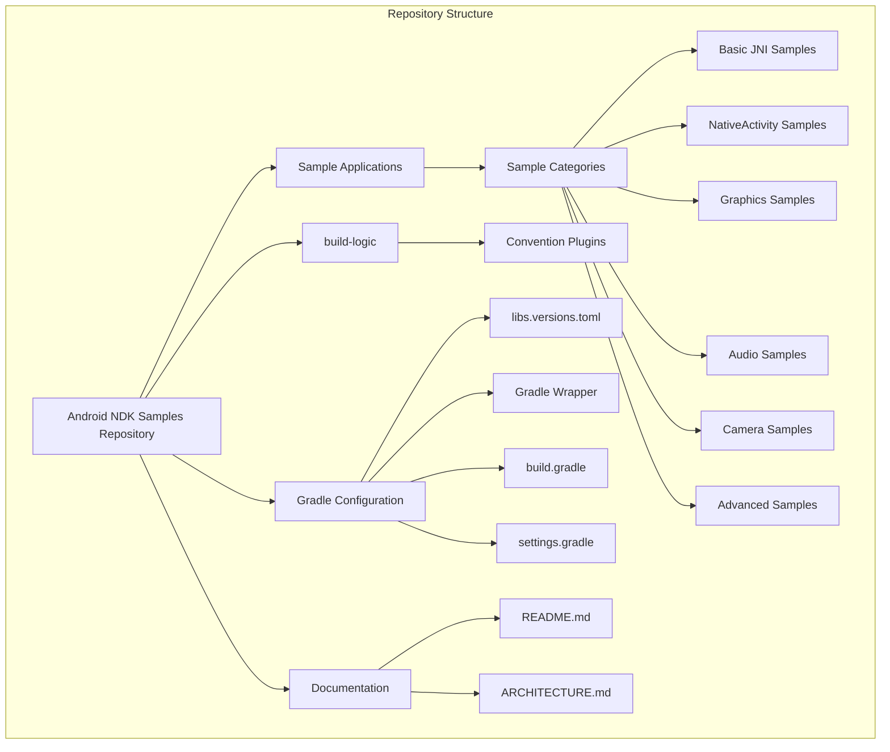
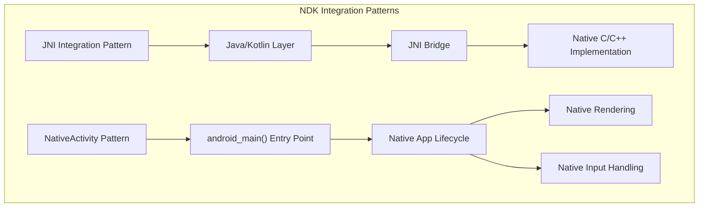
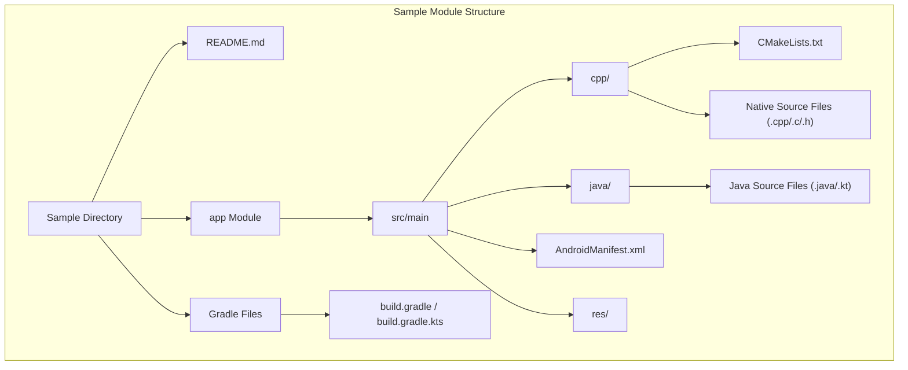
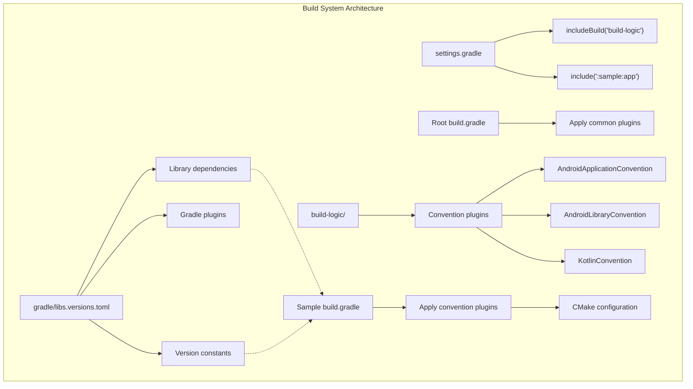
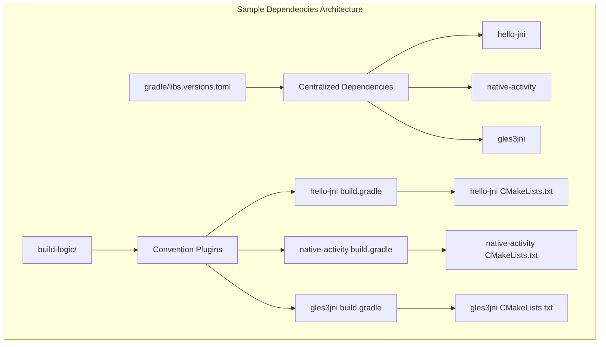

<!-- source: DeepWiki mcp.deepwiki.com · repo android/ndk-samples · page 1.1 Repository Architecture · fetched 2026-10-23 -->

# Repository Architecture

Relevant source files

The following files were used as context for generating this wiki page:

- [ARCHITECTURE.md](ARCHITECTURE.md)
- [README.md](README.md)
- [audio-echo/README.md](audio-echo/README.md)
- [bitmap-plasma/README.md](bitmap-plasma/README.md)
- [docs/run-sample.png](docs/run-sample.png)
- [endless-tunnel/README.md](endless-tunnel/README.md)
- [gles3jni/README.md](gles3jni/README.md)
- [hello-gl2/README.md](hello-gl2/README.md)
- [hello-jni/README.md](hello-jni/README.md)
- [native-activity/README.md](native-activity/README.md)
- [native-audio/README.md](native-audio/README.md)
- [native-codec/README.md](native-codec/README.md)
- [native-media/README.md](native-media/README.md)
- [native-plasma/README.md](native-plasma/README.md)
- [san-angeles/README.md](san-angeles/README.md)

## Purpose and Scope

This document details the overall structure of the Android NDK Samples repository, explaining how the repository is organized, how samples are categorized, and the relationships between different components. It provides a technical overview of the repository architecture to help developers navigate and understand the codebase.

For information on getting started with building and running the samples, see [Getting Started](#1.2). For details on the Gradle build system configuration, see [Build System](#2).

Sources: [README.md:1-7](), [ARCHITECTURE.md:1-5]()

## High-Level Repository Organization

The Android NDK Samples repository is structured as a single Gradle project containing multiple sample applications. The repository demonstrates various Android NDK features and best practices through these samples.

Sources: [ARCHITECTURE.md:8-18](), [README.md:1-7]()

### Root Directory Structure

The repository's root directory contains the following key components:

| Component | Description |
|-----------|-------------|
| Sample directories | Individual sample applications (e.g., `hello-jni`, `native-activity`) |
| `build-logic` | Gradle convention plugins for managing build configuration |
| `gradle/libs.versions.toml` | Central version catalog for dependencies |
| `build.gradle` / `settings.gradle` | Root project build configuration |
| `.github` | GitHub workflows and CI configuration |
| `docs` | Documentation resources |
| `README.md` / `ARCHITECTURE.md` | Main documentation files |

Each sample directory is technically a Gradle module (referred to as a "module" in Android Studio). These modules cannot be opened individually in Android Studio, as they rely on common code from the root project.

Sources: [ARCHITECTURE.md:10-21](), [ARCHITECTURE.md:85-97]()

## Sample Categories and Integration Patterns

The repository contains samples organized by their functionality and the NDK features they demonstrate. These samples showcase different patterns for integrating native code with Android applications.

### Sample Categories

The samples are organized into the following major categories:

1. **Basic JNI Samples**
   - `hello-jni`: Simple JNI integration example
   - `hello-jniCallback`: Demonstrates callbacks from native code
   - `hello-libs`: Shows how to use prebuilt native libraries
   - `hello-neon`: Demonstrates ARM NEON optimization techniques

2. **NativeActivity Samples**
   - `native-activity`: Full application in native code using NativeActivity
   - `native-plasma`: Plasma effect rendered in NativeActivity
   - `endless-tunnel`: Game sample using native glue

3. **Graphics Samples**
   - **OpenGL ES**: `hello-gl2`, `gles3jni`, teapot samples
   - **Vulkan**: `hello-vulkan`
   - **Other Graphics**: `san-angeles`, `bitmap-plasma`

4. **Audio Samples**
   - `native-audio`: OpenSL ES audio playback and recording
   - `audio-echo`: Audio processing with OpenSL ES
   - `hello-oboe`: Modern audio using Oboe library

5. **Camera Samples**
   - `camera-basic`: Basic camera handling with NDK

6. **Advanced Samples**
   - `sanitizers`: Memory error detection with sanitizers
   - `nn-basic`: Neural Networks API usage

Sources: [README.md:75-81](), [hello-jni/README.md:1-10](), [native-activity/README.md:1-9](), [endless-tunnel/README.md:1-14](), [native-audio/README.md:1-14](), [native-codec/README.md:1-13](), [gles3jni/README.md:1-15]()

## Individual Sample Structure

Each sample in the repository follows a common structure, while implementing its specific features.

### Sample Structure Details

Each sample directory typically contains:

1. **README.md** - Documentation specific to the sample
2. **build.gradle** or **build.gradle.kts** - Gradle build script for the module
3. **app/src/main/** - Main source directory containing:
   - **java/** - Java/Kotlin source files
   - **cpp/** - Native C/C++ source files
   - **CMakeLists.txt** - CMake build script for native code
   - **AndroidManifest.xml** - Android manifest file
   - **res/** - Android resources

The exact structure might vary slightly between samples depending on their complexity and requirements.

Sources: [ARCHITECTURE.md:10-21](), [hello-jni/README.md:6-9]()

## Build System Organization

The build system is a crucial part of the repository architecture, providing consistency across all samples.

### Build System Components

1. **Gradle Wrapper** - Ensures consistent Gradle version across environments
2. **Convention Plugins** - Located in `build-logic/`, these plugins define common configurations for all samples
3. **Version Catalog** - Located in `gradle/libs.versions.toml`, it centralizes dependency versions
4. **Root build files**:
   - `settings.gradle` - Configures repositories and includes sample modules
   - `build.gradle` - Defines top-level configuration

This architecture follows modern Gradle best practices, centralizing build logic to ensure consistency and maintainability across all samples.

Sources: [ARCHITECTURE.md:37-44](), [ARCHITECTURE.md:50-60](), [ARCHITECTURE.md:62-74](), [ARCHITECTURE.md:76-84]()

## Sample Module Dependencies

Sample modules in the repository share common dependencies and configurations through the centralized build system. The diagram below illustrates this relationship:

This dependency structure ensures that:

1. All samples use consistent versions of libraries and tools
2. Build configurations are standardized across samples
3. Sample-specific build scripts remain simple and focused on their unique requirements

Sources: [ARCHITECTURE.md:50-60](), [ARCHITECTURE.md:76-84]()

## Common Development Workflows

Understanding the repository structure helps navigate common development workflows:

1. **Opening the project in Android Studio**:
   - Open the entire repository as a single project
   - Individual samples appear as modules in the project view

2. **Running a sample**:
   - Select the sample from the configuration dropdown in Android Studio
   - Click the run button to build and run the sample

3. **Switching build variants**:
   - Use the Build Variants tool window in Android Studio
   - Select debug or release variant for each sample

4. **Command line building**:
   - Run `./gradlew build` to build all samples
   - Run `./gradlew :sample:task` to run a specific task for a specific sample
   - For example: `./gradlew :hello-jni:assembleDebug`

Sources: [README.md:8-23](), [ARCHITECTURE.md:28-36]()

## Conclusion

The Android NDK Samples repository uses a well-organized architecture that balances sample-specific functionality with shared infrastructure. Key features of this architecture include:

1. A single repository containing multiple sample applications
2. Centralized build configuration through convention plugins and a version catalog
3. Organized sample categories demonstrating different NDK integration patterns
4. Consistent structure within each sample module

This architecture makes it easy to explore individual samples while ensuring consistency across the entire repository.

---

