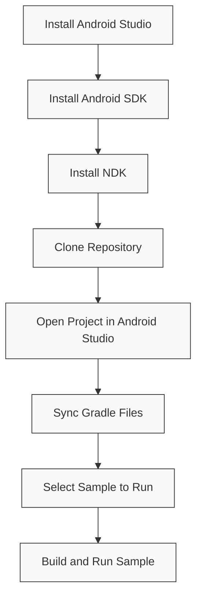
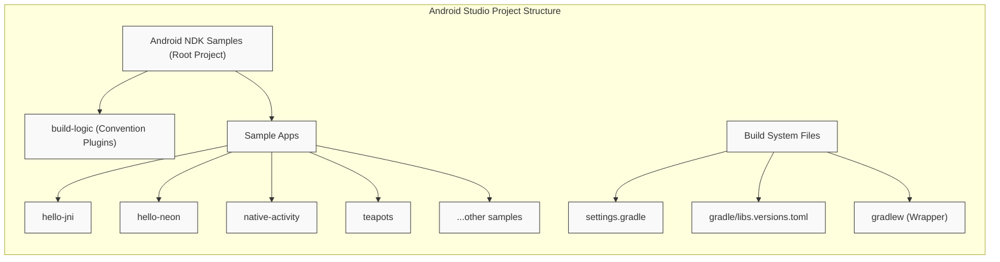
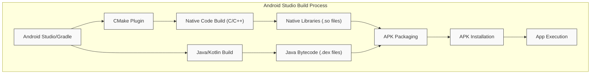

<!-- source: DeepWiki mcp.deepwiki.com · repo android/ndk-samples · page 1.2 Getting Started · fetched 2026-10-23 -->

# Getting Started

<details>
<summary>Relevant source files</summary>

The following files were used as context for generating this wiki page:

- [.github/workflows/build.yml](.github/workflows/build.yml)
- [ARCHITECTURE.md](ARCHITECTURE.md)
- [README.md](README.md)
- [audio-echo/README.md](audio-echo/README.md)
- [bitmap-plasma/README.md](bitmap-plasma/README.md)
- [docs/run-sample.png](docs/run-sample.png)
- [endless-tunnel/README.md](endless-tunnel/README.md)
- [gles3jni/README.md](gles3jni/README.md)
- [hello-gl2/README.md](hello-gl2/README.md)
- [hello-jni/README.md](hello-jni/README.md)
- [hello-neon/app/proguard-rules.pro](hello-neon/app/proguard-rules.pro)
- [hello-neon/app/src/main/AndroidManifest.xml](hello-neon/app/src/main/AndroidManifest.xml)
- [hello-neon/app/src/main/cpp/helloneon-intrinsics.h](hello-neon/app/src/main/cpp/helloneon-intrinsics.h)
- [hello-neon/app/src/main/res/mipmap-hdpi/ic_launcher.png](hello-neon/app/src/main/res/mipmap-hdpi/ic_launcher.png)
- [native-activity/README.md](native-activity/README.md)
- [native-audio/README.md](native-audio/README.md)
- [native-codec/README.md](native-codec/README.md)
- [native-media/README.md](native-media/README.md)
- [native-plasma/README.md](native-plasma/README.md)
- [san-angeles/README.md](san-angeles/README.md)

</details>


This document provides step-by-step instructions for setting up, building, and running the Android NDK samples. It covers installation of prerequisites, configuring your development environment, and running samples in both Android Studio and from the command line. For information about the repository architecture and organization, see [Repository Architecture](#1.1).

## Prerequisites

Before you can build and run the Android NDK samples, you need to have the following software installed:

- Android Studio (4.2 or higher)
- Android SDK
- Android NDK 
- Git (for cloning the repository)

### System Requirements

The Android NDK samples have been tested and validated on various configurations, including:
- Android L AndroidOne
- Android M/N and newer on Nexus/Pixel devices
- Most modern Android devices running Android 6.0 or higher

Sources: [README.md:11-23](), [audio-echo/README.md:9-14]()

## Setting Up the Development Environment

Follow these steps to set up your development environment for working with the Android NDK samples:



### 1. Install Android Studio

1. Download Android Studio from the [official website](http://developer.android.com/sdk/index.html)
2. Install and launch Android Studio
3. Complete the setup wizard which will install the basic Android SDK components

### 2. Install the Android NDK

The NDK can be installed through the Android Studio SDK Manager:

1. Open Android Studio
2. Go to **File > Settings > Appearance & Behavior > System Settings > Android SDK** (on macOS, **Android Studio > Preferences > Appearance & Behavior > System Settings > Android SDK**)
3. Select the **SDK Tools** tab
4. Check **NDK (Side by side)** and click **Apply** to install it

Alternatively, you can install the NDK when you open a project that requires it.

Sources: [README.md:9-16](), [hello-jni/README.md:12-13]()

### 3. Clone the Repository

```bash
git clone https://github.com/android/ndk-samples
cd ndk-samples
```

## Building and Running Samples

The Android NDK samples can be built and run either through Android Studio or using the command line with Gradle.

### Using Android Studio



1. Open Android Studio
2. Select **Open an existing Android Studio project**
3. Navigate to the cloned repository directory and click **OK**
4. Android Studio will load the project - this may take some time as Gradle syncs all dependencies
5. Once the project is loaded, you may be prompted to download the NDK if it's not already installed
6. Select the sample you want to run from the configuration dropdown in the top bar
7. Click the **Run** button (green triangle) to build and run the sample on a connected device or emulator

| Action | Description |
|--------|-------------|
| Select Sample | Use the configuration dropdown in the top bar |
| Build | Click Build > Make Project or use the shortcut (Ctrl+F9 / Cmd+F9) |
| Run | Click Run > Run 'app' or use the shortcut (Shift+F10 / Ctrl+R) |
| Debug | Click Run > Debug 'app' or use the shortcut (Shift+F9 / Ctrl+D) |

Sources: [README.md:8-16](), [ARCHITECTURE.md:24-26]()

### Using Command Line with Gradle

You can also build and run the samples from the command line using the Gradle wrapper:

**On Linux/macOS**:
```bash
./gradlew build                  # Build all samples
./gradlew :hello-jni:build       # Build a specific sample
./gradlew :hello-jni:installDebug # Install a specific sample
```

**On Windows**:
```bash
.\gradlew.bat build               # Build all samples
.\gradlew.bat :hello-jni:build    # Build a specific sample
.\gradlew.bat :hello-jni:installDebug # Install a specific sample
```

To see available tasks for a specific sample:
```bash
./gradlew :camera:basic:tasks    # Lists all tasks for camera/basic sample
```

Sources: [README.md:18-23](), [.github/workflows/build.yml:22-24]()

## Choosing the Right Sample

The repository contains various samples demonstrating different aspects of the Android NDK. Here's a guide to help you choose the right sample for your needs:

| Category | Sample | Description |
|----------|--------|-------------|
| Basic JNI | hello-jni | Simple JNI integration |
| Basic JNI | hello-neon | ARM NEON optimization |
| Basic JNI | hello-libs | Using prebuilt native libraries |
| Graphics | hello-gl2 | Basic OpenGL ES 2.0 rendering |
| Graphics | gles3jni | OpenGL ES 3.0 features |
| Graphics | teapots | Various rendering techniques |
| Native Activity | native-activity | Full native application |
| Native Activity | native-plasma | Bitmap rendering in native code |
| Audio | native-audio | Audio playback and recording with OpenSL ES |
| Audio | hello-oboe | Modern audio with Oboe library |
| Video | native-media | Video playback with OpenMAX AL |

Sources: [README.md:75-81](), [gles3jni/README.md:3-14](), [native-activity/README.md:3-5]()

## Sample Structure and Building



Most samples in this repository follow a similar structure:

1. **Java/Kotlin code** - UI and application logic
2. **Native C/C++ code** - Core functionality implemented in native code
3. **CMake build scripts** - For building the native code
4. **Gradle build files** - For the overall application build

The samples use the Android Studio CMake plugin for integrating native code. The build process compiles the C/C++ code into shared libraries (`.so` files) that are packaged with the APK.

For specific build configurations of individual samples, refer to their respective README files and `CMakeLists.txt` files in the sample directories.

Sources: [hello-jni/README.md:6-9](), [ARCHITECTURE.md:30-35]()

## Troubleshooting

### Common Issues

1. **NDK not found**
   - Solution: Install the NDK through the SDK Manager in Android Studio

2. **Build errors with CMake**
   - Solution: Make sure you have the latest CMake installed through the SDK Manager

3. **Samples not showing in configuration dropdown**
   - Solution: Sync the project with Gradle files (Tools > Android > Sync Project with Gradle Files)

4. **Device compatibility issues**
   - Solution: Some samples may require specific hardware features. Check the sample's README for requirements

### Getting Help

If you encounter issues with the samples, you can:

- Check the sample's README for specific requirements or known issues
- File an issue on the [GitHub repository](https://github.com/android/ndk-samples/issues)
- Ask questions in the [Discussions tab](https://github.com/android/ndk-samples/discussions) of the repository
- Join the [NDK mailing list](https://groups.google.com/g/android-ndk)

Sources: [README.md:50-73](), [native-audio/README.md:36-40]()

## Next Steps

After successfully setting up and running the samples, you might want to explore:

- [Build System](#2) details to understand how the Gradle build system works with native code
- [Basic JNI Samples](#3) to learn the fundamentals of JNI integration
- [Native Activity Applications](#4) to understand how to create fully native applications
- [Graphics Samples](#5) for learning OpenGL ES and Vulkan on Android

Sources: [README.md:44-48](), [README.md:75-81]()

---

