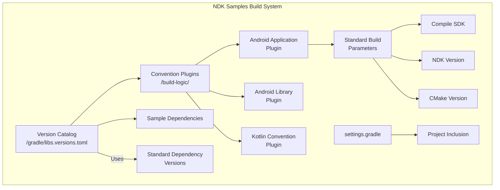
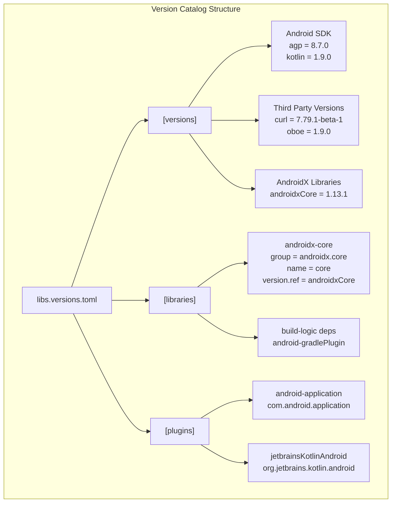
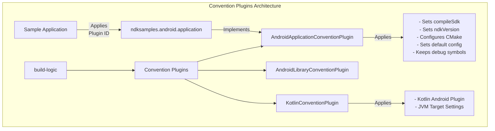
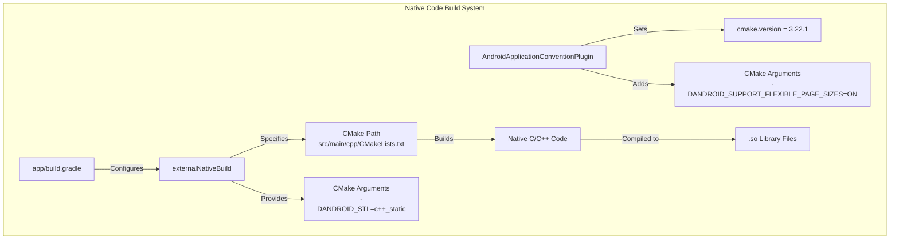
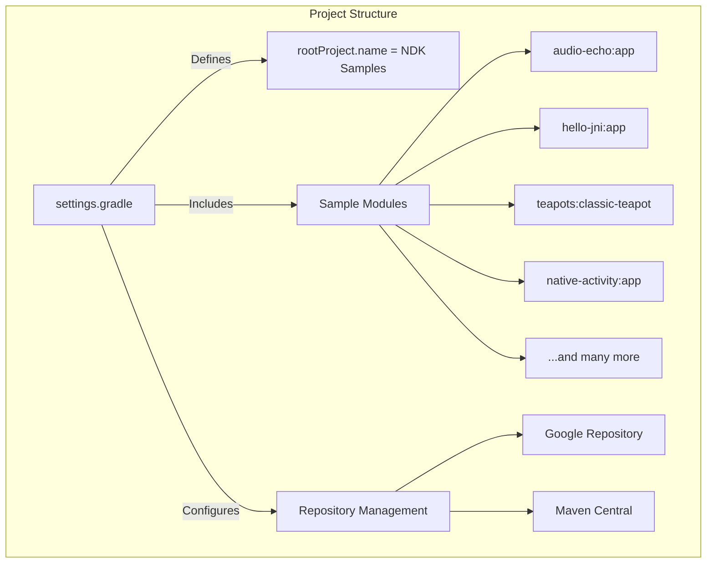
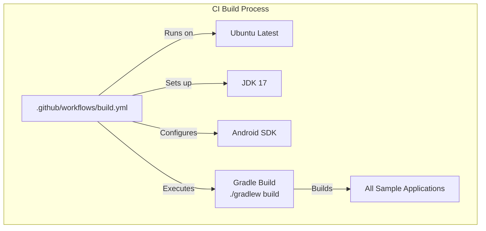

<!-- source: DeepWiki mcp.deepwiki.com · repo android/ndk-samples · page 2 Build System · fetched 2026-10-23 -->

# Build System

<details>
<summary>Relevant source files</summary>

The following files were used as context for generating this wiki page:

- [.github/workflows/build.yml](.github/workflows/build.yml)
- [audio-echo/app/build.gradle](audio-echo/app/build.gradle)
- [build-logic/README.md](build-logic/README.md)
- [build-logic/build.gradle.kts](build-logic/build.gradle.kts)
- [build-logic/settings.gradle.kts](build-logic/settings.gradle.kts)
- [build-logic/src/main/java/com/android/ndk/samples/buildlogic/AndroidApplicationConventionPlugin.kt](build-logic/src/main/java/com/android/ndk/samples/buildlogic/AndroidApplicationConventionPlugin.kt)
- [build-logic/src/main/java/com/android/ndk/samples/buildlogic/KotlinConventionPlugin.kt](build-logic/src/main/java/com/android/ndk/samples/buildlogic/KotlinConventionPlugin.kt)
- [build-logic/src/main/java/com/android/ndk/samples/buildlogic/Versions.kt](build-logic/src/main/java/com/android/ndk/samples/buildlogic/Versions.kt)
- [gradle/libs.versions.toml](gradle/libs.versions.toml)
- [hello-neon/app/proguard-rules.pro](hello-neon/app/proguard-rules.pro)
- [hello-neon/app/src/main/AndroidManifest.xml](hello-neon/app/src/main/AndroidManifest.xml)
- [hello-neon/app/src/main/cpp/helloneon-intrinsics.h](hello-neon/app/src/main/cpp/helloneon-intrinsics.h)
- [hello-neon/app/src/main/res/mipmap-hdpi/ic_launcher.png](hello-neon/app/src/main/res/mipmap-hdpi/ic_launcher.png)
- [settings.gradle](settings.gradle)

</details>


The Android NDK Samples repository utilizes a modern Gradle-based build system designed to standardize build configurations across multiple sample applications while simplifying dependency management. This page describes the architecture, components, and configuration of the build system used throughout the repository.

For information about specific build configurations for individual samples, see [Basic JNI Samples](#3) or other sample-specific pages.

## Overview

The build system is designed with several key objectives:

- Provide consistent build configurations across all samples
- Centralize version management for dependencies and SDK versions
- Standardize native code integration through CMake
- Simplify application setup with convention plugins



Sources: [gradle/libs.versions.toml](), [build-logic/src/main/java/com/android/ndk/samples/buildlogic/Versions.kt](), [build-logic/build.gradle.kts](), [settings.gradle]()

## Version Management

The build system centralizes version management using Gradle's version catalog feature. This ensures that all samples use consistent dependency versions and build configurations.

### Version Catalog

The repository uses a central `libs.versions.toml` file to define all dependency versions, libraries, and plugins.



Sources: [gradle/libs.versions.toml]()

Key sections in the version catalog:
- **`[versions]`**: Defines version constants for all dependencies and plugins
- **`[libraries]`**: Defines library dependencies with references to version constants
- **`[plugins]`**: Defines Gradle plugins with version references

### Standard Versions

The project defines standard versions for SDK, NDK, and other build parameters in a dedicated Kotlin class:

```kotlin
object Versions {
    const val COMPILE_SDK = 34
    const val TARGET_SDK = 34
    const val MIN_SDK = 21
    const val NDK = "27.1.12297006" // r27b
    const val CMAKE = "3.22.1"
    val JAVA = JavaVersion.VERSION_1_8
}
```

Sources: [build-logic/src/main/java/com/android/ndk/samples/buildlogic/Versions.kt]()

## Convention Plugins

The build system uses convention plugins to standardize build configurations across all samples. These plugins are defined in the `build-logic` directory and applied to individual sample projects.



Sources: [build-logic/src/main/java/com/android/ndk/samples/buildlogic/AndroidApplicationConventionPlugin.kt](), [build-logic/build.gradle.kts](), [build-logic/src/main/java/com/android/ndk/samples/buildlogic/KotlinConventionPlugin.kt]()

### Android Application Convention Plugin

The `AndroidApplicationConventionPlugin` applies standard configurations to Android application modules:

- Sets the compile SDK to version 34
- Configures the NDK version to "27.1.12297006" (r27b)
- Sets the CMake version to 3.22.1
- Configures minSdk (21) and targetSdk (34)
- Preserves debug symbols for native libraries in debug builds

Sample projects apply this plugin with a simple declaration:

```kotlin
plugins {
    id "ndksamples.android.application"
}
```

Sources: [build-logic/src/main/java/com/android/ndk/samples/buildlogic/AndroidApplicationConventionPlugin.kt](), [audio-echo/app/build.gradle]()

### Kotlin Convention Plugin

The `KotlinConventionPlugin` handles Kotlin-specific configurations:

- Applies the Kotlin Android plugin
- Sets JVM target compatibility

Sources: [build-logic/src/main/java/com/android/ndk/samples/buildlogic/KotlinConventionPlugin.kt]()

## Native Code Integration

The build system standardizes native code integration across samples using CMake. Each sample application configures its CMake settings in its build.gradle file.



Sources: [audio-echo/app/build.gradle](), [build-logic/src/main/java/com/android/ndk/samples/buildlogic/AndroidApplicationConventionPlugin.kt]()

Sample project CMake configuration:

```groovy
android {
    defaultConfig {
        externalNativeBuild {
            cmake {
                arguments '-DANDROID_STL=c++_static'
            }
        }
    }
    externalNativeBuild {
        cmake {
            path 'src/main/cpp/CMakeLists.txt'
        }
    }
}
```

Sources: [audio-echo/app/build.gradle]()

## Project Organization

The repository is organized as a multi-project Gradle build with numerous sample applications. The `settings.gradle` file defines the project structure.



Sources: [settings.gradle]()

Each sample is configured as a separate module, allowing individual building and testing. The convention plugins ensure consistent configuration across all samples.

## Continuous Integration

The repository includes CI/CD configuration through GitHub Actions, which builds all samples to ensure they remain functional.



Sources: [.github/workflows/build.yml]()

## Using the Build System in Samples

To use the standardized build system in a sample application:

1. Include the module in `settings.gradle`
2. Apply the appropriate convention plugin in the module's `build.gradle`
3. Configure sample-specific settings as needed

Example of a sample's build.gradle file:

```groovy
plugins {
    id "ndksamples.android.application"
}

android {
    defaultConfig {
        applicationId 'com.google.sample.echo'
        versionCode 1
        versionName '1.0'
        externalNativeBuild {
            cmake {
                arguments '-DANDROID_STL=c++_static'
            }
        }
    }
    externalNativeBuild {
        cmake {
            path 'src/main/cpp/CMakeLists.txt'
        }
    }
    namespace 'com.google.sample.echo'
}

dependencies {
    implementation libs.appcompat
}
```

Sources: [audio-echo/app/build.gradle]()

Note how the sample references dependencies using the version catalog with `libs.appcompat`.

---

