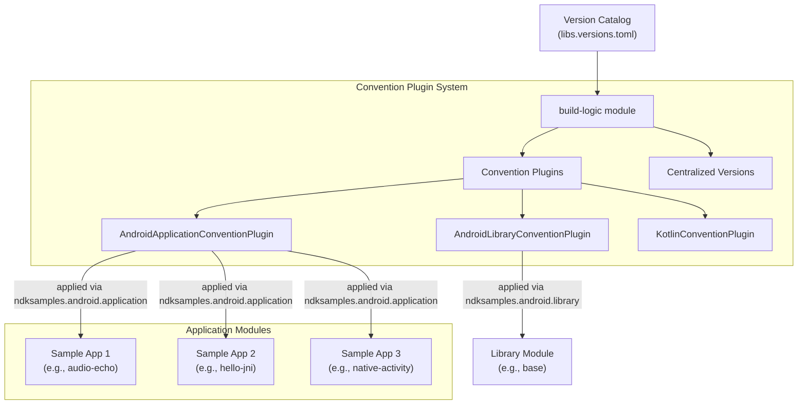
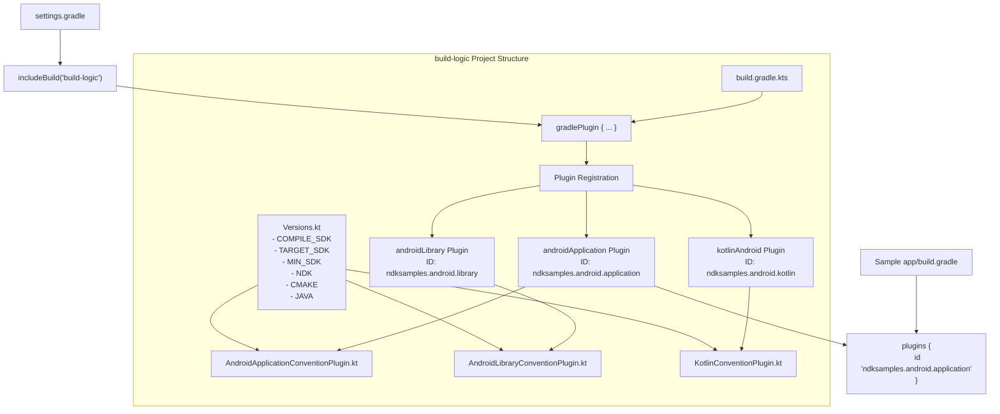
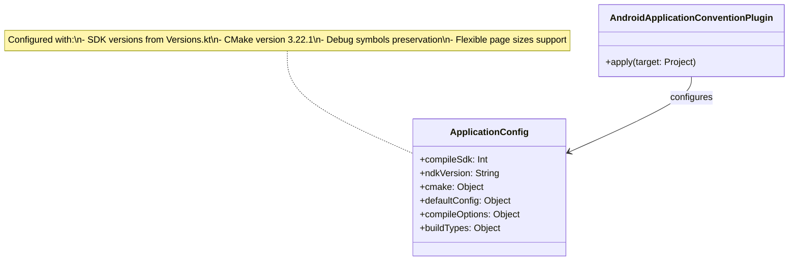
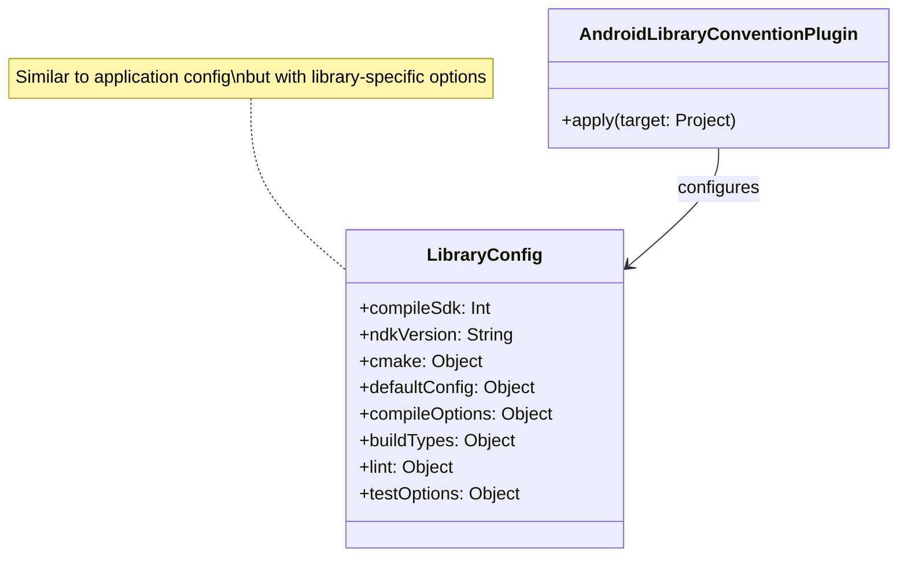
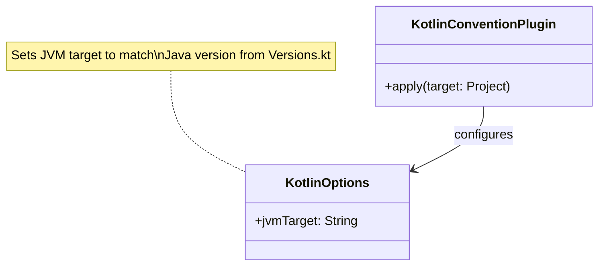
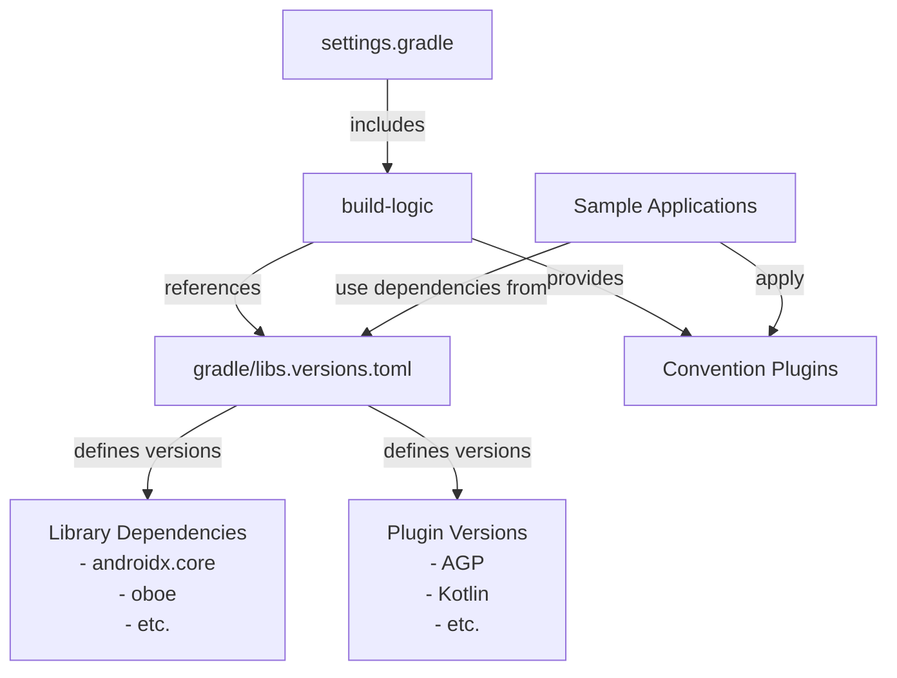

<!-- source: DeepWiki mcp.deepwiki.com · repo android/ndk-samples · page 2.2 Convention Plugins · fetched 2026-10-23 -->

# Convention Plugins

<details>
<summary>Relevant source files</summary>

The following files were used as context for generating this wiki page:

- [audio-echo/app/build.gradle](audio-echo/app/build.gradle)
- [base/.gitignore](base/.gitignore)
- [base/build.gradle.kts](base/build.gradle.kts)
- [base/src/main/cpp/CMakeLists.txt](base/src/main/cpp/CMakeLists.txt)
- [base/src/main/cpp/include/base/errno_restorer.h](base/src/main/cpp/include/base/errno_restorer.h)
- [base/src/main/cpp/include/base/logging.h](base/src/main/cpp/include/base/logging.h)
- [base/src/main/cpp/include/base/macros.h](base/src/main/cpp/include/base/macros.h)
- [base/src/main/cpp/logging.cpp](base/src/main/cpp/logging.cpp)
- [base/src/main/cpp/logging_splitters.h](base/src/main/cpp/logging_splitters.h)
- [build-logic/README.md](build-logic/README.md)
- [build-logic/build.gradle.kts](build-logic/build.gradle.kts)
- [build-logic/settings.gradle.kts](build-logic/settings.gradle.kts)
- [build-logic/src/main/java/com/android/ndk/samples/buildlogic/AndroidApplicationConventionPlugin.kt](build-logic/src/main/java/com/android/ndk/samples/buildlogic/AndroidApplicationConventionPlugin.kt)
- [build-logic/src/main/java/com/android/ndk/samples/buildlogic/AndroidLibraryConventionPlugin.kt](build-logic/src/main/java/com/android/ndk/samples/buildlogic/AndroidLibraryConventionPlugin.kt)
- [build-logic/src/main/java/com/android/ndk/samples/buildlogic/KotlinConventionPlugin.kt](build-logic/src/main/java/com/android/ndk/samples/buildlogic/KotlinConventionPlugin.kt)
- [build-logic/src/main/java/com/android/ndk/samples/buildlogic/Versions.kt](build-logic/src/main/java/com/android/ndk/samples/buildlogic/Versions.kt)
- [gradle/libs.versions.toml](gradle/libs.versions.toml)
- [sanitizers/app/src/main/cpp/CMakeLists.txt](sanitizers/app/src/main/cpp/CMakeLists.txt)
- [sanitizers/app/src/ubsan/jniLibs/arm64-v8a/libclang_rt.ubsan_standalone-aarch64-android.so](sanitizers/app/src/ubsan/jniLibs/arm64-v8a/libclang_rt.ubsan_standalone-aarch64-android.so)
- [settings.gradle](settings.gradle)

</details>


This document explains the convention plugins used in the Android NDK Samples repository. Convention plugins centralize and standardize build configurations across the sample applications, reducing boilerplate code in individual build files while ensuring consistent settings.

## Purpose and Overview

The convention plugins in the NDK Samples repository serve to:

1. Centralize common build configurations including SDK versions, NDK versions, and CMake settings
2. Ensure consistency across multiple sample applications
3. Simplify individual build files by abstracting shared configuration
4. Provide sensible defaults for native Android development

The convention plugins are housed in the `build-logic` directory and are implemented as Gradle plugins that apply common configurations to sample applications.



Sources: [build-logic/README.md](), [build-logic/build.gradle.kts:26-40](), [settings.gradle:1-3]()

## Convention Plugin Architecture

The NDK Samples repository implements convention plugins using Gradle's composite build feature. The `build-logic` project is included as a build dependency, making its plugins available to all sample applications.

### Structure and Registration



Sources: [build-logic/build.gradle.kts:25-40](), [settings.gradle:1-3](), [audio-echo/app/build.gradle:1-3](), [build-logic/src/main/java/com/android/ndk/samples/buildlogic/Versions.kt]()

## Available Convention Plugins

The repository provides three main convention plugins:

### 1. AndroidApplicationConventionPlugin

This plugin applies common Android application configurations to sample apps.

Key features:
- Applies the Android application plugin
- Sets common SDK versions (compile, target, min)
- Configures the NDK and CMake versions
- Sets up native build options
- Preserves debug symbols in debug builds for better NDK crash reporting



Sources: [build-logic/src/main/java/com/android/ndk/samples/buildlogic/AndroidApplicationConventionPlugin.kt](), [build-logic/src/main/java/com/android/ndk/samples/buildlogic/Versions.kt]()

### 2. AndroidLibraryConventionPlugin

Similar to the application plugin but specifically for Android library modules.

Key features:
- Applies the Android library plugin
- Shares much of the same configuration as the application plugin
- Sets up library-specific options like testOptions and lint configuration



Sources: [build-logic/src/main/java/com/android/ndk/samples/buildlogic/AndroidLibraryConventionPlugin.kt]()

### 3. KotlinConventionPlugin

This plugin configures Kotlin-specific options for Android projects.

Key features:
- Applies the Kotlin Android plugin
- Configures the JVM target to match the Java version specified in Versions.kt



Sources: [build-logic/src/main/java/com/android/ndk/samples/buildlogic/KotlinConventionPlugin.kt]()

## Centralized Version Management

The convention plugins rely on centralized version definitions in the `Versions.kt` file. This ensures that all samples use consistent SDK, NDK, and other tool versions.

| Version Constant | Value | Purpose |
|------------------|-------|---------|
| COMPILE_SDK | 34 | Android SDK version to compile against |
| TARGET_SDK | 34 | Target Android SDK version |
| MIN_SDK | 21 | Minimum supported Android SDK version |
| NDK | "27.1.12297006" (r27b) | Native Development Kit version |
| CMAKE | "3.22.1" | CMake version for native builds |
| JAVA | JavaVersion.VERSION_1_8 | Java compatibility version |

Sources: [build-logic/src/main/java/com/android/ndk/samples/buildlogic/Versions.kt]()

## Integration with Version Catalog

The convention plugins work in conjunction with Gradle's version catalog for external dependency management.



The version catalog (`libs.versions.toml`) centralizes the versions of:
- External libraries (AndroidX, Google libraries, third-party dependencies)
- Gradle plugins (Android Gradle Plugin, Kotlin plugin)
- Version constants shared across the project

The convention plugins access these versions to ensure consistency, while individual sample modules reference the dependencies directly.

Sources: [gradle/libs.versions.toml](), [build-logic/settings.gradle.kts:6-9]()

## Usage in Sample Applications

Sample applications use the convention plugins by simply including them in their `build.gradle` files, which greatly simplifies configuration.

### Example: Application Plugin Usage

```groovy
// From audio-echo/app/build.gradle
plugins {
    id "ndksamples.android.application"
}

android {
    defaultConfig {
        applicationId 'com.google.sample.echo'
        versionCode 1
        versionName '1.0'
        externalNativeBuild {
            cmake {
                arguments '-DANDROID_STL=c++_static'
            }
        }
    }
    externalNativeBuild {
        cmake {
            path 'src/main/cpp/CMakeLists.txt'
        }
    }
    namespace 'com.google.sample.echo'
}

dependencies {
    implementation libs.appcompat
}
```

This example shows how the application only needs to specify its unique configurations, while common settings come from the convention plugin.

Sources: [audio-echo/app/build.gradle]()

### Example: Library Plugin Usage

```kotlin
// From base/build.gradle.kts
plugins {
    id("ndksamples.android.library")
}

android {
    namespace = "com.android.ndk.samples.base"

    externalNativeBuild {
        cmake {
            path = file("src/main/cpp/CMakeLists.txt")
        }
    }

    buildFeatures {
        prefabPublishing = true
    }

    prefab {
        create("base") {
            headers = "src/main/cpp/include"
        }
    }
}
```

Sources: [base/build.gradle.kts]()

## Benefits of Convention Plugins

The use of convention plugins in the NDK Samples repository provides several benefits:

1. **Reduced Duplication**: Common configurations are defined once and reused across samples
2. **Consistency**: All samples use the same SDK, NDK, and build tool versions
3. **Easier Maintenance**: Updating versions or build configurations can be done in one place
4. **Simplified Sample Code**: Sample application build files focus only on their unique configurations
5. **Better Organization**: Clear separation between common build logic and sample-specific configurations

For information on general build system configuration, see [Build System](#2).
For information on CMake integration, see [CMake Integration](#2.3).

Sources: [build-logic/README.md](), [audio-echo/app/build.gradle](), [base/build.gradle.kts]()

---

