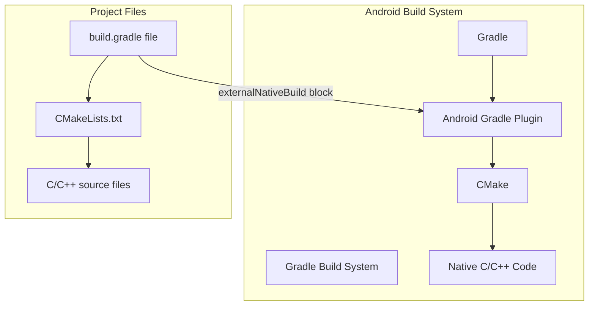
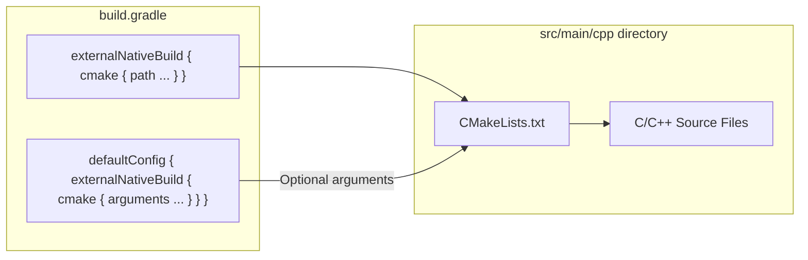
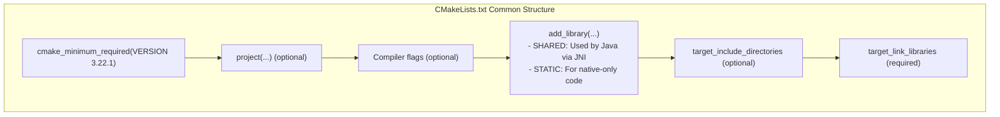
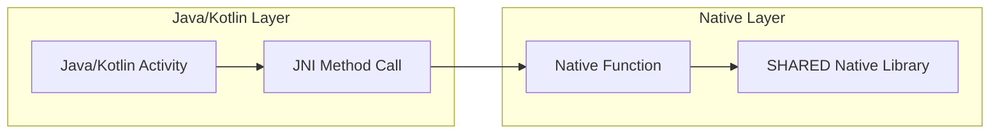
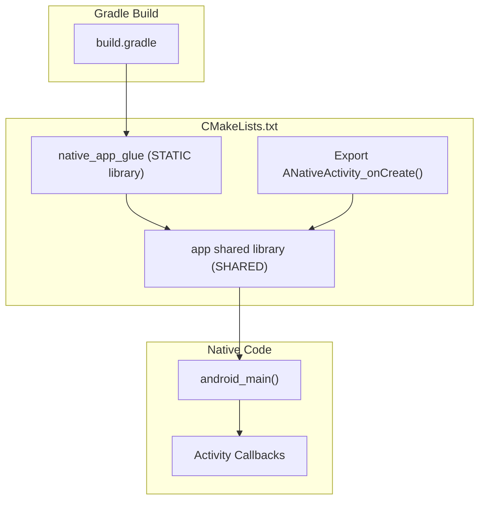
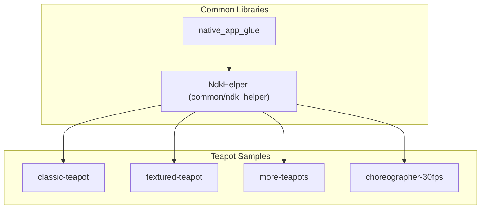
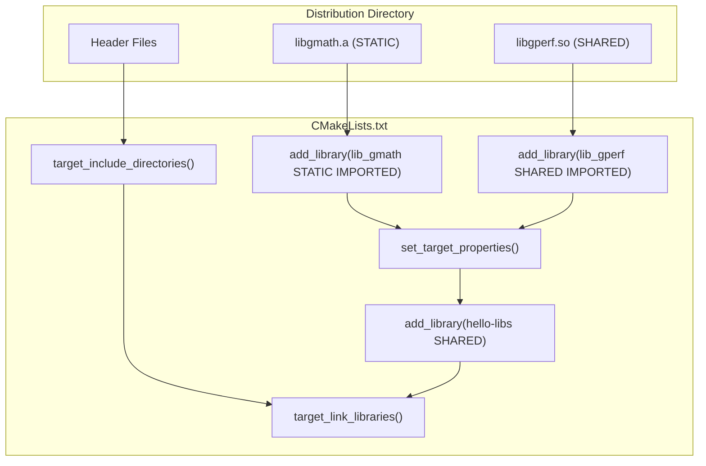

<!-- source: DeepWiki mcp.deepwiki.com · repo android/ndk-samples · page 2.3 CMake Integration · fetched 2026-10-23 -->

# CMake Integration

<details>
<summary>Relevant source files</summary>

The following files were used as context for generating this wiki page:

- [bitmap-plasma/app/build.gradle](bitmap-plasma/app/build.gradle)
- [camera/basic/src/main/cpp/CMakeLists.txt](camera/basic/src/main/cpp/CMakeLists.txt)
- [camera/texture-view/src/main/cpp/CMakeLists.txt](camera/texture-view/src/main/cpp/CMakeLists.txt)
- [endless-tunnel/app/build.gradle](endless-tunnel/app/build.gradle)
- [endless-tunnel/app/src/main/cpp/CMakeLists.txt](endless-tunnel/app/src/main/cpp/CMakeLists.txt)
- [gles3jni/app/src/main/cpp/CMakeLists.txt](gles3jni/app/src/main/cpp/CMakeLists.txt)
- [hello-gl2/app/build.gradle](hello-gl2/app/build.gradle)
- [hello-gl2/app/src/main/cpp/CMakeLists.txt](hello-gl2/app/src/main/cpp/CMakeLists.txt)
- [hello-jni/app/build.gradle](hello-jni/app/build.gradle)
- [hello-libs/app/src/main/cpp/CMakeLists.txt](hello-libs/app/src/main/cpp/CMakeLists.txt)
- [hello-vulkan/app/src/main/cpp/CMakeLists.txt](hello-vulkan/app/src/main/cpp/CMakeLists.txt)
- [native-activity/app/build.gradle](native-activity/app/build.gradle)
- [native-activity/app/src/main/cpp/CMakeLists.txt](native-activity/app/src/main/cpp/CMakeLists.txt)
- [native-audio/app/build.gradle](native-audio/app/build.gradle)
- [native-audio/app/src/main/cpp/CMakeLists.txt](native-audio/app/src/main/cpp/CMakeLists.txt)
- [native-codec/app/build.gradle](native-codec/app/build.gradle)
- [native-codec/app/src/main/cpp/CMakeLists.txt](native-codec/app/src/main/cpp/CMakeLists.txt)
- [native-media/app/build.gradle](native-media/app/build.gradle)
- [native-midi/app/src/main/cpp/CMakeLists.txt](native-midi/app/src/main/cpp/CMakeLists.txt)
- [native-plasma/app/build.gradle](native-plasma/app/build.gradle)
- [native-plasma/app/src/main/cpp/CMakeLists.txt](native-plasma/app/src/main/cpp/CMakeLists.txt)
- [prefab/curl-ssl/app/src/main/cpp/CMakeLists.txt](prefab/curl-ssl/app/src/main/cpp/CMakeLists.txt)
- [prefab/prefab-dependency/app/src/main/cpp/CMakeLists.txt](prefab/prefab-dependency/app/src/main/cpp/CMakeLists.txt)
- [san-angeles/app/build.gradle](san-angeles/app/build.gradle)
- [sensor-graph/accelerometer/src/main/cpp/CMakeLists.txt](sensor-graph/accelerometer/src/main/cpp/CMakeLists.txt)
- [teapots/choreographer-30fps/src/main/cpp/CMakeLists.txt](teapots/choreographer-30fps/src/main/cpp/CMakeLists.txt)
- [teapots/classic-teapot/src/main/cpp/CMakeLists.txt](teapots/classic-teapot/src/main/cpp/CMakeLists.txt)
- [teapots/common/ndk_helper/CMakeLists.txt](teapots/common/ndk_helper/CMakeLists.txt)
- [teapots/more-teapots/src/main/cpp/CMakeLists.txt](teapots/more-teapots/src/main/cpp/CMakeLists.txt)
- [teapots/textured-teapot/src/main/cpp/CMakeLists.txt](teapots/textured-teapot/src/main/cpp/CMakeLists.txt)

</details>


This document explains how CMake is used to build native C/C++ code in the Android NDK Samples repository. It covers the integration between Gradle and CMake, common CMake configurations, and CMake patterns used across the samples.

For information about the overall build system structure, see [Build System](#2). For details on dependency management, see [Dependency Management](#2.1).

## CMake and Android Build System Integration

The Android Gradle plugin supports CMake as a build system for native code. In the NDK Samples repository, each sample that contains native code defines a CMake build script (`CMakeLists.txt`) and configures the Gradle build system to use it.



Sources: [hello-jni/app/build.gradle:15-19](), [native-activity/app/build.gradle:24-28]()

### Gradle to CMake Bridge

Every sample that includes native code follows a similar pattern in its `build.gradle` file:

1. The `externalNativeBuild` block points to the location of the `CMakeLists.txt` file
2. Optional configuration is provided in the `defaultConfig.externalNativeBuild.cmake` block



Sources: [hello-jni/app/build.gradle:15-19](), [native-activity/app/build.gradle:17-21](), [native-activity/app/build.gradle:24-28]()

## Common CMake Configuration Elements

Every `CMakeLists.txt` file in the samples repository shares similar elements:

### 1. CMake Version Requirement

All samples specify CMake 3.22.1 as the minimum version:

```cmake
cmake_minimum_required(VERSION 3.22.1)
```

Sources: [hello-jni/app/src/main/cpp/CMakeLists.txt](), [native-activity/app/src/main/cpp/CMakeLists.txt](), [teapots/common/ndk_helper/CMakeLists.txt]()

### 2. Library Definitions

Each sample defines at least one library - typically a shared library that will be loaded by the Java/Kotlin side:



Sources: [hello-gl2/app/src/main/cpp/CMakeLists.txt](), [native-audio/app/src/main/cpp/CMakeLists.txt](), [native-activity/app/src/main/cpp/CMakeLists.txt]()

## Library Types by Application Pattern

The samples repository demonstrates different native code integration patterns, each with specific CMake configurations.

### 1. JNI-Based Applications

For applications that use JNI to call native code from Java/Kotlin:



Simple JNI samples define a shared library with minimal configuration:

```cmake
add_library(native-lib-name SHARED
    native-source.cpp)

target_link_libraries(native-lib-name
    android
    log)
```

Sources: [hello-jni/app/src/main/cpp/CMakeLists.txt](), [hello-gl2/app/src/main/cpp/CMakeLists.txt]()

### 2. NativeActivity Applications

For applications based on NativeActivity, which runs the main application code in native C/C++:



NativeActivity samples usually include:
1. Building `native_app_glue` as a static library
2. Setting linker flags to export `ANativeActivity_onCreate()`
3. Building the application's shared library
4. Linking against Android system libraries

Sources: [native-activity/app/src/main/cpp/CMakeLists.txt](), [native-plasma/app/src/main/cpp/CMakeLists.txt](), [endless-tunnel/app/src/main/cpp/CMakeLists.txt]()

## Common CMake Patterns

### Configuring Compiler Flags

Most samples set compiler flags to enable warnings and enforce certain coding standards:

```cmake
set(CMAKE_CXX_FLAGS "${CMAKE_CXX_FLAGS} -Wall -Werror -fno-exceptions -fno-rtti")
```

Sources: [teapots/choreographer-30fps/src/main/cpp/CMakeLists.txt:21](), [native-activity/app/src/main/cpp/CMakeLists.txt:25]()

### Configuring C++ Standard Library

Some samples specifically request a static C++ standard library:

```cmake
arguments '-DANDROID_STL=c++_static'
```

Sources: [native-activity/app/build.gradle:19](), [endless-tunnel/app/build.gradle:29]()

### Cross-Module Dependencies

More complex samples, like the teapots series, use a common library defined in a separate CMakeLists.txt file:



The common pattern is to use `add_subdirectory()` to include another CMakeLists.txt file:

```cmake
add_subdirectory(${ndkHelperSrc}
        ${commonDir}/ndkHelperBin/${CMAKE_BUILD_TYPE}/${ANDROID_ABI})
```

Sources: [teapots/classic-teapot/src/main/cpp/CMakeLists.txt:25-27](), [teapots/more-teapots/src/main/cpp/CMakeLists.txt:25-27]()

### Linking Against System Libraries

Every sample links against Android system libraries:

```cmake
target_link_libraries(library-name
    android
    log
    # Additional libraries as needed:
    # GLESv2, EGL, OpenSLES, etc.
)
```

Sources: [hello-gl2/app/src/main/cpp/CMakeLists.txt:10-14](), [native-audio/app/src/main/cpp/CMakeLists.txt:9-12]()

## Specialized CMake Configurations

### Graphics Applications

Graphics samples typically link against graphics libraries:

```cmake
target_link_libraries(app-name
    android
    log
    EGL
    GLESv2)
```

Sources: [hello-gl2/app/src/main/cpp/CMakeLists.txt:10-14](), [native-activity/app/src/main/cpp/CMakeLists.txt:38-43]()

### Audio Applications

Audio samples link against audio libraries:

```cmake
target_link_libraries(native-audio-jni
    android
    log
    OpenSLES)
```

Sources: [native-audio/app/src/main/cpp/CMakeLists.txt:9-12](), [native-midi/app/src/main/cpp/CMakeLists.txt:12]()

### Camera Applications

Camera samples have specific dependencies:

```cmake
target_link_libraries(ndk_camera
    android
    log
    m
    app_glue
    camera2ndk
    mediandk)
```

Sources: [camera/basic/src/main/cpp/CMakeLists.txt:46-52](), [camera/texture-view/src/main/cpp/CMakeLists.txt:40]()

## Working with Prebuilt Libraries

The `hello-libs` sample demonstrates how to use prebuilt libraries in CMake:



The key elements are:
1. Importing libraries with `add_library(... IMPORTED)`
2. Setting the imported library location with `set_target_properties()`
3. Including necessary header directories
4. Linking against the imported libraries

Sources: [hello-libs/app/src/main/cpp/CMakeLists.txt:21-31](), [hello-libs/app/src/main/cpp/CMakeLists.txt:39-47]()

## Platform-Specific Configurations

Some samples like `gles3jni` use platform-specific configurations to handle different Android API levels:

```cmake
if (${ANDROID_PLATFORM_LEVEL} LESS 12)
  message(FATAL_ERROR "OpenGL 2 is not supported before API level 11")
  return()
elseif (${ANDROID_PLATFORM_LEVEL} LESS 18)
  add_definitions("-DDYNAMIC_ES3")
  set(GL3STUB_SRC gl3stub.c)
  set(OPENGL_LIB GLESv2)
else ()
  set(OPENGL_LIB GLESv3)
endif (${ANDROID_PLATFORM_LEVEL} LESS 12)
```

Sources: [gles3jni/app/src/main/cpp/CMakeLists.txt:24-34]()

## Exporting Native Activity Entry Point

For NativeActivity-based applications, the entry point must be exported:

```cmake
set(CMAKE_SHARED_LINKER_FLAGS
    "${CMAKE_SHARED_LINKER_FLAGS} -u ANativeActivity_onCreate")
```

This ensures that the Android system can find and call the native entry point when the activity is created.

Sources: [native-activity/app/src/main/cpp/CMakeLists.txt:29-30](), [native-plasma/app/src/main/cpp/CMakeLists.txt:29-30](), [endless-tunnel/app/src/main/cpp/CMakeLists.txt:25-26]()

## Conclusion

CMake integration in the Android NDK Samples repository follows consistent patterns tailored to different types of native applications. Each sample demonstrates a specific aspect of native development, with CMake configurations designed to support the required functionality.

For more details on the convention plugins that standardize build configurations across samples, see [Convention Plugins](#2.2). For information about CI/CD and code quality tools, see [CI/CD and Code Quality](#2.4).

---

