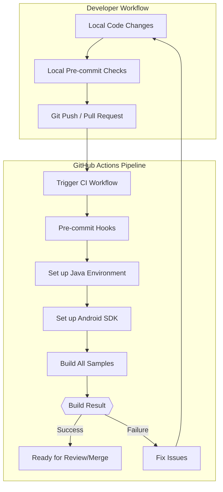
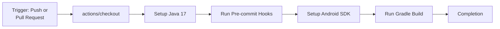
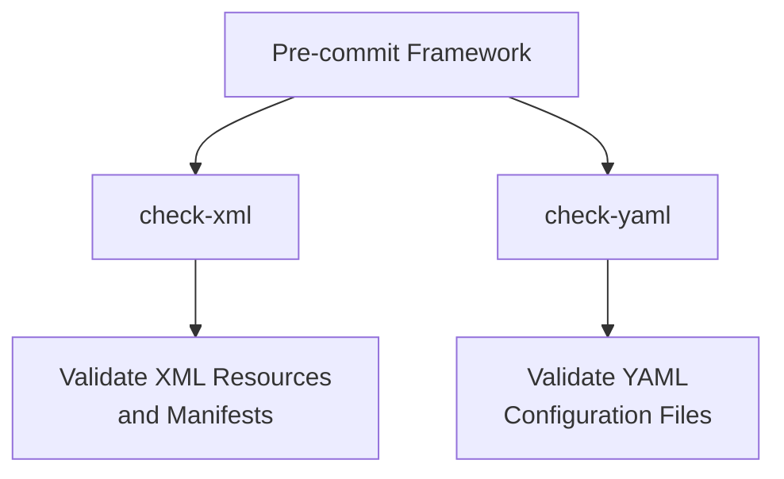
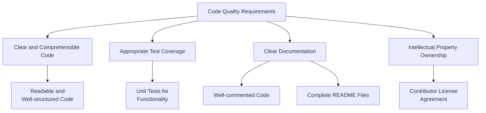
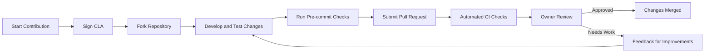

<!-- source: DeepWiki mcp.deepwiki.com · repo android/ndk-samples · page 2.4 CI/CD and Code Quality · fetched 2026-10-23 -->

# CI/CD and Code Quality

<details>
<summary>Relevant source files</summary>

The following files were used as context for generating this wiki page:

- [.github/workflows/build.yml](.github/workflows/build.yml)
- [.pre-commit-config.yaml](.pre-commit-config.yaml)
- [CONTRIBUTING.md](CONTRIBUTING.md)
- [LICENSE](LICENSE)
- [REFERENCE.md](REFERENCE.md)
- [exceptions/README.md](exceptions/README.md)
- [exceptions/screenshot.png](exceptions/screenshot.png)
- [hello-neon/app/proguard-rules.pro](hello-neon/app/proguard-rules.pro)
- [hello-neon/app/src/main/AndroidManifest.xml](hello-neon/app/src/main/AndroidManifest.xml)
- [hello-neon/app/src/main/cpp/helloneon-intrinsics.h](hello-neon/app/src/main/cpp/helloneon-intrinsics.h)
- [hello-neon/app/src/main/res/mipmap-hdpi/ic_launcher.png](hello-neon/app/src/main/res/mipmap-hdpi/ic_launcher.png)
- [native-activity/app/src/main/res/mipmap-hdpi/ic_launcher.png](native-activity/app/src/main/res/mipmap-hdpi/ic_launcher.png)
- [native-activity/app/src/main/res/mipmap-mdpi/ic_launcher.png](native-activity/app/src/main/res/mipmap-mdpi/ic_launcher.png)
- [native-activity/app/src/main/res/mipmap-xhdpi/ic_launcher.png](native-activity/app/src/main/res/mipmap-xhdpi/ic_launcher.png)
- [native-activity/app/src/main/res/mipmap-xxhdpi/ic_launcher.png](native-activity/app/src/main/res/mipmap-xxhdpi/ic_launcher.png)

</details>


This page documents the continuous integration, continuous deployment, and code quality enforcement tools utilized within the Android NDK Samples repository. This infrastructure ensures that all sample code remains buildable, follows consistent standards, and maintains high quality for developers using these examples.

## 1. CI/CD Pipeline Overview

The Android NDK Samples repository employs a GitHub Actions-based CI/CD pipeline that automatically validates changes on both push events and pull requests. This ensures that all code in the repository remains in a buildable state and follows established quality standards.



Sources: [.github/workflows/build.yml](), [.pre-commit-config.yaml]()

## 2. GitHub Actions Configuration

The CI workflow is defined in the `.github/workflows/build.yml` file and automatically runs on every push to the repository and on all pull requests.

### 2.1 Workflow Structure



The workflow consists of the following key steps:

| Step | Description | Action Used |
|------|-------------|-------------|
| Checkout | Checks out the repository code | `actions/checkout@v2` |
| Java Setup | Sets up Java 17 runtime environment | `actions/setup-java@v1` |
| Pre-commit | Runs pre-commit hooks for validation | `pre-commit/action@v3.0.0` |
| Android Setup | Sets up Android SDK | `android-actions/setup-android@v3` |
| Build | Runs Gradle build for all samples | `./gradlew build` |

Sources: [.github/workflows/build.yml:5-24]()

### 2.2 Build Script Details

The main build command executed in the CI pipeline is:

```
./gradlew build
```

This command builds all sample projects in the repository, ensuring that they compile successfully with the current NDK toolchain.

Sources: [.github/workflows/build.yml:22-24]()

## 3. Pre-commit Hooks

Pre-commit hooks provide automated checks before code is committed, catching common issues early in the development process.

### 3.1 Pre-commit Configuration

The repository uses the pre-commit framework with the following hooks configured:



| Hook | Purpose |
|------|---------|
| `check-xml` | Validates XML files (layouts, manifests, etc.) |
| `check-yaml` | Validates YAML configuration files (GitHub Actions, etc.) |

These hooks run both locally when contributors use the pre-commit framework and in the CI pipeline.

Sources: [.pre-commit-config.yaml:1-6]()

### 3.2 Setting Up Pre-commit Locally

Contributors are encouraged to set up pre-commit hooks locally to catch issues before pushing code. This requires:

1. Installing the pre-commit tool
2. Running `pre-commit install` in the repository root
3. Pre-commit hooks will automatically run on `git commit`

## 4. Contribution Quality Standards

The Android NDK Samples repository maintains high code quality standards through its contribution process.

### 4.1 Code Quality Requirements

Contributors are expected to follow these quality guidelines:



Sources: [CONTRIBUTING.md:24-33]()

### 4.2 Contributor License Agreement

All contributors must sign a Contributor License Agreement (CLA) before their contributions can be accepted:

- Individual CLA for personal contributions
- Corporate CLA for company-sponsored contributions

Sources: [CONTRIBUTING.md:3-20]()

## 5. Exception Handling and Error Reporting

Beyond basic build validation, the Android NDK Samples also implement examples of error handling best practices, particularly for handling native exceptions across the JNI boundary.

The exceptions sample demonstrates proper error handling between C++ and Java/Kotlin code, showing how to:

1. Catch native exceptions in JNI methods
2. Translate them to appropriate Java exceptions
3. Handle these exceptions properly in the Java/Kotlin layer

This approach ensures that native crashes are properly reported and handled, improving the quality and stability of NDK applications.

Sources: [exceptions/README.md:1-44]()

## 6. Contribution Workflow

The contribution workflow enforces code quality through a structured review process.



The key steps in the contribution workflow are:

1. Sign the appropriate Contributor License Agreement
2. Fork the repository and develop changes
3. Ensure code is well-tested and documented
4. Submit a pull request
5. Automated CI checks validate build status
6. Repository owners review the changes
7. Approved changes are merged into the repository

Sources: [CONTRIBUTING.md:22-33]()

## 7. Integration with the Build System

The CI/CD pipeline integrates with the larger build system discussed in other sections of this wiki.

| Component | Relationship to CI/CD |
|-----------|----------------------|
| Gradle Wrapper | Used by the CI pipeline to build samples |
| Convention Plugins | Applied during CI builds to ensure consistent configuration |
| CMake Integration | Validated during CI builds for native code |
| Dependency Management | Centralized version control ensures consistent builds in CI |

The CI/CD system validates the same build configurations used by developers, ensuring that what works in CI also works for end users.

For more detailed information about the build system components, see:
- [Dependency Management](#2.1)
- [Convention Plugins](#2.2)
- [CMake Integration](#2.3)

## Summary

The CI/CD and code quality infrastructure in the Android NDK Samples repository ensures that:

1. All samples remain in a buildable state
2. Code follows established quality standards
3. Contributions meet requirements before being accepted
4. Developers can rely on samples working as expected

By maintaining this infrastructure, the repository provides reliable and high-quality examples for Android NDK development.

---

