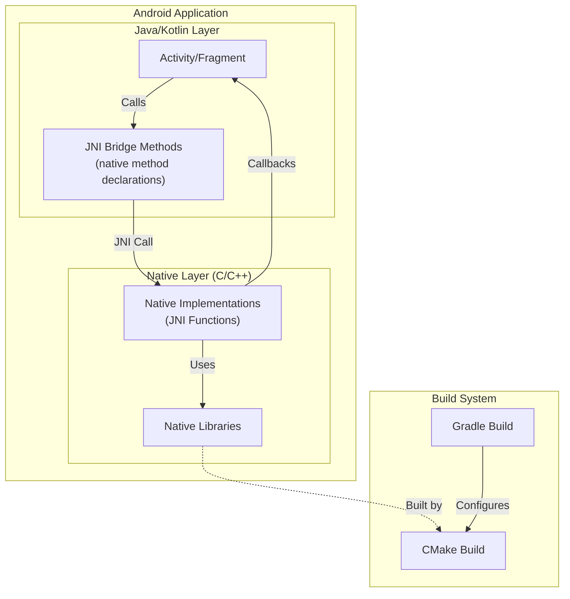
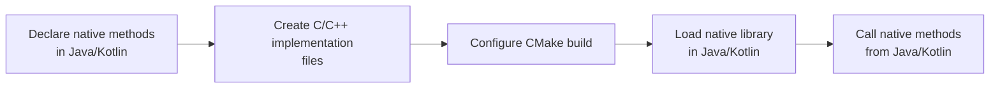
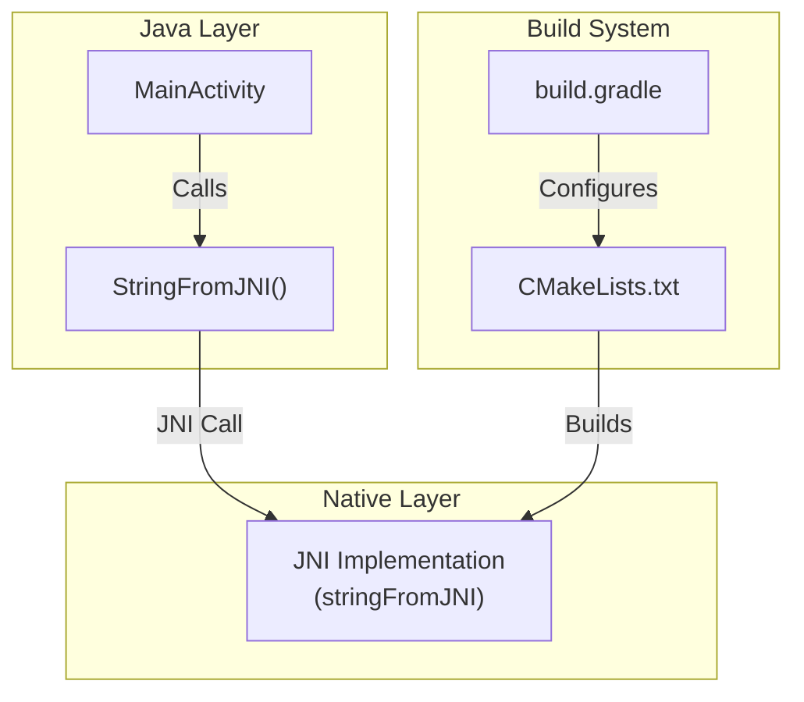
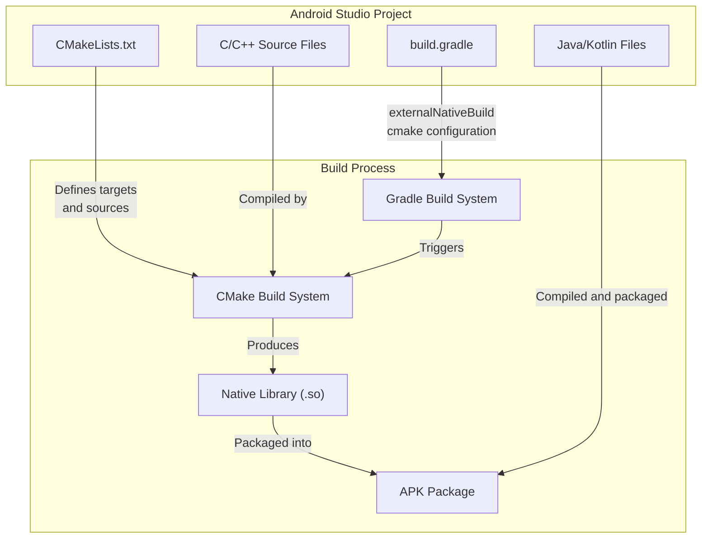
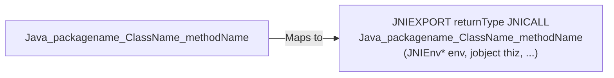

<!-- source: DeepWiki mcp.deepwiki.com · repo android/ndk-samples · page 3 Basic JNI Samples · fetched 2026-10-23 -->

# Basic JNI Samples

<details>
<summary>Relevant source files</summary>

The following files were used as context for generating this wiki page:

- [audio-echo/README.md](audio-echo/README.md)
- [bitmap-plasma/README.md](bitmap-plasma/README.md)
- [bitmap-plasma/app/build.gradle](bitmap-plasma/app/build.gradle)
- [endless-tunnel/README.md](endless-tunnel/README.md)
- [endless-tunnel/app/build.gradle](endless-tunnel/app/build.gradle)
- [gles3jni/README.md](gles3jni/README.md)
- [hello-gl2/README.md](hello-gl2/README.md)
- [hello-gl2/app/build.gradle](hello-gl2/app/build.gradle)
- [hello-jni/README.md](hello-jni/README.md)
- [hello-jni/app/build.gradle](hello-jni/app/build.gradle)
- [native-activity/README.md](native-activity/README.md)
- [native-activity/app/build.gradle](native-activity/app/build.gradle)
- [native-audio/README.md](native-audio/README.md)
- [native-audio/app/build.gradle](native-audio/app/build.gradle)
- [native-codec/README.md](native-codec/README.md)
- [native-codec/app/build.gradle](native-codec/app/build.gradle)
- [native-media/README.md](native-media/README.md)
- [native-media/app/build.gradle](native-media/app/build.gradle)
- [native-plasma/README.md](native-plasma/README.md)
- [native-plasma/app/build.gradle](native-plasma/app/build.gradle)
- [san-angeles/README.md](san-angeles/README.md)
- [san-angeles/app/build.gradle](san-angeles/app/build.gradle)

</details>


## Purpose and Scope

This document provides an overview of the basic Java Native Interface (JNI) samples in the Android NDK samples repository. These samples demonstrate fundamental techniques for integrating C/C++ code with Java/Kotlin in Android applications through JNI. They serve as practical examples for developers who need to leverage native code capabilities while maintaining the Android application framework.

The samples covered in this document focus on basic JNI integration patterns. For more advanced use cases such as Native Activities that don't use Java at all, see [Native Activity Applications](#4).

## What is JNI?

Java Native Interface (JNI) is the framework that enables Java code running in the Android Runtime (ART) to interact with native code written in C/C++. JNI allows developers to:

- Call C/C++ functions from Java/Kotlin code
- Access Java objects and methods from C/C++ code
- Pass data between Java and native code
- Leverage platform-specific optimizations and libraries

## JNI Integration Architecture

The following diagram illustrates the basic architecture of JNI integration in Android applications:



Sources: [hello-jni/app/build.gradle:1-29](), [hello-jni/README.md:1-56]()

## Basic JNI Samples in the Repository

The repository includes the following basic JNI samples:

| Sample | Description | Purpose |
|--------|-------------|---------|
| hello-jni | Simple JNI example that calls C code from Java | Demonstrates basic JNI setup and function calling |
| hello-jniCallback | JNI with callbacks from native to Java | Shows bidirectional communication between Java and native code |
| hello-libs | Integration of prebuilt C/C++ libraries | Demonstrates using external native libraries |
| hello-neon | ARM NEON instruction set optimization | Shows performance optimization using SIMD instructions |

Sources: [hello-jni/README.md:1-56]()

## JNI Development Process

The typical development process for JNI integration follows these steps:



Sources: [hello-jni/app/build.gradle:1-29](), [hello-jni/README.md:1-56]()

## Hello JNI Sample

The Hello JNI sample demonstrates the simplest form of JNI integration, where Java code calls a function implemented in C++.

### Architecture of Hello JNI



Sources: [hello-jni/app/build.gradle:1-29](), [hello-jni/README.md:1-56]()

### Key Components in Hello JNI

1. **Java Component:**
   - Declares a native method with the `native` keyword
   - Loads the native library using `System.loadLibrary()`
   - Calls the native method

2. **Native Component:**
   - Implements the JNI function with the correct naming convention
   - Follows JNI calling conventions
   - Returns data back to Java

3. **Build Configuration:**
   - Uses the `externalNativeBuild` block in Gradle to configure CMake
   - Specifies the CMakeLists.txt path
   - Defines the native library name and source files

Sources: [hello-jni/app/build.gradle:1-29](), [hello-jni/README.md:1-56]()

## CMake Integration

All JNI samples use CMake for building native code, which is the recommended approach for NDK projects in Android Studio.



Sources: [hello-jni/app/build.gradle:15-19](), [native-activity/app/build.gradle:24-28](), [native-audio/app/build.gradle:13-18]()

### Gradle Configuration for Native Code

The Gradle build file for JNI samples typically includes:

```
android {
    externalNativeBuild {
        cmake {
            path "src/main/cpp/CMakeLists.txt"
        }
    }
}
```

This configuration tells Gradle where to find the CMake build script for the native code components.

Sources: [hello-jni/app/build.gradle:15-19](), [native-activity/app/build.gradle:24-28](), [native-audio/app/build.gradle:13-18]()

## JNI Method Naming Convention

The naming convention for JNI functions follows a specific pattern to ensure proper linking between Java and native code:



This naming convention is crucial for the Java runtime to find the corresponding native implementation for a native method declaration.

Sources: [hello-jni/README.md:1-56]()

## Data Type Mapping

JNI provides a set of mappings between Java and C/C++ data types:

| Java Type | JNI Type | C/C++ Type |
|-----------|----------|------------|
| boolean | jboolean | unsigned char |
| byte | jbyte | signed char |
| char | jchar | unsigned short |
| short | jshort | short |
| int | jint | int |
| long | jlong | long long |
| float | jfloat | float |
| double | jdouble | double |
| Object | jobject | jobject |
| String | jstring | jstring |
| byte[] | jbyteArray | jbyteArray |
| Object[] | jobjectArray | jobjectArray |
| Class | jclass | jclass |

Sources: [hello-jni/README.md:1-56]()

## Best Practices for JNI Development

When developing with JNI, consider these best practices:

1. **Error Handling**: Always check for exceptions after JNI calls
2. **Resource Management**: Release native resources properly
3. **Threading**: Be aware of threading issues between Java and native code
4. **Performance**: Minimize JNI boundary crossings as they have overhead
5. **Type Safety**: Be careful with type conversions between Java and C/C++

Sources: [hello-jni/README.md:1-56](), [audio-echo/README.md:1-138]()

## Conclusion

The Basic JNI Samples in the Android NDK repository demonstrate fundamental techniques for integrating Java and C/C++ code. They provide a starting point for developers who need to leverage native code in their Android applications for performance-critical tasks, access to platform-specific features, or integration with existing C/C++ libraries.

For more detailed information about specific aspects of the NDK:
- For information about hello-jni sample, see [Hello JNI](#3.1)
- For information about prebuilt libraries integration, see [Prebuilt Libraries](#3.2)
- For information about NEON optimization, see [NEON Optimization](#3.3)

---

