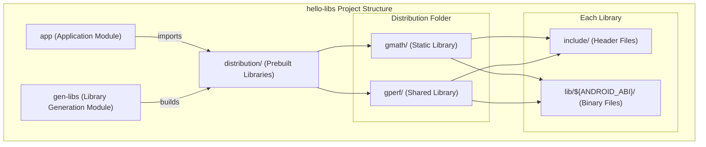
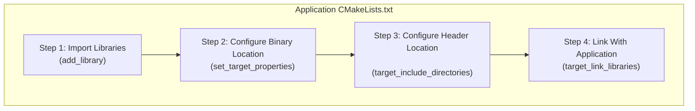
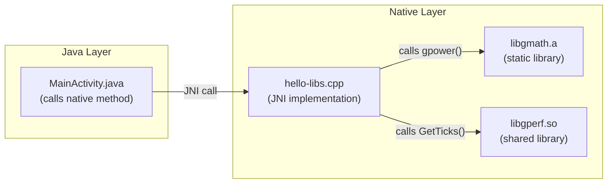
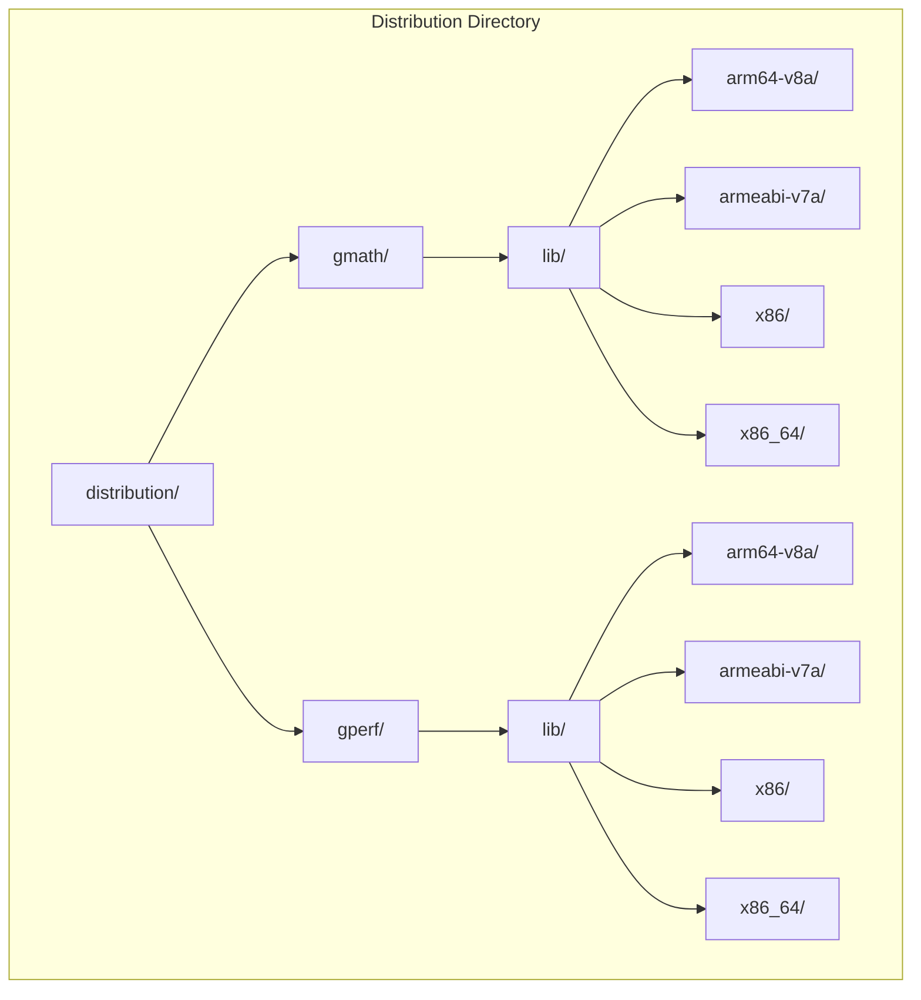

<!-- source: DeepWiki mcp.deepwiki.com · repo android/ndk-samples · page 3.2 Prebuilt Libraries · fetched 2026-10-23 -->

# Prebuilt Libraries

<details>
<summary>Relevant source files</summary>

The following files were used as context for generating this wiki page:

- [endless-tunnel/app/src/main/AndroidManifest.xml](endless-tunnel/app/src/main/AndroidManifest.xml)
- [hello-libs/README.md](hello-libs/README.md)
- [hello-libs/app/build.gradle](hello-libs/app/build.gradle)
- [hello-libs/app/src/main/cpp/hello-libs.cpp](hello-libs/app/src/main/cpp/hello-libs.cpp)
- [hello-libs/app/src/main/java/com/example/hellolibs/MainActivity.java](hello-libs/app/src/main/java/com/example/hellolibs/MainActivity.java)
- [hello-libs/app/src/main/res/values/strings.xml](hello-libs/app/src/main/res/values/strings.xml)
- [hello-libs/gen-libs/build.gradle](hello-libs/gen-libs/build.gradle)
- [hello-libs/gen-libs/proguard-rules.pro](hello-libs/gen-libs/proguard-rules.pro)
- [hello-libs/gen-libs/src/main/AndroidManifest.xml](hello-libs/gen-libs/src/main/AndroidManifest.xml)
- [hello-libs/gen-libs/src/main/cpp/gmath/src/gmath.c](hello-libs/gen-libs/src/main/cpp/gmath/src/gmath.c)
- [hello-libs/screenshot.png](hello-libs/screenshot.png)

</details>


This page documents how to integrate pre-compiled 3rd party C/C++ libraries into your Android NDK project. It focuses on the `hello-libs` sample which demonstrates importing both static and shared native libraries using CMake build system.

For information about building native libraries from source in your project, see [CMake Integration](#2.3).

## Overview

The Android NDK allows integration of pre-compiled C/C++ libraries into your applications. This approach offers several advantages:

- Reuse existing C/C++ code without modification
- Incorporate proprietary or closed-source libraries
- Separate library development from application development
- Reduce build times by using pre-compiled binaries

The `hello-libs` sample demonstrates a production-ready approach to importing and using external native libraries in your Android application.

Sources: [hello-libs/README.md:1-29]()

## Sample Structure

The sample is organized into two main modules:

1. **app** - The main application module that imports and uses the pre-built libraries
2. **gen-libs** - A utility module for generating the libraries (disabled by default)

The pre-built libraries are stored in a `distribution` directory and include:
- `libgmath.a` - A static math library
- `libgperf.so` - A shared performance measurement library



**Library Organization**:
- Each library has a standard structure with:
  - `include/` - Header files for the library
  - `lib/${ANDROID_ABI}/` - Binary files for different ABIs

Sources: [hello-libs/README.md:12-28](), [hello-libs/app/build.gradle:1-32]()

## Library Integration Process

The integration of prebuilt libraries involves several key steps in the CMake build configuration:



This process connects your application with the prebuilt libraries, making their functions available to your native code.

Sources: [hello-libs/README.md:30-52]()

## CMake Configuration

The key to using prebuilt libraries is proper CMake configuration. Below is how the sample imports both static and shared libraries:

```cmake
# Import a static library
add_library(lib_gmath STATIC IMPORTED)
set_target_properties(lib_gmath PROPERTIES IMPORTED_LOCATION
    ${distribution_DIR}/gmath/lib/${ANDROID_ABI}/libgmath.a)

# Import a shared library
add_library(lib_gperf SHARED IMPORTED)
set_target_properties(lib_gperf PROPERTIES IMPORTED_LOCATION
    ${distribution_DIR}/gperf/lib/${ANDROID_ABI}/libgperf.so)

# Include header directories
target_include_directories(hello-libs PRIVATE
                           ${distribution_DIR}/gmath/include
                           ${distribution_DIR}/gperf/include)
```

Note the following important points:
- `IMPORTED` flag marks a library as pre-compiled
- `${ANDROID_ABI}` ensures the correct architecture variant is used
- Header files are included separately from binary files

Sources: [hello-libs/README.md:40-52]()

## Library Usage in Native Code

The sample demonstrates how to use the imported libraries in your JNI code:



The native code implementation:
1. Includes headers from both libraries
2. Uses functions from both libraries
3. Returns results to Java via JNI

Sources: [hello-libs/app/src/main/cpp/hello-libs.cpp:17-48](), [hello-libs/app/src/main/java/com/example/hellolibs/MainActivity.java:25-39]()

## Library Loading

For shared libraries, the Java code needs to load the library at runtime:

```java
static {
    System.loadLibrary("hello-libs");
}
```

The application doesn't need to explicitly load the imported libraries, as they're linked at build time and the Android system handles loading dependencies:

1. Static libraries (`libgmath.a`) are compiled directly into your application's native library
2. Shared libraries (`libgperf.so`) are loaded automatically when your application's native library loads

Sources: [hello-libs/app/src/main/java/com/example/hellolibs/MainActivity.java:35-37]()

## ABI Support

The sample demonstrates proper handling of multiple Android ABIs (Application Binary Interfaces):



The `${ANDROID_ABI}` variable in CMake automatically selects the correct architecture-specific binary for the current build target.

Sources: [hello-libs/README.md:42-47]()

## Regenerating Libraries

Although the sample provides pre-built libraries, it also includes the source code and build scripts to regenerate them if needed. This involves:

1. Enabling the `gen-libs` module
2. Building the project
3. Disabling the module after libraries are generated

The specific steps are:

```
1. In settings.gradle, enable the line `include :gen-libs`
2. In app/build.gradle, enable the line `api project(':gen-libs')`
3. Build the project
4. Undo the first 2 steps
5. Clean up temporary build files with `rm -fr app/build app/.cxx`
```

This approach separates library building from application building, which is a common practice in larger projects.

Sources: [hello-libs/README.md:54-62](), [hello-libs/gen-libs/build.gradle:1-40](), [hello-libs/app/build.gradle:26-31]()

## Implementation Details

### Native Implementation

The sample implements a simple performance measurement function that uses both prebuilt libraries:

1. The `gperf` library provides the `GetTicks()` function to measure time
2. The `gmath` library provides the `gpower()` function to calculate powers
3. The JNI implementation uses both to measure how long calculations take

```
Java_com_example_hellolibs_MainActivity_measureTicks() {
    auto ticks = GetTicks();
    
    for (auto exp = 0; exp < 1000; ++exp) {
        volatile unsigned val = gpower(exp);
    }
    
    ticks = GetTicks() - ticks;
    return ticks;
}
```

Sources: [hello-libs/app/src/main/cpp/hello-libs.cpp:34-48]()

### Java Implementation

The Java implementation is minimal, focusing on calling the native method and displaying results:

```
TextView tv = new TextView(this);
tv.setText("The calculation took " + measureTicks() + " ticks");
setContentView(tv);
```

Sources: [hello-libs/app/src/main/java/com/example/hellolibs/MainActivity.java:27-33]()

## Build Configuration

The application's build.gradle file is configured to support the native libraries:

```gradle
android {
    defaultConfig {
        externalNativeBuild {
            cmake {
                arguments '-DANDROID_STL=c++_static'
            }
        }
    }

    externalNativeBuild {
        cmake {
            path 'src/main/cpp/CMakeLists.txt'
        }
    }
}
```

Note the specific configuration:
- Uses C++ static STL for better compatibility
- Points to the CMake build script in the cpp directory

Sources: [hello-libs/app/build.gradle:8-23]()

## Best Practices

When integrating prebuilt libraries into your Android NDK application:

1. **Organize libraries consistently** - Follow the sample's structure with separate include and lib directories
2. **Support multiple ABIs** - Provide binaries for all target architectures
3. **Separate building and using** - Build libraries separately from application code
4. **Version control** - Consider your strategy for storing large binary files
5. **Header consistency** - Ensure headers match the binary implementation
6. **Documentation** - Document library usage and any platform-specific considerations

Following these practices will make your integration more maintainable and less error-prone.

## Common Issues and Solutions

| Issue | Cause | Solution |
|-------|-------|----------|
| Library not found | Incorrect path in `set_target_properties` | Double-check paths and file existence |
| Symbol not found | Header/implementation mismatch | Ensure library versions match headers |
| Linker errors | ABI mismatch | Verify correct ABI binaries are being used |
| Runtime crashes | Missing dependencies for shared libraries | Check library dependencies with `objdump -p` |
| Performance issues | Debug vs. release builds | Use release builds for performance testing |

By following the approach demonstrated in the sample, you can successfully integrate pre-compiled C/C++ libraries into your Android NDK applications.

---

