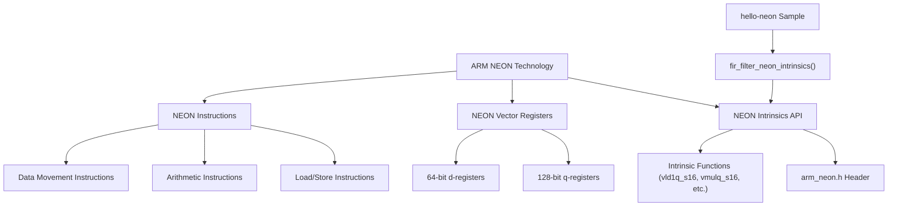
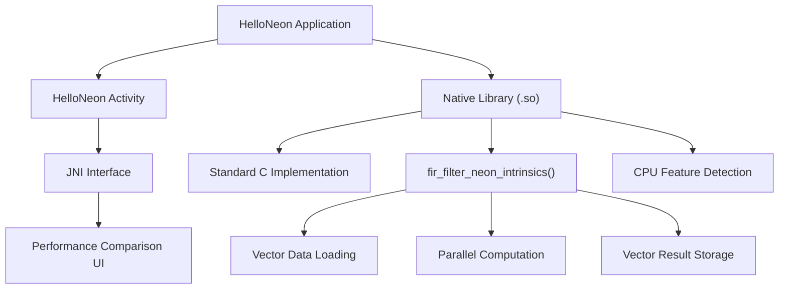
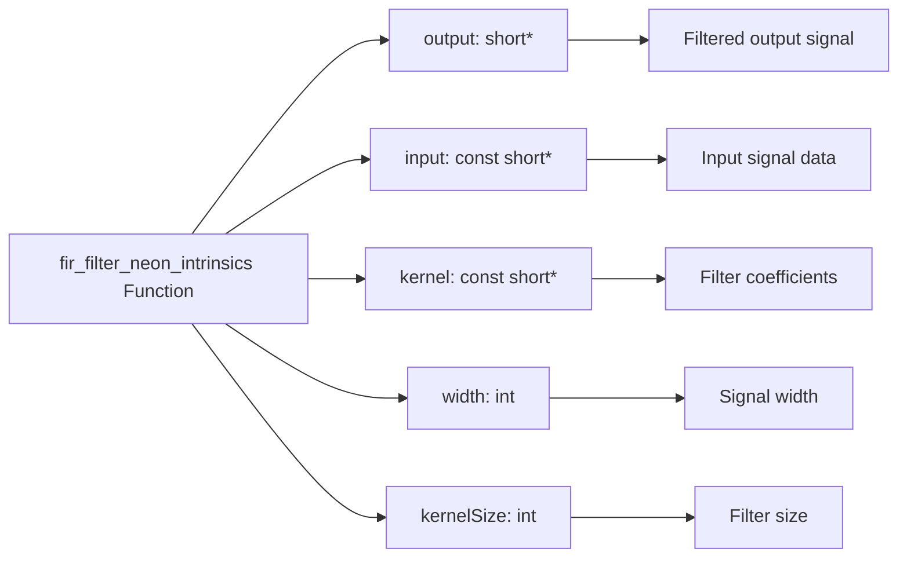
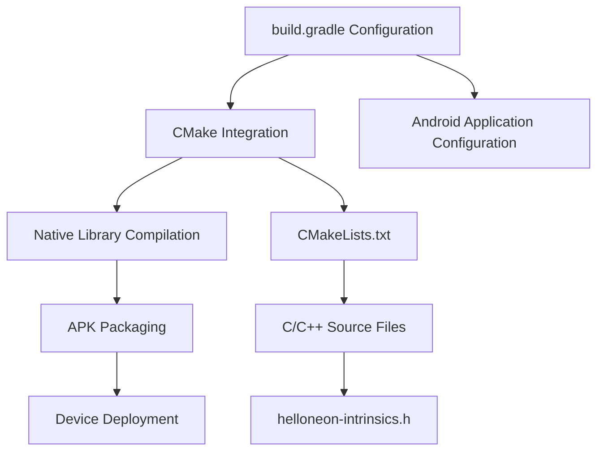
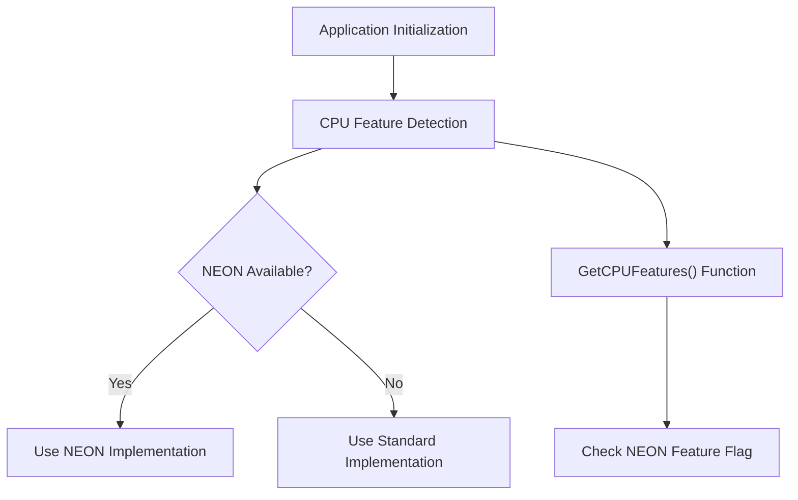

<!-- source: DeepWiki mcp.deepwiki.com · repo android/ndk-samples · page 3.3 NEON Optimization · fetched 2026-10-23 -->

# NEON Optimization

<details>
<summary>Relevant source files</summary>

The following files were used as context for generating this wiki page:

- [.github/workflows/build.yml](.github/workflows/build.yml)
- [hello-jniCallback/app/build.gradle](hello-jniCallback/app/build.gradle)
- [hello-neon/app/build.gradle](hello-neon/app/build.gradle)
- [hello-neon/app/proguard-rules.pro](hello-neon/app/proguard-rules.pro)
- [hello-neon/app/src/main/AndroidManifest.xml](hello-neon/app/src/main/AndroidManifest.xml)
- [hello-neon/app/src/main/cpp/helloneon-intrinsics.h](hello-neon/app/src/main/cpp/helloneon-intrinsics.h)
- [hello-neon/app/src/main/res/mipmap-hdpi/ic_launcher.png](hello-neon/app/src/main/res/mipmap-hdpi/ic_launcher.png)
- [nn-samples/basic/build.gradle](nn-samples/basic/build.gradle)
- [nn-samples/basic/src/main/res/layout/activity_main.xml](nn-samples/basic/src/main/res/layout/activity_main.xml)
- [nn-samples/sequence/build.gradle](nn-samples/sequence/build.gradle)
- [nn-samples/sequence/src/main/res/layout/activity_main.xml](nn-samples/sequence/src/main/res/layout/activity_main.xml)
- [teapots/choreographer-30fps/build.gradle](teapots/choreographer-30fps/build.gradle)
- [teapots/classic-teapot/build.gradle](teapots/classic-teapot/build.gradle)
- [teapots/image-decoder/build.gradle](teapots/image-decoder/build.gradle)
- [teapots/more-teapots/build.gradle](teapots/more-teapots/build.gradle)
- [teapots/textured-teapot/build.gradle](teapots/textured-teapot/build.gradle)

</details>


## Purpose and Scope

This document details the ARM NEON optimization techniques demonstrated in the `hello-neon` sample of the Android NDK Samples repository. It covers how to leverage NEON SIMD (Single Instruction, Multiple Data) architecture to accelerate computation-intensive operations through parallel data processing, with a focus on implementing an optimized FIR (Finite Impulse Response) filter.

For information about other JNI samples, see [Basic JNI Samples](#3).

Sources: [hello-neon/app/build.gradle](), [hello-neon/app/src/main/AndroidManifest.xml]()

## Overview of ARM NEON

ARM NEON is a SIMD architecture extension for ARM processors that enables efficient parallel processing of data, significantly improving performance for compute-intensive applications.



Key NEON features:
- 128-bit registers that can process multiple data elements simultaneously
- Support for various data types (8/16/32/64-bit integers, single-precision floating-point)
- Specialized instructions for common signal processing operations
- C/C++ intrinsics API for easier programming than direct assembly

Sources: [hello-neon/app/src/main/cpp/helloneon-intrinsics.h]()

## Hello-NEON Sample Architecture

The sample demonstrates the performance benefits of NEON optimization by implementing a FIR filter with both standard C and NEON-optimized approaches.



The application provides a side-by-side performance comparison of the standard and NEON-optimized implementations, demonstrating the speedup achieved through vectorization.

Sources: [hello-neon/app/src/main/AndroidManifest.xml:10-17](), [hello-neon/app/src/main/cpp/helloneon-intrinsics.h]()

## FIR Filter Implementation

The core of the sample is a FIR filter, which computes output samples by convolving input samples with a kernel of filter coefficients. The NEON-optimized implementation is declared in the header file:



The function signature:
```
void fir_filter_neon_intrinsics(short* output, const short* input, 
                               const short* kernel, int width, int kernelSize);
```

This function implements the filter using NEON intrinsics to compute multiple output samples in parallel.

Sources: [hello-neon/app/src/main/cpp/helloneon-intrinsics.h:20-21]()

## NEON Optimization Techniques

The sample demonstrates several key optimization techniques available through NEON:

### Vector Data Processing

NEON enables processing multiple data elements simultaneously:

| Standard C Implementation | NEON Implementation |
|---------------------------|---------------------|
| Processes 1 element per operation | Processes 8 short integers (16-bit) in parallel |
| Sequential loop iteration | Vectorized loop processing |
| Scalar operations | Vector operations (load, multiply, add, store) |

### NEON Intrinsics Usage

The sample uses NEON intrinsics, which are C/C++ function calls that map directly to NEON assembly instructions. Common intrinsics used in FIR filter implementations include:

| Intrinsic Function | Purpose |
|--------------------|---------|
| `vld1q_s16()` | Load 8 short integers into a 128-bit q-register |
| `vmulq_s16()` | Multiply two vectors of 8 short integers each |
| `vaddq_s16()` | Add two vectors of 8 short integers each |
| `vst1q_s16()` | Store 8 short integers from a q-register to memory |

Sources: [hello-neon/app/src/main/cpp/helloneon-intrinsics.h]()

## Building and Running the Sample

The `hello-neon` sample uses the standard Android build system with CMake integration:



To build and run the sample:
1. Open the project in Android Studio
2. Build using Gradle: `./gradlew build`
3. Deploy to an ARM device with NEON support

Sources: [hello-neon/app/build.gradle:14-18](), [.github/workflows/build.yml:23-24]()

## Performance Optimization Considerations

When implementing NEON optimizations, follow these best practices:

| Consideration | Description |
|---------------|-------------|
| Data Alignment | Align data to 16-byte boundaries for optimal NEON load/store operations |
| Loop Unrolling | Unroll loops to reduce branch penalties and increase instruction-level parallelism |
| Memory Access Patterns | Use sequential memory access when possible for better cache utilization |
| Data Precision | Balance precision requirements with NEON's capabilities (e.g., using 16-bit vs. 32-bit precision) |
| Edge Cases | Handle edge cases (e.g., non-vectorizable iterations) separately from the main vectorized loop |

Typical performance improvements for well-optimized NEON code range from 2x to 8x for suitable algorithms.

Sources: [hello-neon/app/src/main/cpp/helloneon-intrinsics.h]()

## Runtime NEON Detection

Not all devices support NEON, so proper feature detection is essential:



Best practices for feature detection:
1. Always check for NEON availability at runtime
2. Provide a fallback implementation for devices without NEON
3. Cache the detection result to avoid repeated checks

Sources: [hello-neon/app/src/main/cpp/helloneon-intrinsics.h]()

## Conclusion

The `hello-neon` sample demonstrates how ARM NEON optimization can significantly improve performance for compute-intensive operations like FIR filtering. By leveraging SIMD parallelism through NEON intrinsics, developers can achieve substantial performance improvements while maintaining readable code.

Key takeaways:
1. NEON intrinsics provide a convenient C/C++ API for SIMD optimization
2. Vectorizing operations can deliver 2-8x performance improvements for suitable algorithms
3. Always implement feature detection and fallback mechanisms for compatibility
4. Consider data alignment, memory access patterns, and loop structures for optimal performance

For more information about other JNI samples, see [Basic JNI Samples](#3).

Sources: [hello-neon/app/src/main/cpp/helloneon-intrinsics.h](), [hello-neon/app/build.gradle](), [hello-neon/app/src/main/AndroidManifest.xml]()

---

