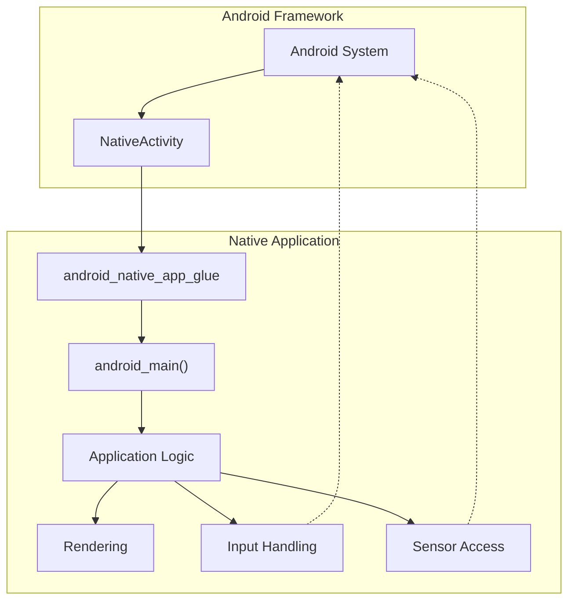
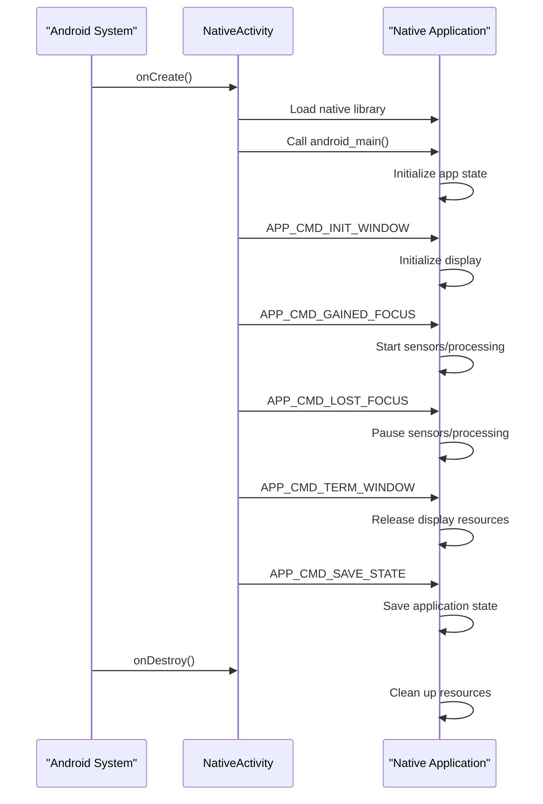
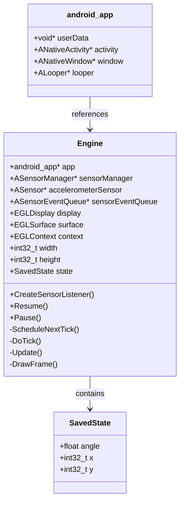
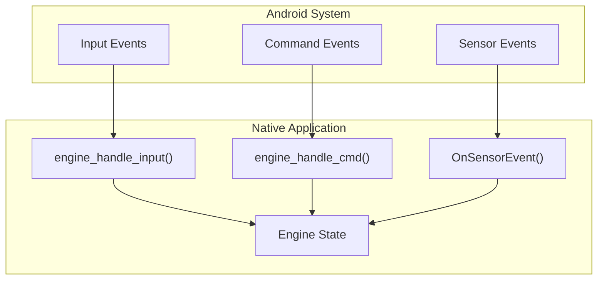
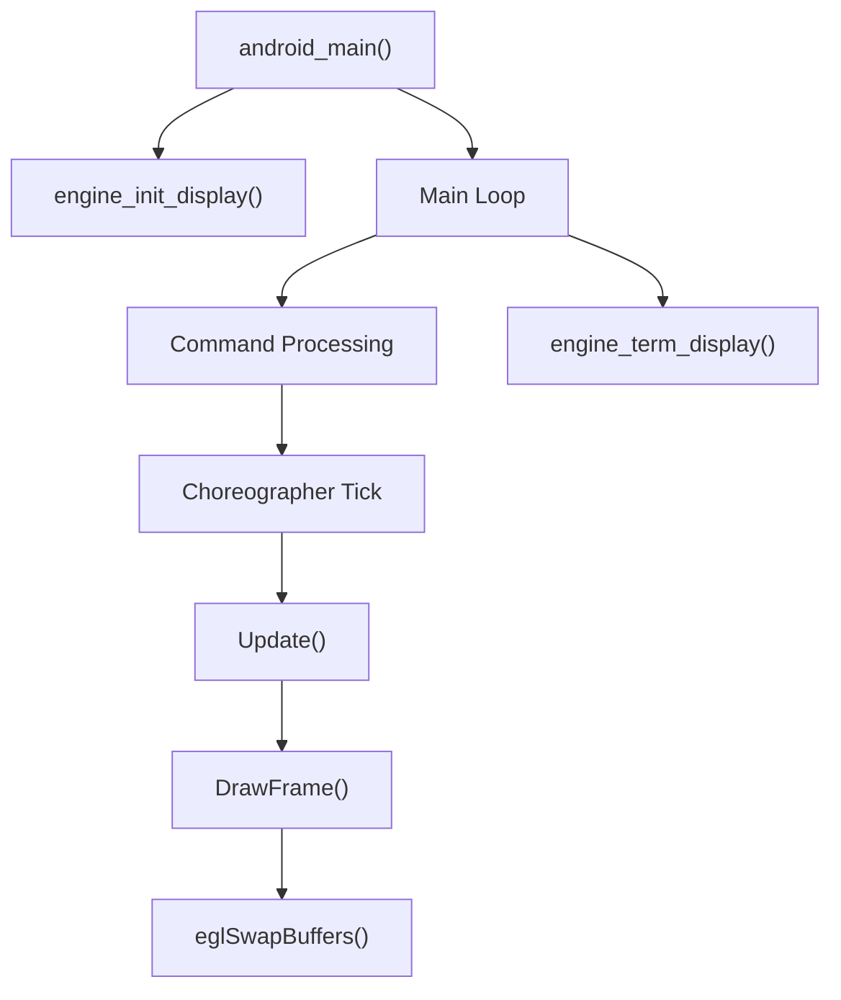
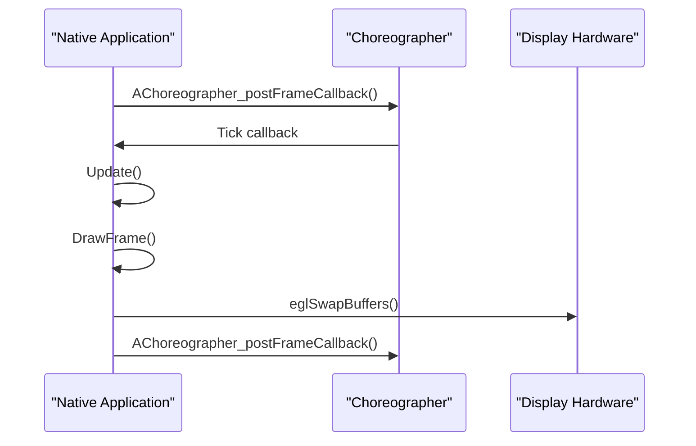

<!-- source: DeepWiki mcp.deepwiki.com · repo android/ndk-samples · page 4 Native Activity Applications · fetched 2026-10-23 -->

# Native Activity Applications

<details>
<summary>Relevant source files</summary>

The following files were used as context for generating this wiki page:

- [audio-echo/README.md](audio-echo/README.md)
- [audio-echo/app/src/main/AndroidManifest.xml](audio-echo/app/src/main/AndroidManifest.xml)
- [audio-echo/app/src/main/res/menu/menu_main.xml](audio-echo/app/src/main/res/menu/menu_main.xml)
- [bitmap-plasma/README.md](bitmap-plasma/README.md)
- [bitmap-plasma/app/src/main/AndroidManifest.xml](bitmap-plasma/app/src/main/AndroidManifest.xml)
- [camera/common/utils/camera_utils.cpp](camera/common/utils/camera_utils.cpp)
- [camera/texture-view/src/main/cpp/android_main.cpp](camera/texture-view/src/main/cpp/android_main.cpp)
- [camera/texture-view/src/main/cpp/camera_engine.cpp](camera/texture-view/src/main/cpp/camera_engine.cpp)
- [camera/texture-view/src/main/cpp/camera_engine.h](camera/texture-view/src/main/cpp/camera_engine.h)
- [camera/texture-view/src/main/cpp/camera_manager.cpp](camera/texture-view/src/main/cpp/camera_manager.cpp)
- [camera/texture-view/src/main/cpp/camera_manager.h](camera/texture-view/src/main/cpp/camera_manager.h)
- [endless-tunnel/README.md](endless-tunnel/README.md)
- [gles3jni/README.md](gles3jni/README.md)
- [gles3jni/app/src/main/cpp/gles3jni.cpp](gles3jni/app/src/main/cpp/gles3jni.cpp)
- [hello-gl2/README.md](hello-gl2/README.md)
- [hello-gl2/app/src/main/AndroidManifest.xml](hello-gl2/app/src/main/AndroidManifest.xml)
- [hello-jni/README.md](hello-jni/README.md)
- [hello-jni/app/src/main/AndroidManifest.xml](hello-jni/app/src/main/AndroidManifest.xml)
- [native-activity/README.md](native-activity/README.md)
- [native-activity/app/src/main/AndroidManifest.xml](native-activity/app/src/main/AndroidManifest.xml)
- [native-activity/app/src/main/cpp/main.cpp](native-activity/app/src/main/cpp/main.cpp)
- [native-audio/README.md](native-audio/README.md)
- [native-codec/README.md](native-codec/README.md)
- [native-codec/app/src/main/AndroidManifest.xml](native-codec/app/src/main/AndroidManifest.xml)
- [native-media/README.md](native-media/README.md)
- [native-media/app/src/main/AndroidManifest.xml](native-media/app/src/main/AndroidManifest.xml)
- [native-plasma/README.md](native-plasma/README.md)
- [native-plasma/app/src/main/AndroidManifest.xml](native-plasma/app/src/main/AndroidManifest.xml)
- [san-angeles/README.md](san-angeles/README.md)
- [san-angeles/app/src/main/AndroidManifest.xml](san-angeles/app/src/main/AndroidManifest.xml)

</details>


Native Activity Applications provide a way to write Android applications entirely in native code (C/C++) without requiring any Java or Kotlin. This page explains how to develop Android applications using the NativeActivity framework, which is particularly useful for performance-critical applications like games or graphics-intensive applications that benefit from direct hardware access.

For applications that mix Java/Kotlin code with native code using JNI, see [Basic JNI Samples](#3).

## Architecture Overview

Native Activity applications have a unique architecture that differs from traditional Android applications. Instead of having an activity implemented in Java that calls native methods, the entire application lifecycle is handled in native code.



**Native Activity Architecture**

Sources: [native-activity/app/src/main/cpp/main.cpp:385-423](), [native-activity/app/src/main/AndroidManifest.xml:19-35]()

The key components are:

- **NativeActivity**: A Java class provided by the Android framework that serves as a bridge between the Android system and native code.
- **android_native_app_glue**: A helper library that simplifies the interaction with NativeActivity by providing a C/C++ interface.
- **android_main()**: The entry point for native code execution, analogous to `main()` in a traditional C/C++ program.

## Application Lifecycle

Native Activity applications follow the Android activity lifecycle, but handle it entirely in native code through callback functions.



**Native Activity Lifecycle**

Sources: [native-activity/app/src/main/cpp/main.cpp:322-364]()

The lifecycle is handled through the `engine_handle_cmd` function, which processes commands from the Android system:

| Command | Description | Android Lifecycle Equivalent |
|---------|-------------|------------------------------|
| APP_CMD_SAVE_STATE | Save the application state | onSaveInstanceState() |
| APP_CMD_INIT_WINDOW | Initialize the display | surfaceCreated() |
| APP_CMD_TERM_WINDOW | Clean up the display | surfaceDestroyed() |
| APP_CMD_GAINED_FOCUS | App is now in focus | onResume() |
| APP_CMD_LOST_FOCUS | App lost focus | onPause() |

## Core Components of Native Activity

A typical Native Activity application includes several core components:



**Native Activity Core Components**

Sources: [native-activity/app/src/main/cpp/main.cpp:71-181](), [native-activity/app/src/main/cpp/main.cpp:390-405]()

The main components include:

1. **Engine Structure**: Holds the application state, including references to the display, sensors, and application-specific data.
2. **android_app Structure**: Provided by android_native_app_glue, contains references to the Android activity, window, and looper.
3. **Callback Functions**: Process events from the Android system, including input events and lifecycle events.
4. **Main Loop**: Processes events and updates the application state.

## Event Handling in Native Activity

Native Activity applications receive events from the Android system through callback functions.



**Event Handling Flow**

Sources: [native-activity/app/src/main/cpp/main.cpp:305-317](), [native-activity/app/src/main/cpp/main.cpp:322-364](), [native-activity/app/src/main/cpp/main.cpp:367-383]()

The event handling system includes:

1. **Input Handling**: Processes touch events through the `engine_handle_input` function.
2. **Command Handling**: Processes lifecycle events through the `engine_handle_cmd` function.
3. **Sensor Handling**: Processes sensor data through sensor event callbacks.

## Rendering with OpenGL ES

Native Activity applications typically use OpenGL ES for rendering, which is initialized and managed entirely in native code.



**Rendering Pipeline**

Sources: [native-activity/app/src/main/cpp/main.cpp:126-181](), [native-activity/app/src/main/cpp/main.cpp:187-281]()

Key aspects of rendering include:

1. **Display Initialization**: Sets up the EGL context and surface in `engine_init_display`.
2. **Rendering Loop**: Managed by the Choreographer, which schedules rendering frames.
3. **Frame Drawing**: Performed in the `DrawFrame` method, which updates the display.
4. **Display Cleanup**: Handled by `engine_term_display` when the application is paused or terminated.

## Configuring a Native Activity in AndroidManifest.xml

To create a Native Activity application, you need to configure the AndroidManifest.xml file appropriately:

```xml
<application
    android:hasCode="false">
    <activity android:name="android.app.NativeActivity">
        <meta-data android:name="android.app.lib_name"
                   android:value="native-activity" />
        <intent-filter>
            <action android:name="android.intent.action.MAIN" />
            <category android:name="android.intent.category.LAUNCHER" />
        </intent-filter>
    </activity>
</application>
```

Key configuration points:

- `android:hasCode="false"`: Indicates there's no Java/Kotlin code in the application.
- `android:name="android.app.NativeActivity"`: Specifies that the activity is a NativeActivity.
- `android.app.lib_name`: Specifies the name of the native library that contains the application code.

Sources: [native-activity/app/src/main/AndroidManifest.xml:14-34]()

## Using the Choreographer for Animation

Native Activity applications can use the Android Choreographer for synchronized animation and rendering:



**Choreographer Animation Flow**

Sources: [native-activity/app/src/main/cpp/main.cpp:126-157]()

The Choreographer provides a way to synchronize animation with the display refresh rate:

1. Register a callback with `AChoreographer_postFrameCallback`.
2. When the callback is invoked, update the animation state.
3. Render the frame.
4. Re-register the callback for the next frame.

## Sample Applications in the NDK

The Android NDK samples repository includes several applications that demonstrate Native Activity:

1. **native-activity**: A basic sample that demonstrates initializing a GLES 2.0 context and reading accelerometer data.
2. **native-plasma**: Renders a plasma effect in a Bitmap using Native Activity.
3. **endless-tunnel**: A more complex game that demonstrates using Native Activity for a complete game application.

Sources: [native-activity/README.md:1-60](), [native-plasma/README.md:1-60](), [endless-tunnel/README.md:1-96]()

## Comparison with JNI Approach

| Aspect | Native Activity | JNI Approach |
|--------|----------------|--------------|
| Code Structure | Entirely in C/C++ | Mix of Java/Kotlin and C/C++ |
| UI Framework | Limited to what you implement in native code | Full access to Android UI toolkit |
| Lifecycle Management | Manual handling in C/C++ | Automatic in Java/Kotlin |
| Performance | Potentially better for render-intensive apps | Overhead from JNI calls |
| Development Complexity | Higher for UI, lower for native code | Lower for UI, higher for native integration |
| Use Case | Games, graphics-intensive applications | Apps needing both native performance and rich UI |

Sources: [hello-jni/README.md:1-55](), [native-activity/README.md:1-60](), [endless-tunnel/README.md:1-96]()

## Best Practices

When developing Native Activity applications, consider these best practices:

1. **Memory Management**: Properly initialize and clean up resources to avoid memory leaks.
2. **Error Handling**: Implement robust error handling for system callbacks and OpenGL operations.
3. **Input Handling**: Design a flexible input system that can handle multiple input types.
4. **Performance Optimization**: Use techniques like double buffering and proper threading for smooth performance.
5. **Lifecycle Awareness**: Properly handle all lifecycle events to ensure the application behaves correctly.

Sources: [native-activity/app/src/main/cpp/main.cpp:44-58](), [native-activity/app/src/main/cpp/main.cpp:322-364]()

## Conclusion

Native Activity provides a way to develop Android applications entirely in native code, which is particularly useful for performance-critical applications like games. By understanding the architecture, lifecycle, and event handling of Native Activity applications, developers can create high-performance applications that interact directly with the Android system without requiring Java or Kotlin code.

For applications that require both native performance and rich UI components, consider using the JNI approach described in [Basic JNI Samples](#3).

---

