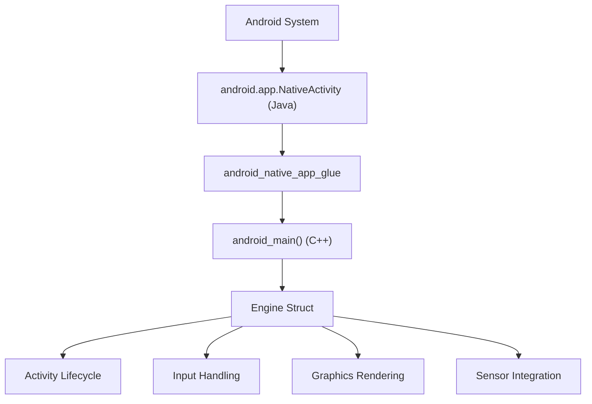
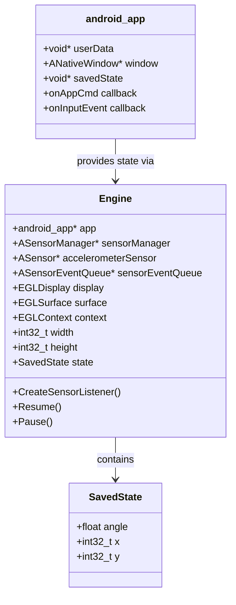
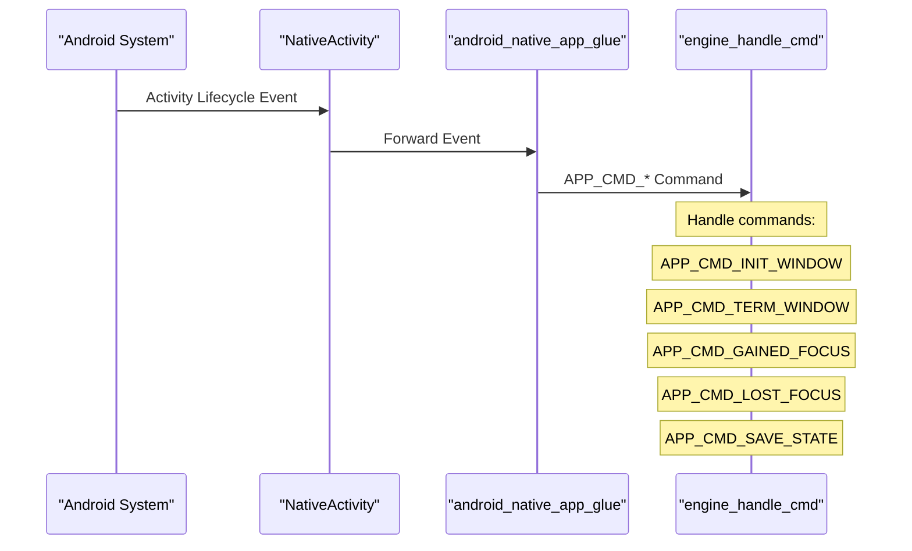
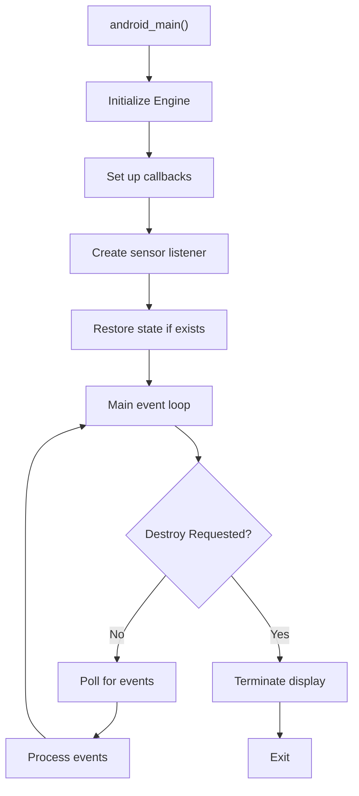
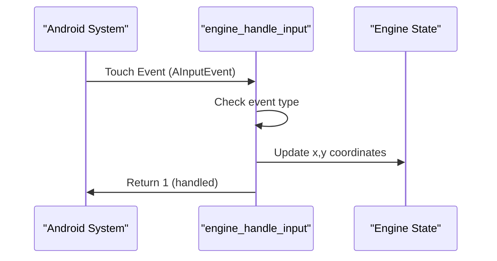
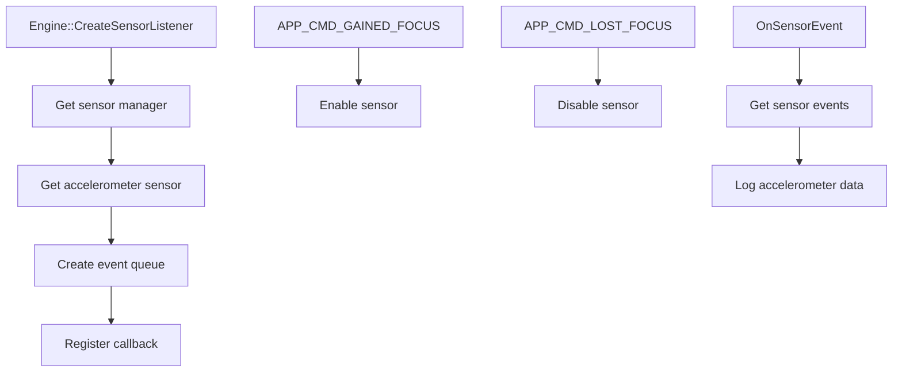
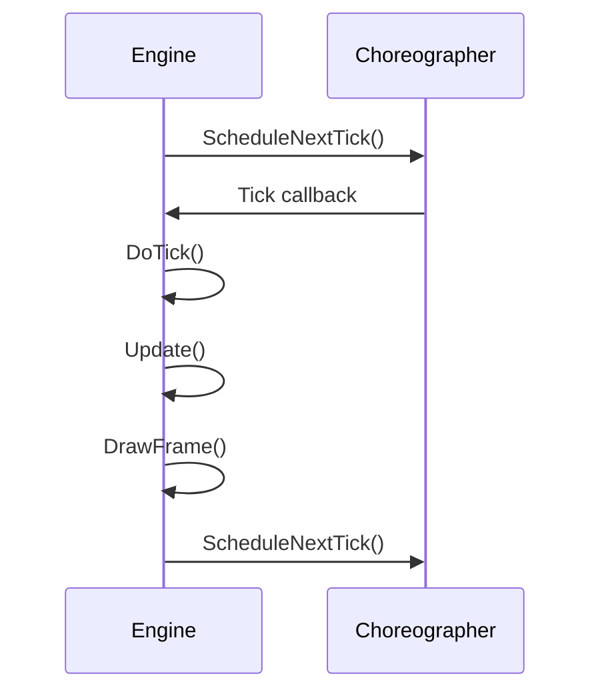

<!-- source: DeepWiki mcp.deepwiki.com · repo android/ndk-samples · page 4.1 Basic Native Activity · fetched 2026-10-23 -->

# Basic Native Activity

<details>
<summary>Relevant source files</summary>

The following files were used as context for generating this wiki page:

- [audio-echo/README.md](audio-echo/README.md)
- [audio-echo/app/src/main/AndroidManifest.xml](audio-echo/app/src/main/AndroidManifest.xml)
- [audio-echo/app/src/main/res/menu/menu_main.xml](audio-echo/app/src/main/res/menu/menu_main.xml)
- [bitmap-plasma/README.md](bitmap-plasma/README.md)
- [bitmap-plasma/app/src/main/AndroidManifest.xml](bitmap-plasma/app/src/main/AndroidManifest.xml)
- [camera/common/utils/camera_utils.cpp](camera/common/utils/camera_utils.cpp)
- [camera/texture-view/src/main/cpp/android_main.cpp](camera/texture-view/src/main/cpp/android_main.cpp)
- [camera/texture-view/src/main/cpp/camera_engine.cpp](camera/texture-view/src/main/cpp/camera_engine.cpp)
- [camera/texture-view/src/main/cpp/camera_engine.h](camera/texture-view/src/main/cpp/camera_engine.h)
- [camera/texture-view/src/main/cpp/camera_manager.cpp](camera/texture-view/src/main/cpp/camera_manager.cpp)
- [camera/texture-view/src/main/cpp/camera_manager.h](camera/texture-view/src/main/cpp/camera_manager.h)
- [endless-tunnel/README.md](endless-tunnel/README.md)
- [gles3jni/README.md](gles3jni/README.md)
- [gles3jni/app/src/main/cpp/gles3jni.cpp](gles3jni/app/src/main/cpp/gles3jni.cpp)
- [hello-gl2/README.md](hello-gl2/README.md)
- [hello-gl2/app/src/main/AndroidManifest.xml](hello-gl2/app/src/main/AndroidManifest.xml)
- [hello-jni/README.md](hello-jni/README.md)
- [hello-jni/app/src/main/AndroidManifest.xml](hello-jni/app/src/main/AndroidManifest.xml)
- [native-activity/README.md](native-activity/README.md)
- [native-activity/app/src/main/AndroidManifest.xml](native-activity/app/src/main/AndroidManifest.xml)
- [native-activity/app/src/main/cpp/main.cpp](native-activity/app/src/main/cpp/main.cpp)
- [native-audio/README.md](native-audio/README.md)
- [native-codec/README.md](native-codec/README.md)
- [native-codec/app/src/main/AndroidManifest.xml](native-codec/app/src/main/AndroidManifest.xml)
- [native-media/README.md](native-media/README.md)
- [native-media/app/src/main/AndroidManifest.xml](native-media/app/src/main/AndroidManifest.xml)
- [native-plasma/README.md](native-plasma/README.md)
- [native-plasma/app/src/main/AndroidManifest.xml](native-plasma/app/src/main/AndroidManifest.xml)
- [san-angeles/README.md](san-angeles/README.md)
- [san-angeles/app/src/main/AndroidManifest.xml](san-angeles/app/src/main/AndroidManifest.xml)

</details>


This document explains how to implement Android applications that run entirely in native code using the NativeActivity component. A NativeActivity allows you to write Android apps completely in C/C++ without requiring Java/Kotlin code. We'll examine the native-activity sample from the Android NDK samples repository to understand the structure, lifecycle, and implementation details of native Android applications.

For applications that use Java/Kotlin with C++ through JNI, see [Basic JNI Samples](#3).

## Architecture Overview

Native Activity applications have a different architecture compared to traditional Android applications. Rather than implementing activity logic in Java or Kotlin, they leverage the Android NDK's `android_native_app_glue` library to bridge between the Android system and native C/C++ code.



The `android_main()` function serves as the entry point for the native application, similar to `main()` in standard C/C++ programs. The `Engine` struct maintains application state and provides methods for managing the application lifecycle.

Sources: [native-activity/app/src/main/cpp/main.cpp:24-25](), [native-activity/app/src/main/cpp/main.cpp:390-423]()

## Application Components

The native-activity sample demonstrates a basic OpenGL ES application with accelerometer input and touch handling. Its components are organized as follows:



The `Engine` struct encapsulates the application's state, including the OpenGL ES context, display information, and sensor management. The `SavedState` structure holds the data that should persist across activity restarts.

Sources: [native-activity/app/src/main/cpp/main.cpp:71-75](), [native-activity/app/src/main/cpp/main.cpp:80-93]()

## AndroidManifest Configuration

To implement a Native Activity application, you need to configure your AndroidManifest.xml with several important elements:

| Configuration | Description |
|---------------|-------------|
| `android:hasCode="false"` | Indicates the application has no Java/Kotlin code |
| `android.app.NativeActivity` | The Java class that bridges to native code |
| `android.app.lib_name` | Meta-data that specifies the name of the shared library |

Here's the relevant AndroidManifest.xml configuration:

```
<application
    android:allowBackup="false"
    android:fullBackupContent="false"
    android:icon="@mipmap/ic_launcher"
    android:label="@string/app_name"
    android:hasCode="false">

  <activity android:name="android.app.NativeActivity"
            android:label="@string/app_name"
            android:configChanges="orientation|keyboardHidden">
    <!-- Tell NativeActivity the name of our .so -->
    <meta-data android:name="android.app.lib_name"
               android:value="native-activity" />
    <intent-filter>
      <action android:name="android.intent.action.MAIN" />
      <category android:name="android.intent.category.LAUNCHER" />
    </intent-filter>
  </activity>
</application>
```

The `android.app.lib_name` meta-data element is crucial as it tells the NativeActivity which shared library to load.

Sources: [native-activity/app/src/main/AndroidManifest.xml:14-34]()

## Application Lifecycle

The native activity receives Android lifecycle events through the `android_app` structure. The main lifecycle events are handled in the `engine_handle_cmd` function, which processes commands such as initialization, termination, and focus changes.



The following table outlines key lifecycle events and their handling:

| Command | Triggered When | Handling Action |
|---------|----------------|-----------------|
| `APP_CMD_INIT_WINDOW` | Window is created | Initialize OpenGL ES context |
| `APP_CMD_TERM_WINDOW` | Window is destroyed | Clean up OpenGL ES resources |
| `APP_CMD_GAINED_FOCUS` | App gains focus | Enable sensors, resume rendering |
| `APP_CMD_LOST_FOCUS` | App loses focus | Disable sensors, pause rendering |
| `APP_CMD_SAVE_STATE` | System asks for state | Save data for restoration |

Sources: [native-activity/app/src/main/cpp/main.cpp:322-365]()

## Main Entry Point

The `android_main()` function serves as the entry point for the native activity. It initializes the application, sets up callback handlers, and runs the main event loop:



The main event loop uses `ALooper_pollOnce()` to wait for events from the Android system. When an event occurs, the corresponding callback is triggered.

Sources: [native-activity/app/src/main/cpp/main.cpp:390-423]()

## Input Handling

The native-activity sample handles touch input through the `engine_handle_input` function, which is registered as the `onInputEvent` callback in the `android_app` structure. When a touch event occurs, the function updates the x and y coordinates in the engine's state.



This input handling approach is straightforward:

1. The function checks if the event is a motion event (`AINPUT_EVENT_TYPE_MOTION`)
2. If so, it extracts the x and y coordinates using `AMotionEvent_getX/Y`
3. The coordinates are stored in the engine's state for use in rendering

Sources: [native-activity/app/src/main/cpp/main.cpp:308-317]()

## Sensor Integration

The sample demonstrates integration with the device's accelerometer sensor. This is handled through the following process:



Key aspects of sensor integration:

1. The sensor manager is obtained via `ASensorManager_getInstance()`
2. The accelerometer sensor is acquired with `ASensorManager_getDefaultSensor()`
3. A sensor event queue is created and associated with the application's looper
4. The sensor is enabled when the app gains focus and disabled when it loses focus
5. A callback function (`OnSensorEvent`) processes the sensor data

Sources: [native-activity/app/src/main/cpp/main.cpp:94-106](), [native-activity/app/src/main/cpp/main.cpp:367-383]()

## Graphics Rendering

The sample initializes an OpenGL ES context and renders to the screen. This process involves:

| Step | Function | Purpose |
|------|----------|---------|
| 1 | `engine_init_display` | Initialize OpenGL ES and EGL |
| 2 | `engine_term_display` | Clean up OpenGL ES resources |
| 3 | `Engine::DoTick` | Handle frame updates |
| 4 | `Engine::Update` | Update animation state |
| 5 | `Engine::DrawFrame` | Render the frame |

The rendering is basic—it simply fills the screen with a color based on touch position and animation angle:

```
// In DrawFrame()
glClearColor(((float)state.x) / width, state.angle, ((float)state.y) / height, 1);
glClear(GL_COLOR_BUFFER_BIT);
eglSwapBuffers(display, surface);
```

Sources: [native-activity/app/src/main/cpp/main.cpp:187-282](), [native-activity/app/src/main/cpp/main.cpp:169-181]()

## Frame Timing with Choreographer

The sample uses Android's Choreographer API to synchronize rendering with the display's vsync signal. This ensures smooth animation and efficient resource usage:



The Choreographer-based timing system:

1. Registers a callback with `AChoreographer_postFrameCallback()`
2. When the callback is triggered, updates the animation state
3. Renders the frame
4. Re-registers for the next frame

This approach is more efficient than a traditional game loop as it synchronizes with the display refresh rate and prevents unnecessary rendering.

Sources: [native-activity/app/src/main/cpp/main.cpp:126-167]()

## Summary

The native-activity sample demonstrates a complete Android application implemented entirely in C++. It shows how to:

1. Configure an Android application to use the NativeActivity
2. Implement the native entry point and main loop
3. Handle activity lifecycle events
4. Process touch input
5. Integrate with device sensors
6. Render graphics using OpenGL ES
7. Synchronize rendering with the display refresh rate

This approach is particularly useful for:

| Use Case | Benefits |
|----------|----------|
| Game development | Direct access to OpenGL ES without Java overhead |
| Cross-platform applications | Easier sharing of code between platforms |
| Performance-critical applications | Reduced overhead from JNI calls |
| Existing C/C++ codebases | Integration without extensive Java wrappers |

For more complex native applications or those requiring extensive Android framework features, consider hybrid approaches using JNI (see [Basic JNI Samples](#3)) or other native patterns like those demonstrated in [Endless Tunnel](#8).

Sources: [native-activity/README.md:1-60]()

---

