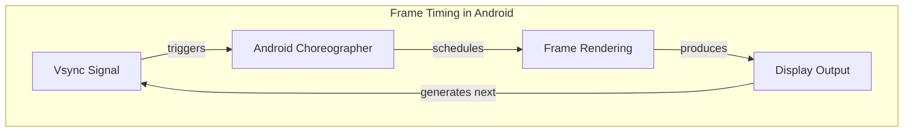
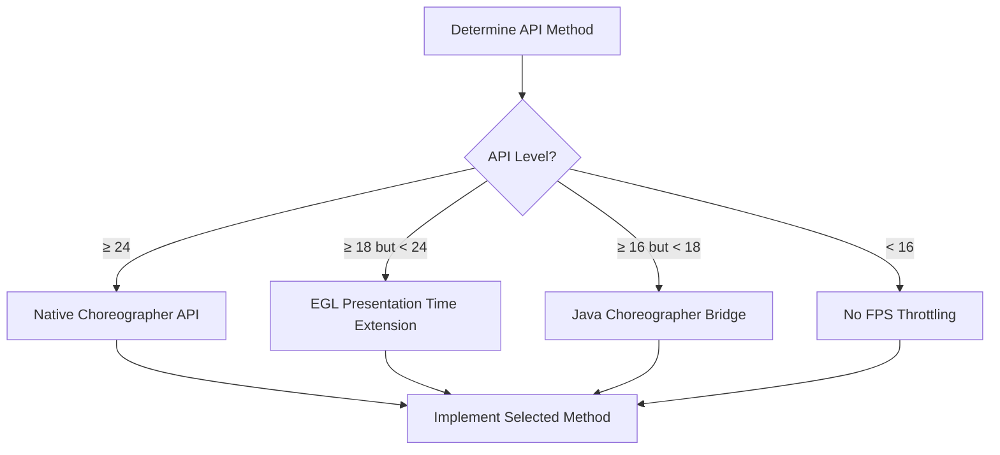
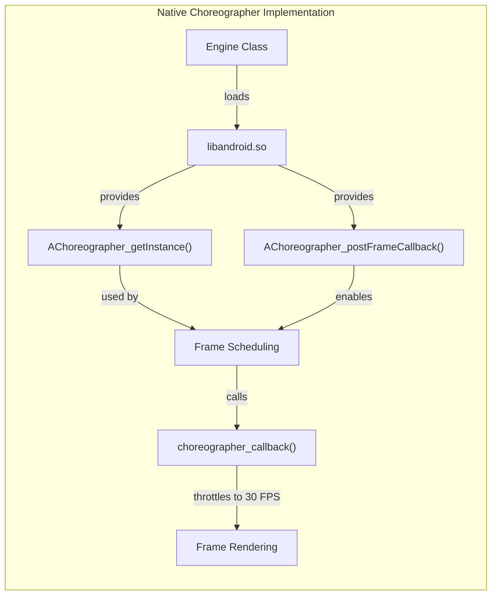
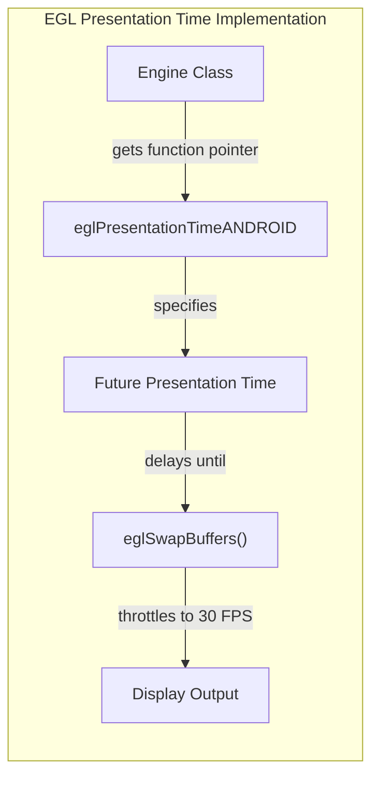
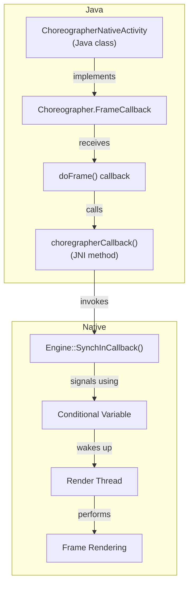
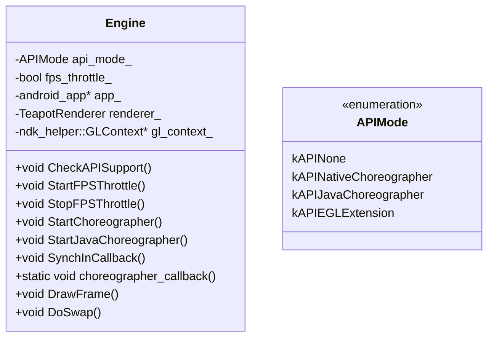
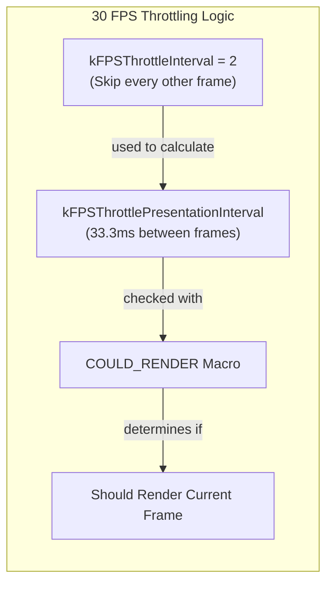
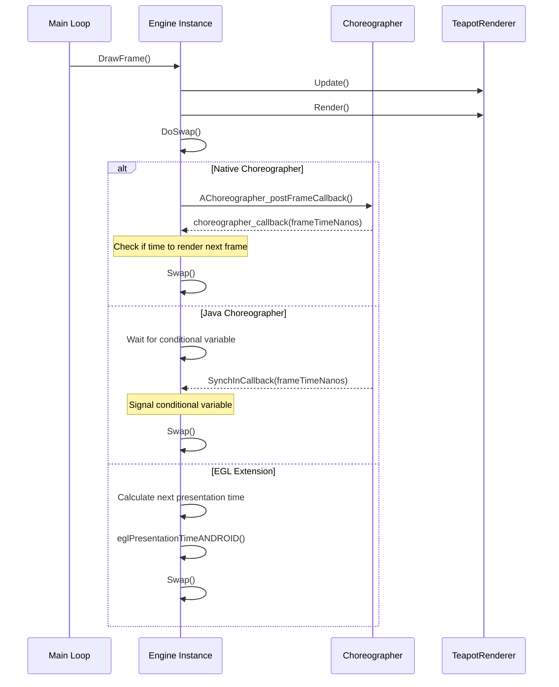
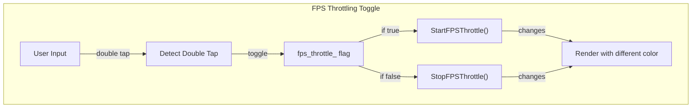

<!-- source: DeepWiki mcp.deepwiki.com · repo android/ndk-samples · page 4.2 Choreographer and Animation · fetched 2026-10-23 -->

# Choreographer and Animation

<details>
<summary>Relevant source files</summary>

The following files were used as context for generating this wiki page:

- [.gitignore](.gitignore)
- [camera/basic/src/main/cpp/android_main.cpp](camera/basic/src/main/cpp/android_main.cpp)
- [endless-tunnel/app/src/main/cpp/native_engine.cpp](endless-tunnel/app/src/main/cpp/native_engine.cpp)
- [endless-tunnel/app/src/main/cpp/native_engine.hpp](endless-tunnel/app/src/main/cpp/native_engine.hpp)
- [hello-jniCallback/app/build.gradle](hello-jniCallback/app/build.gradle)
- [hello-neon/app/build.gradle](hello-neon/app/build.gradle)
- [native-plasma/app/src/main/cpp/plasma.c](native-plasma/app/src/main/cpp/plasma.c)
- [nn-samples/basic/build.gradle](nn-samples/basic/build.gradle)
- [nn-samples/basic/src/main/res/layout/activity_main.xml](nn-samples/basic/src/main/res/layout/activity_main.xml)
- [nn-samples/sequence/build.gradle](nn-samples/sequence/build.gradle)
- [nn-samples/sequence/src/main/res/layout/activity_main.xml](nn-samples/sequence/src/main/res/layout/activity_main.xml)
- [sensor-graph/accelerometer/src/main/cpp/sensorgraph.cpp](sensor-graph/accelerometer/src/main/cpp/sensorgraph.cpp)
- [teapots/choreographer-30fps/build.gradle](teapots/choreographer-30fps/build.gradle)
- [teapots/choreographer-30fps/src/main/cpp/ChoreographerNativeActivity.cpp](teapots/choreographer-30fps/src/main/cpp/ChoreographerNativeActivity.cpp)
- [teapots/choreographer-30fps/src/main/java/com/sample/choreographer/ChoreographerNativeActivity.java](teapots/choreographer-30fps/src/main/java/com/sample/choreographer/ChoreographerNativeActivity.java)
- [teapots/classic-teapot/build.gradle](teapots/classic-teapot/build.gradle)
- [teapots/classic-teapot/src/main/cpp/TeapotNativeActivity.cpp](teapots/classic-teapot/src/main/cpp/TeapotNativeActivity.cpp)
- [teapots/image-decoder/build.gradle](teapots/image-decoder/build.gradle)
- [teapots/image-decoder/src/main/cpp/TeapotNativeActivity.cpp](teapots/image-decoder/src/main/cpp/TeapotNativeActivity.cpp)
- [teapots/more-teapots/build.gradle](teapots/more-teapots/build.gradle)
- [teapots/more-teapots/src/main/cpp/MoreTeapotsNativeActivity.cpp](teapots/more-teapots/src/main/cpp/MoreTeapotsNativeActivity.cpp)
- [teapots/textured-teapot/build.gradle](teapots/textured-teapot/build.gradle)
- [teapots/textured-teapot/src/main/cpp/TeapotNativeActivity.cpp](teapots/textured-teapot/src/main/cpp/TeapotNativeActivity.cpp)

</details>


This document explains how to control frame timing and animation in native Android applications using the Choreographer API. The Choreographer enables precise frame scheduling for smooth animations and helps manage battery usage by limiting frame rates when needed.

## Introduction to Choreographer

The Android Choreographer is a system service that synchronizes application rendering with the display's refresh rate (vsync). In standard Android applications written in Java/Kotlin, developers use Choreographer to schedule frame rendering at the optimal time. In native applications, accessing this functionality requires special techniques.

The choreographer-30fps sample demonstrates how to:

1. Throttle the frame rate to 30 FPS (instead of the standard 60 FPS)
2. Implement Choreographer integration using several different approaches based on the Android API level
3. Synchronize native rendering with the device's vsync signal



Sources: [teapots/choreographer-30fps/src/main/cpp/ChoreographerNativeActivity.cpp:36-46]()

## Choreographer API Approaches

The sample demonstrates three different approaches to implement frame timing control in native code, depending on the Android API level:



Sources: [teapots/choreographer-30fps/src/main/cpp/ChoreographerNativeActivity.cpp:154-194]()

### Native Choreographer API (API 24+)

For Android 7.0 (API level 24) and above, the sample uses the native Choreographer API provided by Android NDK. This approach provides direct access to the Choreographer functionality from C/C++ code.

The sample dynamically loads the native Choreographer functions from the Android library:



Sources: [teapots/choreographer-30fps/src/main/cpp/ChoreographerNativeActivity.cpp:163-173](), [teapots/choreographer-30fps/src/main/cpp/ChoreographerNativeActivity.cpp:241-269]()

### EGL Presentation Time Extension (API 18-23)

For Android 4.3 to 6.x (API levels 18-23), the sample uses the EGL Presentation Time extension. This extension allows specifying when a frame should be displayed, enabling frame rate control.



Sources: [teapots/choreographer-30fps/src/main/cpp/ChoreographerNativeActivity.cpp:177-186](), [teapots/choreographer-30fps/src/main/cpp/ChoreographerNativeActivity.cpp:228-234]()

### Java Choreographer Bridge (API 16-17)

For Android 4.1 to 4.2 (API levels 16-17), the sample creates a bridge between native code and the Java Choreographer API:



Sources: [teapots/choreographer-30fps/src/main/java/com/sample/choreographer/ChoreographerNativeActivity.java:44-64](), [teapots/choreographer-30fps/src/main/cpp/ChoreographerNativeActivity.cpp:298-310]()

## Implementation Details

### Engine Class Structure

The main implementation is in the `Engine` class within the `ChoreographerNativeActivity.cpp` file. This class manages the frame rendering and choreographer interaction:



Sources: [teapots/choreographer-30fps/src/main/cpp/ChoreographerNativeActivity.cpp:62-133]()

### Frame Timing Logic

The core logic to throttle frames to 30 FPS is implemented with this time interval calculation:



Sources: [teapots/choreographer-30fps/src/main/cpp/ChoreographerNativeActivity.cpp:44-48](), [teapots/choreographer-30fps/src/main/cpp/ChoreographerNativeActivity.cpp:262-264](), [teapots/choreographer-30fps/src/main/cpp/ChoreographerNativeActivity.cpp:300-302]()

### Frame Rendering Process

The following diagram illustrates the typical flow of a frame in the choreographer-30fps sample:



Sources: [teapots/choreographer-30fps/src/main/cpp/ChoreographerNativeActivity.cpp:387-401](), [teapots/choreographer-30fps/src/main/cpp/ChoreographerNativeActivity.cpp:218-238]()

## Using the Choreographer API in Your Application

### Detecting Available Methods

First, check the device's API level to determine which method to use:

```cpp
void Engine::CheckAPISupport() {
  auto apilevel = AConfiguration_getSdkVersion(app_->config);
  
  if (apilevel >= 24) {
    // Use Native Choreographer API
  } else if (apilevel >= 18) {
    // Use EGL Presentation Time extension
  } else if (apilevel >= 16) {
    // Use Java Choreographer bridge
  } else {
    // No throttling available
  }
}
```

Sources: [teapots/choreographer-30fps/src/main/cpp/ChoreographerNativeActivity.cpp:154-194]()

### Implementing Native Choreographer

For API level 24+, implement a function to load the native choreographer functions and set up the callback:

```cpp
// Initialize native choreographer
void Engine::StartChoreographer() {
  if (api_mode_ == kAPINativeChoreographer) {
    auto choreographer = AChoreographer_getInstance_();
    AChoreographer_postFrameCallback_(choreographer, choreographer_callback, this);
  }
}

// Choreographer callback function
void Engine::choreographer_callback(long frameTimeNanos, void* data) {
  auto engine = reinterpret_cast<Engine*>(data);
  
  // Post next callback
  if (engine->has_focus_) {
    engine->StartChoreographer();
  }
  
  // Render if it's time for the next frame
  if (COULD_RENDER(frameTimeNanos, engine->prevFrameTimeNanos_)) {
    engine->should_render_ = true;
    engine->Swap();
    engine->prevFrameTimeNanos_ = frameTimeNanos;
  }
}
```

Sources: [teapots/choreographer-30fps/src/main/cpp/ChoreographerNativeActivity.cpp:241-269]()

### Implementing Java Choreographer Bridge

For API levels 16-23, implement a Java class that implements `Choreographer.FrameCallback` and bridges to native code:

```java
public class YourNativeActivity extends NativeActivity
        implements Choreographer.FrameCallback {
    
    @Override
    public void doFrame(long frameTimeNanos) {
        Choreographer.getInstance().postFrameCallback(this);
        // Call native method to notify about frame time
        nativeChoreographerCallback(frameTimeNanos);
    }
    
    protected native void nativeChoreographerCallback(long frameTimeNanos);
}
```

Then implement the native side to receive these callbacks:

```cpp
extern "C" JNIEXPORT void JNICALL
Java_com_your_package_YourNativeActivity_nativeChoreographerCallback(
    JNIEnv* env, jobject instance, jlong frameTimeInNanos) {
  // Process the frame timing information
  if (COULD_RENDER(frameTimeInNanos, prevFrameTimeNanos_)) {
    prevFrameTimeNanos_ = frameTimeInNanos;
    // Signal render thread to process this frame
  }
}
```

Sources: [teapots/choreographer-30fps/src/main/java/com/sample/choreographer/ChoreographerNativeActivity.java:44-64](), [teapots/choreographer-30fps/src/main/cpp/ChoreographerNativeActivity.cpp:298-310]()

## Switching Between Standard and Throttled Frame Rates

The sample includes functionality to toggle between 30 FPS and 60 FPS modes via a double-tap gesture:



Sources: [teapots/choreographer-30fps/src/main/cpp/ChoreographerNativeActivity.cpp:426-436](), [teapots/choreographer-30fps/src/main/cpp/ChoreographerNativeActivity.cpp:396-399]()

## Best Practices

1. **Fallback Strategy**: Always implement a fallback strategy for devices that don't support your preferred method.

2. **Battery Efficiency**: Use throttled frame rates when full 60 FPS is not necessary to save battery.

3. **Version Targeting**: Check API levels at runtime to select the appropriate method:
   - API 24+: Use Native Choreographer API
   - API 18-23: Use EGL Presentation Time extension 
   - API 16-17: Use Java Choreographer bridge
   - Below API 16: Implement manual timing or accept unthrottled frame rates

4. **Error Handling**: Always validate function pointers when using dynamically loaded functions.

5. **Thread Safety**: Be careful with concurrency when using Java to native bridges.

## Related Topics

For information about basic native activity implementation, see [Basic Native Activity](#4.1).

For more advanced graphics rendering in the NDK, see [Graphics Samples](#5).

Sources: [teapots/choreographer-30fps/src/main/cpp/ChoreographerNativeActivity.cpp](), [teapots/choreographer-30fps/src/main/java/com/sample/choreographer/ChoreographerNativeActivity.java]()

---

