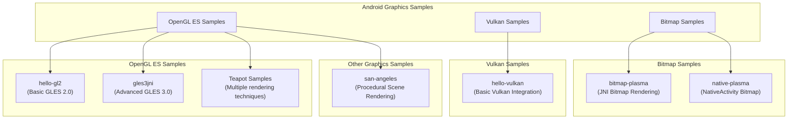
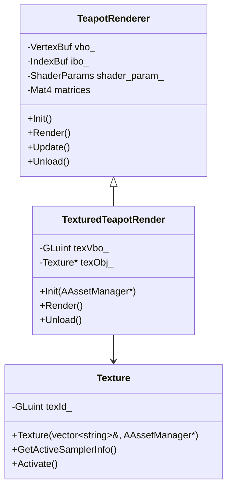
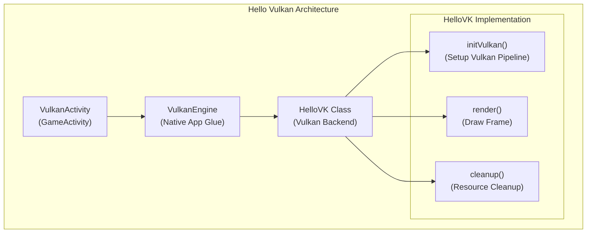
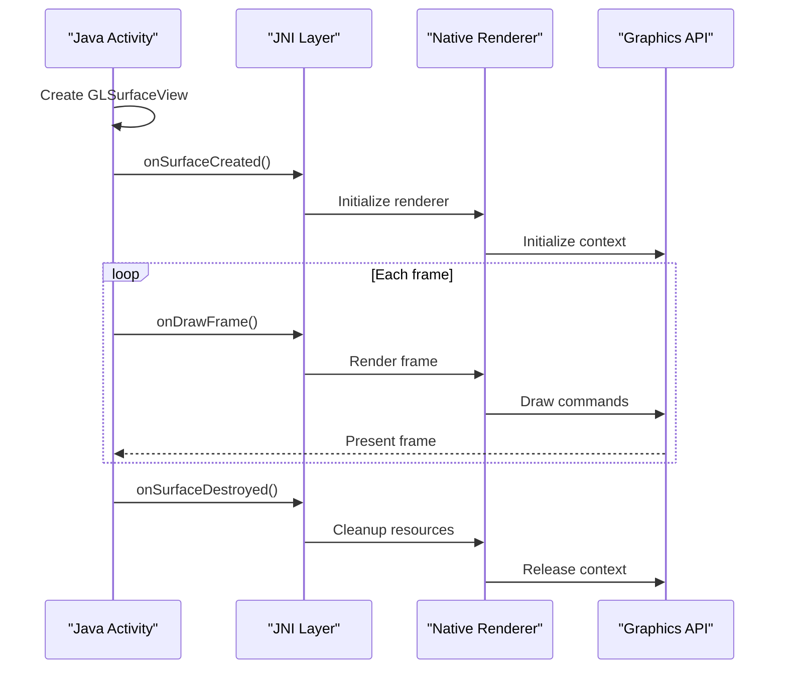
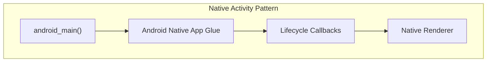

<!-- source: DeepWiki mcp.deepwiki.com · repo android/ndk-samples · page 5 Graphics Samples · fetched 2026-10-23 -->

# Graphics Samples

<details>
<summary>Relevant source files</summary>

The following files were used as context for generating this wiki page:

- [audio-echo/README.md](audio-echo/README.md)
- [bitmap-plasma/README.md](bitmap-plasma/README.md)
- [endless-tunnel/README.md](endless-tunnel/README.md)
- [gles3jni/README.md](gles3jni/README.md)
- [hello-gl2/README.md](hello-gl2/README.md)
- [hello-jni/README.md](hello-jni/README.md)
- [hello-vulkan/app/build.gradle](hello-vulkan/app/build.gradle)
- [hello-vulkan/app/src/main/AndroidManifest.xml](hello-vulkan/app/src/main/AndroidManifest.xml)
- [hello-vulkan/app/src/main/cpp/hellovk.h](hello-vulkan/app/src/main/cpp/hellovk.h)
- [hello-vulkan/app/src/main/cpp/vk_main.cpp](hello-vulkan/app/src/main/cpp/vk_main.cpp)
- [hello-vulkan/app/src/main/java/com/android/hellovk/VulkanActivity.kt](hello-vulkan/app/src/main/java/com/android/hellovk/VulkanActivity.kt)
- [hello-vulkan/app/src/main/res/mipmap-hdpi/ic_launcher.png](hello-vulkan/app/src/main/res/mipmap-hdpi/ic_launcher.png)
- [hello-vulkan/app/src/main/res/mipmap-mdpi/ic_launcher.png](hello-vulkan/app/src/main/res/mipmap-mdpi/ic_launcher.png)
- [hello-vulkan/app/src/main/res/mipmap-xhdpi/ic_launcher.png](hello-vulkan/app/src/main/res/mipmap-xhdpi/ic_launcher.png)
- [native-activity/README.md](native-activity/README.md)
- [native-audio/README.md](native-audio/README.md)
- [native-codec/README.md](native-codec/README.md)
- [native-media/README.md](native-media/README.md)
- [native-plasma/README.md](native-plasma/README.md)
- [san-angeles/README.md](san-angeles/README.md)
- [teapots/textured-teapot/README.md](teapots/textured-teapot/README.md)
- [teapots/textured-teapot/screenshot.png](teapots/textured-teapot/screenshot.png)
- [teapots/textured-teapot/src/main/assets/Shaders/ShaderPlain.fsh](teapots/textured-teapot/src/main/assets/Shaders/ShaderPlain.fsh)
- [teapots/textured-teapot/src/main/cpp/TeapotRenderer.cpp](teapots/textured-teapot/src/main/cpp/TeapotRenderer.cpp)
- [teapots/textured-teapot/src/main/cpp/TeapotRenderer.h](teapots/textured-teapot/src/main/cpp/TeapotRenderer.h)
- [teapots/textured-teapot/src/main/cpp/Texture.cpp](teapots/textured-teapot/src/main/cpp/Texture.cpp)
- [teapots/textured-teapot/src/main/cpp/Texture.h](teapots/textured-teapot/src/main/cpp/Texture.h)
- [teapots/textured-teapot/src/main/cpp/TexturedTeapotRender.cpp](teapots/textured-teapot/src/main/cpp/TexturedTeapotRender.cpp)
- [teapots/textured-teapot/src/main/cpp/TexturedTeapotRender.h](teapots/textured-teapot/src/main/cpp/TexturedTeapotRender.h)
- [teapots/textured-teapot/src/main/cpp/android_debug.h](teapots/textured-teapot/src/main/cpp/android_debug.h)

</details>


This page provides a comprehensive overview of the graphics samples in the Android NDK Samples repository. These samples demonstrate how to use various graphics APIs in native code, including OpenGL ES (2.0 and 3.0), Vulkan, and bitmap manipulation techniques. They illustrate effective patterns for integrating graphics rendering with the Android platform using C/C++ code.

For information about audio samples, see [Audio Samples](#6). For information about Native Activity applications, see [Native Activity Applications](#4).

## Graphics Samples Overview

The NDK samples repository includes a variety of graphics samples that showcase different rendering technologies and techniques:

1. **OpenGL ES Samples**
   - Basic rendering (hello-gl2)
   - Advanced OpenGL ES 3.0 features (gles3jni)
   - Multiple teapot rendering samples with various features

2. **Vulkan Sample**
   - Basic Vulkan integration (hello-vulkan)

3. **Other Graphics Samples**
   - Bitmap manipulation (bitmap-plasma)
   - Procedural rendering (san-angeles)

These samples demonstrate how to implement efficient graphics rendering in native code while properly integrating with the Android platform's lifecycle and window system.

### Graphics APIs Architecture



Sources: `gles3jni/README.md`, `hello-gl2/README.md`, `bitmap-plasma/README.md`, `san-angeles/README.md`, `hello-vulkan/app/build.gradle`

## OpenGL ES Samples

The OpenGL ES samples demonstrate how to use the OpenGL ES graphics API from native code to render 2D and 3D graphics on Android devices.

### Hello GL2 (Basic OpenGL ES 2.0)

The hello-gl2 sample demonstrates how to create a basic OpenGL ES 2.0 application using JNI. It shows:

- How to create and use a GLSurfaceView from Java
- How to initialize an OpenGL ES 2.0 context in native code
- How to render a simple triangle using vertex and fragment shaders

This sample serves as a minimal starting point for OpenGL ES development in native code.

Sources: `hello-gl2/README.md`

### GLES3JNI (Advanced OpenGL ES 3.0)

The gles3jni sample demonstrates advanced features of OpenGL ES 3.0, showing how to:

- Use instanced rendering and vertex attribute divisor to reduce draw calls
- Implement vertex array objects to reduce vertex attribute state setup calls
- Explicitly assign attribute locations to eliminate query assignments

This sample is useful for developers looking to leverage the performance improvements in OpenGL ES 3.0.

Sources: `gles3jni/README.md`

### Teapot Samples

The teapot samples demonstrate various rendering techniques using the classic 3D teapot model. These samples share a common architecture but each showcases different rendering features.



The teapot samples include:

1. **Classic Teapot**: Basic teapot rendering with lighting
2. **Textured Teapot**: Adds texture mapping to the teapot
3. **More Teapots**: Demonstrates instanced rendering for performance
4. **Choreographer-30fps**: Shows frame timing control
5. **Image-Decoder**: Demonstrates modern texture loading techniques

#### Textured Teapot Implementation

The textured teapot sample builds on the base teapot renderer by adding texture mapping capabilities:

- The `TexturedTeapotRender` class extends the base `TeapotRenderer`
- It adds texture loading and management via the `Texture` class
- Texture loading is done through the Android asset manager
- The shaders are modified to support texture mapping

Key components of the implementation:

1. **TexturedTeapotRender**: Manages texture buffer objects and coordinates
2. **Texture**: Handles loading and binding of texture images from assets
3. **Shaders**: Modified vertex and fragment shaders for texture mapping

Sources: `teapots/textured-teapot/src/main/cpp/TexturedTeapotRender.cpp`, `teapots/textured-teapot/src/main/cpp/Texture.h`, `teapots/textured-teapot/src/main/cpp/Texture.cpp`, `teapots/textured-teapot/src/main/cpp/TeapotRenderer.h`, `teapots/textured-teapot/README.md`

## Vulkan Samples

The Vulkan samples demonstrate how to use the Vulkan graphics API for high-performance rendering on Android devices.

### Hello Vulkan

The hello-vulkan sample shows how to integrate Vulkan with Android, demonstrating:

- Vulkan instance and device initialization
- Surface creation and management
- Swapchain handling
- Command buffer recording and submission
- Integration with Android's GameActivity



Key components of the Vulkan sample:

1. **VulkanActivity**: Java-side activity class that loads the native library and creates a window
2. **VulkanEngine**: Native code that handles the Android application lifecycle
3. **HelloVK**: Core Vulkan implementation that manages rendering

The sample illustrates best practices for:
- Resource management in Vulkan
- Handling device orientation changes
- Memory allocation and buffer management
- Proper cleanup of Vulkan resources

Sources: `hello-vulkan/app/build.gradle`, `hello-vulkan/app/src/main/cpp/vk_main.cpp`, `hello-vulkan/app/src/main/cpp/hellovk.h`, `hello-vulkan/app/src/main/java/com/android/hellovk/VulkanActivity.kt`

## Bitmap Manipulation Samples

These samples demonstrate how to manipulate bitmap data from native code.

### Bitmap Plasma

The bitmap-plasma sample shows how to:
- Access and modify Android Bitmap pixel data from C/C++ code
- Create dynamic visual effects (a plasma effect) in native code
- Pass Bitmap objects between Java and native code

This sample is useful for applications that need to perform custom image processing or generate dynamic visual content.

Sources: `bitmap-plasma/README.md`

### Native Plasma

The native-plasma sample demonstrates a similar plasma effect but implemented using Native Activity. This approach shows how to handle bitmap rendering entirely in native code without using Java.

Sources: `native-plasma/README.md`

## Integration Patterns

The graphics samples demonstrate several common patterns for integrating native graphics code with the Android platform.

### JNI Bridge Pattern

Many samples use a JNI bridge pattern where:
1. Java code creates a window or surface
2. Native code performs the rendering
3. Communication happens through JNI



### Native Activity Pattern

Samples like native-plasma use the Native Activity pattern where:
1. The entire application is implemented in native code
2. The android_main() function is the entry point
3. Android lifecycle events are handled through callbacks



Sources: `native-plasma/README.md`, `native-activity/README.md`

## Best Practices

Based on the samples, here are some best practices for developing graphics applications with the Android NDK:

### Resource Management

1. **Proper Initialization and Cleanup**: All samples demonstrate proper initialization and cleanup of graphics resources.
   
2. **Asset Loading**: Use the Android Asset Manager to load textures, shaders, and other resources.
   ```cpp
   // Example of loading assets:
   std::vector<uint8_t> LoadBinaryFileToVector(const char *file_path, AAssetManager *assetManager) {
     // Implementation from hello-vulkan/app/src/main/cpp/hellovk.h
   }
   ```

3. **Error Handling**: Check for errors after graphics API calls, especially for Vulkan.

### Performance Considerations

1. **Minimize State Changes**: Group similar draw calls to minimize state changes.

2. **Use Instanced Rendering**: For repeated geometry (as shown in the gles3jni and more-teapots samples).

3. **Proper Synchronization**: Especially important for Vulkan to ensure proper resource usage.

4. **Memory Management**: Be careful with memory allocation during rendering loops.

### Integration with Android

1. **Handle Configuration Changes**: Be prepared for surface creation/destruction during device rotation.

2. **Lifecycle Awareness**: Properly pause rendering when the app is not visible.

3. **Support Multiple API Levels**: Check for feature availability at runtime.

Sources: All sample README files

## Conclusion

The graphics samples in the Android NDK repository provide valuable examples of how to implement various graphics rendering techniques using native code. They demonstrate best practices for working with OpenGL ES, Vulkan, and bitmap manipulation, while properly integrating with the Android platform's lifecycle and window system.

These samples serve as excellent starting points for developers looking to leverage the performance benefits of native code for graphics-intensive applications on Android.

---

